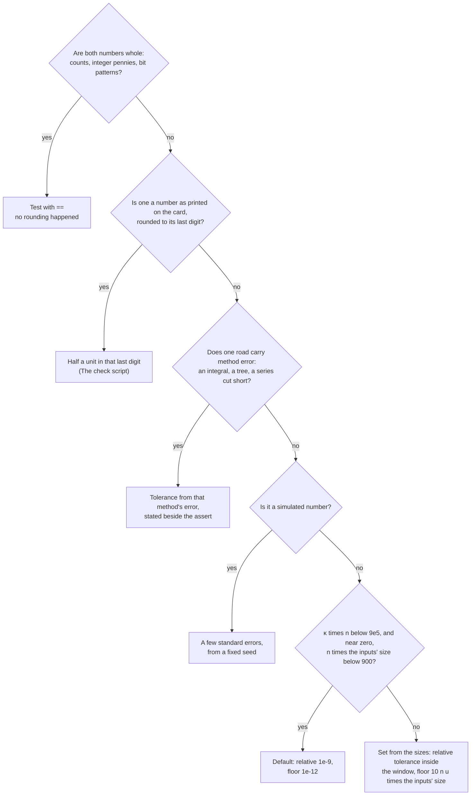

# Tolerances: never test two computed numbers for equality

[Syllabus](../../../SYLLABUS.md) → [Applied and computational](../README.md) → [Scientific Computing Practice](../README.md#s08) → Tolerances

---

## General Overview

A café receipt lists three items: water at £0.99, a pastry at £1.19 and a coffee at £2.19. The total is £4.37. A check script on this library adds the three prices and asserts the answer: `assert total == 4.37`.

Added in the order they were rung up, the computer gets 4.369999999999999, and the assert stops the script. Added dearest first, the same three prices give 4.37 and the assert passes. Nothing was wrong either time. Each addition rounds its answer to the nearest number the machine can store ([Floating point](01-floating-point-in-practice.md)), and the two orders round differently. The two sums sit one storable step apart: one **ulp** (unit in the last place, the gap between neighbouring stored numbers), 8.882e-16 at this size.

So the check asks a softer question: is the total *within 1e-9 of* 4.37? That passes both sums. It still fails if someone types the water as 98p, because then the total is off by a penny, far more than the allowance. The allowance is called a **tolerance**: how far apart two numbers may be and still count as the same answer.

This card says how to pick that allowance, and sets the rule every check script on this library follows. A good tolerance sits in a window: above the rounding noise, so correct code passes, and below the smallest mistake that matters, so wrong code fails.

**Compare computed numbers by asking whether they are close, with a tolerance set above the rounding noise and below the smallest mistake worth catching, and scaled to the size of the numbers.**

**What kind of fact this is:** a working rule, not a theorem. It rests on one theorem, the bound on rounding error in a sum, proved to first order on [Floating point](01-floating-point-in-practice.md) and applied in Why it works.

### The picture: the window, on a log scale

Each bar's length grows by two marks for every tenfold step in size, so equal steps mean equal ratios. The first two bars are the rounding noise in the receipt total. The middle bar is the gap a relative tolerance of 1e-9 allows at £4.37. The last two are mistakes a check must catch.

```
gap of one ulp      ####                           8.882e-16
worst-case bound    #####                          2.426e-15
tolerance at 4.37   #################              4.370e-9
a tenth of a penny  ############################   1.000e-3
one penny           ############################## 1.000e-2
```

The allowed gap, 4.370e-9, sits near the middle of the window, several powers of ten above the noise and several below a penny. That margin on both sides is what makes it safe.

---

## The formula

$$|a - b| \;\le\; \max\!\big(\tau_r \cdot \max(|a|,\,|b|),\;\; \tau_a\big)$$

**Read it aloud:** the gap between the two numbers is no bigger than a fixed share of the larger one, or a fixed small amount, whichever allows more.

The tolerance is then chosen from two sizes the reader can work out:

$$10\,\kappa\,n\,u \;\;\le\;\; \tau_r \;\;\le\;\; \frac{\Delta}{10\,|b|}$$

**Read it aloud:** the relative tolerance sits at least ten times above the worst rounding noise and at least ten times below the smallest mistake that matters, measured as a share of the answer.

| Symbol | Plain meaning | In our example | Push it up and the answer… |
| --- | --- | --- | --- |
| $a$ | the computed number | 4.369999999999999 | — |
| $b$ | the number it should be | 4.37 | a relative tolerance allows more |
| $\tau_r$ | relative tolerance: the allowed gap as a share of the larger number. Say "tau r". | 1e-9 | more passes; mistakes start to slip through |
| $\tau_a$ | absolute tolerance: a floor on the allowed gap, for answers near zero | 1e-12 | more passes near zero |
| $u$ | unit roundoff: the largest relative error of one rounding, $2^{-53}$ | 1.110e-16 | — |
| $n$ | how many roundings went into $a$ | 5: three prices stored, two additions | the noise grows; $\tau_r$ must rise |
| $\kappa$ | condition number: how much the sum magnifies relative errors in its inputs ([Cancellation](02-catastrophic-cancellation-and-safe-formulas.md)). Say "kappa". | 1, since all prices are positive | the noise grows; near zero it is unbounded |
| $\Delta$ | the smallest mistake worth catching. Say "delta". | £0.01, one penny | $\tau_r$ may rise |
| $\Sigma\lvert x\rvert$ | the size of the inputs: their sizes added up | 4.37 | the noise and the floor $\tau_a$ grow |

For the receipt, the window for $\tau_r$ runs from 5.551e-15 to 2.288e-4. The library's 1e-9 sits inside it with room on both sides. Python's own `math.isclose` uses the same first formula, with $\tau_r$ = 1e-9 and no floor unless asked.

### When it holds

- **The noise is rounding, not method error.** A computed integral, a coin-flip tree or a simulation is off by far more than $n u$. Its tolerance comes from the method's own error, or for a simulation from a few standard errors ([Seeds](03-reproducible-simulation-and-seeds.md)). Use 1e-9 there and correct code fails.
- **The number of roundings is known roughly.** The rule is safe while $\kappa n$ stays below about 9.01e5, at full margin. A loop of many millions of additions needs a larger $\tau_r$, or the bound must be checked by measuring the error.
- **The answer is not near zero.** Relative error means nothing when the answer is 0, so the floor $\tau_a$ takes over. The floor must be set from the size of the *inputs*, not of the answer: the default 1e-12 covers $n\,\Sigma\lvert x\rvert$ up to about 900.7, and bigger computations need $10\,n\,u\,\Sigma\lvert x\rvert$.
- **The mistake you care about is bigger than the noise.** If $\Delta/|b|$ is below $10\kappa n u$, the window is empty: no tolerance can tell right from wrong, and the computation itself must be made more accurate first.
- **The quantity is not a whole number.** Counts, pennies held as integers and bit patterns involve no rounding. Test those with `==`, and a tolerance there would only hide mistakes.

---

## Why it works

### Step 0: two different sizes of wrong

A computed number can be wrong in two ways. It carries rounding noise: tiny, unavoidable, and present in correct code. Or it carries a mistake: a wrong price, a dropped term, a sign. On the receipt the noise is below 1e-15 and the smallest mistake is 0.01. The gap between those two sizes is enormous. A tolerance anywhere in that gap tells the two apart. `==` sits at the bottom edge, with no room for noise, so it fails correct code at random.

### Step 1: one rounding is off by at most u, as a share

Each stored number and each arithmetic answer is the true answer rounded once, off by at most $u = 2^{-53}$, about 1.110e-16, as a share of itself ([Floating point](01-floating-point-in-practice.md)). So 0.99 is stored as a number within $0.99\,u$ of 0.99, and each addition adds at most $u$ times its own answer.

### Step 2: in a sum, the shares add up

[Floating point](01-floating-point-in-practice.md) proves the bound for a running sum, to first order: each addition costs at most $u$ times the running total, and no running total is bigger than $\Sigma\lvert x\rvert$. Storing a price costs at most $u$ times that price, which is smaller still. So $n$ roundings of either kind cost at most $n\,u\,\Sigma\lvert x\rvert$.

For the receipt: 5 roundings, $u$ = 1.110e-16 and $\Sigma\lvert x\rvert$ = 4.37 give a bound of 2.426e-15. The check measures the true errors exactly, in whole pennies over powers of two: −7.816e-16 in the rung-up order, 1.066e-16 dearest first. Both sit under the bound.

The bound is a worst case. The roundings usually partly cancel, so the real error is often far smaller, but a tolerance should cover the worst case.

### Step 3: the noise grows with the numbers, so the tolerance must too

The bound $n u \Sigma\lvert x\rvert$ is proportional to the size of the numbers. Ring the same receipt up 100,000 times and add every item: the total should be £437,000. The machine gets 436999.99999984, off by 1.612e-7, under its bound of 1.456e-5. An absolute tolerance of 1e-9 fails this correct sum. A relative tolerance of 1e-9 allows 4.370e-4 at this size and passes it.

This is why $\tau_r$ is a share of the larger number. It reads the same at £4.37 and at £437,000, the way the noise does. Using the larger of $\lvert a\rvert$ and $\lvert b\rvert$ makes the test give the same answer whichever number is called "computed".

### Step 4: near zero, the share fails and a floor takes over

Refund all three items: take 0.99, 1.19 and 2.19 off the total of 4.369999999999999. The answer should be 0. The machine gets −8.882e-16.

A relative test against 0 allows $\tau_r \times 8.882\text{e-}16$, which is smaller than the gap itself. So it fails, at any $\tau_r$ below 1. The trouble is that the noise was made while the numbers were near £4.37 and has nothing to do with the tiny answer. In the Cancellation card's terms, $\kappa = \Sigma\lvert x\rvert / \lvert\text{answer}\rvert$ is enormous.

The fix is the floor $\tau_a$, set from the inputs. Here 8 roundings over inputs of total size 8.74 (£4.37 up, £4.37 down) give a worst noise near $8 u \times 8.74$. Ten times that is 7.763e-14, below the library's 1e-12, so the floor covers it.

A fixed floor runs out on big inputs. Refund all 100,000 receipts from Step 3, item by item, and the leftover is 1.320e-11. Nothing is wrong, yet it is over 1e-12, so the default fails it. There 600,003 roundings over inputs of size 874,000 (£437,000 up, £437,000 down) call for a floor of $10\,n\,u\,\Sigma\lvert x\rvert$ = 5.822e-4. That is still far below a penny, and the leftover passes it.

### Step 5: put the tolerance in the middle of the window

The tolerance needs margin on both sides, and the sides are measured in powers of ten. So the natural place is the middle on a log scale. On the receipt the window for $\tau_r$ runs from 5.551e-15 to 2.288e-4, and its middle is 1.127e-9. The library rounds this to 1e-9.

How much rounding does 1e-9 cover? Divide by $u$: 9.01e6 roundings in the worst case at $\kappa = 1$, or 9.01e5 with the tenfold margin. In general it covers $\kappa n$ up to 9.01e5. The floor 1e-12 covers $n\,\Sigma\lvert x\rvert$ up to $10^{-12}/(10u)$ = 900.7. So the library's default is relative 1e-9 with a floor of 1e-12, for any comparison inside both limits. Outside them, the tolerance comes from the formula, with the floor $10\,n\,u\,\Sigma\lvert x\rvert$.

---

## Worked numbers, by hand

The receipt, rung-up order, compared with 4.37 at the library's default.

| Step | Arithmetic | Value |
| --- | --- | --- |
| total in pennies, no rounding | 99 + 119 + 219 | 437 |
| machine total | 0.99 + 1.19 + 2.19 | 4.369999999999999 |
| exact error of that total | measured in whole numbers | −7.816e-16 |
| worst-case noise, $n u \Sigma\lvert x\rvert$ | 5 × 1.110e-16 × 4.37 | 2.426e-15 |
| lowest safe $\tau_r$, $10\kappa n u$ | 10 × 1 × 5 × 1.110e-16 | 5.551e-15 |
| highest safe $\tau_r$, $\Delta / (10\lvert b\rvert)$ | 0.01 / (10 × 4.37) | 2.288e-4 |
| allowed gap at $\tau_r$ = 1e-9 | 1e-9 × 4.37 | 4.370e-9 |
| actual gap | 4.37 − 4.369999999999999 | 8.882e-16 |
| **verdict** | 8.882e-16 ≤ 4.370e-9 | **pass** |

The correct total passes with room to spare. The 98p typo, at 4.359999999999999, misses 4.37 by 0.010000000000000675 and fails by just as wide a margin.

The full sweep, from the check:

| Absolute tolerance | Correct sum passes | Penny mistake caught |
| --- | --- | --- |
| 0, i.e. `==` | no | yes |
| 1e-16 | no | yes |
| 1e-15 to 1e-2 | yes | yes |
| 2e-2 | yes | no |

### What breaks if you drop a piece

| Mistake | Comes out at | What went wrong |
| --- | --- | --- |
| Test with `==` | dearest-first sum passes, rung-up sum fails | The verdict depends on the order of addition, not on the code being right |
| Absolute 1e-9 on £437,000 | correct total fails, off by 1.612e-7 | The noise grows with the size of the numbers; a fixed allowance does not |
| Relative 1e-9 with no floor, on the refund | −8.882e-16 judged not equal to 0 | Near zero, a share of the answer is a share of nothing |
| Floor 1e-12 on 100,000 receipts refunded | correct leftover 1.320e-11 fails | Near zero the noise grows with the inputs; a fixed floor covers $n\,\Sigma\lvert x\rvert$ only up to 900.7 |
| Tolerance of 2p | the 98p typo, 4.359999999999999, passes | The tolerance sits above the smallest mistake worth catching |

A sixth trap sits at the edge of the window. A tolerance of exactly one penny caught the typo, but only because 4.37 − 4.359999999999999 came out at 0.010000000000000675, a hair over 0.01. A tolerance equal to the mistake leaves the verdict to the last bit.

### The library's rule, set from these numbers

Every check script on this library chooses its comparison this way:



- **The default** covers two roads that differ only by rounding, and a computed number against a value that is exact or pinned with full digits, such as the receipt's 4.37. A number as printed on a card, rounded to its last digit, is held to half a unit in that digit instead, since against 1e-9 an honestly rounded number would fail. [The check script](07-writing-a-check-script.md) works that branch through.
- **Method error** is named and sized: the [Black–Scholes call](../../12-Financial%20mathematics/08-The%20Black-Scholes%20call%20and%20put/01-black-scholes-call.md) card gives its coin-flip tree a tolerance set by the tree's own distance from the formula, not 1e-9.
- **Python against Rust** is compared as printed text. Printing to a fixed number of digits is itself a tolerance: a last-bit difference between the two languages' maths libraries usually disappears in the rounding; when it does not, the two outputs differ and the mismatch shows. The [Two roads and a mutation](06-testing-numerical-code-two-roads-and-mutations.md) card shows each assert can still fail.

---

## Code, from first principles, and it actually runs

The code adds the receipt in two orders, then measures each total's true error in whole numbers: it reads the 64 stored bits, writes the total as a whole number over a power of two, and subtracts 437/100 exactly. That gives two independent roads to every error: the machine's arithmetic, and exact whole-number arithmetic that cannot round. An assert holds them to the same gap between the two orders. A third road is the worst-case bound from Step 2, which every measured error must sit under. The code then sweeps tolerances against a correct total and a penny typo, scales the receipt up 100,000 times, refunds both sizes to zero, and prints the library's rule in numbers. It writes its own comparison function rather than importing one.

### Python

```python
# Tolerances -- the check behind the card.  Standard library only.
# Every number on the card is printed here.  struct only hands over a double's
# 64 bits; each exact error is then worked out in whole numbers (pennies over
# powers of two), which cannot round, and set against the machine's answer.
import math, struct

U = 2.0 ** -53                          # unit roundoff: worst relative error of one rounding
TOL_REL, TOL_ABS = 1e-9, 1e-12          # the library's default pair
ITEMS = (0.99, 1.19, 2.19)              # the receipt, in the order it was rung up
PENNIES = (99, 119, 219)                # the same prices as whole numbers: no rounding

def bits(x): return struct.unpack(">Q", struct.pack(">d", x))[0]

def exact_error(x, p):                  # (stored x) - p/100, worked in whole numbers
    b = bits(x)
    m, k = (1 << 52) | (b & ((1 << 52) - 1)), 1075 - ((b >> 52) & 0x7FF)   # x = m / 2^k
    return (100 * m - p * (1 << k)) / (100 * (1 << k))

def close(a, b, rel, abs_):             # the card's formula
    return abs(a - b) <= max(rel * max(abs(a), abs(b)), abs_)

def add_up(xs):
    s = 0.0
    for x in xs: s += x
    return s

def sci(x):
    a, e = f"{x:.3e}".split("e"); return f"{a}e{int(e)}"
def yn(flag): return "yes" if flag else "no"
def row(label, value): print(f"{label:<40} {value}")

# ---- 1. one receipt, added in two orders ----
pennies = sum(PENNIES)
s_rung = add_up(ITEMS)
s_sorted = add_up(ITEMS[::-1])          # the same three prices, dearest first
gap_ulps = bits(s_sorted) - bits(s_rung)
row("pennies 99 + 119 + 219", pennies)
row("0.99 + 1.19 + 2.19", repr(s_rung))
row("2.19 + 1.19 + 0.99", repr(s_sorted))
row("== 4.37, rung-up order / dearest first", f"{yn(s_rung == 4.37)} / {yn(s_sorted == 4.37)}")
row("gap between the two sums, in ulps", gap_ulps)
row("one ulp at 4.37", sci(s_sorted - s_rung))
e_rung, e_sorted = exact_error(s_rung, pennies), exact_error(s_sorted, pennies)
row("exact error, rung-up order", sci(e_rung))
row("exact error, dearest first", sci(e_sorted))
n_small = 5                             # 3 prices stored, 2 additions: 5 roundings
bound_small = n_small * U * pennies / 100
row("worst-case bound, 5 roundings", sci(bound_small))
assert 1.0 + U == 1.0 and 1.0 + 2 * U > 1.0, "u is half the gap between 1 and the next double"
assert gap_ulps == 1, "the two orders sit one step apart"
assert e_sorted - e_rung == s_sorted - s_rung, "exact errors and machine sums give the same gap"
assert 0 < abs(e_rung) <= bound_small and abs(e_sorted) <= bound_small, "exact errors under the bound"

# ---- 2. choosing the tolerance: correct sum against a penny mistake ----
s_wrong = add_up((0.98, 1.19, 2.19))    # a typo: water rung up at 98p
row("the penny mistake, 0.98 + 1.19 + 2.19", repr(s_wrong))
print("absolute tolerance   correct sum passes   penny mistake caught")
verdicts = {}
for tol in (0.0, 1e-16, 1e-15, 1e-12, 1e-9, 1e-6, 1e-3, 5e-3, 1e-2, 2e-2):
    ok, caught = close(s_rung, 4.37, 0.0, tol), not close(s_wrong, 4.37, 0.0, tol)
    verdicts[tol] = (ok, caught)
    print(f"{sci(tol) if tol else '0, i.e. ==':>18}   {yn(ok):>18}   {yn(caught):>20}")
assert verdicts[1e-9] == (True, True), "1e-9 must pass the right sum and catch the wrong one"
assert verdicts[0.0][0] is False and verdicts[2e-2][1] is False, "both edges of the window must fail"
floor, ceiling = abs(s_rung - 4.37), 0.01
lo, hi = 10 * n_small * U, ceiling / (10 * 4.37)       # the window for the relative tolerance
row("4.37 minus the penny mistake", repr(4.37 - s_wrong))
row("relative 1e-9 allows at 4.37", sci(TOL_REL * 4.37))
row("relative window, 10 n u .. Delta/(10 b)", f"{sci(lo)} .. {sci(hi)}")
row("middle of that window, log scale", sci(10 ** ((math.log10(lo) + math.log10(hi)) / 2)))
for label, v in (("gap of one ulp", floor), ("worst-case bound", bound_small), ("tolerance at 4.37", TOL_REL * 4.37),
                 ("a tenth of a penny", 1e-3), ("one penny", ceiling)):   # bar length: 2 x (17 + log10)
    print(f"{label:<20}{'#' * round(2 * (17 + math.log10(v))):<31}{sci(v)}")

# ---- 3. the same receipt 100,000 times: absolute breaks, relative holds ----
N_REC = 100000
big = add_up(ITEMS * N_REC)
big_p = pennies * N_REC
want = big_p / 100                      # 437000.0: exact, a whole number
e_big = exact_error(big, big_p)
bound_big = (3 * N_REC + 3) * U * big_p / 100
row("100,000 receipts, added item by item", f"{big:.8f}")
row("exact error", sci(e_big))
row("worst-case bound, 300,003 roundings", sci(bound_big))
row("absolute 1e-9 / relative 1e-9 passes", f"{yn(close(big, want, 0.0, 1e-9))} / {yn(close(big, want, TOL_REL, 0.0))}")
row("relative 1e-9 allows, in pounds", sci(TOL_REL * want))
assert abs(e_big) <= bound_big and abs(e_big) > 1e-9, "error above 1e-9 yet under the bound"
assert close(big, want, TOL_REL, TOL_ABS) and not close(big, want, 0.0, 1e-9), "scale needs relative"

# ---- 4. near zero: refund every item, expect 0 ----
left = s_rung
for x in ITEMS: left -= x
floor_needed = 10 * 8 * U * 2 * pennies / 100   # 10 x 8 roundings x u x sum|x| (4.37 up, 4.37 down)
row("refund: 4.37 total minus each item", sci(left))
row("relative 1e-9 only / with floor 1e-12", f"{yn(close(left, 0.0, TOL_REL, 0.0))} / {yn(close(left, 0.0, TOL_REL, TOL_ABS))}")
row("inputs' size, 4.37 up and 4.37 down", 2 * pennies / 100)
row("floor needed, 10 n u sum|x|, n = 8", sci(floor_needed))
assert 0 < abs(left) <= floor_needed / 10, "a nonzero leftover, under the worst-case noise"
assert close(left, 0.0, TOL_REL, TOL_ABS) and not close(left, 0.0, TOL_REL, 0.0), "near zero, the floor decides"
big_left = big
for x in ITEMS * N_REC: big_left -= x   # refund all 100,000 receipts, item by item
floor_big = 10 * (6 * N_REC + 3) * U * 2 * big_p / 100   # 300,003 roundings up, 300,000 down
row("refund of 100,000 receipts", sci(big_left))
row("inputs' size, 437,000 up, 437,000 down", 2 * big_p // 100)
row("floor needed, 10 n u sum|x|, n = 600,003", sci(floor_big))
row("floor 1e-12 / floor 10 n u sum|x| passes", f"{yn(close(big_left, 0.0, TOL_REL, TOL_ABS))} / {yn(close(big_left, 0.0, TOL_REL, floor_big))}")
assert not close(big_left, 0.0, TOL_REL, TOL_ABS) and close(big_left, 0.0, TOL_REL, floor_big), "big inputs need a bigger floor"

# ---- 5. a tolerance is not equality: it does not chain ----
a, b, c = 4.366, 4.370, 4.374
row("4.366~4.370, 4.370~4.374, 4.366~4.374", " ".join(yn(close(p, q, 0.0, 5e-3)) for p, q in ((a, b), (b, c), (a, c))))

# ---- 6. the library's rule, in numbers ----
row("unit roundoff u = 2^-53", sci(U))
row("default pair: relative, absolute", f"{sci(TOL_REL)}, {sci(TOL_ABS)}")
row("roundings 1e-9 covers, worst case", f"{TOL_REL / U:.2e}".replace("e+0", "e"))
row("the same, with a tenfold margin", f"{TOL_REL / U / 10:.2e}".replace("e+0", "e"))
row("n x inputs' size the floor 1e-12 covers", f"{TOL_ABS / (10 * U):.1f}")
print("ALL CHECKS PASS")
```

**Ran 2026-11-11 on macOS, Python 3.14.10, standard library only. All checks passed. Output, pasted from the run:**

```
pennies 99 + 119 + 219                   437
0.99 + 1.19 + 2.19                       4.369999999999999
2.19 + 1.19 + 0.99                       4.37
== 4.37, rung-up order / dearest first   no / yes
gap between the two sums, in ulps        1
one ulp at 4.37                          8.882e-16
exact error, rung-up order               -7.816e-16
exact error, dearest first               1.066e-16
worst-case bound, 5 roundings            2.426e-15
the penny mistake, 0.98 + 1.19 + 2.19    4.359999999999999
absolute tolerance   correct sum passes   penny mistake caught
        0, i.e. ==                   no                    yes
         1.000e-16                   no                    yes
         1.000e-15                  yes                    yes
         1.000e-12                  yes                    yes
          1.000e-9                  yes                    yes
          1.000e-6                  yes                    yes
          1.000e-3                  yes                    yes
          5.000e-3                  yes                    yes
          1.000e-2                  yes                    yes
          2.000e-2                  yes                     no
4.37 minus the penny mistake             0.010000000000000675
relative 1e-9 allows at 4.37             4.370e-9
relative window, 10 n u .. Delta/(10 b)  5.551e-15 .. 2.288e-4
middle of that window, log scale         1.127e-9
gap of one ulp      ####                           8.882e-16
worst-case bound    #####                          2.426e-15
tolerance at 4.37   #################              4.370e-9
a tenth of a penny  ############################   1.000e-3
one penny           ############################## 1.000e-2
100,000 receipts, added item by item     436999.99999984
exact error                              -1.612e-7
worst-case bound, 300,003 roundings      1.456e-5
absolute 1e-9 / relative 1e-9 passes     no / yes
relative 1e-9 allows, in pounds          4.370e-4
refund: 4.37 total minus each item       -8.882e-16
relative 1e-9 only / with floor 1e-12    no / yes
inputs' size, 4.37 up and 4.37 down      8.74
floor needed, 10 n u sum|x|, n = 8       7.763e-14
refund of 100,000 receipts               1.320e-11
inputs' size, 437,000 up, 437,000 down   874000
floor needed, 10 n u sum|x|, n = 600,003 5.822e-4
floor 1e-12 / floor 10 n u sum|x| passes no / yes
4.366~4.370, 4.370~4.374, 4.366~4.374    yes yes no
unit roundoff u = 2^-53                  1.110e-16
default pair: relative, absolute         1.000e-9, 1.000e-12
roundings 1e-9 covers, worst case        9.01e6
the same, with a tenfold margin          9.01e5
n x inputs' size the floor 1e-12 covers  900.7
ALL CHECKS PASS
```

### Rust

Same receipt, same roads. Rust's `to_bits` hands over the stored bits, and the exact error uses 128-bit whole numbers.

```rust
// Tolerances -- the same check as tolerances_and_comparing_computed_numbers_check.py, in Rust.
// Standard library only, no crates.  to_bits hands over a double's 64 bits; each exact
// error is then worked out in whole numbers (pennies over powers of two), which cannot
// round, and set against the machine's answer.
// Compile: rustc --edition 2021 -O tolerances_and_comparing_computed_numbers_check.rs -o /tmp/tol

const U: f64 = 1.0 / 9007199254740992.0;          // 2^-53, unit roundoff
const TOL_REL: f64 = 1e-9;                        // the library's default pair
const TOL_ABS: f64 = 1e-12;
const ITEMS: [f64; 3] = [0.99, 1.19, 2.19];       // the receipt, in the order it was rung up
const PENNIES: [i128; 3] = [99, 119, 219];        // the same prices as whole numbers

fn exact_error(x: f64, p: i128) -> f64 {          // (stored x) - p/100, in whole numbers
    let b = x.to_bits();
    let m = ((1u64 << 52) | (b & ((1u64 << 52) - 1))) as i128;
    let k = 1075 - ((b >> 52) & 0x7FF) as i32;    // x = m / 2^k
    let num = 100 * m - p * (1i128 << k);
    num as f64 / (100i128 * (1i128 << k)) as f64
}

fn close(a: f64, b: f64, rel: f64, abs_: f64) -> bool {   // the card's formula
    (a - b).abs() <= (rel * a.abs().max(b.abs())).max(abs_)
}

fn add_up(xs: &[f64]) -> f64 {
    let mut s = 0.0;
    for x in xs { s += x; }
    s
}

fn sci(x: f64) -> String { format!("{:.3e}", x) }
fn yn(flag: bool) -> &'static str { if flag { "yes" } else { "no" } }
fn row(label: &str, value: String) { println!("{:<40} {}", label, value); }

fn main() {
    // ---- 1. one receipt, added in two orders ----
    let pennies: i128 = PENNIES.iter().sum();
    let s_rung = add_up(&ITEMS);
    let rev: Vec<f64> = ITEMS.iter().rev().cloned().collect();
    let s_sorted = add_up(&rev);                  // the same three prices, dearest first
    let gap_ulps = s_sorted.to_bits() as i64 - s_rung.to_bits() as i64;
    row("pennies 99 + 119 + 219", format!("{}", pennies));
    row("0.99 + 1.19 + 2.19", format!("{}", s_rung));
    row("2.19 + 1.19 + 0.99", format!("{}", s_sorted));
    row("== 4.37, rung-up order / dearest first", format!("{} / {}", yn(s_rung == 4.37), yn(s_sorted == 4.37)));
    row("gap between the two sums, in ulps", format!("{}", gap_ulps));
    row("one ulp at 4.37", sci(s_sorted - s_rung));
    let (e_rung, e_sorted) = (exact_error(s_rung, pennies), exact_error(s_sorted, pennies));
    row("exact error, rung-up order", sci(e_rung));
    row("exact error, dearest first", sci(e_sorted));
    let bound_small = 5.0 * U * pennies as f64 / 100.0;   // 3 prices stored, 2 additions
    row("worst-case bound, 5 roundings", sci(bound_small));
    assert!(1.0 + U == 1.0 && 1.0 + 2.0 * U > 1.0, "u is half the gap between 1 and the next double");
    assert!(gap_ulps == 1, "the two orders sit one step apart");
    assert!(e_sorted - e_rung == s_sorted - s_rung, "exact errors and machine sums give the same gap");
    assert!(e_rung.abs() > 0.0 && e_rung.abs() <= bound_small && e_sorted.abs() <= bound_small, "exact errors under the bound");

    // ---- 2. choosing the tolerance: correct sum against a penny mistake ----
    let s_wrong = add_up(&[0.98, 1.19, 2.19]);    // a typo: water rung up at 98p
    row("the penny mistake, 0.98 + 1.19 + 2.19", format!("{}", s_wrong));
    println!("absolute tolerance   correct sum passes   penny mistake caught");
    let mut verdicts = Vec::new();
    for tol in [0.0, 1e-16, 1e-15, 1e-12, 1e-9, 1e-6, 1e-3, 5e-3, 1e-2, 2e-2] {
        let (ok, caught) = (close(s_rung, 4.37, 0.0, tol), !close(s_wrong, 4.37, 0.0, tol));
        verdicts.push((tol, ok, caught));
        let t = if tol == 0.0 { "0, i.e. ==".to_string() } else { sci(tol) };
        println!("{:>18}   {:>18}   {:>20}", t, yn(ok), yn(caught));
    }
    let find = |t: f64| verdicts.iter().find(|v| v.0 == t).map(|v| (v.1, v.2)).unwrap();
    assert!(find(1e-9) == (true, true), "1e-9 must pass the right sum and catch the wrong one");
    assert!(!find(0.0).0 && !find(2e-2).1, "both edges of the window must fail");
    let (floor, ceiling): (f64, f64) = ((s_rung - 4.37).abs(), 0.01);
    let (lo, hi) = (10.0 * 5.0 * U, ceiling / (10.0 * 4.37));   // the window for the relative tolerance
    row("4.37 minus the penny mistake", format!("{}", 4.37 - s_wrong));
    row("relative 1e-9 allows at 4.37", sci(TOL_REL * 4.37));
    row("relative window, 10 n u .. Delta/(10 b)", format!("{} .. {}", sci(lo), sci(hi)));
    row("middle of that window, log scale", sci(10f64.powf((lo.log10() + hi.log10()) / 2.0)));
    for (label, v) in [("gap of one ulp", floor), ("worst-case bound", bound_small), ("tolerance at 4.37", TOL_REL * 4.37),
                       ("a tenth of a penny", 1e-3), ("one penny", ceiling)] {   // bar: 2 x (17 + log10)
        let bar = "#".repeat((2.0 * (17.0 + v.log10())).round() as usize);
        println!("{:<20}{:<31}{}", label, bar, sci(v));
    }

    // ---- 3. the same receipt 100,000 times: absolute breaks, relative holds ----
    let n_rec: usize = 100000;
    let mut all = Vec::with_capacity(3 * n_rec);
    for _ in 0..n_rec { all.extend_from_slice(&ITEMS); }
    let big = add_up(&all);
    let big_p = pennies * n_rec as i128;
    let want = big_p as f64 / 100.0;              // 437000.0: exact, a whole number
    let e_big = exact_error(big, big_p);
    let bound_big = (3 * n_rec + 3) as f64 * U * big_p as f64 / 100.0;
    row("100,000 receipts, added item by item", format!("{:.8}", big));
    row("exact error", sci(e_big));
    row("worst-case bound, 300,003 roundings", sci(bound_big));
    row("absolute 1e-9 / relative 1e-9 passes", format!("{} / {}", yn(close(big, want, 0.0, 1e-9)), yn(close(big, want, TOL_REL, 0.0))));
    row("relative 1e-9 allows, in pounds", sci(TOL_REL * want));
    assert!(e_big.abs() <= bound_big && e_big.abs() > 1e-9, "error above 1e-9 yet under the bound");
    assert!(close(big, want, TOL_REL, TOL_ABS) && !close(big, want, 0.0, 1e-9), "scale needs relative");

    // ---- 4. near zero: refund every item, expect 0 ----
    let mut left = s_rung;
    for x in ITEMS { left -= x; }
    let floor_needed = 10.0 * 8.0 * U * 2.0 * pennies as f64 / 100.0;   // 10 x 8 roundings x u x sum|x|
    row("refund: 4.37 total minus each item", sci(left));
    row("relative 1e-9 only / with floor 1e-12", format!("{} / {}", yn(close(left, 0.0, TOL_REL, 0.0)), yn(close(left, 0.0, TOL_REL, TOL_ABS))));
    row("inputs' size, 4.37 up and 4.37 down", format!("{}", 2.0 * pennies as f64 / 100.0));
    row("floor needed, 10 n u sum|x|, n = 8", sci(floor_needed));
    assert!(left.abs() > 0.0 && left.abs() <= floor_needed / 10.0, "a nonzero leftover, under the worst-case noise");
    assert!(close(left, 0.0, TOL_REL, TOL_ABS) && !close(left, 0.0, TOL_REL, 0.0), "near zero, the floor decides");
    let mut big_left = big;
    for x in &all { big_left -= x; }              // refund all 100,000 receipts, item by item
    let floor_big = 10.0 * (6 * n_rec + 3) as f64 * U * 2.0 * big_p as f64 / 100.0;   // 300,003 up, 300,000 down
    row("refund of 100,000 receipts", sci(big_left));
    row("inputs' size, 437,000 up, 437,000 down", format!("{}", 2 * big_p / 100));
    row("floor needed, 10 n u sum|x|, n = 600,003", sci(floor_big));
    row("floor 1e-12 / floor 10 n u sum|x| passes", format!("{} / {}", yn(close(big_left, 0.0, TOL_REL, TOL_ABS)), yn(close(big_left, 0.0, TOL_REL, floor_big))));
    assert!(!close(big_left, 0.0, TOL_REL, TOL_ABS) && close(big_left, 0.0, TOL_REL, floor_big), "big inputs need a bigger floor");

    // ---- 5. a tolerance is not equality: it does not chain ----
    let (a, b, c) = (4.366, 4.370, 4.374);
    let chain: Vec<&str> = [(a, b), (b, c), (a, c)].iter().map(|&(p, q)| yn(close(p, q, 0.0, 5e-3))).collect();
    row("4.366~4.370, 4.370~4.374, 4.366~4.374", chain.join(" "));

    // ---- 6. the library's rule, in numbers ----
    row("unit roundoff u = 2^-53", sci(U));
    row("default pair: relative, absolute", format!("{}, {}", sci(TOL_REL), sci(TOL_ABS)));
    row("roundings 1e-9 covers, worst case", format!("{:.2e}", TOL_REL / U));
    row("the same, with a tenfold margin", format!("{:.2e}", TOL_REL / U / 10.0));
    row("n x inputs' size the floor 1e-12 covers", format!("{:.1}", TOL_ABS / (10.0 * U)));
    println!("ALL CHECKS PASS");
}
```

**Ran 2026-11-11 on macOS, rustc 1.98.1, no crates. All checks passed. Output, pasted from the run:**

```
pennies 99 + 119 + 219                   437
0.99 + 1.19 + 2.19                       4.369999999999999
2.19 + 1.19 + 0.99                       4.37
== 4.37, rung-up order / dearest first   no / yes
gap between the two sums, in ulps        1
one ulp at 4.37                          8.882e-16
exact error, rung-up order               -7.816e-16
exact error, dearest first               1.066e-16
worst-case bound, 5 roundings            2.426e-15
the penny mistake, 0.98 + 1.19 + 2.19    4.359999999999999
absolute tolerance   correct sum passes   penny mistake caught
        0, i.e. ==                   no                    yes
         1.000e-16                   no                    yes
         1.000e-15                  yes                    yes
         1.000e-12                  yes                    yes
          1.000e-9                  yes                    yes
          1.000e-6                  yes                    yes
          1.000e-3                  yes                    yes
          5.000e-3                  yes                    yes
          1.000e-2                  yes                    yes
          2.000e-2                  yes                     no
4.37 minus the penny mistake             0.010000000000000675
relative 1e-9 allows at 4.37             4.370e-9
relative window, 10 n u .. Delta/(10 b)  5.551e-15 .. 2.288e-4
middle of that window, log scale         1.127e-9
gap of one ulp      ####                           8.882e-16
worst-case bound    #####                          2.426e-15
tolerance at 4.37   #################              4.370e-9
a tenth of a penny  ############################   1.000e-3
one penny           ############################## 1.000e-2
100,000 receipts, added item by item     436999.99999984
exact error                              -1.612e-7
worst-case bound, 300,003 roundings      1.456e-5
absolute 1e-9 / relative 1e-9 passes     no / yes
relative 1e-9 allows, in pounds          4.370e-4
refund: 4.37 total minus each item       -8.882e-16
relative 1e-9 only / with floor 1e-12    no / yes
inputs' size, 4.37 up and 4.37 down      8.74
floor needed, 10 n u sum|x|, n = 8       7.763e-14
refund of 100,000 receipts               1.320e-11
inputs' size, 437,000 up, 437,000 down   874000
floor needed, 10 n u sum|x|, n = 600,003 5.822e-4
floor 1e-12 / floor 10 n u sum|x| passes no / yes
4.366~4.370, 4.370~4.374, 4.366~4.374    yes yes no
unit roundoff u = 2^-53                  1.110e-16
default pair: relative, absolute         1.000e-9, 1.000e-12
roundings 1e-9 covers, worst case        9.01e6
the same, with a tenfold margin          9.01e5
n x inputs' size the floor 1e-12 covers  900.7
ALL CHECKS PASS
```

The two outputs match line for line. Both languages store and add numbers by the same standard, so the same order of additions gives the same bits.

> [!TIP]
> **Try changing**
> Guess first, then run it. An assert is a line that stops the program if a number comes out wrong.
> - **Drop the floor.** Set `TOL_ABS` to `0`. Guess whether the refund still passes. It does not: the refund line reads `no / no`, and the floor assert stops the run.
> - **Tighten the relative tolerance.** Set `TOL_REL` to `1e-15`. Guess what fails first. The 1e-9 row of the sweep still passes, since the sweep uses its own list. The £437,000 total fails, and the assert "scale needs relative" stops the run.
> - **Shrink the pile.** Set `N_REC` to `1000` (the labels still say 100,000). Guess whether an absolute 1e-9 now passes. It does: a £4,370 total has less noise than 1e-9. The assert that expects the error above 1e-9 stops the run, which is the point: absolute tolerances work only at the size they were set for.
> - **Make a ten-pence typo.** Change `0.98` to `0.89`. Guess which tolerances catch it. All of them do, even 2e-2, so the assert that needs a tolerance too loose to catch it stops the run.

---

## The usual mistake

> [!warning]
> **Writing `==` because the numbers "should" be equal.** Two correct computations of £4.37 came out one ulp apart, 4.369999999999999 and 4.37, purely from the order of addition. An `==` test passes or fails by accident, and a later harmless edit, such as sorting the items, can flip it. Compare with a tolerance; keep `==` for whole numbers.
>
> - **A tolerance copied from somewhere else.** Absolute 1e-9 is right for £4.37 and wrong for £437,000, where the correct total is off by 1.612e-7. Make it relative.
> - **A relative test against zero.** The refund's −8.882e-16 fails a relative test at any tolerance below 1. Add a floor set from the inputs' size.
> - **A tolerance so loose it catches nothing.** At 2p, the 98p typo passes. Check that a deliberate mistake of the smallest size you care about fails.
> - **Treating "close" like "equal".** With half a penny allowed, 4.366 is close to 4.370 and 4.370 is close to 4.374, but 4.366 is not close to 4.374. Closeness does not chain, so never reason "a matches b, b matches c, so a matches c".

---

## Where you meet it in real life

- **This library's check scripts.** The rule above is the standard each card's asserts are held to: the default pair, half a unit for a number as printed, a tolerance named after the method's own error, or `==` on whole numbers. [The check script](07-writing-a-check-script.md) holds two cards' printed numbers to half a unit.
- **Test frameworks.** Python's `math.isclose` uses this formula, with no floor unless asked. Other libraries use close variants: Python's `unittest` rounds the gap to a fixed number of decimal places, an absolute test, and NumPy's `isclose` adds an absolute part to a relative part measured against the second number only.
- **Accounting software.** Much of it holds money in whole pennies, so balances are tested with `==`. Interest and tax are computed in floating point and rounded to the penny at a stated step.
- **Engineering simulations.** A bridge model's deflection from two solvers is compared to a relative tolerance chosen above the solvers' noise and below the size of a design change.
- **Physics constants.** A measured value agrees with theory when the gap is within a few of its stated uncertainties. That is a tolerance set by the measurement, as the method-error branch above is.

> **Say it back**
> Computed numbers carry rounding noise, so two correct answers can differ in the last place, and `==` judges them by accident. A tolerance asks whether they are close instead. It must sit above the noise, which grows with the number of roundings and the size of the numbers, and below the smallest mistake worth catching. Making it relative lets one tolerance serve all sizes; a small absolute floor, set from the size of the inputs, handles answers near zero. This library's default is relative 1e-9 with a floor of 1e-12, which covers small computations; numbers as printed get half a unit in their last digit, and whole numbers get `==`.

---

## What this builds on

- [Floating point](01-floating-point-in-practice.md): why each stored number and each operation is off by at most $u$, and what an ulp is.
- [Cancellation](02-catastrophic-cancellation-and-safe-formulas.md): the condition number $\kappa$, and why subtracting nearly equal numbers leaves noise that is huge compared with the answer. That is why the floor exists.

## Where this goes next

- [Two roads and a mutation](06-testing-numerical-code-two-roads-and-mutations.md): a tolerance passes correct code; that card shows the check also fails when the maths is broken on purpose.
- [Floating point](01-floating-point-in-practice.md): choosing a stopping tolerance for an iteration, where the noise is the method's own error rather than rounding.
- Also on this shelf: [Seeds](03-reproducible-simulation-and-seeds.md) fixes a simulation's random numbers so its tolerance can be stated, [Cost in practice](04-computational-cost-and-vectorisation.md) counts the operations that set $n$, and [The check script](07-writing-a-check-script.md) holds numbers as printed on a card to half a unit in their last digit, the printed-number branch of this rule.

The question this card leaves open is what to do when the window is empty: when the noise of a long computation reaches the size of the mistakes that matter.

---

## Sources

Verified 2026-11-11: every link below resolves to the publisher's page.

- Goldberg, David. "What Every Computer Scientist Should Know About Floating-Point Arithmetic." *ACM Computing Surveys* 23, no. 1 (1991): 5–48. [doi:10.1145/103162.103163](https://doi.org/10.1145/103162.103163). Rounding error, ulps and relative error: the noise this card's tolerance must sit above.
- Higham, Nicholas J. *Accuracy and Stability of Numerical Algorithms*, 2nd ed. SIAM, 2002. [doi:10.1137/1.9780898718027](https://doi.org/10.1137/1.9780898718027). The chapter on summation proves the bound used in Step 2 and shows how the order of addition changes the error.
- Knuth, Donald E. *The Art of Computer Programming, Volume 2: Seminumerical Algorithms*, 3rd ed. Addison-Wesley. [Publisher page](https://www.informit.com/store/art-of-computer-programming-volume-2-seminumerical-9780201896848). Section 4.2.2 defines approximate equality of floating-point numbers with a relative allowance, the idea behind this card's formula.
- IEEE. *IEEE Standard for Floating-Point Arithmetic* (IEEE 754-2019). [doi:10.1109/IEEESTD.2019.8766229](https://doi.org/10.1109/IEEESTD.2019.8766229). The rounding rule that makes Python and Rust produce the same bits for the same additions.
