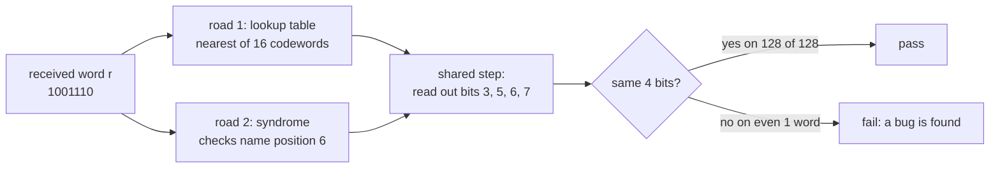
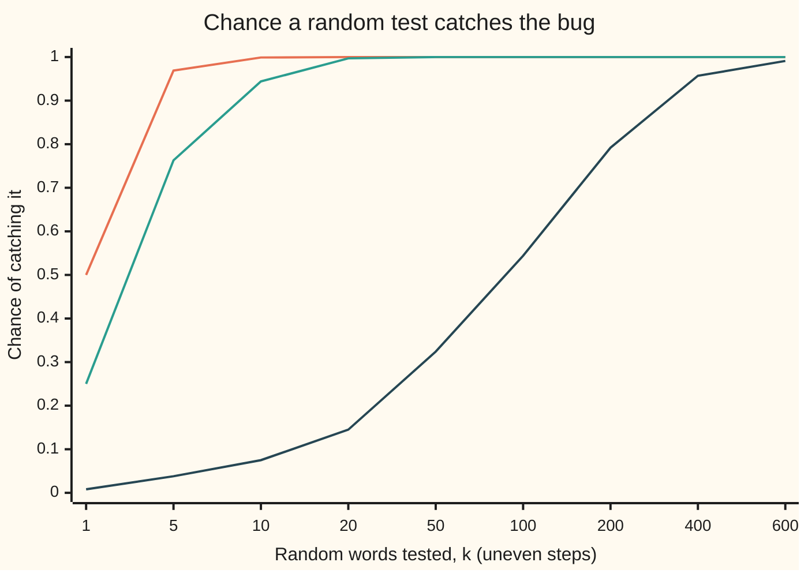

# Two roads and a mutation: a test that would notice if the answer were wrong

[Syllabus](../../../SYLLABUS.md) → [Applied and computational](../README.md) → [Scientific Computing Practice](../README.md#s08) → Two roads and a mutation

---

## General Overview

A radio link sends 4 data bits wrapped in Hamming's (7,4) code: 7 bits, 3 of them checks. The word 1001110 arrives. A decoder (the code that repairs the word and reads the data back out) says the data were 0100. Is that right?

A test that runs the decoder and prints "pass" settles nothing on its own. Many tests pass whether the code is right or wrong. The question that matters is the reverse: **if the decoder were wrong, would this test fail?** This card answers it in two moves, and they are how every number in this library is guarded.

- **Two roads.** Get the answer twice, by methods that share no working parts. Here road 1 is a lookup table: for each of the 128 possible 7-bit words, the nearest of the 16 codewords, found by counting differences. Road 2 is the syndrome, the 3-bit pattern of failed checks that names the bad bit. The two roads agree on all 128 words.
- **A mutation.** Break the decoder on purpose, one small bug at a time (a *mutant*), and run the tests. A test that still passes did not notice. Five bugs were planted. A round-trip test (encode, decode, compare) catches 1 of them. The two-roads test catches 4. A single answer worked by hand catches 3. Together they catch all 5. An assert that compares the decoder with itself catches 0.

**A number is trusted when two independent methods reach it, and a test is trusted only after it has been seen to fail on deliberately broken code.**

**What kind of fact this is:** a working method, not a theorem: agreement and caught bugs make an error unlikely, never impossible. Inside it sits one theorem, proved in Why it works: the chance that a random sample of test inputs catches a bug.

### The picture: one word, two roads, one comparison



Schematic. The shared step in the middle is the weak spot: a bug there makes both roads wrong together, and no comparison between them can see it.

---

## The formula

A test that checks every input either sees a bug or proves it absent. A test that checks a random sample can miss. The chance it does not miss is

$$P(\text{catch}) \;=\; 1 - \left(1 - \frac{w}{N}\right)^{k}, \qquad \text{mutation score} \;=\; \frac{K}{M}.$$

**Read it aloud:** the chance a random test of k inputs catches a bug is one minus the chance that every one of the k draws lands on an input where the bug is silent; a test suite's mutation score is the share of planted bugs it catches.

Here k counts test inputs. It is not the k of an (n, k) code on the Hamming card; this card never needs that one.

| Symbol | Plain meaning | In our example | Push it up and the answer… |
| --- | --- | --- | --- |
| $N$ | every input the code can receive | 128 seven-bit words | catch falls: more places to hide |
| $w$ | inputs on which the bug shows (the two roads disagree) | 1 for a table typo, up to 64 | catch rises fast |
| $k$ | inputs a random test draws, each uniform over the $N$ | 5 | catch rises towards 1 |
| $P(\text{catch})$ | chance the random test fails on the bug | 0.0385 when $w = 1$, $k = 5$ | — |
| $M$ | mutants planted, one at a time | 5 | a finer measure of the test |
| $K$ | mutants killed: the test failed on them | 5 for T1, T2 and T3 together | score rises |
| $r$ | the received 7-bit word, positions 1 to 7 | 1001110 | — |
| $s$ | syndrome: the three check parities read as a binary number | 6 | names the flipped position |
| $p$ | a position in the word, 1 to 7 | 6, the flipped bit | — |
| d1 to d4 | the 4 data bits, kept at positions 3, 5, 6, 7 | 0, 1, 0, 0 | — |
| $A(r)$ | road 1's answer: the lookup table's 4 data bits | 0100 | — |
| $B(r)$ | road 2's answer: the syndrome decoder's 4 data bits | 0100 | — |

The test itself is one line: **pass when $A(r) = B(r)$ for every $r$ checked.** The bits are compared exactly. A floating-point number would be compared within a tolerance, the subject of [Tolerances](05-tolerances-and-comparing-computed-numbers.md).

### When it holds

- **The roads are independent.** Two roads that share code can share a bug. Mutant M5 sits in the shared read-out step: both roads go wrong together, $w = 0$, and the two-roads test passes. Independently written programs have been measured failing together more often than chance predicts, so "independent" means sharing no code, not just written twice.
- **The draws are uniform over all N inputs.** The formula assumes each test input is any of the 128 words with equal chance. A test that only feeds in the 16 clean codewords never meets a damaged word, so a bug that only touches repairs is invisible to it: the round trip misses M1 to M4.
- **The bug changes an answer somewhere.** A mutant with $w = 0$, such as skipping the repair when the check bit at position 1 itself is hit, changes no decoded message. No test can catch it, and none needs to. It is called an *equivalent mutant*.
- **The mutants look like real bugs.** A score of 5 out of 5 is measured against these five. It says the tests notice typos, swapped indices and forgotten steps. It is not a proof that the decoder is right.
- **Exact comparison only where the answer is exact.** Bits are exact. Prices, probabilities and integrals are not, and comparing them with `==` gives false alarms; the rule for them is on the Tolerances card.

---

## Why it works

### Step 0: a wrong number passes only when the test cannot see it

A bug survives a test in one of three ways. The test never runs the input where the bug shows. The test compares the code with something that is wrong in the same way. Or the test compares the code with itself. Two roads close the second gap, checking every input closes the first, and planting bugs on purpose shows whether any gap is still open.

### Step 1: two decoders, and the parts they still share

Road 1 never computes a syndrome. For each of the 128 words it counts, for every one of the 16 codewords, the positions where they differ, and stores the nearest. That is the definition of decoding: pick the nearest codeword. It is slow, but there is nothing in it to get clever about.

Road 2 is the fast method from [Hamming and Reed-Solomon](../03-Information%20Theory/08-error-correcting-codes-hamming-and-reed-solomon.md). The three checks cover positions {1, 3, 5, 7}, {2, 3, 6, 7} and {4, 5, 6, 7}. Each check adds its bits and keeps the remainder after dividing by 2 (its parity). Read the three parities as a binary number, low bit first, and that number is the position of the flipped bit.

The two roads still share two pieces. Both read the data bits out of positions 3, 5, 6 and 7 at the end. And road 1's 16 codewords come from the encoder, which uses the same data positions and the same three check groups as road 2. A bug in either shared piece can make both roads wrong in the same way, and their agreement cannot see it. So the script pins the encoder with a third road: its four basic codewords must equal the four columns of the generator matrix typed in from the Hamming card. The shared read-out matters later.

Both roads are correct, for the reason the Hamming card proves: every one of the 128 words lies within one flip of exactly one codeword, so nearest-codeword decoding is well defined, and the syndrome of a single flip at position p is p in binary.

### Step 2: with a finite input space, check every input

There are only 128 possible received words. Checking all of them is not a sample; it is a proof that the two roads compute the same function. The check also confirms the syndrome claim directly: flip each of the 7 positions of each of the 16 codewords, 112 one-flip words in all, and the syndrome equals the flipped position on 112 of 112.

When the input space is too big to list (every 64-bit float, every price), the test samples, and Step 3 says how much a sample is worth.

### Step 3: the chance a random sample catches a bug

Say the bug shows on $w$ of the $N$ inputs. One random draw lands on a silent input with chance $1 - w/N$. The draws are independent, so all $k$ land on silent inputs with chance $(1 - w/N)^k$, multiplying one factor per draw. The test catches the bug whenever at least one draw does not, which gives

$$P(\text{catch}) = 1 - \left(1 - \frac{w}{N}\right)^{k}.$$

To reach a 99% catch, set the miss chance to 0.01 and solve with logarithms:

$$k \;\ge\; \frac{\ln 0.01}{\ln(1 - w/N)}.$$

For a bug that shows on one word in 128, that is 588 random draws, far more than the 128 that cover everything. On a small space, listing every input is cheaper than sampling it. The check confirms the formula a second way, by simulation: 20,000 random five-word tests per mutant, drawn with the SplitMix64 generator from a stated seed (see [Seeds](03-reproducible-simulation-and-seeds.md)), land within a few standard errors of the formula.

### The picture: catch probability against test size



Top line: a bug showing on 64 words (M4, the decoder forgets to flip). Middle line: 32 words (M1, syndrome read backwards). Bottom line: 1 word (M3, one typo in the table). Loud bugs are caught by a handful of inputs. The quiet one needs hundreds, and a five-input test catches it with chance 0.038.

### Step 4: test the test by breaking the code

A test is only evidence if it can fail. The direct way to find out is to make it fail: change one thing in the code, the kind of slip a person makes, and run the tests again. If some test fails, the mutant is *killed*. If none does, either the change made no difference (an equivalent mutant) or the tests have a blind spot.

The five mutants here, each a one-line change:

| Mutant | The change | Words where roads disagree, $w$ |
| --- | --- | --- |
| M1 | syndrome bits read in the wrong order | 32 |
| M2 | check 2 forgets position 7 | 48 |
| M3 | one wrong entry in the 128-entry table | 1 |
| M4 | decoder computes the syndrome but forgets to flip the bit | 64 |
| M5 | the shared read-out swaps d1 and d2 | 0 |

The four tests: T0 compares road 2 with itself; T1 is the round trip on the 16 clean codewords; T2 is the two-roads test over all 128 words; T3 is the one hand-worked word, 1001110, which must decode to 0100.

The kill table, K for killed:

| Mutant | T0 self | T1 round trip | T2 two roads | T3 pinned word |
| --- | --- | --- | --- | --- |
| M1 | – | – | K | K |
| M2 | – | – | K | – |
| M3 | – | – | K | – |
| M4 | – | – | K | K |
| M5 | – | K | – | K |
| **score** | **0 of 5** | **1 of 5** | **4 of 5** | **3 of 5** |

Each test has a blind spot, and they are different blind spots. T1 never calls road 1, so it cannot see M3's table typo, and it sees only clean words, where M1, M2 and M4 do no harm: with nothing to repair, the syndrome is 0 whichever order its bits are read and whether or not the flip is forgotten, and M2's false alarm on a clean word flips only check bit 2, which the read-out never looks at. T2 cannot see M5, because both roads pass through the broken read-out. T3 sees only one word, so it misses bugs that are silent there. Run together, T1, T2 and T3 kill 5 of 5.

The idea that small planted slips are a fair stand-in for real bugs is an observation, not a law: tests that catch simple faults have been found, in study after study, to catch most compound ones too.

### Step 5: why the library also pins a number worked by hand

M5 is the lesson of the shared step. Two roads that meet before the comparison can only check what comes before the meeting point. The fix is a third kind of road that shares nothing with the code: an answer known in advance. T1 knows its answers because it chose the messages. T3 knows its answer because it was worked by hand on paper. Either one kills M5.

That is why each card in this library carries a "Worked numbers, by hand" table and asserts its final number: the hand-worked value is the road no bug in the code can reach.

---

## Worked numbers, by hand

The pinned word r = 1001110 through both roads, then through mutant M1, then the sampling arithmetic for M3.

| Step | Arithmetic | Value |
| --- | --- | --- |
| check 1, positions 1, 3, 5, 7 | 1 + 0 + 1 + 0 = 2, parity | 0 |
| check 2, positions 2, 3, 6, 7 | 0 + 0 + 1 + 0 = 1, parity | 1 |
| check 3, positions 4, 5, 6, 7 | 1 + 1 + 1 + 0 = 3, parity | 1 |
| syndrome $s$, low bit first | 0 × 1 + 1 × 2 + 1 × 4 | 6 |
| road 2: flip position 6 | 1001110 → 1001100 | 1001100 |
| road 2: read positions 3, 5, 6, 7 | 0, 1, 0, 0 | $B(r) = 0100$ |
| road 1: differences to the 16 codewords | 4 4 3 3 1 5 2 2 5 5 2 6 4 4 3 3 | nearest: 1001100, at 1 |
| road 1: read positions 3, 5, 6, 7 | 0, 1, 0, 0 | $A(r) = 0100$ |
| M1: syndrome 110 read backwards | 011 read as a plain binary number: 0 × 4 + 1 × 2 + 1 × 1 | 3 |
| M1: flip position 3 and read out | 1001110 → 1011110 → 1, 1, 1, 0 | 1110, not 0100: **killed by T3** |
| M3, $w = 1$: one draw misses | 1 − 1/128 | 0.99219 |
| five draws all miss | 0.99219 to the 5th | 0.96154 |
| **five-word random test catches M3** | 1 − 0.96154 | **0.03846** |
| draws for a 99% catch | ln 0.01 / ln(127/128) = −4.60517 / −0.0078432 = 587.16, round up | 588 |

So a random five-word test would let the table typo through with chance 0.96154, while checking all 128 words catches it every time.

### What breaks if you drop a piece

| Mistake | Comes out at | What went wrong |
| --- | --- | --- |
| Assert the decoder equals itself | kills 0 of 5 | The comparison cannot fail; it is a tautology, not a test |
| Keep only the round trip on clean codewords | kills 1 of 5 | It never feeds in a damaged word, so the repair logic is never exercised |
| Keep only the two roads | kills 4 of 5 | M5 lives in the shared read-out, so both roads are wrong together, $w = 0$ |
| Sample 5 random words instead of all 128 | catches M3 with chance 0.0385 | A bug on 1 word in 128 needs 588 random draws for a 99% catch |

---

## Code, from first principles, and it actually runs

The script builds both decoders, confirms they agree on all 128 words and match the hand-worked word, then plants each of the five mutants and records which tests fail. The sampling formula is checked against a seeded simulation. That is three independent roads: road 1 against road 2 over the whole input space; both against the value worked by hand, and the shared encoder against the Hamming card's generator matrix (its matrix of codeword columns); and the catch formula against simulation. The Python and Rust listings are a fourth pair: written separately, they print identical output.

### Python

```python
# Two roads and a mutation -- the check behind the card.  Standard library only.
# Road 1 decodes Hamming (7,4) with a lookup table built by brute force: for each
# of the 128 possible 7-bit words, the nearest of the 16 codewords.  Road 2 uses
# the syndrome.  Then five bugs (mutants) are planted one at a time, and each
# test is scored by how many of them it catches.
from math import log, ceil

GROUPS = ((1, 3, 5, 7), (2, 3, 6, 7), (4, 5, 6, 7))  # check position first
DATA = (3, 5, 6, 7)                                   # where d1..d4 sit
MUT = None                                            # which bug is planted

def bits(x, n): return [(x >> (n - 1 - i)) & 1 for i in range(n)]
def show(b): return "".join(map(str, b))

def encode(m):                              # [d1, d2, d3, d4] -> positions 1..7
    c = [0] * 8
    for p, d in zip(DATA, m): c[p] = d
    for g in GROUPS: c[g[0]] = sum(c[p] for p in g[1:]) % 2
    return c[1:]

def extract(c):                             # shared by both roads
    where = (5, 3, 6, 7) if MUT == "M5" else DATA
    return [c[p - 1] for p in where]

CODEWORDS = [encode(bits(x, 4)) for x in range(16)]
WORDS = [bits(x, 7) for x in range(128)]

def dist(a, b): return sum(x != y for x, y in zip(a, b))

def nearest(r):                             # brute force over all 16 codewords
    return min(CODEWORDS, key=lambda c: dist(r, c))
TABLE = [nearest(r) for r in WORDS]         # built once, from distances alone

def road1(r):                               # the lookup table
    c = TABLE[int(show(r), 2)]
    if MUT == "M3" and show(r) == "0000011": c = CODEWORDS[15]  # one typo
    return extract(c)

def syndrome(r):
    s = 0
    for k, g in enumerate(GROUPS):
        if MUT == "M2" and k == 1: g = (2, 3, 6)                 # forgot 7
        s += (sum(r[p - 1] for p in g) % 2) << k
    if MUT == "M1": s = int(format(s, "03b")[::-1], 2)          # bits read backwards
    return s

def road2(r):                               # the syndrome names the bad position
    s, c = syndrome(r), list(r)
    if s and MUT != "M4": c[s - 1] ^= 1                         # M4: forgot to flip
    return extract(c)

PIN = [1, 0, 0, 1, 1, 1, 0]                 # 1001100 with position 6 flipped
TESTS = {
    "T0 tautology: road 2 equals road 2": lambda: all(road2(r) == road2(r) for r in WORDS),
    "T1 round trip, 16 clean codewords": lambda: all(road2(encode(bits(x, 4))) == bits(x, 4) for x in range(16)),
    "T2 two roads agree on all 128 words": lambda: all(road1(r) == road2(r) for r in WORDS),
    "T3 pinned hand value 1001110 -> 0100": lambda: road2(PIN) == [0, 1, 0, 0],
}
MUTANTS = {"M1": "syndrome bits read backwards", "M2": "check 2 forgets position 7",
           "M3": "one typo in the table", "M4": "decoder forgets to flip",
           "M5": "shared extract swaps d1, d2"}

# ---- the clean code: both roads, and the hand-worked word ----
print("codeword for 0100", show(encode([0, 1, 0, 0])))
print("pinned word", show(PIN), "syndrome", syndrome(PIN), "-> road 1", show(road1(PIN)), "road 2", show(road2(PIN)))
sums = [sum(PIN[p - 1] for p in g) for g in GROUPS]
print("pinned word check sums", *sums, "-> parities", *[x % 2 for x in sums])
print("distances from pinned word to the 16 codewords", " ".join(str(dist(PIN, c)) for c in CODEWORDS))
agree = sum(road1(r) == road2(r) for r in WORDS)
single = sum(syndrome(c[:p] + [1 - c[p]] + c[p + 1:]) == p + 1 for c in CODEWORDS for p in range(7))
print("clean: roads agree on", agree, "of 128; syndrome = position on", single, "of 112 one-flip words")
G_COLUMNS = ["1110000", "1001100", "0101010", "1101001"]   # from the Hamming card's G
assert [show(encode(bits(8 >> i, 4))) for i in range(4)] == G_COLUMNS, "encoder matches G"
assert agree == 128, "the two roads must agree on every word"
assert single == 112, "one flip at position p must give syndrome p"
assert all(t() for t in TESTS.values()), "every test passes on clean code"
assert syndrome(PIN) == 6, "hand value: the checks name position 6"
assert show(road2(PIN)) == "0100", "hand value: 1001110 decodes to 0100"

# ---- plant each bug, run every test ----
print()
print("mutant   w  T0 T1 T2 T3  pin  what was broken")
kills, W, any_kill = {t: 0 for t in TESTS}, {}, 0
for m, what in MUTANTS.items():
    MUT = m
    W[m] = sum(road1(r) != road2(r) for r in WORDS)              # words where the roads disagree
    row = []
    for t, f in TESTS.items():
        caught = not f()
        kills[t] += caught
        row.append(" K" if caught else " -")
    any_kill += "K" in "".join(row[1:])
    print(f"{m:<6}{W[m]:>4} " + " ".join(row) + "  " + show(road2(PIN)) + " " + what)
MUT = "M1"
flipped = PIN[:]; flipped[syndrome(PIN) - 1] ^= 1
print("M1 on pinned word: syndrome", syndrome(PIN), "flipped word", show(flipped), "data", show(road2(PIN)))
MUT = None
print()
for t, k in kills.items(): print(f"{t:<40} kills {k} of 5")
print(f"{'T1 + T2 + T3 together':<40} kills {any_kill} of 5")
assert [kills[t] for t in list(TESTS)[1:]] == [1, 4, 3], "T1, T2 and T3 kill 1, 4 and 3 of the 5"
assert W["M5"] == 0 and any_kill == 5, "two roads miss shared code; the pin catches it"

# ---- a random test of k words instead of all 128: formula against simulation ----
MASK = (1 << 64) - 1
state = 20261111                            # SplitMix64, written out, stated seed
def nxt():
    global state
    state = (state + 0x9E3779B97F4A7C15) & MASK
    z = state
    z = ((z ^ (z >> 30)) * 0xBF58476D1CE4E5B9) & MASK
    z = ((z ^ (z >> 27)) * 0x94D049BB133111EB) & MASK
    return z ^ (z >> 31)
def p_catch(w, k): return 1 - (1 - w / 128) ** k
def k_for(w, goal): return ceil(log(1 - goal) / log(1 - w / 128))
print()
print("mutant   w  P(catch), 5 random words  simulated, 20000 runs  words for 99%")
for m in ("M1", "M2", "M3", "M4"):
    MUT = m
    bad = [road1(r) != road2(r) for r in WORDS]
    hits = sum(max(bad[nxt() % 128] for _ in range(5)) for _ in range(20000))
    sim, f = hits / 20000, p_catch(W[m], 5)
    print(f"{m:<6}{W[m]:>4}  {f:>24.4f}  {sim:>22.4f}  {k_for(W[m], 0.99):>13}")
    assert abs(sim - f) < 4 * (f * (1 - f) / 20000) ** 0.5, "simulation must meet the formula"
MUT = None
q = 1 - 1 / 128
print(f"by hand, w = 1: 1 - w/128 = {q:.5f}, to the 5th = {q ** 5:.5f}, catch = {1 - q ** 5:.5f}")
print(f"by hand, 99%: ln 0.01 = {log(0.01):.5f}, ln(127/128) = {log(q):.7f}, ratio = {log(0.01) / log(q):.2f}")
print()
ks = [1, 5, 10, 20, 50, 100, 200, 400, 600]
print("chart, words tested k" + "".join(f"{k:>7}" for k in ks))
for w in (64, 32, 1):
    print(f"chart, w = {w:<10}" + "".join(f"{p_catch(w, k):>7.3f}" for k in ks))
print("ALL CHECKS PASS")
```

**Ran 2026-11-11 on macOS, Python 3.14.10, standard library only. All checks passed. Output, pasted from the run:**

```
codeword for 0100 1001100
pinned word 1001110 syndrome 6 -> road 1 0100 road 2 0100
pinned word check sums 2 1 3 -> parities 0 1 1
distances from pinned word to the 16 codewords 4 4 3 3 1 5 2 2 5 5 2 6 4 4 3 3
clean: roads agree on 128 of 128; syndrome = position on 112 of 112 one-flip words

mutant   w  T0 T1 T2 T3  pin  what was broken
M1      32  -  -  K  K  1110 syndrome bits read backwards
M2      48  -  -  K  -  0100 check 2 forgets position 7
M3       1  -  -  K  -  0100 one typo in the table
M4      64  -  -  K  K  0110 decoder forgets to flip
M5       0  -  K  -  K  1000 shared extract swaps d1, d2
M1 on pinned word: syndrome 3 flipped word 1011110 data 1110

T0 tautology: road 2 equals road 2       kills 0 of 5
T1 round trip, 16 clean codewords        kills 1 of 5
T2 two roads agree on all 128 words      kills 4 of 5
T3 pinned hand value 1001110 -> 0100     kills 3 of 5
T1 + T2 + T3 together                    kills 5 of 5

mutant   w  P(catch), 5 random words  simulated, 20000 runs  words for 99%
M1      32                    0.7627                  0.7642             17
M2      48                    0.9046                  0.9041             10
M3       1                    0.0385                  0.0368            588
M4      64                    0.9688                  0.9673              7
by hand, w = 1: 1 - w/128 = 0.99219, to the 5th = 0.96154, catch = 0.03846
by hand, 99%: ln 0.01 = -4.60517, ln(127/128) = -0.0078432, ratio = 587.16

chart, words tested k      1      5     10     20     50    100    200    400    600
chart, w = 64          0.500  0.969  0.999  1.000  1.000  1.000  1.000  1.000  1.000
chart, w = 32          0.250  0.763  0.944  0.997  1.000  1.000  1.000  1.000  1.000
chart, w = 1           0.008  0.038  0.075  0.145  0.324  0.544  0.792  0.957  0.991
ALL CHECKS PASS
```

### Rust

```rust
// Two roads and a mutation -- the same check as the Python, in Rust.  No crates.
// Road 1: a lookup table of nearest codewords, built by brute force.  Road 2: the
// syndrome.  Five bugs are planted one at a time; each test is scored by its kills.
const GROUPS: [[usize; 4]; 3] = [[1, 3, 5, 7], [2, 3, 6, 7], [4, 5, 6, 7]];
const DATA: [usize; 4] = [3, 5, 6, 7];
type W7 = [u8; 7];

fn bits<const N: usize>(x: usize) -> [u8; N] {
    let mut b = [0u8; N];
    for i in 0..N { b[i] = ((x >> (N - 1 - i)) & 1) as u8; }
    b
}
fn show(b: &[u8]) -> String { b.iter().map(|x| x.to_string()).collect() }

fn encode(m: [u8; 4]) -> W7 {
    let mut c = [0u8; 8];
    for i in 0..4 { c[DATA[i]] = m[i]; }
    for g in GROUPS.iter() { c[g[0]] = (c[g[1]] + c[g[2]] + c[g[3]]) % 2; }
    let mut w = [0u8; 7]; w.copy_from_slice(&c[1..]); w
}
fn dist(a: &W7, b: &W7) -> usize { (0..7).filter(|&i| a[i] != b[i]).count() }

struct Code { mutant: &'static str, codewords: Vec<W7>, table: Vec<W7> }

impl Code {
    fn new() -> Code {
        let codewords: Vec<W7> = (0..16).map(|x| encode(bits::<4>(x))).collect();
        let mut table = Vec::new();
        for x in 0..128 {                       // nearest codeword, by brute force
            let r: W7 = bits::<7>(x);
            let mut best = codewords[0];
            for c in codewords.iter() { if dist(&r, c) < dist(&r, &best) { best = *c; } }
            table.push(best);
        }
        Code { mutant: "", codewords, table }
    }
    fn extract(&self, c: &W7) -> [u8; 4] {     // shared by both roads
        let w = if self.mutant == "M5" { [5, 3, 6, 7] } else { DATA };
        [c[w[0] - 1], c[w[1] - 1], c[w[2] - 1], c[w[3] - 1]]
    }
    fn road1(&self, r: &W7) -> [u8; 4] {
        let mut c = self.table[usize::from_str_radix(&show(r), 2).unwrap()];
        if self.mutant == "M3" && show(r) == "0000011" { c = self.codewords[15]; }
        self.extract(&c)
    }
    fn syndrome(&self, r: &W7) -> usize {
        let mut s = 0;
        for (k, g) in GROUPS.iter().enumerate() {
            let mut sum = 0;
            for &p in g.iter() {
                if self.mutant == "M2" && k == 1 && p == 7 { continue; }
                sum += r[p - 1] as usize;
            }
            s += (sum % 2) << k;
        }
        if self.mutant == "M1" { s = ((s & 1) << 2) | (s & 2) | (s >> 2); }
        s
    }
    fn road2(&self, r: &W7) -> [u8; 4] {
        let (s, mut c) = (self.syndrome(r), *r);
        if s > 0 && self.mutant != "M4" { c[s - 1] ^= 1; }
        self.extract(&c)
    }
    fn test(&self, t: usize, words: &[W7], pin: &W7) -> bool {
        match t {
            0 => words.iter().all(|r| self.road2(r) == self.road2(r)),
            1 => (0..16).all(|x| self.road2(&encode(bits::<4>(x))) == bits::<4>(x)),
            2 => words.iter().all(|r| self.road1(r) == self.road2(r)),
            _ => self.road2(pin) == [0, 1, 0, 0],
        }
    }
}

struct SplitMix(u64);
impl SplitMix {
    fn next(&mut self) -> u64 {
        self.0 = self.0.wrapping_add(0x9E3779B97F4A7C15);
        let mut z = self.0;
        z = (z ^ (z >> 30)).wrapping_mul(0xBF58476D1CE4E5B9);
        z = (z ^ (z >> 27)).wrapping_mul(0x94D049BB133111EB);
        z ^ (z >> 31)
    }
}
fn p_catch(w: usize, k: i32) -> f64 { 1.0 - (1.0 - w as f64 / 128.0).powi(k) }
fn k_for(w: usize, goal: f64) -> f64 { ((1.0 - goal).ln() / (1.0 - w as f64 / 128.0).ln()).ceil() }

fn main() {
    let mut code = Code::new();
    let words: Vec<W7> = (0..128).map(|x| bits::<7>(x)).collect();
    let pin: W7 = [1, 0, 0, 1, 1, 1, 0];
    let names = ["T0 tautology: road 2 equals road 2", "T1 round trip, 16 clean codewords",
                 "T2 two roads agree on all 128 words", "T3 pinned hand value 1001110 -> 0100"];
    let mutants = [("M1", "syndrome bits read backwards"), ("M2", "check 2 forgets position 7"),
                   ("M3", "one typo in the table"), ("M4", "decoder forgets to flip"),
                   ("M5", "shared extract swaps d1, d2")];

    println!("codeword for 0100 {}", show(&encode([0, 1, 0, 0])));
    println!("pinned word {} syndrome {} -> road 1 {} road 2 {}", show(&pin), code.syndrome(&pin),
             show(&code.road1(&pin)), show(&code.road2(&pin)));
    let sums: Vec<usize> = GROUPS.iter().map(|g| g.iter().map(|&p| pin[p - 1] as usize).sum()).collect();
    println!("pinned word check sums {} {} {} -> parities {} {} {}", sums[0], sums[1], sums[2],
             sums[0] % 2, sums[1] % 2, sums[2] % 2);
    let d: Vec<String> = code.codewords.iter().map(|c| dist(&pin, c).to_string()).collect();
    println!("distances from pinned word to the 16 codewords {}", d.join(" "));
    let agree = words.iter().filter(|r| code.road1(r) == code.road2(r)).count();
    let mut single = 0;
    for c in code.codewords.iter() {
        for p in 0..7 { let mut r = *c; r[p] ^= 1; if code.syndrome(&r) == p + 1 { single += 1; } }
    }
    println!("clean: roads agree on {} of 128; syndrome = position on {} of 112 one-flip words", agree, single);
    let g_columns = ["1110000", "1001100", "0101010", "1101001"]; // from the Hamming card's G
    assert!((0..4).all(|i| show(&encode(bits::<4>(8 >> i))) == g_columns[i]), "encoder matches G");
    assert!(agree == 128, "the two roads must agree on every word");
    assert!(single == 112, "one flip at position p must give syndrome p");
    assert!((0..4).all(|t| code.test(t, &words, &pin)), "every test passes on clean code");
    assert!(code.syndrome(&pin) == 6, "hand value: the checks name position 6");
    assert!(show(&code.road2(&pin)) == "0100", "hand value: 1001110 decodes to 0100");

    println!();
    println!("mutant   w  T0 T1 T2 T3  pin  what was broken");
    let (mut kills, mut ws, mut any_kill) = ([0; 4], Vec::new(), 0);
    for (m, what) in mutants.iter() {
        code.mutant = m;
        let w = words.iter().filter(|r| code.road1(r) != code.road2(r)).count();
        ws.push(w);
        let mut row = Vec::new();
        for t in 0..4 {
            let caught = !code.test(t, &words, &pin);
            if caught { kills[t] += 1; }
            row.push(if caught { " K" } else { " -" });
        }
        if row[1..].contains(&" K") { any_kill += 1; }
        println!("{:<6}{:>4} {}  {} {}", m, w, row.join(" "), show(&code.road2(&pin)), what);
    }
    code.mutant = "M1";
    let mut flipped = pin; flipped[code.syndrome(&pin) - 1] ^= 1;
    println!("M1 on pinned word: syndrome {} flipped word {} data {}", code.syndrome(&pin), show(&flipped), show(&code.road2(&pin)));
    code.mutant = "";
    println!();
    for t in 0..4 { println!("{:<40} kills {} of 5", names[t], kills[t]); }
    println!("{:<40} kills {} of 5", "T1 + T2 + T3 together", any_kill);
    assert!(kills[1..] == [1, 4, 3], "T1, T2 and T3 kill 1, 4 and 3 of the 5");
    assert!(ws[4] == 0 && any_kill == 5, "two roads miss shared code; the pin catches it");

    let mut rng = SplitMix(20261111);
    println!();
    println!("mutant   w  P(catch), 5 random words  simulated, 20000 runs  words for 99%");
    for i in 0..4 {
        code.mutant = mutants[i].0;
        let bad: Vec<bool> = words.iter().map(|r| code.road1(r) != code.road2(r)).collect();
        let mut hits = 0;
        for _ in 0..20000 {
            if (0..5).map(|_| bad[(rng.next() % 128) as usize]).fold(false, |a, b| a | b) { hits += 1; }
        }
        let (sim, f) = (hits as f64 / 20000.0, p_catch(ws[i], 5));
        println!("{:<6}{:>4}  {:>24.4}  {:>22.4}  {:>13}", mutants[i].0, ws[i], f, sim, k_for(ws[i], 0.99));
        assert!((sim - f).abs() < 4.0 * (f * (1.0 - f) / 20000.0).sqrt(), "simulation must meet the formula");
    }
    let q = 1.0 - 1.0 / 128.0_f64;
    println!("by hand, w = 1: 1 - w/128 = {:.5}, to the 5th = {:.5}, catch = {:.5}", q, q.powi(5), 1.0 - q.powi(5));
    println!("by hand, 99%: ln 0.01 = {:.5}, ln(127/128) = {:.7}, ratio = {:.2}", 0.01_f64.ln(), q.ln(),
             0.01_f64.ln() / q.ln());
    println!();
    let ks = [1, 5, 10, 20, 50, 100, 200, 400, 600];
    println!("chart, words tested k{}", ks.iter().map(|k| format!("{:>7}", k)).collect::<String>());
    for w in [64, 32, 1] {
        println!("chart, w = {:<10}{}", w, ks.iter().map(|&k| format!("{:>7.3}", p_catch(w, k))).collect::<String>());
    }
    println!("ALL CHECKS PASS");
}
```

**Ran 2026-11-11 on macOS, rustc 1.98.1, no crates. All checks passed. Output, pasted from the run:**

```
codeword for 0100 1001100
pinned word 1001110 syndrome 6 -> road 1 0100 road 2 0100
pinned word check sums 2 1 3 -> parities 0 1 1
distances from pinned word to the 16 codewords 4 4 3 3 1 5 2 2 5 5 2 6 4 4 3 3
clean: roads agree on 128 of 128; syndrome = position on 112 of 112 one-flip words

mutant   w  T0 T1 T2 T3  pin  what was broken
M1      32  -  -  K  K  1110 syndrome bits read backwards
M2      48  -  -  K  -  0100 check 2 forgets position 7
M3       1  -  -  K  -  0100 one typo in the table
M4      64  -  -  K  K  0110 decoder forgets to flip
M5       0  -  K  -  K  1000 shared extract swaps d1, d2
M1 on pinned word: syndrome 3 flipped word 1011110 data 1110

T0 tautology: road 2 equals road 2       kills 0 of 5
T1 round trip, 16 clean codewords        kills 1 of 5
T2 two roads agree on all 128 words      kills 4 of 5
T3 pinned hand value 1001110 -> 0100     kills 3 of 5
T1 + T2 + T3 together                    kills 5 of 5

mutant   w  P(catch), 5 random words  simulated, 20000 runs  words for 99%
M1      32                    0.7627                  0.7642             17
M2      48                    0.9046                  0.9041             10
M3       1                    0.0385                  0.0368            588
M4      64                    0.9688                  0.9673              7
by hand, w = 1: 1 - w/128 = 0.99219, to the 5th = 0.96154, catch = 0.03846
by hand, 99%: ln 0.01 = -4.60517, ln(127/128) = -0.0078432, ratio = 587.16

chart, words tested k      1      5     10     20     50    100    200    400    600
chart, w = 64          0.500  0.969  0.999  1.000  1.000  1.000  1.000  1.000  1.000
chart, w = 32          0.250  0.763  0.944  0.997  1.000  1.000  1.000  1.000  1.000
chart, w = 1           0.008  0.038  0.075  0.145  0.324  0.544  0.792  0.957  0.991
ALL CHECKS PASS
```

The two outputs are identical line for line, including the simulated catch rates, because both languages draw from the same SplitMix64 stream.

> [!TIP]
> **Try changing**
> - Guess first: if M3's typo is moved to the word `0000000`, a clean codeword, does the round trip T1 now catch it? Change `"0000011"` to `"0000000"`. No: T1 calls only road 2, and the typo is in road 1's table. Only T2 can see a bug in the reference road.
> - Guess first: how often does a 20-word random test catch M3? Change both `5`s in the simulation loop (the draw count and `p_catch(W[m], 5)`) to `20`. The chance rises to about 0.145, the chart's bottom line at k = 20, and the simulation still lands within a few standard errors of the formula.
> - Guess first: what if M4 skipped the repair only when the syndrome is 1? Change `MUT != "M4"` to `(MUT != "M4" or s > 1)`. Its $w$ drops to 0 and every test passes on it, so the assert that demands all five kills fails. Position 1 holds a check bit, so leaving it unrepaired never changes the data: an equivalent mutant.
> - Guess first: does the pinned word alone catch the read-backwards bug M1? Yes. 110 read backwards is 3, and flipping position 3 turns the data into 1110 (the "pin" column of the output).

---

## The usual mistake

> [!warning]
> **An assert that cannot fail.** `assert decode(r) == decode(r)`, `assert abs(x - x) < 1e-9` and `assert 3 == 3` pass on any code, right or wrong. T0 is exactly this, and it killed 0 of 5 mutants. The test looks like evidence and is none. The cure is the mutation: break the code and watch the assert fail at least once.
>
> Smaller traps, each with the number it costs:
> - **Testing only the easy inputs.** A round trip through clean codewords never asks the decoder to repair anything. It killed 1 of 5, and only the one bug outside the repair logic.
> - **Two roads through one shared helper.** The read-out swap M5 shows on 0 of 128 words in the two-roads test. A bug in shared code is invisible to agreement; it needs a known answer.
> - **A few random inputs on a small space.** Five random words catch a one-word bug with chance 0.0385. All 128 words cost little and catch it every time.
> - **Printing a number without asserting it.** A number that is printed but never compared can change silently. Every number on a card is printed by the check, and the important ones are compared with something computed another way.

---

## Where you meet it in real life

- **This library's check scripts.** Every card ships a Python and a Rust check that print the same lines, and each check reaches its main number by at least two roads. A reviewer breaks the Python check in three ways and confirms an assert fails each time.
- **Memory chips that correct their own errors.** Server memory repairs single flipped bits with an extended Hamming code: a longer code built the same way as this card's, plus one overall parity bit. A bug in that decoder corrupts data silently, the failure that tests like T2 and T3 exist to catch.
- **Compiler testing.** Feed the same program to two compilers, run both results, and compare. A difference points at a bug in one of them. It is the two-roads test with whole programs as inputs.
- **Flight and rail control software.** Some systems run two or three separately written versions and vote. Experiments found that such versions fail together on the same hard inputs more often than independence predicts, which is why the shared-helper trap matters.

> **Say it back**
> A passing test means nothing unless it would have failed on wrong code. Get every number two ways that share no code, and check every input when the space is small: here 128 words, against the 588 random draws a one-word bug would need. Then break the code on purpose; each test has its own blind spot, and the two roads plus one known answer (the round trip or the hand-worked word) killed all 5 mutants. A comparison of the code with itself killed none. Shared code is a blind spot for two roads, and an answer known in advance closes it.

---

## What this builds on

- [Tolerances](05-tolerances-and-comparing-computed-numbers.md): how close two floating-point answers must be to count as agreeing. This card compares bits exactly; for any computed real number, its rule replaces `==`.
- [Hamming and Reed-Solomon](../03-Information%20Theory/08-error-correcting-codes-hamming-and-reed-solomon.md): the (7,4) code, its three checks, its generator matrix and why the syndrome names the flipped position. This card uses that decoder as the code under test.

Also used: [Seeds](03-reproducible-simulation-and-seeds.md) for the SplitMix64 stream behind the simulation, and [Floating point](01-floating-point-in-practice.md) for why most comparisons cannot be exact.

---

## Where this goes next

- [The check script](07-writing-a-check-script.md): turns these habits into the layout every check in this library follows: what to print, what to assert, and the provenance line under the output.

Mutation testing measures a test against the bugs someone thought to plant; how to choose mutants that stand for the bugs nobody has thought of yet is still open.

---

## Sources

Verified 2026-11-11: every link below resolves to the publisher's page.

- DeMillo, R. A., Lipton, R. J. and Sayward, F. G. (1978). Hints on test data selection: help for the practicing programmer. *Computer* 11(4), 34–41. [doi:10.1109/C-M.1978.218136](https://doi.org/10.1109/C-M.1978.218136). The paper that introduced mutation testing and the coupling effect: tests that catch simple faults tend to catch compound ones.
- Jia, Y. and Harman, M. (2011). An analysis and survey of the development of mutation testing. *IEEE Transactions on Software Engineering* 37(5), 649–678. [doi:10.1109/TSE.2010.62](https://doi.org/10.1109/TSE.2010.62). The survey behind Step 4: mutation score, equivalent mutants and the evidence for the coupling effect.
- Knight, J. C. and Leveson, N. G. (1986). An experimental evaluation of the assumption of independence in multiversion programming. *IEEE Transactions on Software Engineering* SE-12(1), 96–109. [doi:10.1109/TSE.1986.6312924](https://doi.org/10.1109/TSE.1986.6312924). The experiment behind "When it holds": separately written programs failed together more often than independence predicts.
- Hamming, R. W. (1950). Error detecting and error correcting codes. *Bell System Technical Journal* 29(2), 147–160. [doi:10.1002/j.1538-7305.1950.tb00463.x](https://doi.org/10.1002/j.1538-7305.1950.tb00463.x). The (7,4) code and the syndrome decoder used as the code under test.
