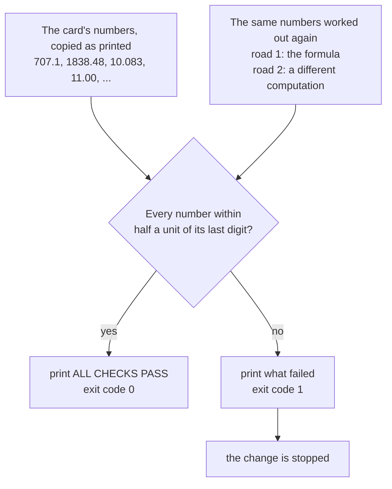

# The check script: asserts that can fail, run on every card

[Syllabus](../../../SYLLABUS.md) → [Applied and computational](../README.md) → [Scientific Computing Practice](../README.md#s08) → The check script

---

## General Overview

The [Stock](../05-Operations%20Research/06-inventory-models-eoq-and-newsvendor.md) card tells a warehouse to order butter **707.1** cases at a time, for a yearly cost of **£1,838.48**. The [Queues](../05-Operations%20Research/07-queueing-theory-and-littles-law.md) card tells a bakery that a customer at its one busy till waits **11.00** minutes in line. Ten numbers like these, across two cards, are what a manager would act on.

Each of them can go wrong after it is written. A finger slips and 707.1 becomes 701.7. A later edit to the code drops a 2 from a formula. Someone confuses the time in line with the time in the shop and prints 12 for 11. None of these looks wrong on the page. A reader has no way to tell.

A **check script** is the guard. It holds a copy of every number as the card prints it. It works each one out again from scratch, two different ways. It compares, allowing only the rounding the card's printed digits admit. If anything disagrees, it ends with a failure code that any machine can read, so a broken card is stopped before anyone sees it. Then it breaks the card on purpose and confirms it notices.

**A check script turns every number on a card into a yes-or-no test, allows each number exactly the rounding its printed digits admit, and reports the whole verdict as one exit code: 0 if every test passes, anything else if one fails.**

**What kind of fact this is:** a working practice, not a law. Inside it sits one small theorem, proved in Why it works: the half-unit rule never rejects a correctly rounded number, and it rejects any change to the printed digits, except a change that lands exactly on a rounding tie.

### The picture: one run of the script



The script is a funnel: many numbers go in, one exit code comes out. The exit code is what a build machine reads. The printed lines are for people.

---

## The formula

Notation first, in words. Number the claims on the card $i$ = 1, 2, 3 and so on. Claim $i$ prints a value $c_i$ with $d_i$ digits after the decimal point. The script computes its own value $x_i$, once by each road. The **exit code** is the whole number a program hands back to whatever started it; by long convention 0 means success and anything else means failure.

$$\text{claim } i \text{ passes} \iff |x_i - c_i| \le \tfrac12 \times 10^{-d_i} \text{ on both roads}, \qquad \text{exit code} = \begin{cases} 0 & \text{every claim passes} \\ 1 & \text{otherwise.} \end{cases}$$

**Read it aloud:** a claim passes when the computed value sits within half a unit of the card's last printed digit, by both roads, and the script exits with 0 only when every claim passes.

A number that comes from a simulation is held to a different allowance, a few standard errors (the typical spread of a simulated average) instead of half a unit:

$$|\bar{x} - c| \le 4\,\mathrm{SE}.$$

Numbers compared as computed follow a third rule. Two roads checked against each other, or a computed number against a value pinned with full digits, get the floating-point default of [Tolerances](05-tolerances-and-comparing-computed-numbers.md): a relative allowance with a small floor. This card holds numbers as printed; that card holds numbers as computed.

| Symbol | Plain meaning | In our example | Push it up and the answer… |
| --- | --- | --- | --- |
| $i$ | which claim on the card | 1 to 10: the order size first, the two-till wait last | — |
| $c_i$ | claim $i$ exactly as printed on the card, copied by hand | 707.1 | a typo moves it off the computed value and the claim fails |
| $d_i$ | digits printed after the decimal point | 1 for 707.1; 3 for 10.083 | the allowance shrinks tenfold per digit |
| $x_i$ | the value the script works out, by road 1 or road 2 | 707.1068 | — |
| $\tfrac12 \times 10^{-d_i}$ | the allowance: half a unit in the last printed digit | 0.05 for 707.1 | — |
| exit code | the one number the script hands back when it ends | 0 on this run; 1 on a mistyped card | — |
| $\bar{x}$, SE | a simulated average and its standard error | 10.71 minutes, 0.23 | — |
| $Q^*$, $K$, $D$, $h$ | best order size (the economic order quantity, EOQ in the code's labels); order cost, yearly demand and holding cost, from [Stock](../05-Operations%20Research/06-inventory-models-eoq-and-newsvendor.md) | 707.1 cases; £125, 5,200 cases, £2.60 | — |
| $\lambda$, $\mu$, $\rho$ | arrivals an hour, sales a till makes an hour, the busy share $\lambda/\mu$, from [Queues](../05-Operations%20Research/07-queueing-theory-and-littles-law.md) | 55, 60, 0.9167 | $\lambda$ up to 59: six claims fail |
| $L_q$, $W_q$, $W$ | people in line, minutes in line, minutes in the shop | 10.083, 11.00, 12.00 | — |

### When it holds

- **Something outside the formula is consulted.** A script that works each number out one way only, and whose output is pasted onto the card, agrees with the card by construction, so a bug in the code is printed faithfully. The outside witness is a second road that avoids the formula, plus a value worked by hand. The claims list, copied from the card, adds a guard against typos in the prose.
- **The printed digits are honest.** The half-unit rule trusts that 707.1 was rounded from the true value. A card that truncates (707.19 printed as 707.1) can be off by up to a whole unit, and fails whenever the dropped part is more than half a unit.
- **The number is exact, up to floating point.** A formula or an exact count can be held to half a unit. A simulated number cannot: the simulated wait, 10.71 minutes, is off by 0.29 from the true 11.00, and that is honest noise, not a bug. It needs the standard-error allowance instead ([Seeds](03-reproducible-simulation-and-seeds.md)).
- **The failure reaches the exit code.** A check that prints FAIL but still ends with 0 is invisible to every machine that runs it. So is an `assert` that the optimiser deletes, below.
- **Some break would trip each check.** An assert that compares a value with itself, or that allows 1% on every number, can pass while the card is wrong. Breaking the card on purpose is the only way to know.

---

## Why it works

### Step 0: a printed number is a claim with two halves

707.1 says two things: roughly where the true value is, and how closely. The digits give the place. The number of digits gives the precision: one digit after the point means "rounded to the nearest tenth". A check that uses only the first half has to guess the second. Guess too tight and honest rounding fails; guess too loose and typos pass. The printed string carries both halves, so the script reads both from it. That is why the claims list stores `"707.1"` as text, not as the number 707.1: the text remembers its own digit count.

### Step 1: half a unit is exactly the right allowance

Take one claim and drop the $i$. Rounding to $d$ digits moves a value by at most half a unit in the last place, $\tfrac12 \times 10^{-d}$. So a correctly rounded claim always passes: no false alarms.

Now suppose a typo changes the printed digits, from $c$ to some other $c'$ with the same number of digits. Two such numbers differ by at least one whole unit, $10^{-d}$. The true value is within half a unit of $c$, so it is at least half a unit from $c'$:

$$|x - c'| \ge |c' - c| - |x - c| \ge 10^{-d} - \tfrac12 \times 10^{-d} = \tfrac12 \times 10^{-d}.$$

Equality needs both steps to be tight at once: the typo moves exactly one unit, and the true value sits exactly on a rounding tie. Otherwise the typo fails. In the butter case the true $Q^*$ is 707.1068, off by 0.0068 from 707.1 and by 5.4068 from 701.7, against an allowance of 0.05.

A fixed relative allowance has neither guarantee. With 1%, the typo 10.083 → 10.038 passes, because 10.038 is off by 0.0453 and 1% of it is 0.1004. And the correct two-till wait, 0.27 minutes, fails: the true 0.2659 is off by 0.0041, but 1% of 0.27 allows only 0.0027. One rule, one miss and one false alarm.

### Step 2: two roads, so the code cannot vouch for itself

Every claim is worked out twice. For the butter, road 1 is the formula $Q^* = \sqrt{2KD/h}$. Road 2 never takes a square root: it halves an interval 200 times, keeping the half where the yearly holding cost $hQ/2$ meets the yearly ordering cost $KD/Q$. A third road, trying every whole order from 1 to 5,000, finds the cheapest at 707.

For the queue, road 1 is the closed form $W_q = \rho/(\mu - \lambda)$. Road 2 solves the balance equations (at each queue length, the line steps up as often as it steps back down) state by state. It then reads the wait off Little's law: the average number of people in line equals the arrival rate times the average wait in line.

Both roads must land within the allowance of the card. A bug now has to make the same mistake twice, in two different computations, and still match the printed digits. Why two roads catch what one cannot is the job of [Two roads and a mutation](06-testing-numerical-code-two-roads-and-mutations.md); here it is one line in a loop.

### Step 3: a simulated number gets a statistical allowance

The script also simulates 1,000,000 customers at the till, using the rule "the next customer's wait is this customer's wait, plus this sale, minus the gap to the next arrival, or zero if that is negative" (Lindley's recursion). The run is cut into 20 batches. The spread of the batch averages gives the standard error. The answer is 10.71 minutes with a standard error of 0.23, against the formula's 11.00. Held to half a unit, 0.005, it fails by 0.29. Held to 4 standard errors it passes, and so does a second seed. A fixed seed makes the run repeat bit for bit ([Seeds](03-reproducible-simulation-and-seeds.md)), so Python and Rust print the same 10.71.

### Step 4: the verdict must survive optimisation

The obvious way to write a check is Python's `assert` statement. Python's reference manual says plainly that when optimisation is requested (`python -O`), "the current code generator emits no code for an assert statement". The check vanishes, and the script exits 0 whatever the card says. Rust has the same trap in `debug_assert!`, which an optimised build (`rustc -O`) does not execute. The script shows both: a deliberately false assert run under the optimiser exits with code 0. So the Rust check must be built with `-O`, as this library's run command does; built without it, that one demonstration fails.

So this script never relies on either. Its `check` function records every failure in a list and prints it, and the last lines decide the exit code from the list: `sys.exit(1)` in Python, `std::process::exit(1)` in Rust. To prove the exit code really moves, the script runs a second copy of itself with the order size mistyped as 701.7 and reads that copy's exit code: 1.

### Step 5: break it on purpose

An assert that has never failed has not shown it can. The script breaks the card and the code six ways and counts what fails, using the mutation idea from [Two roads and a mutation](06-testing-numerical-code-two-roads-and-mutations.md). Two typos, a dropped 2 and a mixed-up wait are caught. The 1% rule misses a typo; the one claim it fails on that row is the correct 0.27, a false alarm. A check that compares the formula with itself misses the dropped 2: zero failing claims, because nothing outside the code is consulted.

---

## Worked numbers, by hand

| Step | Arithmetic | Value |
| --- | --- | --- |
| digits in "707.1" | one after the point | $d = 1$ |
| allowance | $\tfrac12 \times 10^{-1}$ | 0.05 |
| road 1 | $\sqrt{2 \times 125 \times 5{,}200 / 2.60}$ | 707.1068 |
| road 2 | bisect $2.60\,Q/2 = 125 \times 5{,}200/Q$ | 707.1068 |
| gap to the card | $\lvert 707.1068 - 707.1 \rvert$ | 0.0068, under 0.05: pass |
| gap to a typo | $\lvert 707.1068 - 701.7 \rvert$ | 5.4068, over 0.05: fail |
| digits in "10.083" | three after the point | allowance 0.0005 |
| gap to the card | $\lvert 10.0833 - 10.083 \rvert$ | 0.0003: pass |
| gap to a typo | $\lvert 10.0833 - 10.038 \rvert$ | 0.0453: fail |
| all ten claims | both roads, each within its allowance | **0 failing: exit code 0** |

All ten numbers on the two cards are confirmed by two independent computations, each to the precision it was printed at, and one swapped digit anywhere would turn the exit code to 1.

### What breaks if you drop a piece

| Mistake | Comes out at | What went wrong |
| --- | --- | --- |
| Card typo, 707.1 printed as 701.7 | off by 5.4068; 1 failing; exit code 1 | Nothing: this is the script working |
| Code drops the 2: $\sqrt{KD/h}$ | $Q^*$ = 500.0000; 4 failing | Caught, through the order size, the cost, the whole order and the deliveries |
| Code uses the time in the shop for the time in line | 12.0000 minutes against 11.00; 1 failing | Caught; the two roads disagree too |
| Allow 1% instead of half a unit | typo 10.038 passes; correct 0.27 fails (off by 0.0041, allowed 0.0027) | Relative slack is too loose on big numbers and too tight on short ones |
| Compare the formula with itself | 0 failing with the 2 dropped | A tautology: nothing outside the code is consulted |
| Use a plain `assert`, run with the optimiser on | exit code 0 on a false claim | The optimiser deleted the check |
| Hold the simulation to half a unit | off by 0.29 against 0.005: fail | Simulation noise is not a bug; it needs a standard-error allowance |

Every number in this table is printed by both checks.

---

## Code, from first principles, and it actually runs

The script below is a complete check for ten numbers from two cards. It takes **three roads**: a closed formula for each number; a second computation that avoids the formula (bisection, a brute-force search over every whole order, and the balance equations solved state by state); and, for the waiting time, a seeded simulation of 1,000,000 customers. It then breaks the card and the code six ways, runs a copy of itself on a mistyped card to read the real exit code, and runs a false assert under the optimiser. The random numbers come from SplitMix64, written out, so both languages print the same lines.

### Python

```python
# The check script -- the check behind the card.  Standard library only.
# Re-derives this wing's EOQ and queue numbers two ways each, compares them with the
# card to half a unit in the last printed digit, and exits 1 on any failure.
# Then it breaks things on purpose and confirms each break is caught.
import sys, subprocess
from math import sqrt, log

CARD = [  # copied by hand from the cards, exactly as printed; never computed here
    ("EOQ order size Q*, cases", "707.1"), ("EOQ yearly cost, pounds", "1838.48"),
    ("EOQ best whole order, cases", "707"), ("EOQ deliveries a year", "7.35"),
    ("queue busy share rho", "0.9167"), ("queue Lq, people in line", "10.083"),
    ("queue Wq, minutes in line", "11.00"), ("queue W, minutes in shop", "12.00"),
    ("two tills P(wait)", "0.2881"), ("two tills Wq, minutes", "0.27"),
]
K, D, H, LAM, MU, MASK = 125.0, 5200.0, 2.60, 55.0, 60.0, (1 << 64) - 1

def cuts(lam, mu, c, nmax=4000):  # balance state by state: lam p[n] = min(n+1, c) mu p[n+1]
    p = [1.0]
    for n in range(nmax): p.append(p[-1] * lam / (min(n + 1, c) * mu))
    s = sum(p)
    p = [x / s for x in p]
    L = sum(n * x for n, x in enumerate(p))
    Lq = sum((n - c) * p[n] for n in range(c, len(p)))
    return p, L, Lq

def derive(lam=LAM, mu=MU, bug=""):  # road 1 = closed form, road 2 = a different computation
    two = 1.0 if bug == "drop the 2" else 2.0
    q1 = sqrt(two * K * D / H)
    lo, hi = 1.0, 1e5                  # road 2: bisect on "holding cost = ordering cost"
    for _ in range(200):
        mid = (lo + hi) / 2
        if H * mid / 2 < K * D / mid: lo = mid
        else: hi = mid
    cost = lambda q: K * D / q + H * q / 2
    best = min(range(1, 5001), key=cost)  # every whole order size from 1 to 5,000
    rho = lam / mu
    p1, L1, Lq1 = cuts(lam, mu, 1)
    wq = 1 / (mu - lam) if bug == "W for Wq" else rho / (mu - lam)
    a = lam / mu
    top = a * a / 2 / (1 - a / 2)      # Erlang C with two tills
    pw = top / (1 + a + top)
    p2, L2, Lq2 = cuts(lam, mu, 2)
    return [(q1, lo), (sqrt(two * K * D * H), cost(lo)), (round(q1), best), (D / q1, D / lo),
            (rho, 1 - p1[0]), (rho * rho / (1 - rho), Lq1), (60 * wq, 60 * Lq1 / lam),
            (60 / (mu - lam), 60 * L1 / lam), (pw, 1 - p2[0] - p2[1]), (60 * pw / (2 * mu - lam), 60 * Lq2 / lam)]

def decimals(s): return len(s.split(".")[1]) if "." in s else 0

def compare(card, vals, rule="half-unit"):  # the labels of every claim that fails
    fails = []
    for (label, printed), (r1, r2) in zip(card, vals):
        if rule == "itself": ok = abs(r1 - r1) <= 1e-9   # the tautology, kept only to show it
        else:
            tol = 0.5 * 10.0 ** -decimals(printed) if rule == "half-unit" else 0.01 * abs(float(printed))
            ok = all(abs(r - float(printed)) <= tol * (1 + 1e-9) for r in (r1, r2))
        if not ok: fails.append(label)
    return fails

def edit(card, label, printed): return [(l, printed if l == label else p) for l, p in card]

if "--break" in sys.argv:  # run as a child with one card number mistyped; the exit code is the verdict
    sys.exit(1 if compare(edit(CARD, CARD[0][0], "701.7"), derive()) else 0)

def splitmix(seed):
    s = seed
    while True:
        s = (s + 0x9E3779B97F4A7C15) & MASK
        z = ((s ^ (s >> 30)) * 0xBF58476D1CE4E5B9) & MASK
        z = ((z ^ (z >> 27)) * 0x94D049BB133111EB) & MASK
        yield ((z ^ (z >> 31)) >> 11) / 9007199254740992.0

def simulate(seed, n=1000000, batches=20):  # Lindley: next wait = max(0, wait + service - gap)
    u, w, acc, means = splitmix(seed), 0.0, 0.0, []
    for i in range(n):
        acc += w
        if (i + 1) % (n // batches) == 0: means.append(60 * acc / (n // batches)); acc = 0.0
        w = max(0.0, w - log(1 - next(u)) / MU + log(1 - next(u)) / LAM)
    m = sum(means) / batches
    return m, sqrt(sum((x - m) ** 2 for x in means) / (batches - 1) / batches)

bad = []
def check(ok, what):  # an assert that survives python -O: it records, and the exit code reports
    if not ok: bad.append(what); print("FAIL", what)

vals = derive()
for (label, printed), (r1, r2) in zip(CARD, vals):
    d = decimals(printed)
    print(f"{label}: card {printed}, road 1 {r1:.4f}, road 2 {r2:.4f}, allowed +/- {0.5 * 10.0 ** -d:.{d + 1}f}")
check(compare(CARD, vals) == [], "every card number within half a unit, both roads")
q, lq = vals[0][0], vals[5][0]
print(f"by hand: Q* off by {abs(q - 707.1):.4f} from 707.1, {abs(q - 701.7):.4f} from 701.7; "
      f"Lq off by {abs(lq - 10.083):.4f} from 10.083, {abs(lq - 10.038):.4f} from 10.038; 1% of 10.038 is {0.01 * 10.038:.4f}")
print(f"by hand: drop the 2 and Q* is {derive(bug='drop the 2')[0][0]:.4f}; W for Wq gives {derive(bug='W for Wq')[6][0]:.4f} min")
m, se = simulate(2026)
print(f"road 3, simulated Wq, 1,000,000 customers, seed 2026: {m:.2f} min, standard error {se:.2f}")
check(abs(m - vals[6][0]) <= 4 * se, "simulation within 4 standard errors of 11.00")

BREAKS = [("card typo: Q* 707.1 -> 701.7", edit(CARD, CARD[0][0], "701.7"), "", "half-unit", 0),
          ("code drops the 2 in Q*", CARD, "drop the 2", "half-unit", 0),
          ("code uses W for Wq", CARD, "W for Wq", "half-unit", 6),
          ("card typo: Lq 10.083 -> 10.038", edit(CARD, CARD[5][0], "10.038"), "", "half-unit", 5),
          ("card typo: Lq 10.083 -> 10.038", edit(CARD, CARD[5][0], "10.038"), "", "1% rel", 5),
          ("code drops the 2 in Q*", CARD, "drop the 2", "itself", 0)]
hits = []
for name, card, bug, rule, target in BREAKS:  # is the broken number itself among the failures?
    fails = compare(card, derive(bug=bug), rule)
    hits.append(CARD[target][0] in fails)
    print(f"break: {name:<31} rule {rule:<9} failing {len(fails)}  {'caught' if hits[-1] else 'MISSED'}")
check(hits == [True, True, True, True, False, False], "half-unit catches all four breaks; 1% and itself miss")
print(f"false alarm under the 1% rule: {', '.join(compare(CARD, vals, '1% rel'))}, off by {0.27 - vals[9][0]:.4f}, allowed {0.01 * 0.27:.4f}")
check(compare(CARD, vals, "1% rel") == [CARD[9][0]], "the 1% rule flags the correct 0.27")

child = subprocess.run([sys.executable, "-B", __file__, "--break"], capture_output=True).returncode
stripped = subprocess.run([sys.executable, "-O", "-c", "assert 707.1 == 701.7"], capture_output=True).returncode
print(f"exit code, this script run on the mistyped card: {child}")
print(f"exit code, a false assert the optimiser strips: {stripped}")
check(child == 1, "a broken card makes the script exit 1")
check(stripped == 0, "the stripped assert lets a false claim exit 0")

n59 = compare(CARD, derive(lam=59.0))
print(f"try: 59 arrivals an hour, card unchanged: {len(n59)} failing, Wq now {derive(lam=59.0)[6][0]:.2f} min")
check(len(n59) == 6, "every queue number moves when the arrival rate does")
print(f"try: simulated Wq held to +/- 0.005: off by {abs(m - 11.0):.2f}, {'pass' if abs(m - 11.0) <= 0.005 else 'fail'}")
m2, se2 = simulate(7)
print(f"try: seed 7: simulated Wq {m2:.2f} min, standard error {se2:.2f}, within 4 se: {'yes' if abs(m2 - 11.0) <= 4 * se2 else 'no'}")

if bad:
    print(f"{len(bad)} CHECKS FAILED")
    sys.exit(1)
print("ALL CHECKS PASS")
```

**Ran 2026-11-11 on macOS, Python 3.14.10, standard library only. All checks passed. Output, pasted from the run:**

```
EOQ order size Q*, cases: card 707.1, road 1 707.1068, road 2 707.1068, allowed +/- 0.05
EOQ yearly cost, pounds: card 1838.48, road 1 1838.4776, road 2 1838.4776, allowed +/- 0.005
EOQ best whole order, cases: card 707, road 1 707.0000, road 2 707.0000, allowed +/- 0.5
EOQ deliveries a year: card 7.35, road 1 7.3539, road 2 7.3539, allowed +/- 0.005
queue busy share rho: card 0.9167, road 1 0.9167, road 2 0.9167, allowed +/- 0.00005
queue Lq, people in line: card 10.083, road 1 10.0833, road 2 10.0833, allowed +/- 0.0005
queue Wq, minutes in line: card 11.00, road 1 11.0000, road 2 11.0000, allowed +/- 0.005
queue W, minutes in shop: card 12.00, road 1 12.0000, road 2 12.0000, allowed +/- 0.005
two tills P(wait): card 0.2881, road 1 0.2881, road 2 0.2881, allowed +/- 0.00005
two tills Wq, minutes: card 0.27, road 1 0.2659, road 2 0.2659, allowed +/- 0.005
by hand: Q* off by 0.0068 from 707.1, 5.4068 from 701.7; Lq off by 0.0003 from 10.083, 0.0453 from 10.038; 1% of 10.038 is 0.1004
by hand: drop the 2 and Q* is 500.0000; W for Wq gives 12.0000 min
road 3, simulated Wq, 1,000,000 customers, seed 2026: 10.71 min, standard error 0.23
break: card typo: Q* 707.1 -> 701.7    rule half-unit failing 1  caught
break: code drops the 2 in Q*          rule half-unit failing 4  caught
break: code uses W for Wq              rule half-unit failing 1  caught
break: card typo: Lq 10.083 -> 10.038  rule half-unit failing 1  caught
break: card typo: Lq 10.083 -> 10.038  rule 1% rel    failing 1  MISSED
break: code drops the 2 in Q*          rule itself    failing 0  MISSED
false alarm under the 1% rule: two tills Wq, minutes, off by 0.0041, allowed 0.0027
exit code, this script run on the mistyped card: 1
exit code, a false assert the optimiser strips: 0
try: 59 arrivals an hour, card unchanged: 6 failing, Wq now 59.00 min
try: simulated Wq held to +/- 0.005: off by 0.29, fail
try: seed 7: simulated Wq 10.86 min, standard error 0.27, within 4 se: yes
ALL CHECKS PASS
```

### Rust

```rust
// The check script -- the check behind the card.  Rust std only, no crates.
// Re-derives this wing's EOQ and queue numbers two ways each, compares them with the
// card to half a unit in the last printed digit, and exits 1 on any failure.
// Then it breaks things on purpose and confirms each break is caught.
use std::process::{exit, Command};

// copied by hand from the cards, exactly as printed; never computed here
const CARD: [(&str, &str); 10] = [
    ("EOQ order size Q*, cases", "707.1"), ("EOQ yearly cost, pounds", "1838.48"),
    ("EOQ best whole order, cases", "707"), ("EOQ deliveries a year", "7.35"),
    ("queue busy share rho", "0.9167"), ("queue Lq, people in line", "10.083"),
    ("queue Wq, minutes in line", "11.00"), ("queue W, minutes in shop", "12.00"),
    ("two tills P(wait)", "0.2881"), ("two tills Wq, minutes", "0.27"),
];
type Card = Vec<(&'static str, &'static str)>;
const K: f64 = 125.0; const D: f64 = 5200.0; const H: f64 = 2.60; const LAM: f64 = 55.0; const MU: f64 = 60.0;

// balance state by state: lam p[n] = min(n+1, c) mu p[n+1]; returns (p, L, Lq)
fn cuts(lam: f64, mu: f64, c: usize) -> (Vec<f64>, f64, f64) {
    let mut p = vec![1.0];
    for n in 0..4000 {
        p.push(p[n] * lam / ((n + 1).min(c) as f64 * mu));
    }
    let s: f64 = p.iter().sum();
    let p: Vec<f64> = p.iter().map(|x| x / s).collect();
    let l: f64 = p.iter().enumerate().map(|(n, x)| n as f64 * x).sum();
    let lq: f64 = (c..p.len()).map(|n| (n - c) as f64 * p[n]).sum();
    (p, l, lq)
}

// road 1 = closed form, road 2 = a different computation
fn derive(lam: f64, mu: f64, bug: &str) -> Vec<(f64, f64)> {
    let two = if bug == "drop the 2" { 1.0 } else { 2.0 };
    let q1 = (two * K * D / H).sqrt();
    let (mut lo, mut hi) = (1.0, 1e5); // road 2: bisect on "holding cost = ordering cost"
    for _ in 0..200 {
        let mid = (lo + hi) / 2.0;
        if H * mid / 2.0 < K * D / mid { lo = mid } else { hi = mid }
    }
    let cost = |q: f64| K * D / q + H * q / 2.0;
    let best = (1..=5000).min_by(|a, b| cost(*a as f64).partial_cmp(&cost(*b as f64)).unwrap()).unwrap(); // every whole order 1 to 5,000
    let rho = lam / mu;
    let (p1, l1, lq1) = cuts(lam, mu, 1);
    let wq = if bug == "W for Wq" { 1.0 / (mu - lam) } else { rho / (mu - lam) };
    let a = lam / mu;
    let top = a * a / 2.0 / (1.0 - a / 2.0); // Erlang C with two tills
    let pw = top / (1.0 + a + top);
    let (p2, _, lq2) = cuts(lam, mu, 2);
    vec![(q1, lo), ((two * K * D * H).sqrt(), cost(lo)), (q1.round(), best as f64), (D / q1, D / lo),
         (rho, 1.0 - p1[0]), (rho * rho / (1.0 - rho), lq1), (60.0 * wq, 60.0 * lq1 / lam),
         (60.0 / (mu - lam), 60.0 * l1 / lam), (pw, 1.0 - p2[0] - p2[1]), (60.0 * pw / (2.0 * mu - lam), 60.0 * lq2 / lam)]
}

fn decimals(s: &str) -> i32 {
    s.split('.').nth(1).map_or(0, |t| t.len() as i32)
}
// the labels of every claim that fails
fn compare(card: &Card, vals: &[(f64, f64)], rule: &str) -> Vec<&'static str> {
    let mut fails = vec![];
    for (&(label, printed), &(r1, r2)) in card.iter().zip(vals) {
        let ok = if rule == "itself" {
            (r1 - r1).abs() <= 1e-9 // the tautology, kept only to show it
        } else {
            let c: f64 = printed.parse().unwrap();
            let tol = if rule == "half-unit" { 0.5 * 10f64.powi(-decimals(printed)) } else { 0.01 * c.abs() };
            [r1, r2].iter().all(|r| (r - c).abs() <= tol * (1.0 + 1e-9))
        };
        if !ok { fails.push(label) }
    }
    fails
}
fn edit(label: &str, printed: &'static str) -> Card {
    CARD.iter().map(|&(l, p)| (l, if l == label { printed } else { p })).collect()
}

struct SplitMix(u64);
impl SplitMix {
    fn next(&mut self) -> f64 {
        self.0 = self.0.wrapping_add(0x9E3779B97F4A7C15);
        let mut z = (self.0 ^ (self.0 >> 30)).wrapping_mul(0xBF58476D1CE4E5B9);
        z = (z ^ (z >> 27)).wrapping_mul(0x94D049BB133111EB);
        ((z ^ (z >> 31)) >> 11) as f64 / 9007199254740992.0
    }
}

// Lindley: next wait = max(0, wait + service - gap); returns (mean wait in minutes, standard error)
fn simulate(seed: u64) -> (f64, f64) {
    let (n, batches) = (1000000usize, 20usize);
    let (mut u, mut w, mut acc, mut means) = (SplitMix(seed), 0.0f64, 0.0, vec![]);
    for i in 0..n {
        acc += w;
        if (i + 1) % (n / batches) == 0 { means.push(60.0 * acc / (n / batches) as f64); acc = 0.0 }
        let s = -(1.0 - u.next()).ln() / MU;
        w = (w + s + (1.0 - u.next()).ln() / LAM).max(0.0);
    }
    let m = means.iter().sum::<f64>() / batches as f64;
    let var = means.iter().map(|x| (x - m) * (x - m)).sum::<f64>() / (batches - 1) as f64;
    (m, (var / batches as f64).sqrt())
}

fn main() {
    let card: Card = CARD.to_vec();
    let args: Vec<String> = std::env::args().collect();
    if args.iter().any(|a| a == "--break") { // run as a child with one card number mistyped
        exit(if compare(&edit(CARD[0].0, "701.7"), &derive(LAM, MU, ""), "half-unit").is_empty() { 0 } else { 1 });
    }
    if args.iter().any(|a| a == "--strip") { // a false assert that rustc -O removes
        debug_assert!(707.1f64 == 701.7);
        exit(0);
    }
    let mut bad: Vec<&str> = vec![];
    // an assert that survives rustc -O: it records, and the exit code reports
    let mut check = |ok: bool, what: &'static str| if !ok { bad.push(what); println!("FAIL {}", what) };

    let vals = derive(LAM, MU, "");
    for (&(label, printed), &(r1, r2)) in card.iter().zip(&vals) {
        let d = decimals(printed);
        println!("{}: card {}, road 1 {:.4}, road 2 {:.4}, allowed +/- {:.*}", label, printed, r1, r2, (d + 1) as usize, 0.5 * 10f64.powi(-d));
    }
    check(compare(&card, &vals, "half-unit").is_empty(), "every card number within half a unit, both roads");
    let (q, lq) = (vals[0].0, vals[5].0);
    println!("by hand: Q* off by {:.4} from 707.1, {:.4} from 701.7; Lq off by {:.4} from 10.083, {:.4} from 10.038; 1% of 10.038 is {:.4}",
             (q - 707.1).abs(), (q - 701.7).abs(), (lq - 10.083).abs(), (lq - 10.038).abs(), 0.01 * 10.038);
    println!("by hand: drop the 2 and Q* is {:.4}; W for Wq gives {:.4} min", derive(LAM, MU, "drop the 2")[0].0, derive(LAM, MU, "W for Wq")[6].0);
    let (m, se) = simulate(2026);
    println!("road 3, simulated Wq, 1,000,000 customers, seed 2026: {:.2} min, standard error {:.2}", m, se);
    check((m - vals[6].0).abs() <= 4.0 * se, "simulation within 4 standard errors of 11.00");

    let breaks: [(&str, Card, &str, &str, usize); 6] = [
        ("card typo: Q* 707.1 -> 701.7", edit(CARD[0].0, "701.7"), "", "half-unit", 0),
        ("code drops the 2 in Q*", card.clone(), "drop the 2", "half-unit", 0),
        ("code uses W for Wq", card.clone(), "W for Wq", "half-unit", 6),
        ("card typo: Lq 10.083 -> 10.038", edit(CARD[5].0, "10.038"), "", "half-unit", 5),
        ("card typo: Lq 10.083 -> 10.038", edit(CARD[5].0, "10.038"), "", "1% rel", 5),
        ("code drops the 2 in Q*", card.clone(), "drop the 2", "itself", 0)];
    let mut hits = vec![];
    for (name, c, bug, rule, target) in breaks.iter() { // is the broken number itself among the failures?
        let fails = compare(c, &derive(LAM, MU, bug), rule);
        hits.push(fails.contains(&CARD[*target].0));
        println!("break: {:<31} rule {:<9} failing {}  {}", name, rule, fails.len(), if *hits.last().unwrap() { "caught" } else { "MISSED" });
    }
    check(hits == [true, true, true, true, false, false], "half-unit catches all four breaks; 1% and itself miss");
    let alarm = compare(&card, &vals, "1% rel");
    println!("false alarm under the 1% rule: {}, off by {:.4}, allowed {:.4}", alarm.join(", "), 0.27 - vals[9].0, 0.01 * 0.27);
    check(alarm == [CARD[9].0], "the 1% rule flags the correct 0.27");

    let me = std::env::current_exe().unwrap();
    let child = Command::new(&me).arg("--break").output().unwrap().status.code().unwrap();
    let stripped = Command::new(&me).arg("--strip").output().unwrap().status.code().unwrap();
    println!("exit code, this script run on the mistyped card: {}", child);
    println!("exit code, a false assert the optimiser strips: {}", stripped);
    check(child == 1, "a broken card makes the script exit 1");
    check(stripped == 0, "the stripped assert lets a false claim exit 0");

    let v59 = derive(59.0, MU, "");
    let n59 = compare(&card, &v59, "half-unit");
    println!("try: 59 arrivals an hour, card unchanged: {} failing, Wq now {:.2} min", n59.len(), v59[6].0);
    check(n59.len() == 6, "every queue number moves when the arrival rate does");
    let off = (m - 11.0).abs();
    println!("try: simulated Wq held to +/- 0.005: off by {:.2}, {}", off, if off <= 0.005 { "pass" } else { "fail" });
    let (m2, se2) = simulate(7);
    println!("try: seed 7: simulated Wq {:.2} min, standard error {:.2}, within 4 se: {}", m2, se2, if (m2 - 11.0).abs() <= 4.0 * se2 { "yes" } else { "no" });

    if !bad.is_empty() {
        println!("{} CHECKS FAILED", bad.len());
        exit(1);
    }
    println!("ALL CHECKS PASS");
}
```

**Ran 2026-11-11 on macOS, rustc 1.98.1, no crates. All checks passed. Output, pasted from the run:**

```
EOQ order size Q*, cases: card 707.1, road 1 707.1068, road 2 707.1068, allowed +/- 0.05
EOQ yearly cost, pounds: card 1838.48, road 1 1838.4776, road 2 1838.4776, allowed +/- 0.005
EOQ best whole order, cases: card 707, road 1 707.0000, road 2 707.0000, allowed +/- 0.5
EOQ deliveries a year: card 7.35, road 1 7.3539, road 2 7.3539, allowed +/- 0.005
queue busy share rho: card 0.9167, road 1 0.9167, road 2 0.9167, allowed +/- 0.00005
queue Lq, people in line: card 10.083, road 1 10.0833, road 2 10.0833, allowed +/- 0.0005
queue Wq, minutes in line: card 11.00, road 1 11.0000, road 2 11.0000, allowed +/- 0.005
queue W, minutes in shop: card 12.00, road 1 12.0000, road 2 12.0000, allowed +/- 0.005
two tills P(wait): card 0.2881, road 1 0.2881, road 2 0.2881, allowed +/- 0.00005
two tills Wq, minutes: card 0.27, road 1 0.2659, road 2 0.2659, allowed +/- 0.005
by hand: Q* off by 0.0068 from 707.1, 5.4068 from 701.7; Lq off by 0.0003 from 10.083, 0.0453 from 10.038; 1% of 10.038 is 0.1004
by hand: drop the 2 and Q* is 500.0000; W for Wq gives 12.0000 min
road 3, simulated Wq, 1,000,000 customers, seed 2026: 10.71 min, standard error 0.23
break: card typo: Q* 707.1 -> 701.7    rule half-unit failing 1  caught
break: code drops the 2 in Q*          rule half-unit failing 4  caught
break: code uses W for Wq              rule half-unit failing 1  caught
break: card typo: Lq 10.083 -> 10.038  rule half-unit failing 1  caught
break: card typo: Lq 10.083 -> 10.038  rule 1% rel    failing 1  MISSED
break: code drops the 2 in Q*          rule itself    failing 0  MISSED
false alarm under the 1% rule: two tills Wq, minutes, off by 0.0041, allowed 0.0027
exit code, this script run on the mistyped card: 1
exit code, a false assert the optimiser strips: 0
try: 59 arrivals an hour, card unchanged: 6 failing, Wq now 59.00 min
try: simulated Wq held to +/- 0.005: off by 0.29, fail
try: seed 7: simulated Wq 10.86 min, standard error 0.27, within 4 se: yes
ALL CHECKS PASS
```

### Lean

Lean proves the half-unit rule of Step 1 for every true value and digit count, and checks the card's worked numbers exactly.

- Take any true value $x$ and any digit count $d$. Then rounding $x$ to $d$ digits moves it by at most half a unit.
- Suppose $x$ is within half a unit of $c$, and $c'$ is a different number with the same digit count. Then $x$ is at least half a unit from $c'$.
- Suppose also that $c'$ passes the half-unit rule. Then $c'$ is exactly one unit from $c$, and $x$ sits exactly on a rounding tie.
- The butter numbers 707.1, 1838.48 and 7.35 pass the half-unit rule, and the typo 701.7 fails it.
- The whole order 707 costs less than 706 or 708.
- The queue numbers 0.9167, 10.083, 0.2881 and 0.27 pass the half-unit rule. The waits come out at exactly 11 and 12 minutes.
- Under the 1% rule, the typo 10.038 passes and the correct 0.27 fails.

The second roads, the search over every whole order, the simulation and the exit codes are left to the Python and Rust checks.

```lean
-- The check script: the half-unit rule never rejects a correctly rounded number, and a changed number with the same digit count passes it only on an exact rounding tie one unit away.
import Mathlib.Algebra.Order.Round
import Mathlib.Algebra.Order.Archimedean.Real.Basic
import Mathlib.Tactic.NormNum

/-! A number printed with `d` digits after the decimal point is `m / 10 ^ d` for a whole
number `m` (707.1 is `7071 / 10 ^ 1`). The half-unit allowance is `1 / (2 * 10 ^ d)`.
A claim `c` passes against the true value `x` when `|x - c| ≤ 1 / (2 * 10 ^ d)`.
"The printed digits are honest" means the card's `c` is within half a unit of `x`. -/

/-- Helper: two different whole-number prints with `d` digits differ by `|m' - m|` units. -/
lemma typo_gap_aux (x : ℝ) (d : ℕ) (m m' : ℤ) :
    |((m' : ℝ) - m)| / 10 ^ d ≤ |x - (m : ℝ) / 10 ^ d| + |x - (m' : ℝ) / 10 ^ d| := by
  have hu : (0 : ℝ) < 10 ^ d := by positivity
  have h1 : |((m' : ℝ) - m)| / 10 ^ d = |(m' : ℝ) / 10 ^ d - (m : ℝ) / 10 ^ d| := by
    rw [← sub_div, abs_div, abs_of_pos hu]
  rw [h1]
  calc |(m' : ℝ) / 10 ^ d - (m : ℝ) / 10 ^ d|
      = |(x - (m : ℝ) / 10 ^ d) - (x - (m' : ℝ) / 10 ^ d)| := by ring_nf
    _ ≤ |x - (m : ℝ) / 10 ^ d| + |x - (m' : ℝ) / 10 ^ d| := abs_sub _ _

/-- Helper: different integers are at least one apart, as reals. -/
lemma one_le_abs_int_sub_aux (m m' : ℤ) (typo : m' ≠ m) : (1 : ℝ) ≤ |((m' : ℝ) - m)| := by
  have h : (1 : ℤ) ≤ |m' - m| := Int.one_le_abs (sub_ne_zero.mpr typo)
  have h2 : ((|m' - m| : ℤ) : ℝ) = |((m' : ℝ) - m)| := by push_cast; rfl
  rw [← h2]; exact_mod_cast h

#print axioms typo_gap_aux
#print axioms one_le_abs_int_sub_aux

/-- The half-unit rule. Let the true value `x` be honestly printed as `m / 10 ^ d`
(within half a unit of it). If a typo changes the printed digits to a different
`m' / 10 ^ d` with the same digit count, and the typo still passes the half-unit test,
then the typo moved exactly one unit and the true value sat exactly on a rounding tie.
In every other case the typo fails. -/
theorem half_unit_rule_rejects_typo_except_on_tie (x : ℝ) (d : ℕ) (m m' : ℤ)
    (honest : |x - (m : ℝ) / 10 ^ d| ≤ 1 / (2 * (10 : ℝ) ^ d))
    (typo : m' ≠ m)
    (passes : |x - (m' : ℝ) / 10 ^ d| ≤ 1 / (2 * (10 : ℝ) ^ d)) :
    |x - (m : ℝ) / 10 ^ d| = 1 / (2 * (10 : ℝ) ^ d) ∧ |m' - m| = 1 := by
  have hu : (0 : ℝ) < 10 ^ d := by positivity
  have hg := typo_gap_aux x d m m'
  have h1 := one_le_abs_int_sub_aux m m' typo
  have hh : 1 / (2 * (10 : ℝ) ^ d) = (1 / 2) / 10 ^ d := by field_simp
  rw [hh] at honest passes ⊢
  have hle : |((m' : ℝ) - m)| / 10 ^ d ≤ 1 / 10 ^ d := by
    have : (1 / 2 : ℝ) / 10 ^ d + (1 / 2) / 10 ^ d = 1 / 10 ^ d := by ring
    linarith
  have hle' : |((m' : ℝ) - m)| ≤ 1 := by
    rwa [div_le_div_iff_of_pos_right hu] at hle
  have hge : 1 / 10 ^ d ≤ |((m' : ℝ) - m)| / 10 ^ d :=
    div_le_div_of_nonneg_right h1 hu.le
  refine ⟨?_, ?_⟩
  · have : (1 / 2 : ℝ) / 10 ^ d + (1 / 2) / 10 ^ d = 1 / 10 ^ d := by ring
    linarith
  · have hr : ((|m' - m| : ℤ) : ℝ) = 1 := by
      push_cast
      exact le_antisymm hle' h1
    exact_mod_cast hr

/-- No false alarms: rounding any value to `d` digits moves it by at most half a unit
in the last place, so a correctly rounded claim always passes the half-unit test. -/
theorem rounding_within_half_unit (x : ℝ) (d : ℕ) :
    |x - (round (x * 10 ^ d) : ℝ) / 10 ^ d| ≤ 1 / (2 * (10 : ℝ) ^ d) := by
  have hu : (0 : ℝ) < 10 ^ d := by positivity
  have h := abs_sub_round (x * 10 ^ d)
  have e : x - (round (x * 10 ^ d) : ℝ) / 10 ^ d = (x * 10 ^ d - round (x * 10 ^ d)) / 10 ^ d := by
    field_simp
  rw [e, abs_div, abs_of_pos hu, div_le_iff₀ hu]
  have : 1 / (2 * (10 : ℝ) ^ d) * 10 ^ d = 1 / 2 := by field_simp
  rw [this]; exact h

/-- The typo bound from Step 1: if the true value is within half a unit of the printed
`m / 10 ^ d`, then it is at least half a unit from any other `m' / 10 ^ d` with the
same number of digits. -/
theorem typo_at_least_half_unit_away (x : ℝ) (d : ℕ) (m m' : ℤ)
    (honest : |x - (m : ℝ) / 10 ^ d| ≤ 1 / (2 * (10 : ℝ) ^ d))
    (typo : m' ≠ m) :
    1 / (2 * (10 : ℝ) ^ d) ≤ |x - (m' : ℝ) / 10 ^ d| := by
  have hu : (0 : ℝ) < 10 ^ d := by positivity
  have hg := typo_gap_aux x d m m'
  have h1 := one_le_abs_int_sub_aux m m' typo
  have hh : 1 / (2 * (10 : ℝ) ^ d) = (1 / 2) / 10 ^ d := by field_simp
  rw [hh] at honest ⊢
  have hge : 1 / 10 ^ d ≤ |((m' : ℝ) - m)| / 10 ^ d :=
    div_le_div_of_nonneg_right h1 hu.le
  have : (1 / 2 : ℝ) / 10 ^ d + (1 / 2) / 10 ^ d = 1 / 10 ^ d := by ring
  linarith

/-! The card's worked numbers, as exact fractions. -/

-- Allowances: 0.05 for one digit (707.1), 0.0005 for three digits (10.083).
example : 1 / (2 * (10 : ℚ) ^ 1) = 1 / 20 := by norm_num
example : 1 / (2 * (10 : ℚ) ^ 3) = 1 / 2000 := by norm_num
-- Butter: Q*^2 = 2 K D / h = 2 * 125 * 5200 / (26/10) = 500000.
example : (2 * 125 * 5200 : ℚ) / (26 / 10) = 500000 := by norm_num
-- 707.1 passes: Q* = sqrt 500000 lies within 0.05 of 707.1 (checked by squaring).
example : (7071 / 10 - 1 / 20 : ℚ) ^ 2 ≤ 500000 ∧ (500000 : ℚ) ≤ (7071 / 10 + 1 / 20) ^ 2 := by
  norm_num
-- The typo 701.7 fails: Q* is more than 0.05 above it.
example : (7017 / 10 + 1 / 20 : ℚ) ^ 2 < 500000 := by norm_num
-- Yearly cost sqrt(2 K D h) = sqrt 3380000 lies within 0.005 of 1838.48.
example : (2 * 125 * 5200 * (26 / 10) : ℚ) = 3380000 := by norm_num
example : (183848 / 100 - 1 / 200 : ℚ) ^ 2 ≤ 3380000 ∧
    (3380000 : ℚ) ≤ (183848 / 100 + 1 / 200) ^ 2 := by norm_num
-- Deliveries a year D / Q*: (D / Q*)^2 = 5200^2 / 500000, within 0.005 of 7.35.
example : (735 / 100 - 1 / 200 : ℚ) ^ 2 ≤ 5200 ^ 2 / 500000 ∧
    (5200 ^ 2 / 500000 : ℚ) ≤ (735 / 100 + 1 / 200) ^ 2 := by norm_num
-- The best whole order is 707: cheaper than its neighbours 706 and 708.
example : (125 * 5200 / 707 + (26 / 10) * 707 / 2 : ℚ) ≤ 125 * 5200 / 706 + (26 / 10) * 706 / 2 ∧
    (125 * 5200 / 707 + (26 / 10) * 707 / 2 : ℚ) ≤ 125 * 5200 / 708 + (26 / 10) * 708 / 2 := by
  norm_num
-- Queue, rho = 55/60 = 11/12, within 0.00005 of 0.9167.
example : |(55 / 60 : ℚ) - 9167 / 10000| ≤ 1 / 20000 := by norm_num
-- Lq = rho^2 / (1 - rho) = 121/12 = 10.0833..., within 0.0005 of 10.083.
example : (11 / 12 : ℚ) ^ 2 / (1 - 11 / 12) = 121 / 12 := by norm_num
example : |(121 / 12 : ℚ) - 10083 / 1000| ≤ 1 / 2000 := by norm_num
-- The typo 10.038 fails the half-unit rule (off by 0.0453)...
example : ¬ (|(121 / 12 : ℚ) - 10038 / 1000| ≤ 1 / 2000) := by norm_num
-- ...but passes a 1% relative rule, since 1% of 10.038 is 0.10038.
example : |(121 / 12 : ℚ) - 10038 / 1000| ≤ 1 / 100 * (10038 / 1000) := by norm_num
-- Wq = 60 rho / (mu - lambda) = 11 minutes; W = 60 / (mu - lambda) = 12 minutes.
example : 60 * (11 / 12 : ℚ) / (60 - 55) = 11 := by norm_num
example : 60 / (60 - 55 : ℚ) = 12 := by norm_num
-- Two tills: P(wait) = 121/420, within 0.00005 of 0.2881.
example : let a : ℚ := 55 / 60; let top := a * a / 2 / (1 - a / 2);
    top / (1 + a + top) = 121 / 420 := by norm_num
example : |(121 / 420 : ℚ) - 2881 / 10000| ≤ 1 / 20000 := by norm_num
-- Two tills: Wq = 60 * P(wait) / (2 mu - lambda) = 121/455 minutes, within 0.005 of 0.27,
-- but the 1% rule rejects it: off by more than 1% of 0.27.
example : 60 * (121 / 420 : ℚ) / (2 * 60 - 55) = 121 / 455 := by norm_num
example : |(121 / 455 : ℚ) - 27 / 100| ≤ 1 / 200 := by norm_num
example : ¬ (|(121 / 455 : ℚ) - 27 / 100| ≤ 1 / 100 * (27 / 100)) := by norm_num

#print axioms half_unit_rule_rejects_typo_except_on_tie
#print axioms rounding_within_half_unit
#print axioms typo_at_least_half_unit_away
```

**Checked 2026-11-14 on macOS, Lean 4.36.0-rc2, Mathlib v4.36.0-rc2. Every proof is complete and uses only Lean's standard axioms. Output, pasted from the run:**

```
'typo_gap_aux' depends on axioms: [propext, Classical.choice, Quot.sound]
'one_le_abs_int_sub_aux' depends on axioms: [propext, Classical.choice, Quot.sound]
'half_unit_rule_rejects_typo_except_on_tie' depends on axioms: [propext, Classical.choice, Quot.sound]
'rounding_within_half_unit' depends on axioms: [propext, Classical.choice, Quot.sound]
'typo_at_least_half_unit_away' depends on axioms: [propext, Classical.choice, Quot.sound]
```

> [!TIP]
> **Try changing**
> - Guess first: if the bakery gets busier, 59 arrivals an hour, how many of the ten claims fail? Call `derive(lam=59.0)`. Answer: 6, every queue number. The wait in line is now 59.00 minutes. The card is out of date, and the script says so.
> - Guess first: does the simulated wait pass if held to half a unit like the formulas? Answer: no. It is off by 0.29 against an allowance of 0.005. That is noise, so it gets 4 standard errors instead.
> - Guess first: with seed 7 instead of 2026, does the simulation still pass? Answer: yes. It reads 10.86 minutes with a standard error of 0.27, inside 4 standard errors of 11.00.
> - Guess first: run the Python with `python3 -O`. Does it still catch a typo? Answer: yes. It never uses `assert`, so the optimiser has nothing to delete; the exit code still comes from `sys.exit(1)`.

---

## The usual mistake

> [!warning]
> **Checking the code against itself.** A script that works each number out only one way, and compares it with itself, passes whatever the code does. Paste its output onto the card and a dropped 2 is published as 500 cases with every check green. Pasting the real output is right, and this library requires it; what makes it safe is a second road that avoids the formula being tested, and a value worked by hand. Comparing the formula with itself gives 0 failing claims with the 2 dropped.
>
> Four smaller traps:
> - **A plain `assert` under the optimiser.** `python -O` deletes `assert` statements, and an optimised Rust build skips `debug_assert!`. A false claim then exits with code 0.
> - **Printing FAIL and exiting 0.** A human reading the log sees the failure; the build machine reads only the exit code and waves the change through. The script must end with a non-zero code.
> - **One relative tolerance for everything.** 1% lets the typo 10.038 through and fails the correct 0.27. Read the allowance from each number's printed digits. Comparing two computed roads with each other is a different job, where floating-point noise sets the allowance ([Tolerances](05-tolerances-and-comparing-computed-numbers.md)).
> - **Holding a simulation to the printed digits.** The simulated wait, 10.71 minutes, misses 11.00 by 0.29 and fails at half a unit. Allow a few standard errors, and fix the seed so the run repeats.

---

## Where you meet it in real life

- **Continuous integration.** A service reruns a project's checks on every proposed change. The green tick or red cross on the change is the exit code of those checks, nothing more.
- **Test runners.** Python's test tools and `cargo test` collect many checks and end with one exit code. The same rule applies: a failure must reach that code.
- **The shell.** `make && deploy` runs the second command only if the first exits 0. A check script that always exits 0 makes that guard decorative.
- **Standard test vectors.** A cryptographic standard prints known inputs and outputs, and an implementation is checked against them digit for digit. This wing's [AES](../04-Cryptography/02-symmetric-ciphers-and-aes.md) and [Hashes and MACs](../04-Cryptography/03-hash-functions-and-macs.md) cards do exactly that.
- **This library.** Every card ships a Python and a Rust check built the same way: at least two roads to each number, and a failing exit code. Most use plain asserts against values computed another way or worked by hand: Python runs them without `-O`, and Rust's `assert!`, unlike `debug_assert!`, survives `-O`, so a false claim still stops the run. Both print every number on the card, their real output is pasted under the code, and each must end with `ALL CHECKS PASS`. This script's claims list and half-unit rule are an extra guard on top.

> **Say it back**
> A check script copies every number from the card exactly as printed. It works each one out again by two different roads and allows each number half a unit in its last printed digit, which never rejects honest rounding and catches a changed digit except on an exact rounding tie. Simulated numbers get a few standard errors instead. The verdict is the exit code, set explicitly, because the optimiser can delete plain asserts. And the script breaks the card on purpose, to prove its checks can fail.

---

## What this builds on

- [Two roads and a mutation](06-testing-numerical-code-two-roads-and-mutations.md): why two independent computations catch bugs that one cannot, and why a check is only trusted after a deliberate break makes it fail. This card packages both into one script.
- [Cost in practice](04-computational-cost-and-vectorisation.md): counting operations instead of timing them. The script asserts counts and values, never a stopwatch, so it gives the same verdict on any machine.
- [Stock](../05-Operations%20Research/06-inventory-models-eoq-and-newsvendor.md): the order-size formula and the butter numbers used here as test cases.
- [Queues](../05-Operations%20Research/07-queueing-theory-and-littles-law.md): the one-till and two-till waits, and Little's law, used here as test cases and as road 2.

## Where this goes next

Back on this shelf, the cards this script leans on:

- [Tolerances](05-tolerances-and-comparing-computed-numbers.md): the rule for numbers compared as computed, two roads against each other or against a value pinned with full digits, where floating-point error, not printed rounding, sets the allowance.
- [Floating point](01-floating-point-in-practice.md) and [Cancellation](02-catastrophic-cancellation-and-safe-formulas.md): why two honest roads can disagree in the last few binary digits, and when that disagreement is large.
- [Seeds](03-reproducible-simulation-and-seeds.md): why a fixed seed lets a simulation be checked at all.

A check script proves the card matches the code; it cannot prove the model behind both is right, and that question is left to each card's When it holds.

---

## Sources

Verified 2026-11-11: every link below resolves to the publisher's page.

- DeMillo, Richard A., Richard J. Lipton, and Frederick G. Sayward. "Hints on Test Data Selection: Help for the Practicing Programmer." *Computer* 11, no. 4 (1978): 34–41. [doi:10.1109/C-M.1978.218136](https://doi.org/10.1109/C-M.1978.218136). Mutation testing: judge a test by whether deliberately broken programs fail it.
- Wilson, Greg, et al. "Best Practices for Scientific Computing." *PLoS Biology* 12, no. 1 (2014): e1001745. [doi:10.1371/journal.pbio.1001745](https://doi.org/10.1371/journal.pbio.1001745). Assertions, automated tests and an oracle to compare against, for code that produces numbers.
- Goldberg, David. "What Every Computer Scientist Should Know About Floating-Point Arithmetic." *ACM Computing Surveys* 23, no. 1 (1991): 5–48. [doi:10.1145/103162.103163](https://doi.org/10.1145/103162.103163). Why two correct computations can differ in the last digits, and why rounding sets the allowance.
- Python Software Foundation. *The Python Language Reference*, "The assert statement". [docs.python.org](https://docs.python.org/3/reference/simple_stmts.html#the-assert-statement). States that no code is emitted for `assert` when optimisation is requested with `-O`.
- The Rust Project. *The Rust Standard Library*, `debug_assert!`. [doc.rust-lang.org](https://doc.rust-lang.org/std/macro.debug_assert.html). States that an optimised build does not execute `debug_assert!` unless debug assertions are switched on.
