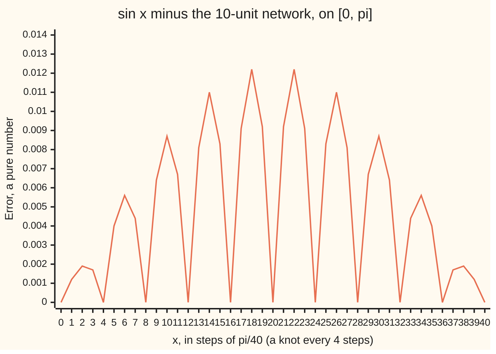

# Universal approximation: one hidden layer can fit any continuous curve, at a price

[Syllabus](../../../SYLLABUS.md) → [Applied and computational](../README.md) → [Deep Networks](../README.md#s09) → Universal approximation

---

## General Overview

A signal chip must produce sin x for angles from 0 to π, and it may only add, multiply and take a maximum. A network with one hidden layer of 10 units can do it. Each unit is a **ReLU** (rectified linear unit): it outputs its input when that is positive and 0 otherwise, so its graph is a hinge with one bend, called a **kink**.

Put the 10 kinks at 0, π/10, 2π/10 and so on. Add the hinges with the right weights, and the network draws straight segments that meet sin x at 11 points. Between those points it sags below the curve. The worst sag, measured at 10,001 points, is 0.012160. A short proof promises at most $`(\pi/10)^2/8 = 0.012337`$.

Want half that error? The bound asks for 14.14 units, about 1.41 times as many, so 15 whole units, not 20. Error falls with the square of the spacing, so twice the accuracy costs only $`\sqrt 2`$ times the units on one input. With many inputs the same construction explodes: a 28 by 28 grey image of a handwritten digit has 784 inputs, and a grid with 10 pieces per input needs $`10^{784}`$ pieces.

**One hidden layer of non-polynomial units, such as ReLU, can match any continuous function on a closed, bounded region as closely as you ask, but it promises nothing about width, training or new inputs.**

In one input the proof is a join-the-dots line whose error is at most $`M h^2/8`$. With many inputs, the theorem does not say how many units are needed.

**What kind of fact this is:** a theorem. The one-input ReLU case, with its error bound, is proved on this card in Why it works. The general case for any number of inputs and any continuous non-polynomial unit is stated with the shape of its proof and named sources.

### The picture: ten arches of error



The line is the gap between sin x and the network at 41 evenly spaced points. It is 0 at each of the 11 knots, where the network meets the curve. Each arch peaks near the middle of its piece. The tallest arches, 0.0122, sit beside π/2, where sin x bends hardest.

---

## The formula

New notation, in words first. $`\mathrm{ReLU}(z) = \max(0, z)`$: keep a positive number, replace a negative one by 0. A **hidden unit** takes the input $`x`$ and forms $`w_k x + b_k`$: a weight times the input plus a bias, as on [The perceptron and its stack](../06-Machine%20Learning%20Mathematics/03-perceptron-and-neural-networks.md). It passes that through an **activation function** $`g`$, here ReLU. The network adds the units' outputs with output weights $`a_k`$ and an output bias $`c`$.

**The theorem.** Let $`g`$ be continuous and not a polynomial. Let $`f`$ be continuous on a closed, bounded set $`S`$ of points with $`d`$ coordinates. For every error allowance $`\varepsilon > 0`$ there are a width $`N`$ and numbers $`a_k`$, $`w_k`$, $`b_k`$, $`c`$ with

```math
\Bigl|\, f(x) - \Bigl(c + \sum_{k=0}^{N-1} a_k\, g(w_k \cdot x + b_k)\Bigr) \Bigr| < \varepsilon \quad \text{for every } x \text{ in } S
```

**Read it aloud:** whatever continuous target and whatever tolerance, some single hidden layer of enough units stays within that tolerance everywhere on the region.

Here $`w_k \cdot x`$ is a dot product: multiply matching coordinates and add. With one input it is an ordinary product.

**The one-input ReLU case, with a price.** On $`[0, \pi]`$, put $`N + 1`$ knots at spacing $`h = \pi/N`$, so $`N`$ pieces, and join the values of $`f`$ with straight segments. Call that join $`L`$. If $`f`$ bends by at most $`M`$ (its second derivative stays between $`-M`$ and $`M`$), then

```math
\max_{0 \le x \le \pi} \lvert f(x) - L(x) \rvert \;\le\; \frac{M h^2}{8}, \qquad N \;\ge\; \pi \sqrt{\frac{M}{8\varepsilon}} \text{ units suffice for error } \varepsilon
```

**Read it aloud:** the worst gap is the bend times the spacing squared over eight, so the units needed grow like one over the square root of the error.

For sin x, $`M = 1`$ and $`h = \pi/10 = 0.314159`$, so the bound is $`0.098696/8 = 0.012337`$.

| Symbol | Plain meaning | In our example | Push it up and the answer… |
| --- | --- | --- | --- |
| $`f`$ | the target: a continuous function | $`\sin x`$ | — |
| $`x`$, $`S`$, $`d`$ | an input; the closed, bounded region of inputs; how many coordinates an input has | $`S = [0, \pi]`$, $`d = 1`$ | $`d`$ up: units needed explode |
| $`g`$, $`\mathrm{ReLU}`$ | the activation; ReLU is $`\max(0, z)`$ | ReLU | — |
| $`N`$; $`k`$, $`j`$ | the width (number of hidden units); counters for units and segments | $`N = 10`$ | error falls like $`1/N^2`$ |
| $`w_k`$, $`b_k`$ | unit $`k`$'s weight and bias; its kink sits at $`x = -b_k/w_k`$ | $`w_k = 1`$, $`b_k = -k\pi/10`$ | moves or steepens the hinge |
| $`a_k`$, $`c`$, $`s_k`$ | output weights, output bias; $`s_k`$ the slope of segment $`k`$ | $`a_0 = s_0 = 0.9836`$, $`a_1 = -0.0963`$, $`c = 0`$ | more bend at that kink |
| $`x_k`$, $`h`$ | the knots, where the network meets $`f`$; the spacing between them | $`k\pi/10`$; $`h = 0.314159`$ | error grows like $`h^2`$ |
| $`L`$, $`e`$ | the join (straight segments through the knots); the gap $`f - L`$ | the 10-unit network; worst gap 0.012160 | — |
| $`M`$ | the largest bend, the most $`\lvert f''\rvert`$ reaches | 1 | the bound grows in step |
| $`\varepsilon`$ | the error allowance | 0.012337 at 10 units | smaller: more units |
| $`m`$ | a polynomial's degree, or a derivative's order (Step 4) | 2 for square units | — |
| $`\phi`$, $`\xi`$ | the fold's helper function, and the point where its bend is 0 | — | — |

### When it holds

- **The target must be continuous.** A jump of 1 defeats every continuous network: next to the jump some error is at least 0.5. At 10, 20, 40 and 80 units the measured worst error is 0.907, 0.814, 0.628 and 0.736, never below 0.5.
- **The region must be bounded.** The promise covers $`[0, \pi]`$ only. Past π the network keeps its last slope: at $`x = 4`$ it says −0.8444 where sin says −0.7568, and at $`2\pi`$ it says −3.0902 where sin says 0.
- **The activation must not be a polynomial.** With square units every network is a parabola, whatever its width. No parabola gets within 0.027988 of sin x, more than twice the 10-unit ReLU bound.
- **The activation needs a kink or a curve.** With identity units, $`g(z) = z`$, the network is a straight line, and every line misses by at least 0.500000.
- **The theorem is about existence.** It promises that good weights exist, not that training finds them (Step 5).

---

## Why it works

### Step 0: a ReLU is a hinge, and hinges add up to any polyline

One unit, $`\mathrm{ReLU}(x - x_k)`$, is flat until $`x_k`$ and then rises with slope 1. Multiply it by $`a_k`$ and it changes the slope by $`a_k`$ at $`x_k`$, and nowhere else.

A **polyline** (a chain of straight segments) is described by a start value and a slope change at each corner. So a sum of hinges, one per corner, draws any polyline. A continuous curve is close to a polyline with short enough segments.

### Step 1: choose the weights so the network is the join

Let $`s_k`$ be the slope of segment $`k`$, from $`x_k`$ to $`x_{k+1}`$: $`s_k = (f(x_{k+1}) - f(x_k))/h`$. Set

```math
c = f(x_0), \qquad a_0 = s_0, \qquad a_k = s_k - s_{k-1} \quad (k = 1, \dots, N - 1)
```

**Read it aloud:** start at the curve's first value, give the first hinge the first slope, and give every later hinge the change in slope at its corner.

On segment $`j`$, the units $`0`$ to $`j`$ are switched on. Their slopes add to $`a_0 + a_1 + \dots + a_j = s_j`$, because the differences cancel in pairs. So the network rises with slope $`s_j`$ there, and it starts at $`f(x_0)`$. By induction along the segments, it passes through every $`f(x_k)`$: it is exactly the join $`L`$.

For sin x, the first slope is $`a_0 = 0.9836`$ and the next corner bends by $`a_1 = -0.0963`$. The checks build the network from these weights and, separately, read the join off piece by piece. The two never differ by more than $`10^{-12}`$ at the 10,001 test points.

### Step 2: on one piece, the gap is at most $`M h^2/8`$

Between two knots, the gap $`f - L`$ is 0 at both ends. Its second derivative is $`f''`$, because $`L`$ is straight. A function that is 0 at both ends and bends by at most $`M`$ cannot rise more than $`M h^2/8`$, and the parabola $`\tfrac{M}{2}(x - x_j)(x_{j+1} - x)`$ shows the worst case. Its peak, at the middle, is $`\tfrac{M}{2} \cdot \tfrac{h}{2} \cdot \tfrac{h}{2} = M h^2/8`$.

<details>
<summary>Detailed proof: the gap on one piece is f''(ξ)/2 times (x − x_j)(x − x_{j+1})</summary>

Fix a piece from $`x_j`$ to $`x_{j+1}`$ and a point $`x`$ strictly inside it. Write $`e(t) = f(t) - L(t)`$, so $`e(x_j) = e(x_{j+1}) = 0`$. Define

$`\displaystyle \phi(t) = e(t) - e(x)\,\frac{(t - x_j)(t - x_{j+1})}{(x - x_j)(x - x_{j+1})}`$

Then $`\phi`$ is 0 at three points: $`x_j`$, $`x`$ and $`x_{j+1}`$. Rolle's theorem says a smooth function equal at two points has zero slope somewhere between; it is the engine of [Taylor's theorem](../../06-Calculus%20and%20analysis/03-What%20Derivatives%20Tell%20You/05-taylors-theorem.md). So $`\phi'`$ is 0 at two points, and then $`\phi''`$ is 0 at some $`\xi`$ in the piece. Since $`L'' = 0`$,

$`\displaystyle 0 = \phi''(\xi) = f''(\xi) - \frac{2\,e(x)}{(x - x_j)(x - x_{j+1})}, \qquad \text{so} \qquad e(x) = \frac{f''(\xi)}{2}\,(x - x_j)(x - x_{j+1}).`$

The product $`(x - x_j)(x_{j+1} - x)`$ is largest at the middle, where it equals $`h^2/4`$. With $`\lvert f''\rvert \le M`$ this gives $`\lvert e(x)\rvert \le M h^2/8`$.

</details>

For sin x the gap on the piece from $`0.4\pi`$ to $`0.5\pi`$ peaks near its middle at $`\sin(0.45\pi)\,(1 - \cos(\pi/20)) = 0.012160`$. The scan of 10,001 points finds the same 0.012160, at $`x = 1.7272`$ on the mirror piece. That is 0.9857 of the bound: the bound is nearly tight.

### Step 3: any continuous target, no derivatives needed

Step 2 needs a second derivative. The theorem needs only continuity, and [Uniform continuity](../../06-Calculus%20and%20analysis/01-Limits%20and%20Continuity/08-uniform-continuity-and-lipschitz.md) supplies the rest. On a closed, bounded interval, a continuous $`f`$ has one input tolerance for the whole interval. For any $`\varepsilon`$ there is a spacing $`h`$ such that inputs within $`h`$ have outputs within $`\varepsilon`$.

Take that spacing for the knots. On each piece, $`L(x)`$ is a weighted average of $`f(x_j)`$ and $`f(x_{j+1})`$. Both are within $`\varepsilon`$ of $`f(x)`$, so their average is too. With Step 1, the ReLU network is within $`\varepsilon`$ of $`f`$ everywhere on the interval. That completes the proof of the one-input case.

### Step 4: other activations and many inputs, the shape of the proof

The general theorem is stated here without a full proof. Its route, in words:

- **Why "not a polynomial".** If $`g`$ is a polynomial of degree $`m`$, every network built from it is a polynomial of degree at most $`m`$. That family is closed: width adds no new shapes. Square units give parabolas only, and the checks prove that every parabola misses sin x by at least 0.027988. The parabola through 0, π/2 and π misses by 0.056010; lowered by half that, it misses by 0.028005. So the best parabola sits between these two numbers, at any width.
- **Why non-polynomial is enough, for smooth g.** Differences of $`g(w x + b)`$ at nearby weights approximate its derivatives in $`w`$. At $`w = 0`$ the $`m`$-th derivative is $`x^m g^{(m)}(b)`$, where $`g^{(m)}`$ is the $`m`$-th derivative of $`g`$. A smooth non-polynomial has some $`b`$ where no derivative vanishes, so every power $`x^m`$ is within reach of a network. Sums of powers are polynomials, and Weierstrass's theorem (polynomials come within any $`\varepsilon`$ of a continuous function on an interval) finishes. Leshno, Lin, Pinkus and Schocken removed the smoothness.
- **Many inputs.** A continuous function of $`d`$ inputs is approximated by sums of **ridge functions**, functions of one direction $`w \cdot x`$ only, such as waves $`\cos(w \cdot x)`$. Each ridge is a one-input function, and Step 3 approximates it.
- **The first proofs.** Cybenko (1989) proved the sigmoid case by a separation argument from functional analysis. If the networks missed some continuous function, a nonzero measure (a way of weighting the region) would give every unit's output a total of 0. He shows that no such measure exists for a sigmoid. Hornik, Stinchcombe and White proved a general version the same year.

### Step 5: the price, and what is not promised

**Width.** Error falls like $`h^2`$, so like $`1/N^2`$. Doubling the units divides the error by about 4: the measured ratios are 4.0249, 3.9569, 3.9892 and 3.9976. To halve the error, multiply the units by $`\sqrt 2`$: the target 0.006169 needs $`\pi/\sqrt{8 \times 0.006169} = 14.14`$ units, so 15.

In $`d`$ inputs the grid version of this proof needs $`N`$ pieces per input, $`N^d`$ in all: 100 for two inputs, 1000 for three, $`10^{784}`$ for a digit image. The theorem offers no smaller count. Deeper networks can do better on some functions. Some functions that a few layers build with few units need exponentially many units in one hidden layer. This fact is called **depth separation**; it is named here and not proved.

**Training.** The theorem says good weights exist. It does not say gradient descent finds them. Start every kink at $`x = 4`$, past π: every unit outputs 0 on the data, so every slope that training follows for the unit weights is exactly 0. After 300 steps only the output bias has moved, to 0.630265, the mean of sin at the 101 training points. The worst error stays 0.630265.

**Generalisation.** The theorem assumes $`f`$ is known at every point of $`S`$. Training sees only samples. Add 30 units to the 10-unit network, three per piece, that raise a tent of height 1 in the middle of each piece and are 0 at every knot. The 40-unit network still matches all 11 samples of sin x exactly, yet the scan of 10,001 points finds a worst error of 0.998074 between them. Both networks fit the samples perfectly. The theorem cannot say which one training returns, or how either does on inputs it has not seen.

---

## Worked numbers, by hand

| Step | Arithmetic | Value |
| --- | --- | --- |
| spacing | $`h = \pi/10`$ | 0.314159 |
| spacing squared | $`h^2`$ | 0.098696 |
| the bound, $`M = 1`$ | $`0.098696/8`$ | 0.012337 |
| first hinge weight | slope of the first chord, $`a_0 = s_0`$ | 0.9836 |
| second hinge weight | $`a_1 = s_1 - s_0`$ | −0.0963 |
| numbers in the network | 10 weights + 10 biases + 10 output weights + 1 output bias | 31 |
| measured worst error | scan of 10,001 points | 0.012160 |
| measured over bound | $`0.012160/0.012337`$ | 0.9857 |
| half the bound | $`0.012337/2`$ | 0.006169 |
| units to reach it | $`\pi/\sqrt{8 \times 0.006169}`$, rounded up | **14.14, so 15** |

Ten units hold sin x to within about 0.0122 on $`[0, \pi]`$. Halving that bound takes 14.14 units by the formula, 1.41 times as many, so 15 whole units.

The same rule sizes a network for a stated error:

| Error allowance | Units by $`\pi\sqrt{1/(8\varepsilon)}`$ | Measured worst error |
| --- | ---: | ---: |
| 0.01 | 12 | 0.008482 |
| 0.001 | 36 | 0.000951 |
| 0.0001 | 112 | 0.000098 |

Each tenfold gain in accuracy multiplies the units by about $`\sqrt{10}`$: 12, 36, 112.

### What breaks if you drop a piece

| Mistake | Comes out at | What went wrong |
| --- | --- | --- |
| Target with a jump of 1 at $`x = 1.6`$ | worst error 0.907, 0.814, 0.628, 0.736 at 10, 20, 40, 80 units | a continuous network cannot jump; next to the jump it misses by at least 0.5 |
| Reading the network outside $`[0, \pi]`$ | −3.0902 at $`2\pi`$, where sin is 0 | the promise covers the bounded region only |
| Square units, any width | every parabola misses by at least 0.027988 | a polynomial activation gives polynomials of fixed degree |
| Identity units, no kink | every line misses by at least 0.500000 | the network collapses to one straight line |
| Every kink started past π, then trained | stuck at 0.630265 after 300 steps | dead units have zero slope, so training never moves them |

The lower bounds for lines and parabolas come from a **divided difference**. This is a weighted sum of $`f`$ at a few points that is exactly 0 for every line (3 points) or every parabola (4 points). Whatever such a sum returns on sin x must come from the error, so it caps how small the error can be. For lines, the points 0, π/2 and π with weights 1, −2 and 1 give $`\lvert 0 - 2 \times 1 + 0 \rvert / (1 + 2 + 1) = 0.5`$.

---

## Code, from first principles, and it actually runs

The code builds the 10-unit network from the slopes and checks it against the join read off piece by piece. It then measures the error at 10,001 points against the bound and a midpoint formula, and repeats this at 5 to 80 units. It runs the five broken cases, with divided-difference lower bounds for lines and parabolas, a training run whose closed-form answer is a cotangent sum, and a 40-unit network that matches every sample but not the curve between them. That is two independent roads to the main error, the midpoint formula and the scan, checked against the bound. Only the `math` module is imported.

### Python

```python
# Universal approximation -- the check behind the card.  Only math is imported.
# A one-hidden-layer ReLU network with 10 units is built to equal the straight-
# line join of sin x at 11 points on [0, pi].  Roads: the network against the
# join read off piece by piece; the error measured at 10,001 points against the
# bound h^2/8 and a midpoint formula; four broken hypotheses, two of them with a
# lower bound proved by a divided difference (a sum that wipes out every
# straight line or every parabola); and a training run whose units are dead.
import math

PI = math.pi
GRID = [i * PI / 10000 for i in range(10001)]          # the 10,001 test points

def relu(z):
    return z if z > 0.0 else 0.0

def build(f, n):     # unit k computes relu(1 * x - x_k); output c + sum of a_k * unit k
    xs = [k * PI / n for k in range(n + 1)]
    ys = [f(x) for x in xs]
    s = [(ys[k + 1] - ys[k]) / (xs[k + 1] - xs[k]) for k in range(n)]
    a = [s[0]] + [s[k] - s[k - 1] for k in range(1, n)]
    return ys[0], a, xs[:n], xs, ys

def net(c, a, kinks, x):
    out = c
    for ak, bk in zip(a, kinks):
        out += ak * relu(x - bk)
    return out

def join(xs, ys, x):     # road two: find the piece, draw its chord; no network
    j = 0
    while j < len(xs) - 2 and x > xs[j + 1]:
        j += 1
    t = (x - xs[j]) / (xs[j + 1] - xs[j])
    return ys[j] + t * (ys[j + 1] - ys[j])

def max_err(f, n):
    c, a, kinks, _, _ = build(f, n)
    return max((abs(f(x) - net(c, a, kinks, x)), x) for x in GRID)

def bound(n):                                     # M h^2 / 8 with M = 1 for sin
    return (PI / n) ** 2 / 8

def ddiff(pts, f):   # |divided difference| / (sum of |weights|): a lower bound on
    w = []           # the miss of every polynomial of degree len(pts) - 2
    for i in range(len(pts)):
        p = 1.0
        for j in range(len(pts)):
            if j != i:
                p *= pts[i] - pts[j]
        w.append(1.0 / p)
    return abs(sum(wi * f(x) for wi, x in zip(w, pts))) / sum(abs(wi) for wi in w)

c, a, kinks, xs, ys = build(math.sin, 10)
gap = max(abs(net(c, a, kinks, x) - join(xs, ys, x)) for x in GRID)
err, at = max_err(math.sin, 10)
mid = math.sin(0.45 * PI) * (1 - math.cos(PI / 20))
h = PI / 10
print("sin x on [0, pi]: 10 hidden ReLU units, kinks at x_k = k*pi/10, k = 0 to 9")
print("output weights a_k:", " ".join(f"{v:.4f}" for v in a))
print("numbers in the network: 10 weights + 10 biases + 10 output weights + 1 output bias = 31")
print(f"network against the chord join, largest gap over 10,001 points below 1e-12: {'yes' if gap < 1e-12 else 'no'}")
print(f"h = pi/10 = {h:.6f}; h^2 = {h * h:.6f}; bound h^2/8 = {bound(10):.6f}")
print(f"measured max error at 10,001 points: {err:.6f} at x = {at:.4f}")
print(f"midpoint formula sin(0.45 pi)(1 - cos(pi/20)): {mid:.6f}")
print(f"measured / bound: {err / bound(10):.4f}")
print("units | max error | bound h^2/8 | error ratio to the row above")
errs = {}
for n in [5, 10, 20, 40, 80]:
    errs[n] = max_err(math.sin, n)[0]
    ratio = f"{errs[n // 2] / errs[n]:.4f}" if n // 2 in errs else "-"
    print(f"{n} | {errs[n]:.6f} | {bound(n):.6f} | {ratio}")
target = bound(10) / 2
need = PI / math.sqrt(8 * target)
n_half = 10
while bound(n_half) > target:
    n_half += 1
print(f"halve the error: target {target:.6f}; formula pi/sqrt(8 target) = {need:.2f} units, "
      f"{need / 10:.4f} times 10; bound at 14 = {bound(14):.6f}, at 15 = {bound(15):.6f}; smallest: {n_half}")
for eps in [0.01, 0.001, 0.0001]:
    n = math.ceil(PI / math.sqrt(8 * eps))
    print(f"error {eps}: units by the bound {n}; measured error {max_err(math.sin, n)[0]:.6f}")
print("grid of 10 pieces per axis:", "; ".join(f"d = {d}: {10 ** d}" for d in [1, 2, 3]) + "; d = 784: 10^784")
step = lambda x: 1.0 if x >= 1.6 else 0.0
jump = [max_err(step, n)[0] for n in [10, 20, 40, 80]]
print("break 1, a jump of 1 at x = 1.6, max error at 10, 20, 40, 80 units:", " ".join(f"{v:.3f}" for v in jump))
print(f"break 2, outside [0, pi]: network at 2 pi = {net(c, a, kinks, 2 * PI):.4f}, sin 2 pi = 0; "
      f"at 4: network {net(c, a, kinks, 4.0):.4f}, sin {math.sin(4.0):.4f}")
line_low = ddiff([0.0, PI / 2, PI], math.sin)
line_hi = max(abs(math.sin(x) - 0.5) for x in GRID)
print(f"break 3, no kink (identity units): every line misses by >= {line_low:.6f}; the constant 0.5 misses by {line_hi:.6f}")
G = 48
par_low, best = 0.0, None
for i in range(G + 1):
    for j in range(i + 1, G + 1):
        for k in range(j + 1, G + 1):
            for l in range(k + 1, G + 1):
                v = ddiff([i * PI / G, j * PI / G, k * PI / G, l * PI / G], math.sin)
                if v > par_low:
                    par_low, best = v, (i, j, k, l)
para = lambda x: 4 * x * (PI - x) / (PI * PI)
miss = max(abs(math.sin(x) - para(x)) for x in GRID)
par_hi = max(abs(math.sin(x) - (para(x) - miss / 2)) for x in GRID)
print(f"break 4, square units, any width: every parabola misses by >= {par_low:.6f} "
      f"(points {best} x pi/48); parabola through 0, pi/2, pi misses by {miss:.6f}; lowered by half: {par_hi:.6f}")
tx = [j * PI / 100 for j in range(101)]                     # 101 training points
ta, tw, tb, tc, dead = [0.5] * 10, [1.0] * 10, [-4.0] * 10, 0.0, 0.0
for _ in range(300):                                      # gradient descent, rate 0.1
    ga, gw, gb, gc = [0.0] * 10, [0.0] * 10, [0.0] * 10, 0.0
    for x in tx:
        z = [tw[k] * x + tb[k] for k in range(10)]
        d = 2 * (tc + sum(ta[k] * relu(z[k]) for k in range(10)) - math.sin(x)) / 101
        gc += d
        for k in range(10):
            on = 1.0 if z[k] > 0 else 0.0
            ga[k] += d * relu(z[k]); gw[k] += d * ta[k] * on * x; gb[k] += d * ta[k] * on
    dead = max([dead] + [abs(g) for g in ga + gw + gb])
    tc -= 0.1 * gc
    ta = [ta[k] - 0.1 * ga[k] for k in range(10)]
closed = 1 / math.tan(PI / 200) / 101                  # sum of sin(j pi/100) = cot(pi/200)
stuck = max(abs(math.sin(x) - tc) for x in GRID)
print(f"training with every kink at x = 4: largest unit gradient over 300 steps {dead:.1f}; "
      f"output bias {tc:.6f}; mean of sin at the 101 points {closed:.6f}; max error {stuck:.6f}")
fit40 = lambda x: net(c, a, kinks, x) + sum(relu(x - xs[j]) - 2 * relu(x - xs[j] - h / 2) + relu(x - xs[j + 1]) for j in range(10)) * 2 / h
memo, wild = (max(abs(fit40(x) - math.sin(x)) for x in pts) for pts in (xs, GRID))   # 30 more units: a tent on each piece
print(f"generalisation, 10 units + 30 tent units: error at the 11 samples below 1e-12: {'yes' if memo < 1e-12 else 'no'}; "
      f"max error at 10,001 points {wild:.6f}")
fig = [abs(math.sin(i * PI / 40) - net(c, a, kinks, i * PI / 40)) for i in range(41)]
print("figure, error at x = i*pi/40, i = 0 to 40:", " ".join(f"{v:.4f}" for v in fig))
assert gap < 1e-12                                     # network = chord join
assert 0.98 * bound(10) < err <= bound(10)             # bound holds and is nearly tight
assert abs(err - mid) < 1e-6                           # scan agrees with the formula
assert all(3.9 < errs[n // 2] / errs[n] < 4.1 for n in [10, 20, 40, 80])
assert n_half == 15 and abs(need / 10 - math.sqrt(2)) < 1e-9
assert min(jump) >= 0.5                                # continuity: no width helps
assert abs(line_low - 0.5) < 1e-12 and abs(line_hi - 0.5) < 1e-12
assert par_low <= par_hi < par_low + 1e-4 and par_low > 2 * bound(10)
assert dead == 0.0 and abs(tc - closed) < 1e-12 and abs(stuck - closed) < 1e-12
assert memo < 1e-12 and abs(wild - (1 - math.sin(PI / 20) * (1 - math.cos(PI / 20)))) < 1e-9   # tent 1 minus the smallest midpoint gap
print("ALL CHECKS PASS")
```

**Ran 2026-11-23 on macOS, Python 3.14.10, standard library only. All checks passed. Output, pasted from the run:**

```
sin x on [0, pi]: 10 hidden ReLU units, kinks at x_k = k*pi/10, k = 0 to 9
output weights a_k: 0.9836 -0.0963 -0.1831 -0.2521 -0.2963 -0.3116 -0.2963 -0.2521 -0.1831 -0.0963
numbers in the network: 10 weights + 10 biases + 10 output weights + 1 output bias = 31
network against the chord join, largest gap over 10,001 points below 1e-12: yes
h = pi/10 = 0.314159; h^2 = 0.098696; bound h^2/8 = 0.012337
measured max error at 10,001 points: 0.012160 at x = 1.7272
midpoint formula sin(0.45 pi)(1 - cos(pi/20)): 0.012160
measured / bound: 0.9857
units | max error | bound h^2/8 | error ratio to the row above
5 | 0.048943 | 0.049348 | -
10 | 0.012160 | 0.012337 | 4.0249
20 | 0.003073 | 0.003084 | 3.9569
40 | 0.000770 | 0.000771 | 3.9892
80 | 0.000193 | 0.000193 | 3.9976
halve the error: target 0.006169; formula pi/sqrt(8 target) = 14.14 units, 1.4142 times 10; bound at 14 = 0.006294, at 15 = 0.005483; smallest: 15
error 0.01: units by the bound 12; measured error 0.008482
error 0.001: units by the bound 36; measured error 0.000951
error 0.0001: units by the bound 112; measured error 0.000098
grid of 10 pieces per axis: d = 1: 10; d = 2: 100; d = 3: 1000; d = 784: 10^784
break 1, a jump of 1 at x = 1.6, max error at 10, 20, 40, 80 units: 0.907 0.814 0.628 0.736
break 2, outside [0, pi]: network at 2 pi = -3.0902, sin 2 pi = 0; at 4: network -0.8444, sin -0.7568
break 3, no kink (identity units): every line misses by >= 0.500000; the constant 0.5 misses by 0.500000
break 4, square units, any width: every parabola misses by >= 0.027988 (points (0, 7, 24, 41) x pi/48); parabola through 0, pi/2, pi misses by 0.056010; lowered by half: 0.028005
training with every kink at x = 4: largest unit gradient over 300 steps 0.0; output bias 0.630265; mean of sin at the 101 points 0.630265; max error 0.630265
generalisation, 10 units + 30 tent units: error at the 11 samples below 1e-12: yes; max error at 10,001 points 0.998074
figure, error at x = i*pi/40, i = 0 to 40: 0.0000 0.0012 0.0019 0.0017 0.0000 0.0040 0.0056 0.0044 0.0000 0.0064 0.0087 0.0067 0.0000 0.0081 0.0110 0.0083 0.0000 0.0091 0.0122 0.0092 0.0000 0.0092 0.0122 0.0091 0.0000 0.0083 0.0110 0.0081 0.0000 0.0067 0.0087 0.0064 0.0000 0.0044 0.0056 0.0040 0.0000 0.0017 0.0019 0.0012 0.0000
ALL CHECKS PASS
```

### Rust

Same numbers, same labels, built with `rustc --edition 2021 -O`.

```rust
// Universal approximation -- the same check as the Python, in Rust.  No crates.
// A one-hidden-layer ReLU network with 10 units is built to equal the straight-
// line join of sin x at 11 points on [0, pi].  Roads: the network against the
// join read off piece by piece; the error measured at 10,001 points against the
// bound h^2/8 and a midpoint formula; four broken hypotheses, two of them with a
// lower bound proved by a divided difference (a sum that wipes out every
// straight line or every parabola); and a training run whose units are dead.
use std::f64::consts::PI;

fn relu(z: f64) -> f64 { if z > 0.0 { z } else { 0.0 } }

struct Net { c: f64, a: Vec<f64>, kinks: Vec<f64>, xs: Vec<f64>, ys: Vec<f64> }

fn build(f: &dyn Fn(f64) -> f64, n: usize) -> Net {   // unit k computes relu(1 * x - x_k)
    let xs: Vec<f64> = (0..=n).map(|k| k as f64 * PI / n as f64).collect();
    let ys: Vec<f64> = xs.iter().map(|&x| f(x)).collect();
    let s: Vec<f64> = (0..n).map(|k| (ys[k + 1] - ys[k]) / (xs[k + 1] - xs[k])).collect();
    let mut a = vec![s[0]];
    for k in 1..n { a.push(s[k] - s[k - 1]) }
    Net { c: ys[0], a, kinks: xs[..n].to_vec(), xs, ys }
}

fn net(m: &Net, x: f64) -> f64 {
    let mut out = m.c;
    for (ak, bk) in m.a.iter().zip(m.kinks.iter()) { out += ak * relu(x - bk) }
    out
}

fn join(xs: &[f64], ys: &[f64], x: f64) -> f64 {     // road two: find the piece, draw its chord
    let mut j = 0;
    while j < xs.len() - 2 && x > xs[j + 1] { j += 1 }
    let t = (x - xs[j]) / (xs[j + 1] - xs[j]);
    ys[j] + t * (ys[j + 1] - ys[j])
}

fn grid() -> Vec<f64> { (0..=10000).map(|i| i as f64 * PI / 10000.0).collect() }

fn max_err(f: &dyn Fn(f64) -> f64, n: usize) -> (f64, f64) {
    let m = build(f, n);
    let (mut best, mut at) = (-1.0, 0.0);
    for x in grid() {
        let e = (f(x) - net(&m, x)).abs();
        if e > best || (e == best && x > at) { best = e; at = x }
    }
    (best, at)
}

fn bound(n: usize) -> f64 { (PI / n as f64).powi(2) / 8.0 }   // M h^2 / 8 with M = 1 for sin

fn ddiff(pts: &[f64], f: &dyn Fn(f64) -> f64) -> f64 {        // lower bound on the miss of
    let mut w = Vec::new();                                    // every polynomial of degree
    for i in 0..pts.len() {                                    // pts.len() - 2
        let mut p = 1.0;
        for j in 0..pts.len() { if j != i { p *= pts[i] - pts[j] } }
        w.push(1.0 / p);
    }
    let num: f64 = w.iter().zip(pts.iter()).map(|(wi, &x)| wi * f(x)).sum();
    num.abs() / w.iter().map(|wi| wi.abs()).sum::<f64>()
}

fn joined(v: &[f64], d: usize) -> String {
    v.iter().map(|x| format!("{:.*}", d, x)).collect::<Vec<_>>().join(" ")
}

fn main() {
    let sin = |x: f64| x.sin();
    let m = build(&sin, 10);
    let gap = grid().iter().map(|&x| (net(&m, x) - join(&m.xs, &m.ys, x)).abs()).fold(0.0, f64::max);
    let (err, at) = max_err(&sin, 10);
    let mid = (0.45 * PI).sin() * (1.0 - (PI / 20.0).cos());
    let h = PI / 10.0;
    println!("sin x on [0, pi]: 10 hidden ReLU units, kinks at x_k = k*pi/10, k = 0 to 9");
    println!("output weights a_k: {}", joined(&m.a, 4));
    println!("numbers in the network: 10 weights + 10 biases + 10 output weights + 1 output bias = 31");
    println!("network against the chord join, largest gap over 10,001 points below 1e-12: {}", if gap < 1e-12 { "yes" } else { "no" });
    println!("h = pi/10 = {:.6}; h^2 = {:.6}; bound h^2/8 = {:.6}", h, h * h, bound(10));
    println!("measured max error at 10,001 points: {:.6} at x = {:.4}", err, at);
    println!("midpoint formula sin(0.45 pi)(1 - cos(pi/20)): {:.6}", mid);
    println!("measured / bound: {:.4}", err / bound(10));
    println!("units | max error | bound h^2/8 | error ratio to the row above");
    let sizes = [5usize, 10, 20, 40, 80];
    let mut errs: Vec<f64> = Vec::new();
    for (i, &n) in sizes.iter().enumerate() {
        errs.push(max_err(&sin, n).0);
        let ratio = if i > 0 { format!("{:.4}", errs[i - 1] / errs[i]) } else { "-".to_string() };
        println!("{} | {:.6} | {:.6} | {}", n, errs[i], bound(n), ratio);
    }
    let target = bound(10) / 2.0;
    let need = PI / (8.0 * target).sqrt();
    let mut n_half = 10;
    while bound(n_half) > target { n_half += 1 }
    println!("halve the error: target {:.6}; formula pi/sqrt(8 target) = {:.2} units, {:.4} times 10; bound at 14 = {:.6}, at 15 = {:.6}; smallest: {}",
             target, need, need / 10.0, bound(14), bound(15), n_half);
    for eps in [0.01f64, 0.001, 0.0001] {
        let n = (PI / (8.0 * eps).sqrt()).ceil() as usize;
        println!("error {}: units by the bound {}; measured error {:.6}", eps, n, max_err(&sin, n).0);
    }
    let dims: Vec<String> = [1u32, 2, 3].iter().map(|&d| format!("d = {}: {}", d, 10u64.pow(d))).collect();
    println!("grid of 10 pieces per axis: {}; d = 784: 10^784", dims.join("; "));
    let step = |x: f64| if x >= 1.6 { 1.0 } else { 0.0 };
    let jump: Vec<f64> = [10usize, 20, 40, 80].iter().map(|&n| max_err(&step, n).0).collect();
    println!("break 1, a jump of 1 at x = 1.6, max error at 10, 20, 40, 80 units: {}", joined(&jump, 3));
    println!("break 2, outside [0, pi]: network at 2 pi = {:.4}, sin 2 pi = 0; at 4: network {:.4}, sin {:.4}",
             net(&m, 2.0 * PI), net(&m, 4.0), (4.0f64).sin());
    let line_low = ddiff(&[0.0, PI / 2.0, PI], &sin);
    let line_hi = grid().iter().map(|&x| (x.sin() - 0.5).abs()).fold(0.0, f64::max);
    println!("break 3, no kink (identity units): every line misses by >= {:.6}; the constant 0.5 misses by {:.6}", line_low, line_hi);
    let g = 48usize;
    let (mut par_low, mut best) = (0.0, (0, 0, 0, 0));
    for i in 0..=g { for j in i + 1..=g { for k in j + 1..=g { for l in k + 1..=g {
        let p = |q: usize| q as f64 * PI / g as f64;
        let v = ddiff(&[p(i), p(j), p(k), p(l)], &sin);
        if v > par_low { par_low = v; best = (i, j, k, l) }
    }}}}
    let para = |x: f64| 4.0 * x * (PI - x) / (PI * PI);
    let miss = grid().iter().map(|&x| (x.sin() - para(x)).abs()).fold(0.0, f64::max);
    let par_hi = grid().iter().map(|&x| (x.sin() - (para(x) - miss / 2.0)).abs()).fold(0.0, f64::max);
    println!("break 4, square units, any width: every parabola misses by >= {:.6} (points ({}, {}, {}, {}) x pi/48); parabola through 0, pi/2, pi misses by {:.6}; lowered by half: {:.6}",
             par_low, best.0, best.1, best.2, best.3, miss, par_hi);
    let tx: Vec<f64> = (0..=100).map(|j| j as f64 * PI / 100.0).collect();   // 101 training points
    let (mut ta, tw, tb, mut tc, mut dead) = (vec![0.5; 10], vec![1.0; 10], vec![-4.0; 10], 0.0f64, 0.0f64);
    for _ in 0..300 {                                                       // gradient descent, rate 0.1
        let (mut ga, mut gw, mut gb, mut gc) = (vec![0.0; 10], vec![0.0; 10], vec![0.0; 10], 0.0);
        for &x in &tx {
            let z: Vec<f64> = (0..10).map(|k| tw[k] * x + tb[k]).collect();
            let d = 2.0 * (tc + (0..10).map(|k| ta[k] * relu(z[k])).sum::<f64>() - x.sin()) / 101.0;
            gc += d;
            for k in 0..10 {
                let on = if z[k] > 0.0 { 1.0 } else { 0.0 };
                ga[k] += d * relu(z[k]); gw[k] += d * ta[k] * on * x; gb[k] += d * ta[k] * on;
            }
        }
        for gv in ga.iter().chain(gw.iter()).chain(gb.iter()) { dead = dead.max(gv.abs()) }
        tc -= 0.1 * gc;
        for k in 0..10 { ta[k] -= 0.1 * ga[k] }
    }
    let closed = 1.0 / (PI / 200.0).tan() / 101.0;                          // sum of sin(j pi/100) = cot(pi/200)
    let stuck = grid().iter().map(|&x| (x.sin() - tc).abs()).fold(0.0, f64::max);
    println!("training with every kink at x = 4: largest unit gradient over 300 steps {:.1}; output bias {:.6}; mean of sin at the 101 points {:.6}; max error {:.6}",
             dead, tc, closed, stuck);
    let fit40 = |x: f64| net(&m, x) + (0..10).map(|j| relu(x - m.xs[j]) - 2.0 * relu(x - m.xs[j] - h / 2.0) + relu(x - m.xs[j + 1])).sum::<f64>() * 2.0 / h;
    let memo = m.xs.iter().map(|&x| (fit40(x) - x.sin()).abs()).fold(0.0, f64::max);   // 30 more units: a tent on each piece
    let wild = grid().iter().map(|&x| (fit40(x) - x.sin()).abs()).fold(0.0, f64::max);
    println!("generalisation, 10 units + 30 tent units: error at the 11 samples below 1e-12: {}; max error at 10,001 points {:.6}",
             if memo < 1e-12 { "yes" } else { "no" }, wild);
    let fig: Vec<f64> = (0..=40).map(|i| { let x = i as f64 * PI / 40.0; (x.sin() - net(&m, x)).abs() }).collect();
    println!("figure, error at x = i*pi/40, i = 0 to 40: {}", joined(&fig, 4));
    assert!(gap < 1e-12);                                      // network = chord join
    assert!(0.98 * bound(10) < err && err <= bound(10));       // bound holds and is nearly tight
    assert!((err - mid).abs() < 1e-6);                         // scan agrees with the formula
    assert!((1..5).all(|i| errs[i - 1] / errs[i] > 3.9 && errs[i - 1] / errs[i] < 4.1));
    assert!(n_half == 15 && (need / 10.0 - 2f64.sqrt()).abs() < 1e-9);
    assert!(jump.iter().all(|&v| v >= 0.5));                   // continuity: no width helps
    assert!((line_low - 0.5).abs() < 1e-12 && (line_hi - 0.5).abs() < 1e-12);
    assert!(par_low <= par_hi && par_hi < par_low + 1e-4 && par_low > 2.0 * bound(10));
    assert!(dead == 0.0 && (tc - closed).abs() < 1e-12 && (stuck - closed).abs() < 1e-12);
    assert!(memo < 1e-12 && (wild - (1.0 - (PI / 20.0).sin() * (1.0 - (PI / 20.0).cos()))).abs() < 1e-9);   // tent 1 minus the smallest midpoint gap
    println!("ALL CHECKS PASS");
}
```

**Ran 2026-11-23 on macOS, rustc 1.98.1, no crates. All checks passed. Output, pasted from the run:**

```
sin x on [0, pi]: 10 hidden ReLU units, kinks at x_k = k*pi/10, k = 0 to 9
output weights a_k: 0.9836 -0.0963 -0.1831 -0.2521 -0.2963 -0.3116 -0.2963 -0.2521 -0.1831 -0.0963
numbers in the network: 10 weights + 10 biases + 10 output weights + 1 output bias = 31
network against the chord join, largest gap over 10,001 points below 1e-12: yes
h = pi/10 = 0.314159; h^2 = 0.098696; bound h^2/8 = 0.012337
measured max error at 10,001 points: 0.012160 at x = 1.7272
midpoint formula sin(0.45 pi)(1 - cos(pi/20)): 0.012160
measured / bound: 0.9857
units | max error | bound h^2/8 | error ratio to the row above
5 | 0.048943 | 0.049348 | -
10 | 0.012160 | 0.012337 | 4.0249
20 | 0.003073 | 0.003084 | 3.9569
40 | 0.000770 | 0.000771 | 3.9892
80 | 0.000193 | 0.000193 | 3.9976
halve the error: target 0.006169; formula pi/sqrt(8 target) = 14.14 units, 1.4142 times 10; bound at 14 = 0.006294, at 15 = 0.005483; smallest: 15
error 0.01: units by the bound 12; measured error 0.008482
error 0.001: units by the bound 36; measured error 0.000951
error 0.0001: units by the bound 112; measured error 0.000098
grid of 10 pieces per axis: d = 1: 10; d = 2: 100; d = 3: 1000; d = 784: 10^784
break 1, a jump of 1 at x = 1.6, max error at 10, 20, 40, 80 units: 0.907 0.814 0.628 0.736
break 2, outside [0, pi]: network at 2 pi = -3.0902, sin 2 pi = 0; at 4: network -0.8444, sin -0.7568
break 3, no kink (identity units): every line misses by >= 0.500000; the constant 0.5 misses by 0.500000
break 4, square units, any width: every parabola misses by >= 0.027988 (points (0, 7, 24, 41) x pi/48); parabola through 0, pi/2, pi misses by 0.056010; lowered by half: 0.028005
training with every kink at x = 4: largest unit gradient over 300 steps 0.0; output bias 0.630265; mean of sin at the 101 points 0.630265; max error 0.630265
generalisation, 10 units + 30 tent units: error at the 11 samples below 1e-12: yes; max error at 10,001 points 0.998074
figure, error at x = i*pi/40, i = 0 to 40: 0.0000 0.0012 0.0019 0.0017 0.0000 0.0040 0.0056 0.0044 0.0000 0.0064 0.0087 0.0067 0.0000 0.0081 0.0110 0.0083 0.0000 0.0091 0.0122 0.0092 0.0000 0.0092 0.0122 0.0091 0.0000 0.0083 0.0110 0.0081 0.0000 0.0067 0.0087 0.0064 0.0000 0.0044 0.0056 0.0040 0.0000 0.0017 0.0019 0.0012 0.0000
ALL CHECKS PASS
```

The two outputs match line for line.

### Lean

Lean proves the general theorem in full, which Step 4 only sketches, and the one-input ReLU case with its price.

- Take $`g`$ continuous and not a polynomial, and $`f`$ continuous on a closed, bounded set $`S`$ of points with $`d`$ coordinates. Then for every $`\varepsilon > 0`$, some single hidden layer of enough units stays within $`\varepsilon`$ of $`f`$ everywhere on $`S`$.
- Take $`N`$ pieces of spacing $`h`$ on any closed interval, and Step 1's weights $`c`$ and $`a_k`$. Then the ReLU network meets $`f`$ at every knot, so it is the join $`L`$.
- Suppose also that $`f`$ has a second derivative, with $`\lvert f''\rvert \le M`$ on the interval. Then the network's error is at most $`M h^2/8`$ everywhere on it.
- Take a polynomial activation of degree $`m`$. Then every one-input network built from it, of any width, is a polynomial of degree at most $`m`$.
- The 10-unit network holds 31 numbers. Halving its bound takes 15 units, and 14 fall short.
- A grid of 10 pieces per input has 100 pieces for two inputs and 1000 for three.

Measured numbers on sin x, the five broken cases, the training run and the 40-unit tent network are left to the Python and Rust checks.

```lean
-- Universal approximation: one hidden layer of non-polynomial units comes within any tolerance of a continuous function on a closed, bounded region, and in one input the ReLU join-the-dots network has error at most M h^2 / 8.
import Mathlib.Analysis.Calculus.Deriv.Basic
import Mathlib.Algebra.Polynomial.Degree.Lemmas
import Mathlib.Topology.MetricSpace.Bounded
import Mathlib

open Finset

/-- `u` is exactly a one-input network with activation `g`. -/
def UANet1 (g : ℝ → ℝ) (u : ℝ → ℝ) : Prop :=
  ∃ (N : ℕ) (a w b : Fin N → ℝ) (c : ℝ), ∀ t, u t = c + ∑ k, a k * g (w k * t + b k)

/-- `u` is a limit of one-input networks, uniformly on every interval `[-R, R]`. -/
def UAApprox1 (g : ℝ → ℝ) (u : ℝ → ℝ) : Prop :=
  ∀ R ε : ℝ, 0 < ε → ∃ v, UANet1 g v ∧ ∀ t ∈ Set.Icc (-R) R, |u t - v t| < ε

theorem uanet1_const (g : ℝ → ℝ) (c : ℝ) : UANet1 g (fun _ => c) :=
  ⟨0, Fin.elim0, Fin.elim0, Fin.elim0, c, fun t => by simp⟩

theorem uanet1_add (g : ℝ → ℝ) {u v : ℝ → ℝ} (hu : UANet1 g u) (hv : UANet1 g v) :
    UANet1 g (fun t => u t + v t) := by
  obtain ⟨N, a, w, b, c, hu⟩ := hu
  obtain ⟨M, a', w', b', c', hv⟩ := hv
  refine ⟨N + M, Fin.append a a', Fin.append w w', Fin.append b b', c + c', fun t => ?_⟩
  simp only
  rw [hu, hv, Fin.sum_univ_add]
  simp only [Fin.append_left, Fin.append_right]
  ring

theorem uanet1_smul (g : ℝ → ℝ) {u : ℝ → ℝ} (r : ℝ) (hu : UANet1 g u) :
    UANet1 g (fun t => r * u t) := by
  obtain ⟨N, a, w, b, c, hu⟩ := hu
  refine ⟨N, fun k => r * a k, w, b, r * c, fun t => ?_⟩
  simp only
  rw [hu, mul_add, Finset.mul_sum]
  simp only [mul_assoc]

theorem uanet1_comp (g : ℝ → ℝ) {u : ℝ → ℝ} (α β : ℝ) (hu : UANet1 g u) :
    UANet1 g (fun t => u (α * t + β)) := by
  obtain ⟨N, a, w, b, c, hu⟩ := hu
  refine ⟨N, a, fun k => w k * α, fun k => w k * β + b k, c, fun t => ?_⟩
  simp only
  rw [hu]
  congr 1
  refine Finset.sum_congr rfl (fun k _ => ?_)
  congr 2
  ring

theorem uanet1_self (g : ℝ → ℝ) : UANet1 g g :=
  ⟨1, fun _ => 1, fun _ => 1, fun _ => 0, 0, fun t => by simp⟩

theorem uaapprox1_of_net (g : ℝ → ℝ) {u : ℝ → ℝ} (hu : UANet1 g u) : UAApprox1 g u :=
  fun _ _ hε => ⟨u, hu, fun t _ => by simpa using hε⟩

theorem uaapprox1_lim (g : ℝ → ℝ) {u : ℝ → ℝ}
    (h : ∀ R ε : ℝ, 0 < ε → ∃ v, UAApprox1 g v ∧ ∀ t ∈ Set.Icc (-R) R, |u t - v t| < ε) :
    UAApprox1 g u := by
  intro R ε hε
  obtain ⟨v, hv, hv'⟩ := h R (ε / 2) (by linarith)
  obtain ⟨w, hw, hw'⟩ := hv R (ε / 2) (by linarith)
  refine ⟨w, hw, fun t ht => ?_⟩
  have h1 := hv' t ht
  have h2 := hw' t ht
  calc |u t - w t| = |(u t - v t) + (v t - w t)| := by ring_nf
    _ ≤ |u t - v t| + |v t - w t| := abs_add_le _ _
    _ < ε := by linarith

theorem uaapprox1_add (g : ℝ → ℝ) {u v : ℝ → ℝ} (hu : UAApprox1 g u) (hv : UAApprox1 g v) :
    UAApprox1 g (fun t => u t + v t) := by
  intro R ε hε
  obtain ⟨u', hu', hu''⟩ := hu R (ε / 2) (by linarith)
  obtain ⟨v', hv', hv''⟩ := hv R (ε / 2) (by linarith)
  refine ⟨_, uanet1_add g hu' hv', fun t ht => ?_⟩
  have h1 := hu'' t ht
  have h2 := hv'' t ht
  calc |u t + v t - (u' t + v' t)| = |(u t - u' t) + (v t - v' t)| := by ring_nf
    _ ≤ |u t - u' t| + |v t - v' t| := abs_add_le _ _
    _ < ε := by linarith

theorem uaapprox1_smul (g : ℝ → ℝ) {u : ℝ → ℝ} (r : ℝ) (hu : UAApprox1 g u) :
    UAApprox1 g (fun t => r * u t) := by
  intro R ε hε
  obtain ⟨u', hu', hu''⟩ := hu R (ε / (|r| + 1)) (by positivity)
  refine ⟨_, uanet1_smul g r hu', fun t ht => ?_⟩
  have h1 := hu'' t ht
  have hr : 0 < |r| + 1 := by positivity
  calc |r * u t - r * u' t| = |r| * |u t - u' t| := by rw [← mul_sub, abs_mul]
    _ ≤ (|r| + 1) * |u t - u' t| := by gcongr; linarith
    _ < (|r| + 1) * (ε / (|r| + 1)) := by gcongr
    _ = ε := by field_simp

theorem uaapprox1_sum (g : ℝ → ℝ) (m : ℕ) (F : ℕ → ℝ → ℝ) (hF : ∀ j < m, UAApprox1 g (F j)) :
    UAApprox1 g (fun t => ∑ j ∈ range m, F j t) := by
  induction m with
  | zero => simpa using uaapprox1_of_net g (uanet1_const g 0)
  | succ m ih =>
    simp only [Finset.sum_range_succ]
    exact uaapprox1_add g (ih fun j hj => hF j (by omega)) (hF m (by omega))

theorem uaapprox1_comp (g : ℝ → ℝ) {u : ℝ → ℝ} (α β : ℝ) (hu : UAApprox1 g u) :
    UAApprox1 g (fun t => u (α * t + β)) := by
  intro R ε hε
  obtain ⟨u', hu', hu''⟩ := hu (|α| * |R| + |β|) ε hε
  refine ⟨_, uanet1_comp g α β hu', fun t ht => hu'' _ ?_⟩
  have h1 : |t| ≤ |R| := by
    rw [abs_le]; constructor <;> cases abs_cases R <;> linarith [ht.1, ht.2]
  have h2 : |α * t + β| ≤ |α| * |R| + |β| := by
    calc |α * t + β| ≤ |α * t| + |β| := abs_add_le _ _
      _ = |α| * |t| + |β| := by rw [abs_mul]
      _ ≤ |α| * |R| + |β| := by gcongr
  exact abs_le.1 h2

/-- The moving average of `u` over a window of length `c`. -/
noncomputable def uaAvg (c : ℝ) (u : ℝ → ℝ) (t : ℝ) : ℝ := (1 / c) * ∫ s in (0 : ℝ)..c, u (t + s)

theorem uaAvg_eq (c : ℝ) {u : ℝ → ℝ} (hu : Continuous u) (t : ℝ) :
    uaAvg c u t = (1 / c) * ((∫ s in (0 : ℝ)..(t + c), u s) - ∫ s in (0 : ℝ)..t, u s) := by
  unfold uaAvg
  rw [intervalIntegral.integral_comp_add_left (fun s => u s) t,
    intervalIntegral.integral_interval_sub_left (hu.intervalIntegrable _ _)
      (hu.intervalIntegrable _ _), add_zero]

theorem uaAvg_hasDerivAt (c : ℝ) {u : ℝ → ℝ} (hu : Continuous u) (t : ℝ) :
    HasDerivAt (uaAvg c u) ((1 / c) * (u (t + c) - u t)) t := by
  have e : uaAvg c u = fun t =>
      (1 / c) * ((∫ s in (0 : ℝ)..(t + c), u s) - ∫ s in (0 : ℝ)..t, u s) :=
    funext (uaAvg_eq c hu)
  rw [e]
  have h1 : HasDerivAt (fun t => ∫ s in (0 : ℝ)..(t + c), u s) (u (t + c)) t := by
    have := (hu.integral_hasStrictDerivAt 0 (t + c)).hasDerivAt
    have h3 := this.comp t ((hasDerivAt_id' t).add_const c)
    simpa [Function.comp_def] using h3
  have h2 : HasDerivAt (fun t => ∫ s in (0 : ℝ)..t, u s) (u t) t :=
    (hu.integral_hasStrictDerivAt 0 t).hasDerivAt
  exact (h1.sub h2).const_mul (1 / c)

theorem uaAvg_contDiff (c : ℝ) {u : ℝ → ℝ} (j : ℕ) (hu : ContDiff ℝ j u) :
    ContDiff ℝ (j + 1 : ℕ) (uaAvg c u) := by
  have hc := hu.continuous
  have hd : deriv (uaAvg c u) = fun t => (1 / c) * (u (t + c) - u t) :=
    funext fun t => (uaAvg_hasDerivAt c hc t).deriv
  rw [Nat.cast_add, Nat.cast_one, contDiff_succ_iff_deriv]
  refine ⟨fun t => (uaAvg_hasDerivAt c hc t).differentiableAt, by simp, ?_⟩
  rw [hd]
  exact contDiff_const.mul ((hu.comp (contDiff_id.add contDiff_const)).sub hu)

theorem uaAvg_continuous (c : ℝ) {u : ℝ → ℝ} (hu : Continuous u) : Continuous (uaAvg c u) :=
  continuous_iff_continuousAt.2 fun t => (uaAvg_hasDerivAt c hu t).continuousAt

theorem uaAvg_close (c : ℝ) (hc : 0 < c) {u : ℝ → ℝ} (hu : Continuous u) (t C η : ℝ)
    (h : ∀ s ∈ Set.Icc 0 c, |u (t + s) - C| ≤ η) : |uaAvg c u t - C| ≤ η := by
  have e : uaAvg c u t - C = (1 / c) * ∫ s in (0 : ℝ)..c, (u (t + s) - C) := by
    unfold uaAvg
    have hi : IntervalIntegrable (fun s => u (t + s)) MeasureTheory.volume 0 c :=
      (hu.comp (continuous_const.add continuous_id)).intervalIntegrable _ _
    rw [intervalIntegral.integral_sub hi intervalIntegrable_const, intervalIntegral.integral_const]
    simp only [sub_zero, smul_eq_mul]
    field_simp
  rw [e, abs_mul, abs_of_pos (by positivity : (0 : ℝ) < 1 / c)]
  have hb : ‖∫ s in (0 : ℝ)..c, (u (t + s) - C)‖ ≤ η * |c - 0| := by
    refine intervalIntegral.norm_integral_le_of_norm_le_const (fun s hs => ?_)
    rw [Set.uIoc_of_le hc.le] at hs
    exact h s ⟨hs.1.le, hs.2⟩
  rw [Real.norm_eq_abs, sub_zero, abs_of_pos hc] at hb
  calc 1 / c * |∫ s in (0 : ℝ)..c, (u (t + s) - C)| ≤ 1 / c * (η * c) := by gcongr
    _ = η := by field_simp

theorem uaapprox1_avg (g : ℝ → ℝ) (c : ℝ) (hc : 0 < c) {u : ℝ → ℝ} (hu : Continuous u)
    (hA : UAApprox1 g u) : UAApprox1 g (uaAvg c u) := by
  apply uaapprox1_lim
  intro R ε hε
  set K := Set.Icc (-(|R| + c)) (|R| + c)
  have hK : IsCompact K := isCompact_Icc
  obtain ⟨δ, hδ, hδ'⟩ := Metric.uniformContinuousOn_iff.1
    (hK.uniformContinuousOn_of_continuous hu.continuousOn) (ε / 2) (by linarith)
  obtain ⟨m, hm⟩ := exists_nat_gt (c / δ)
  have hm0 : (0 : ℝ) < m := lt_of_le_of_lt (by positivity) hm
  have hcm : c / m < δ := by
    rw [div_lt_iff₀ hm0]; rw [div_lt_iff₀ hδ] at hm; linarith
  set x : ℕ → ℝ := fun j => j * (c / m) with hx
  refine ⟨fun t => (1 / c) * ∑ j ∈ range m, (c / m) * u (t + x j), ?_, ?_⟩
  · refine uaapprox1_smul g _ (uaapprox1_sum g m _ (fun j _ => uaapprox1_smul g _ ?_))
    simpa only [one_mul] using uaapprox1_comp g 1 (x j) hA
  · intro t ht
    have hint : ∀ j < m, IntervalIntegrable (fun s => u (t + s)) MeasureTheory.volume (x j) (x (j + 1)) :=
      fun j _ => (hu.comp (continuous_const.add continuous_id)).intervalIntegrable _ _
    have hsplit := intervalIntegral.sum_integral_adjacent_intervals hint
    have hx0 : x 0 = 0 := by simp [hx]
    have hxm : x m = c := by simp only [hx]; field_simp
    rw [hx0, hxm] at hsplit
    have hcell : ∀ j ∈ range m, (c / m) * u (t + x j) = ∫ s in (x j)..(x (j + 1)), u (t + x j) := by
      intro j _
      rw [intervalIntegral.integral_const, smul_eq_mul]
      congr 1; simp only [hx]; push_cast; ring
    simp only
    rw [Finset.sum_congr rfl hcell]
    unfold uaAvg
    rw [← hsplit, ← mul_sub, ← Finset.sum_sub_distrib]
    have hbound : ∀ j ∈ range m, |(∫ s in (x j)..(x (j + 1)), u (t + s)) -
        ∫ s in (x j)..(x (j + 1)), u (t + x j)| ≤ ε / 2 * (c / m) := by
      intro j _
      rw [← intervalIntegral.integral_sub (hint j (by simp_all)) intervalIntegrable_const]
      have hxx : x j ≤ x (j + 1) := by simp only [hx]; push_cast; nlinarith [hc, hm0, div_pos hc hm0]
      have hlen : x (j + 1) - x j = c / m := by simp only [hx]; push_cast; ring
      have := intervalIntegral.norm_integral_le_of_norm_le_const
        (f := fun s => u (t + s) - u (t + x j)) (a := x j) (b := x (j + 1)) (C := ε / 2) ?_
      · rwa [Real.norm_eq_abs, hlen, abs_of_pos (div_pos hc hm0)] at this
      intro s hs
      rw [Set.uIoc_of_le hxx] at hs
      have hxj0 : 0 ≤ x j := by simp only [hx]; positivity
      have hxjc : x (j + 1) ≤ c := by
        simp only [hx]
        have : ((j + 1 : ℕ) : ℝ) ≤ m := by exact_mod_cast (show j + 1 ≤ m by simp_all)
        calc ((j + 1 : ℕ) : ℝ) * (c / m) ≤ m * (c / m) := by gcongr
          _ = c := by field_simp
      have htR : -|R| ≤ t ∧ t ≤ |R| := by
        constructor <;> cases abs_cases R <;> linarith [ht.1, ht.2]
      have h1 : t + s ∈ K := ⟨by linarith [hs.1], by linarith [hs.2]⟩
      have h2 : t + x j ∈ K := ⟨by linarith, by linarith⟩
      have hd : dist (t + s) (t + x j) < δ := by
        rw [Real.dist_eq]
        rw [abs_of_nonneg (by linarith [hs.1])]
        linarith [hs.1, hs.2]
      have := hδ' _ h1 _ h2 hd
      rw [Real.dist_eq] at this
      rw [Real.norm_eq_abs]; exact this.le
    rw [abs_mul, abs_of_pos (by positivity : (0 : ℝ) < 1 / c)]
    calc 1 / c * |∑ j ∈ range m, ((∫ s in (x j)..(x (j + 1)), u (t + s)) -
          ∫ s in (x j)..(x (j + 1)), u (t + x j))|
        ≤ 1 / c * ∑ j ∈ range m, ε / 2 * (c / m) := by
          gcongr
          exact (Finset.abs_sum_le_sum_abs _ _).trans (Finset.sum_le_sum hbound)
      _ = ε / 2 := by rw [Finset.sum_const, Finset.card_range, nsmul_eq_mul]; field_simp
      _ < ε := by linarith

theorem uaIter_continuous (c : ℝ) {u : ℝ → ℝ} (hu : Continuous u) (j : ℕ) :
    Continuous ((uaAvg c)^[j] u) := by
  induction j with
  | zero => simpa using hu
  | succ j ih => rw [Function.iterate_succ_apply']; exact uaAvg_continuous c ih

theorem uaIter_contDiff (c : ℝ) {u : ℝ → ℝ} (hu : Continuous u) (j : ℕ) :
    ContDiff ℝ j ((uaAvg c)^[j] u) := by
  induction j with
  | zero => simpa [contDiff_zero] using hu
  | succ j ih => rw [Function.iterate_succ_apply']; exact uaAvg_contDiff c j ih

theorem uaIter_approx (g : ℝ → ℝ) (c : ℝ) (hc : 0 < c) {u : ℝ → ℝ} (hu : Continuous u)
    (hA : UAApprox1 g u) (j : ℕ) : UAApprox1 g ((uaAvg c)^[j] u) := by
  induction j with
  | zero => simpa using hA
  | succ j ih =>
    rw [Function.iterate_succ_apply']
    exact uaapprox1_avg g c hc (uaIter_continuous c hu j) ih

theorem uaIter_close (c : ℝ) (hc : 0 < c) {u : ℝ → ℝ} (hu : Continuous u) (C η : ℝ) (j : ℕ) :
    ∀ t, (∀ s ∈ Set.Icc 0 (j * c), |u (t + s) - C| ≤ η) → |(uaAvg c)^[j] u t - C| ≤ η := by
  induction j with
  | zero =>
    intro t h
    simpa using h 0 (by simp)
  | succ j ih =>
    intro t h
    rw [Function.iterate_succ_apply']
    refine uaAvg_close c hc (uaIter_continuous c hu j) t C η (fun s hs => ?_)
    refine ih (t + s) (fun s' hs' => ?_)
    have := h (s + s') ⟨by linarith [hs.1, hs'.1], by push_cast; linarith [hs.2, hs'.2]⟩
    rwa [add_assoc]

theorem uaIter_tendsto {u : ℝ → ℝ} (hu : Continuous u) (j : ℕ) (t : ℝ) :
    Filter.Tendsto (fun n : ℕ => (uaAvg (1 / ((n : ℝ) + 1)))^[j] u t) Filter.atTop
      (nhds (u t)) := by
  rw [Metric.tendsto_atTop]
  intro ε hε
  obtain ⟨δ, hδ, hδ'⟩ := Metric.continuous_iff.1 hu t (ε / 2) (by linarith)
  obtain ⟨N, hN⟩ := exists_nat_gt (j / δ)
  refine ⟨N, fun n hn => ?_⟩
  have hc : (0 : ℝ) < 1 / ((n : ℝ) + 1) := by positivity
  have hjc : (j : ℝ) * (1 / ((n : ℝ) + 1)) < δ := by
    have hn' : (N : ℝ) ≤ n := by exact_mod_cast hn
    rw [div_lt_iff₀ hδ] at hN
    rw [mul_one_div, div_lt_iff₀ (by positivity)]
    nlinarith
  have := uaIter_close _ hc hu (u t) (ε / 2) j t (fun s hs => by
    have h1 := hδ' (t + s) (by
      rw [Real.dist_eq, add_sub_cancel_left, abs_of_nonneg hs.1]; linarith [hs.2])
    rw [Real.dist_eq] at h1; exact h1.le)
  rw [Real.dist_eq]; linarith

theorem ua_poly_of_iteratedDeriv_zero (k : ℕ) : ∀ (F : ℝ → ℝ), ContDiff ℝ k F →
    (∀ t, iteratedDeriv k F t = 0) →
    ∃ p : Polynomial ℝ, p.degree < k ∧ ∀ t, F t = p.eval t := by
  induction k with
  | zero =>
    intro F _ hF
    refine ⟨0, by simp, fun t => ?_⟩
    simpa using hF t
  | succ k ih =>
    intro F hF hz
    have hF' : ContDiff ℝ (k + 1 : ℕ) F := hF
    rw [Nat.cast_add, Nat.cast_one, contDiff_succ_iff_deriv] at hF'
    obtain ⟨hdiff, -, hdF⟩ := hF'
    obtain ⟨q, hqdeg, hq⟩ := ih (deriv F) hdF (fun t => by rw [← iteratedDeriv_succ']; exact hz t)
    open Polynomial in
    let Q : Polynomial ℝ := ∑ i ∈ range k, C (q.coeff i / (i + 1)) * X ^ (i + 1)
    have hQeval : ∀ t, Q.eval t = ∑ i ∈ range k, q.coeff i / (i + 1) * t ^ (i + 1) := by
      intro t; simp [Q, Polynomial.eval_finsetSum]
    have hqeval : ∀ t, q.eval t = ∑ i ∈ range k, q.coeff i * t ^ i := by
      intro t
      have hnat : q.natDegree < k + 1 :=
        Nat.lt_succ_of_le (Polynomial.natDegree_le_of_degree_le hqdeg.le)
      rw [Polynomial.eval_eq_sum_range' hnat, Finset.sum_range_succ,
        Polynomial.coeff_eq_zero_of_degree_lt hqdeg, zero_mul, add_zero]
    have hQd : ∀ t, HasDerivAt (fun t => Q.eval t) (q.eval t) t := by
      intro t
      have e : (fun t => Q.eval t) = fun t => ∑ i ∈ range k, q.coeff i / (i + 1) * t ^ (i + 1) :=
        funext hQeval
      rw [e, hqeval]
      have := HasDerivAt.fun_sum (u := range k)
        (A := fun i t => q.coeff i / (i + 1) * t ^ (i + 1))
        (A' := fun i => q.coeff i / (i + 1) * (((i + 1 : ℕ) : ℝ) * t ^ i))
        (fun i _ => (hasDerivAt_pow (i + 1) t).const_mul _)
      convert this using 1
      refine Finset.sum_congr rfl (fun i _ => ?_)
      push_cast
      field_simp
    have hQdeg : Q.degree < ((k + 1 : ℕ) : WithBot ℕ) := by
      have : Q.natDegree ≤ k := by
        refine Polynomial.natDegree_sum_le_of_forall_le _ _ (fun i hi => ?_)
        refine (Polynomial.natDegree_C_mul_X_pow_le _ _).trans ?_
        simp at hi; omega
      exact (Polynomial.degree_le_of_natDegree_le this).trans_lt (by exact_mod_cast Nat.lt_succ_self k)
    have hconst : ∀ t, F t - Q.eval t = F 0 - Q.eval 0 := by
      intro t
      refine is_const_of_deriv_eq_zero (f := fun t => F t - Q.eval t)
        (fun t => (hdiff t).sub (hQd t).differentiableAt) (fun t => ?_) t 0
      rw [((hdiff t).hasDerivAt.fun_sub (hQd t)).deriv, hq t, sub_self]
    refine ⟨Q + Polynomial.C (F 0 - Q.eval 0), ?_, fun t => ?_⟩
    · refine (Polynomial.degree_add_le _ _).trans_lt (max_lt hQdeg ?_)
      exact (Polynomial.degree_C_le).trans_lt (by exact_mod_cast Nat.succ_pos k)
    · rw [Polynomial.eval_add, Polynomial.eval_C, ← hconst t]; ring

theorem ua_poly_of_lim (k : ℕ) (Fn : ℕ → ℝ → ℝ) (g : ℝ → ℝ)
    (hp : ∀ n, ∃ p : Polynomial ℝ, p.degree < k ∧ ∀ t, Fn n t = p.eval t)
    (hlim : ∀ t, Filter.Tendsto (fun n => Fn n t) Filter.atTop (nhds (g t))) :
    ∃ P : Polynomial ℝ, ∀ t, g t = P.eval t := by
  classical
  let s : Finset ℕ := range k
  let v : ℕ → ℝ := fun i => (i : ℝ)
  have hinj : Set.InjOn v s := fun a _ b _ h => by simpa [v] using h
  have key : ∀ n t, Fn n t = ∑ i ∈ s, Fn n (v i) * (Lagrange.basis s v i).eval t := by
    intro n t
    obtain ⟨p, hpd, hpe⟩ := hp n
    have hcard : p.degree < (#s : WithBot ℕ) := by simpa [s] using hpd
    rw [hpe t, Lagrange.eq_interpolate hinj hcard]
    simp [Lagrange.interpolate_apply, Polynomial.eval_finsetSum, hpe]
  refine ⟨∑ i ∈ s, Polynomial.C (g (v i)) * Lagrange.basis s v i, fun t => ?_⟩
  have h1 : Filter.Tendsto (fun n => ∑ i ∈ s, Fn n (v i) * (Lagrange.basis s v i).eval t)
      Filter.atTop (nhds (∑ i ∈ s, g (v i) * (Lagrange.basis s v i).eval t)) :=
    tendsto_finsetSum _ (fun i _ => (hlim (v i)).mul_const _)
  have h2 : Filter.Tendsto (fun n => Fn n t) Filter.atTop
      (nhds (∑ i ∈ s, g (v i) * (Lagrange.basis s v i).eval t)) := by
    simpa only [← key] using h1
  rw [tendsto_nhds_unique (hlim t) h2]
  simp [Polynomial.eval_finsetSum]

theorem ua_exists_smooth (g : ℝ → ℝ) (hg : Continuous g)
    (hpoly : ¬ ∃ p : Polynomial ℝ, ∀ z, g z = p.eval z) (k : ℕ) :
    ∃ F : ℝ → ℝ, ContDiff ℝ k F ∧ UAApprox1 g F ∧ ∃ β, iteratedDeriv k F β ≠ 0 := by
  by_contra H
  push Not at H
  apply hpoly
  refine ua_poly_of_lim k (fun n => (uaAvg (1 / ((n : ℝ) + 1)))^[k] g) g (fun n => ?_)
    (fun t => uaIter_tendsto hg k t)
  have hc : (0 : ℝ) < 1 / ((n : ℝ) + 1) := by positivity
  exact ua_poly_of_iteratedDeriv_zero k _ (uaIter_contDiff _ hg k)
    (H _ (uaIter_contDiff _ hg k) (uaIter_approx g _ hc hg (uaapprox1_of_net g (uanet1_self g)) k))

theorem uaapprox1_congr (g : ℝ → ℝ) {u v : ℝ → ℝ} (hu : UAApprox1 g u) (h : ∀ t, u t = v t) :
    UAApprox1 g v := by
  have : u = v := funext h
  rwa [← this]

theorem ua_deriv_step (g : ℝ → ℝ) (F : ℝ → ℝ) (k : ℕ) (hF : ContDiff ℝ k F)
    (hA : UAApprox1 g F) :
    ∀ j ≤ k, ∀ α β : ℝ, UAApprox1 g (fun t => t ^ j * iteratedDeriv j F (α * t + β)) := by
  intro j
  induction j with
  | zero =>
    intro _ α β
    simpa using uaapprox1_comp g α β hA
  | succ j ih =>
    intro hjk α β
    set G := iteratedDeriv j F with hG
    set G' := iteratedDeriv (j + 1) F with hG'
    have hGd : ∀ z, HasDerivAt G (G' z) z := by
      intro z
      have hd : Differentiable ℝ G :=
        hF.differentiable_iteratedDeriv j (by exact_mod_cast (show j < k by omega))
      rw [hG', iteratedDeriv_succ]
      exact (hd z).hasDerivAt
    have hG'c : Continuous G' := hF.continuous_iteratedDeriv (j + 1) (by exact_mod_cast hjk)
    apply uaapprox1_lim
    intro R ε hε
    set ρ := |R| with hρ
    have hρ0 : 0 ≤ ρ := abs_nonneg R
    set K := Set.Icc (-((|α| + 1) * ρ + |β|)) ((|α| + 1) * ρ + |β|)
    set η := ε / (2 * (ρ ^ (j + 1) + 1)) with hη
    have hη0 : 0 < η := by positivity
    obtain ⟨δ, hδ, hδ'⟩ := Metric.uniformContinuousOn_iff.1
      (isCompact_Icc.uniformContinuousOn_of_continuous hG'c.continuousOn) η hη0
    set h := min 1 (δ / (ρ + 1)) / 2 with hh
    have hh0 : 0 < h := by positivity
    have hh1 : h ≤ 1 := by
      have := min_le_left 1 (δ / (ρ + 1)); rw [hh]; linarith
    have hhρ : h * ρ < δ := by
      have h2 : h ≤ δ / (ρ + 1) / 2 := by
        have := min_le_right 1 (δ / (ρ + 1)); rw [hh]; linarith
      have h3 : δ / (ρ + 1) * ρ < δ := by
        rw [div_mul_eq_mul_div, div_lt_iff₀ (by positivity)]; nlinarith
      calc h * ρ ≤ δ / (ρ + 1) / 2 * ρ := by gcongr
        _ ≤ δ / (ρ + 1) * ρ := by
          have : 0 ≤ δ / (ρ + 1) * ρ := by positivity
          linarith
        _ < δ := h3
    refine ⟨fun t => (1 / h) * (t ^ j * G ((α + h) * t + β)) +
      (-(1 / h)) * (t ^ j * G (α * t + β)), ?_, ?_⟩
    · exact uaapprox1_add g (uaapprox1_smul g _ (ih (by omega) (α + h) β))
        (uaapprox1_smul g _ (ih (by omega) α β))
    · intro t ht
      have htρ : |t| ≤ ρ := by
        rw [hρ, abs_le]; constructor <;> cases abs_cases R <;> linarith [ht.1, ht.2]
      set x := α * t + β with hx
      set y := (α + h) * t + β with hy
      have hyx : y - x = h * t := by rw [hx, hy]; ring
      have hxK : ∀ z ∈ Set.uIcc x y, z ∈ K ∧ |z - x| < δ := by
        intro z hz
        have hzx : |z - x| ≤ |y - x| := Set.abs_sub_left_of_mem_uIcc hz
        rw [hyx, abs_mul, abs_of_pos hh0] at hzx
        have hzx' : |z - x| ≤ h * ρ := hzx.trans (by gcongr)
        have hxb : |x| ≤ |α| * ρ + |β| := by
          calc |x| ≤ |α * t| + |β| := abs_add_le _ _
            _ = |α| * |t| + |β| := by rw [abs_mul]
            _ ≤ |α| * ρ + |β| := by gcongr
        have hzb : |z| ≤ (|α| + 1) * ρ + |β| := by
          calc |z| = |(z - x) + x| := by ring_nf
            _ ≤ |z - x| + |x| := abs_add_le _ _
            _ ≤ h * ρ + (|α| * ρ + |β|) := add_le_add hzx' hxb
            _ ≤ 1 * ρ + (|α| * ρ + |β|) := by gcongr
            _ = (|α| + 1) * ρ + |β| := by ring
        exact ⟨abs_le.1 hzb, lt_of_le_of_lt hzx' hhρ⟩
      have hxK' : x ∈ K := (hxK x Set.left_mem_uIcc).1
      have hmv := Convex.norm_image_sub_le_of_norm_hasDerivWithin_le
        (f := fun z => G z - G' x * z) (f' := fun z => G' z - G' x) (C := η)
        (s := Set.uIcc x y) (x := x) (y := y)
        (fun z _ => (((hGd z).sub ((hasDerivAt_id' z).const_mul (G' x))).congr_deriv
          (by ring)).hasDerivWithinAt)
        (fun z hz => by
          have := hδ' z (hxK z hz).1 x hxK' (by rw [Real.dist_eq]; exact (hxK z hz).2)
          rw [Real.dist_eq] at this
          rw [Real.norm_eq_abs]; exact this.le)
        (convex_uIcc x y) Set.left_mem_uIcc Set.right_mem_uIcc
      simp only [Real.norm_eq_abs] at hmv
      have e : t ^ (j + 1) * G' (α * t + β) -
          ((1 / h) * (t ^ j * G ((α + h) * t + β)) + (-(1 / h)) * (t ^ j * G (α * t + β))) =
          -(t ^ j / h) * ((G y - G' x * y) - (G x - G' x * x)) := by
        rw [← hx, ← hy]
        have : G' x * y - G' x * x = G' x * (h * t) := by rw [← mul_sub, hyx]
        field_simp
        linear_combination (-(t ^ j) * h) * this
      rw [hyx, abs_mul, abs_of_pos hh0] at hmv
      rw [e, abs_mul, abs_neg, abs_div, abs_of_pos hh0, abs_pow]
      have hpow : |t| ^ j * |t| ≤ ρ ^ (j + 1) := by
        rw [← pow_succ]; exact pow_le_pow_left₀ (abs_nonneg t) htρ _
      calc |t| ^ j / h * |G y - G' x * y - (G x - G' x * x)|
          ≤ |t| ^ j / h * (η * (h * |t|)) := by gcongr
        _ = η * (|t| ^ j * |t|) := by field_simp
        _ ≤ η * ρ ^ (j + 1) := by gcongr
        _ < ε := by
          rw [hη, div_mul_eq_mul_div, div_lt_iff₀ (by positivity)]
          nlinarith [pow_nonneg hρ0 (j + 1)]

theorem ua_monomial (g : ℝ → ℝ) (hg : Continuous g)
    (hpoly : ¬ ∃ p : Polynomial ℝ, ∀ z, g z = p.eval z) (k : ℕ) :
    UAApprox1 g (fun t => t ^ k) := by
  obtain ⟨F, hF, hA, β, hβ⟩ := ua_exists_smooth g hg hpoly k
  have := uaapprox1_smul g (1 / iteratedDeriv k F β) (ua_deriv_step g F k hF hA k le_rfl 0 β)
  refine uaapprox1_congr g this (fun t => ?_)
  simp only [zero_mul, zero_add]
  field_simp

theorem ua_polynomial (g : ℝ → ℝ) (hg : Continuous g)
    (hpoly : ¬ ∃ p : Polynomial ℝ, ∀ z, g z = p.eval z) (p : Polynomial ℝ) :
    UAApprox1 g (fun t => p.eval t) := by
  refine uaapprox1_congr g (uaapprox1_sum g (p.natDegree + 1) (fun i t => p.coeff i * t ^ i)
    (fun i _ => uaapprox1_smul g _ (ua_monomial g hg hpoly i))) (fun t => ?_)
  rw [Polynomial.eval_eq_sum_range]

theorem ua_continuous (g : ℝ → ℝ) (hg : Continuous g)
    (hpoly : ¬ ∃ p : Polynomial ℝ, ∀ z, g z = p.eval z) (u : ℝ → ℝ) (hu : Continuous u) :
    UAApprox1 g u := by
  apply uaapprox1_lim
  intro R ε hε
  obtain ⟨p, hp⟩ := exists_polynomial_near_of_continuousOn (-R) R u hu.continuousOn ε hε
  exact ⟨_, ua_polynomial g hg hpoly p, fun t ht => by rw [abs_sub_comm]; exact hp t ht⟩

/-- `v` is exactly a network with `d` inputs and activation `g`. -/
def UANetD (g : ℝ → ℝ) {d : ℕ} (v : (Fin d → ℝ) → ℝ) : Prop :=
  ∃ (N : ℕ) (a : Fin N → ℝ) (w : Fin N → Fin d → ℝ) (b : Fin N → ℝ) (c : ℝ),
    ∀ x, v x = c + ∑ k, a k * g ((∑ i, w k i * x i) + b k)

/-- The continuous function `F` on `S` is within any tolerance of some network. -/
def UAApproxS (g : ℝ → ℝ) {d : ℕ} (S : Set (Fin d → ℝ)) (F : C(S, ℝ)) : Prop :=
  ∀ ε : ℝ, 0 < ε → ∃ v, UANetD g v ∧ ∀ x : S, |F x - v x.1| < ε

theorem uanetD_add (g : ℝ → ℝ) {d : ℕ} {u v : (Fin d → ℝ) → ℝ} (hu : UANetD g u)
    (hv : UANetD g v) : UANetD g (fun x => u x + v x) := by
  obtain ⟨N, a, w, b, c, hu⟩ := hu
  obtain ⟨M, a', w', b', c', hv⟩ := hv
  refine ⟨N + M, Fin.append a a', Fin.append w w', Fin.append b b', c + c', fun x => ?_⟩
  simp only
  rw [hu, hv, Fin.sum_univ_add]
  simp only [Fin.append_left, Fin.append_right]
  ring

theorem uanetD_smul (g : ℝ → ℝ) {d : ℕ} {u : (Fin d → ℝ) → ℝ} (r : ℝ) (hu : UANetD g u) :
    UANetD g (fun x => r * u x) := by
  obtain ⟨N, a, w, b, c, hu⟩ := hu
  refine ⟨N, fun k => r * a k, w, b, r * c, fun x => ?_⟩
  simp only
  rw [hu, mul_add, Finset.mul_sum]
  simp only [mul_assoc]

theorem uaapproxS_zero (g : ℝ → ℝ) {d : ℕ} (S : Set (Fin d → ℝ)) : UAApproxS g S 0 :=
  fun ε hε => ⟨fun _ => 0, ⟨0, Fin.elim0, Fin.elim0, Fin.elim0, 0, fun x => by simp⟩,
    fun x => by simpa using hε⟩

theorem uaapproxS_add (g : ℝ → ℝ) {d : ℕ} (S : Set (Fin d → ℝ)) {F G : C(S, ℝ)}
    (hF : UAApproxS g S F) (hG : UAApproxS g S G) : UAApproxS g S (F + G) := by
  intro ε hε
  obtain ⟨u, hu, hu'⟩ := hF (ε / 2) (by linarith)
  obtain ⟨v, hv, hv'⟩ := hG (ε / 2) (by linarith)
  refine ⟨_, uanetD_add g hu hv, fun x => ?_⟩
  have h1 := hu' x
  have h2 := hv' x
  rw [ContinuousMap.add_apply]
  calc |F x + G x - (u x.1 + v x.1)| = |(F x - u x.1) + (G x - v x.1)| := by ring_nf
    _ ≤ |F x - u x.1| + |G x - v x.1| := abs_add_le _ _
    _ < ε := by linarith

theorem uaapproxS_smul (g : ℝ → ℝ) {d : ℕ} (S : Set (Fin d → ℝ)) (r : ℝ) {F : C(S, ℝ)}
    (hF : UAApproxS g S F) : UAApproxS g S (r • F) := by
  intro ε hε
  obtain ⟨u, hu, hu'⟩ := hF (ε / (|r| + 1)) (by positivity)
  refine ⟨_, uanetD_smul g r hu, fun x => ?_⟩
  have h1 := hu' x
  have hr : 0 < |r| + 1 := by positivity
  rw [ContinuousMap.smul_apply, smul_eq_mul]
  calc |r * F x - r * u x.1| = |r| * |F x - u x.1| := by rw [← mul_sub, abs_mul]
    _ ≤ (|r| + 1) * |F x - u x.1| := by gcongr; linarith
    _ < (|r| + 1) * (ε / (|r| + 1)) := by gcongr
    _ = ε := by field_simp

theorem uaapproxS_ridge (g : ℝ → ℝ) {d : ℕ} (S : Set (Fin d → ℝ)) (hSb : Bornology.IsBounded S)
    {φ : ℝ → ℝ} (hφ : UAApprox1 g φ) (w : Fin d → ℝ) (F : C(S, ℝ))
    (hF : ∀ x : S, F x = φ (∑ i, w i * x.1 i)) : UAApproxS g S F := by
  intro ε hε
  obtain ⟨C, hC⟩ := (isBounded_iff_forall_norm_le).1 hSb
  obtain ⟨v, hv, hv'⟩ := hφ (∑ i, |w i| * C) ε hε
  obtain ⟨N, a, w', b, c, hvn⟩ := hv
  refine ⟨fun x => v (∑ i, w i * x i), ⟨N, a, fun k i => w' k * w i, b, c, fun x => ?_⟩,
    fun x => ?_⟩
  · simp only
    rw [hvn]
    congr 1
    refine Finset.sum_congr rfl (fun k _ => ?_)
    rw [Finset.mul_sum]
    simp only [mul_assoc]
  · rw [hF x]
    refine hv' _ (abs_le.1 ?_)
    calc |∑ i, w i * x.1 i| ≤ ∑ i, |w i * x.1 i| := Finset.abs_sum_le_sum_abs _ _
      _ = ∑ i, |w i| * |x.1 i| := by simp only [abs_mul]
      _ ≤ ∑ i, |w i| * C := by
        refine Finset.sum_le_sum (fun i _ => ?_)
        gcongr
        exact (norm_le_pi_norm x.1 i).trans (hC x.1 x.2)

/-- Linear interpolation error on one piece. -/
theorem lin_interp_err (f : ℝ → ℝ) (hf : Differentiable ℝ f) (hf' : Differentiable ℝ (deriv f))
    (a b M : ℝ) (hab : a < b) (hM : ∀ t ∈ Set.Icc a b, |deriv (deriv f) t| ≤ M)
    (x : ℝ) (hx : x ∈ Set.Icc a b) :
    |f x - (f a + (f b - f a) / (b - a) * (x - a))| ≤ M / 2 * ((x - a) * (b - x)) := by
  set s := (f b - f a) / (b - a) with hs
  have hba : b - a ≠ 0 := by linarith
  have hsb : f a + s * (b - a) = f b := by rw [hs]; field_simp; ring
  have hD : Convex ℝ (Set.Icc a b) := convex_Icc a b
  have hint : interior (Set.Icc a b) = Set.Ioo a b := interior_Icc
  have hseg : x ∈ segment ℝ a b := by rw [segment_eq_Icc hab.le]; exact hx
  have ha : a ∈ Set.Icc a b := ⟨le_rfl, hab.le⟩
  have hb : b ∈ Set.Icc a b := ⟨hab.le, le_rfl⟩
  -- lower bound by concavity
  have h1 : ∀ σ : ℝ, σ = 1 ∨ σ = -1 →
      ∀ t, HasDerivAt (fun t => f t - (f a + s * (t - a)) - σ * (M / 2) * ((t - a) * (t - b)))
        (deriv f t - s - σ * (M / 2) * (2 * t - a - b)) t := by
    intro σ _ t
    have e1 := (hf t).hasDerivAt
    have e2 : HasDerivAt (fun t => f a + s * (t - a)) s t := by
      simpa using ((hasDerivAt_id t).sub_const a).const_mul s |>.const_add (f a)
    have e3 : HasDerivAt (fun t => (t - a) * (t - b)) (2 * t - a - b) t := by
      have := ((hasDerivAt_id' t).sub_const a).mul ((hasDerivAt_id' t).sub_const b)
      convert this using 1; ring
    exact (e1.sub e2).sub (e3.const_mul (σ * (M / 2)))
  have h2 : ∀ σ : ℝ, ∀ t, HasDerivAt (fun t => deriv f t - s - σ * (M / 2) * (2 * t - a - b))
        (deriv (deriv f) t - σ * M) t := by
    intro σ t
    have e1 := (hf' t).hasDerivAt
    have e3 : HasDerivAt (fun t => 2 * t - a - b) 2 t := by
      simpa using (((hasDerivAt_id t).const_mul 2).sub_const a).sub_const b
    convert (e1.sub_const s).sub (e3.const_mul (σ * (M / 2))) using 1; ring
  have hcont : ∀ σ : ℝ, σ = 1 ∨ σ = -1 → ContinuousOn
      (fun t => f t - (f a + s * (t - a)) - σ * (M / 2) * ((t - a) * (t - b))) (Set.Icc a b) :=
    fun σ hσ => (continuous_iff_continuousAt.2 fun t => (h1 σ hσ t).continuousAt).continuousOn
  have hcc : ConcaveOn ℝ (Set.Icc a b)
      (fun t => f t - (f a + s * (t - a)) - 1 * (M / 2) * ((t - a) * (t - b))) := by
    refine concaveOn_of_hasDerivWithinAt2_nonpos hD (hcont 1 (Or.inl rfl))
      (fun t _ => (h1 1 (Or.inl rfl) t).hasDerivWithinAt) (fun t _ => (h2 1 t).hasDerivWithinAt) ?_
    intro t ht
    rw [hint] at ht
    have := (abs_le.1 (hM t ⟨ht.1.le, ht.2.le⟩)).2
    linarith
  have hcv : ConvexOn ℝ (Set.Icc a b)
      (fun t => f t - (f a + s * (t - a)) - (-1) * (M / 2) * ((t - a) * (t - b))) := by
    refine convexOn_of_hasDerivWithinAt2_nonneg hD (hcont (-1) (Or.inr rfl))
      (fun t _ => (h1 (-1) (Or.inr rfl) t).hasDerivWithinAt) (fun t _ => (h2 (-1) t).hasDerivWithinAt) ?_
    intro t ht
    rw [hint] at ht
    have := (abs_le.1 (hM t ⟨ht.1.le, ht.2.le⟩)).1
    linarith
  have l1 := hcc.ge_on_segment ha hb hseg
  have l2 := hcv.le_on_segment ha hb hseg
  simp only [sub_self, mul_zero, zero_mul, add_zero, hsb, min_self, max_self] at l1 l2
  rw [abs_le]
  constructor <;> nlinarith

/-- The universal approximation theorem. Let the activation `g` be continuous and not a
polynomial. Let `f` be continuous on a closed, bounded set `S` of points with `d` coordinates.
Then for every error allowance `ε > 0` there are a width `N`, output weights `a k`, unit
weights `w k`, biases `b k` and an output bias `c` such that the one-hidden-layer network
`c + ∑ a k * g (w k · x + b k)` is within `ε` of `f` at every point of `S`. -/
theorem universal_approximation {d : ℕ} (g : ℝ → ℝ) (hg : Continuous g)
    (hpoly : ¬ ∃ p : Polynomial ℝ, ∀ z, g z = p.eval z)
    (S : Set (Fin d → ℝ)) (hSc : IsClosed S) (hSb : Bornology.IsBounded S)
    (f : (Fin d → ℝ) → ℝ) (hf : ContinuousOn f S) (ε : ℝ) (hε : 0 < ε) :
    ∃ (N : ℕ) (a : Fin N → ℝ) (w : Fin N → Fin d → ℝ) (b : Fin N → ℝ) (c : ℝ),
      ∀ x ∈ S, |f x - (c + ∑ k, a k * g ((∑ i, w k i * x i) + b k))| < ε := by
  have : CompactSpace S :=
    isCompact_iff_compactSpace.1 (Metric.isCompact_of_isClosed_isBounded hSc hSb)
  let E : (Fin d → ℝ) → C(S, ℝ) := fun w =>
    ⟨fun x => Real.exp (∑ i, w i * x.1 i), Real.continuous_exp.comp
      (continuous_finsetSum _ fun i _ =>
        continuous_const.mul ((continuous_apply i).comp continuous_subtype_val))⟩
  let A : Subalgebra ℝ C(S, ℝ) := Algebra.adjoin ℝ (Set.range E)
  have hsep : A.SeparatesPoints := by
    intro x y hxy
    have hne : x.1 ≠ y.1 := fun h => hxy (Subtype.ext h)
    obtain ⟨i, hi⟩ := Function.ne_iff.1 hne
    refine ⟨E (Pi.single i 1), ⟨E (Pi.single i 1), Algebra.subset_adjoin ⟨_, rfl⟩, rfl⟩, ?_⟩
    simp only [E, ContinuousMap.coe_mk, Pi.single_apply, ite_mul, one_mul, zero_mul,
      Finset.sum_ite_eq', Finset.mem_univ, ite_true]
    exact fun h => hi (Real.exp_injective h)
  have hexp : UAApprox1 g Real.exp := ua_continuous g hg hpoly _ Real.continuous_exp
  have hA : ∀ F ∈ A, UAApproxS g S F := by
    intro F hF
    have hF' : F ∈ Submodule.span ℝ (Submonoid.closure (Set.range E) : Set C(S, ℝ)) := by
      rw [← Algebra.adjoin_eq_span]; exact hF
    clear hF
    induction hF' using Submodule.span_induction with
    | mem x hx =>
      have : ∃ w, x = E w := by
        induction hx using Submonoid.closure_induction with
        | mem x hx => obtain ⟨w, rfl⟩ := hx; exact ⟨w, rfl⟩
        | one => exact ⟨0, by ext x; simp [E]⟩
        | mul x y _ _ hx hy =>
          obtain ⟨w, rfl⟩ := hx
          obtain ⟨v, rfl⟩ := hy
          refine ⟨w + v, ?_⟩
          ext x
          simp [E, ← Real.exp_add, add_mul, Finset.sum_add_distrib]
      obtain ⟨w, rfl⟩ := this
      exact uaapproxS_ridge g S hSb hexp w _ (fun x => rfl)
    | zero => exact uaapproxS_zero g S
    | add x y _ _ hx hy => exact uaapproxS_add g S hx hy
    | smul r x _ hx => exact uaapproxS_smul g S r hx
  obtain ⟨F, hFf⟩ := ContinuousMap.exists_mem_subalgebra_near_continuous_of_separatesPoints A hsep
    (S.domRestrict f) hf.domRestrict (ε / 2) (by linarith)
  obtain ⟨v, hv, hv'⟩ := hA F F.2 (ε / 2) (by linarith)
  obtain ⟨N, a, w, b, c, hvn⟩ := hv
  refine ⟨N, a, w, b, c, fun x hx => ?_⟩
  rw [← hvn]
  have h1 : |(F : C(S, ℝ)) ⟨x, hx⟩ - f x| < ε / 2 := by
    simpa [Real.norm_eq_abs] using hFf ⟨x, hx⟩
  have h2 := hv' ⟨x, hx⟩
  calc |f x - v x| = |((F : C(S, ℝ)) ⟨x, hx⟩ - v x) - ((F : C(S, ℝ)) ⟨x, hx⟩ - f x)| := by ring_nf
    _ ≤ |(F : C(S, ℝ)) ⟨x, hx⟩ - v x| + |(F : C(S, ℝ)) ⟨x, hx⟩ - f x| := abs_sub _ _
    _ < ε := by linarith

/-- The one-input ReLU case with its price. On `[l, r]` put `N + 1` knots `x_k = l + k h`
with spacing `h = (r - l) / N`, let `s_k` be the slope of the chord on piece `k`, and give
the network output bias `c = f(x_0)`, first output weight `a_0 = s_0` and later output
weights `a_k = s_k - s_(k-1)`, with unit `k` computing `ReLU(x - x_k) = max 0 (x - x_k)`.
Then the network passes through every knot (it is the join of the dots), and if the second
derivative of `f` stays between `-M` and `M` on `[l, r]`, its error is at most `M h^2 / 8`. -/
theorem relu_join_error_le (f : ℝ → ℝ) (l r M : ℝ) (N : ℕ) (hlr : l < r) (hN : 0 < N)
    (hf : Differentiable ℝ f) (hf' : Differentiable ℝ (deriv f))
    (hM : ∀ x ∈ Set.Icc l r, |deriv (deriv f) x| ≤ M) :
    let h : ℝ := (r - l) / N
    let knot : ℕ → ℝ := fun k => l + k * h
    let s : ℕ → ℝ := fun k => (f (knot (k + 1)) - f (knot k)) / h
    let a : ℕ → ℝ := fun k => if k = 0 then s 0 else s k - s (k - 1)
    let net : ℝ → ℝ := fun x => f (knot 0) + ∑ k ∈ range N, a k * max 0 (x - knot k)
    (∀ k ≤ N, net (knot k) = f (knot k)) ∧
      ∀ x ∈ Set.Icc l r, |f x - net x| ≤ M * h ^ 2 / 8 := by
  intro h knot s a net
  have hNpos : (0 : ℝ) < N := by exact_mod_cast hN
  have hh : 0 < h := div_pos (by linarith) hNpos
  have hknotN : knot N = r := by
    show l + (N : ℝ) * ((r - l) / N) = r
    field_simp; ring
  have hknot_succ : ∀ k, knot (k + 1) = knot k + h := by
    intro k; show l + ((k + 1 : ℕ) : ℝ) * h = l + k * h + h; push_cast; ring
  have hknot_mono : ∀ j k : ℕ, j ≤ k → knot j ≤ knot k := by
    intro j k hjk
    show l + (j : ℝ) * h ≤ l + k * h
    have : (j : ℝ) ≤ k := by exact_mod_cast hjk
    nlinarith
  have hs_mul : ∀ k, s k * h = f (knot (k + 1)) - f (knot k) := by
    intro k; show (f (knot (k + 1)) - f (knot k)) / h * h = _; field_simp
  have hpart : ∀ k x, ∑ j ∈ range (k + 1), a j * (x - knot j) =
      f (knot k) - f (knot 0) + s k * (x - knot k) := by
    intro k x
    induction k with
    | zero => simp [a]
    | succ k ih =>
      rw [Finset.sum_range_succ, ih]
      have : a (k + 1) = s (k + 1) - s k := by simp [a]
      rw [this, hknot_succ k]
      have := hs_mul k
      rw [hknot_succ k] at this
      linear_combination this
  have hpiece : ∀ k < N, ∀ x, knot k ≤ x → x ≤ knot (k + 1) →
      net x = f (knot k) + s k * (x - knot k) := by
    intro k hk x hx1 hx2
    show f (knot 0) + ∑ j ∈ range N, a j * max 0 (x - knot j) = _
    rw [← Finset.sum_range_add_sum_Ico _ (show k + 1 ≤ N by omega)]
    have e1 : ∑ j ∈ range (k + 1), a j * max 0 (x - knot j) =
        ∑ j ∈ range (k + 1), a j * (x - knot j) := by
      refine Finset.sum_congr rfl (fun j hj => ?_)
      have : knot j ≤ knot k := hknot_mono j k (by simp at hj; omega)
      rw [max_eq_right (by linarith)]
    have e2 : ∑ j ∈ Finset.Ico (k + 1) N, a j * max 0 (x - knot j) = 0 := by
      refine Finset.sum_eq_zero (fun j hj => ?_)
      have : knot (k + 1) ≤ knot j := hknot_mono _ _ (Finset.mem_Ico.1 hj).1
      rw [max_eq_left (by linarith), mul_zero]
    rw [e1, e2, hpart]; ring
  refine ⟨?_, ?_⟩
  · intro k hk
    cases k with
    | zero =>
      show f (knot 0) + ∑ j ∈ range N, a j * max 0 (knot 0 - knot j) = f (knot 0)
      rw [Finset.sum_eq_zero (fun j _ => by
        rw [max_eq_left (by linarith [hknot_mono 0 j (Nat.zero_le j)]), mul_zero]), add_zero]
    | succ m =>
      rw [hpiece m (by omega) (knot (m + 1)) (by rw [hknot_succ]; linarith) le_rfl, hknot_succ,
        add_sub_cancel_left, hs_mul, ← hknot_succ]
      ring
  · intro x hx
    have hM0 : 0 ≤ M := (abs_nonneg _).trans (hM l ⟨le_rfl, hlr.le⟩)
    set q := (x - l) / h with hq
    have hq0 : 0 ≤ q := div_nonneg (by linarith [hx.1]) hh.le
    have hqN : q ≤ N := by
      rw [hq, div_le_iff₀ hh]
      have : (N : ℝ) * h = r - l := by
        show (N : ℝ) * ((r - l) / N) = r - l; field_simp
      linarith [hx.2]
    have hxq : x = l + q * h := by rw [hq]; field_simp; ring
    set k := min (⌊q⌋₊) (N - 1) with hk
    have hkN : k < N := by omega
    have hlo : knot k ≤ x := by
      show l + (k : ℝ) * h ≤ x
      have : (k : ℝ) ≤ q := (Nat.cast_le.2 (min_le_left _ _)).trans (Nat.floor_le hq0)
      rw [hxq]; nlinarith
    have hhi : x ≤ knot (k + 1) := by
      rcases le_or_gt (⌊q⌋₊) (N - 1) with hc | hc
      · have hk' : k = ⌊q⌋₊ := min_eq_left hc
        show x ≤ l + ((k + 1 : ℕ) : ℝ) * h
        have : q ≤ ((k + 1 : ℕ) : ℝ) := by
          rw [hk']; push_cast; exact (Nat.lt_floor_add_one q).le
        rw [hxq]; nlinarith
      · have hk' : k + 1 = N := by omega
        rw [hk', hknotN]; exact hx.2
    have hlk : l ≤ knot k := by
      have := hknot_mono 0 k (Nat.zero_le k)
      simpa [knot] using this
    have hkr : knot (k + 1) ≤ r := by
      rw [← hknotN]; exact hknot_mono _ _ (by omega)
    have hab : knot k < knot (k + 1) := by rw [hknot_succ]; linarith
    have herr := lin_interp_err f hf hf' (knot k) (knot (k + 1)) M hab
      (fun t ht => hM t ⟨hlk.trans ht.1, ht.2.trans hkr⟩) x ⟨hlo, hhi⟩
    have hsk : (f (knot (k + 1)) - f (knot k)) / (knot (k + 1) - knot k) = s k := by
      rw [show knot (k + 1) - knot k = h by rw [hknot_succ k]; ring]
    rw [hsk, ← hpiece k hkN x hlo hhi] at herr
    refine herr.trans ?_
    have hw : knot (k + 1) - knot k = h := by rw [hknot_succ k]; ring
    have : (x - knot k) * (knot (k + 1) - x) ≤ h ^ 2 / 4 := by
      rw [← hw]; nlinarith [sq_nonneg (x - (knot k + knot (k + 1)) / 2)]
    calc M / 2 * ((x - knot k) * (knot (k + 1) - x)) ≤ M / 2 * (h ^ 2 / 4) :=
          mul_le_mul_of_nonneg_left this (by linarith)
      _ = M * h ^ 2 / 8 := by ring

/-- Why the activation must not be a polynomial. If every unit uses a polynomial `p` of
degree `m`, then every one-input network `c + ∑ a k * p (w k * x + b k)`, of any width, is
itself a polynomial of degree at most `m`: width adds no new shapes. -/
theorem polynomial_activation_net_is_polynomial (p : Polynomial ℝ) (N : ℕ)
    (a w b : Fin N → ℝ) (c : ℝ) :
    ∃ q : Polynomial ℝ, q.natDegree ≤ p.natDegree ∧
      ∀ x : ℝ, c + ∑ k, a k * p.eval (w k * x + b k) = q.eval x := by
  open Polynomial in
  refine ⟨C c + ∑ k, C (a k) * p.comp (C (w k) * X + C (b k)), ?_, ?_⟩
  · refine natDegree_add_le_of_degree_le (by simp) ?_
    refine natDegree_sum_le_of_forall_le _ _ (fun k _ => ?_)
    refine (natDegree_C_mul_le _ _).trans ?_
    refine natDegree_comp_le.trans ?_
    calc p.natDegree * (C (w k) * X + C (b k)).natDegree ≤ p.natDegree * 1 :=
          Nat.mul_le_mul_left _ natDegree_linear_le
      _ = p.natDegree := by simp
  · intro x
    simp [Polynomial.eval_finsetSum]

-- The 10-unit network holds 10 weights, 10 biases, 10 output weights and 1 output bias.
example : 10 + 10 + 10 + 1 = 31 := by norm_num

-- Halving the bound (pi/n)^2/8 below (pi/10)^2/16 needs n^2 >= 2 * 10^2: 14 units fail, 15 suffice.
example : 14 ^ 2 < 2 * 10 ^ 2 ∧ 2 * 10 ^ 2 ≤ 15 ^ 2 := by decide

-- A grid of 10 pieces per input needs 10^d pieces: 100 for two inputs, 1000 for three.
example : 10 ^ 2 = 100 ∧ 10 ^ 3 = 1000 := by norm_num

#print axioms uanet1_const
#print axioms uanet1_add
#print axioms uanet1_smul
#print axioms uanet1_comp
#print axioms uanet1_self
#print axioms uaapprox1_of_net
#print axioms uaapprox1_lim
#print axioms uaapprox1_add
#print axioms uaapprox1_smul
#print axioms uaapprox1_sum
#print axioms uaapprox1_comp
#print axioms uaAvg_eq
#print axioms uaAvg_hasDerivAt
#print axioms uaAvg_contDiff
#print axioms uaAvg_continuous
#print axioms uaAvg_close
#print axioms uaapprox1_avg
#print axioms uaIter_continuous
#print axioms uaIter_contDiff
#print axioms uaIter_approx
#print axioms uaIter_close
#print axioms uaIter_tendsto
#print axioms ua_poly_of_iteratedDeriv_zero
#print axioms ua_poly_of_lim
#print axioms ua_exists_smooth
#print axioms uaapprox1_congr
#print axioms ua_deriv_step
#print axioms ua_monomial
#print axioms ua_polynomial
#print axioms ua_continuous
#print axioms uanetD_add
#print axioms uanetD_smul
#print axioms uaapproxS_zero
#print axioms uaapproxS_add
#print axioms uaapproxS_smul
#print axioms uaapproxS_ridge
#print axioms lin_interp_err
#print axioms universal_approximation
#print axioms relu_join_error_le
#print axioms polynomial_activation_net_is_polynomial
```

**Checked 2026-11-23 on macOS, Lean 4.36.0-rc2, Mathlib v4.36.0-rc2. Every proof is complete and uses only Lean's standard axioms. Output, pasted from the run:**

```
'uanet1_const' depends on axioms: [propext, Classical.choice, Quot.sound]
'uanet1_add' depends on axioms: [propext, Classical.choice, Quot.sound]
'uanet1_smul' depends on axioms: [propext, Classical.choice, Quot.sound]
'uanet1_comp' depends on axioms: [propext, Classical.choice, Quot.sound]
'uanet1_self' depends on axioms: [propext, Classical.choice, Quot.sound]
'uaapprox1_of_net' depends on axioms: [propext, Classical.choice, Quot.sound]
'uaapprox1_lim' depends on axioms: [propext, Classical.choice, Quot.sound]
'uaapprox1_add' depends on axioms: [propext, Classical.choice, Quot.sound]
'uaapprox1_smul' depends on axioms: [propext, Classical.choice, Quot.sound]
'uaapprox1_sum' depends on axioms: [propext, Classical.choice, Quot.sound]
'uaapprox1_comp' depends on axioms: [propext, Classical.choice, Quot.sound]
'uaAvg_eq' depends on axioms: [propext, Classical.choice, Quot.sound]
'uaAvg_hasDerivAt' depends on axioms: [propext, Classical.choice, Quot.sound]
'uaAvg_contDiff' depends on axioms: [propext, Classical.choice, Quot.sound]
'uaAvg_continuous' depends on axioms: [propext, Classical.choice, Quot.sound]
'uaAvg_close' depends on axioms: [propext, Classical.choice, Quot.sound]
'uaapprox1_avg' depends on axioms: [propext, Classical.choice, Quot.sound]
'uaIter_continuous' depends on axioms: [propext, Classical.choice, Quot.sound]
'uaIter_contDiff' depends on axioms: [propext, Classical.choice, Quot.sound]
'uaIter_approx' depends on axioms: [propext, Classical.choice, Quot.sound]
'uaIter_close' depends on axioms: [propext, Classical.choice, Quot.sound]
'uaIter_tendsto' depends on axioms: [propext, Classical.choice, Quot.sound]
'ua_poly_of_iteratedDeriv_zero' depends on axioms: [propext, Classical.choice, Quot.sound]
'ua_poly_of_lim' depends on axioms: [propext, Classical.choice, Quot.sound]
'ua_exists_smooth' depends on axioms: [propext, Classical.choice, Quot.sound]
'uaapprox1_congr' depends on axioms: [propext, Classical.choice, Quot.sound]
'ua_deriv_step' depends on axioms: [propext, Classical.choice, Quot.sound]
'ua_monomial' depends on axioms: [propext, Classical.choice, Quot.sound]
'ua_polynomial' depends on axioms: [propext, Classical.choice, Quot.sound]
'ua_continuous' depends on axioms: [propext, Classical.choice, Quot.sound]
'uanetD_add' depends on axioms: [propext, Classical.choice, Quot.sound]
'uanetD_smul' depends on axioms: [propext, Classical.choice, Quot.sound]
'uaapproxS_zero' depends on axioms: [propext, Classical.choice, Quot.sound]
'uaapproxS_add' depends on axioms: [propext, Classical.choice, Quot.sound]
'uaapproxS_smul' depends on axioms: [propext, Classical.choice, Quot.sound]
'uaapproxS_ridge' depends on axioms: [propext, Classical.choice, Quot.sound]
'lin_interp_err' depends on axioms: [propext, Classical.choice, Quot.sound]
'universal_approximation' depends on axioms: [propext, Classical.choice, Quot.sound]
'relu_join_error_le' depends on axioms: [propext, Classical.choice, Quot.sound]
'polynomial_activation_net_is_polynomial' depends on axioms: [propext, Classical.choice, Quot.sound]
```

> [!TIP]
> **Try changing**
> - Guess first: with 20 units instead of 10, what is the worst error? Change the width passed to `build` from 10 to 20. It falls to 0.003073, a quarter, not a half.
> - Guess first: how many units for an error of 0.001? Run the error-allowance loop. The bound asks for 36, and they give 0.000951.
> - Guess first: does a jump at $`x = 1.6`$ get easier with 80 units? Look at break 1. The worst error is 0.736, still above 0.5.
> - Guess first: what does the network say at $`2\pi`$? Look at break 2. It says −3.0902, because past π it keeps its last slope.

---

## The usual mistake

> [!warning]
> **Reading "one layer can fit any continuous function" as "a network will learn any task".** The theorem promises that some weights exist, on a bounded region, for some width. It says nothing about the width needed, whether training finds those weights, or how the network behaves on new inputs. Here ten dead units train to a worst error of 0.630265, not 0.012160.
>
> Smaller traps:
> - **Expecting error to halve when units double.** It quarters: 0.012160 at 10 units, 0.003073 at 20. Halving it needs $`\sqrt 2`$ times the units, 15 not 20.
> - **Carrying the one-input cost to images.** The grid construction needs $`10^{784}`$ pieces for a 784-pixel digit at 10 per input. The theorem gives no better count.
> - **Any activation will do.** Square units stop at 0.027988 however wide the layer.

---

## Where you meet it in real life

- **Signal chips and graphics code.** Tables of sine values joined by straight lines are a standard way to compute sin quickly. The $`M h^2/8`$ rule sizes the table, exactly as it sized the network here.
- **Handwritten digit readers.** A network that reads a 28 by 28 image has 784 inputs. The theorem says one wide hidden layer could represent any continuous scoring rule. It does not say why far fewer units than the grid's $`10^{784}`$ work in practice.
- **Engineering surrogates.** A network trained to stand in for a slow simulation, such as airflow over a wing, rests on this theorem for its first justification. Its accuracy is still measured on test points, as the 10,001-point scan does here.
- **Language models.** A model reading "the cat sat on the mat" turns six words into scores for the next word. The theorem says a wide enough layer could represent the scoring map; the architecture on [Attention](04-attention-and-transformers.md) is how practical models make it learnable.

> **Say it back**
> A ReLU unit is a hinge, and a sum of hinges draws any chain of straight segments. Join the dots of a continuous function finely enough and the gap shrinks below any tolerance, so one hidden layer can match it on a bounded region. For sin x on 0 to π, 10 units keep the gap below 0.012337, and the gap shrinks with the square of the spacing, so halving it needs 1.41 times the units. Any non-polynomial activation and any number of inputs work too, but the theorem says nothing about how many units many inputs need, whether training finds the weights, or what happens outside the region.

---

## What this builds on

- [The perceptron and its stack](../06-Machine%20Learning%20Mathematics/03-perceptron-and-neural-networks.md): units as a weight times the input plus a bias, through an activation, stacked in layers. This card asks what one such layer can represent.
- [Backpropagation](../06-Machine%20Learning%20Mathematics/04-backpropagation.md): how training computes slopes. Here it explains the dead units: a ReLU that outputs 0 on every training point passes back a slope of 0.
- [Uniform continuity](../../06-Calculus%20and%20analysis/01-Limits%20and%20Continuity/08-uniform-continuity-and-lipschitz.md): one input tolerance for a whole closed interval. It turns the join-the-dots proof into the theorem for every continuous target.
- [Taylor's theorem](../../06-Calculus%20and%20analysis/03-What%20Derivatives%20Tell%20You/05-taylors-theorem.md): an error written as a derivative read at an unknown point between. Step 2 uses the same Rolle argument to get $`M h^2/8`$.

## Where this goes next

- [Convolutional networks](02-convolutional-networks.md): the same units, with weights shared across an image, so a 28 by 28 digit needs far fewer numbers than a full layer.
- [Residual connections and normalisation](03-residual-networks-and-normalisation.md): how very deep stacks stay trainable, the practical side of depth.
- [Attention](04-attention-and-transformers.md): layers whose weights depend on the input, the machinery behind language models.
- [Linear interpolation](../../16-Numerical%20analysis/04-Interpolation%20and%20Approximation/01-linear-interpolation-and-extrapolation.md): the join-the-dots error $`M h^2/8`$ treated as numerical analysis, with the risks of reading past the last point.
- [Weierstrass and the minimax fit](../../16-Numerical%20analysis/04-Interpolation%20and%20Approximation/08-weierstrass-and-best-approximation.md): the polynomial theorem that Step 4 leans on, and the best possible worst error.
- [Optimal transport](../../25-Frontier/07-Physics%2C%20Finance%20and%20Machines/04-optimal-transport-and-machine-learning-theory.md): the open questions of learning theory, including why trained networks generalise.

This card shows that good weights exist; why training usually finds weights that also work on new inputs, which the theorem does not promise, is the question it leaves open.

---

## Sources

Verified 2026-11-23: every link below resolves to the publisher's page.

- Cybenko, G. "Approximation by Superpositions of a Sigmoidal Function." *Mathematics of Control, Signals and Systems* 2, no. 4 (1989): 303–314. [doi:10.1007/BF02551274](https://doi.org/10.1007/BF02551274). The first proof that one hidden layer of sigmoid units can approximate every continuous function on a closed, bounded region.
- Hornik, Kurt, Maxwell Stinchcombe, and Halbert White. "Multilayer Feedforward Networks Are Universal Approximators." *Neural Networks* 2, no. 5 (1989): 359–366. [doi:10.1016/0893-6080(89)90020-8](https://doi.org/10.1016/0893-6080(89)90020-8). A general version for any squashing activation, proved the same year.
- Leshno, Moshe, Vladimir Ya. Lin, Allan Pinkus, and Shimon Schocken. "Multilayer Feedforward Networks with a Nonpolynomial Activation Function Can Approximate Any Function." *Neural Networks* 6, no. 6 (1993): 861–867. [doi:10.1016/S0893-6080(05)80131-5](https://doi.org/10.1016/S0893-6080(05)80131-5). The exact condition: an activation works if and only if it is not a polynomial.
- Pinkus, Allan. "Approximation Theory of the MLP Model in Neural Networks." *Acta Numerica* 8 (1999): 143–195. [doi:10.1017/S0962492900002919](https://doi.org/10.1017/S0962492900002919). A survey with the ridge-function and derivative arguments sketched in Step 4, and rates of approximation.
