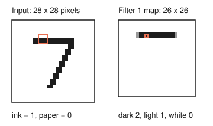
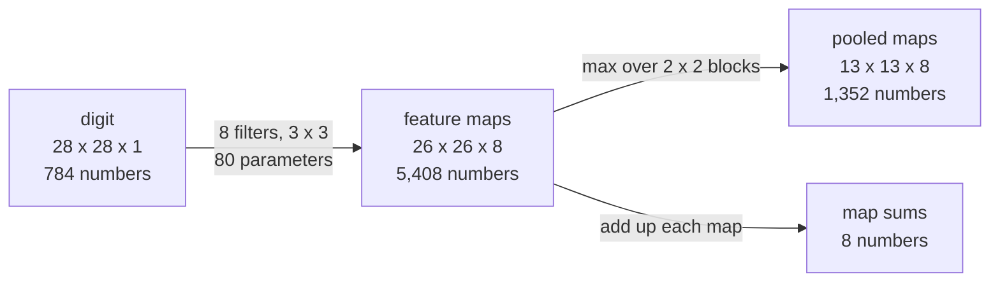

# Convolutional networks: one small filter slid everywhere, so a shift in gives a shift out

[Syllabus](../../../SYLLABUS.md) → [Applied and computational](../README.md) → [Deep Networks](../README.md#s09) → Convolutional networks

---

## General Overview

A scanned handwritten digit is a grid of 28 by 28 grey pixels: 784 numbers. A network that reads digits on cheques and envelopes must find the same strokes wherever the writer put them. A 7 written one pixel further right is still a 7.

The plain approach is a dense layer: every output wired to every pixel with its own weight. To turn the 784 pixels into 5,408 feature numbers that way takes 784 × 5,408 = 4,239,872 weights. Each one must be learned, and a stroke learned in one corner teaches nothing about the other corners.

A **convolutional layer** uses one small grid of weights instead, called a **filter**: here 3 by 3 pixels. It slides the filter over every position of the image and writes down one score at each stop. The scores form a new grid, called a **feature map**: it shows where the image contains the pattern the filter looks for.

Eight such filters on the 28 by 28 digit give eight maps of 26 by 26, which is the same 5,408 numbers. They cost 8 × (9 + 1) = 80 parameters: nine weights and one bias per filter. Because the same filter is used everywhere, moving the digit one pixel moves every map one pixel, and nothing else changes.

**A convolutional layer applies one small filter at every position of the image, so it needs a few weights where a dense layer needs millions, and shifting the input shifts every output map by the same amount.**

**What kind of fact this is:** the output size and the parameter count are counting rules, checked here against direct counts. The shift rule (translation equivariance) is a theorem, proved on this card in Why it works. The help that pooling gives against small shifts is partial: it is measured on this card's synthetic digit, not promised.

### The picture: one filter on the digit

<p align="center"></p>

The digit is synthetic: 58 ink pixels drawn by a fixed rule in the checks. Filter 1, "ink below", fires where paper sits above ink. Only 28 of its map cells are active, all along the upper edge of the top bar. The orange window covers pixel rows 5 to 7 and columns 9 to 11, and it writes the orange cell of the map. The picture is to scale, one square per pixel.

---

## The formula

Notation first, in words. Rows and columns count from 0 at the top left. $`x[r, c]`$ is the pixel in row $`r`$ and column $`c`$: 1 for ink, 0 for paper. [The perceptron and its stack](../06-Machine%20Learning%20Mathematics/03-perceptron-and-neural-networks.md) gave weights, a bias and layer matrices $`W`$; here filter $`f`$ has a 3 by 3 grid of weights $`w_f[a, b]`$ and a bias $`b_f`$.

**ReLU** (rectified linear unit) is the squashing function used here: $`\mathrm{ReLU}(v) = \max(0, v)`$. It keeps positive scores and sets negative ones to 0.

The layer, for filter $`f`$ and output position $`(i, j)`$, with stride 1 and no padding:

```math
y_f[i, j] = \mathrm{ReLU}\Bigl(b_f + \sum_{a=0}^{k-1} \sum_{b=0}^{k-1} w_f[a, b]\; x[i + a,\, j + b]\Bigr)
```

**Read it aloud:** lay the filter on the image with its top-left corner at row $`i`$, column $`j`$; multiply each weight by the pixel under it, add them up, add the bias, and keep the result if it is positive.

The size of each output map, for an image of side $`n`$, a filter of side $`k`$, $`p`$ rings of zeros added round the edge (padding), and a step of $`s`$ pixels between stops (stride):

```math
m = \Bigl\lfloor \frac{n + 2p - k}{s} \Bigr\rfloor + 1
```

**Read it aloud:** the padded image has room for $`n + 2p - k`$ pixels of travel after the first stop; divide by the step, round down, and count the first stop too.

The parameter count, for $`C_{\text{in}}`$ input channels (1 for a grey image, 3 for colour) and $`C_{\text{out}}`$ filters:

```math
\text{parameters} = C_{\text{out}}\,\bigl(k^2\, C_{\text{in}} + 1\bigr)
```

**Read it aloud:** each filter has a weight for every pixel of its window in every input channel, plus one bias.

The shift rule. Write $`T_{u,v}`$ for "move the picture down $`u`$ rows and right $`v`$ columns", so $`(T_{u,v}x)[r, c] = x[r - u, c - v]`$. Then:

```math
\mathrm{conv}(T_{u,v}\, x) = T_{u,v}\, \mathrm{conv}(x)
```

**Read it aloud:** shifting the image and then running the layer gives the same maps as running the layer and then shifting the maps.

That property is **translation equivariance**: the output moves with the input. **Translation invariance**, a different property, would mean the output does not move at all.

| Symbol | Plain meaning | In our example | Push it up and the answer… |
| --- | --- | --- | --- |
| $`x[r, c]`$ | the input pixel in row $`r`$, column $`c`$ | 28 by 28, 58 ink pixels | — |
| $`w_f[a, b]`$, $`b_f`$ | filter $`f`$'s weights and bias | filter 1 is `[[-1, -1, -1], [0, 0, 0], [1, 1, 1]]`; every bias −1 | a larger bias lets weaker matches through |
| $`y_f[i, j]`$ | filter $`f`$'s map at row $`i`$, column $`j`$ | $`y_1[5, 9] = 2`$ | — |
| $`n`$ | the image side, in pixels | 28 | bigger maps |
| $`k`$ | the filter side | 3 | smaller maps, more parameters: $`k = 5`$ gives side 24 |
| $`p`$ | padding: rings of zeros added round the image | 0 | bigger maps: $`p = 1`$ gives side 28 |
| $`s`$ | stride: pixels moved between stops | 1 | maps shrink about $`s`$-fold each way: $`s = 2`$ gives side 13 |
| $`m`$ | the side of each output map | 26 | — |
| $`C_{\text{in}}`$, $`C_{\text{out}}`$ | input channels; filters, which are the output channels | 1; 8 | parameters grow in proportion |
| $`T_{u,v}`$, $`\mathrm{conv}`$ | shift down $`u`$ rows, right $`v`$ columns, filling with zeros; the whole layer, image in, all maps out | $`T_{0,1}`$: one pixel right | — |
| $`\ell`$, $`\delta_f[i, j]`$ | the training loss; the backpropagated error at map cell $`(i, j)`$ | used in Step 3 only | — |
| $`\mathrm{ReLU}`$, $`\lfloor\,\cdot\,\rfloor`$, $`\sum`$ | $`\max(0, v)`$; round down; add over the indices shown | $`\mathrm{ReLU}(3 - 1) = 2`$; $`\lfloor 25/2 \rfloor + 1 = 13`$ for stride 2 | — |

### When it holds

- **The same weights at every position.** This weight sharing is what makes the shift rule true. A locally connected layer, with a fresh set of 80 parameters at every position, would cost far more and would not shift with the input.
- **Stride 1.** With stride 2 the layer only stops at even positions. A one-pixel shift then gives no shifted copy: 44 of 1,352 numbers disagree. A two-pixel shift moves the map exactly one cell.
- **The content stays clear of the edge.** With padding, a stop at the border sees the zero ring where the moved digit would have ink. Shift the digit 8 pixels right and 12 numbers disagree.
- **The squashing acts one number at a time.** ReLU looks at one score and ignores its position, so it passes the shift through. A step that mixed positions differently in different places would not.
- **The shift is a whole number of pixels.** A half-pixel move changes the pixel values themselves; the rule says nothing about it.

---

## Why it works

### Step 0: the same question asked everywhere

A filter is a fixed question, such as "is there paper above ink here?" The layer asks that one question at every position. Move the picture and the answers move with it, because the question did not depend on where it was asked.

The rest of this section turns that sentence into three proofs: the counts, the shift rule, and why pooling and stride give some of it up.

### Step 1: counting the stops

Along one row, the filter's left edge can stand at columns 0, 1, 2 and so on, as long as its right edge stays inside. With side $`n + 2p`$ after padding and filter side $`k`$, the last start is column $`n + 2p - k`$. With stride $`s`$, only every $`s`$-th start is used, so the count is $`\lfloor (n + 2p - k)/s \rfloor + 1`$.

For the digit, $`(28 - 3)/1 + 1 = 26`$ stops each way, so each map is 26 by 26 and eight maps hold 5,408 numbers. The checks count the window starts that fit, without the formula, for six settings; the two always agree.

### Step 2: counting the parameters

Each filter has $`k \times k`$ weights for each input channel, plus a bias. Nothing else is learned, however large the image. Here that is $`8 \times (9 + 1) = 80`$.

The dense layer to the same 5,408 outputs has one weight per pair of input pixel and output number: $`784 \times 5{,}408 = 4{,}239{,}872`$, or 4,245,280 with a bias per output. That is 52,998 dense weights for every convolutional parameter.

### Step 3: a convolution is a dense layer with most weights forced

Write the convolutional layer as a 784 by 5,408 matrix, like the dense layer. Each output reads only its own 9 pixels, so only $`5{,}408 \times 9 = 48{,}672`$ of the 4,239,872 entries can be non-zero: 1.15 %. And those entries are not free. They are copies of just 72 weights, the 8 filters' 9 slots each.

So a convolution is a dense layer with two rules imposed: most connections removed (local connections), and the rest tied together (weight sharing). The checks build this matrix and multiply by it, a second road that agrees with the sliding filter on all 5,408 outputs.

The second rule matters for training too. In [Backpropagation](../06-Machine%20Learning%20Mathematics/04-backpropagation.md), each weight's slope is the error at the unit it feeds times the value it carried in. Here $`\ell`$ is the training loss and $`\delta_f[i, j]`$ is the backpropagated error at map cell $`(i, j)`$. A shared weight feeds every position, so its slope is the sum over all positions: $`\partial \ell / \partial w_f[a, b] = \sum_{i,j} \delta_f[i, j]\, x[i + a, j + b]`$. Every stroke anywhere in the image trains the same nine weights.

### Step 4: the shift rule, proved

Take the shifted image $`T_{u,v}x`$ and run the layer at position $`(i, j)`$:

```math
\mathrm{ReLU}\Bigl(b_f + \sum_{a,b} w_f[a, b]\; x[i + a - u,\, j + b - v]\Bigr) = y_f[i - u,\, j - v] = (T_{u,v}\, y_f)[i, j]
```

The middle step is the definition of $`y_f`$, read at position $`(i - u, j - v)`$. It works because $`w_f`$ and $`b_f`$ do not depend on $`(i, j)`$: the same weights meet the same pixels, only at a new address. ReLU acts on the finished sum, so it does not see the address at all.

The proof has one gap: the edge. Near the border, a position may read a pixel that one side of the equation has and the other lacks. Keep the content away from the border, or assume the image wraps round, and the rule is exact.

The checks compare all 5,408 numbers for three shifts: one pixel right, one down, and three down with two left. Every comparison gives 0 disagreements. Without the shift on the right side, the same maps disagree at 207, 268 and 453 places: the maps did change, by moving.

This is the time-invariance of [Linear and time-invariant](../../13-Engineering%20mathematics/02-Linear%20Systems%20and%20Transforms/01-linear-time-invariant-systems-and-convolution.md), with two directions in place of time. That card proves the converse in one dimension: a linear system that commutes with every shift is a convolution. So a bank of shift-respecting linear filters is exactly a convolutional layer, each filter a small finite impulse response (FIR) filter: a pulse response only nine taps long.

<details>
<summary>Detailed proof: the shift rule on a wrap-round image</summary>

On a torus (an image whose right edge joins its left and whose bottom joins its top), indices are taken modulo 28 and the edge gap disappears. Let $`z = T_{u,v}x`$, so $`z[r, c] = x[r - u, c - v]`$ with indices modulo 28. Then the sum inside the layer at $`(i, j)`$ is

$`\displaystyle \sum_{a,b} w_f[a, b]\, z[i + a, j + b] = \sum_{a,b} w_f[a, b]\, x[(i - u) + a, (j - v) + b].`$

The right side is the sum the layer computes at $`(i - u, j - v)`$ on the original image. Adding $`b_f`$ and applying ReLU to both sides gives $`\mathrm{conv}(z)_f[i, j] = y_f[i - u, j - v]`$ for every $`f`$, $`i`$ and $`j`$. That is $`\mathrm{conv}(T_{u,v}x) = T_{u,v}\,\mathrm{conv}(x)`$. Only two facts were used: the weights do not depend on the position, and every position has a full window.

</details>

### Step 5: pooling and stride trade where for whether

Equivariance keeps the position of every feature. A digit reader wants the opposite at the end: "is there a top bar?", not "is it at column 9?" Two operations throw away position on purpose.

- **Max pooling** keeps the largest value in each 2 by 2 block of a map, stepping 2 at a time. The 26 by 26 maps become 13 by 13: 1,352 numbers.
- **Global pooling** adds up each whole map into one number: 8 numbers in all. Dividing each sum by the map's cell count gives the average, the usual form.



Each step down the chart keeps less detail and survives a shift better. Over the four one-pixel shifts (right, left, down, up), the checks count how many of the active (non-zero) values stay exactly where they were:

| Level | Numbers | Active values kept in place | Share kept |
| --- | ---: | ---: | ---: |
| feature maps | 5,408 | 490 of 1,044 | 47 % |
| after 2 by 2 max pool | 1,352 | 267 of 420 | 64 % |
| map sums | 8 | 32 of 32 | 100 % |

Max pooling helps because a feature that moves within its 2 by 2 block keeps the same maximum. It only helps partly: a feature that crosses a block boundary jumps to the next cell. A two-pixel shift moves the pooled map exactly one cell, 0 disagreements, so pooling is equivariant on a grid twice as coarse.

Global pooling is fully invariant, and the reason is a proof, not a measurement. A sum does not care about the order of its terms, so a map moved within the frame has the same sum. The map sums stay at `[52, 60, 39, 30, 48, 61, 44, 32]` after a shift of three down and two left. The price: the sums cannot say where anything is.

Stride does the same trade inside the layer. A stride-2 layer gives exactly every second value of the stride-1 layer, 13 by 13 per map. It throws away the odd positions, so it loses the one-pixel shift rule: whether the map is left still or moved one cell, at least 44 of its 1,352 numbers disagree.

---

## Worked numbers, by hand

Filter 1, "ink below", at output position row 5, column 9. Its window covers pixel rows 5 to 7, columns 9 to 11: one row of paper above two rows of the top bar.

| Step | Arithmetic | Value |
| --- | --- | --- |
| the patch under the window | rows 5, 6, 7 of columns 9 to 11 | `[[0, 0, 0], [1, 1, 1], [1, 1, 1]]` |
| weights times pixels, row by row | $`(-1)(0) \times 3 + (0)(1) \times 3 + (1)(1) \times 3`$ | 3 |
| add the bias | $`3 - 1`$ | 2 |
| ReLU | $`\max(0, 2)`$ | 2 |
| map side | $`(28 + 0 - 3)/1 + 1`$ | 26 |
| numbers out | $`26 \times 26 \times 8`$ | 5,408 |
| parameters | $`8 \times (9 + 1)`$ | 80 |
| dense layer, same output | $`784 \times 5{,}408`$ | 4,239,872 |
| digit moved one pixel right | the same patch now sits under row 5, column 10 | $`y_1[5, 10] = 2`$ |
| after 2 by 2 max pooling | $`13 \times 13 \times 8`$ | **1,352** |

**The layer finds the top bar's upper edge with a score of 2, using 80 parameters where a dense layer needs 4,239,872; moving the digit moves the score, and pooling then cuts 5,408 numbers to 1,352.**

### What breaks if you drop a piece

| Mistake | Comes out at | What went wrong |
| --- | --- | --- |
| Forget the bias in the count | 72 parameters, not 80 | each filter has one bias as well as nine weights |
| Map side taken as $`n - k`$ | side 25 and 5,000 numbers, not 26 and 5,408 | the first stop counts too: add 1 |
| Stride 2, then expect the shift rule | 44 of 1,352 numbers disagree | the layer stops only at even positions |
| Padding 1, digit shifted 8 pixels right | 12 numbers disagree | the border stops see zeros where the moved digit would have ink |
| Flip the filter, as textbook convolution does | filter 1's map comes out equal to filter 5's | the flip turns "ink below" into "ink above" |

The code prints every row.

---

## Code, from first principles, and it actually runs

Nothing is imported. The scripts draw the digit by a fixed rule, build the eight filters from their directions, and run the layer. They take three independent roads. The output size and parameter count are computed by formula and by counting window starts and weight slots. The feature maps are computed by sliding each filter (gathering) and by the 784 by 5,408 matrix (scattering each pixel into its outputs). The shift rule is proved above and then tested on all 5,408 numbers for three shifts. Max pooling is computed by taking each 2 by 2 block's maximum and, separately, by letting every cell of the matrix road's maps raise its block's maximum; the counts in the pooling table are recounted a second way.

### Python

```python
# Convolutional networks -- the check behind the card.  Nothing is imported.
# A synthetic 28 x 28 digit "7" (ink 1, paper 0, drawn by the rule below) goes
# through 8 filters of 3 x 3, each bias -1, then ReLU = max(0, value).  Roads:
# size and parameter formulas against counting; a sliding loop against the
# same layer written as a 784 x 5408 matrix; shift proofs against comparing
# every number.
N, K, F = 28, 3, 8
NAMES = ["ink below", "ink below-right", "ink right", "ink above-right",
         "ink above", "ink above-left", "ink left", "ink below-left"]
DIRS = [(1, 0), (1, 1), (0, 1), (-1, 1), (-1, 0), (-1, -1), (0, -1), (1, -1)]
sign = lambda v: (v > 0) - (v < 0)
yn = lambda c: "yes" if c else "no"
W = [[[sign(di * a + dj * b) for dj in (-1, 0, 1)] for di in (-1, 0, 1)] for a, b in DIRS]
B = [-1] * F

def digit(dr, dc):                     # the 7: a top bar and a slanting stroke
    x = [[0] * N for _ in range(N)]
    ink = [(r, c) for r in (6, 7) for c in range(7, 21)]
    ink += [(r, 19 - (r - 8) // 2 + d) for r in range(8, 23) for d in (0, 1)]
    for r, c in ink:
        if 0 <= r + dr < N and 0 <= c + dc < N:
            x[r + dr][c + dc] = 1
    return x

def conv(x, s=1, flip=False, pad=0):   # road one: slide each filter, gather
    x = [[0] * (N + 2 * pad)] * pad + [[0] * pad + r + [0] * pad for r in x] + [[0] * (N + 2 * pad)] * pad
    m = (len(x) - K) // s + 1
    out = []
    for f in range(F):
        w = [row[::-1] for row in W[f][::-1]] if flip else W[f]
        out.append([[max(0, B[f] + sum(w[a][b] * x[i * s + a][j * s + b]
                     for a in range(K) for b in range(K))) for j in range(m)] for i in range(m)])
    return out

def shift(y, dr, dc):                  # move every map, filling with zeros
    m = len(y[0])
    return [[[y[f][i - dr][j - dc] if 0 <= i - dr < m and 0 <= j - dc < m else 0
              for j in range(m)] for i in range(m)] for f in range(len(y))]

def pool(y, p=2):                      # max over p x p blocks, stride p
    m = len(y[0]) // p
    return [[[max(y[f][p * i + a][p * j + b] for a in range(p) for b in range(p))
              for j in range(m)] for i in range(m)] for f in range(len(y))]

def diff(y, z):                        # how many numbers disagree
    return sum(u != v for g, h in zip(y, z) for r, q in zip(g, h) for u, v in zip(r, q))

def kept(y, z):                        # active values of y that z keeps in place
    act = [(f, i, j) for f in range(len(y)) for i in range(len(y[0])) for j in range(len(y[0])) if y[f][i][j]]
    return sum(y[f][i][j] == z[f][i][j] for f, i, j in act), len(act)

def size(n, k, p, s):                  # the formula
    return (n + 2 * p - k) // s + 1

def fits(n, k, p, s):                  # count window starts that fit
    return sum(1 for i in range(0, n + 2 * p) if i % s == 0 and i + k <= n + 2 * p)

x = digit(0, 0)
y = conv(x)
m = size(N, K, 0, 1)
links = [(f * m * m + i * m + j, (i + a) * N + j + b, (f, a, b))   # road two:
         for f in range(F) for i in range(m) for j in range(m)     # the layer
         for a in range(K) for b in range(K)]                      # as a matrix
acc = [B[o // (m * m)] for o in range(F * m * m)]
flat = [v for row in x for v in row]
for o, p, (f, a, b) in links:          # scatter each input into its outputs
    acc[o] += W[f][a][b] * flat[p]
y2 = [[[max(0, acc[f * m * m + i * m + j]) for j in range(m)] for i in range(m)] for f in range(F)]
slots = len({s for _, _, s in links})
dense = N * N * F * m * m
print(f"image {N} x {N}, ink pixels {sum(flat)}; {F} filters of {K} x {K}, bias -1 each")
for f in range(F):
    print(f"filter {f + 1} {NAMES[f]:<15} {W[f]}")
print(f"output side, formula (28 + 2*0 - 3)//1 + 1 = {m}; window starts counted: {fits(N, K, 0, 1)}")
print(f"output numbers {m} x {m} x {F} = {F * m * m}")
print(f"parameters, formula {F} x ({K * K} + 1) = {F * (K * K + 1)}; slots counted in the matrix {slots} + biases {F}")
print(f"dense layer to the same output: {N * N} x {F * m * m} = {dense} weights, {dense + F * m * m} with biases")
print(f"matrix entries the layer can set: {len(links)} of {dense} ({100 * len(links) / dense:.2f} %)")
print(f"dense weights per conv parameter, whole part: {dense // (F * (K * K + 1))}")
print(f"sliding loop and matrix agree on all {F * m * m} outputs: {yn(y == y2)}")
pt = [x[5 + a][9:12] for a in range(K)]
print(f"by hand, filter 1 at row 5, col 9: patch {pt} -> {sum(W[0][a][b] * pt[a][b] for a in range(K) for b in range(K))} - 1 -> {y[0][5][9]}")
print(f"figure, ink pixels {sum(flat)}; window rows 5-7, cols 9-11; filter 1 active cells {sum(v > 0 for r in y[0] for v in r)}")
active = [sum(v > 0 for r in y[f] for v in r) for f in range(F)]
print(f"active (non-zero) values per map {active}, total {sum(active)}")
for dr, dc in [(0, 1), (1, 0), (3, -2)]:
    ys = conv(digit(dr, dc))
    print(f"shift ({dr}, {dc}): conv(shift x) vs shift(conv x) disagree at {diff(ys, shift(y, dr, dc))} of {F * m * m}; "
          f"unshifted maps disagree at {diff(ys, y)}")
y1 = conv(digit(0, 1))
print(f"after shift (0, 1), filter 1 at row 5, col 10: {y1[0][5][10]}")
P, P2 = pool(y), pool(conv(digit(0, 2)))
print(f"max pool 2 x 2: {len(P[0])} x {len(P[0])} x {F} = {F * len(P[0]) ** 2} numbers")
gs = lambda z: [sum(v for r in z[f] for v in r) for f in range(F)]
Pb = [[[0] * (m // 2) for _ in range(m // 2)] for _ in range(F)]      # pooling, road two: every cell of the
for f, r, c in [(f, r, c) for f in range(F) for r in range(m) for c in range(m)]:   # matrix road raises its block's max
    Pb[f][r // 2][c // 2] = max(Pb[f][r // 2][c // 2], y2[f][r][c])
same = lambda u, v: sum(a > 0 and a == b for g, k in zip(u, v) for r, q in zip(g, k) for a, b in zip(r, q))   # recount
tot, rc = [0] * 6, [0, 0]
for d in [(0, 1), (0, -1), (1, 0), (-1, 0)]:
    z = conv(digit(*d))
    a, b, c, e = *kept(y, z), *kept(P, pool(z))
    rc = [rc[0] + same(y, z), rc[1] + same(Pb, pool(z))]
    g = sum(u == v for u, v in zip(gs(y), gs(z)))
    tot = [t + v for t, v in zip(tot, (a, b, c, e, g, F))]
    print(f"shift {d}: raw values kept {a} of {b}; pooled kept {c} of {e}; map sums kept {g} of {F}")
print(f"over the four 1-pixel shifts: raw {tot[0]} of {tot[1]} ({100 * tot[0] / tot[1]:.0f} %), pooled "
      f"{tot[2]} of {tot[3]} ({100 * tot[2] / tot[3]:.0f} %), map sums {tot[4]} of {tot[5]} ({100 * tot[4] / tot[5]:.0f} %)")
print(f"pooled, 2-pixel shift vs pooled map moved 1 cell: disagree at {diff(P2, shift(P, 0, 1))}")
print(f"map sums {gs(y)}; after shift (3, -2) {gs(conv(digit(3, -2)))}")
s2, s2s = conv(x, 2), conv(digit(0, 1), 2)
m2 = size(N, K, 0, 2)
sub = [[[y[f][2 * i][2 * j] for j in range(m2)] for i in range(m2)] for f in range(F)]
print(f"stride 2: side (28 - 3)//2 + 1 = {m2}, counted {fits(N, K, 0, 2)}; equals every 2nd stride-1 value: {yn(s2 == sub)}")
best = min(diff(s2s, shift(s2, 0, c)) for c in (0, 1))   # not still, not moved 1 cell
print(f"stride 2, 1-pixel shift: no shifted copy, disagree at {best} of {F * m2 * m2}; "
      f"2-pixel shift vs moved 1 cell: {diff(conv(digit(0, 2), 2), shift(s2, 0, 1))}")
cases = [(28, 3, 0, 1), (28, 3, 1, 1), (28, 5, 0, 1), (28, 3, 0, 2), (26, 2, 0, 2), (224, 7, 3, 2)]
print("side n k p s -> formula, counted: " + "; ".join(f"{c} -> {size(*c)}, {fits(*c)}" for c in cases))
print(f"mistake, bias forgotten: {F} x {K * K} = {F * K * K} parameters, not {F * (K * K + 1)}")
print(f"mistake, side as n - k: {N - K}, not {m}; numbers {F * (N - K) ** 2}, not {F * m * m}")
yp, ye = conv(x, pad=1), conv(digit(0, 8), pad=1)
print(f"breaks, padding 1 (side {len(yp[0])}), shift (0, 8) pushes ink past the edge: disagree at {diff(ye, shift(yp, 0, 8))}")
yf = conv(x, flip=True)
print(f"mistake, flipping the filter (textbook convolution): filter 1 map equals filter 5 map: {yn(yf[0] == y[4])}")
assert m == fits(N, K, 0, 1) and all(size(*c) == fits(*c) for c in cases)   # formula vs count
assert slots + F == F * (K * K + 1)                          # slots counted vs formula
assert y == y2                                               # gather against scatter
assert sum(W[0][a][b] * pt[a][b] for a in range(K) for b in range(K)) - 1 == y[0][5][9] == 2   # by hand
assert all(diff(conv(digit(dr, dc)), shift(y, dr, dc)) == 0 for dr, dc in [(0, 1), (1, 0), (3, -2)])
assert diff(P2, shift(P, 0, 1)) == 0                         # pooled map moves 1 cell
assert gs(y) == gs(conv(digit(3, -2)))                       # map sums do not move
assert Pb == P                                               # pooling: gather vs scatter
assert tot[:4] == [rc[0], 4 * sum(active), rc[1], 4 * sum(v > 0 for g in Pb for r in g for v in r)]   # recount
assert tot[2] * tot[1] > tot[0] * tot[3]                     # pooling keeps a larger share
assert s2 == sub                                             # stride = subsampling
assert best > 0                                              # stride breaks 1-pixel shifts
assert diff(ye, shift(yp, 0, 8)) > 0                         # padding breaks at the edge
print("ALL CHECKS PASS")
```

**Ran 2026-11-23 on macOS, Python 3.14.10, standard library only. All checks passed. Output, pasted from the run:**

```
image 28 x 28, ink pixels 58; 8 filters of 3 x 3, bias -1 each
filter 1 ink below       [[-1, -1, -1], [0, 0, 0], [1, 1, 1]]
filter 2 ink below-right [[-1, -1, 0], [-1, 0, 1], [0, 1, 1]]
filter 3 ink right       [[-1, 0, 1], [-1, 0, 1], [-1, 0, 1]]
filter 4 ink above-right [[0, 1, 1], [-1, 0, 1], [-1, -1, 0]]
filter 5 ink above       [[1, 1, 1], [0, 0, 0], [-1, -1, -1]]
filter 6 ink above-left  [[1, 1, 0], [1, 0, -1], [0, -1, -1]]
filter 7 ink left        [[1, 0, -1], [1, 0, -1], [1, 0, -1]]
filter 8 ink below-left  [[0, -1, -1], [1, 0, -1], [1, 1, 0]]
output side, formula (28 + 2*0 - 3)//1 + 1 = 26; window starts counted: 26
output numbers 26 x 26 x 8 = 5408
parameters, formula 8 x (9 + 1) = 80; slots counted in the matrix 72 + biases 8
dense layer to the same output: 784 x 5408 = 4239872 weights, 4245280 with biases
matrix entries the layer can set: 48672 of 4239872 (1.15 %)
dense weights per conv parameter, whole part: 52998
sliding loop and matrix agree on all 5408 outputs: yes
by hand, filter 1 at row 5, col 9: patch [[0, 0, 0], [1, 1, 1], [1, 1, 1]] -> 3 - 1 -> 2
figure, ink pixels 58; window rows 5-7, cols 9-11; filter 1 active cells 28
active (non-zero) values per map [28, 46, 26, 28, 28, 47, 27, 31], total 261
shift (0, 1): conv(shift x) vs shift(conv x) disagree at 0 of 5408; unshifted maps disagree at 207
shift (1, 0): conv(shift x) vs shift(conv x) disagree at 0 of 5408; unshifted maps disagree at 268
shift (3, -2): conv(shift x) vs shift(conv x) disagree at 0 of 5408; unshifted maps disagree at 453
after shift (0, 1), filter 1 at row 5, col 10: 2
max pool 2 x 2: 13 x 13 x 8 = 1352 numbers
shift (0, 1): raw values kept 136 of 261; pooled kept 55 of 105; map sums kept 8 of 8
shift (0, -1): raw values kept 136 of 261; pooled kept 60 of 105; map sums kept 8 of 8
shift (1, 0): raw values kept 109 of 261; pooled kept 76 of 105; map sums kept 8 of 8
shift (-1, 0): raw values kept 109 of 261; pooled kept 76 of 105; map sums kept 8 of 8
over the four 1-pixel shifts: raw 490 of 1044 (47 %), pooled 267 of 420 (64 %), map sums 32 of 32 (100 %)
pooled, 2-pixel shift vs pooled map moved 1 cell: disagree at 0
map sums [52, 60, 39, 30, 48, 61, 44, 32]; after shift (3, -2) [52, 60, 39, 30, 48, 61, 44, 32]
stride 2: side (28 - 3)//2 + 1 = 13, counted 13; equals every 2nd stride-1 value: yes
stride 2, 1-pixel shift: no shifted copy, disagree at 44 of 1352; 2-pixel shift vs moved 1 cell: 0
side n k p s -> formula, counted: (28, 3, 0, 1) -> 26, 26; (28, 3, 1, 1) -> 28, 28; (28, 5, 0, 1) -> 24, 24; (28, 3, 0, 2) -> 13, 13; (26, 2, 0, 2) -> 13, 13; (224, 7, 3, 2) -> 112, 112
mistake, bias forgotten: 8 x 9 = 72 parameters, not 80
mistake, side as n - k: 25, not 26; numbers 5000, not 5408
breaks, padding 1 (side 28), shift (0, 8) pushes ink past the edge: disagree at 12
mistake, flipping the filter (textbook convolution): filter 1 map equals filter 5 map: yes
ALL CHECKS PASS
```

### Rust

Same numbers, same labels, built with `rustc --edition 2021 -O`.

```rust
// Convolutional networks -- the same check as the Python, in Rust.  No crates.
// A synthetic 28 x 28 digit "7" (ink 1, paper 0, drawn by the rule below) goes
// through 8 filters of 3 x 3, each bias -1, then ReLU = max(0, value).  Roads:
// size and parameter formulas against counting; a sliding loop against the
// same layer written as a 784 x 5408 matrix; shift proofs against comparing
// every number.
type Maps = Vec<Vec<Vec<i64>>>;
const N: usize = 28; const K: usize = 3; const F: usize = 8; const B: i64 = -1;
const NAMES: [&str; 8] = ["ink below", "ink below-right", "ink right", "ink above-right",
                          "ink above", "ink above-left", "ink left", "ink below-left"];
const DIRS: [(i64, i64); 8] = [(1, 0), (1, 1), (0, 1), (-1, 1), (-1, 0), (-1, -1), (0, -1), (1, -1)];

fn filters() -> Vec<Vec<Vec<i64>>> {
    DIRS.iter().map(|&(a, b)| (-1..=1).map(|di| (-1..=1).map(|dj| (di * a + dj * b).signum()).collect()).collect()).collect()
}

fn yn(c: bool) -> &'static str { if c { "yes" } else { "no" } }

fn digit(dr: i64, dc: i64) -> Vec<Vec<i64>> {      // the 7: a top bar and a slanting stroke
    let mut x = vec![vec![0i64; N]; N];
    let mut ink: Vec<(i64, i64)> = Vec::new();
    for r in [6, 7] { for c in 7..21 { ink.push((r, c)) } }
    for r in 8..23 { for d in [0, 1] { ink.push((r, 19 - (r - 8) / 2 + d)) } }
    for (r, c) in ink {
        let (rr, cc) = (r + dr, c + dc);
        if (0..N as i64).contains(&rr) && (0..N as i64).contains(&cc) { x[rr as usize][cc as usize] = 1 }
    }
    x
}

fn conv(x0: &Vec<Vec<i64>>, w: &Maps, s: usize, flip: bool, pad: usize) -> Maps {  // road one
    let n = x0.len() + 2 * pad;
    let mut x = vec![vec![0i64; n]; n];
    for i in 0..x0.len() { for j in 0..x0.len() { x[i + pad][j + pad] = x0[i][j] } }
    let m = (n - K) / s + 1;
    (0..F).map(|f| (0..m).map(|i| (0..m).map(|j| {
        let mut t = B;
        for a in 0..K { for b in 0..K {
            let wt = if flip { w[f][K - 1 - a][K - 1 - b] } else { w[f][a][b] };
            t += wt * x[i * s + a][j * s + b];
        } }
        t.max(0)
    }).collect()).collect()).collect()
}

fn shift(y: &Maps, dr: i64, dc: i64) -> Maps {      // move every map, filling with zeros
    let m = y[0].len() as i64;
    y.iter().map(|g| (0..m).map(|i| (0..m).map(|j| {
        let (a, b) = (i - dr, j - dc);
        if a >= 0 && a < m && b >= 0 && b < m { g[a as usize][b as usize] } else { 0 }
    }).collect()).collect()).collect()
}

fn pool(y: &Maps) -> Maps {                         // max over 2 x 2 blocks, stride 2
    let m = y[0].len() / 2;
    y.iter().map(|g| (0..m).map(|i| (0..m).map(|j|
        g[2 * i][2 * j].max(g[2 * i][2 * j + 1]).max(g[2 * i + 1][2 * j]).max(g[2 * i + 1][2 * j + 1])
    ).collect()).collect()).collect()
}

fn diff(y: &Maps, z: &Maps) -> usize {             // how many numbers disagree
    y.iter().flatten().flatten().zip(z.iter().flatten().flatten()).filter(|(u, v)| u != v).count()
}

fn kept(y: &Maps, z: &Maps) -> (usize, usize) {   // active values of y that z keeps in place
    let (mut k, mut n) = (0, 0);
    for f in 0..y.len() { for i in 0..y[0].len() { for j in 0..y[0].len() {
        if y[f][i][j] != 0 { n += 1; if y[f][i][j] == z[f][i][j] { k += 1 } }
    } } }
    (k, n)
}

fn size(n: usize, k: usize, p: usize, s: usize) -> usize { (n + 2 * p - k) / s + 1 }   // the formula

fn fits(n: usize, k: usize, p: usize, s: usize) -> usize {   // count window starts that fit
    (0..n + 2 * p).filter(|i| i % s == 0 && i + k <= n + 2 * p).count()
}

fn sums(z: &Maps) -> Vec<i64> { z.iter().map(|g| g.iter().flatten().sum()).collect() }
fn active(g: &Vec<Vec<i64>>) -> usize { g.iter().flatten().filter(|&&v| v > 0).count() }
fn main() {
    let (w, x, m) = (filters(), digit(0, 0), size(N, K, 0, 1));
    let y = conv(&x, &w, 1, false, 0);
    let mut links: Vec<(usize, usize, (usize, usize, usize))> = Vec::new();   // road two:
    for f in 0..F { for i in 0..m { for j in 0..m { for a in 0..K { for b in 0..K {  // the layer
        links.push((f * m * m + i * m + j, (i + a) * N + j + b, (f, a, b)));         // as a matrix
    } } } } }
    let mut acc = vec![B; F * m * m];
    let flat: Vec<i64> = x.iter().flatten().copied().collect();
    for &(o, p, (f, a, b)) in &links { acc[o] += w[f][a][b] * flat[p] }   // scatter
    let y2: Maps = (0..F).map(|f| (0..m).map(|i| (0..m).map(|j| acc[f * m * m + i * m + j].max(0))
        .collect()).collect()).collect();
    let mut slot_list: Vec<(usize, usize, usize)> = Vec::new();
    for l in &links { if !slot_list.contains(&l.2) { slot_list.push(l.2) } }
    let (slots, dense, ink) = (slot_list.len(), N * N * F * m * m, flat.iter().sum::<i64>());
    println!("image {} x {}, ink pixels {}; {} filters of {} x {}, bias -1 each", N, N, ink, F, K, K);
    for f in 0..F { println!("filter {} {:<15} {:?}", f + 1, NAMES[f], w[f]) }
    println!("output side, formula (28 + 2*0 - 3)//1 + 1 = {}; window starts counted: {}", m, fits(N, K, 0, 1));
    println!("output numbers {} x {} x {} = {}", m, m, F, F * m * m);
    println!("parameters, formula {} x ({} + 1) = {}; slots counted in the matrix {} + biases {}", F, K * K, F * (K * K + 1), slots, F);
    println!("dense layer to the same output: {} x {} = {} weights, {} with biases", N * N, F * m * m, dense, dense + F * m * m);
    println!("matrix entries the layer can set: {} of {} ({:.2} %)", links.len(), dense, 100.0 * links.len() as f64 / dense as f64);
    println!("dense weights per conv parameter, whole part: {}", dense / (F * (K * K + 1)));
    println!("sliding loop and matrix agree on all {} outputs: {}", F * m * m, yn(y == y2));
    let pt: Vec<Vec<i64>> = (0..K).map(|a| x[5 + a][9..12].to_vec()).collect();
    let hand: i64 = (0..K).map(|a| (0..K).map(|b| w[0][a][b] * pt[a][b]).sum::<i64>()).sum();
    println!("by hand, filter 1 at row 5, col 9: patch {:?} -> {} - 1 -> {}", pt, hand, y[0][5][9]);
    println!("figure, ink pixels {}; window rows 5-7, cols 9-11; filter 1 active cells {}", ink, active(&y[0]));
    let act: Vec<usize> = y.iter().map(active).collect();
    println!("active (non-zero) values per map {:?}, total {}", act, act.iter().sum::<usize>());
    let mut equi = true;
    for (dr, dc) in [(0, 1), (1, 0), (3, -2)] {
        let ys = conv(&digit(dr, dc), &w, 1, false, 0);
        let d = diff(&ys, &shift(&y, dr, dc));
        equi = equi && d == 0;
        println!("shift ({}, {}): conv(shift x) vs shift(conv x) disagree at {} of {}; unshifted maps disagree at {}",
                 dr, dc, d, F * m * m, diff(&ys, &y));
    }
    let y1 = conv(&digit(0, 1), &w, 1, false, 0);
    println!("after shift (0, 1), filter 1 at row 5, col 10: {}", y1[0][5][10]);
    let (pp, p2) = (pool(&y), pool(&conv(&digit(0, 2), &w, 1, false, 0)));
    println!("max pool 2 x 2: {} x {} x {} = {} numbers", pp[0].len(), pp[0].len(), F, F * pp[0].len() * pp[0].len());
    let mut pb = vec![vec![vec![0i64; m / 2]; m / 2]; F];   // pooling, road two: every cell of the matrix
    for f in 0..F { for r in 0..m { for c in 0..m { pb[f][r / 2][c / 2] = pb[f][r / 2][c / 2].max(y2[f][r][c]) } } }   // road raises its block's max
    let same = |u: &Maps, v: &Maps| u.iter().flatten().flatten().zip(v.iter().flatten().flatten()).filter(|(a, b)| **a > 0 && a == b).count();
    let (mut tot, mut rc) = ([0usize; 6], [0usize; 2]);
    for d in [(0, 1), (0, -1), (1, 0), (-1, 0)] {
        let z = conv(&digit(d.0, d.1), &w, 1, false, 0);
        let ((a, b), (c, e)) = (kept(&y, &z), kept(&pp, &pool(&z)));
        rc[0] += same(&y, &z); rc[1] += same(&pb, &pool(&z));
        let g = sums(&y).iter().zip(sums(&z).iter()).filter(|(u, v)| u == v).count();
        for (t, v) in tot.iter_mut().zip([a, b, c, e, g, F]) { *t += v }
        println!("shift {:?}: raw values kept {} of {}; pooled kept {} of {}; map sums kept {} of {}", d, a, b, c, e, g, F);
    }
    let pc = |u: usize, v: usize| format!("{:.0}", 100.0 * u as f64 / v as f64);
    println!("over the four 1-pixel shifts: raw {} of {} ({} %), pooled {} of {} ({} %), map sums {} of {} ({} %)",
             tot[0], tot[1], pc(tot[0], tot[1]), tot[2], tot[3], pc(tot[2], tot[3]), tot[4], tot[5], pc(tot[4], tot[5]));
    let (pd, s32) = (diff(&p2, &shift(&pp, 0, 1)), sums(&conv(&digit(3, -2), &w, 1, false, 0)));
    println!("pooled, 2-pixel shift vs pooled map moved 1 cell: disagree at {}", pd);
    println!("map sums {:?}; after shift (3, -2) {:?}", sums(&y), s32);
    let (s2, s2s, m2) = (conv(&x, &w, 2, false, 0), conv(&digit(0, 1), &w, 2, false, 0), size(N, K, 0, 2));
    let sub: Maps = (0..F).map(|f| (0..m2).map(|i| (0..m2).map(|j| y[f][2 * i][2 * j]).collect()).collect()).collect();
    println!("stride 2: side (28 - 3)//2 + 1 = {}, counted {}; equals every 2nd stride-1 value: {}", m2, fits(N, K, 0, 2), yn(s2 == sub));
    let best = diff(&s2s, &shift(&s2, 0, 0)).min(diff(&s2s, &shift(&s2, 0, 1)));   // not still, not moved 1 cell
    println!("stride 2, 1-pixel shift: no shifted copy, disagree at {} of {}; 2-pixel shift vs moved 1 cell: {}",
             best, F * m2 * m2, diff(&conv(&digit(0, 2), &w, 2, false, 0), &shift(&s2, 0, 1)));
    let cases = [(28, 3, 0, 1), (28, 3, 1, 1), (28, 5, 0, 1), (28, 3, 0, 2), (26, 2, 0, 2), (224, 7, 3, 2)];
    let parts: Vec<String> = cases.iter().map(|&(n, k, p, s)| format!("{:?} -> {}, {}", (n, k, p, s), size(n, k, p, s), fits(n, k, p, s))).collect();
    println!("side n k p s -> formula, counted: {}", parts.join("; "));
    println!("mistake, bias forgotten: {} x {} = {} parameters, not {}", F, K * K, F * K * K, F * (K * K + 1));
    println!("mistake, side as n - k: {}, not {}; numbers {}, not {}", N - K, m, F * (N - K) * (N - K), F * m * m);
    let (yp, ye) = (conv(&x, &w, 1, false, 1), conv(&digit(0, 8), &w, 1, false, 1));
    let (edge, yf) = (diff(&ye, &shift(&yp, 0, 8)), conv(&x, &w, 1, true, 0));
    println!("breaks, padding 1 (side {}), shift (0, 8) pushes ink past the edge: disagree at {}", yp[0].len(), edge);
    println!("mistake, flipping the filter (textbook convolution): filter 1 map equals filter 5 map: {}", yn(yf[0] == y[4]));
    assert!(m == fits(N, K, 0, 1) && cases.iter().all(|&(n, k, p, s)| size(n, k, p, s) == fits(n, k, p, s)));
    assert!(slots + F == F * (K * K + 1));                      // slots counted vs formula
    assert!(y == y2);                                           // gather against scatter
    assert!(hand - 1 == y[0][5][9] && y[0][5][9] == 2);         // by hand vs the layer
    assert!(equi);                                              // shift in, shift out
    assert!(pd == 0);                                           // pooled map moves 1 cell
    assert!(sums(&y) == s32);                                   // map sums do not move
    assert!(pb == pp);                                          // pooling: gather vs scatter
    assert!(tot[..4] == [rc[0], 4 * act.iter().sum::<usize>(), rc[1], 4 * pb.iter().map(active).sum::<usize>()]);   // recount
    assert!(tot[2] * tot[1] > tot[0] * tot[3]);                 // pooling keeps a larger share
    assert!(s2 == sub);                                         // stride = subsampling
    assert!(best > 0);                                          // stride breaks 1-pixel shifts
    assert!(edge > 0);                                          // padding breaks at the edge
    println!("ALL CHECKS PASS");
}
```

**Ran 2026-11-23 on macOS, rustc 1.98.1, no crates. All checks passed. Output, pasted from the run:**

```
image 28 x 28, ink pixels 58; 8 filters of 3 x 3, bias -1 each
filter 1 ink below       [[-1, -1, -1], [0, 0, 0], [1, 1, 1]]
filter 2 ink below-right [[-1, -1, 0], [-1, 0, 1], [0, 1, 1]]
filter 3 ink right       [[-1, 0, 1], [-1, 0, 1], [-1, 0, 1]]
filter 4 ink above-right [[0, 1, 1], [-1, 0, 1], [-1, -1, 0]]
filter 5 ink above       [[1, 1, 1], [0, 0, 0], [-1, -1, -1]]
filter 6 ink above-left  [[1, 1, 0], [1, 0, -1], [0, -1, -1]]
filter 7 ink left        [[1, 0, -1], [1, 0, -1], [1, 0, -1]]
filter 8 ink below-left  [[0, -1, -1], [1, 0, -1], [1, 1, 0]]
output side, formula (28 + 2*0 - 3)//1 + 1 = 26; window starts counted: 26
output numbers 26 x 26 x 8 = 5408
parameters, formula 8 x (9 + 1) = 80; slots counted in the matrix 72 + biases 8
dense layer to the same output: 784 x 5408 = 4239872 weights, 4245280 with biases
matrix entries the layer can set: 48672 of 4239872 (1.15 %)
dense weights per conv parameter, whole part: 52998
sliding loop and matrix agree on all 5408 outputs: yes
by hand, filter 1 at row 5, col 9: patch [[0, 0, 0], [1, 1, 1], [1, 1, 1]] -> 3 - 1 -> 2
figure, ink pixels 58; window rows 5-7, cols 9-11; filter 1 active cells 28
active (non-zero) values per map [28, 46, 26, 28, 28, 47, 27, 31], total 261
shift (0, 1): conv(shift x) vs shift(conv x) disagree at 0 of 5408; unshifted maps disagree at 207
shift (1, 0): conv(shift x) vs shift(conv x) disagree at 0 of 5408; unshifted maps disagree at 268
shift (3, -2): conv(shift x) vs shift(conv x) disagree at 0 of 5408; unshifted maps disagree at 453
after shift (0, 1), filter 1 at row 5, col 10: 2
max pool 2 x 2: 13 x 13 x 8 = 1352 numbers
shift (0, 1): raw values kept 136 of 261; pooled kept 55 of 105; map sums kept 8 of 8
shift (0, -1): raw values kept 136 of 261; pooled kept 60 of 105; map sums kept 8 of 8
shift (1, 0): raw values kept 109 of 261; pooled kept 76 of 105; map sums kept 8 of 8
shift (-1, 0): raw values kept 109 of 261; pooled kept 76 of 105; map sums kept 8 of 8
over the four 1-pixel shifts: raw 490 of 1044 (47 %), pooled 267 of 420 (64 %), map sums 32 of 32 (100 %)
pooled, 2-pixel shift vs pooled map moved 1 cell: disagree at 0
map sums [52, 60, 39, 30, 48, 61, 44, 32]; after shift (3, -2) [52, 60, 39, 30, 48, 61, 44, 32]
stride 2: side (28 - 3)//2 + 1 = 13, counted 13; equals every 2nd stride-1 value: yes
stride 2, 1-pixel shift: no shifted copy, disagree at 44 of 1352; 2-pixel shift vs moved 1 cell: 0
side n k p s -> formula, counted: (28, 3, 0, 1) -> 26, 26; (28, 3, 1, 1) -> 28, 28; (28, 5, 0, 1) -> 24, 24; (28, 3, 0, 2) -> 13, 13; (26, 2, 0, 2) -> 13, 13; (224, 7, 3, 2) -> 112, 112
mistake, bias forgotten: 8 x 9 = 72 parameters, not 80
mistake, side as n - k: 25, not 26; numbers 5000, not 5408
breaks, padding 1 (side 28), shift (0, 8) pushes ink past the edge: disagree at 12
mistake, flipping the filter (textbook convolution): filter 1 map equals filter 5 map: yes
ALL CHECKS PASS
```

The two outputs match line for line.

### Lean

Lean proves the shift rule and the map-sum rule on a wrap-round image, and the map-side formula for every size, padding and stride.

- Take a stride-1 layer on a wrap-round image, with any filters, biases and squashing function, and any whole-pixel shift. Then $`\mathrm{conv}(T_{u,v}\, x) = T_{u,v}\, \mathrm{conv}(x)`$ for every map.
- Take the same layer and the same shift. Then each map sum is the same before and after the shift.
- Take side $`n`$, padding $`p`$, filter side $`k \le n + 2p`$ and stride $`s \ge 1`$. Then the window starts that fit number exactly $`\lfloor (n + 2p - k)/s \rfloor + 1`$.
- The formula gives the card's six map sides: 26, 28, 24, 13, 13 and 112. For the digit, 26 window starts are also counted directly.
- The counts hold: 80 parameters, 5,408 numbers out, 4,239,872 dense weights, 48,672 settable matrix entries and 1,352 pooled numbers.
- By hand, filter 1 at row 5, column 9 scores 3, minus the bias 1, so ReLU gives 2.
- The mistakes give 72 parameters, and side 25 with 5,000 numbers.

Zero-filled shifts of the synthetic digit, the edge, stride 2 and max pooling are left to the Python and Rust checks.

```lean
-- Convolutional networks: on a wrap-round image, shifting the input of a convolutional layer shifts every output map by the same amount, the map sums do not move at all, and the output side is the floor formula plus one.
import Mathlib.Algebra.BigOperators.Fin
import Mathlib.Algebra.Order.Group.MinMax
import Mathlib.Data.Fintype.Sum
import Mathlib.Basic.Real.Basic
import Mathlib.Data.ZMod.Basic
import Mathlib.Tactic.NormNum

open Finset

namespace ConvNet

/-- The convolutional layer on a wrap-round image (a torus): rows are counted modulo `n`,
columns modulo `n'`, and pixel `(r, c)` of the image is `x r c`. Filter `f` (one of `F`) has a
`k` by `k` grid of weights `w f a b` and a bias `bias f`; the layer lays the filter's top-left
corner at `(i, j)`, multiplies each weight by the pixel under it, adds them up, adds the bias,
and applies the squashing function `σ` (ReLU on the card) to that one number. The same weights
are used at every position, and the filter stops at every position (stride 1). -/
def conv {n n' k F : ℕ} (w : Fin F → Fin k → Fin k → ℝ) (bias : Fin F → ℝ) (σ : ℝ → ℝ)
    (x : ZMod n → ZMod n' → ℝ) : Fin F → ZMod n → ZMod n' → ℝ :=
  fun f i j => σ (bias f + ∑ a : Fin k, ∑ b : Fin k,
    w f a b * x (i + ((a : ℕ) : ZMod n)) (j + ((b : ℕ) : ZMod n')))

/-- The shift `T_{u,v}`: move the picture down `u` rows and right `v` columns, so
`(T_{u,v} x)[r, c] = x[r - u, c - v]`, with indices taken round the torus. -/
def shift {α : Type*} {n n' : ℕ} (u : ZMod n) (v : ZMod n') (x : ZMod n → ZMod n' → α) :
    ZMod n → ZMod n' → α :=
  fun r c => x (r - u) (c - v)

/-- The shift rule (translation equivariance). On a wrap-round image, a layer that uses the
same weights and bias at every position, stops at every position, and squashes one number at
a time gives, for an input shifted by a whole number of pixels, exactly the original output
maps shifted by the same amount: `conv (T_{u,v} x) = T_{u,v} (conv x)`, for every filter. -/
theorem conv_shift_eq_shift_conv {n n' k F : ℕ} (w : Fin F → Fin k → Fin k → ℝ)
    (bias : Fin F → ℝ) (σ : ℝ → ℝ) (x : ZMod n → ZMod n' → ℝ) (u : ZMod n) (v : ZMod n') :
    conv w bias σ (shift u v x) = fun f => shift u v (conv w bias σ x f) := by
  funext f i j
  simp only [conv, shift, sub_add_eq_add_sub]

/-- Global pooling is fully invariant: adding up each whole output map gives the same map sums
whether or not the input was shifted, because a sum does not care about the order of its terms. -/
theorem map_sums_shift_invariant {n n' k F : ℕ} [NeZero n] [NeZero n']
    (w : Fin F → Fin k → Fin k → ℝ) (bias : Fin F → ℝ) (σ : ℝ → ℝ)
    (x : ZMod n → ZMod n' → ℝ) (u : ZMod n) (v : ZMod n') (f : Fin F) :
    ∑ i : ZMod n, ∑ j : ZMod n', conv w bias σ (shift u v x) f i j
      = ∑ i : ZMod n, ∑ j : ZMod n', conv w bias σ x f i j := by
  rw [conv_shift_eq_shift_conv]
  simp only [shift]
  exact Fintype.sum_equiv (Equiv.subRight u) _ _
    (fun i => Fintype.sum_equiv (Equiv.subRight v) _ _ (fun j => rfl))

/-- Counting the stops: on an image of side `n` padded with `p` rings of zeros, a filter of
side `k` that fits (`k ≤ n + 2p`) and moves `s ≥ 1` pixels between stops has its left edge at
the multiples of `s` from `0` to `n + 2p - k`, and there are `⌊(n + 2p - k)/s⌋ + 1` of them. -/
theorem output_side_eq_count_of_stops (n k p s : ℕ) (hs : 0 < s) (hk : k ≤ n + 2 * p) :
    ((range (n + 2 * p + 1)).filter (fun t => s ∣ t ∧ t + k ≤ n + 2 * p)).card
      = (n + 2 * p - k) / s + 1 := by
  have key : (range (n + 2 * p + 1)).filter (fun t => s ∣ t ∧ t + k ≤ n + 2 * p)
      = (range ((n + 2 * p - k) / s + 1)).map ⟨fun q => q * s, mul_left_injective₀ hs.ne'⟩ := by
    ext t
    simp only [mem_filter, mem_range, mem_map, Function.Embedding.coeFn_mk]
    constructor
    · rintro ⟨-, ⟨q, rfl⟩, h⟩
      refine ⟨q, ?_, mul_comm q s⟩
      have h1 : q * s ≤ n + 2 * p - k := by rw [mul_comm]; omega
      have h2 : q ≤ (n + 2 * p - k) / s := (Nat.le_div_iff_mul_le hs).2 h1
      omega
    · rintro ⟨q, hq, rfl⟩
      have h2 : q ≤ (n + 2 * p - k) / s := by omega
      have h1 : q * s ≤ n + 2 * p - k := (Nat.le_div_iff_mul_le hs).1 h2
      refine ⟨by omega, ⟨q, mul_comm q s⟩, by omega⟩
  rw [key, card_map, card_range]

-- The card's six settings (n, k, p, s) and their map sides, by the formula.
example : (28 + 2 * 0 - 3) / 1 + 1 = 26 := by norm_num
example : (28 + 2 * 1 - 3) / 1 + 1 = 28 := by norm_num
example : (28 + 2 * 0 - 5) / 1 + 1 = 24 := by norm_num
example : (28 + 2 * 0 - 3) / 2 + 1 = 13 := by norm_num
example : (26 + 2 * 0 - 2) / 2 + 1 = 13 := by norm_num
example : (224 + 2 * 3 - 7) / 2 + 1 = 112 := by norm_num

-- The digit's stops counted directly: 26 window starts fit along a row of 28 pixels.
example : ((range (28 + 2 * 0 + 1)).filter (fun t => 1 ∣ t ∧ t + 3 ≤ 28 + 2 * 0)).card = 26 := by
  decide

-- Parameters: 8 filters, each with 3 x 3 weight slots and one bias, give 8 x (9 + 1) = 80.
example : Fintype.card (Fin 8 × (Fin 3 × Fin 3 ⊕ Unit)) = 80 := by decide
example : 8 * (3 ^ 2 * 1 + 1) = 80 := by norm_num

-- Output numbers, the dense layer and the matrix entries the layer can set.
example : 26 * 26 * 8 = 5408 := by norm_num
example : 784 * 5408 = 4239872 := by norm_num
example : 784 * 5408 + 5408 = 4245280 := by norm_num
example : 5408 * 9 = 48672 := by norm_num
example : 4239872 / 80 = 52998 := by norm_num
example : 13 * 13 * 8 = 1352 := by norm_num

-- By hand: filter 1 ("ink below") on the patch at row 5, column 9 scores 3, minus the bias 1, ReLU 2.
example :
    max 0 ((-1 : ℤ) + ∑ a : Fin 3, ∑ b : Fin 3,
      (![![-1, -1, -1], ![0, 0, 0], ![1, 1, 1]] : Fin 3 → Fin 3 → ℤ) a b *
      (![![0, 0, 0], ![1, 1, 1], ![1, 1, 1]] : Fin 3 → Fin 3 → ℤ) a b) = 2 := by
  decide

-- The mistakes: forgetting the bias gives 72; taking the side as n - k gives 25 and 5,000 numbers.
example : 8 * 9 = 72 := by norm_num
example : 28 - 3 = 25 ∧ 25 * 25 * 8 = 5000 := by norm_num

#print axioms conv_shift_eq_shift_conv
#print axioms map_sums_shift_invariant
#print axioms output_side_eq_count_of_stops

end ConvNet
```

**Checked 2026-11-23 on macOS, Lean 4.36.0-rc2, Mathlib v4.36.0-rc2. Every proof is complete and uses only Lean's standard axioms. Output, pasted from the run:**

```
'ConvNet.conv_shift_eq_shift_conv' depends on axioms: [propext, Classical.choice, Quot.sound]
'ConvNet.map_sums_shift_invariant' depends on axioms: [propext, Classical.choice, Quot.sound]
'ConvNet.output_side_eq_count_of_stops' depends on axioms: [propext, Classical.choice, Quot.sound]
```

> [!TIP]
> **Try changing**
> Guess first, then run it. Each answer below is already printed by the checks.
> - **A bigger filter.** Guess the map side for a 5 by 5 filter on the 28 by 28 digit. The sizes line gives $`(28 - 5)/1 + 1 = 24`$.
> - **Padding.** Call `conv(x, pad=1)`. Guess the side: 28, the same as the input. That is why one ring of padding is called "same" padding for a 3 by 3 filter.
> - **Stride 2.** Call `conv(x, 2)`. Guess the side and whether a one-pixel shift survives: side 13, and 44 of 1,352 numbers disagree.
> - **Flip the filters.** Call `conv(x, flip=True)`. Guess what happens to filter 1: its map becomes filter 5's map, "ink above".

---

## The usual mistake

> [!warning]
> **Reading equivariance as invariance.** A convolutional layer does not ignore where things are. It keeps track of where they are. Move the digit one pixel right and 207 of the 5,408 numbers change in place. They have moved, not vanished. Indifference to position comes from pooling, or from later layers that learn it, not from the convolution itself. The 2 by 2 kind of pooling gives it only partly: 64 % of active values kept, not 100 %.
>
> - **Calling it convolution and flipping the filter.** [Convolution](../../08-Differential%20equations%20and%20dynamics/08-Laplace%20Transforms%20for%20Initial-Value%20Problems/07-convolution-and-the-impulse-response.md) in the textbook sense reverses one signal before sliding. Network layers do not flip: strictly they compute a cross-correlation. Flip by mistake and filter 1 behaves as filter 5. The shift rule holds either way.
> - **Forgetting the bias.** $`8 \times 9 = 72`$ is the weight count; the parameter count is 80.
> - **Dropping the $`+1`$ in the size.** Side 25 and 5,000 numbers, against the true 26 and 5,408.
> - **Assuming every layer keeps the shift rule.** Stride 2 breaks it for one-pixel shifts (44 disagreements), and padding breaks it at the edge (12 disagreements).

---

## Where you meet it in real life

- **Reading handwriting.** Networks of this kind read handwritten digits on bank cheques in the 1990s; the layer here is the same kind as their first layer, which used six 5 by 5 filters.
- **Photos.** A common first layer for a 224 by 224 colour photo uses 7 by 7 filters, padding 3 and stride 2, giving 112 by 112 maps; the sizes line checks that.
- **Medical scans.** Filters slide over X-ray and microscope images to mark the same kind of spot wherever it appears in the frame.
- **Sound.** A one-dimensional filter slides along time in a speech recogniser, with the same shift rule: a word said later gives the same features later.

> **Say it back**
> A convolutional layer slides one small filter over every position of the image and writes a score at each stop. The map side is $`\lfloor (n + 2p - k)/s \rfloor + 1`$, 26 for the digit, and the cost is nine weights and a bias per filter, 80 in all, against 4,239,872 for a dense layer. Because the weights are the same everywhere, shifting the input shifts every map by the same amount: equivariance, proved by re-indexing one sum. Pooling and stride throw away position on purpose: 2 by 2 max pooling keeps 64 % of features in place under one-pixel shifts, and summing each map keeps all of them, at the cost of not knowing where anything is.

---

## What this builds on

- [The perceptron and its stack](../06-Machine%20Learning%20Mathematics/03-perceptron-and-neural-networks.md): units, weights, biases and layers. This card restricts a layer's weight matrix to local, shared weights.
- [Backpropagation](../06-Machine%20Learning%20Mathematics/04-backpropagation.md): how the weights are trained. A shared weight's slope is the sum of its slopes at every position.
- [Convolution](../../08-Differential%20equations%20and%20dynamics/08-Laplace%20Transforms%20for%20Initial-Value%20Problems/07-convolution-and-the-impulse-response.md): the response as a sum of shifted, scaled copies, with the flipped sign convention that networks drop.
- [Linear and time-invariant](../../13-Engineering%20mathematics/02-Linear%20Systems%20and%20Transforms/01-linear-time-invariant-systems-and-convolution.md): shift in gives shift out, and why a linear system with that property is a convolution.
- [Universal approximation](01-universal-approximation-theorem.md): what one wide layer can fit in principle. This card gives a layer that fits images with far fewer weights.

## Where this goes next

- [Residual connections and normalisation](03-residual-networks-and-normalisation.md): how stacks of convolutional layers dozens deep still train.
- [Attention](04-attention-and-transformers.md): weights that depend on the input itself, so far-apart parts of an image or sentence can interact in one layer.

The question this card leaves open: a filter sees only 3 by 3 pixels, so how does a stack of layers come to see, and recognise, the whole digit?

---

## Sources

Verified 2026-11-23: every link below resolves to the publisher's page or, where the publisher blocks automated checks, the book's own site. Each DOI was checked against its Crossref record for title and first author.

- LeCun, Yann, Léon Bottou, Yoshua Bengio, and Patrick Haffner. "Gradient-Based Learning Applied to Document Recognition." *Proceedings of the IEEE* 86, no. 11 (1998): 2278–2324. [doi:10.1109/5.726791](https://doi.org/10.1109/5.726791). Convolutional networks with shared weights, pooling and backpropagation, applied to handwritten digits and cheques.
- Fukushima, Kunihiko. "Neocognitron: A Self-Organizing Neural Network Model for a Mechanism of Pattern Recognition Unaffected by Shift in Position." *Biological Cybernetics* 36, no. 4 (1980): 193–202. [doi:10.1007/BF00344251](https://doi.org/10.1007/BF00344251). The earlier layered design of local feature detectors and pooling, built for shift tolerance.
- Goodfellow, Ian, Yoshua Bengio, and Aaron Courville. *Deep Learning*. MIT Press, 2016. [Chapter 9, Convolutional Networks](https://www.deeplearningbook.org/contents/convnets.html). Parameter sharing, equivariance, pooling, stride and padding, and the cross-correlation convention.
- Azulay, Aharon, and Yair Weiss. "Why Do Deep Convolutional Networks Generalize So Poorly to Small Image Transformations?" *Journal of Machine Learning Research* 20, no. 184 (2019): 1–25. [Publisher page](https://www.jmlr.org/papers/v20/19-519.html). Shows that stride and pooling break the shift rule, so small shifts can change a network's answer.
