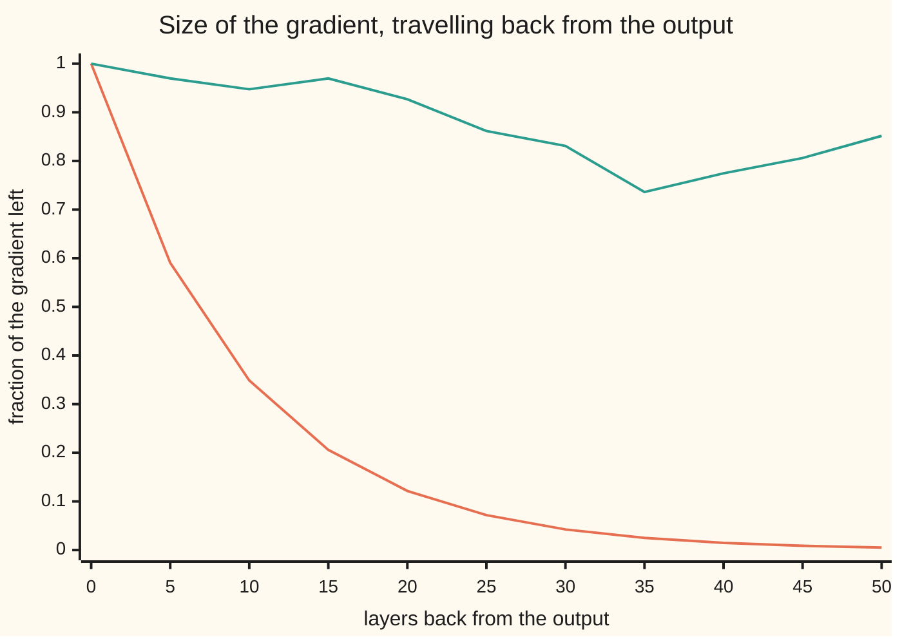
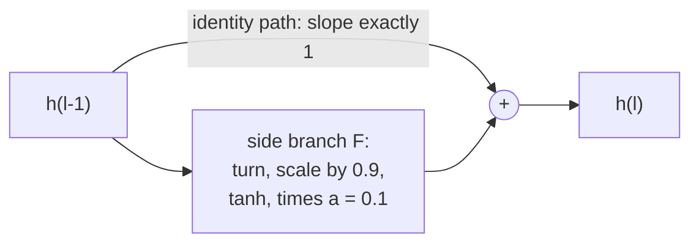

# Residual connections and normalisation: keep the gradient alive through fifty layers

[Syllabus](../../../SYLLABUS.md) → [Applied and computational](../README.md) → [Deep Networks](../README.md#s09) → Residual connections and normalisation

---

## General Overview

A network reads a 28 by 28 grey image of a handwritten digit, 784 pixel values, and says which digit it is. Deeper networks can draw finer distinctions, so suppose it has 50 layers. Training it needs the gradient: for every weight, how fast the error changes when that weight moves ([Backpropagation](../06-Machine%20Learning%20Mathematics/04-backpropagation.md)).

Backpropagation sends the error's slope backwards from the output, one layer at a time. Each layer multiplies it by that layer's local slope. Suppose every layer shrinks it to 0.9 of its size. After 50 layers, $`0.9^{50} = 0.005154`$ of it is left: about half a percent. The first layer gets almost no signal and barely learns. That is the **vanishing gradient**. If every layer grows it by 1.1 instead, $`1.1^{50} = 117.39`$, and training blows up: the **exploding gradient**.

Two design tricks fix most of this.

- A **residual connection** (also called a skip connection) adds each layer's input back to its output. The backward signal then has a path through every layer that multiplies it by exactly 1. Each layer's factor becomes 1 plus something small. In this card's 50-layer network the gradient reaching the first layer is 0.851484 of its starting size, not 0.005154.
- **Normalisation** rescales a list of numbers to mean 0 and spread 1 before the next layer sees them. Layer normalisation turns four numbers that a layer computed from one digit image, (1, 2, 3, 4), into (−1.342, −0.447, 0.447, 1.342). Whatever size the numbers grew to, the next layer sees the same scale.

**Backpropagation multiplies one slope per layer, so 50 slopes a little under or over 1 shrink or blow up the gradient; a residual connection makes each factor 1 plus a small correction, and normalisation resets the size of every layer's numbers to a fixed scale.**

**What kind of fact this is:** the shrinking and growing product is a theorem: the chain rule plus arithmetic, proved on this card in Why it works. Residual connections and normalisation are design methods. They change what the chain multiplies, which the card proves and runs. That they make real networks train better is an observed fact, not a theorem.

### The picture: how much gradient is left, layer by layer



Orange: the plain 50-layer network, each layer shrinking the gradient by 0.9. Green: the same layers used as small side branches next to a skip connection. The network is a small synthetic stand-in for the digit reader: 4 numbers wide, so every step can be checked, and generated from a stated rule and seed in the code below.

---

## The formula

Notation first, in words. The network has $`L = 50`$ layers, numbered $`l = 1, \dots, L`$. Layer $`l`$ outputs a list of $`d = 4`$ numbers, $`h_l`$; the input is $`h_0`$. (Elsewhere in this wing $`L`$ is a queue length or a Laplacian; here it counts layers.)

The **Jacobian** $`J_l`$ of layer $`l`$ is its table of local slopes: entry $`(i, j)`$ says how fast output $`i`$ moves when input $`j`$ moves ([Chain rule in several variables](../../06-Calculus%20and%20analysis/07-Several%20Variables/04-multivariable-chain-rule-and-jacobians.md)). The gradient $`g_l`$ is how fast the loss $`\ell`$ (the error score) moves with each entry of $`h_l`$. Its length is $`\lVert g_l\rVert`$.

**The chain.** Backpropagation passes the gradient back through each layer's transposed Jacobian (rows turned into columns):

```math
g_0 = J_1^{\mathsf T} J_2^{\mathsf T} \cdots J_L^{\mathsf T}\, g_L .
```

**Read it aloud:** the gradient at the input is the gradient at the output, multiplied by every layer's slope table in turn, last layer first.

If every layer scales lengths by the same factor $`s`$, then $`\lVert g_0\rVert = s^L \lVert g_L\rVert`$. With $`s = 0.9`$ and $`L = 50`$ that is 0.005154.

**The residual connection.** A residual layer adds a side branch $`F_l`$ to an identity path:

```math
h_l = h_{l-1} + F_l(h_{l-1}), \qquad J_l = I + F_l' .
```

**Read it aloud:** the layer's output is its input plus a correction, so its slope table is the identity (the table that changes nothing) plus the branch's slope table.

**Normalisation.** Take $`d`$ numbers $`x_1, \dots, x_d`$. Find their mean $`\mu`$ and their variance $`\sigma^2`$, the average squared distance from the mean ([Variance](../../09-Probability%20and%20statistics/02-Random%20Variables/03-variance-and-standard-deviation.md)). Then

```math
\mu = \frac1d\sum_{i=1}^{d} x_i, \qquad \sigma^2 = \frac1d\sum_{i=1}^{d}(x_i-\mu)^2, \qquad y_i = \gamma\,\frac{x_i-\mu}{\sqrt{\sigma^2+\varepsilon}} + \beta .
```

**Read it aloud:** subtract the mean, divide by the standard deviation, then let the network stretch by $`\gamma`$ and shift by $`\beta`$ as it learns.

**Layer normalisation** takes the $`d`$ numbers from one example, such as one word's list of features. **Batch normalisation** takes one feature across the $`m`$ examples of a training batch, such as one feature over 32 digit images. The formula is the same; only the list it averages over differs.

| Symbol | Plain meaning | In our example | Push it up and the answer… |
| --- | --- | --- | --- |
| $`L`$, $`l`$ | number of layers; one layer's number | 50; 1 to 50 | the gradient's shrink or growth compounds over more factors |
| $`h_l`$, $`d`$ | layer $`l`$'s output list; its length (width) | $`h_0 = (0.1, 0.2, 0.3, 0.4)`$; $`d = 4`$ | — |
| $`\ell`$, $`g_l`$, $`\lVert g\rVert`$ | the loss; its gradient with respect to $`h_l`$; a list's length | $`\ell`$ = first entry of $`h_{50}`$, so $`\lVert g_{50}\rVert = 1`$ | — |
| $`J_l`$, $`I`$, $`{}^{\mathsf T}`$ | layer $`l`$'s slope table; the identity; transpose | $`J_l = 0.9\,Q_l`$ in the plain network | — |
| $`s`$, $`Q_l`$ | a plain layer's scale; a rotation (turns the list, keeps its length) | $`s = 0.9`$; seeded random turns | $`s = 1.1`$ gives 117.390853 |
| $`F_l`$, $`F_l'`$, $`a`$ | the side branch; its slope table; its size | $`F_l(h) = a\tanh(0.9\,Q_l h)`$, $`a = 0.1`$ | $`a = 1`$ gives 39.664059 |
| $`x_i`$, $`y_i`$, $`\mathrm{LN}`$ | the numbers going into normalisation; coming out; layer normalisation as a function | (1, 2, 3, 4); (−1.341641, −0.447214, 0.447214, 1.341641) | — |
| $`\mu`$, $`\sigma^2`$, $`\sigma`$, $`r`$ | mean; variance; standard deviation; $`r = \sqrt{\sigma^2+\varepsilon}`$ | 2.5; 1.25; 1.118034; 1.118034 at $`\varepsilon = 0`$ | outputs do not change: scale is removed |
| $`\varepsilon`$ | a tiny number added so a flat list never divides by zero (not the wing's error allowance) | $`10^{-5}`$ | $`y_1`$ moves from −1.341641 to −1.341635 |
| $`\gamma`$, $`\beta`$ | learned stretch and shift | start at 1 and 0 | — |
| $`m`$ | examples in a batch (the batch size) | 3: images A, B and C | batch norm gets steadier statistics |
| $`\partial y_i/\partial x_j`$, $`\delta_{ij}`$, $`\ln`$, $`e`$, $`\tanh`$ | slope of $`y_i`$ as $`x_j`$ alone moves; 1 if $`i = j`$, else 0; natural log and its base; the S-shaped squashing curve from −1 to 1 | $`\ln 0.9^{50} = -5.268026`$ | — |

### When it holds

- **The branch starts small.** The skip helps because $`I + F_l'`$ is close to $`I`$. Make the branch full size, $`a = 1`$, and the gradient at the input grows to 39.664059. Real networks start each branch small: the last layer of the branch starts at or near zero.
- **Batch normalisation needs a batch.** With one example, each feature's mean is the feature itself. Every output is 0, whatever the image. At test time, when images arrive one at a time, batch norm uses averages saved during training instead.
- **The list has some spread.** A flat list such as (5, 5, 5, 5) has variance 0. Without $`\varepsilon`$ the formula divides 0 by 0. With $`\varepsilon = 10^{-5}`$ it returns (0, 0, 0, 0).
- **Overall size carries no meaning.** Normalisation throws away the list's mean and scale: (1, 2, 3, 4) and (2, 4, 6, 8) give the same output. The learned $`\gamma`$ and $`\beta`$ let the network put back a scale it needs, but the input's own scale is gone.

---

## Why it works

### Step 0: fifty factors compound like interest

The backward pass multiplies one factor per layer. A product of many factors behaves like compound interest run backwards. Take logarithms and it becomes a sum: $`\ln 0.9^{50} = 50 \ln 0.9 = -5.268026`$, and $`e^{-5.268026} = 0.005154`$.

A sum of 50 equal terms is big even when each term is small. So a factor only a little below 1 kills the gradient, and a factor only a little above 1 blows it up. Exactly 1 is the only safe value, and nothing in a plain layer holds it there.

### Step 1: the chain rule makes the gradient a product

Write the network as 50 functions applied in turn: $`h_l = f_l(h_{l-1})`$. The chain rule says the slope table of the whole stack is the product of the layers' slope tables. Backpropagation applies it from the loss end: $`g_{l-1} = J_l^{\mathsf T} g_l`$. This is the backpropagated-error recursion of [Backpropagation](../06-Machine%20Learning%20Mathematics/04-backpropagation.md), written with whole slope tables.

This card's plain layer is $`h_l = 0.9\,Q_l h_{l-1}`$. Here $`Q_l`$ is a rotation: it turns the list and keeps its length. So $`J_l = 0.9\,Q_l`$, and every backward step cuts the gradient's length to exactly 0.9 of what it was, in any direction. After 50 steps, $`\lVert g_0\rVert = 0.9^{50} = 0.005154`$, proved by this argument and confirmed by the code.

Real layers are less tidy: a slope table is a weight matrix times the squashing function's slope, at most 1 for tanh. Some directions shrink, some grow, and the product drifts the same way.

### Step 2: the skip connection puts an exact 1 in every factor



A residual layer computes $`h_l = h_{l-1} + F_l(h_{l-1})`$. Its slope table is $`I + F_l'`$, so the backward step is

```math
g_{l-1} = g_l + F_l'^{\mathsf T} g_l .
```

**Read it aloud:** the gradient going into a residual layer is the gradient coming out, passed through unchanged, plus a correction from the branch.

The identity path carries $`g_l`$ through with factor exactly 1. The branch only adds a correction. Expand the product of 50 factors $`(I + F_l')`$ and one term takes the identity path every time: the output gradient itself, untouched by depth.

How big can the correction be? Here $`F_l(h) = 0.1\tanh(0.9\,Q_l h)`$. Its slopes are at most $`0.1 \times 0.9 = 0.09`$, because tanh's slope is at most 1 and a rotation keeps lengths. So each factor stretches or shrinks the gradient by between $`0.91`$ and $`1.09`$.

- **The guarantee:** after 50 layers the gradient's length lies between $`0.91^{50} = 0.008955`$ and $`1.09^{50} = 74.357520`$.
- **The run:** it is 0.851484. The small corrections point in different directions from layer to layer, so they partly cancel.

The guarantee alone is weak. The skip buys factors near 1 instead of factors fixed at 0.9.

### Step 3: normalisation fixes the size of what each layer sees

Subtracting the mean makes the outputs add to zero. Dividing by the standard deviation makes their average square 1. Both hold for any input with some spread.

<details>
<summary>Proof: the output has mean 0 and variance 1</summary>

Take $`\gamma = 1`$, $`\beta = 0`$ and $`\varepsilon = 0`$, so $`y_i = (x_i - \mu)/\sigma`$. The deviations add to zero, because $`\mu`$ is their average:

$`\displaystyle \sum_{i=1}^{d} (x_i - \mu) = \sum_{i=1}^{d} x_i - d\mu = d\mu - d\mu = 0 .`$

So the $`y_i`$ add to zero too: mean 0. For the spread, square and average:

$`\displaystyle \frac1d\sum_{i=1}^{d} y_i^2 = \frac{1}{\sigma^2}\cdot\frac1d\sum_{i=1}^{d}(x_i-\mu)^2 = \frac{\sigma^2}{\sigma^2} = 1 .`$

With mean 0, the average square is the variance, so the variance is 1. Multiply every $`x_i`$ by the same positive number and $`\mu`$, the deviations and $`\sigma`$ all scale by it, which cancels: the output does not change.

</details>

So if the numbers coming out of a layer grew 117.39 times, the next layer still sees (−1.341641, −0.447214, 0.447214, 1.341641). The forward pass cannot compound a size error from layer to layer.

The backward pass divides by the same $`\sigma`$. The slope table of layer normalisation is

```math
\frac{\partial y_i}{\partial x_j} = \frac{1}{\sqrt{\sigma^2+\varepsilon}}\Bigl(\delta_{ij} - \frac1d - \frac{y_i\,y_j}{d}\Bigr),
```

where $`\delta_{ij}`$ is 1 when $`i = j`$ and 0 otherwise (not the backpropagated error $`\delta`$ of the backpropagation card). The code checks it against a central difference: the slopes of $`y_1`$ are (0.268328, −0.357771, −0.089443, 0.178885) both ways. Feed in the input scaled up 117.39 times and they become (0.002286, −0.003048, −0.000762, 0.001524), each 117.39 times smaller: a too-large input gets a proportionally smaller gradient. A training step moves the input in proportion to that gradient, while the input itself is 117.39 times larger. So one step changes it by a far smaller fraction of its size: 13,780.6 times smaller, which is $`117.39^2`$. Numbers that have grown too big are slow to move.

<details>
<summary>Where the slope table comes from</summary>

Write $`r = \sqrt{\sigma^2 + \varepsilon}`$, so $`y_i = (x_i - \mu)/r`$. Moving $`x_j`$ moves the mean by $`1/d`$, and moves the variance by $`2(x_j - \mu)/d`$, because the deviations add to zero. So $`r`$ moves by $`(x_j - \mu)/(d\,r)`$. The quotient rule gives

$`\displaystyle \frac{\partial y_i}{\partial x_j} = \frac{\delta_{ij} - 1/d}{r} - \frac{(x_i - \mu)(x_j - \mu)}{d\,r^3} = \frac1r\Bigl(\delta_{ij} - \frac1d - \frac{y_i\,y_j}{d}\Bigr).`$

At (1, 2, 3, 4), $`r = 1.118034`$ and $`y_1 = -1.341641`$, so the first slope is $`(1 - 0.25 - 0.45)/1.118034 = 0.268328`$.

</details>

### Step 4: batch or layer, the only difference is what gets averaged

| | Batch normalisation | Layer normalisation |
| --- | --- | --- |
| Averages over | one feature, across the $`m`$ examples in the batch | all $`d`$ features of one example |
| Depends on other examples | yes | no |
| Batch of one | every output 0 | works |
| At test time | uses averages saved in training | the same formula as in training |
| Typical home | image networks, after convolutions | transformers, one word at a time |

Take a batch of three images, each summarised by a layer as 4 features: A = (1, 2, 3, 4), B = (2, 4, 6, 8) and C = (3, 0, 3, 0). Batch norm turns A into (−1.224745, 0, −0.707107, 0). Swap C for (9, 9, 9, 9) and A becomes (−0.842927, −1.019049, −1.224745, −1.388730), though A itself did not change. Layer norm gives A and B the same output, (−1.341641, −0.447214, 0.447214, 1.341641), because B is A doubled.

---

## Worked numbers, by hand

| Step | Arithmetic | Value |
| --- | --- | --- |
| plain chain, 50 factors of 0.9 | $`50 \ln 0.9`$, then $`e`$ to that power | −5.268026, then **0.005154** |
| plain chain, 50 factors of 1.1 | $`1.1^{50}`$ | 117.390853 |
| residual chain, bounds | $`0.91^{50}`$ and $`1.09^{50}`$ | 0.008955 and 74.357520 |
| residual chain, run | backpropagation through 50 layers, $`a = 0.1`$ | **0.851484** |
| mean of (1, 2, 3, 4) | $`(1 + 2 + 3 + 4)/4`$ | 2.5 |
| variance | $`(1.5^2 + 0.5^2 + 0.5^2 + 1.5^2)/4`$ | 1.25 |
| standard deviation | $`\sqrt{1.25}`$ | 1.118034 |
| $`y_1`$, $`y_2`$ | $`-1.5/1.118034`$, $`-0.5/1.118034`$ | −1.341641, −0.447214 |
| layer norm of (1, 2, 3, 4) | by symmetry, $`y_3 = -y_2`$ and $`y_4 = -y_1`$ | **(−1.342, −0.447, 0.447, 1.342)** |
| with $`\varepsilon = 10^{-5}`$ | $`-1.5/\sqrt{1.25001}`$ | −1.341635 |

The first layer of the plain network gets 0.005154 of the gradient; through skip connections it gets 0.851484. The normalised list has mean 0 and variance 1, and $`\varepsilon`$ moves only the sixth decimal.

### What breaks if you drop a piece

| Mistake | Comes out at | What went wrong |
| --- | --- | --- |
| Drop the skip connections | gradient 0.005154 instead of 0.851484 | 50 factors of 0.9, nothing near 1 |
| Plain layers that scale by 1.1 | gradient 117.390853 | 50 factors a little over 1 explode |
| Full-size side branch, $`a = 1`$ | gradient 39.664059 | each factor is $`I`$ plus something big, not small |
| Batch norm on a batch of one | (0, 0, 0, 0) | each feature is its own mean |
| Divide the variance by $`d - 1`$ instead of $`d`$ | (−1.161895, −0.387298, 0.387298, 1.161895), variance 0.75 | the sample-variance rule, wrong here: the output's variance is $`(d-1)/d`$, not 1 |
| Leave out $`\varepsilon`$ on (5, 5, 5, 5) | division by zero | a flat list has no spread to divide by |

Every number in the table is printed by the code below.

---

## Code, from first principles, and it actually runs

The scripts build a synthetic 4-wide, 50-layer network. Each plain layer is a random rotation from SplitMix64 with seed 2026, times 0.9. They take **three independent roads** to the gradient that reaches the input: the closed form $`0.9^{50}`$; backpropagation, layer by layer through the transposed slope tables; and a central difference that nudges each input by $`10^{-6}`$ and reruns all 50 layers. They do the same for the residual network, the 1.1 network and the full-size branch. Then they normalise (1, 2, 3, 4), check the result against the hand values $`\pm 3/\sqrt5`$ and $`\pm 1/\sqrt5`$, check the slope-table formula against a central difference, check that 117.39 times the input gives 117.39 times smaller slopes and a step fraction $`117.39^2`$ times smaller, run batch norm on images A, B and C against hand values, and reproduce every "what breaks" number.

### Python

```python
# Residual connections and normalisation -- the check behind the card.  Standard library only.
# A synthetic 50-layer, 4-wide network: each plain layer turns its input (a random rotation,
# SplitMix64 seed 2026) and scales it by 0.9.  Three roads to the gradient that reaches layer 0:
# the closed form 0.9^50, backpropagation through the layers, and a central difference.
from math import cos, sin, tanh, sqrt, log, pi

D, L, MASK = 4, 50, (1 << 64) - 1
def splitmix(state):                     # SplitMix64: returns (new state, uniform in [0, 1))
    state = (state + 0x9E3779B97F4A7C15) & MASK; z = state
    z = ((z ^ (z >> 30)) * 0xBF58476D1CE4E5B9) & MASK
    z = ((z ^ (z >> 27)) * 0x94D049BB133111EB) & MASK
    return state, ((z ^ (z >> 31)) >> 11) / 2.0 ** 53

def rotations(seed):                     # 50 random 4-by-4 rotations, four plane turns each
    out, s = [], seed
    for _ in range(L):
        A = [[1.0 if i == j else 0.0 for j in range(D)] for i in range(D)]
        for i, j in ((0, 1), (2, 3), (0, 2), (1, 3)):
            s, u = splitmix(s); c, t = cos(2 * pi * u), sin(2 * pi * u)
            for r in A: r[i], r[j] = c * r[i] - t * r[j], t * r[i] + c * r[j]
        out.append(A)
    return out
Q = rotations(2026)
mv = lambda A, x: [sum(A[i][j] * x[j] for j in range(D)) for i in range(D)]
mtv = lambda A, x: [sum(A[j][i] * x[j] for j in range(D)) for i in range(D)]
norm = lambda v: sqrt(sum(t * t for t in v))

def forward(x, s, a):                    # a = 0: plain layer h = s Q h; else h = h + a tanh(s Q h)
    hs = [x]
    for l in range(L):
        z = [s * t for t in mv(Q[l], x)]
        x = z if a == 0 else [x[i] + a * tanh(z[i]) for i in range(D)]
        hs.append(x)
    return hs

def backward(x, s, a):                   # loss = first entry of h_50, so its gradient is (1, 0, 0, 0)
    hs, g, sizes = forward(x, s, a), [1.0, 0.0, 0.0, 0.0], [1.0]
    for l in reversed(range(L)):
        if a == 0: g = [s * t for t in mtv(Q[l], g)]
        else:
            z = [s * t for t in mv(Q[l], hs[l])]
            side = mtv(Q[l], [a * (1 - tanh(z[i]) ** 2) * g[i] * s for i in range(D)])
            g = [g[i] + side[i] for i in range(D)]   # identity path plus side branch
        sizes.append(norm(g))
    return g, sizes

def central(x, s, a, e=1e-6):
    return [(forward([x[j] + (e if j == i else 0) for j in range(D)], s, a)[-1][0]
             - forward([x[j] - (e if j == i else 0) for j in range(D)], s, a)[-1][0]) / (2 * e)
            for i in range(D)]

X0 = [0.1, 0.2, 0.3, 0.4]
row = lambda label, *vals: print(f"{label:<42}" + "".join(f"{v + 0.0:>11.6f}" for v in vals))
row("chain: 0.9^50, 1.1^50", 0.9 ** 50, 1.1 ** 50)
row("chain: 50 ln 0.9, exp of it", 50 * log(0.9), 2.718281828459045 ** (50 * log(0.9)))
res = {}
for name, s, a in (("plain 0.9", 0.9, 0), ("residual a=0.1", 0.9, 0.1),
                   ("plain 1.1", 1.1, 0), ("residual a=1", 0.9, 1.0)):
    g, sizes = backward(X0, s, a); cd = central(X0, s, a)
    res[name] = (g, cd, sizes)
    row(f"{name}: backprop |g0|, central |g0|", norm(g), norm(cd))
row("residual a=0.1: bounds 0.91^50, 1.09^50", 0.91 ** 50, 1.09 ** 50)
print("chart, layers back: plain 0.9 | residual a=0.1")
for k in range(0, L + 1, 5):
    row(f"  {k} layers back", res["plain 0.9"][2][k], res["residual a=0.1"][2][k])

def layer_norm(x, eps=0.0, n_minus_1=False):
    d = len(x); mu = sum(x) / d
    var = sum((t - mu) ** 2 for t in x) / (d - 1 if n_minus_1 else d)
    return [(t - mu) / sqrt(var + eps) for t in x], mu, var

def batch_norm(batch, eps=0.0):          # each feature (column) normalised over the batch
    cols = [layer_norm([ex[f] for ex in batch], eps)[0] for f in range(len(batch[0]))]
    return [[cols[f][b] for f in range(len(cols))] for b in range(len(batch))]

x = [1.0, 2.0, 3.0, 4.0]
y, mu, var = layer_norm(x)
row("layer norm: mean, variance, sd", mu, var, sqrt(var))
row("layer norm of (1, 2, 3, 4)", *y)
row("  with eps = 1e-5", *layer_norm(x, 1e-5)[0])
row("  output mean, output variance", sum(y) / 4, sum(t * t for t in y) / 4)
big = [117.390853 * t for t in x]
row("layer norm of 117.39 x (1, 2, 3, 4)", *layer_norm(big)[0])
J = [[(float(i == j) - 0.25 - y[i] * y[j] / 4) / sqrt(var) for j in range(D)] for i in range(D)]
Jcd = [(layer_norm([x[j] + (1e-6 if j == k else 0) for j in range(D)])[0][0]
        - layer_norm([x[j] - (1e-6 if j == k else 0) for j in range(D)])[0][0]) / 2e-6 for k in range(D)]
row("LN slopes of y1: formula", *J[0])
row("LN slopes of y1: central difference", *Jcd)
Jbig = [(float(0 == j) - 0.25 - y[0] * y[j] / 4) / sqrt(layer_norm(big)[2]) for j in range(D)]
row("LN slopes of y1, input x 117.39", *Jbig)
frac = norm(J[0]) / norm(x) / (norm(Jbig) / norm(big))   # a step's size over the input's size, scale 1 over scale 117.39
row("  step fraction ratio, 1 vs 117.39", frac)
batch = [[1.0, 2.0, 3.0, 4.0], [2.0, 4.0, 6.0, 8.0], [3.0, 0.0, 3.0, 0.0]]
bn = batch_norm(batch)
row("batch norm, image A in batch A B C", *bn[0])
bn2 = batch_norm([batch[0], batch[1], [9.0, 9.0, 9.0, 9.0]])
row("batch norm, image A, C now (9,9,9,9)", *bn2[0])
row("layer norm, image B = 2 x image A", *layer_norm(batch[1])[0])
row("wrong: batch norm, batch of one", *batch_norm([x], 1e-5)[0])
wrong = layer_norm(x, n_minus_1=True)[0]
row("wrong: divide by d - 1", *wrong)
row("  its output variance", sum(t * t for t in wrong) / 4)
flat = [5.0, 5.0, 5.0, 5.0]
row("flat (5,5,5,5) with eps = 1e-5", *layer_norm(flat, 1e-5)[0])
print("flat (5,5,5,5) with eps = 0: variance 0, division by zero")

gp, cp, sp = res["plain 0.9"]; gr, cr, sr = res["residual a=0.1"]
assert abs(norm(gp) - 0.9 ** 50) < 1e-12, "plain net: backprop against the closed form 0.9^50"
assert abs(norm(res["plain 1.1"][0]) - 1.1 ** 50) < 1e-9, "plain net, 1.1: closed form 1.1^50"
for g, cd, _ in res.values():
    assert max(abs(g[i] - cd[i]) for i in range(D)) < 1e-6 * max(1.0, norm(g)), "backprop vs central"
assert 0.5 < norm(gr) < 2.0 and 0.91 ** 50 < norm(gr) < 1.09 ** 50, "residual gradient stays near 1"
assert norm(res["residual a=1"][0]) > 10, "a full-size side branch explodes"
assert max(abs(y[i] - c) for i, c in enumerate((-3 / sqrt(5), -1 / sqrt(5), 1 / sqrt(5), 3 / sqrt(5)))) < 1e-12
assert abs(sum(y)) < 1e-12 and abs(sum(t * t for t in y) / 4 - 1) < 1e-12, "LN output: mean 0, variance 1"
assert max(abs(J[0][k] - Jcd[k]) for k in range(D)) < 1e-8, "LN Jacobian formula vs central difference"
assert max(abs(a - b) for a, b in zip(layer_norm(big)[0], y)) < 1e-12, "LN ignores overall scale"
assert max(abs(Jbig[k] - J[0][k] / 117.390853) for k in range(D)) < 1e-12, "slopes shrink by the scale"
assert abs(frac - 117.390853 ** 2) < 1e-6, "a step's fraction shrinks by the scale squared"
assert max(abs(a - b) for a, b in zip(bn[0], (-sqrt(1.5), 0.0, -1 / sqrt(2), 0.0))) < 1e-12, "batch norm by hand"
assert max(abs(bn2[0][i] + 3 / sqrt((9 + (i - 2) ** 2 + (5 - i) ** 2) / 3)) for i in range(D)) < 1e-12, "C changed, by hand"
assert all(t == 0.0 for t in batch_norm([x], 1e-5)[0]), "batch of one: every output is 0"
assert abs(sum(t * t for t in wrong) / 4 - 0.75) < 1e-12, "n - 1 spread gives variance (d-1)/d"
print("ALL CHECKS PASS")
```

**Ran 2026-11-23 on macOS, Python 3.14.10, standard library only. All checks passed. Output, pasted from the run:**

```
chain: 0.9^50, 1.1^50                        0.005154 117.390853
chain: 50 ln 0.9, exp of it                 -5.268026   0.005154
plain 0.9: backprop |g0|, central |g0|       0.005154   0.005154
residual a=0.1: backprop |g0|, central |g0|   0.851484   0.851484
plain 1.1: backprop |g0|, central |g0|     117.390853 117.390853
residual a=1: backprop |g0|, central |g0|   39.664059  39.664059
residual a=0.1: bounds 0.91^50, 1.09^50      0.008955  74.357520
chart, layers back: plain 0.9 | residual a=0.1
  0 layers back                              1.000000   1.000000
  5 layers back                              0.590490   0.969655
  10 layers back                             0.348678   0.947380
  15 layers back                             0.205891   0.969539
  20 layers back                             0.121577   0.926833
  25 layers back                             0.071790   0.861599
  30 layers back                             0.042391   0.830874
  35 layers back                             0.025032   0.736001
  40 layers back                             0.014781   0.774513
  45 layers back                             0.008728   0.806044
  50 layers back                             0.005154   0.851484
layer norm: mean, variance, sd               2.500000   1.250000   1.118034
layer norm of (1, 2, 3, 4)                  -1.341641  -0.447214   0.447214   1.341641
  with eps = 1e-5                           -1.341635  -0.447212   0.447212   1.341635
  output mean, output variance               0.000000   1.000000
layer norm of 117.39 x (1, 2, 3, 4)         -1.341641  -0.447214   0.447214   1.341641
LN slopes of y1: formula                     0.268328  -0.357771  -0.089443   0.178885
LN slopes of y1: central difference          0.268328  -0.357771  -0.089443   0.178885
LN slopes of y1, input x 117.39              0.002286  -0.003048  -0.000762   0.001524
  step fraction ratio, 1 vs 117.39        13780.612368
batch norm, image A in batch A B C          -1.224745   0.000000  -0.707107   0.000000
batch norm, image A, C now (9,9,9,9)        -0.842927  -1.019049  -1.224745  -1.388730
layer norm, image B = 2 x image A           -1.341641  -0.447214   0.447214   1.341641
wrong: batch norm, batch of one              0.000000   0.000000   0.000000   0.000000
wrong: divide by d - 1                      -1.161895  -0.387298   0.387298   1.161895
  its output variance                        0.750000
flat (5,5,5,5) with eps = 1e-5               0.000000   0.000000   0.000000   0.000000
flat (5,5,5,5) with eps = 0: variance 0, division by zero
ALL CHECKS PASS
```

Backpropagation and the central difference agree on every network, and the plain network matches $`0.9^{50}`$ to $`10^{-12}`$.

### Rust

The same checks, the same seed, std only.

```rust
// Residual connections and normalisation -- the same check as the Python, in Rust.  std only.
// A synthetic 50-layer, 4-wide network: each plain layer turns its input (a random rotation,
// SplitMix64 seed 2026) and scales it by 0.9.  Three roads to the gradient that reaches layer 0:
// the closed form 0.9^50, backpropagation through the layers, and a central difference.
// Compile: rustc --edition 2021 -O residual_networks_and_normalisation_check.rs -o /tmp/resnorm
use std::f64::consts::PI;

const D: usize = 4;
const L: usize = 50;
type M = [[f64; D]; D];

fn splitmix(state: u64) -> (u64, f64) {      // returns (new state, uniform in [0, 1))
    let s = state.wrapping_add(0x9E3779B97F4A7C15);
    let mut z = s;
    z = (z ^ (z >> 30)).wrapping_mul(0xBF58476D1CE4E5B9);
    z = (z ^ (z >> 27)).wrapping_mul(0x94D049BB133111EB);
    (s, ((z ^ (z >> 31)) >> 11) as f64 / 9007199254740992.0)
}

fn rotations(seed: u64) -> Vec<M> {          // 50 random 4-by-4 rotations, four plane turns each
    let (mut out, mut s) = (Vec::new(), seed);
    for _ in 0..L {
        let mut a = [[0.0; D]; D];
        for i in 0..D { a[i][i] = 1.0; }
        for (i, j) in [(0, 1), (2, 3), (0, 2), (1, 3)] {
            let (s2, u) = splitmix(s); s = s2;
            let (c, t) = ((2.0 * PI * u).cos(), (2.0 * PI * u).sin());
            for r in a.iter_mut() { let (ri, rj) = (r[i], r[j]); r[i] = c * ri - t * rj; r[j] = t * ri + c * rj; }
        }
        out.push(a);
    }
    out
}
fn mv(a: &M, x: &[f64]) -> Vec<f64> { (0..D).map(|i| (0..D).map(|j| a[i][j] * x[j]).sum()).collect() }
fn mtv(a: &M, x: &[f64]) -> Vec<f64> { (0..D).map(|i| (0..D).map(|j| a[j][i] * x[j]).sum()).collect() }
fn norm(v: &[f64]) -> f64 { v.iter().map(|t| t * t).sum::<f64>().sqrt() }

// a = 0: plain layer h = s Q h; else h = h + a tanh(s Q h)
fn forward(q: &[M], x: &[f64], s: f64, a: f64) -> Vec<Vec<f64>> {
    let mut hs = vec![x.to_vec()];
    let mut x = x.to_vec();
    for l in 0..L {
        let z: Vec<f64> = mv(&q[l], &x).iter().map(|t| s * t).collect();
        x = if a == 0.0 { z } else { (0..D).map(|i| x[i] + a * z[i].tanh()).collect() };
        hs.push(x.clone());
    }
    hs
}

// loss = first entry of h_50, so its gradient is (1, 0, 0, 0)
fn backward(q: &[M], x: &[f64], s: f64, a: f64) -> (Vec<f64>, Vec<f64>) {
    let hs = forward(q, x, s, a);
    let (mut g, mut sizes) = (vec![1.0, 0.0, 0.0, 0.0], vec![1.0]);
    for l in (0..L).rev() {
        if a == 0.0 { g = mtv(&q[l], &g).iter().map(|t| s * t).collect(); } else {
            let z: Vec<f64> = mv(&q[l], &hs[l]).iter().map(|t| s * t).collect();
            let inner: Vec<f64> = (0..D).map(|i| a * (1.0 - z[i].tanh().powi(2)) * g[i] * s).collect();
            let side = mtv(&q[l], &inner);
            g = (0..D).map(|i| g[i] + side[i]).collect();   // identity path plus side branch
        }
        sizes.push(norm(&g));
    }
    (g, sizes)
}

fn central(q: &[M], x: &[f64], s: f64, a: f64) -> Vec<f64> {
    let e = 1e-6;
    (0..D).map(|i| {
        let (mut up, mut dn) = (x.to_vec(), x.to_vec()); up[i] += e; dn[i] -= e;
        (forward(q, &up, s, a)[L][0] - forward(q, &dn, s, a)[L][0]) / (2.0 * e)
    }).collect()
}

fn row(label: &str, vals: &[f64]) {
    let mut out = format!("{:<42}", label);
    for v in vals { out += &format!("{:>11.6}", v + 0.0); }
    println!("{}", out);
}

fn layer_norm(x: &[f64], eps: f64, n_minus_1: bool) -> (Vec<f64>, f64, f64) {
    let d = x.len() as f64;
    let mu = x.iter().sum::<f64>() / d;
    let var = x.iter().map(|t| (t - mu).powi(2)).sum::<f64>() / if n_minus_1 { d - 1.0 } else { d };
    (x.iter().map(|t| (t - mu) / (var + eps).sqrt()).collect(), mu, var)
}

fn batch_norm(batch: &[Vec<f64>], eps: f64) -> Vec<Vec<f64>> {   // each feature normalised over the batch
    let cols: Vec<Vec<f64>> = (0..batch[0].len())
        .map(|f| layer_norm(&batch.iter().map(|ex| ex[f]).collect::<Vec<f64>>(), eps, false).0).collect();
    (0..batch.len()).map(|b| (0..cols.len()).map(|f| cols[f][b]).collect()).collect()
}

fn main() {
    let q = rotations(2026);
    let x0 = [0.1, 0.2, 0.3, 0.4];
    row("chain: 0.9^50, 1.1^50", &[0.9f64.powf(50.0), 1.1f64.powf(50.0)]);
    row("chain: 50 ln 0.9, exp of it", &[50.0 * 0.9f64.ln(), 2.718281828459045f64.powf(50.0 * 0.9f64.ln())]);
    let mut res = Vec::new();
    for (name, s, a) in [("plain 0.9", 0.9, 0.0), ("residual a=0.1", 0.9, 0.1), ("plain 1.1", 1.1, 0.0), ("residual a=1", 0.9, 1.0)] {
        let (g, sizes) = backward(&q, &x0, s, a);
        let cd = central(&q, &x0, s, a);
        row(&format!("{}: backprop |g0|, central |g0|", name), &[norm(&g), norm(&cd)]);
        res.push((g, cd, sizes));
    }
    row("residual a=0.1: bounds 0.91^50, 1.09^50", &[0.91f64.powf(50.0), 1.09f64.powf(50.0)]);
    println!("chart, layers back: plain 0.9 | residual a=0.1");
    for k in (0..=L).step_by(5) { row(&format!("  {} layers back", k), &[res[0].2[k], res[1].2[k]]); }

    let x = vec![1.0, 2.0, 3.0, 4.0];
    let (y, mu, var) = layer_norm(&x, 0.0, false);
    row("layer norm: mean, variance, sd", &[mu, var, var.sqrt()]);
    row("layer norm of (1, 2, 3, 4)", &y);
    row("  with eps = 1e-5", &layer_norm(&x, 1e-5, false).0);
    row("  output mean, output variance", &[y.iter().sum::<f64>() / 4.0, y.iter().map(|t| t * t).sum::<f64>() / 4.0]);
    let big: Vec<f64> = x.iter().map(|t| 117.390853 * t).collect();
    let (ybig, _, varbig) = layer_norm(&big, 0.0, false);
    row("layer norm of 117.39 x (1, 2, 3, 4)", &ybig);
    let delta = |i: usize, j: usize| if i == j { 1.0 } else { 0.0 };
    let j0: Vec<f64> = (0..D).map(|j| (delta(0, j) - 0.25 - y[0] * y[j] / 4.0) / var.sqrt()).collect();
    let jcd: Vec<f64> = (0..D).map(|k| {
        let (mut up, mut dn) = (x.clone(), x.clone()); up[k] += 1e-6; dn[k] -= 1e-6;
        (layer_norm(&up, 0.0, false).0[0] - layer_norm(&dn, 0.0, false).0[0]) / 2e-6
    }).collect();
    row("LN slopes of y1: formula", &j0);
    row("LN slopes of y1: central difference", &jcd);
    let jbig: Vec<f64> = (0..D).map(|j| (delta(0, j) - 0.25 - y[0] * y[j] / 4.0) / varbig.sqrt()).collect();
    row("LN slopes of y1, input x 117.39", &jbig);
    let frac = norm(&j0) / norm(&x) / (norm(&jbig) / norm(&big));   // a step's size over the input's size, scale 1 over scale 117.39
    row("  step fraction ratio, 1 vs 117.39", &[frac]);
    let batch = vec![vec![1.0, 2.0, 3.0, 4.0], vec![2.0, 4.0, 6.0, 8.0], vec![3.0, 0.0, 3.0, 0.0]];
    let bn = batch_norm(&batch, 0.0);
    row("batch norm, image A in batch A B C", &bn[0]);
    let batch2 = vec![batch[0].clone(), batch[1].clone(), vec![9.0; 4]];
    let bn2 = batch_norm(&batch2, 0.0);
    row("batch norm, image A, C now (9,9,9,9)", &bn2[0]);
    row("layer norm, image B = 2 x image A", &layer_norm(&batch[1], 0.0, false).0);
    let one = batch_norm(&[x.clone()], 1e-5);
    row("wrong: batch norm, batch of one", &one[0]);
    let wrong = layer_norm(&x, 0.0, true).0;
    let wrong_var = wrong.iter().map(|t| t * t).sum::<f64>() / 4.0;
    row("wrong: divide by d - 1", &wrong);
    row("  its output variance", &[wrong_var]);
    row("flat (5,5,5,5) with eps = 1e-5", &layer_norm(&[5.0; 4], 1e-5, false).0);
    println!("flat (5,5,5,5) with eps = 0: variance 0, division by zero");

    let (gp, gr) = (&res[0].0, &res[1].0);
    assert!((norm(gp) - 0.9f64.powf(50.0)).abs() < 1e-12, "plain net: backprop against the closed form 0.9^50");
    assert!((norm(&res[2].0) - 1.1f64.powf(50.0)).abs() < 1e-9, "plain net, 1.1: closed form 1.1^50");
    for (g, cd, _) in &res {
        let worst = (0..D).map(|i| (g[i] - cd[i]).abs()).fold(0.0, f64::max);
        assert!(worst < 1e-6 * norm(g).max(1.0), "backprop vs central");
    }
    let nr = norm(gr);
    assert!(nr > 0.5 && nr < 2.0 && nr > 0.91f64.powf(50.0) && nr < 1.09f64.powf(50.0), "residual gradient stays near 1");
    assert!(norm(&res[3].0) > 10.0, "a full-size side branch explodes");
    let exact = [-3.0 / 5f64.sqrt(), -1.0 / 5f64.sqrt(), 1.0 / 5f64.sqrt(), 3.0 / 5f64.sqrt()];
    assert!((0..D).all(|i| (y[i] - exact[i]).abs() < 1e-12), "LN against the hand values");
    assert!(y.iter().sum::<f64>().abs() < 1e-12 && (y.iter().map(|t| t * t).sum::<f64>() / 4.0 - 1.0).abs() < 1e-12, "LN output: mean 0, variance 1");
    assert!((0..D).all(|k| (j0[k] - jcd[k]).abs() < 1e-8), "LN Jacobian formula vs central difference");
    assert!((0..D).all(|i| (ybig[i] - y[i]).abs() < 1e-12), "LN ignores overall scale");
    assert!((0..D).all(|k| (jbig[k] - j0[k] / 117.390853).abs() < 1e-12), "slopes shrink by the scale");
    assert!((frac - 117.390853f64.powi(2)).abs() < 1e-6, "a step's fraction shrinks by the scale squared");
    let hand = [-(1.5f64).sqrt(), 0.0, -1.0 / 2f64.sqrt(), 0.0];
    assert!((0..D).all(|i| (bn[0][i] - hand[i]).abs() < 1e-12), "batch norm by hand");
    assert!((0..D).all(|i| (bn2[0][i] + 3.0 / ((9.0 + (i as f64 - 2.0).powi(2) + (5.0 - i as f64).powi(2)) / 3.0).sqrt()).abs() < 1e-12), "C changed, by hand");
    assert!(one[0].iter().all(|&t| t == 0.0), "batch of one: every output is 0");
    assert!((wrong_var - 0.75).abs() < 1e-12, "n - 1 spread gives variance (d-1)/d");
    println!("ALL CHECKS PASS");
}
```

**Ran 2026-11-23 on macOS, rustc 1.98.1, no crates. All checks passed. Output, pasted from the run:**

```
chain: 0.9^50, 1.1^50                        0.005154 117.390853
chain: 50 ln 0.9, exp of it                 -5.268026   0.005154
plain 0.9: backprop |g0|, central |g0|       0.005154   0.005154
residual a=0.1: backprop |g0|, central |g0|   0.851484   0.851484
plain 1.1: backprop |g0|, central |g0|     117.390853 117.390853
residual a=1: backprop |g0|, central |g0|   39.664059  39.664059
residual a=0.1: bounds 0.91^50, 1.09^50      0.008955  74.357520
chart, layers back: plain 0.9 | residual a=0.1
  0 layers back                              1.000000   1.000000
  5 layers back                              0.590490   0.969655
  10 layers back                             0.348678   0.947380
  15 layers back                             0.205891   0.969539
  20 layers back                             0.121577   0.926833
  25 layers back                             0.071790   0.861599
  30 layers back                             0.042391   0.830874
  35 layers back                             0.025032   0.736001
  40 layers back                             0.014781   0.774513
  45 layers back                             0.008728   0.806044
  50 layers back                             0.005154   0.851484
layer norm: mean, variance, sd               2.500000   1.250000   1.118034
layer norm of (1, 2, 3, 4)                  -1.341641  -0.447214   0.447214   1.341641
  with eps = 1e-5                           -1.341635  -0.447212   0.447212   1.341635
  output mean, output variance               0.000000   1.000000
layer norm of 117.39 x (1, 2, 3, 4)         -1.341641  -0.447214   0.447214   1.341641
LN slopes of y1: formula                     0.268328  -0.357771  -0.089443   0.178885
LN slopes of y1: central difference          0.268328  -0.357771  -0.089443   0.178885
LN slopes of y1, input x 117.39              0.002286  -0.003048  -0.000762   0.001524
  step fraction ratio, 1 vs 117.39        13780.612368
batch norm, image A in batch A B C          -1.224745   0.000000  -0.707107   0.000000
batch norm, image A, C now (9,9,9,9)        -0.842927  -1.019049  -1.224745  -1.388730
layer norm, image B = 2 x image A           -1.341641  -0.447214   0.447214   1.341641
wrong: batch norm, batch of one              0.000000   0.000000   0.000000   0.000000
wrong: divide by d - 1                      -1.161895  -0.387298   0.387298   1.161895
  its output variance                        0.750000
flat (5,5,5,5) with eps = 1e-5               0.000000   0.000000   0.000000   0.000000
flat (5,5,5,5) with eps = 0: variance 0, division by zero
ALL CHECKS PASS
```

The two outputs are identical line for line.

### Lean

Lean proves the three theorems for any width and any number of layers, and checks the card's small sums as exact fractions.

- Take any list with some spread, and set $`\gamma = 1`$, $`\beta = 0`$ and $`\varepsilon = 0`$. Then layer normalisation gives a list with mean 0 and variance 1.
- Suppose a slope table scales every length by $`s`$. Then its transpose also scales every length by $`s`$.
- Suppose every layer's slope table scales every length by the same $`s`$. Then after $`L`$ layers, $`\lVert g_0\rVert = s^L \lVert g_L\rVert`$.
- Suppose each layer's slope table is $`I + F_l'`$, and no $`F_l'`$ stretches a list by more than 0.09. Then after $`L`$ layers the gradient's length stays between $`0.91^L`$ and $`1.09^L`$ times its starting length. Lean allows any bound up to 1 in place of 0.09.
- For (1, 2, 3, 4), the mean is 5/2, the variance is 5/4, and $`y_1^2 = 9/5`$. Dividing by $`d - 1`$ gives an output variance of 3/4.

The Python and Rust checks cover the seeded network's run: its gradient 0.851484, layer normalisation's slope table, and batch normalisation.

```lean
-- Residual connections and normalisation: layer normalisation turns any list with some spread into one with mean 0 and variance 1, a chain of layers that each scale lengths by s shrinks or grows the gradient by exactly s^L, and with skip connections whose side branches have slope at most a the gradient stays between (1 - a)^L and (1 + a)^L of its size.
import Mathlib.Algebra.BigOperators.Expect
import Mathlib.Analysis.InnerProductSpace.Adjoint
import Mathlib.Analysis.SpecialFunctions.Pow.Real
import Mathlib.Tactic.NormNum
import Mathlib.Algebra.Order.BigOperators.Expect
import Mathlib.Analysis.Normed.Module.FiniteDimension

open Finset BigOperators

namespace ResNorm

/-- The mean `μ` of a list `x₁, …, x_d` of numbers: their average. -/
noncomputable def mean {d : ℕ} (x : Fin d → ℝ) : ℝ := 𝔼 i, x i

/-- The variance `σ²` of the list: the average squared distance from the mean. -/
noncomputable def var {d : ℕ} (x : Fin d → ℝ) : ℝ := 𝔼 i, (x i - mean x) ^ 2

/-- Layer normalisation with stretch `γ`, shift `β` and safety term `ε`:
`yᵢ = γ (xᵢ - μ) / √(σ² + ε) + β`. -/
noncomputable def layerNorm {d : ℕ} (γ β ε : ℝ) (x : Fin d → ℝ) : Fin d → ℝ :=
  fun i => γ * (x i - mean x) / Real.sqrt (var x + ε) + β

/-- Layer normalisation (with `γ = 1`, `β = 0`, `ε = 0`) of any list that has some spread
(variance not 0) gives a list with mean 0 and variance 1. -/
theorem layerNorm_mean_zero_variance_one {d : ℕ} (x : Fin d → ℝ) (hspread : var x ≠ 0) :
    mean (layerNorm 1 0 0 x) = 0 ∧ var (layerNorm 1 0 0 x) = 1 := by
  rcases Nat.eq_zero_or_pos d with hd | hd
  · subst hd
    exact absurd (by simp [var]) hspread
  have : Nonempty (Fin d) := ⟨⟨0, hd⟩⟩
  have hσ : 0 ≤ var x := Finset.expect_nonneg (fun i _ => sq_nonneg _)
  have hlay : layerNorm 1 0 0 x = fun i => (x i - mean x) / Real.sqrt (var x) := by
    funext i; simp [layerNorm]
  have hc : 𝔼 i, (x i - mean x) = 0 := by
    rw [Finset.expect_sub_distrib, Finset.expect_const Finset.univ_nonempty]
    simp [mean]
  have hm : mean (layerNorm 1 0 0 x) = 0 := by
    rw [hlay]
    show 𝔼 i, ((x i - mean x) / Real.sqrt (var x)) = 0
    rw [← Finset.expect_div, hc, zero_div]
  refine ⟨hm, ?_⟩
  unfold var
  rw [hm, hlay]
  simp only [sub_zero, div_pow, Real.sq_sqrt hσ]
  rw [← Finset.expect_div]
  exact div_self hspread

variable {E : Type*} [NormedAddCommGroup E] [InnerProductSpace ℝ E] [FiniteDimensional ℝ E]

/-- If a slope table scales every length by `s`, so does its transpose (adjoint). -/
theorem adjoint_norm_of_scale (A : E →L[ℝ] E) (s : ℝ) (h : ∀ x, ‖A x‖ = s * ‖x‖) (x : E) :
    ‖ContinuousLinearMap.adjoint A x‖ = s * ‖x‖ := by
  rcases lt_trichotomy s 0 with hs | hs | hs
  · have hx : x = 0 := by
      have h1 := h x
      have h2 := norm_nonneg (A x)
      have h3 := norm_nonneg x
      have : ‖x‖ = 0 := by nlinarith
      exact norm_eq_zero.mp this
    simp [hx]
  · subst hs
    have hA : A = 0 := by
      ext y
      have := h y
      simpa using this
    simp [hA]
  · set U : E →L[ℝ] E := s⁻¹ • A with hUdef
    have hU : ∀ y, ‖U y‖ = ‖y‖ := by
      intro y
      rw [hUdef, smul_apply, norm_smul, h y, Real.norm_eq_abs,
        abs_inv, abs_of_pos hs, ← mul_assoc, inv_mul_cancel₀ hs.ne', one_mul]
    let li : E →ₗᵢ[ℝ] E := { toLinearMap := U.toLinearMap, norm_map' := hU }
    let e : E ≃ₗᵢ[ℝ] E := li.toLinearIsometryEquiv rfl
    have he : (e : E →L[ℝ] E) = U := by
      ext y; rfl
    have hadjU : ∀ y, ‖ContinuousLinearMap.adjoint U y‖ = ‖y‖ := by
      intro y
      rw [← he, LinearIsometryEquiv.adjoint_eq_symm]
      exact e.symm.norm_map y
    have hAU : A = s • U := by
      rw [hUdef, smul_smul, mul_inv_cancel₀ hs.ne', one_smul]
    rw [hAU, map_smulₛₗ, smul_apply, norm_smul, hadjU, Real.norm_eq_abs,
      starRingEnd_apply, star_trivial, abs_of_pos hs]

#print axioms adjoint_norm_of_scale

/-- Backpropagation through layers `1, …, L` with slope tables `J l`: the gradient `g_L` at the
output is passed back through each transposed slope table, last layer first, giving
`g₀ = J₁ᵀ J₂ᵀ ⋯ J_Lᵀ g_L`. -/
noncomputable def backprop (J : ℕ → E →L[ℝ] E) : ℕ → E → E
  | 0, g => g
  | n + 1, g => backprop J n (ContinuousLinearMap.adjoint (J (n + 1)) g)

/-- The plain chain: if every layer's slope table scales lengths by the same factor `s`, then
after `L` layers the gradient's length is `s ^ L` times its length at the output. -/
theorem backprop_norm_eq_pow (J : ℕ → E →L[ℝ] E) (s : ℝ)
    (hscale : ∀ l x, ‖J l x‖ = s * ‖x‖) (L : ℕ) (g : E) :
    ‖backprop J L g‖ = s ^ L * ‖g‖ := by
  induction L generalizing g with
  | zero => simp [backprop]
  | succ n ih =>
    rw [backprop, ih, adjoint_norm_of_scale (J (n + 1)) s (hscale (n + 1)), pow_succ, mul_assoc]

/-- The residual chain: when layer `l` is `h ↦ h + F_l(h)`, its slope table is `I + F_l'`.
If every side branch's slope table has size at most `a ≤ 1` (the branch is small), the
gradient's length after `L` layers lies between `(1 - a) ^ L` and `(1 + a) ^ L` times its
length at the output. -/
theorem residual_backprop_norm_bounds (F' : ℕ → E →L[ℝ] E) (a : ℝ)
    (hsmall : ∀ l, ‖F' l‖ ≤ a) (ha : a ≤ 1) (L : ℕ) (g : E) :
    (1 - a) ^ L * ‖g‖ ≤ ‖backprop (fun l => ContinuousLinearMap.id ℝ E + F' l) L g‖ ∧
      ‖backprop (fun l => ContinuousLinearMap.id ℝ E + F' l) L g‖ ≤ (1 + a) ^ L * ‖g‖ := by
  have ha0 : 0 ≤ a := le_trans (norm_nonneg _) (hsmall 0)
  have hstep : ∀ l (y : E),
      (1 - a) * ‖y‖ ≤ ‖ContinuousLinearMap.adjoint (ContinuousLinearMap.id ℝ E + F' l) y‖ ∧
        ‖ContinuousLinearMap.adjoint (ContinuousLinearMap.id ℝ E + F' l) y‖ ≤ (1 + a) * ‖y‖ := by
    intro l y
    have hadj : ContinuousLinearMap.adjoint (ContinuousLinearMap.id ℝ E + F' l) y =
        y + ContinuousLinearMap.adjoint (F' l) y := by
      rw [map_add, add_apply]
      congr 1
      have : ContinuousLinearMap.adjoint (ContinuousLinearMap.id ℝ E) = ContinuousLinearMap.id ℝ E :=
        ContinuousLinearMap.adjoint_id
      rw [this]; rfl
    have hF : ‖ContinuousLinearMap.adjoint (F' l) y‖ ≤ a * ‖y‖ := by
      calc ‖ContinuousLinearMap.adjoint (F' l) y‖ ≤ ‖ContinuousLinearMap.adjoint (F' l)‖ * ‖y‖ :=
            (ContinuousLinearMap.adjoint (F' l)).le_opNorm y
        _ = ‖F' l‖ * ‖y‖ := by rw [LinearIsometryEquiv.norm_map]
        _ ≤ a * ‖y‖ := mul_le_mul_of_nonneg_right (hsmall l) (norm_nonneg y)
    rw [hadj]
    constructor
    · have := norm_sub_norm_le y (-ContinuousLinearMap.adjoint (F' l) y)
      rw [sub_neg_eq_add, norm_neg] at this
      linarith
    · have := norm_add_le y (ContinuousLinearMap.adjoint (F' l) y)
      linarith
  induction L generalizing g with
  | zero => simp [backprop]
  | succ n ih =>
    obtain ⟨h1, h2⟩ := ih (ContinuousLinearMap.adjoint (ContinuousLinearMap.id ℝ E + F' (n + 1)) g)
    obtain ⟨k1, k2⟩ := hstep (n + 1) g
    have p1 : 0 ≤ (1 - a) ^ n := pow_nonneg (by linarith) n
    have p2 : 0 ≤ (1 + a) ^ n := pow_nonneg (by linarith) n
    rw [backprop]
    constructor
    · calc (1 - a) ^ (n + 1) * ‖g‖ = (1 - a) ^ n * ((1 - a) * ‖g‖) := by ring
        _ ≤ (1 - a) ^ n * ‖ContinuousLinearMap.adjoint
              (ContinuousLinearMap.id ℝ E + F' (n + 1)) g‖ := mul_le_mul_of_nonneg_left k1 p1
        _ ≤ _ := h1
    · calc _ ≤ (1 + a) ^ n * ‖ContinuousLinearMap.adjoint
              (ContinuousLinearMap.id ℝ E + F' (n + 1)) g‖ := h2
        _ ≤ (1 + a) ^ n * ((1 + a) * ‖g‖) := mul_le_mul_of_nonneg_left k2 p2
        _ = (1 + a) ^ (n + 1) * ‖g‖ := by ring

/-- The card's list `(1, 2, 3, 4)`. -/
def x₀ : Fin 4 → ℚ := ![1, 2, 3, 4]

/-- Its mean is 5/2 (2.5). -/
example : 𝔼 i, x₀ i = 5 / 2 := by
  simp [Finset.expect_univ, Fin.sum_univ_four, x₀, NNRat.smul_def]; norm_num

/-- Its variance is 5/4 (1.25). -/
example : 𝔼 i, (x₀ i - 5 / 2) ^ 2 = 5 / 4 := by
  simp [Finset.expect_univ, Fin.sum_univ_four, x₀, NNRat.smul_def]; norm_num

/-- The first output squared: `y₁² = (-3/2)² / (5/4) = 9/5`, so `y₁ = -1.341641…`. -/
example : (-3 / 2 : ℚ) ^ 2 / (5 / 4) = 9 / 5 := by norm_num

/-- Dividing by `d - 1 = 3` instead of `d = 4`: the output's variance is `(d - 1)/d = 3/4`. -/
example : ((∑ i, (x₀ i - 5 / 2) ^ 2) / ((∑ i, (x₀ i - 5 / 2) ^ 2) / 3)) / 4 = (3 / 4 : ℚ) := by
  simp [Fin.sum_univ_four, x₀]; norm_num

#print axioms layerNorm_mean_zero_variance_one
#print axioms backprop_norm_eq_pow
#print axioms residual_backprop_norm_bounds

end ResNorm
```

**Checked 2026-11-23 on macOS, Lean 4.36.0-rc2, Mathlib v4.36.0-rc2. Every proof is complete and uses only Lean's standard axioms. Output, pasted from the run:**

```
'ResNorm.adjoint_norm_of_scale' depends on axioms: [propext, Classical.choice, Quot.sound]
'ResNorm.layerNorm_mean_zero_variance_one' depends on axioms: [propext, Classical.choice, Quot.sound]
'ResNorm.backprop_norm_eq_pow' depends on axioms: [propext, Classical.choice, Quot.sound]
'ResNorm.residual_backprop_norm_bounds' depends on axioms: [propext, Classical.choice, Quot.sound]
```

> [!TIP]
> **Try changing**
> - Guess first: double the depth. Change `L` from 50 to 100 (in Python, `D, L, MASK = 4, 50, …`). The plain network's gradient falls to 0.000027; the residual one's is 1.039244. The asserts written for 50 layers then fail.
> - Guess first: grow the side branch from $`a = 0.1`$ to $`a = 0.5`$: change the last 0.1 in `("residual a=0.1", 0.9, 0.1)`. Its gradient becomes 7.069329: the factors are no longer near 1.
> - Guess first: make each plain layer shrink by 0.99 instead of 0.9, in `("plain 0.9", 0.9, 0)`. The plain network's gradient is $`0.99^{50} = 0.605006`$. Even a 1% shrink per layer loses 40% over 50 layers.
> - Guess first: set $`\varepsilon = 1`$ instead of $`10^{-5}`$ in the `with eps = 1e-5` line. Layer norm of (1, 2, 3, 4) becomes (−1, −0.333333, 0.333333, 1): $`\varepsilon`$ must be tiny next to the variance.

---

## The usual mistake

> [!warning]
> **Believing the skip connection fixes depth on its own.** The identity path guarantees one factor of exactly 1 in each layer, but the branch adds to it. A full-size branch, $`a = 1`$, gives factors far from 1, and the gradient at the input comes out at 39.664059 instead of 0.851484. Residual networks train because each branch starts small, often with its last layer started at zero, and normalisation keeps the branch's input at a fixed size.
>
> Smaller traps, each with the wrong number it gives here:
> - **Batch norm on a single example:** every output is 0, (0, 0, 0, 0), whatever the input.
> - **Dividing by $`d - 1`$:** (−1.161895, −0.387298, 0.387298, 1.161895), whose variance is 0.75, not 1.
> - **Forgetting that batch norm mixes examples:** image A's output moves from (−1.224745, 0, −0.707107, 0) to (−0.842927, −1.019049, −1.224745, −1.388730) when only image C changes.
> - **Leaving out $`\varepsilon`$:** a flat list such as (5, 5, 5, 5) divides by zero.

---

## Where you meet it in real life

- **Image recognition.** The residual network of 2015 trained a 152-layer network on photographs and won that year's ImageNet classification contest. Its 50-layer version, ResNet-50, is still a standard starting point for image models. A digit reader like this card's uses the same blocks around its convolutions ([Convolutional networks](02-convolutional-networks.md)).
- **Language models.** A modern transformer block computes $`h + F(\mathrm{LN}(h))`$, where $`\mathrm{LN}`$ is layer normalisation: normalise, run the side branch, add the skip. The 2017 original normalised after the addition instead. In "the cat sat on the mat", each of the six words carries its own list of features, normalised on its own ([Attention](04-attention-and-transformers.md)).
- **Debugging a network that will not train.** The first check is the gradient's size at each layer. A plot like the one on this card, falling to 0.005 at the first layer, points at vanishing gradients.

> **Say it back**
> Backpropagation multiplies one slope per layer, so through 50 layers the gradient is a product of 50 factors. Factors a little under 1 make it vanish, $`0.9^{50} = 0.005154`$; factors a little over 1 make it explode. A residual connection adds the input back to the output, so each factor becomes 1 plus a small correction, and the gradient stays near its starting size. Normalisation subtracts the mean and divides by the standard deviation, so (1, 2, 3, 4) becomes (−1.342, −0.447, 0.447, 1.342) whatever its scale. Batch norm averages one feature over a batch; layer norm averages all features of one example.

---

## What this builds on

- [Backpropagation](../06-Machine%20Learning%20Mathematics/04-backpropagation.md): the backward pass. Its error recursion is the product of slope tables that this card shows vanishing or exploding.
- [Gradient descent](../06-Machine%20Learning%20Mathematics/02-gradient-descent-and-stochastic-gradient.md): what the gradient is for. A layer that gets 0.005 of the gradient takes steps roughly 0.005 times as large.
- [Convolutional networks](02-convolutional-networks.md): the layers that residual blocks and batch normalisation wrap in image networks.

## Where this goes next

- [Attention](04-attention-and-transformers.md): the next card. Transformers stack dozens of blocks, each a skip connection around layer normalisation and attention.
- [Momentum and Adam](../../15-Optimization/06-Conic%2C%20Quadratic%20and%20Stochastic%20Programs/09-momentum-adam-and-step-size-schedules.md): step sizes that adapt for each weight, the other usual defence against gradients of very different sizes.

Skip connections and normalisation keep the gradient's size near 1 at the start of training; why the trained network then finds weights that work on new images is left open.

---

## Sources

Verified 2026-11-23: every link below resolves to the publisher's page. Each DOI was checked against its Crossref or DataCite record for title and first author.

- Bengio, Yoshua, Patrice Simard, and Paolo Frasconi. "Learning Long-Term Dependencies with Gradient Descent Is Difficult." *IEEE Transactions on Neural Networks* 5, no. 2 (1994): 157–166. [doi:10.1109/72.279181](https://doi.org/10.1109/72.279181). Why gradients shrink or blow up through long chains of steps.
- He, Kaiming, Xiangyu Zhang, Shaoqing Ren, and Jian Sun. "Deep Residual Learning for Image Recognition." *2016 IEEE Conference on Computer Vision and Pattern Recognition (CVPR)* (2016): 770–778. [doi:10.1109/CVPR.2016.90](https://doi.org/10.1109/CVPR.2016.90). The residual connection, and networks of 50 to 152 layers trained with it.
- He, Kaiming, Xiangyu Zhang, Shaoqing Ren, and Jian Sun. "Identity Mappings in Deep Residual Networks." In *Computer Vision – ECCV 2016*, Lecture Notes in Computer Science, 630–645. Springer, 2016. [doi:10.1007/978-3-319-46493-0_38](https://doi.org/10.1007/978-3-319-46493-0_38). The backward pass through the identity path, as in Step 2.
- Ioffe, Sergey, and Christian Szegedy. "Batch Normalization: Accelerating Deep Network Training by Reducing Internal Covariate Shift." *Proceedings of the 32nd International Conference on Machine Learning*, PMLR 37 (2015): 448–456. [Publisher page](https://proceedings.mlr.press/v37/ioffe15.html). Batch normalisation, its learned stretch and shift, and the saved averages used at test time.
- Ba, Jimmy Lei, Jamie Ryan Kiros, and Geoffrey E. Hinton. "Layer Normalization." arXiv:1607.06450 (2016). [doi:10.48550/arXiv.1607.06450](https://doi.org/10.48550/arXiv.1607.06450). Normalising over the features of one example, so the formula no longer depends on the batch.
