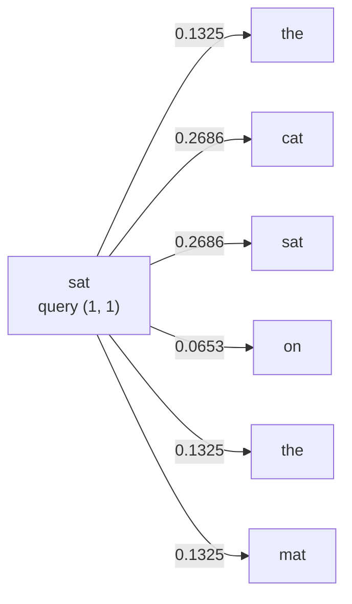
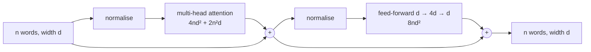
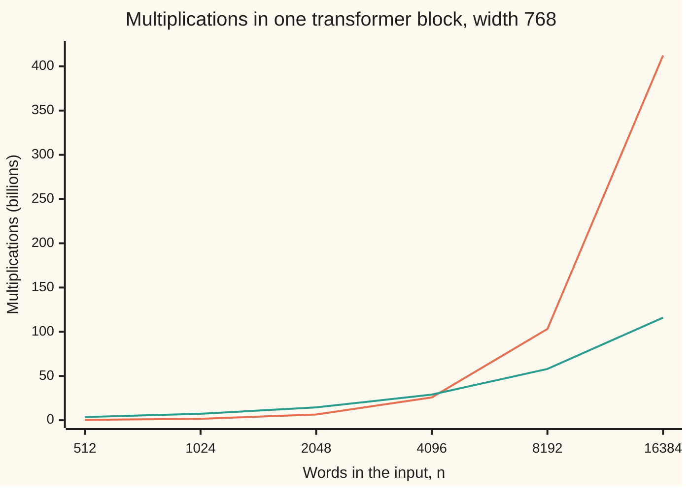

# Attention: every word looks at every other word, weighted by a softmax

[Syllabus](../../../SYLLABUS.md) → [Applied and computational](../README.md) → [Deep Networks](../README.md#s09) → Attention

---

## General Overview

Take the sentence "the cat sat on the mat". It has six words. To understand "sat", a reader needs "cat": the cat did the sitting. Each word gets its meaning partly from other words, sometimes far away in the sentence.

**Attention** is the step inside a modern language network that lets each word gather that context. Every word sends out a short list of numbers, its **query** ("what am I looking for?"). Every word also shows a **key** ("what do I offer?"). A query and a key that point the same way score high. The scores go through a softmax, so each word ends up with six weights that are positive and add to 1. The word's new list of numbers is the weighted average of six **values** ("what I hand over if chosen").

On this card every list has 2 numbers. "sat" spreads its attention like this: 0.2686 on "cat", 0.2686 on itself, 0.1325 on each "the" and on "mat", and 0.0653 on "on". Its new list is (0.5989, 0.8731).

Two facts follow, and the card proves both. First, attention ignores word order: "the mat sat on the cat" gives the cat and the mat exactly the same new lists as before, only moved. A network that must tell who sat on whom adds a **position code** to each word. Second, the cost: six words make 36 query-key pairs, at 2 multiplications each, so 72 multiplications. The pairs grow as the square of the sentence length.

**Attention scores every word's query against every word's key, divides by the square root of the list length, turns each row of scores into weights with a softmax, and hands each word the weighted average of the values, so it treats the words as a set until positions are added and costs about n² d multiplications for n words of width d.**

**What kind of fact this is:** attention is a definition, a design chosen because it trains well. Three theorems about it are proved on this card in Why it works: the weights in each row add to 1, self-attention commutes with reordering the words, and one transformer block costs exactly 12nd² + 2n²d multiplications.

### The picture: where "sat" looks



Each arrow carries one weight. The six weights add to 1. "sat" leans hardest on "cat" and on itself, and least on "on".

---

## The formula

Each of the n words starts as a list of d numbers, its **embedding** $`x_t`$ (the word's learned code). Stack the six embeddings as the rows of a table X with n rows and d columns. Three learned matrices turn X into queries, keys and values: $`Q = XW_Q`$, $`K = XW_K`$, $`V = XW_V`$. Then

```math
Z = \mathrm{softmax}\left(\frac{Q K^{\mathsf T}}{\sqrt{d}}\right) V
```

**Read it aloud:** score every query against every key, shrink the scores by the square root of the width, turn each row of scores into weights that add to 1, and give each word the weighted average of the values.

The softmax here works along each row, as on [Softmax and cross-entropy](../06-Machine%20Learning%20Mathematics/05-softmax-and-cross-entropy-for-classification.md): raise e to each score and divide by the row's total. $`K^{\mathsf T}`$ is K turned on its side (its transpose), so the entry in row i, column j of $`QK^{\mathsf T}`$ is the dot product of query i with key j: multiply matching entries and add ([The dot product](../../03-Algebra/06-Dot%20Products%20and%20Best%20Fits/01-dot-product.md)).

This card's numbers, chosen by hand rather than learned:

| Word | Embedding $`x_t`$ | Query $`q_t`$ | Key $`k_t`$ | Value $`v_t`$ |
| --- | --- | --- | --- | --- |
| the | (1, 0) | (1, 0) | (0, 1) | (1, 0) |
| cat | (0, 2) | (0, 2) | (2, 0) | (0, 2) |
| sat | (1, 1) | (1, 1) | (1, 1) | (1, 1) |
| on | (1, −1) | (1, −1) | (−1, 1) | (1, −1) |
| mat | (0, 1) | (0, 1) | (1, 0) | (0, 1) |

The query and value matrices keep the embedding as it is: $`W_Q = W_V =`$ `[[1, 0], [0, 1]]`. The key matrix swaps its two numbers: $`W_K =`$ `[[0, 1], [1, 0]]`.

The cost of one transformer block, counted as multiplications inside its matrix products, with any number of heads:

```math
C(n, d) = 12\,n\,d^2 + 2\,n^2 d
```

| Symbol | Plain meaning | In our example | Push it up and the answer… |
| --- | --- | --- | --- |
| $`n`$ | number of words (tokens) in the input | 6 | the score table grows as $`n^2`$ |
| $`d`$ | width: how many numbers describe each word; $`\sqrt{d}`$ is the shrink factor | 2, so $`\sqrt{2} = 1.4142`$ | each score costs more; without the shrink, weights pile onto one word |
| $`x_t`$, $`X`$ | the embedding of the word at position t, counted from t = 0 (slot 1) to t = 5 (slot 6); X stacks all n of them as rows | "sat" is (1, 1) | — |
| $`p_t`$ | the position code added to $`x_t`$ at position t | $`(\sin t, \cos t)`$ for t = 0 to 5 | words in different slots stop looking alike |
| $`W_Q, W_K, W_V, W_O`$ | learned d-by-d matrices: query, key, value and output | identity, swap, identity | — |
| $`Q, K, V`$; $`q_t, k_t, v_t`$ | the queries, keys and values, one row per word; $`q_t`$, $`k_t`$, $`v_t`$ are the rows for position t | rows in the table above | — |
| $`S = QK^{\mathsf T}/\sqrt{d}`$, $`s_{ij}`$ | the scores: entry $`s_{ij}`$ (row i, column j) says how well word j's key fits word i's query | "sat" on "cat": $`2/1.4142 = 1.4142`$ | a higher score takes a larger share |
| $`A`$, $`a_{ij}`$ | the weights: softmax of each row of S; $`a_{ij}`$ is word i's weight on word j | "sat" on "cat": 0.2686 | each row always adds to 1 |
| $`Z`$, $`z_i`$ | the outputs: row i is $`\sum_j a_{ij} v_j`$, word i's new list | $`z_{\text{sat}}`$ = (0.5989, 0.8731) | — |
| $`h`$ | number of heads: attention run in parallel on h slices of width d/h | 1 or 2 | cost stays the same |
| $`P`$ | a reordering (permutation) of the n slots, written as a matrix; $`P^{\mathsf T}P = I`$, the identity (the do-nothing matrix) | swap slots 2 and 6 | outputs reorder the same way |
| $`C(n, d)`$ | multiplications in one transformer block | 432 | grows as $`n^2`$ once $`n > 6d`$ |

### When it holds

- **Each row of scores is turned into weights on its own.** Run the softmax down the columns instead and the rows stop adding to 1: "cat" gets total weight 1.6847, so its output is no longer an average.
- **The scores are shrunk by $`\sqrt{d}`$.** Drop the shrink at width 512 and the largest weight averages 0.9576: each word copies one other word, and training stalls because the softmax barely responds to small changes.
- **Word order matters only through added positions.** With no position code, attention cannot tell "the cat sat on the mat" from "the mat sat on the cat".
- **The cost formula assumes a feed-forward layer of width 4d and counts only matrix multiplications.** The softmax's 36 exponentials, the additions and the normalisation are a further cost proportional to $`n^2`$ or $`nd`$, not counted here.
- **Every word may look at every word.** A network that writes text one word at a time hides the future with a **causal mask** (scores for later words are set to minus infinity), and keeps 21 of the 36 scores.

---

## Why it works

### Step 0: a soft lookup table

A dictionary lookup takes a question, finds the one key that matches, and returns that key's value. Attention does the same, but softly. It compares the question (query) with every key, and returns a blend of all the values, mixed by how well each key matches.

The softmax makes the blend a true weighted average: weights are positive and add to 1. A blend that is smooth in the scores can be trained by [Backpropagation](../06-Machine%20Learning%20Mathematics/04-backpropagation.md), which a hard "pick the best key" cannot.

### Step 1: the weights in each row add to 1

Row i of the weights is $`a_{ij} = e^{s_{ij}} / \sum_k e^{s_{ik}}`$, where $`s_{ij}`$ is the score of word j for word i. Every $`e^{s}`$ is positive, so every weight is positive. Add the weights over j: the top becomes $`\sum_j e^{s_{ij}}`$, the same as the bottom, so the total is 1.

So each output $`z_i = \sum_j a_{ij} v_j`$ is an average of the six values. It always lies inside the smallest straight-edged region that holds all six values. For "sat", the first number 0.5989 lies between the smallest first value, 0, and the largest, 1.

### Step 2: why divide by the square root of d

Suppose the d numbers of a query and of a key are independent, each with mean 0 and variance 1 (spread 1). A score is $`q \cdot k = q_1 k_1 + \dots + q_d k_d`$. Each product $`q_i k_i`$ has mean 0 and variance $`1 \times 1 = 1`$. Independent pieces add their variances, so the score has variance d and spread $`\sqrt{d}`$.

At width 512 the raw scores have a spread of $`\sqrt{512}`$ = 22.6274. Softmax of numbers that far apart puts almost all weight on the largest one. Dividing by $`\sqrt{d}`$ brings the spread back to 1 at every width. The seeded run below confirms it: scaled, the largest of six weights averages between 0.3981 and 0.4166 at every width tested; unscaled, it climbs from 0.4797 at width 2 to 0.9576 at width 512.

### Step 3: reorder the words, and the outputs reorder the same way

Write the reordering as a matrix P: multiplying X by P on the left moves its rows into the new order. P has one 1 in each row and column, so $`P^{\mathsf T} P = I`$ (turning it on its side undoes it).

Feed in PX instead of X and follow it through.

1. Queries, keys and values become PQ, PK and PV, because $`(PX)W = P(XW)`$.
2. The scores become $`PQ\,(PK)^{\mathsf T} / \sqrt{d} = P S P^{\mathsf T}`$: the same table with its rows and its columns reordered in the same way.
3. Softmax works on each row by itself and does not care about the order of entries inside a row. So the weights become $`P A P^{\mathsf T}`$.
4. The outputs become $`P A P^{\mathsf T} P V = P A V = P Z`$.

**Reordering the input reorders the output, and changes nothing else.** The name for this is **permutation equivariance**. Nothing in the proof used the numbers in W, so it holds for every trained network that has no position code and no causal mask (a mask makes what a word may see depend on its slot). The code checks all 720 orders of the six words.

### Step 4: positions break the symmetry, on purpose

Step 3 is a problem for language. "the cat sat on the mat" and "the mat sat on the cat" differ only by swapping slots 2 and 6. Attention hands "cat" the list (0.8916, 0.1626) in both, so it cannot tell who sat on whom.

The fix adds a position code to each embedding before anything else: $`x_t + p_t`$. The code belongs to the slot, not to the word, so moving a word changes what it carries. The original transformer uses sines and cosines of the slot number at many speeds. At width 2 that is $`p_t = (\sin t, \cos t)`$.

With positions added, the two copies of "the" stop looking alike. Without positions both get (0.4240, 1.1057). With positions, slot 1 gets (1.0263, 1.5074) and slot 5 gets (0.2427, 0.8897). Of the 720 orders, only the original one now leaves the outputs merely reordered.

### Step 5: many heads at the cost of one

One set of weights per word can capture only one kind of relation. **Multi-head attention** cuts the width d into h slices of width d/h, runs attention on each slice with its own weights, sets the h outputs side by side, and mixes them with the output matrix $`W_O`$. Each head divides its scores by the square root of its own width, $`\sqrt{d/h}`$, not $`\sqrt{d}`$.

Each head's score table costs $`n^2 \times (d/h)`$ multiplications. Over h heads that is $`n^2 d`$ again. So heads buy variety, not extra cost: with 2 heads the house block still counts 432.

### Step 6: a transformer block, and what it costs

A **transformer block** is attention followed by a small two-layer network applied to each word on its own (the feed-forward layer, width d to 4d and back, as on [The perceptron and its stack](../06-Machine%20Learning%20Mathematics/03-perceptron-and-neural-networks.md)). Each part is wrapped in a skip connection and a normalisation, from [Residual connections and normalisation](03-residual-networks-and-normalisation.md).



Schematic: the circles add the skip connection back in.

Count the multiplications in the matrix products, using [Matrix multiplication](../../03-Algebra/04-Matrices/03-matrix-multiplication.md)'s rule that an (a by b) times (b by c) product costs abc.

| Part | Matrix shapes | Multiplications |
| --- | --- | --- |
| queries, keys, values | three of (n by d) times (d by d) | $`3nd^2`$ |
| scores $`QK^{\mathsf T}`$ | (n by d) times (d by n) | $`n^2 d`$ |
| weights times values | (n by n) times (n by d) | $`n^2 d`$ |
| output matrix $`W_O`$ | (n by d) times (d by d) | $`nd^2`$ |
| feed-forward | (n by d)(d by 4d), then (n by 4d)(4d by d) | $`8nd^2`$ |

The total is $`12nd^2 + 2n^2d`$. The first part grows in step with the number of words. The second grows as its square. They are equal when $`12nd^2 = 2n^2d`$, that is at $`n = 6d`$. Beyond that, the $`2n^2d`$ part (the score table and the mixing) costs the most.

---

## Worked numbers, by hand

Row "sat" of the attention, with query $`q_{\text{sat}} = (1, 1)`$.

| Step | Arithmetic | Value |
| --- | --- | --- |
| dot product with each key | the (0, 1): 1; cat (2, 0): 2; sat (1, 1): 2; on (−1, 1): 0; the: 1; mat (1, 0): 1 | 1, 2, 2, 0, 1, 1 |
| divide by $`\sqrt{2}`$ | $`1/1.4142`$, $`2/1.4142`$, … | 0.7071, 1.4142, 1.4142, 0, 0.7071, 0.7071 |
| e to each | $`e^{0.7071}`$, $`e^{1.4142}`$, $`e^{0}`$ | 2.0281, 4.1133, 4.1133, 1.0000, 2.0281, 2.0281 |
| total | $`3 \times 2.0281 + 2 \times 4.1133 + 1`$ | 15.3108 |
| weights | $`2.0281/15.3108`$, $`4.1133/15.3108`$, $`1/15.3108`$ | 0.1325, 0.2686, 0.2686, 0.0653, 0.1325, 0.1325 |
| first number of the output | $`0.1325 \cdot 1 + 0.2686 \cdot 0 + 0.2686 \cdot 1 + 0.0653 \cdot 1 + 0.1325 \cdot 1 + 0.1325 \cdot 0`$ | 0.5989 |
| second number of the output | $`0 + 0.5373 + 0.2686 - 0.0653 + 0 + 0.1325`$ | 0.8731 |
| **output for "sat"** | | **(0.5989, 0.8731)** |

"sat" started with two equal numbers, (1, 1). Its output leans toward the second number, 0.8731 against 0.5989. The pull comes from "cat", whose value (0, 2) lies along the second number and which shares the largest weight, 0.2686, with "sat" itself. That is the context arriving.

The full weight table, one row per word looking, one column per word looked at:

| Looking \ at | the | cat | sat | on | the | mat |
| --- | --- | --- | --- | --- | --- | --- |
| the | 0.0938 | 0.3858 | 0.1902 | 0.0462 | 0.0938 | 0.1902 |
| cat | 0.2229 | 0.0542 | 0.2229 | 0.2229 | 0.2229 | 0.0542 |
| sat | 0.1325 | 0.2686 | 0.2686 | 0.0653 | 0.1325 | 0.1325 |
| on | 0.0589 | 0.4914 | 0.1195 | 0.0290 | 0.0589 | 0.2423 |
| the | 0.0938 | 0.3858 | 0.1902 | 0.0462 | 0.0938 | 0.1902 |
| mat | 0.2006 | 0.0989 | 0.2006 | 0.2006 | 0.2006 | 0.0989 |

Every row adds to 1.0000. The two "the" rows are identical: with no position code, the same word in two places is the same input. The numbers were chosen by hand to show the mechanics, not learned, so the table is not a trained reading of the sentence: "on" looks mostly at "cat", 0.4914, and only 0.2423 at "mat".

The cost of the house block, n = 6 and d = 2: queries, keys and values 72, scores 72 (36 pairs at 2 each), weights times values 72, output matrix 24, feed-forward 192. **Total 432**, which is $`12 \cdot 6 \cdot 4 + 2 \cdot 36 \cdot 2`$. At six words the $`n^2`$ part, scores and mixing (72 + 72), is still smaller than the rest (72 + 24 + 192). It overtakes the rest only past 6d = 12 words at this width.

### What breaks if you drop a piece

| Mistake | Comes out at | What went wrong |
| --- | --- | --- |
| Drop the $`\sqrt{d}`$, width 512 | largest weight averages 0.9576, against 0.4132 scaled | raw scores spread $`\sqrt{512}`$ = 22.6274; softmax turns that into a near-hard choice |
| Softmax down the columns | row sums 0.8024, 1.6847, 1.1920, 0.6103, 0.8024, 0.9083 | each word's weights no longer add to 1, so outputs are not averages |
| No position code | "the mat sat on the cat": "cat" still gets (0.8916, 0.1626); gap after reordering 0.0000 | Step 3: attention sees a set of words, not a sequence |
| Positions added, same swap | gap after reordering 1.8680 | the fix working: the slot now changes the output |

---

## The cost against sentence length

At a realistic width, d = 768, the two parts of the cost cross at n = 6d = 4608 words.



Orange: the attention part that grows as $`n^2`$, $`2n^2d`$ (the score table and the mixing). Green: the rest, $`12nd^2`$, which includes attention's own four d-by-d matrices. At 1024 words the orange part is 1.61 billion of 8.86 billion; at 16384 words it is 412.32 billion against 115.96 billion. Doubling n doubles the green line and multiplies the orange line by 4.

---

## Code, from first principles, and it actually runs

The scripts build attention from loops and a counting matrix product. They reach the outputs by two roads: the matrix formula, and a one-pass loop over the keys that keeps a running maximum and a running total (the way memory-saving attention code works). They check reordering by brute force over all 720 orders of the six words, with and without positions. They count every multiplication in a whole transformer block at six sizes and compare against $`12nd^2 + 2n^2d`$. A seeded SplitMix64 run (a small random-number generator written out, seed 2026) shows the $`\sqrt{d}`$ shrink at work.

### Python

```python
# Attention and transformers -- the check behind the card.  Standard library only.
# Sentence "the cat sat on the mat", width d = 2.  Every number on the card is printed here.
from math import exp, sqrt, sin, cos, log

WORDS = ["the", "cat", "sat", "on", "the", "mat"]
EMB = {"the": (1.0, 0.0), "cat": (0.0, 2.0), "sat": (1.0, 1.0), "on": (1.0, -1.0), "mat": (0.0, 1.0)}
WQ = [[1.0, 0.0], [0.0, 1.0]]               # query matrix: keep x
WK = [[0.0, 1.0], [1.0, 0.0]]               # key matrix: swap the two numbers
WV = [[1.0, 0.0], [0.0, 1.0]]               # value matrix: keep x
COUNT = [0]                                  # multiplications done inside matrix products

def matmul(A, B):                            # row by column, counting every multiplication
    COUNT[0] += len(A) * len(B) * len(B[0])
    return [[sum(A[i][t] * B[t][j] for t in range(len(B))) for j in range(len(B[0]))] for i in range(len(A))]

def softmax(row):                            # shift by the largest score, exponentiate, divide by the total
    m = max(row); e = [exp(s - m) for s in row]; z = sum(e)
    return [t / z for t in e]

def attention(X, wq=WQ, wk=WK, wv=WV):       # road 1: softmax(Q K^T / sqrt d) V, as matrices
    Q, K, V = matmul(X, wq), matmul(X, wk), matmul(X, wv)
    d = len(Q[0]); KT = [list(c) for c in zip(*K)]
    A = [softmax([s / sqrt(d) for s in row]) for row in matmul(Q, KT)]
    return A, matmul(A, V)

def attention_online(X):                     # road 2: one pass over the keys, running max and running sum
    Q, K, V = matmul(X, WQ), matmul(X, WK), matmul(X, WV); d = len(Q[0]); out = []
    for q in Q:
        m, z, acc = -1e300, 0.0, [0.0] * d
        for k, v in zip(K, V):
            s = sum(a * b for a, b in zip(q, k)) / sqrt(d); m2 = max(m, s); c = exp(m - m2); w = exp(s - m2)
            z = z * c + w; acc = [a * c + w * vi for a, vi in zip(acc, v)]; m = m2
        out.append([a / z for a in acc])
    return out

def pos(t): return (sin(t), cos(t))         # the sine-and-cosine position code, width 2
def embed(words, with_pos):
    return [[EMB[w][0] + (pos(t)[0] if with_pos else 0.0), EMB[w][1] + (pos(t)[1] if with_pos else 0.0)] for t, w in enumerate(words)]
def show(label, v): print(f"{label:<30}" + " ".join(f"{x:8.4f}" for x in v))
def gap(P, R): return max(abs(a - b) for p, r in zip(P, R) for a, b in zip(p, r))

X = embed(WORDS, False)
A, Z = attention(X)
print("weights: row = the word looking, columns = the six words it looks at")
for w, row in zip(WORDS, A): show(f"  {w:<4} (row sum {sum(row):.4f})", row)
for w, z in zip(WORDS, Z): show(f"output {w}", z)
# worked row by hand: "sat", query (1, 1)
s = [sum(a * b for a, b in zip((1.0, 1.0), (k[1], k[0]))) for k in X]
show("sat: dot products q.k", s); show("sat: divided by sqrt 2", [t / sqrt(2) for t in s])
e = [exp(t / sqrt(2)) for t in s]; show("sat: e to each", e); show("sat: total of e", [sum(e)])
hand = exp(sqrt(2)) / (3 * exp(1 / sqrt(2)) + 2 * exp(sqrt(2)) + 1)     # closed form, weight of sat on cat
show("sat on cat: closed form", [hand])
show("sat: weight x value, first", [A[2][j] * X[j][0] for j in range(6)])
show("sat: weight x value, second", [A[2][j] * X[j][1] for j in range(6)])
Zo = attention_online(X); show("road 2 online, largest gap", [gap(Z, Zo)])

def permute(L, p): return [L[i] for i in p]
def perms(L):
    if len(L) <= 1: yield list(L); return
    for i in range(len(L)):
        for rest in perms(L[:i] + L[i + 1:]): yield [L[i]] + rest
swap = [0, 5, 2, 3, 4, 1]                    # "the mat sat on the cat"
_, Zs = attention(embed(permute(WORDS, swap), False))
show("swapped: output at slot 2 (mat)", Zs[1]); show("swapped: output at slot 6 (cat)", Zs[5])
show("swapped vs reordered, gap", [gap(Zs, permute(Z, swap))])
ok_plain = ok_pos = 0
_, Zp = attention(embed(WORDS, True))
for p in perms(list(range(6))):              # road 3: all 720 orders
    ok_plain += gap(attention(embed(permute(WORDS, p), False))[1], permute(Z, p)) < 1e-12
    ok_pos += gap(attention(embed(permute(WORDS, p), True))[1], permute(Zp, p)) < 1e-12
print(f"orders tested 720; equivariant without positions {ok_plain}; with positions {ok_pos}")
show("positions: output the (slot 1)", Zp[0]); show("positions: output the (slot 5)", Zp[4])
_, Zps = attention(embed(permute(WORDS, swap), True))
show("positions: swap gap", [gap(Zps, permute(Zp, swap))])

def block(n, d, h):                          # road 4: one transformer block, counting multiplications
    COUNT[0] = 0; X = [[0.01 * (i + j) for j in range(d)] for i in range(n)]
    I = [[1.0 if i == j else 0.0 for j in range(d)] for i in range(d)]
    Q, K, V = matmul(X, I), matmul(X, I), matmul(X, I); w = d // h; heads = []
    for g in range(h):                       # each head sees its own w = d/h columns
        q = [r[g * w:(g + 1) * w] for r in Q]; k = [r[g * w:(g + 1) * w] for r in K]; v = [r[g * w:(g + 1) * w] for r in V]
        A = [softmax([x / sqrt(w) for x in row]) for row in matmul(q, [list(c) for c in zip(*k)])]
        heads.append(matmul(A, v))
    H = [sum((hd[i] for hd in heads), []) for i in range(n)]
    Y = matmul(H, I)                                             # output matrix W_O
    F = [[max(0.0, x) for x in r] for r in matmul(Y, [[0.1] * (4 * d) for _ in range(d)])]
    matmul(F, [[0.1] * d for _ in range(4 * d)])                 # feed-forward d -> 4d -> d
    return COUNT[0]
def formula(n, d): return 12 * n * d * d + 2 * n * n * d
print(f"house block n=6 d=2: projections {3*6*4}, scores {36*2}, mixing {36*2}, output {6*4}, feed-forward {8*6*4}")
for n, d, h in ((6, 2, 1), (6, 2, 2), (12, 4, 2), (24, 4, 2), (48, 4, 4), (96, 8, 2)):
    c = block(n, d, h); print(f"block n={n:<3} d={d} heads={h}: counted {c:>7}, 12nd^2 + 2n^2d = {formula(n, d):>7}")
    assert c == formula(n, d), "counted multiplications must meet the formula"
print(f"attention part overtakes the rest at n = 6d = {6 * 768} for d = 768, at n = 6d = {6 * 2} for d = 2")
print(f"block total n=1024 d=768: {formula(1024, 768) / 1e9:.2f}e9; sqrt 512 = {sqrt(512):.4f}")
for n in (512, 1024, 2048, 4096, 8192, 16384):
    print(f"chart, d=768 n={n:<5}  attention 2n^2d {2*n*n*768/1e9:6.2f}e9  rest 12nd^2 {12*n*768*768/1e9:6.2f}e9")

def splitmix(s):                             # SplitMix64, written out
    s = (s + 0x9E3779B97F4A7C15) & (2**64 - 1); z = s
    z = ((z ^ (z >> 30)) * 0xBF58476D1CE4E5B9) & (2**64 - 1); z = ((z ^ (z >> 27)) * 0x94D049BB133111EB) & (2**64 - 1)
    return s, (z ^ (z >> 31)) / 2**64
seed = 2026
for d in (2, 64, 512):                       # what breaks: drop the 1/sqrt d
    tot = [0.0, 0.0]
    for _ in range(1000):
        vals = []
        for _ in range(7 * d): seed, u = splitmix(seed); vals.append(sqrt(3) * (2 * u - 1))   # mean 0, variance 1
        q, ks = vals[:d], [vals[d * (j + 1):d * (j + 2)] for j in range(6)]
        raw = [sum(a * b for a, b in zip(q, k)) for k in ks]
        tot[0] += max(softmax([r / sqrt(d) for r in raw])); tot[1] += max(softmax(raw))
    print(f"d={d:<4} average largest weight: scaled {tot[0]/1000:.4f}  unscaled {tot[1]/1000:.4f}")
    if d == 512: assert tot[1] / 1000 > 0.95 and tot[0] / 1000 < 0.6, "unscaled softmax should saturate"
S = matmul(matmul(X, WQ), [list(c) for c in zip(*matmul(X, WK))])
cols = [softmax([S[i][j] / sqrt(2) for i in range(6)]) for j in range(6)]   # wrong axis: down each column
show("wrong axis: row sums", [sum(cols[j][i] for j in range(6)) for i in range(6)])
print(f"causal mask: scores kept {sum(i + 1 for i in range(6))} of 36")

assert all(abs(sum(r) - 1) < 1e-12 for r in A), "each row of weights sums to 1"
assert abs(A[2][1] - hand) < 1e-12, "sat's weight on cat meets the closed form"
assert gap(Z, Zo) < 1e-12, "online road meets the matrix road"
assert ok_plain == 720 and ok_pos < 720, "equivariant in every order, until positions are added"
assert gap(Zs, permute(Z, swap)) < 1e-12 and gap(Zps, permute(Zp, swap)) > 0.01, "the swap test"
print("ALL CHECKS PASS")
```

**Ran 2026-11-23 on macOS, Python 3.14.10, standard library only. All checks passed. Output, pasted from the run:**

```
weights: row = the word looking, columns = the six words it looks at
  the  (row sum 1.0000)         0.0938   0.3858   0.1902   0.0462   0.0938   0.1902
  cat  (row sum 1.0000)         0.2229   0.0542   0.2229   0.2229   0.2229   0.0542
  sat  (row sum 1.0000)         0.1325   0.2686   0.2686   0.0653   0.1325   0.1325
  on   (row sum 1.0000)         0.0589   0.4914   0.1195   0.0290   0.0589   0.2423
  the  (row sum 1.0000)         0.0938   0.3858   0.1902   0.0462   0.0938   0.1902
  mat  (row sum 1.0000)         0.2006   0.0989   0.2006   0.2006   0.2006   0.0989
output the                      0.4240   1.1057
output cat                      0.8916   0.1626
output sat                      0.5989   0.8731
output on                       0.2663   1.3155
output the                      0.4240   1.1057
output mat                      0.8022   0.2967
sat: dot products q.k           1.0000   2.0000   2.0000   0.0000   1.0000   1.0000
sat: divided by sqrt 2          0.7071   1.4142   1.4142   0.0000   0.7071   0.7071
sat: e to each                  2.0281   4.1133   4.1133   1.0000   2.0281   2.0281
sat: total of e                15.3108
sat on cat: closed form         0.2686
sat: weight x value, first      0.1325   0.0000   0.2686   0.0653   0.1325   0.0000
sat: weight x value, second     0.0000   0.5373   0.2686  -0.0653   0.0000   0.1325
road 2 online, largest gap      0.0000
swapped: output at slot 2 (mat)  0.8022   0.2967
swapped: output at slot 6 (cat)  0.8916   0.1626
swapped vs reordered, gap       0.0000
orders tested 720; equivariant without positions 720; with positions 1
positions: output the (slot 1)  1.0263   1.5074
positions: output the (slot 5)  0.2427   0.8897
positions: swap gap             1.8680
house block n=6 d=2: projections 72, scores 72, mixing 72, output 24, feed-forward 192
block n=6   d=2 heads=1: counted     432, 12nd^2 + 2n^2d =     432
block n=6   d=2 heads=2: counted     432, 12nd^2 + 2n^2d =     432
block n=12  d=4 heads=2: counted    3456, 12nd^2 + 2n^2d =    3456
block n=24  d=4 heads=2: counted    9216, 12nd^2 + 2n^2d =    9216
block n=48  d=4 heads=4: counted   27648, 12nd^2 + 2n^2d =   27648
block n=96  d=8 heads=2: counted  221184, 12nd^2 + 2n^2d =  221184
attention part overtakes the rest at n = 6d = 4608 for d = 768, at n = 6d = 12 for d = 2
block total n=1024 d=768: 8.86e9; sqrt 512 = 22.6274
chart, d=768 n=512    attention 2n^2d   0.40e9  rest 12nd^2   3.62e9
chart, d=768 n=1024   attention 2n^2d   1.61e9  rest 12nd^2   7.25e9
chart, d=768 n=2048   attention 2n^2d   6.44e9  rest 12nd^2  14.50e9
chart, d=768 n=4096   attention 2n^2d  25.77e9  rest 12nd^2  28.99e9
chart, d=768 n=8192   attention 2n^2d 103.08e9  rest 12nd^2  57.98e9
chart, d=768 n=16384  attention 2n^2d 412.32e9  rest 12nd^2 115.96e9
d=2    average largest weight: scaled 0.3981  unscaled 0.4797
d=64   average largest weight: scaled 0.4166  unscaled 0.8825
d=512  average largest weight: scaled 0.4132  unscaled 0.9576
wrong axis: row sums            0.8024   1.6847   1.1920   0.6103   0.8024   0.9083
causal mask: scores kept 21 of 36
ALL CHECKS PASS
```

### Rust

```rust
// Attention and transformers -- the same check as attention_and_transformers_check.py, in Rust.
// Standard library only, no crates.  Sentence "the cat sat on the mat", width d = 2.
type M = Vec<Vec<f64>>;
const WORDS: [&str; 6] = ["the", "cat", "sat", "on", "the", "mat"];

fn emb(w: &str) -> [f64; 2] {
    match w { "the" => [1.0, 0.0], "cat" => [0.0, 2.0], "sat" => [1.0, 1.0], "on" => [1.0, -1.0], _ => [0.0, 1.0] }
}
fn wq() -> M { vec![vec![1.0, 0.0], vec![0.0, 1.0]] }      // query matrix: keep x
fn wk() -> M { vec![vec![0.0, 1.0], vec![1.0, 0.0]] }      // key matrix: swap the two numbers
fn wv() -> M { vec![vec![1.0, 0.0], vec![0.0, 1.0]] }      // value matrix: keep x

fn matmul(a: &M, b: &M, count: &mut u64) -> M {            // row by column, counting every multiplication
    *count += (a.len() * b.len() * b[0].len()) as u64;
    a.iter().map(|r| (0..b[0].len()).map(|j| (0..b.len()).map(|t| r[t] * b[t][j]).sum()).collect()).collect()
}
fn transpose(a: &M) -> M { (0..a[0].len()).map(|j| a.iter().map(|r| r[j]).collect()).collect() }
fn softmax(row: &[f64]) -> Vec<f64> {                      // shift by the largest score, exponentiate, divide
    let m = row.iter().cloned().fold(f64::NEG_INFINITY, f64::max);
    let e: Vec<f64> = row.iter().map(|s| (s - m).exp()).collect();
    let z: f64 = e.iter().sum();
    e.iter().map(|t| t / z).collect()
}
fn attention(x: &M, c: &mut u64) -> (M, M) {              // road 1: softmax(Q K^T / sqrt d) V
    let (q, k, v) = (matmul(x, &wq(), c), matmul(x, &wk(), c), matmul(x, &wv(), c));
    let d = q[0].len() as f64;
    let a: M = matmul(&q, &transpose(&k), c).iter()
        .map(|r| softmax(&r.iter().map(|s| s / d.sqrt()).collect::<Vec<_>>())).collect();
    let z = matmul(&a, &v, c);
    (a, z)
}
fn attention_online(x: &M, c: &mut u64) -> M {            // road 2: one pass, running max and running sum
    let (q, k, v) = (matmul(x, &wq(), c), matmul(x, &wk(), c), matmul(x, &wv(), c));
    let d = q[0].len();
    q.iter().map(|qi| {
        let (mut m, mut z, mut acc) = (-1e300_f64, 0.0_f64, vec![0.0; d]);
        for (kj, vj) in k.iter().zip(v.iter()) {
            let s: f64 = qi.iter().zip(kj).map(|(a, b)| a * b).sum::<f64>() / (d as f64).sqrt();
            let m2 = m.max(s); let cc = (m - m2).exp(); let w = (s - m2).exp();
            z = z * cc + w; for t in 0..d { acc[t] = acc[t] * cc + w * vj[t]; } m = m2;
        }
        acc.iter().map(|a| a / z).collect()
    }).collect()
}
fn embed(words: &[&str], with_pos: bool) -> M {          // the sine-and-cosine position code, width 2
    words.iter().enumerate().map(|(t, w)| {
        let e = emb(w); let (s, co) = if with_pos { ((t as f64).sin(), (t as f64).cos()) } else { (0.0, 0.0) };
        vec![e[0] + s, e[1] + co]
    }).collect()
}
fn show(label: &str, v: &[f64]) {
    let parts: Vec<String> = v.iter().map(|x| format!("{:8.4}", x)).collect();
    println!("{:<30}{}", label, parts.join(" "));
}
fn gap(p: &M, r: &M) -> f64 {
    p.iter().zip(r).flat_map(|(a, b)| a.iter().zip(b).map(|(x, y)| (x - y).abs())).fold(0.0, f64::max)
}
fn permute<T: Clone>(l: &[T], p: &[usize]) -> Vec<T> { p.iter().map(|&i| l[i].clone()).collect() }
fn perms(l: &[usize]) -> Vec<Vec<usize>> {
    if l.len() <= 1 { return vec![l.to_vec()]; }
    let mut out = vec![];
    for i in 0..l.len() {
        let mut rest = l.to_vec(); let head = rest.remove(i);
        for mut r in perms(&rest) { r.insert(0, head); out.push(r); }
    }
    out
}
fn block(n: usize, d: usize, h: usize) -> u64 {           // road 4: one transformer block, counting multiplications
    let mut c = 0u64;
    let x: M = (0..n).map(|i| (0..d).map(|j| 0.01 * (i + j) as f64).collect()).collect();
    let id: M = (0..d).map(|i| (0..d).map(|j| if i == j { 1.0 } else { 0.0 }).collect()).collect();
    let (q, k, v) = (matmul(&x, &id, &mut c), matmul(&x, &id, &mut c), matmul(&x, &id, &mut c));
    let w = d / h; let mut hcat: M = vec![vec![]; n];
    for g in 0..h {                                        // each head sees its own w = d/h columns
        let cut = |m: &M| -> M { m.iter().map(|r| r[g * w..(g + 1) * w].to_vec()).collect() };
        let (qh, kh, vh) = (cut(&q), cut(&k), cut(&v));
        let a: M = matmul(&qh, &transpose(&kh), &mut c).iter()
            .map(|r| softmax(&r.iter().map(|s| s / (w as f64).sqrt()).collect::<Vec<_>>())).collect();
        for (i, r) in matmul(&a, &vh, &mut c).into_iter().enumerate() { hcat[i].extend(r); }
    }
    let y = matmul(&hcat, &id, &mut c);                    // output matrix W_O
    let f: M = matmul(&y, &vec![vec![0.1; 4 * d]; d], &mut c).iter()
        .map(|r| r.iter().map(|x| x.max(0.0)).collect()).collect();
    matmul(&f, &vec![vec![0.1; d]; 4 * d], &mut c);        // feed-forward d -> 4d -> d
    c
}
fn formula(n: u64, d: u64) -> u64 { 12 * n * d * d + 2 * n * n * d }
fn splitmix(s: &mut u64) -> f64 {                          // SplitMix64, written out
    *s = s.wrapping_add(0x9E3779B97F4A7C15); let mut z = *s;
    z = (z ^ (z >> 30)).wrapping_mul(0xBF58476D1CE4E5B9); z = (z ^ (z >> 27)).wrapping_mul(0x94D049BB133111EB);
    (z ^ (z >> 31)) as f64 / 18446744073709551616.0
}

fn main() {
    let mut c = 0u64;
    let x = embed(&WORDS, false);
    let (a, z) = attention(&x, &mut c);
    println!("weights: row = the word looking, columns = the six words it looks at");
    for (w, row) in WORDS.iter().zip(&a) { show(&format!("  {:<4} (row sum {:.4})", w, row.iter().sum::<f64>()), row); }
    for (w, zi) in WORDS.iter().zip(&z) { show(&format!("output {}", w), zi); }
    let s: Vec<f64> = x.iter().map(|k| 1.0 * k[1] + 1.0 * k[0]).collect();
    show("sat: dot products q.k", &s);
    show("sat: divided by sqrt 2", &s.iter().map(|t| t / 2f64.sqrt()).collect::<Vec<_>>());
    let e: Vec<f64> = s.iter().map(|t| (t / 2f64.sqrt()).exp()).collect();
    show("sat: e to each", &e); show("sat: total of e", &[e.iter().sum::<f64>()]);
    let r2 = 2f64.sqrt();
    let hand = r2.exp() / (3.0 * (1.0 / r2).exp() + 2.0 * r2.exp() + 1.0);   // closed form, sat on cat
    show("sat on cat: closed form", &[hand]);
    show("sat: weight x value, first", &(0..6).map(|j| a[2][j] * x[j][0]).collect::<Vec<_>>());
    show("sat: weight x value, second", &(0..6).map(|j| a[2][j] * x[j][1]).collect::<Vec<_>>());
    let zo = attention_online(&x, &mut c); show("road 2 online, largest gap", &[gap(&z, &zo)]);

    let swap = [0usize, 5, 2, 3, 4, 1];                    // "the mat sat on the cat"
    let (_, zs) = attention(&embed(&permute(&WORDS, &swap), false), &mut c);
    show("swapped: output at slot 2 (mat)", &zs[1]); show("swapped: output at slot 6 (cat)", &zs[5]);
    show("swapped vs reordered, gap", &[gap(&zs, &permute(&z, &swap))]);
    let (_, zp) = attention(&embed(&WORDS, true), &mut c);
    let (mut ok_plain, mut ok_pos) = (0, 0);
    for p in perms(&[0, 1, 2, 3, 4, 5]) {                  // road 3: all 720 orders
        let pw = permute(&WORDS, &p);
        if gap(&attention(&embed(&pw, false), &mut c).1, &permute(&z, &p)) < 1e-12 { ok_plain += 1; }
        if gap(&attention(&embed(&pw, true), &mut c).1, &permute(&zp, &p)) < 1e-12 { ok_pos += 1; }
    }
    println!("orders tested 720; equivariant without positions {}; with positions {}", ok_plain, ok_pos);
    show("positions: output the (slot 1)", &zp[0]); show("positions: output the (slot 5)", &zp[4]);
    let (_, zps) = attention(&embed(&permute(&WORDS, &swap), true), &mut c);
    show("positions: swap gap", &[gap(&zps, &permute(&zp, &swap))]);

    println!("house block n=6 d=2: projections {}, scores {}, mixing {}, output {}, feed-forward {}", 3 * 6 * 4, 36 * 2, 36 * 2, 6 * 4, 8 * 6 * 4);
    for (n, d, h) in [(6usize, 2usize, 1usize), (6, 2, 2), (12, 4, 2), (24, 4, 2), (48, 4, 4), (96, 8, 2)] {
        let cnt = block(n, d, h); let f = formula(n as u64, d as u64);
        println!("block n={:<3} d={} heads={}: counted {:>7}, 12nd^2 + 2n^2d = {:>7}", n, d, h, cnt, f);
        assert!(cnt == f, "counted multiplications must meet the formula");
    }
    println!("attention part overtakes the rest at n = 6d = {} for d = 768, at n = 6d = {} for d = 2", 6 * 768, 6 * 2);
    println!("block total n=1024 d=768: {:.2}e9; sqrt 512 = {:.4}", formula(1024, 768) as f64 / 1e9, 512f64.sqrt());
    for n in [512u64, 1024, 2048, 4096, 8192, 16384] {
        println!("chart, d=768 n={:<5}  attention 2n^2d {:6.2}e9  rest 12nd^2 {:6.2}e9", n,
                 (2 * n * n * 768) as f64 / 1e9, (12 * n * 768 * 768) as f64 / 1e9);
    }
    let mut seed = 2026u64;
    for d in [2usize, 64, 512] {                           // what breaks: drop the 1/sqrt d
        let mut tot = [0.0f64, 0.0];
        for _ in 0..1000 {
            let vals: Vec<f64> = (0..7 * d).map(|_| 3f64.sqrt() * (2.0 * splitmix(&mut seed) - 1.0)).collect();
            let q = &vals[..d];
            let raw: Vec<f64> = (0..6).map(|j| q.iter().zip(&vals[d * (j + 1)..d * (j + 2)]).map(|(a, b)| a * b).sum()).collect();
            let sc: Vec<f64> = raw.iter().map(|r| r / (d as f64).sqrt()).collect();
            tot[0] += softmax(&sc).iter().cloned().fold(0.0, f64::max);
            tot[1] += softmax(&raw).iter().cloned().fold(0.0, f64::max);
        }
        println!("d={:<4} average largest weight: scaled {:.4}  unscaled {:.4}", d, tot[0] / 1000.0, tot[1] / 1000.0);
        if d == 512 { assert!(tot[1] / 1000.0 > 0.95 && tot[0] / 1000.0 < 0.6, "unscaled softmax should saturate"); }
    }
    let sm = matmul(&matmul(&x, &wq(), &mut c), &transpose(&matmul(&x, &wk(), &mut c)), &mut c);
    let cols: M = (0..6).map(|j| softmax(&(0..6).map(|i| sm[i][j] / 2f64.sqrt()).collect::<Vec<_>>())).collect();
    show("wrong axis: row sums", &(0..6).map(|i| (0..6).map(|j| cols[j][i]).sum()).collect::<Vec<f64>>());
    println!("causal mask: scores kept {} of 36", (0..6).map(|i| i + 1).sum::<usize>());

    assert!(a.iter().all(|r| (r.iter().sum::<f64>() - 1.0).abs() < 1e-12), "each row of weights sums to 1");
    assert!((a[2][1] - hand).abs() < 1e-12, "sat's weight on cat meets the closed form");
    assert!(gap(&z, &zo) < 1e-12, "online road meets the matrix road");
    assert!(ok_plain == 720 && ok_pos < 720, "equivariant in every order, until positions are added");
    assert!(gap(&zs, &permute(&z, &swap)) < 1e-12 && gap(&zps, &permute(&zp, &swap)) > 0.01, "the swap test");
    println!("ALL CHECKS PASS");
}
```

**Ran 2026-11-23 on macOS, rustc 1.98.1, no crates. All checks passed. Output, pasted from the run:**

```
weights: row = the word looking, columns = the six words it looks at
  the  (row sum 1.0000)         0.0938   0.3858   0.1902   0.0462   0.0938   0.1902
  cat  (row sum 1.0000)         0.2229   0.0542   0.2229   0.2229   0.2229   0.0542
  sat  (row sum 1.0000)         0.1325   0.2686   0.2686   0.0653   0.1325   0.1325
  on   (row sum 1.0000)         0.0589   0.4914   0.1195   0.0290   0.0589   0.2423
  the  (row sum 1.0000)         0.0938   0.3858   0.1902   0.0462   0.0938   0.1902
  mat  (row sum 1.0000)         0.2006   0.0989   0.2006   0.2006   0.2006   0.0989
output the                      0.4240   1.1057
output cat                      0.8916   0.1626
output sat                      0.5989   0.8731
output on                       0.2663   1.3155
output the                      0.4240   1.1057
output mat                      0.8022   0.2967
sat: dot products q.k           1.0000   2.0000   2.0000   0.0000   1.0000   1.0000
sat: divided by sqrt 2          0.7071   1.4142   1.4142   0.0000   0.7071   0.7071
sat: e to each                  2.0281   4.1133   4.1133   1.0000   2.0281   2.0281
sat: total of e                15.3108
sat on cat: closed form         0.2686
sat: weight x value, first      0.1325   0.0000   0.2686   0.0653   0.1325   0.0000
sat: weight x value, second     0.0000   0.5373   0.2686  -0.0653   0.0000   0.1325
road 2 online, largest gap      0.0000
swapped: output at slot 2 (mat)  0.8022   0.2967
swapped: output at slot 6 (cat)  0.8916   0.1626
swapped vs reordered, gap       0.0000
orders tested 720; equivariant without positions 720; with positions 1
positions: output the (slot 1)  1.0263   1.5074
positions: output the (slot 5)  0.2427   0.8897
positions: swap gap             1.8680
house block n=6 d=2: projections 72, scores 72, mixing 72, output 24, feed-forward 192
block n=6   d=2 heads=1: counted     432, 12nd^2 + 2n^2d =     432
block n=6   d=2 heads=2: counted     432, 12nd^2 + 2n^2d =     432
block n=12  d=4 heads=2: counted    3456, 12nd^2 + 2n^2d =    3456
block n=24  d=4 heads=2: counted    9216, 12nd^2 + 2n^2d =    9216
block n=48  d=4 heads=4: counted   27648, 12nd^2 + 2n^2d =   27648
block n=96  d=8 heads=2: counted  221184, 12nd^2 + 2n^2d =  221184
attention part overtakes the rest at n = 6d = 4608 for d = 768, at n = 6d = 12 for d = 2
block total n=1024 d=768: 8.86e9; sqrt 512 = 22.6274
chart, d=768 n=512    attention 2n^2d   0.40e9  rest 12nd^2   3.62e9
chart, d=768 n=1024   attention 2n^2d   1.61e9  rest 12nd^2   7.25e9
chart, d=768 n=2048   attention 2n^2d   6.44e9  rest 12nd^2  14.50e9
chart, d=768 n=4096   attention 2n^2d  25.77e9  rest 12nd^2  28.99e9
chart, d=768 n=8192   attention 2n^2d 103.08e9  rest 12nd^2  57.98e9
chart, d=768 n=16384  attention 2n^2d 412.32e9  rest 12nd^2 115.96e9
d=2    average largest weight: scaled 0.3981  unscaled 0.4797
d=64   average largest weight: scaled 0.4166  unscaled 0.8825
d=512  average largest weight: scaled 0.4132  unscaled 0.9576
wrong axis: row sums            0.8024   1.6847   1.1920   0.6103   0.8024   0.9083
causal mask: scores kept 21 of 36
ALL CHECKS PASS
```

The two outputs are identical line for line.

### Lean

Lean proves Steps 1, 3, 5 and 6 for any number of words, any width and any learned matrices, and checks the house counts.

- Every weight $`a_{ij}`$ is positive, and the weights in each row add to 1.
- Take any reordering P of the n words, with no position code and no causal mask. Then feeding in PX gives outputs PZ: the old outputs, reordered the same way.
- Take h heads, each of width d/h, and a feed-forward layer of width 4d. Then one transformer block costs $`12nd^2 + 2n^2d`$ multiplications, whatever h is.
- The house dot products, the swap of slots 2 and 6, and the count of 720 orders all check out.
- So do the counts: 432 for the house block, the code's block table, the crossing at n = 6d, and 21 kept scores.

The decimal weights and outputs, the position codes and the seeded runs are left to the Python and Rust checks.

```lean
-- Attention: self-attention with no position code commutes with every reordering of the words, each row of its softmax weights is positive and adds to 1, one transformer block costs exactly 12nd² + 2n²d multiplications with any number of heads, and the card's whole-number examples check out.
import Mathlib.Analysis.SpecialFunctions.Exp
import Mathlib.Analysis.Real.Sqrt
import Mathlib.LinearAlgebra.Matrix.Permutation
import Mathlib.LinearAlgebra.Matrix.Notation
import Mathlib.Data.Fintype.Perm

namespace AttentionAndTransformers

open Matrix

/-- The softmax along each row of a table of scores: raise e to each score and divide by the
row's total. -/
noncomputable def rowSoftmax {m k : Type*} [Fintype k] (S : Matrix m k ℝ) : Matrix m k ℝ :=
  fun i j => Real.exp (S i j) / ∑ l, Real.exp (S i l)

/-- The attention weights for `n` words of width `d`, stacked as the rows of `X`:
`A = softmax(Q Kᵀ / √d)` with `Q = X W_Q` and `K = X W_K`, the softmax taken along each row. -/
noncomputable def attentionWeights {n d : ℕ} (X : Matrix (Fin n) (Fin d) ℝ)
    (WQ WK : Matrix (Fin d) (Fin d) ℝ) : Matrix (Fin n) (Fin n) ℝ :=
  rowSoftmax ((1 / Real.sqrt d) • ((X * WQ) * (X * WK)ᵀ))

/-- Scaled dot-product self-attention: `Z = softmax(Q Kᵀ / √d) V` with `V = X W_V`. Row `i` of
`Z` is word `i`'s new list, the weighted average of the values. -/
noncomputable def attention {n d : ℕ} (X : Matrix (Fin n) (Fin d) ℝ)
    (WQ WK WV : Matrix (Fin d) (Fin d) ℝ) : Matrix (Fin n) (Fin d) ℝ :=
  attentionWeights X WQ WK * (X * WV)

/-- Softmax along rows commutes with reordering rows and columns by the same permutation. -/
theorem rowSoftmax_submatrix {n : ℕ} (S : Matrix (Fin n) (Fin n) ℝ) (σ : Equiv.Perm (Fin n)) :
    rowSoftmax (S.submatrix σ σ) = (rowSoftmax S).submatrix σ σ := by
  ext i j
  simp only [rowSoftmax, submatrix_apply]
  congr 1
  exact Equiv.sum_comp σ (fun l => Real.exp (S (σ i) l))

#print axioms rowSoftmax_submatrix

/-- The card's main result (Step 3, permutation equivariance). Take any `n` words of width `d`
with no position code and no causal mask, and any query, key and value matrices. Reorder the
words by a permutation `σ`, written as the permutation matrix `P`. Then the outputs come out
reordered in the same way and nothing else changes: attention of `P X` is `P` times attention
of `X`. -/
theorem attention_perm_equivariant {n d : ℕ} (X : Matrix (Fin n) (Fin d) ℝ)
    (WQ WK WV : Matrix (Fin d) (Fin d) ℝ) (σ : Equiv.Perm (Fin n)) :
    attention (σ.permMatrix ℝ * X) WQ WK WV = σ.permMatrix ℝ * attention X WQ WK WV := by
  have hP : ∀ (M : Matrix (Fin n) (Fin d) ℝ), σ.permMatrix ℝ * M = M.submatrix σ id :=
    fun M => PEquiv.toMatrix_toPEquiv_mul σ M
  have hm : ∀ (M : Matrix (Fin n) (Fin d) ℝ) (W : Matrix (Fin d) (Fin d) ℝ),
      M.submatrix σ id * W = (M * W).submatrix σ id := by
    intro M W
    ext i j
    rfl
  rw [hP, hP]
  unfold attention attentionWeights
  rw [hm, hm, hm, transpose_submatrix]
  have hs : (X * WQ).submatrix σ id * ((X * WK)ᵀ).submatrix id σ
      = ((X * WQ) * (X * WK)ᵀ).submatrix σ σ := by
    ext i j
    rfl
  have hsm : (1 / Real.sqrt d) • ((X * WQ) * (X * WK)ᵀ).submatrix σ σ
      = ((1 / Real.sqrt d) • ((X * WQ) * (X * WK)ᵀ)).submatrix σ σ := rfl
  rw [hs, hsm, rowSoftmax_submatrix]
  exact submatrix_mul_equiv _ _ σ σ id

/-- Step 1: every attention weight is positive and the weights in each row add to 1, so each
output is a true weighted average of the values. -/
theorem attentionWeights_pos_and_row_sum_eq_one {n d : ℕ} (X : Matrix (Fin n) (Fin d) ℝ)
    (WQ WK : Matrix (Fin d) (Fin d) ℝ) (i : Fin n) :
    (∀ j, 0 < attentionWeights X WQ WK i j) ∧ ∑ j, attentionWeights X WQ WK i j = 1 := by
  have hden : 0 < ∑ l, Real.exp (((1 / Real.sqrt d) • ((X * WQ) * (X * WK)ᵀ)) i l) := by
    have hne : Nonempty (Fin n) := ⟨i⟩
    exact Finset.sum_pos (fun l _ => Real.exp_pos _) Finset.univ_nonempty
  refine ⟨fun j => div_pos (Real.exp_pos _) hden, ?_⟩
  simp only [attentionWeights, rowSoftmax]
  rw [← Finset.sum_div]
  exact div_self hden.ne'

/-- Step 6: the cost of one transformer block, counted as multiplications inside its matrix
products (an (a by b) times (b by c) product costs a·b·c), with `h` heads each of width `e`, so
the width is `d = h e`, and a feed-forward layer of width `4d`. Queries, keys and values cost
`3nd²`, the `h` score tables `h · n e n`, the `h` mixings `h · n n e`, the output matrix `nd²`
and the feed-forward layer `nd(4d) + n(4d)d`. The total is `12nd² + 2n²d` for every number of
heads. -/
theorem transformer_block_cost (n h e : ℕ) :
    3 * (n * (h * e) * (h * e)) + h * (n * e * n) + h * (n * n * e) + n * (h * e) * (h * e)
      + (n * (h * e) * (4 * (h * e)) + n * (4 * (h * e)) * (h * e))
      = 12 * n * (h * e) ^ 2 + 2 * n ^ 2 * (h * e) := by
  ring

/-! The card's house example: "the cat sat on the mat", width 2. -/

/-- The six embeddings as rows: the (1, 0), cat (0, 2), sat (1, 1), on (1, −1), the (1, 0),
mat (0, 1). -/
def houseX : Matrix (Fin 6) (Fin 2) ℤ := !![1, 0; 0, 2; 1, 1; 1, -1; 1, 0; 0, 1]

/-- The query matrix keeps the embedding. -/
def houseWQ : Matrix (Fin 2) (Fin 2) ℤ := !![1, 0; 0, 1]

/-- The key matrix swaps the two numbers. -/
def houseWK : Matrix (Fin 2) (Fin 2) ℤ := !![0, 1; 1, 0]

-- The unscaled score table Q Kᵀ: row "sat" is 1, 2, 2, 0, 1, 1, as in Worked numbers.
example : (houseX * houseWQ) * (houseX * houseWK)ᵀ =
    !![0, 2, 1, -1, 0, 1;
       2, 0, 2, 2, 2, 0;
       1, 2, 2, 0, 1, 1;
       -1, 2, 0, -2, -1, 1;
       0, 2, 1, -1, 0, 1;
       1, 0, 1, 1, 1, 0] := by
  decide

-- Swapping slots 2 and 6 turns the sentence into "the mat sat on the cat".
example : (Equiv.swap (1 : Fin 6) 5).permMatrix ℤ * houseX =
    !![1, 0; 0, 1; 1, 1; 1, -1; 1, 0; 0, 2] := by
  decide

-- The code checks all 720 orders of the six words.
example : Fintype.card (Equiv.Perm (Fin 6)) = 720 := by
  rw [Fintype.card_perm, Fintype.card_fin]; decide

-- Six words make 36 query-key pairs at 2 multiplications each: 72.
example : 6 * 6 * 2 = 72 := by norm_num

-- The house block, n = 6 and d = 2: 72 + 72 + 72 + 24 + 192 = 432 = 12·6·2² + 2·6²·2.
example : 3 * (6 * 2 * 2) + 6 * 2 * 6 + 6 * 6 * 2 + 6 * 2 * 2 + (6 * 2 * 8 + 6 * 8 * 2) = 432 ∧
    12 * 6 * 2 ^ 2 + 2 * 6 ^ 2 * 2 = 432 := by norm_num

-- The counted block sizes in the code's table.
example : 12 * 12 * 4 ^ 2 + 2 * 12 ^ 2 * 4 = 3456 ∧ 12 * 24 * 4 ^ 2 + 2 * 24 ^ 2 * 4 = 9216 ∧
    12 * 48 * 4 ^ 2 + 2 * 48 ^ 2 * 4 = 27648 ∧ 12 * 96 * 8 ^ 2 + 2 * 96 ^ 2 * 8 = 221184 := by
  norm_num

-- The two parts cross at n = 6d: 12 words at width 2, 4608 words at width 768.
example : 12 * 12 * 2 ^ 2 = 2 * 12 ^ 2 * 2 ∧ 12 * 4608 * 768 ^ 2 = 2 * 4608 ^ 2 * 768 := by
  norm_num

-- A causal mask keeps 1 + 2 + ... + 6 = 21 of the 36 scores.
example : ∑ i ∈ Finset.range 6, (i + 1) = 21 := by decide

#print axioms attention_perm_equivariant
#print axioms attentionWeights_pos_and_row_sum_eq_one
#print axioms transformer_block_cost

end AttentionAndTransformers
```

**Checked 2026-11-23 on macOS, Lean 4.36.0-rc2, Mathlib v4.36.0-rc2. Every proof is complete and uses only Lean's standard axioms. Output, pasted from the run:**

```
'AttentionAndTransformers.rowSoftmax_submatrix' depends on axioms: [propext, Classical.choice, Quot.sound]
'AttentionAndTransformers.attention_perm_equivariant' depends on axioms: [propext, Classical.choice, Quot.sound]
'AttentionAndTransformers.attentionWeights_pos_and_row_sum_eq_one' depends on axioms: [propext, Classical.choice, Quot.sound]
'AttentionAndTransformers.transformer_block_cost' depends on axioms: [propext]
```

> [!TIP]
> **Try changing**
> - Guess first: does a second head double the cost? Set `h = 2` for the house block. The count stays **432**, because each head works on half the width.
> - Guess first: double the words from 12 to 24 at width 4. Does the cost quadruple? It goes from **3456 to 9216**, under 3 times, because at this size the $`12nd^2`$ part still dominates.
> - Guess first: add positions. Do the two copies of "the" still agree? No: slot 1 gets **(1.0263, 1.5074)** and slot 5 gets **(0.2427, 0.8897)**.
> - Guess first: hide the future with a causal mask, so each word sees only itself and earlier words. How many of the 36 scores remain? **21**: one for the first word, two for the second, and so on up to six.

---

## The usual mistake

> [!warning]
> **Believing attention knows word order.** It does not. Step 3 proves that reordering the input only reorders the output. "the mat sat on the cat" hands "cat" the same (0.8916, 0.1626) as the original sentence. Word order enters only through the position code, so a model without one reads a bag of words.
>
> Smaller traps:
> - **Leaving out the $`\sqrt{d}`$.** At width 512 the largest weight averages 0.9576 instead of 0.4132, and training slows to a crawl.
> - **Softmax along the wrong direction.** Normalising columns gives row sums such as 1.6847 for "cat": its output is no longer an average of values.
> - **Thinking heads multiply the cost.** Two heads on the house block cost 432, the same as one.
> - **Blaming attention for all the cost.** At 1024 words and width 768, the score table and the mixing are 1.61 billion of the 8.86 billion multiplications. The square term takes over only past n = 6d = 4608.

---

## Where you meet it in real life

- **Chat assistants and machine translation.** Large language models are stacks of transformer blocks. They are trained to predict the next word with a causal mask and the cross-entropy loss of [Softmax and cross-entropy](../06-Machine%20Learning%20Mathematics/05-softmax-and-cross-entropy-for-classification.md).
- **Context-length limits.** A product's "maximum context" exists because the score table grows as $`n^2`$: at 16384 words of width 768 it costs 412.32 billion multiplications per block.
- **Memory-saving attention code.** Fast implementations never store the full n-by-n table. They use the one-pass running maximum and running total of road 2, which gives the same outputs.
- **Images.** A vision transformer cuts a picture, such as the shelf's 28 by 28 handwritten digit, into small square patches and treats each patch as a word. Without position codes it would not know which patch sits where; compare [Convolutional networks](02-convolutional-networks.md), where position is built into the sliding filter.
- **Sets with no order.** Because self-attention without positions is permutation-equivariant, it suits inputs that really are sets, such as points in a scan or players on a pitch.

> **Say it back**
> Each word sends a query, shows a key and offers a value. Scores are query-key dot products, shrunk by the square root of the width, and a softmax turns each row of scores into weights that add to 1. Each word's output is the weighted average of the values. Reordering the words only reorders the outputs, so order must be added as a position code. One block costs $`12nd^2 + 2n^2d`$ multiplications, and the square term wins once the input is longer than 6 times the width.

---

## What this builds on

- [Softmax and cross-entropy](../06-Machine%20Learning%20Mathematics/05-softmax-and-cross-entropy-for-classification.md): the softmax that turns each row of scores into weights, and the shift by the largest score that keeps it from overflowing.
- [Residual connections and normalisation](03-residual-networks-and-normalisation.md): the skip connections and normalisation that wrap each half of a transformer block.
- [The dot product](../../03-Algebra/06-Dot%20Products%20and%20Best%20Fits/01-dot-product.md): the score of a query against a key, high when the two point the same way.
- [Matrix multiplication](../../03-Algebra/04-Matrices/03-matrix-multiplication.md): row by column, and the abc cost of a product that the block's count rests on.
- [The perceptron and its stack](../06-Machine%20Learning%20Mathematics/03-perceptron-and-neural-networks.md): the two-layer feed-forward network inside each block.
- [Universal approximation](01-universal-approximation-theorem.md): why such a feed-forward layer can fit any smooth rule for each word, given enough width.

## Where this goes next

- [Reverse mode](../../16-Numerical%20analysis/08-Derivatives%20by%20Machine/07-reverse-mode-automatic-differentiation.md): the general machinery that trains a stack of blocks by computing every gradient in one backward pass.
- [Gradient descent](../../15-Optimization/02-Unconstrained%20Methods/02-gradient-descent-and-its-rate.md): how the shape of the loss surface sets how fast training can settle.

The question this card leaves open: the score table costs $`n^2`$, so can a network read a whole book without scoring every pair of words?

---

## Sources

Verified 2026-11-23: every link below resolves to the publisher's page.

- Vaswani, Ashish, et al. "Attention Is All You Need." *Advances in Neural Information Processing Systems* 30 (2017). [Proceedings page](https://papers.nips.cc/paper_files/paper/2017/hash/3f5ee243547dee91fbd053c1c4a845aa-Abstract.html); preprint [doi:10.48550/arXiv.1706.03762](https://doi.org/10.48550/arXiv.1706.03762). The transformer: scaled dot-product attention, the $`\sqrt{d}`$ argument, multi-head attention and the sine-and-cosine position code.
- Bahdanau, Dzmitry, Kyunghyun Cho, and Yoshua Bengio. "Neural Machine Translation by Jointly Learning to Align and Translate." Preprint, 2014. [doi:10.48550/arXiv.1409.0473](https://doi.org/10.48550/arXiv.1409.0473). Attention as a soft lookup, first used for translation.
- Milakov, Maxim, and Natalia Gimelshein. "Online Normalizer Calculation for Softmax." Preprint, 2018. [doi:10.48550/arXiv.1805.02867](https://doi.org/10.48550/arXiv.1805.02867). The one-pass running maximum and running total used as road 2.
- Lee, Juho, et al. "Set Transformer: A Framework for Attention-based Permutation-Invariant Neural Networks." *Proceedings of the 36th International Conference on Machine Learning*, PMLR 97 (2019). [Proceedings page](https://proceedings.mlr.press/v97/lee19d.html). Self-attention without positions as a method for inputs that are sets.
