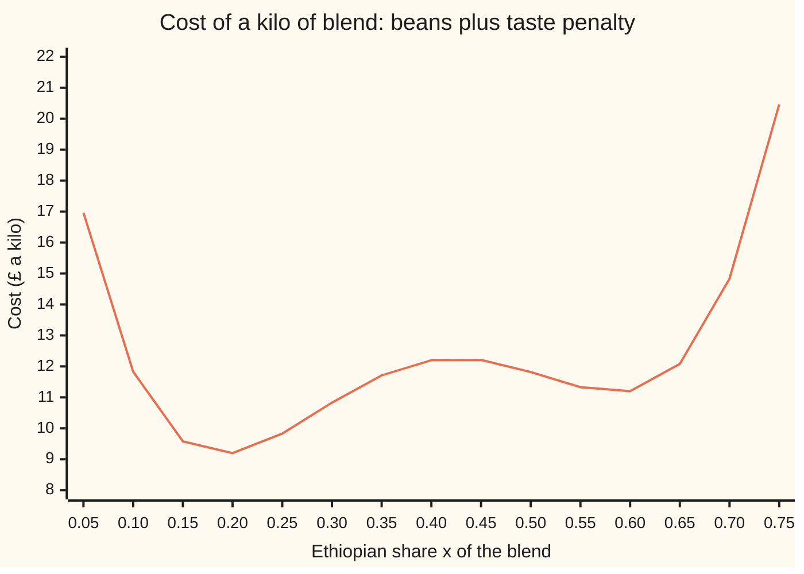

# Local and global minima: the dip nearby against the true bottom

[Syllabus](../../../SYLLABUS.md) → [Optimization](../README.md) → [Convexity](../README.md#s01) → Local and global minima

---

## General Overview

A roaster sells a house blend made from three beans: Brazil at £9 a kilo, Ethiopia at £14 and a robusta at £5. The strength spec is met by holding the robusta at 20 percent. Brazil and Ethiopia are both arabicas of about the same strength, so the one free choice is the Ethiopian share, written x. Brazil fills the rest. The roaster wants to **minimise** the cost of a kilo.

Bean cost alone is a straight line: each step towards the dearer Ethiopian bean adds cost. But the café that buys the blend pays full price for only two tastes. One is chocolatey, near 20 percent Ethiopian. The other is fruity, near 60 percent. A blend between them tastes of neither, and the roaster books the lost price as a **taste penalty**, in pounds a kilo. Add the penalty to the bean cost and the cost curve has two dips.

Both dips look like answers. Stand in either one and every small change in x makes the blend dearer. Only one is the cheapest blend of all: about 19 percent Ethiopian, at £9.17 a kilo. The fruity dip costs £2.00 a kilo more, about £1,996 a tonne. A search started on the fruity side stops in the fruity dip and reports, truthfully, that nothing nearby is cheaper.

**A local minimum beats every point near it; a global minimum beats every allowed point; a search that only looks at points can prove the first and never the second, unless something else is known about the whole curve.**

**What kind of fact this is:** two definitions, and a theorem proved on this card in Why it works: no search that looks at finitely many points can certify a global minimum of a general continuous cost.

### The picture: the blend's cost along the one free share



The one line is the total cost. The left dip, the chocolatey blend, is the lowest point of the whole curve. The right dip, the fruity blend, is lower than its neighbours but £2.00 dearer. The hump between them tops out at x = 0.425410. The two ends of the allowed range are off the chart: £26.20 at x = 0 and £30.20 at x = 0.8.

---

## The formula

The cost of a kilo, in pounds, with the Ethiopian share x running from 0 to 0.8:

$$f(x) = \underbrace{0.2 \times 5 + 9\,(0.8 - x) + 14\,x}_{\text{beans: } 8.2 \,+\, 5x} \;+\; \underbrace{1250\,(x - 0.2)^2\,(x - 0.6)^2}_{\text{taste penalty } P(x)}$$

The bean part is a straight line. A straight line has no dip at all: its lowest point on a range is always an end. **Both dips come from the taste penalty.** It is zero at the two target tastes, x = 0.2 and x = 0.6, and £2.00 at x = 0.4, halfway between. The weight 1250 sets how hard the café punishes a muddled taste.

Now the two words this card is about. This wing writes $x^*$ (read "x star") for a minimiser: an allowed point where the cost is lowest. The place is written $\operatorname{argmin}$ and the lowest value $\min$.

$$x^* \text{ is a global minimiser:} \quad f(x^*) \le f(x) \ \text{ for every allowed } x.$$

$$x^* \text{ is a local minimiser:} \quad \text{there is a radius } r > 0 \text{ with } f(x^*) \le f(x) \ \text{ for every allowed } x \text{ with } |x - x^*| < r.$$

**Read it aloud:** a global minimum is at least as cheap as every allowed blend; a local minimum is at least as cheap as every allowed blend within some small distance of it, and says nothing about blends further away.

For the blend, $\operatorname{argmin} f = \{0.188509\}$ and $\min f = £9.170493$ a kilo. The fruity point, x = 0.586081, is a local minimiser and not a global one.

| Symbol | Plain meaning | In our example | Push it up and the answer… |
| --- | --- | --- | --- |
| $x$ | Ethiopian share of the blend, from 0 to 0.8 | 0.188509 at the cheapest blend | a walk started past 0.43 ends in the fruity dip |
| $f(x)$ | cost of a kilo of blend, pounds | £9.170493 at the cheapest | — |
| $P(x)$ | taste penalty: price lost for a muddled taste, pounds a kilo | £2.00 at x = 0.4 | a heavier weight raises the hump and pins the dips nearer 0.2 and 0.6; a weight of 100 leaves only one dip |
| $x^*$ | a minimiser: a point where the cost is lowest | 0.188509 | — |
| $\operatorname{argmin}$, $\min$ | the place of the lowest cost, and the lowest cost itself | {0.188509} and £9.170493 | — |
| $r$ | a radius: how near "nearby" means in the local definition | anything short of the distance from a dip to the hump at 0.425410 | larger r asks a local minimum to beat more points |
| $f'(x)$ | slope: pounds per unit of share | 0 at both dips; 5 at x = 0.2 | positive means cheaper to the left |
| $f''(x)$ | curvature: how fast the slope changes | 470.93 at the cheapest dip | positive means a dip, negative a hump |
| $L$ | slope bound: no slope on the range is steeper than this | 725 | a bigger bound needs a finer grid |
| $h$ | gap between grid points | 0.001 | a coarser grid loosens the certificate |
| $g$, $D$, $c$, $w$, $d$, $u$ | the cost with a hidden dip added (Step 3); the dip's shape, centre, half-width, depth, and position scaled by the half-width | g = £8.202475 at c = 0.4005; w = 0.0004, d = 4 | a wider dip, w = 0.0006, shows up on the grid |
| $p_1, \dots, p_n$, $\hat x$ | the n points a search asks about, and the point it reports | 801 grid points; 0.188509 | — |

### When it holds

- **The allowed range is closed and the cost is continuous.** Then a global minimum exists ([Extreme value theorem](../../06-Calculus%20and%20analysis/01-Limits%20and%20Continuity/07-extreme-value-theorem.md)). On an open range the cost can creep down for ever without arriving: 1/x on positive x has no minimum.
- **The cost is smooth for the slope test.** Slope zero with positive curvature certifies a strict local minimum. A cost with a corner, such as |x|, can bottom out with no slope at all.
- **Global needs knowledge of the whole curve.** The full formula, a true slope bound, or convexity. A search without any of these sees only its sample points, and Step 3 hides a cheaper blend between them.
- **The slope bound must be true.** A bound that is too small makes the grid certificate lie: the hidden dip's slope reaches 15401 against a claimed 725.
- **One dial here.** With several dials the definitions are the same, with distance measured as length; the flat spots are harder to list ([Extrema in several variables](../../06-Calculus%20and%20analysis/07-Several%20Variables/06-multivariable-extrema.md)).

---

## Why it works

### Step 0: a search sees points, never the curve

Any search, by hand or by computer, asks for the cost at some blends, perhaps the slope too, and decides where to look next. After a finite number of questions it stops. Everything it knows is a list of numbers at a list of points.

Whether a point is a local minimum is a fact about a small neighbourhood. Slope and curvature at the point settle it. Whether a point is a global minimum is a fact about every allowed point. No finite list covers every point. That gap is the whole card.

### Step 1: what certifies a local minimum

The calculus wing already sorts flat spots: where the slope is zero and the curvature positive, the point is a strict local minimum ([Optimisation](../../06-Calculus%20and%20analysis/03-What%20Derivatives%20Tell%20You/03-monotonicity-and-optimisation.md); in several variables, [Extrema in several variables](../../06-Calculus%20and%20analysis/07-Several%20Variables/06-multivariable-extrema.md)). The reason in one line: near such a point the cost behaves like half the curvature times the squared step, which is positive in both directions.

The slope and curvature of the blend's cost are

$$f'(x) = 5 + 2500\,(x - 0.2)(x - 0.6)(2x - 0.8),$$

$$f''(x) = 2500\,\big[(x - 0.6)(2x - 0.8) + (x - 0.2)(2x - 0.8) + 2(x - 0.2)(x - 0.6)\big].$$

The 5 is the bean cost's slope; the rest is the penalty's. At the chocolatey dip, x = 0.188509, the slope is zero and the curvature is 470.93. At the fruity dip, x = 0.586081, the slope is zero and the curvature is 319.39. **Both pass the local test.** The test cannot rank them, because it never looks beyond its own point.

### Step 2: two honest searches, two different answers

A downhill walk uses costs only. From a starting share, try a step of 0.01 left and right. Move if either is cheaper. If neither is, halve the step. Stop when the step is below one billionth.

Started at x = 0.05, the walk stops at 0.188509, £9.170493 a kilo, after 93 cost evaluations. Started at x = 0.75, it stops at 0.586081, £11.166503, after 84. Each walk ends where nothing nearby is cheaper, which is exactly the local definition. The fruity walk never learns the chocolatey dip exists.

Restarting from many places helps. Of 81 starts, 0.00, 0.01, up to 0.80, 44 reach the cheapest dip. The 43 starts left of the hump at 0.425410 go left, and so does 0.43: its first step of 0.01 reaches 0.42, which is cheaper, and carries it back over the hump. Restarts are good evidence. They are not proof, because a dip narrower than the gaps between starts would catch none of them.

### Step 3: a cheaper blend can hide between any points a search looks at

Here is the theorem behind the card's job.

**Any search that asks for costs (and slopes) at finitely many points gives the same answer on f as on some other continuous cost g whose global minimum is far lower.** So its answer cannot be certified global.

The construction: take the points the search asked about. Pick a stretch between two of them that holds none. Inside it, dig a narrow dip: a smooth bump turned upside down, zero with zero slope at its edges. Every cost and every slope the search asked for is unchanged, so it asks the same next questions and stops in the same place. But g is lower inside the dip.

The check does this on the blend. A dip of depth 4, half-width 0.0004, centred at 0.4005 sits between grid points 0.400 and 0.401. All 801 grid costs at 0.000, 0.001, up to 0.800 are unchanged, and all 81 restarts stop exactly where they did. Yet the lowest cost is now £8.202475 at x = 0.4005, cheaper than everything the search saw.

<details>
<summary>Detailed proof: no finite search certifies a global minimum</summary>

Let a search be any rule that, given the answers so far, picks the next point to ask about, or stops and reports a point. Run it on a continuous cost f on [0, 0.8]. It asks at points $p_1, \dots, p_n$ and reports $\hat x$. The asked points are finitely many, so some open stretch $(c - w, c + w)$ inside [0, 0.8] contains none of them, and it can be chosen with $\hat x$ outside $[c - w, c + w]$, ends included.

Define the dip $D(x) = -d\,(1 - u^2)^2$ where $u = (x - c)/w$, for $|x - c| < w$, and $D(x) = 0$ elsewhere. At $u = \pm 1$ both $(1 - u^2)^2$ and its slope $-4u(1 - u^2)$ are zero, so $g = f + D$ is continuous with a continuous slope. (A higher power of $1 - u^2$ matches more derivatives as well.)

At every asked point $D = 0$ and $D' = 0$, so g gives the search the same first answer as f. The rule then picks the same second point, which is also outside the dip, and so on: by induction it asks the same points, gets the same answers and reports the same $\hat x$. Choose the depth $d > f(c) - f(\hat x)$. Then $g(c) = f(c) - d < f(\hat x) = g(\hat x)$, so $\hat x$ is not a global minimiser of g.

The search cannot tell f from g, so whatever it reports, it cannot certify that the report is global for the cost it was given. The argument does not touch local minima: the dip lies outside some neighbourhood of $\hat x$, so g equals f there, and a local minimiser of f stays a local minimiser of g.

</details>

### Step 4: what does certify a global minimum, and why each road needs outside knowledge

Three kinds of extra knowledge close the gap. Each rules out the hidden dip.

**The whole formula.** The cost is continuous on the closed range [0, 0.8], so a cheapest blend exists. It sits at an end or at a flat spot. The slope $f'$ is a cubic, so it has at most three zeros. Its signs at 0, 0.3, 0.5 and 0.8 are −235, 20, −10 and 245: three sign changes, so three zeros, and none missed. Bisection (halving a range where the slope changes sign, keeping the half where it still does) finds them at 0.188509, 0.425410 and 0.586081. Listing them with the two ends gives five candidates. The cheapest is 0.188509 at £9.170493. That list is a full enumeration, a certificate: evidence anyone can recheck that no blend is cheaper.

**A true slope bound.** On [0, 0.8], each factor of the penalty's slope is small: $|x - 0.2| \le 0.6$, $|x - 0.6| \le 0.6$ and $|2x - 0.8| \le 0.8$. So no slope exceeds $L = 5 + 2500 \times 0.6 \times 0.6 \times 0.8 = 725$ pounds per unit share. By the [Mean value theorem](../../06-Calculus%20and%20analysis/03-What%20Derivatives%20Tell%20You/02-mean-value-theorem.md), the cost cannot change by more than L times the distance moved. Every blend is within $h/2 = 0.0005$ of a grid point, so it costs at least the grid's best minus $L h / 2 = 0.3625$. The 801-point grid's best is £9.170549, so **no blend costs below £8.808049**. The best found, £9.170493, sits less than the slack, £0.3625, above that floor. So this road certifies the lowest cost to within £0.3625, not the exact place of x*; a finer grid tightens it. The hidden dip breaks exactly this road: its slope reaches 15401, far past 725.

**Convexity.** If the cost curve bends upwards everywhere, every local minimum is global and one walk is enough. The blend's cost is not convex; its hump has curvature −190.31. The shelf's later cards define convexity and prove the payoff: [Convex functions](03-convex-functions-and-their-tests.md) and [Convexity pays off](04-local-minima-are-global-when-convex.md).

---

## Worked numbers, by hand

The two target tastes are where the penalty is zero, so they are the place to start.

| Step | Arithmetic | Value |
| --- | --- | --- |
| Bean cost | 0.2 × 5 + 9 × (0.8 − x) + 14x | 8.2 + 5x |
| Cost at the chocolatey target | 8.2 + 5 × 0.2 + 0 | £9.20 |
| Cost at the fruity target | 8.2 + 5 × 0.6 + 0 | £11.20 |
| Cost halfway, x = 0.4 | 8.2 + 2 + 1250 × 0.2² × 0.2² | £12.20 (penalty £2.00) |
| Slope at x = 0.2 | 5 + 2500 × 0 | 5: cheaper to the left |
| Curvature at x = 0.2 | 2500 × (−0.4) × (−0.4) | 400 |
| One Newton step | 0.2 − 5 / 400 | x ≈ 0.1875 |
| Cost there, from the bowl | 9.20 − 5² / (2 × 400) | ≈ £9.16875 |
| Same at the fruity target | 0.6 − 5 / 400; 11.20 − 25 / 800 | x ≈ 0.5875, ≈ £11.16875 |
| Gap between the dips | 11.16875 − 9.16875 | ≈ £2.00 a kilo |
| **Cheapest blend (code, exact)** | five candidates compared | **x* = 0.188509, £9.170493 a kilo** |

The cheapest blend is about 19 percent Ethiopian, a little under the chocolatey target because the dearer bean pulls the dip left. Standing in the fruity dip instead costs £1.996010 a kilo more, £1,996 a tonne, and every local test there says all is well.

The Newton step is the one from [Newton's method](../../06-Calculus%20and%20analysis/03-What%20Derivatives%20Tell%20You/06-newtons-method.md), applied to the slope: it treats the dip as a bowl with curvature 400 and jumps to the bowl's bottom. The real curvature at the dip is 470.93, which is why the hand estimate is off in the third decimal.

### What breaks if you drop a piece

| Mistake | Comes out at | What went wrong |
| --- | --- | --- |
| Trust one walk, started at 0.75 | x = 0.586081, £11.166503 a kilo | a true local minimum, £1.996010 a kilo dearer than the global one |
| Stop at slope zero, skip the curvature (Newton on the slope from 0.42) | x = 0.425410, £12.263004, curvature −190.31 | the top of the hump: the dearest flat spot in the range |
| Trust a grid with no true slope bound | all 801 grid costs unchanged, yet the lowest cost is £8.202475 | a dip with slope 15401 hid between two grid points |
| Drop the taste penalty | x = 0, £8.20 of beans; true cost £26.20 | a straight line has no dips; it sends the answer to the end the café rejects |

The check prints every row.

---

## Code, from first principles, and it actually runs

The code writes out the cost, its slope and curvature, and checks the two derivatives against central differences (the slope of a chord through two very close points). It then takes **three independent roads** to the cheapest blend. Road one is the downhill walk, using costs only, from two starts and from 81 starts. Road two lists every flat spot by bisection on the cubic slope, adds the two ends and compares. Road three is the 801-point grid with the slope bound 725, which prints a floor no blend can go below. Then it digs the hidden dip and confirms that the grid and all 81 walks cannot see it. Nothing imported knows the answer; Python uses no imports at all.

### Python

```python
# Local and global minima on a coffee blend's cost curve.  Standard library only.
# x = Ethiopian share of the blend; robusta is held at 0.2 for strength and
# Brazil fills the rest, 0.8 - x.  Cost is in pounds per kilo; we MINIMISE it.
bean = lambda x: 0.2 * 5 + 9 * (0.8 - x) + 14 * x            # beans at £5, £9, £14 a kilo
pen = lambda x: 1250 * (x - 0.2)**2 * (x - 0.6)**2            # taste penalty, £ a kilo
f = lambda x: bean(x) + pen(x)
df = lambda x: 5 + 2500 * (x - 0.2) * (x - 0.6) * (2 * x - 0.8)
d2f = lambda x: 2500 * ((x - 0.6) * (2 * x - 0.8) + (x - 0.2) * (2 * x - 0.8) + 2 * (x - 0.2) * (x - 0.6))
LO, HI = 0.0, 0.8
for x in (0.1, 0.4, 0.7):                                      # slopes against central differences
    h = 1e-5
    assert abs((f(x + h) - f(x - h)) / (2 * h) - df(x)) < 1e-4
    assert abs((df(x + h) - df(x - h)) / (2 * h) - d2f(x)) < 1e-3
print(f"ends: f(0) = {f(LO):.2f}, f(0.8) = {f(HI):.2f}; middle f(0.4) = {f(0.4):.2f}, penalty {pen(0.4):.2f}")
for a in (0.2, 0.6):                                           # by hand: one Newton step from each taste
    print(f"by hand from {a}: cost {f(a):.2f}, slope {df(a):.0f}, curvature {d2f(a):.0f}, step to {a - df(a) / d2f(a):.4f}, cost about {f(a) - df(a)**2 / (2 * d2f(a)):.5f}")
print("chart x = 0.05..0.75:", ", ".join(f"{f(0.05 * i):.2f}" for i in range(1, 16)))

def walk(x, g=f, step=0.01):                                   # road 1: downhill walk, values only
    n = 1
    while step > 1e-9:
        for t in (x - step, x + step):
            n += 1
            if LO <= t <= HI and g(t) < g(x):
                x = t
                break
        else:
            step /= 2
    return x, n
runs = {}
for s in (0.05, 0.75):
    x, n = walk(s)
    runs[s] = x
    print(f"walk from {s:.2f}: x = {x:.6f}, cost {f(x):.6f}, {n} evaluations, slope size {abs(df(x)):.4f}, curvature {d2f(x):.2f}")
    assert abs(df(x)) < 1e-5 and d2f(x) > 0                     # local certificate holds at both
def bisect(a, b):                                              # road 2: every flat spot of f
    assert df(a) * df(b) < 0
    for _ in range(60):
        m = (a + b) / 2
        a, b = (m, b) if df(a) * df(m) > 0 else (a, m)
    return (a + b) / 2
print(f"slope signs at 0, 0.3, 0.5, 0.8: {df(0.0):.0f}, {df(0.3):.0f}, {df(0.5):.0f}, {df(0.8):.0f}")
cands = [LO, HI] + [bisect(a, b) for a, b in ((0.0, 0.3), (0.3, 0.5), (0.5, 0.8))]
for c in cands:
    kind = "end" if c in (LO, HI) else ("local min" if d2f(c) > 0 else "local max")
    print(f"candidate x = {c:.6f}: cost {f(c):.6f} ({kind})")
xstar = min(cands, key=f)
print(f"global: x* = {xstar:.6f}, min cost {f(xstar):.6f}; other dip costs {f(runs[0.75]) - f(xstar):.6f} more, £{1000 * (f(runs[0.75]) - f(xstar)):.0f} a tonne")
assert abs(runs[0.05] - xstar) < 1e-6 and abs(runs[0.75] - cands[4]) < 1e-6
basin = sum(abs(walk(i / 100)[0] - xstar) < 1e-6 for i in range(81))
print(f"starts 0.00, 0.01, ..., 0.80 reaching x*: {basin} of 81; local max at {cands[3]:.6f}")
L = 5 + 2500 * 0.6 * 0.6 * 0.8                                 # road 3: slope bound on [0, 0.8]
steep = max(abs(df(i / 10000)) for i in range(8001))
assert steep <= L
grid = [f(i / 1000) for i in range(801)]
gbest = min(grid)
lower = gbest - L * 0.001 / 2
print(f"slope bound L = {L:.0f} (steepest seen {steep:.2f}); 801-point grid best {gbest:.6f}")
print(f"grid gap h = 0.001, slack L*h/2 = {L * 0.001 / 2:.4f}")
print(f"certificate: no blend costs below {lower:.6f}; best found {f(xstar):.6f}")
assert lower <= f(xstar) <= gbest
c0, w, depth = 0.4005, 0.0004, 4.0                             # a narrow dip between grid points
dip = lambda x: -depth * (1 - ((x - c0) / w)**2)**2 if abs(x - c0) < w else 0.0
g = lambda x: f(x) + dip(x)
assert all(g(i / 1000) == grid[i] for i in range(801))
assert all(walk(i / 100, g)[0] == walk(i / 100)[0] for i in range(81))
gsteep = max(abs(g(c0 + w * (k + 1) / 1000) - g(c0 + w * k / 1000)) / (w / 1000) for k in range(-1000, 1000))
print(f"hidden dip, depth {depth:.0f}, half-width {w}, centre {c0}: same 801 grid values, same walks from all 81 starts")
print(f"hidden dip: lowest cost now g({c0}) = {g(c0):.6f}; steepest slope {gsteep:.0f}")
assert g(c0) < lower
assert abs(gsteep - (depth / w * 8 / 27**0.5 + df(c0))) < 1    # dip's steepest slope, from its formula
print(f"breaks, bean cost only: lowest at x = 0, £{bean(0):.2f} of beans, true cost {f(0):.2f}")
x = 0.42                                                       # Newton on slope = 0, curvature unchecked
for _ in range(6):
    x -= df(x) / d2f(x)
print(f"breaks, Newton on slope = 0 from 0.42: x = {x:.6f}, cost {f(x):.6f}, curvature {d2f(x):.2f}")
assert abs(x - cands[3]) < 1e-9 and d2f(x) < 0
print("ALL CHECKS PASS")
```

**Ran 2026-11-11 on macOS, Python 3.14.10, standard library only. All checks passed. Output, pasted from the run:**

```
ends: f(0) = 26.20, f(0.8) = 30.20; middle f(0.4) = 12.20, penalty 2.00
by hand from 0.2: cost 9.20, slope 5, curvature 400, step to 0.1875, cost about 9.16875
by hand from 0.6: cost 11.20, slope 5, curvature 400, step to 0.5875, cost about 11.16875
chart x = 0.05..0.75: 16.96, 11.83, 9.58, 9.20, 9.83, 10.83, 11.71, 12.20, 12.21, 11.82, 11.33, 11.20, 12.08, 14.83, 20.46
walk from 0.05: x = 0.188509, cost 9.170493, 93 evaluations, slope size 0.0000, curvature 470.93
walk from 0.75: x = 0.586081, cost 11.166503, 84 evaluations, slope size 0.0000, curvature 319.39
slope signs at 0, 0.3, 0.5, 0.8: -235, 20, -10, 245
candidate x = 0.000000: cost 26.200000 (end)
candidate x = 0.800000: cost 30.200000 (end)
candidate x = 0.188509: cost 9.170493 (local min)
candidate x = 0.425410: cost 12.263004 (local max)
candidate x = 0.586081: cost 11.166503 (local min)
global: x* = 0.188509, min cost 9.170493; other dip costs 1.996010 more, £1996 a tonne
starts 0.00, 0.01, ..., 0.80 reaching x*: 44 of 81; local max at 0.425410
slope bound L = 725 (steepest seen 245.00); 801-point grid best 9.170549
grid gap h = 0.001, slack L*h/2 = 0.3625
certificate: no blend costs below 8.808049; best found 9.170493
hidden dip, depth 4, half-width 0.0004, centre 0.4005: same 801 grid values, same walks from all 81 starts
hidden dip: lowest cost now g(0.4005) = 8.202475; steepest slope 15401
breaks, bean cost only: lowest at x = 0, £8.20 of beans, true cost 26.20
breaks, Newton on slope = 0 from 0.42: x = 0.425410, cost 12.263004, curvature -190.31
ALL CHECKS PASS
```

### Rust

```rust
// Local and global minima on a coffee blend's cost curve.  Standard library only.
// x = Ethiopian share of the blend; robusta is held at 0.2 for strength and
// Brazil fills the rest, 0.8 - x.  Cost is in pounds per kilo; we MINIMISE it.
const LO: f64 = 0.0;
const HI: f64 = 0.8;
fn bean(x: f64) -> f64 { 0.2 * 5.0 + 9.0 * (0.8 - x) + 14.0 * x } // beans at £5, £9, £14 a kilo
fn pen(x: f64) -> f64 { 1250.0 * (x - 0.2).powi(2) * (x - 0.6).powi(2) } // taste penalty, £ a kilo
fn f(x: f64) -> f64 { bean(x) + pen(x) }
fn df(x: f64) -> f64 { 5.0 + 2500.0 * (x - 0.2) * (x - 0.6) * (2.0 * x - 0.8) }
fn d2f(x: f64) -> f64 {
    2500.0 * ((x - 0.6) * (2.0 * x - 0.8) + (x - 0.2) * (2.0 * x - 0.8) + 2.0 * (x - 0.2) * (x - 0.6))
}
fn walk(mut x: f64, g: &dyn Fn(f64) -> f64) -> (f64, u32) { // road 1: downhill walk, values only
    let (mut step, mut n) = (0.01, 1);
    while step > 1e-9 {
        let mut moved = false;
        for t in [x - step, x + step] {
            n += 1;
            if LO <= t && t <= HI && g(t) < g(x) { x = t; moved = true; break; }
        }
        if !moved { step /= 2.0; }
    }
    (x, n)
}
fn bisect(mut a: f64, mut b: f64) -> f64 { // road 2: every flat spot of f
    assert!(df(a) * df(b) < 0.0);
    for _ in 0..60 {
        let m = (a + b) / 2.0;
        if df(a) * df(m) > 0.0 { a = m; } else { b = m; }
    }
    (a + b) / 2.0
}
fn main() {
    for x in [0.1, 0.4, 0.7] { // slopes against central differences
        let h = 1e-5;
        assert!(((f(x + h) - f(x - h)) / (2.0 * h) - df(x)).abs() < 1e-4);
        assert!(((df(x + h) - df(x - h)) / (2.0 * h) - d2f(x)).abs() < 1e-3);
    }
    println!("ends: f(0) = {:.2}, f(0.8) = {:.2}; middle f(0.4) = {:.2}, penalty {:.2}", f(LO), f(HI), f(0.4), pen(0.4));
    for a in [0.2, 0.6] { // by hand: one Newton step from each taste
        println!("by hand from {}: cost {:.2}, slope {:.0}, curvature {:.0}, step to {:.4}, cost about {:.5}",
                 a, f(a), df(a), d2f(a), a - df(a) / d2f(a), f(a) - df(a).powi(2) / (2.0 * d2f(a)));
    }
    let chart: Vec<String> = (1..16).map(|i| format!("{:.2}", f(0.05 * i as f64))).collect();
    println!("chart x = 0.05..0.75: {}", chart.join(", "));
    let mut runs = [0.0; 2];
    for (k, s) in [0.05, 0.75].into_iter().enumerate() {
        let (x, n) = walk(s, &f);
        runs[k] = x;
        println!("walk from {:.2}: x = {:.6}, cost {:.6}, {} evaluations, slope size {:.4}, curvature {:.2}",
                 s, x, f(x), n, df(x).abs(), d2f(x));
        assert!(df(x).abs() < 1e-5 && d2f(x) > 0.0); // local certificate holds at both
    }
    println!("slope signs at 0, 0.3, 0.5, 0.8: {:.0}, {:.0}, {:.0}, {:.0}", df(0.0), df(0.3), df(0.5), df(0.8));
    let cands = [LO, HI, bisect(0.0, 0.3), bisect(0.3, 0.5), bisect(0.5, 0.8)];
    for &c in &cands {
        let kind = if c == LO || c == HI { "end" } else if d2f(c) > 0.0 { "local min" } else { "local max" };
        println!("candidate x = {:.6}: cost {:.6} ({})", c, f(c), kind);
    }
    let xstar = cands.iter().cloned().fold(cands[0], |m, c| if f(c) < f(m) { c } else { m });
    let gap = f(runs[1]) - f(xstar);
    println!("global: x* = {:.6}, min cost {:.6}; other dip costs {:.6} more, £{:.0} a tonne", xstar, f(xstar), gap, 1000.0 * gap);
    assert!((runs[0] - xstar).abs() < 1e-6 && (runs[1] - cands[4]).abs() < 1e-6);
    let basin = (0..81).filter(|&i| (walk(i as f64 / 100.0, &f).0 - xstar).abs() < 1e-6).count();
    println!("starts 0.00, 0.01, ..., 0.80 reaching x*: {} of 81; local max at {:.6}", basin, cands[3]);
    let l = 5.0 + 2500.0 * 0.6 * 0.6 * 0.8; // road 3: slope bound on [0, 0.8]
    let steep = (0..8001).map(|i| df(i as f64 / 10000.0).abs()).fold(0.0, f64::max);
    assert!(steep <= l);
    let grid: Vec<f64> = (0..801).map(|i| f(i as f64 / 1000.0)).collect();
    let gbest = grid.iter().cloned().fold(f64::INFINITY, f64::min);
    let lower = gbest - l * 0.001 / 2.0;
    println!("slope bound L = {:.0} (steepest seen {:.2}); 801-point grid best {:.6}", l, steep, gbest);
    println!("grid gap h = 0.001, slack L*h/2 = {:.4}", l * 0.001 / 2.0);
    println!("certificate: no blend costs below {:.6}; best found {:.6}", lower, f(xstar));
    assert!(lower <= f(xstar) && f(xstar) <= gbest);
    let (c0, w, depth) = (0.4005, 0.0004, 4.0); // a narrow dip between grid points
    let g = |x: f64| f(x) + if (x - c0).abs() < w { -depth * (1.0 - ((x - c0) / w).powi(2)).powi(2) } else { 0.0 };
    assert!((0..801).all(|i| g(i as f64 / 1000.0) == grid[i]));
    assert!((0..81).all(|i| walk(i as f64 / 100.0, &g).0 == walk(i as f64 / 100.0, &f).0));
    let gsteep = (-1000..1000).map(|k| ((g(c0 + w * (k + 1) as f64 / 1000.0) - g(c0 + w * k as f64 / 1000.0)) / (w / 1000.0)).abs())
        .fold(0.0, f64::max);
    println!("hidden dip, depth {:.0}, half-width {}, centre {}: same 801 grid values, same walks from all 81 starts", depth, w, c0);
    println!("hidden dip: lowest cost now g({}) = {:.6}; steepest slope {:.0}", c0, g(c0), gsteep);
    assert!(g(c0) < lower);
    assert!((gsteep - (depth / w * 8.0 / 27f64.sqrt() + df(c0))).abs() < 1.0); // dip's steepest slope, from its formula
    println!("breaks, bean cost only: lowest at x = 0, £{:.2} of beans, true cost {:.2}", bean(0.0), f(0.0));
    let mut x = 0.42; // Newton on slope = 0, curvature unchecked
    for _ in 0..6 { x -= df(x) / d2f(x); }
    println!("breaks, Newton on slope = 0 from 0.42: x = {:.6}, cost {:.6}, curvature {:.2}", x, f(x), d2f(x));
    assert!((x - cands[3]).abs() < 1e-9 && d2f(x) < 0.0);
    println!("ALL CHECKS PASS");
}
```

**Ran 2026-11-11 on macOS, rustc 1.98.1, no crates. All checks passed. Output, pasted from the run:**

```
ends: f(0) = 26.20, f(0.8) = 30.20; middle f(0.4) = 12.20, penalty 2.00
by hand from 0.2: cost 9.20, slope 5, curvature 400, step to 0.1875, cost about 9.16875
by hand from 0.6: cost 11.20, slope 5, curvature 400, step to 0.5875, cost about 11.16875
chart x = 0.05..0.75: 16.96, 11.83, 9.58, 9.20, 9.83, 10.83, 11.71, 12.20, 12.21, 11.82, 11.33, 11.20, 12.08, 14.83, 20.46
walk from 0.05: x = 0.188509, cost 9.170493, 93 evaluations, slope size 0.0000, curvature 470.93
walk from 0.75: x = 0.586081, cost 11.166503, 84 evaluations, slope size 0.0000, curvature 319.39
slope signs at 0, 0.3, 0.5, 0.8: -235, 20, -10, 245
candidate x = 0.000000: cost 26.200000 (end)
candidate x = 0.800000: cost 30.200000 (end)
candidate x = 0.188509: cost 9.170493 (local min)
candidate x = 0.425410: cost 12.263004 (local max)
candidate x = 0.586081: cost 11.166503 (local min)
global: x* = 0.188509, min cost 9.170493; other dip costs 1.996010 more, £1996 a tonne
starts 0.00, 0.01, ..., 0.80 reaching x*: 44 of 81; local max at 0.425410
slope bound L = 725 (steepest seen 245.00); 801-point grid best 9.170549
grid gap h = 0.001, slack L*h/2 = 0.3625
certificate: no blend costs below 8.808049; best found 9.170493
hidden dip, depth 4, half-width 0.0004, centre 0.4005: same 801 grid values, same walks from all 81 starts
hidden dip: lowest cost now g(0.4005) = 8.202475; steepest slope 15401
breaks, bean cost only: lowest at x = 0, £8.20 of beans, true cost 26.20
breaks, Newton on slope = 0 from 0.42: x = 0.425410, cost 12.263004, curvature -190.31
ALL CHECKS PASS
```

The two outputs agree line for line.

> [!TIP]
> **Try changing**
> - **Make the Ethiopian bean as cheap as the Brazil.** Guess first: which dip wins? Change `14 * x` to `9 * x` in the bean cost and the `5 +` in the slope to `0 +`. Both dips cost £8.20 exactly, at 0.2 and 0.6: the argmin now holds two points. The assert that expects one winner stops the run.
> - **Soften the penalty.** Guess first: does the fruity dip survive a weight of 100? Set `1250` to `100` in the penalty and the `2500` in `df` and in `d2f` to `200`. It does not: the walk from 0.75 now slides all the way to 0.111369, £8.944402, and the bisection assert stops because the slope changes sign only once. A weak enough penalty leaves one dip.
> - **Widen the hidden dip.** Guess first: what happens at half-width 0.0006? Set `w` to `0.0006`. The dip now covers grid points 0.400 and 0.401, the grid sees changed costs, and the assert that the grid is blind stops the run.
> - **Move a start.** Guess first: where does a walk from 0.43 end? Add 0.43 to the two starts. It ends at the cheapest dip, although 0.43 is right of the hump: its first step of 0.01 lands at 0.42, which is cheaper. That is one of the 44.

---

## The usual mistake

> [!warning]
> **Calling the answer of a search "the optimum".** A search that stops where nothing nearby is cheaper has found a local minimum. On the blend, the walk from 0.75 stops at £11.166503 and every check it can run there passes. Without the formula, a true slope bound or convexity, the honest report is "a local minimum" or "the best found".
>
> - **Reading slope zero as a minimum.** The hump's top also has slope zero: Newton on the slope from 0.42 lands there, at £12.263004, the dearest flat spot.
> - **Reading many agreeing restarts as proof.** 44 of 81 starts agree on the cheapest dip, yet the hidden dip at 0.4005, £8.202475, catches none of them.
> - **Guessing a slope bound.** A grid certificate is only as true as its L. Any dip steeper than the bound, like the one with slope 15401, slips through.
> - **Forgetting the ends.** On a closed range the cheapest point can be an end with nonzero slope. Here the ends cost £26.20 and £30.20 and lose, but they must still be on the list.

---

## Where you meet it in real life

- **Blending and pooling.** Refineries and feed mills blend streams through shared tanks. Quality limits on the pooled tanks make the cost nonconvex, and local solvers can stop at a plan that is only locally best; a small "pooling problem" with more than one locally best plan has been a test case since 1978.
- **Training a neural network.** The loss, a cost measuring fit, has many dips. Training is a downhill walk, and nobody certifies the result global; practice is to restart and keep the best found.
- **Fitting a model to market prices.** Calibrating a model's parameters is a least-squares dip that can have rivals; different starting guesses can return different parameters ([Calibration](../../12-Financial%20mathematics/07-Greeks%20by%20Numbers%20and%20Calibration/06-calibration-as-least-squares.md)).
- **Molecules and proteins.** A molecule settles into the shape of lowest energy. Energy landscapes have many local dips, and a simulation can get trapped in one for a long time.
- **Tuning by experiment.** When each cost evaluation is a costly trial, such as a test bake or a wind-tunnel run, global search methods spend trials where a cheaper dip could still hide.

> **Say it back**
> A local minimum is at least as cheap as every allowed point near it; a global minimum is at least as cheap as every allowed point. Slope zero and positive curvature certify a local minimum from a single point, so the chocolatey and fruity blends both pass. A search sees only finitely many points, and a narrow dip can hide between them, so no search alone can certify a global minimum. Outside knowledge closes the gap: the whole formula to list every flat spot, a true slope bound with a fine grid, or convexity. For the blend, listing all five candidates proves £9.170493 a kilo at x = 0.188509 is the cheapest.

---

## What this builds on

- [Extrema in several variables](../../06-Calculus%20and%20analysis/07-Several%20Variables/06-multivariable-extrema.md): flat spots, the pit-peak-saddle test and a fence that turns one pit into the global minimum. This card takes the local test as given and asks what any search can prove beyond it.

## Where this goes next

- [Convex sets](02-convex-sets.md): the next card. Shapes with no dents, the allowed regions on which local and global can agree.
- [Optimality conditions](../02-Unconstrained%20Methods/01-optimality-conditions.md): the slope and curvature tests in any number of dials, the local certificates every method on shelf 02 prints.
- [Backward induction](../07-Dynamic%20Programming%20and%20Learning/01-finite-horizon-dynamic-programming-and-backward-induction.md): a dynamic program lists every option stage by stage, a full enumeration that certifies a global answer.
- [Bayesian optimisation](../07-Dynamic%20Programming%20and%20Learning/08-global-optimisation-and-bayesian-optimisation.md): global search when each evaluation is costly, spending trials where a hidden dip is still possible.

The open question is which costs let one downhill walk be trusted; convexity is the answer the rest of the shelf builds.

---

## Sources

Verified 2026-11-11: every link below resolves to the publisher's page.

- Nocedal, Jorge, and Stephen J. Wright. *Numerical Optimization*, 2nd ed. Springer, 2006. [doi:10.1007/978-0-387-40065-5](https://doi.org/10.1007/978-0-387-40065-5). Chapter 2: local and global minimisers and the derivative tests that certify a local one.
- Boyd, Stephen, and Lieven Vandenberghe. *Convex Optimization*. Cambridge University Press, 2004. [doi:10.1017/CBO9780511804441](https://doi.org/10.1017/CBO9780511804441). Local against global, and why convex problems remove the difference.
- Piyavskii, S. A. "An algorithm for finding the absolute extremum of a function." *USSR Computational Mathematics and Mathematical Physics* 12, no. 4 (1972): 57–67. [doi:10.1016/0041-5553(72)90115-2](https://doi.org/10.1016/0041-5553(72)90115-2). Global search with a slope bound: the floor used by road three.
- Shubert, Bruno O. "A Sequential Method Seeking the Global Maximum of a Function." *SIAM Journal on Numerical Analysis* 9, no. 3 (1972): 379–388. [doi:10.1137/0709036](https://doi.org/10.1137/0709036). The same slope-bound method found independently, with its guarantee.
- Haverly, C. A. "Studies of the behavior of recursion for the pooling problem." *ACM SIGMAP Bulletin* 25 (1978): 19–28. [doi:10.1145/1111237.1111238](https://doi.org/10.1145/1111237.1111238). The small blending problem whose local optima trap a standard method.
