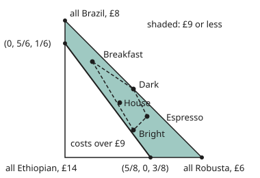

# Convex sets: shapes with no dents, where the straight line stays inside

[Syllabus](../../../SYLLABUS.md) → [Optimization](../README.md) → [Convexity](../README.md#s01) → Convex sets

---

## General Overview

A small roaster mixes three beans. Robusta costs £6 a kilo, a Brazil arabica £8 and an Ethiopian arabica £14. These are this shop's prices; the roaster in [Local and global minima](01-local-and-global-minima.md) is a different shop. A blend is a recipe of shares that add up to one whole: House is 40% Robusta, 40% Brazil and 20% Ethiopian, and costs £8.40 a kilo. The rule for the shop's everyday range is simple: a blend may cost at most £9 a kilo.

Here is what the roaster can count on. Take any two blends that pass, tip them into one bin in any proportion, and the result passes too. Tip 1 kg of Dark (£7.00), 5 kg of Bright (£8.80) and 3 kg of Breakfast (£8.20) together and the 9 kg that comes out is exactly House, at £8.40. A mix costs the same mix of the costs, so it can never cost more than the dearest thing that went in.

A set with that property is **convex**: the straight line between any two of its points stays inside, so the set has no dents. The passing blends are also a **polyhedron**: a shape cut out by flat walls, one wall per rule. Its four corners are found by making walls meet, and every passing blend is a mix of those corners. Measured by area in the picture below, 47.9% of all possible blends pass.

Nothing is minimised or maximised on this card. It describes the allowed choices, the ground every later search for the cheapest or best blend stands on.

**A set is convex when every mix of two of its points stays in it; a set cut out by straight-line rules (a polyhedron) is always convex, and when it is bounded it is exactly the mixes of its corners.**

**What kind of fact this is:** two definitions (convex set, convex hull) and three theorems proved on this card in Why it works; a fourth theorem, that a bounded polyhedron is the mixes of its corners, is stated with its source and checked on the blends.

### The picture: every blend, and the ones that pass

<p align="center"></p>

Robusta share across, Brazil share up, 1 share = 200 units; the Ethiopian share is what is left. The shaded band is the passing set; the dashed outline is the hull of four named blends.

---

## The formula

A blend is a list of three shares, $x = (x_1, x_2, x_3)$: Robusta, Brazil, Ethiopian. Lists mix entry by entry, as vectors do. The plane version of everything below, with points on a field, is in [Convex sets](../../05-Geometry%20and%20trig/07-Points%2C%20Convexity%20and%20Fractals/02-convex-sets-and-convex-hulls.md); this card works in any number of entries $n$.

A **convex combination** (a mix) of two points $x$ and $y$ is

$$\theta x + (1 - \theta)\,y, \qquad 0 \le \theta \le 1.$$

A set $C$ is **convex** when every such mix of two of its points is again in $C$. The **convex hull** of a set $S$ is every mix of finitely many of its points:

$$\operatorname{conv} S = \{\, \theta_1 s_1 + \dots + \theta_k s_k \;:\; s_i \in S,\ \theta_i \ge 0,\ \theta_1 + \dots + \theta_k = 1 \,\}.$$

A **polyhedron** is a set cut out by finitely many walls:

$$P = \{\, x : Ax \le b \,\}, \quad\text{that is,}\quad a_i^{\mathsf T} x \le b_i \text{ for every row } i.$$

Here $a_i^{\mathsf T} x$ is a weighted sum: each entry of $x$ times its weight in row $i$, added up. The inequality holds entry by entry, one row at a time.

**Read it aloud:** a polyhedron is every point that satisfies a list of straight-line rules, each of the form "this weighted sum of the entries is at most that number".

The blend set is one, with six walls. Read each row of `A` against the same entry of `b`:

`A = [[-1, 0, 0], [0, -1, 0], [0, 0, -1], [1, 1, 1], [-1, -1, -1], [6, 8, 14]]`, `b = [0, 0, 0, 1, -1, 9]`.

The first three rows say no share is negative. Rows four and five say the shares add to at most 1 and at least 1, so exactly 1. The last row is the price rule, $6x_1 + 8x_2 + 14x_3 \le 9$.

| Symbol | Plain meaning | In our example | Push it up and the answer… |
| --- | --- | --- | --- |
| $x$, $y$ | two points: here two blends, as lists of shares | Dark $(1/2, 1/2, 0)$, Bright $(1/2, 1/5, 3/10)$ | — |
| $x_1, x_2, x_3$ | the Robusta, Brazil and Ethiopian shares | House: 2/5, 2/5, 1/5 | more Ethiopian in place of the others raises the cost |
| $n$ | how many entries a point has | 3 beans | the set lives in a bigger space; the tests are unchanged |
| $\theta$ | the fraction of $x$ in a two-way mix | 1/2 is a 50/50 bin | the mix slides from $y$ to $x$ |
| $C$ | a set being tested | the blends costing at most £9 | — |
| $S$, $\operatorname{conv} S$ | some given points; every mix of them | five named blends; the dashed outline | more points can only grow the hull |
| $s_i$, $\theta_i$, $k$ | the i-th point, its weight, how many points | House = 1/9 Dark + 5/9 Bright + 1/3 Breakfast | a bigger weight pulls the mix towards that point |
| $a_i$, $b_i$ | one wall: weights on the entries, and a limit | prices $(6, 8, 14)$, limit 9 | a bigger limit moves the wall out |
| $A$, $b$, $m$ | all walls stacked as rows; how many walls | six rows above; $m = 6$ | more walls can only shrink $P$ |
| $P$ | a polyhedron, $\{x : Ax \le b\}$ | the passing set, four corners | — |
| $u$, $v$, $\alpha_i$, $\beta_i$ | two mixes of the points of $S$, and their weights (Step 3's fold) | two tip-togethers of the named blends | — |

### When it holds

- **Every rule is a straight-line rule.** A weighted sum at most a limit, or exactly equal to one. A rule with an "or" in it, such as "a bean is either left out or at least 30%", is not a wall, and the set it makes can be dented.
- **Mixing is linear.** A kilo of a 50/50 bin costs the average of the two prices. A price with a bulk discount, or a taste that changes nonlinearly with the shares, breaks this, and the cost rule stops being a wall.
- **Finitely many walls.** With infinitely many the set is still convex, but it need not be a polyhedron: a disc is convex with no corners at all.
- **Bounded, for the corner theorem.** Bounded means the set fits inside some box of finite size. The shares-add-to-one wall keeps every blend inside the triangle. Keep only the no-negative-shares walls and the set runs off forever: its one corner is the empty bin, yet it holds any amount of Robusta, so it is not the mixes of its corners.

---

## Why it works

### Step 0: a straight-line rule averages along a segment

The cost of a mix is the mix of the costs. Every wall is a weighted sum, so the same holds for every wall: along a straight segment, the wall's left-hand side moves evenly from its value at one end to its value at the other. If both ends are within the limit, so is everything between. That one fact drives the whole card.

### Step 1: one wall makes a convex set, in any number of entries

The set on one side of a wall, $\{x : a^{\mathsf T}x \le b\}$, is a **half-space**. Take two of its points $x$ and $y$ and a fraction $\theta$ from 0 to 1. Then

$$a^{\mathsf T}(\theta x + (1-\theta)y) = \theta\, a^{\mathsf T}x + (1-\theta)\, a^{\mathsf T}y \le \theta b + (1-\theta) b = b.$$

The first step is the even averaging of Step 0. The second uses that $\theta$ and $1-\theta$ are not negative, so they keep the "at most". An equality wall is two half-spaces, at most and at least, so it is convex too.

For the blends: Dark costs £7.00 and Bright £8.80, so every mix of them costs between those two figures. All 28 mixes of Dark, Bright and Breakfast in sixths cost from £7.00 to £8.80.

### Step 2: walls together still make a convex set

If $x$ and $y$ are in every one of several convex sets, the segment between them lies in each set, so it lies in all of them at once. The overlap of convex sets is convex. A polyhedron is the overlap of its half-spaces, so every polyhedron is convex. The blend set is six half-spaces overlapping: convex, with no further work.

### Step 3: the hull is every mix, and the smallest convex set holding the points

Two facts make $\operatorname{conv} S$ the right object.

1. A convex set holds every mix of its points, not only two-way mixes. A three-way mix is a two-way mix of one point with a two-way mix of the others.
2. The set of all mixes is itself convex: mixing two mixes gives weights that are still not negative and still add to one.

So the mixes form a convex set holding $S$, and any convex set holding $S$ holds all the mixes. Nothing smaller works. For the roaster, $\operatorname{conv} S$ is every blend that can be made by tipping existing blends together.

<details>
<summary>Detailed proof: a convex set holds every mix of its points</summary>

Induction on $k$, the number of points. For $k = 1$ the mix is the point itself; $k = 2$ is the definition. Suppose every $(k-1)$-point mix of points of $C$ is in $C$, and take $\theta_1 s_1 + \dots + \theta_k s_k$ with $\theta_k < 1$ (if $\theta_k = 1$ the mix is $s_k$). Write it as

$$(1 - \theta_k)\left(\tfrac{\theta_1}{1-\theta_k} s_1 + \dots + \tfrac{\theta_{k-1}}{1-\theta_k} s_{k-1}\right) + \theta_k s_k.$$

The bracket's weights are not negative and add to one, so the bracket is in $C$ by the induction step. The whole is a two-way mix of the bracket and $s_k$, so it is in $C$.

For the second fact: if $u = \sum \alpha_i s_i$ and $v = \sum \beta_i s_i$ (padding with zero weights so both use the same points), then $\theta u + (1-\theta)v = \sum (\theta\alpha_i + (1-\theta)\beta_i) s_i$. Each new weight is at least 0, and they add to $\theta + (1 - \theta) = 1$.

</details>

House sits inside the hull of the other four named blends, and the weights that rebuild it come from three equations: the Robusta share, the Brazil share, and weights adding to one. They are 1/9, 5/9 and 1/3, all positive.

### Step 4: corners are where enough walls meet

In $n$ entries, a **corner** (also called a vertex) of a polyhedron is a point of it where $n$ walls hold with equality and their directions are independent, so they pin down that one point. With $m$ walls there are at most "m choose n" ways to pick them, so a polyhedron has finitely many corners.

The blends have $n = 3$. The shares-add-to-one rule is always tight, so two more walls must be. Four candidate walls give six choices: four meet at a corner, two meet outside the set (Worked numbers).

**Minkowski–Weyl theorem (stated, not proved here).** A bounded polyhedron is exactly the convex hull of its finitely many corners; conversely, the hull of finitely many points is a bounded polyhedron. The proof is in Ziegler, Lectures on Polytopes, Lectures 1 and 2 (Sources).

The code checks it by a separate road: it keeps the 160 of 325 blends in 24ths that pass and builds their hull with the geometry card's left-turn sweep. That hull has the same four corners.

### Step 5: testing a set, both ways

- **To prove convex:** write the set as walls (Step 2), or as the hull of points (Step 3). Either is a certificate: a proof that anyone can check.
- **To prove not convex:** show one pair of points in the set whose mix is not. One failure settles it.
- **Testing many segments is evidence, not proof.** The code tests 12,720 pairs of grid blends at nine points each and all stay inside; the proof is Step 2.

A real dented rule: a hopper that cannot meter small amounts, so each bean is either left out or at least 30%. The blends (7/10, 3/10, 0) at £6.60 and (7/10, 0, 3/10) at £8.40 both obey it. Their 50/50 mix, (7/10, 3/20, 3/20) at £7.50, is cheap enough but has two beans at 15%. On the grid, 36 pairs of rule-following blends have a midpoint that breaks the rule.

---

## Worked numbers, by hand

Corners of the passing set: hold two walls tight, plus the shares adding to 1, and solve.

| Step | Arithmetic | Value |
| --- | --- | --- |
| No Robusta, no Brazil | $x_3 = 1$; cost $14$ | (0, 0, 1) at £14: breaks the price wall, out |
| No Robusta, no Ethiopian | $x_2 = 1$; cost $8$ | **corner** (0, 1, 0) at £8 |
| No Robusta, cost exactly 9 | $8x_2 + 14x_3 = 9$, $x_2 + x_3 = 1$: $8 + 6x_3 = 9$ | $x_3 = 1/6$: **corner** (0, 5/6, 1/6) |
| No Brazil, no Ethiopian | $x_1 = 1$; cost $6$ | **corner** (1, 0, 0) at £6 |
| No Brazil, cost exactly 9 | $6x_1 + 14x_3 = 9$, $x_1 + x_3 = 1$: $6 + 8x_3 = 9$ | $x_3 = 3/8$: **corner** (5/8, 0, 3/8) |
| No Ethiopian, cost exactly 9 | $6x_1 + 8x_2 = 9$, $x_1 + x_2 = 1$: $6 + 2x_2 = 9$ | $x_2 = 3/2$, so $x_1 = -1/2$: negative share, out |
| Area cut off by the £9 line | triangle $\tfrac12 \times \tfrac58 \times \tfrac56$ | 25/96 |
| Area that passes | $\tfrac12 - 25/96$ | 23/96 |
| Share of all blends that pass | $23/96 \div 1/2$ | **47.9%** |

Four corners: all Robusta, all Brazil, and two edge blends that cost exactly £9. Every passing blend is a mix of these four, and the most Ethiopian any passing blend can hold is 3/8.

### What breaks if you drop a piece

| Mistake | Comes out at | What went wrong |
| --- | --- | --- |
| Drop the shares-add-to-1 wall | corners (0, 0, 0), (0, 0, 9/14), (0, 9/8, 0), (3/2, 0, 0); cheapest point £0 | Still convex, but now the empty bin and 1.5 kg of Robusta count as "a kilo of blend". The walls must describe the real choice. |
| Add "each bean is left out or at least 30%" | (7/10, 3/10, 0) and (7/10, 0, 3/10) pass; their midpoint (7/10, 3/20, 3/20), at £7.50, fails; 36 failing grid pairs | An either-or rule is not a wall. The set is dented. |
| Take the corners to be the pure beans that pass | hull of all Robusta and all Brazil: a segment, area 0.0; House, with Ethiopian share 1/5, left out | Corners come from walls meeting, including the £9 wall, not from the starting ingredients. |

---

## Code, from first principles, and it actually runs

Both programs find the passing set's corners two independent ways. Road one solves every choice of three tight walls by elimination in exact fractions. Road two lists every blend in 24ths and builds the hull of those that pass with a monotone-chain sweep (keep only left turns). The roads must agree. The programs also test 12,720 segments, compare the area against a fine count of 115,440 cells, rebuild House from three blends, and show the 30% rule denting the set.

### Python

```python
# Convex sets: the three-bean blends costing at most £9 a kilo.  Standard library only.
from fractions import Fraction as Fr
from itertools import combinations
PRICE = (6, 8, 14)                       # £ a kilo: Robusta, Brazil, Ethiopian
# Each wall reads a . x <= b, x being the shares (Robusta, Brazil, Ethiopian).
WALLS = [((-1, 0, 0), 0, "no Robusta"), ((0, -1, 0), 0, "no Brazil"),
         ((0, 0, -1), 0, "no Ethiopian"), (PRICE, 9, "cost 9")]
SUM = ((1, 1, 1), 1, "sum 1")            # the shares add to 1: a wall that must hold exactly
dot = lambda a, x: sum(u * v for u, v in zip(a, x))
show = lambda x: "(" + ", ".join(str(v) for v in x) + ")"
def solve(rows):                         # three walls held tight: elimination, exact fractions
    m = [[Fr(v) for v in a] + [Fr(b)] for a, b, _ in rows]
    for c in range(3):
        p = next((r for r in range(c, 3) if m[r][c] != 0), None)
        if p is None: return None        # the walls do not meet in a single point
        m[c], m[p] = m[p], m[c]
        for r in range(3):
            if r != c: m[r] = [u - m[r][c] / m[c][c] * v for u, v in zip(m[r], m[c])]
    return tuple(m[r][3] / m[r][r] for r in range(3))
def corners(walls, eqs, log=None):       # road one: every choice of three tight walls
    found = []
    for pick in combinations(walls, 3 - len(eqs)):
        x = solve(list(pick) + eqs)
        good = x is not None and all(dot(a, x) <= b for a, b, _ in walls)
        if log is not None:
            log.append(f"{' + '.join(w[2] for w in pick)}: " + ("no single point" if x is None else
                       f"{show(x)} cost {dot(PRICE, x)} -> " + ("corner" if good else "outside")))
        if good and x not in found: found.append(x)
    return found
def turn(a, b, c): return (b[0] - a[0]) * (c[1] - a[1]) - (b[1] - a[1]) * (c[0] - a[0])
def hull(pts):                           # monotone chain on (Robusta, Brazil); anticlockwise
    pts, out = sorted(set(pts)), []
    for seq in (pts, pts[::-1]):
        h = []
        for p in seq:
            while len(h) >= 2 and turn(h[-2], h[-1], p) <= 0: h.pop()
            h.append(p)
        out += h[:-1]
    return out
area = lambda h: sum(turn((0, 0), h[i - 1], h[i]) for i in range(len(h))) / 2
log = []
C = corners(WALLS, [SUM], log)
print("road one, three walls tight at a time:")
for line in log: print("  " + line)
N = 24                                   # road two: every blend in 24ths, then its hull
grid = [(i, j, N - i - j) for i in range(N + 1) for j in range(N + 1 - i)]
good = [g for g in grid if dot(PRICE, g) <= 9 * N]
H = [(Fr(r, N), Fr(b, N), 1 - Fr(r + b, N)) for r, b in hull([g[:2] for g in good])]
print(f"road two: {len(good)} of {len(grid)} blends in 24ths pass; their hull has corners "
      + " ".join(show(h) for h in H))
pairs = [(x, y) for i, x in enumerate(good) for y in good[i + 1:]]
seg = [all(dot(PRICE, [(10 - k) * u + k * v for u, v in zip(x, y)]) <= 90 * N for k in range(1, 10)) for x, y in pairs]
print(f"segment test: {len(pairs)} pairs, 9 points on each, pairs staying inside: {sum(seg)}")
A = area([h[:2] for h in H])
M = 480
tri = [(i + 0.5, j + 0.5) for i in range(M) for j in range(M - i)]   # cell centres in the triangle
cells = sum(8 * r + 6 * b >= 5 * M for r, b in tri) / len(tri)
print(f"area of the passing set 1/2 - {Fr(1, 2) - A} = {A} of the triangle's 1/2: {float(2 * A):.1%}; "
      f"fine grid, {len(tri)} cell centres: {cells:.1%}")
blend = {"Dark": (Fr(50, 100), Fr(50, 100), Fr(0)), "Espresso": (Fr(60, 100), Fr(30, 100), Fr(10, 100)),
         "Bright": (Fr(50, 100), Fr(20, 100), Fr(30, 100)), "Breakfast": (Fr(20, 100), Fr(70, 100), Fr(10, 100)),
         "House": (Fr(40, 100), Fr(40, 100), Fr(20, 100))}
for k, x in blend.items(): print(f"{k}: shares {show(x)}, £{float(dot(PRICE, x)):.2f} a kilo")
name = {v[:2]: k for k, v in blend.items()}
H5 = hull([v[:2] for v in blend.values()])
print("hull of the five blends: " + " ".join(name[p] for p in H5) + f"; House inside: {'House' not in [name[p] for p in H5]}")
mix = [(a, b, 6 - a - b) for a in range(7) for b in range(7 - a)]
vals = [dot(PRICE, [(a * d + b * e + c * f) / 6 for d, e, f in zip(blend["Dark"], blend["Bright"], blend["Breakfast"])]) for a, b, c in mix]
print(f"{len(mix)} tip-togethers of Dark, Bright, Breakfast in sixths: £{float(min(vals)):.2f} to £{float(max(vals)):.2f}")
D, Bt, Bk, Ho = blend["Dark"], blend["Bright"], blend["Breakfast"], blend["House"]
w = solve([((D[0], Bt[0], Bk[0]), Ho[0], ""), ((D[1], Bt[1], Bk[1]), Ho[1], ""), ((1, 1, 1), 1, "")])
rebuilt = tuple(w[0] * d + w[1] * e + w[2] * f for d, e, f in zip(D, Bt, Bk))
print(f"House = {w[0]} Dark + {w[1]} Bright + {w[2]} Breakfast: shares {show(rebuilt)}, "
      f"cost {float(dot(PRICE, rebuilt)):.2f} = {float(w[0] * dot(PRICE, D) + w[1] * dot(PRICE, Bt) + w[2] * dot(PRICE, Bk)):.2f}")
rule = lambda x: all(s == 0 or s >= Fr(3, 10) for s in x)
p, q = (Fr(7, 10), Fr(3, 10), Fr(0)), (Fr(7, 10), Fr(0), Fr(3, 10))
mid = tuple((u + v) / 2 for u, v in zip(p, q))
print(f"30% rule: {show(p)} £{float(dot(PRICE, p)):.2f} {rule(p)}, {show(q)} £{float(dot(PRICE, q)):.2f} {rule(q)}, "
      f"midpoint {show(mid)} £{float(dot(PRICE, mid)):.2f} {rule(mid)}")
g30 = [g for g in good if rule([Fr(s, N) for s in g])]
bad = sum(not rule([Fr(u + v, 2 * N) for u, v in zip(x, y)]) for i, x in enumerate(g30) for y in g30[i + 1:])
print(f"30% rule on the grid: {len(g30)} blends pass both rules; pairs whose midpoint breaks the rule: {bad}")
free = corners(WALLS, [])
print("mistake, no sum-to-1 wall: corners " + " ".join(show(x) for x in free)
      + f"; cheapest point £{min(dot(PRICE, x) for x in free)}")
print(f"mistake, corners taken as the passing pure beans: hull of (1, 0, 0) and (0, 1, 0), area {area(hull([(1, 0), (0, 1)])):.1f}; "
      f"House has Ethiopian share {Ho[2]}, so it is left out")
STRONG = ((24, 12, 12), 18, "caffeine 1.8%")   # caffeine in tenths of a percent: 2.4, 1.2, 1.2
C2 = corners(WALLS + [STRONG], [SUM])
print(f"try: add caffeine at most 1.8%: {len(C2)} corners " + " ".join(show(x) for x in C2))
fig = lambda x: f"({float(95 + 200 * x[0]):.1f}, {float(230 - 200 * x[1]):.1f})"
print("figure, 1 share = 200: corners " + " ".join(fig(x) for x in C) + "; blends "
      + " ".join(k + " " + fig(x) for k, x in blend.items()))
assert sorted(C) == sorted(H)                              # walls against the grid's hull
assert all(seg) and len(C) == 4                            # no segment leaves the set
assert min(w) > 0 and rebuilt == Ho                        # House really is a mix of the three
assert abs(cells - float(2 * A)) < 0.005                   # area: shoelace against counting
assert rule(p) and rule(q) and not rule(mid) and bad > 0   # the 30% rule dents the set
print("ALL CHECKS PASS")
```

**Ran 2026-11-11 on macOS, Python 3.14.10, standard library only. All checks passed. Output, pasted from the run:**

```
road one, three walls tight at a time:
  no Robusta + no Brazil: (0, 0, 1) cost 14 -> outside
  no Robusta + no Ethiopian: (0, 1, 0) cost 8 -> corner
  no Robusta + cost 9: (0, 5/6, 1/6) cost 9 -> corner
  no Brazil + no Ethiopian: (1, 0, 0) cost 6 -> corner
  no Brazil + cost 9: (5/8, 0, 3/8) cost 9 -> corner
  no Ethiopian + cost 9: (-1/2, 3/2, 0) cost 9 -> outside
road two: 160 of 325 blends in 24ths pass; their hull has corners (0, 5/6, 1/6) (5/8, 0, 3/8) (1, 0, 0) (0, 1, 0)
segment test: 12720 pairs, 9 points on each, pairs staying inside: 12720
area of the passing set 1/2 - 25/96 = 23/96 of the triangle's 1/2: 47.9%; fine grid, 115440 cell centres: 48.0%
Dark: shares (1/2, 1/2, 0), £7.00 a kilo
Espresso: shares (3/5, 3/10, 1/10), £7.40 a kilo
Bright: shares (1/2, 1/5, 3/10), £8.80 a kilo
Breakfast: shares (1/5, 7/10, 1/10), £8.20 a kilo
House: shares (2/5, 2/5, 1/5), £8.40 a kilo
hull of the five blends: Breakfast Bright Espresso Dark; House inside: True
28 tip-togethers of Dark, Bright, Breakfast in sixths: £7.00 to £8.80
House = 1/9 Dark + 5/9 Bright + 1/3 Breakfast: shares (2/5, 2/5, 1/5), cost 8.40 = 8.40
30% rule: (7/10, 3/10, 0) £6.60 True, (7/10, 0, 3/10) £8.40 True, midpoint (7/10, 3/20, 3/20) £7.50 False
30% rule on the grid: 13 blends pass both rules; pairs whose midpoint breaks the rule: 36
mistake, no sum-to-1 wall: corners (0, 0, 0) (0, 0, 9/14) (0, 9/8, 0) (3/2, 0, 0); cheapest point £0
mistake, corners taken as the passing pure beans: hull of (1, 0, 0) and (0, 1, 0), area 0.0; House has Ethiopian share 1/5, so it is left out
try: add caffeine at most 1.8%: 4 corners (0, 1, 0) (0, 5/6, 1/6) (1/2, 1/2, 0) (1/2, 1/6, 1/3)
figure, 1 share = 200: corners (95.0, 30.0) (95.0, 63.3) (295.0, 230.0) (220.0, 230.0); blends Dark (195.0, 130.0) Espresso (215.0, 170.0) Bright (195.0, 190.0) Breakfast (135.0, 90.0) House (175.0, 150.0)
ALL CHECKS PASS
```

### Rust

Same numbers, same labels, built with `rustc --edition 2021 -O`. Exact fractions come from a small struct written out at the top.

```rust
// Convex sets: the three-bean blends costing at most £9 a kilo.  No crates.
use std::fmt;
use std::ops::{Add, Div, Mul, Sub};
#[derive(Clone, Copy, PartialEq, Eq, Debug)]
struct Q(i64, i64);                                  // an exact fraction, bottom kept positive
fn gcd(a: i64, b: i64) -> i64 { if b == 0 { a.abs() } else { gcd(b, a % b) } }
fn q(n: i64, d: i64) -> Q { let g = gcd(n, d).max(1) * d.signum(); Q(n / g, d / g) }
impl Add for Q { type Output = Q; fn add(self, o: Q) -> Q { q(self.0 * o.1 + o.0 * self.1, self.1 * o.1) } }
impl Sub for Q { type Output = Q; fn sub(self, o: Q) -> Q { q(self.0 * o.1 - o.0 * self.1, self.1 * o.1) } }
impl Mul for Q { type Output = Q; fn mul(self, o: Q) -> Q { q(self.0 * o.0, self.1 * o.1) } }
impl Div for Q { type Output = Q; fn div(self, o: Q) -> Q { q(self.0 * o.1, self.1 * o.0) } }
impl Ord for Q { fn cmp(&self, o: &Q) -> std::cmp::Ordering { (self.0 * o.1).cmp(&(o.0 * self.1)) } }
impl PartialOrd for Q { fn partial_cmp(&self, o: &Q) -> Option<std::cmp::Ordering> { Some(self.cmp(o)) } }
impl fmt::Display for Q {
    fn fmt(&self, f: &mut fmt::Formatter) -> fmt::Result { if self.1 == 1 { write!(f, "{}", self.0) } else { write!(f, "{}/{}", self.0, self.1) } }
}
fn z(n: i64) -> Q { q(n, 1) }
fn fl(x: Q) -> f64 { x.0 as f64 / x.1 as f64 }
type V = [Q; 3];
type Wall = ([i64; 3], i64, &'static str);           // a . x <= b, x = shares (Robusta, Brazil, Ethiopian)
const PRICE: [i64; 3] = [6, 8, 14];                  // £ a kilo
const WALLS: [Wall; 4] = [([-1, 0, 0], 0, "no Robusta"), ([0, -1, 0], 0, "no Brazil"),
    ([0, 0, -1], 0, "no Ethiopian"), (PRICE, 9, "cost 9")];
const SUM: Wall = ([1, 1, 1], 1, "sum 1");          // the shares add to 1: a wall that must hold exactly
fn dot(a: [i64; 3], x: V) -> Q { (0..3).fold(z(0), |s, i| s + z(a[i]) * x[i]) }
fn show(x: V) -> String { format!("({}, {}, {})", x[0], x[1], x[2]) }
fn solve(rows: &[([Q; 3], Q)]) -> Option<V> {        // three walls held tight: elimination, exact fractions
    let mut m: Vec<Vec<Q>> = rows.iter().map(|(a, b)| vec![a[0], a[1], a[2], *b]).collect();
    for c in 0..3 {
        let p = (c..3).find(|&r| m[r][c] != z(0))?;  // None: the walls do not meet in a single point
        m.swap(c, p);
        for r in 0..3 { if r != c { let f = m[r][c] / m[c][c]; for k in 0..4 { m[r][k] = m[r][k] - f * m[c][k] } } }
    }
    Some([m[0][3] / m[0][0], m[1][3] / m[1][1], m[2][3] / m[2][2]])
}
fn combos(n: usize, k: usize) -> Vec<Vec<usize>> {
    if k == 0 { return vec![vec![]] }
    (0..n).flat_map(|i| combos(n, k - 1).into_iter().filter(move |c| c.iter().all(|&j| j > i)).map(move |c| [vec![i], c].concat())).collect()
}
fn corners(walls: &[Wall], eqs: &[Wall], log: &mut Vec<String>) -> Vec<V> { // road one: every choice of three tight walls
    let mut found: Vec<V> = Vec::new();
    for pick in combos(walls.len(), 3 - eqs.len()) {
        let rows: Vec<Wall> = pick.iter().map(|&i| walls[i]).chain(eqs.iter().copied()).collect();
        let x = solve(&rows.iter().map(|w| (w.0.map(z), z(w.1))).collect::<Vec<_>>());
        let good = x.map_or(false, |x| walls.iter().all(|w| dot(w.0, x) <= z(w.1)));
        let names = pick.iter().map(|&i| walls[i].2).collect::<Vec<_>>().join(" + ");
        log.push(match x { None => format!("{}: no single point", names),
            Some(x) => format!("{}: {} cost {} -> {}", names, show(x), dot(PRICE, x), if good { "corner" } else { "outside" }) });
        if good && !found.contains(&x.unwrap()) { found.push(x.unwrap()) }
    }
    found
}
type P = (Q, Q);
fn turn(a: P, b: P, c: P) -> Q { (b.0 - a.0) * (c.1 - a.1) - (b.1 - a.1) * (c.0 - a.0) }
fn hull(mut pts: Vec<P>) -> Vec<P> {                 // monotone chain on (Robusta, Brazil); anticlockwise
    pts.sort(); pts.dedup();
    let mut out = Vec::new();
    for seq in [pts.clone(), pts.iter().rev().copied().collect()] {
        let mut h: Vec<P> = Vec::new();
        for &p in &seq {
            while h.len() >= 2 && turn(h[h.len() - 2], h[h.len() - 1], p) <= z(0) { h.pop(); }
            h.push(p);
        }
        h.pop(); out.extend(h);
    }
    out
}
fn area(h: &[P]) -> Q { (0..h.len()).fold(z(0), |s, i| s + turn((z(0), z(0)), h[(i + h.len() - 1) % h.len()], h[i])) / z(2) }
fn tf(b: bool) -> &'static str { if b { "True" } else { "False" } }
fn main() {
    let mut log = Vec::new();
    let c = corners(&WALLS, &[SUM], &mut log);
    println!("road one, three walls tight at a time:");
    for l in &log { println!("  {}", l) }
    let n: i64 = 24;                                 // road two: every blend in 24ths, then its hull
    let grid: Vec<[i64; 3]> = (0..=n).flat_map(|i| (0..=n - i).map(move |j| [i, j, n - i - j])).collect();
    let good: Vec<[i64; 3]> = grid.iter().copied().filter(|g| (0..3).map(|k| PRICE[k] * g[k]).sum::<i64>() <= 9 * n).collect();
    let h: Vec<V> = hull(good.iter().map(|g| (z(g[0]), z(g[1]))).collect()).iter().map(|p| [p.0 / z(n), p.1 / z(n), z(1) - (p.0 + p.1) / z(n)]).collect();
    println!("road two: {} of {} blends in 24ths pass; their hull has corners {}", good.len(), grid.len(), h.iter().map(|&x| show(x)).collect::<Vec<_>>().join(" "));
    let (mut pairs, mut inside) = (0, 0);
    for i in 0..good.len() { for y in &good[i + 1..] { let x = good[i]; pairs += 1;
        if (1..10).all(|k| (0..3).map(|m| PRICE[m] * ((10 - k) * x[m] + k * y[m])).sum::<i64>() <= 90 * n) { inside += 1 } } }
    println!("segment test: {} pairs, 9 points on each, pairs staying inside: {}", pairs, inside);
    let a = area(&h.iter().map(|x| (x[0], x[1])).collect::<Vec<_>>());
    let m = 480;
    let tri: Vec<(f64, f64)> = (0..m).flat_map(|i| (0..m - i).map(move |j| (i as f64 + 0.5, j as f64 + 0.5))).collect(); // cell centres in the triangle
    let cells = tri.iter().filter(|&&(r, b)| 8.0 * r + 6.0 * b >= 5.0 * m as f64).count() as f64 / tri.len() as f64;
    println!("area of the passing set 1/2 - {} = {} of the triangle's 1/2: {:.1}%; fine grid, {} cell centres: {:.1}%", q(1, 2) - a, a, fl(z(2) * a) * 100.0, tri.len(), cells * 100.0);
    let pc = |r, b, e| [q(r, 100), q(b, 100), q(e, 100)];
    let blend: [(&str, V); 5] = [("Dark", pc(50, 50, 0)), ("Espresso", pc(60, 30, 10)), ("Bright", pc(50, 20, 30)), ("Breakfast", pc(20, 70, 10)), ("House", pc(40, 40, 20))];
    for (k, x) in &blend { println!("{}: shares {}, £{:.2} a kilo", k, show(*x), fl(dot(PRICE, *x))) }
    let name = |p: P| blend.iter().find(|b| (b.1[0], b.1[1]) == p).unwrap().0;
    let h5: Vec<&str> = hull(blend.iter().map(|b| (b.1[0], b.1[1])).collect()).into_iter().map(name).collect();
    println!("hull of the five blends: {}; House inside: {}", h5.join(" "), tf(!h5.contains(&"House")));
    let (d, bt, bk, ho) = (blend[0].1, blend[2].1, blend[3].1, blend[4].1);
    let mix: Vec<[i64; 3]> = (0..7).flat_map(|i| (0..7 - i).map(move |j| [i, j, 6 - i - j])).collect();
    let vals: Vec<Q> = mix.iter().map(|w| dot(PRICE, [0, 1, 2].map(|k| (z(w[0]) * d[k] + z(w[1]) * bt[k] + z(w[2]) * bk[k]) / z(6)))).collect();
    println!("{} tip-togethers of Dark, Bright, Breakfast in sixths: £{:.2} to £{:.2}", mix.len(), fl(*vals.iter().min().unwrap()), fl(*vals.iter().max().unwrap()));
    let w = solve(&[([d[0], bt[0], bk[0]], ho[0]), ([d[1], bt[1], bk[1]], ho[1]), ([z(1), z(1), z(1)], z(1))]).unwrap();
    let rebuilt: V = [0, 1, 2].map(|k| w[0] * d[k] + w[1] * bt[k] + w[2] * bk[k]);
    println!("House = {} Dark + {} Bright + {} Breakfast: shares {}, cost {:.2} = {:.2}", w[0], w[1], w[2], show(rebuilt),
        fl(dot(PRICE, rebuilt)), fl(w[0] * dot(PRICE, d) + w[1] * dot(PRICE, bt) + w[2] * dot(PRICE, bk)));
    let rule = |x: V| x.iter().all(|&s| s == z(0) || s >= q(3, 10));
    let (p, r) = ([q(7, 10), q(3, 10), z(0)], [q(7, 10), z(0), q(3, 10)]);
    let mid: V = [0, 1, 2].map(|k| (p[k] + r[k]) / z(2));
    println!("30% rule: {} £{:.2} {}, {} £{:.2} {}, midpoint {} £{:.2} {}", show(p), fl(dot(PRICE, p)), tf(rule(p)),
        show(r), fl(dot(PRICE, r)), tf(rule(r)), show(mid), fl(dot(PRICE, mid)), tf(rule(mid)));
    let g30: Vec<[i64; 3]> = good.iter().copied().filter(|g| rule(g.map(|s| q(s, n)))).collect();
    let mut bad = 0;
    for i in 0..g30.len() { for y in &g30[i + 1..] { if !rule([0, 1, 2].map(|k| q(g30[i][k] + y[k], 2 * n))) { bad += 1 } } }
    println!("30% rule on the grid: {} blends pass both rules; pairs whose midpoint breaks the rule: {}", g30.len(), bad);
    let free = corners(&WALLS, &[], &mut Vec::new());
    println!("mistake, no sum-to-1 wall: corners {}; cheapest point £{}", free.iter().map(|&x| show(x)).collect::<Vec<_>>().join(" "),
        free.iter().map(|&x| dot(PRICE, x)).min().unwrap());
    println!("mistake, corners taken as the passing pure beans: hull of (1, 0, 0) and (0, 1, 0), area {:.1}; House has Ethiopian share {}, so it is left out",
        fl(area(&hull(vec![(z(1), z(0)), (z(0), z(1))]))), ho[2]);
    let strong: Wall = ([24, 12, 12], 18, "caffeine 1.8%"); // caffeine in tenths of a percent: 2.4, 1.2, 1.2
    let c2 = corners(&[WALLS.to_vec(), vec![strong]].concat(), &[SUM], &mut Vec::new());
    println!("try: add caffeine at most 1.8%: {} corners {}", c2.len(), c2.iter().map(|&x| show(x)).collect::<Vec<_>>().join(" "));
    let fig = |x: V| format!("({:.1}, {:.1})", 95.0 + 200.0 * fl(x[0]), 230.0 - 200.0 * fl(x[1]));
    println!("figure, 1 share = 200: corners {}; blends {}", c.iter().map(|&x| fig(x)).collect::<Vec<_>>().join(" "),
        blend.iter().map(|(k, x)| format!("{} {}", k, fig(*x))).collect::<Vec<_>>().join(" "));
    let (mut cs, mut hs) = (c.clone(), h.clone());
    cs.sort(); hs.sort();
    assert!(cs == hs);                                       // walls against the grid's hull
    assert!(inside == pairs && c.len() == 4);                // no segment leaves the set
    assert!(w.iter().all(|&x| x > z(0)) && rebuilt == ho);   // House really is a mix of the three
    assert!((cells - fl(z(2) * a)).abs() < 0.005);           // area: shoelace against counting
    assert!(rule(p) && rule(r) && !rule(mid) && bad > 0);    // the 30% rule dents the set
    println!("ALL CHECKS PASS");
}
```

**Ran 2026-11-11 on macOS, rustc 1.98.1, no crates. All checks passed. Output, pasted from the run:**

```
road one, three walls tight at a time:
  no Robusta + no Brazil: (0, 0, 1) cost 14 -> outside
  no Robusta + no Ethiopian: (0, 1, 0) cost 8 -> corner
  no Robusta + cost 9: (0, 5/6, 1/6) cost 9 -> corner
  no Brazil + no Ethiopian: (1, 0, 0) cost 6 -> corner
  no Brazil + cost 9: (5/8, 0, 3/8) cost 9 -> corner
  no Ethiopian + cost 9: (-1/2, 3/2, 0) cost 9 -> outside
road two: 160 of 325 blends in 24ths pass; their hull has corners (0, 5/6, 1/6) (5/8, 0, 3/8) (1, 0, 0) (0, 1, 0)
segment test: 12720 pairs, 9 points on each, pairs staying inside: 12720
area of the passing set 1/2 - 25/96 = 23/96 of the triangle's 1/2: 47.9%; fine grid, 115440 cell centres: 48.0%
Dark: shares (1/2, 1/2, 0), £7.00 a kilo
Espresso: shares (3/5, 3/10, 1/10), £7.40 a kilo
Bright: shares (1/2, 1/5, 3/10), £8.80 a kilo
Breakfast: shares (1/5, 7/10, 1/10), £8.20 a kilo
House: shares (2/5, 2/5, 1/5), £8.40 a kilo
hull of the five blends: Breakfast Bright Espresso Dark; House inside: True
28 tip-togethers of Dark, Bright, Breakfast in sixths: £7.00 to £8.80
House = 1/9 Dark + 5/9 Bright + 1/3 Breakfast: shares (2/5, 2/5, 1/5), cost 8.40 = 8.40
30% rule: (7/10, 3/10, 0) £6.60 True, (7/10, 0, 3/10) £8.40 True, midpoint (7/10, 3/20, 3/20) £7.50 False
30% rule on the grid: 13 blends pass both rules; pairs whose midpoint breaks the rule: 36
mistake, no sum-to-1 wall: corners (0, 0, 0) (0, 0, 9/14) (0, 9/8, 0) (3/2, 0, 0); cheapest point £0
mistake, corners taken as the passing pure beans: hull of (1, 0, 0) and (0, 1, 0), area 0.0; House has Ethiopian share 1/5, so it is left out
try: add caffeine at most 1.8%: 4 corners (0, 1, 0) (0, 5/6, 1/6) (1/2, 1/2, 0) (1/2, 1/6, 1/3)
figure, 1 share = 200: corners (95.0, 30.0) (95.0, 63.3) (295.0, 230.0) (220.0, 230.0); blends Dark (195.0, 130.0) Espresso (215.0, 170.0) Bright (195.0, 190.0) Breakfast (135.0, 90.0) House (175.0, 150.0)
ALL CHECKS PASS
```

The two outputs match line for line. The fine count gives 48.0% against the exact 47.9%: a cell cut by the £9 line or the long edge counts whole or not at all, by its centre.

### Lean

Lean proves the card's three theorems for any number of walls and entries, and checks the card's exact blend numbers.

- A polyhedron, cut out by any finite number of walls in any number of entries, is convex.
- A convex set holds every mix of finitely many of its points, not only two-way mixes.
- The smallest convex set holding the points of $S$ is exactly $\operatorname{conv} S$, every mix of finitely many of its points.
- House (2/5, 2/5, 1/5) passes all six walls and costs £8.40 a kilo.
- The corners (0, 5/6, 1/6) and (5/8, 0, 3/8) cost exactly £9.
- The point (-1/2, 3/2, 0) also costs £9 with shares adding to 1, but its negative share puts it outside.
- House = 1/9 Dark + 5/9 Bright + 1/3 Breakfast, with weights adding to one.
- The £9 line cuts 25/96 off the triangle's area of 1/2, leaving 23/96.
- The 50/50 mix of (7/10, 3/10, 0) and (7/10, 0, 3/10) is (7/10, 3/20, 3/20). That puts two beans at 15%, which breaks the 30% rule.
- Of the 325 blends in 24ths, 160 cost at most £9, giving 12,720 pairs. There are 28 mixes of three blends in sixths.

The corner theorem, the corner search, the hull sweep, the segment tests and the figure are left to the Python and Rust checks.

```lean
-- Convex sets: every polyhedron {x : Ax ≤ b} in any number of entries is convex, a convex set holds every finite mix of its points, and the convex hull is exactly the set of all finite mixes.
import Mathlib.Analysis.Convex.Combination
import Mathlib.Analysis.Convex.Basic
import Mathlib.Basic.Real.Basic
import Mathlib.Tactic.NormNum
import Mathlib.Tactic.FinCases

open Finset

/-- A set cut out by finitely many straight-line rules (a polyhedron
`{x : a_iᵀ x ≤ b_i for every row i}`, with `m` walls in `n` entries) is convex:
every mix `θ x + (1 - θ) y` with `0 ≤ θ ≤ 1` of two of its points is again in it. -/
theorem polyhedron_is_convex (m n : ℕ) (A : Fin m → Fin n → ℝ) (b : Fin m → ℝ) :
    Convex ℝ {x : Fin n → ℝ | ∀ i, ∑ j, A i j * x j ≤ b i} := by
  intro x hx y hy a c ha hc hac i
  have h1 : ∑ j, A i j * x j ≤ b i := hx i
  have h2 : ∑ j, A i j * y j ≤ b i := hy i
  calc ∑ j, A i j * (a • x + c • y) j
      = a * ∑ j, A i j * x j + c * ∑ j, A i j * y j := by
        simp only [Pi.add_apply, Pi.smul_apply, smul_eq_mul, mul_add, Finset.sum_add_distrib,
          Finset.mul_sum]
        congr 1 <;> apply Finset.sum_congr rfl <;> intro j _ <;> ring
    _ ≤ a * b i + c * b i := by gcongr
    _ = b i := by rw [← add_mul, hac, one_mul]

/-- A convex set holds every mix of finitely many of its points, not only two-way mixes:
if `s_1, …, s_k` lie in `C`, the weights `θ_i` are not negative and add to one,
then `θ_1 s_1 + … + θ_k s_k` lies in `C`. -/
theorem convex_set_holds_every_mix (n : ℕ) (C : Set (Fin n → ℝ)) (hC : Convex ℝ C)
    (k : ℕ) (s : Fin k → Fin n → ℝ) (θ : Fin k → ℝ)
    (hs : ∀ i, s i ∈ C) (hθ : ∀ i, 0 ≤ θ i) (hsum : ∑ i, θ i = 1) :
    ∑ i, θ i • s i ∈ C := by
  exact hC.sum_mem (fun i _ => hθ i) hsum (fun i _ => hs i)

/-- The smallest convex set holding the points of `S` (Mathlib's `convexHull`) is exactly
the set of every mix of finitely many points of `S`. -/
theorem convex_hull_is_every_mix (n : ℕ) (S : Set (Fin n → ℝ)) :
    convexHull ℝ S =
      {x | ∃ (k : ℕ) (s : Fin k → Fin n → ℝ) (θ : Fin k → ℝ),
        (∀ i, s i ∈ S) ∧ (∀ i, 0 ≤ θ i) ∧ ∑ i, θ i = 1 ∧ x = ∑ i, θ i • s i} := by
  ext x
  constructor
  · intro hx
    rw [mem_convexHull_iff_exists_fintype] at hx
    obtain ⟨ι, _, w, z, hw₀, hw₁, hz, hx⟩ := hx
    let e := Fintype.equivFin ι
    refine ⟨Fintype.card ι, z ∘ e.symm, w ∘ e.symm, fun i => hz _, fun i => hw₀ _, ?_, ?_⟩
    · rw [← hw₁]
      exact Fintype.sum_equiv e.symm _ _ (fun _ => rfl)
    · rw [← hx]
      exact (Fintype.sum_equiv e.symm _ _ (fun _ => rfl)).symm
  · rintro ⟨k, s, θ, hs, hθ, hsum, rfl⟩
    exact mem_convexHull_of_exists_fintype θ s hθ hsum hs rfl

/-! The card's own exact numbers. Shares are (Robusta, Brazil, Ethiopian); prices 6, 8, 14. -/

/-- The card's six walls `A x ≤ b`. -/
def blendWalls : Fin 6 → Fin 3 → ℝ :=
  ![![-1, 0, 0], ![0, -1, 0], ![0, 0, -1], ![1, 1, 1], ![-1, -1, -1], ![6, 8, 14]]

def blendLimits : Fin 6 → ℝ := ![0, 0, 0, 1, -1, 9]

-- House (2/5, 2/5, 1/5) passes all six walls.
example : (![2/5, 2/5, 1/5] : Fin 3 → ℝ) ∈
    {x : Fin 3 → ℝ | ∀ i, ∑ j, blendWalls i j * x j ≤ blendLimits i} := by
  intro i
  fin_cases i <;> simp [blendWalls, blendLimits, Fin.sum_univ_three] <;> norm_num

-- House costs 42/5 a kilo (£8.40).
example : (6 : ℚ) * (2/5) + 8 * (2/5) + 14 * (1/5) = 42/5 := by norm_num

-- The corners (0, 5/6, 1/6) and (5/8, 0, 3/8) cost exactly 9.
example : (6 : ℚ) * 0 + 8 * (5/6) + 14 * (1/6) = 9 := by norm_num
example : (6 : ℚ) * (5/8) + 8 * 0 + 14 * (3/8) = 9 := by norm_num

-- No Ethiopian, cost exactly 9: (-1/2, 3/2, 0) has a negative share, so it is out.
example : (6 : ℚ) * (-1/2) + 8 * (3/2) = 9 ∧ (-1/2 : ℚ) + 3/2 = 1 ∧ (-1/2 : ℚ) < 0 := by norm_num

-- House = 1/9 Dark + 5/9 Bright + 1/3 Breakfast, with weights adding to one.
example : (1/9 : ℚ) + 5/9 + 1/3 = 1 ∧
    (1/9 : ℚ) * (1/2) + 5/9 * (1/2) + 1/3 * (1/5) = 2/5 ∧
    (1/9 : ℚ) * (1/2) + 5/9 * (1/5) + 1/3 * (7/10) = 2/5 ∧
    (1/9 : ℚ) * 0 + 5/9 * (3/10) + 1/3 * (1/10) = 1/5 := by norm_num

-- Area: the £9 line cuts off 25/96, leaving 23/96 of the triangle's 1/2.
example : (1/2 : ℚ) * (5/8) * (5/6) = 25/96 ∧ (1/2 : ℚ) - 25/96 = 23/96 := by norm_num

-- The 30% rule dents the set: (7/10, 3/10, 0) and (7/10, 0, 3/10) obey it,
-- their midpoint (7/10, 3/20, 3/20) has a share that is neither 0 nor at least 3/10.
example : ((7/10 : ℚ) + 7/10) / 2 = 7/10 ∧ ((3/10 : ℚ) + 0) / 2 = 3/20 ∧
    (3/20 : ℚ) ≠ 0 ∧ (3/20 : ℚ) < 3/10 := by norm_num

-- Blends in 24ths: 325 in all, 160 cost at most 9.
example : ((range 25 ×ˢ range 25).filter (fun p : ℕ × ℕ => p.1 + p.2 ≤ 24)).card = 325 := by
  decide +kernel
example : ((range 25 ×ˢ range 25).filter (fun p : ℕ × ℕ =>
    p.1 + p.2 ≤ 24 ∧ 6 * p.1 + 8 * p.2 + 14 * (24 - p.1 - p.2) ≤ 9 * 24)).card = 160 := by
  decide +kernel

-- 160 passing blends give 12,720 pairs; mixes of three blends in sixths number 28.
example : Nat.choose 160 2 = 12720 := by decide +kernel
example : ((range 7 ×ˢ range 7).filter (fun p : ℕ × ℕ => p.1 + p.2 ≤ 6)).card = 28 := by decide +kernel

#print axioms polyhedron_is_convex
#print axioms convex_set_holds_every_mix
#print axioms convex_hull_is_every_mix
```

**Checked 2026-11-12 on macOS, Lean 4.36.0-rc2, Mathlib v4.36.0-rc2. Every proof is complete and uses only Lean's standard axioms. Output, pasted from the run:**

```
'polyhedron_is_convex' depends on axioms: [propext, Classical.choice, Quot.sound]
'convex_set_holds_every_mix' depends on axioms: [propext, Classical.choice, Quot.sound]
'convex_hull_is_every_mix' depends on axioms: [propext, Classical.choice, Quot.sound]
```

> [!TIP]
> **Try changing**
> - **Guess first: how many corners if the price limit drops to £8?** Change the 9 in the `"cost 9"` wall to 8. Three: all Robusta, all Brazil and (3/4, 0, 1/4). All Brazil now costs exactly £8, so three walls meet there and the program lists it three times before removing the repeats. The first assert stops the run, because the grid road still uses £9.
> - **Guess first: does a strength rule keep the set convex?** The program already adds caffeine at most 1.8% (Robusta 2.4%, both arabicas 1.2%). It is a wall, so yes: still four corners, but all Robusta and (5/8, 0, 3/8) are cut off and (1/2, 1/2, 0) and (1/2, 1/6, 1/3) appear. Change 18 to 15 for corners (0, 1, 0), (0, 5/6, 1/6), (1/4, 3/4, 0) and (1/4, 1/2, 1/4).
> - **Guess first: is a 10% minimum still dented?** Change `Fr(3, 10)` to `Fr(1, 10)` in the `rule` line only. The pair (7/10, 3/10, 0) and (7/10, 0, 3/10) no longer fails, since 15% clears 10%, but 855 grid pairs still have a midpoint that breaks the rule. The last assert stops the run, because it insists on that one pair.

---

## The usual mistake

> [!warning]
> **Thinking every rule written with "at most" makes a convex set.** What matters is the shape of the rule, not the sign. "Each bean is left out or at least 30%" sounds like a limit, but it is two rules joined by "or". The blends (7/10, 3/10, 0) and (7/10, 0, 3/10) obey it and their 50/50 mix, (7/10, 3/20, 3/20) at £7.50, does not. Only weighted sums at most, or equal to, a limit are walls.
>
> - **Confusing a convex set with a convex function.** A set is convex when segments stay inside; a function is convex when its chords lie above its graph ([Convex functions](03-convex-functions-and-their-tests.md)). The rule "cost at most £9" makes a convex set because cost is linear; "cost at least £9" does too.
> - **Treating a passed segment test as a proof.** All 12,720 tested pairs stay inside the blend set, but that is evidence. The proof is the six walls. One failed pair is a proof the other way.
> - **Taking the corners to be the ingredients.** The passing pure beans span only a segment of area 0.0; two of the four corners, (0, 5/6, 1/6) and (5/8, 0, 3/8), are new blends sitting on the £9 wall.
> - **Writing "under £9" for "at most £9".** The set stays convex, but the edge at exactly £9 goes missing, and with it the corner (5/8, 0, 3/8), the largest Ethiopian share.

---

## Where you meet it in real life

- **Blending in industry.** Animal feed, fuel, steel and fertiliser are all mixed to meet cost and content rules. Each rule is a wall, so the allowed recipes form a polyhedron, and the cheapest recipe sits at a corner. This is the setting of the [Linear Programming](../README.md#s04) shelf.
- **The diet problem.** In 1945 Stigler asked for the cheapest daily food that meets a list of nutrient minimums. The diets that qualify form a polyhedron of exactly this kind.
- **Portfolio weights.** Fractions of money across assets, adding to one and none negative, form the same triangle as the blend shares, in more entries.
- **Robot and game collision checks.** A program wraps each object in a convex hull first, because two convex shapes that do not overlap can be told apart by one flat wall ([Separating hyperplanes](06-separating-hyperplanes.md)).

> **Say it back**
> A set is convex when every mix of two of its points stays in it. One straight-line rule cuts space into a convex half, because a weighted sum averages evenly along a segment, and an overlap of convex sets stays convex, so any polyhedron is convex. The convex hull of some points is every mix of them, and it is the smallest convex set that holds them. The blends costing at most £9 a kilo are a polyhedron with four corners, found by making walls meet, and 47.9% of all blends pass. An either-or rule, such as a 30% minimum, dents the set.

---

## What this builds on

- [Local and global minima](01-local-and-global-minima.md): the difference between a dip nearby and the true lowest point, which convexity is about to remove.
- [Convex sets](../../05-Geometry%20and%20trig/07-Points%2C%20Convexity%20and%20Fractals/02-convex-sets-and-convex-hulls.md): the segment rule, half-planes and their overlaps, and the hull as weighted averages, all in the plane, with the sweep the code reuses.

## Where this goes next

- [Convex functions](03-convex-functions-and-their-tests.md): the same no-dents idea for a cost curve, and three tests that certify it.
- [Separating hyperplanes](06-separating-hyperplanes.md): a blend outside the set can always be cut off by one wall, which gives a certificate that a specification cannot be met.

This card shows which blends are allowed; it leaves open which allowed blend is best, and why for a convex problem the first good one found is the best of all ([Convexity pays off](04-local-minima-are-global-when-convex.md)).

---

## Sources

Verified 2026-11-11: every link below resolves to the publisher's page.

- Boyd, Stephen, and Lieven Vandenberghe. *Convex Optimization*. Cambridge University Press, 2004. [doi:10.1017/CBO9780511804441](https://doi.org/10.1017/CBO9780511804441). Chapter 2: convex combinations, the hull, half-spaces and polyhedra in any dimension.
- Ziegler, Günter M. *Lectures on Polytopes*. Graduate Texts in Mathematics 152, Springer, 1995. [doi:10.1007/978-1-4613-8431-1](https://doi.org/10.1007/978-1-4613-8431-1). Lecture 1, "Polytopes, Polyhedra, and Cones": the main theorem, that bounded polyhedra and hulls of finitely many points are the same sets; Lecture 2, "Faces of Polytopes": a polytope is the hull of its vertices, its corners. Both with proof.
- Stigler, George J. "The Cost of Subsistence." *Journal of Farm Economics* 27(2), 1945. [doi:10.2307/1231810](https://doi.org/10.2307/1231810). The diet problem: the cheapest food meeting nutrient rules, a blending polyhedron.
