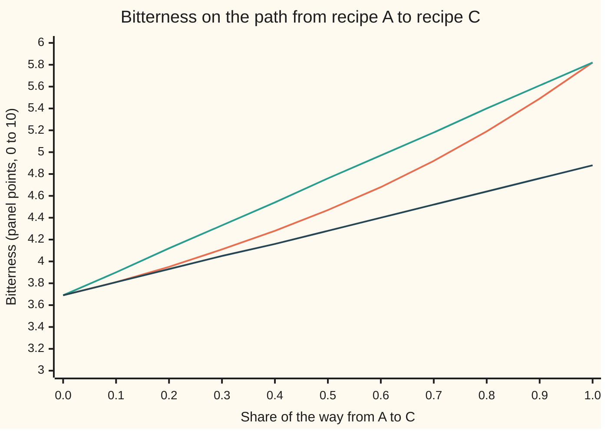

# Convex functions: chords above the graph, and the curvature test that proves it

[Syllabus](../../../SYLLABUS.md) → [Optimization](../README.md) → [Convexity](../README.md#s01) → Convex functions

---

## General Overview

A roaster sells a house blend of arabica and robusta. Two settings are chosen: roast time past first crack (the popping sound that marks a light roast), from 0 to 3 minutes, and robusta's share of the beans, from 0 to 50%. Robusta is cheaper, say £5 a kilo against £9, so the roaster wants to minimise cost by using as much robusta as taste allows. The limit is taste: a panel scores bitterness from 0 to 10, and the blend must score at most 6.

Darker roasts taste more bitter, and the bitterness climbs faster the longer the roast. Robusta adds bitterness too. Recipe A, a 1-minute roast with 40% robusta, scores 3.69 and costs £7.40 a kilo. Recipe C, a 3-minute roast with 10% robusta, scores 5.82 and costs £8.60. Both pass.

Is every recipe between them also in spec, untasted? Halfway is a 2-minute roast with 25% robusta. If the bitterness curve bends upward like a bowl, the halfway recipe can score no more than the average of the two ends, 4.76. It actually scores 4.47.

That guarantee is what **convex** buys. There are three tests for it: chords above the graph, tangents below it, and curvature that never turns downward. For smooth functions they always agree.

**A smooth function is convex exactly when every tangent plane lies under its graph, and exactly when its curvature is never negative in any direction; the chord test, the tangent test and the curvature test are one fact seen three ways.**

**What kind of fact this is:** a theorem, proved on this card in Why it works. The bitterness formula is a model: a plausible made-up fit, not published tasting data.

### The picture: bitterness along the straight path from A to C



The middle line is the true bitterness. The top line is the chord joining A to C: the graph stays under it. The bottom line is the tangent at A, the straight line with A's slope: the graph stays over it. Squeezed between a chord above and a tangent below, the curve can only bend upward.

---

## The formula

The roaster's model, with t the roast time in minutes past first crack and w the robusta share:

$$B(t, w) = 1 + e^{t/2} + k\,t\,w + 4w^2, \qquad k = 1.$$

The term $e^{t/2}$ is bitterness that compounds with roast time, multiplying by $e^{1/2} = 1.6487$ each minute. The term $k\,t\,w$ says robusta's bitter notes grow as the roast goes on, at rate k. The term $4w^2$ is robusta's own bite.

Write a recipe as a point, x = (t, w). [Convex sets](02-convex-sets.md) wrote the mix of two points as $\theta x + (1-\theta)y$, with θ (theta) a weight from 0 to 1. The calculus wing's [Convex functions](../../06-Calculus%20and%20analysis/07-Several%20Variables/09-convex-functions.md) already defined convexity by chords and proved the curvature test. Here they are side by side with the new one, the tangent test, for a function f with two continuous derivatives on an open convex set:

$$\underbrace{f(\theta x + (1-\theta)y) \le \theta f(x) + (1-\theta) f(y)}_{\text{chord}} \iff \underbrace{f(y) \ge f(x) + \nabla f(x)^{\top}(y - x)}_{\text{tangent}} \iff \underbrace{\nabla^2 f(x) \succeq 0}_{\text{curvature}}$$

**Read it aloud:** the graph sits under every chord, if and only if it sits over every tangent plane, if and only if its curvature is never negative in any direction.

Two pieces of notation are new to this wing. The Hessian H, the table of second derivatives, is written $\nabla^2 f(x)$ from here on. And $M \succeq 0$, read "M is positive semidefinite", means $v^{\top} M v \ge 0$ for every direction v ([Quadratic forms](../../03-Algebra/07-Eigenvalues%20and%20Symmetric%20Matrices/05-quadratic-forms-and-positive-definite.md)).

When the curvature is boxed in, between a least value μ (mu) and a greatest value L, the tangent test sharpens into a sandwich:

$$f(x) + \nabla f(x)^{\top}(y-x) + \tfrac{\mu}{2}\lVert y-x\rVert^2 \;\le\; f(y) \;\le\; f(x) + \nabla f(x)^{\top}(y-x) + \tfrac{L}{2}\lVert y-x\rVert^2.$$

**Read it aloud:** the true value sits above the tangent plus a bowl of curvature μ, and below the tangent plus a bowl of curvature L.

A function with μ > 0 is **strongly convex**: it curves up by at least μ in every direction. One with a ceiling L is **L-smooth**: it never curves up faster than L.

| Symbol | Plain meaning | In our example | Push it up and the answer… |
| --- | --- | --- | --- |
| $B(t, w)$ | bitterness, panel points from 0 to 10 | 3.6887 at A, 5.8217 at C | the spec of 6 rules more recipes out |
| $t$ | roast time past first crack, minutes | 0 to 3; A has 1, C has 3 | bitterness climbs, faster and faster |
| $w$ | robusta share of the beans | 0 to 0.5; A has 0.4, C has 0.1 | cheaper, and more bitter |
| $k$ | how fast robusta's bitterness grows with roast time | 1 | above √2 = 1.4142, B stops being convex |
| $f$, $x$, $y$ | any function under test, and two points (recipes) | B, A = (1, 0.4), C = (3, 0.1) | — |
| $\theta$, $z$ | mixing weight, from 0 to 1; the mix itself | ½ gives the halfway recipe (2, 0.25) | the mix moves toward x |
| $\nabla f(x)$ | gradient: the slopes in t and in w | (1.2244, 4.2000) at A | a steeper tangent plane |
| $\nabla f(x)^{\top}(y-x)$ | ⊤ is "transposed": a dot product, each slope times the step in its setting, added up | from A toward C: 1.2244 × 2 + 4.2 × (−0.3) = 1.1887 | — |
| $\nabla^2 f(x)$, $H$ | Hessian: the table of second derivatives | `[[0.4122, 1], [1, 8]]` at A | more curvature |
| $v$, $M$, $\succeq 0$ | a direction; a symmetric matrix; "never negative along any direction" | determinant 2.2974, trace 8.4122 at A | — |
| $\mu$, $L$, $\lVert\cdot\rVert$ | least and greatest curvature over the recipes; length | 0.1230 and 8.1424 | a tighter sandwich, or a looser one |
| $S(t)$ | a bitterness curve that levels off, for What breaks | $8/(1 + e^{2-t})$ | — |
| $g$, $s$, $\xi$, $\sigma$ | the function along one segment; how far along it (0 to 1); a point on it and its position (xi, sigma), from Taylor's theorem | s = 0.5 down to 0.001 in Step 1 | — |

### When it holds

- **Two continuous derivatives.** The Hessian must exist. A kink, such as $\lvert t - 2\rvert$, can be convex with no Hessian at the kink; [Subgradients](07-subgradients.md) handles it.
- **An open convex domain.** Every segment between recipes must stay inside, or chords leave the domain. The converse (Step 4) also needs room to step a little in every direction. B's formula is convex on the whole strip t > −1.3863, which holds every real recipe; below it the determinant turns negative.
- **Every direction, not just the axes.** With k = 4, each setting alone curves upward, yet the blend fails along a diagonal (What breaks, row 1).
- **Every point, not one.** The curve S passes the curvature test at 1 minute and fails at 3 (row 3).
- **Strong convexity needs μ > 0, and the sandwich needs μ and L valid along the whole segment.** On the roaster's box of recipes (t from 0 to 3, w from 0 to 0.5) they come from t = 0 and t = 3, the ends of the roast range.

---

## Why it works

### Step 0: every test is a test on straight lines

Pick two recipes x and y and walk the segment between them: $g(s) = f(x + s(y-x))$, for s from 0 to 1. Along that walk the chain rule gives

$$g'(s) = \nabla f(x + s(y-x))^{\top}(y-x), \qquad g''(s) = (y-x)^{\top}\,\nabla^2 f(x + s(y-x))\,(y-x).$$

So the chord test for f is the chord test for every slice g. The tangent test for f is "g lies above its tangent at 0". The curvature test is "g'' ≥ 0 on every slice". Each claim in several variables is a one-variable claim on every line.

### Step 1: chord implies tangent

Start from the chord inequality with the mix close to x. Write the weight on y as s. Then

$$f(x + s(y-x)) \le f(x) + s\,\big(f(y) - f(x)\big), \quad\text{so}\quad \frac{f(x + s(y-x)) - f(x)}{s} \le f(y) - f(x).$$

The left side is the average slope from x over a step of size s. As s shrinks it becomes the slope at x in direction y − x, which is $\nabla f(x)^{\top}(y-x)$. The inequality survives the limit: that is the tangent test.

On the roaster's segment from A to C, the quotients for s = 0.5, 0.1, 0.01, 0.001 are 1.5591, 1.2500, 1.1946 and 1.1893. They fall toward the slope 1.1887. Every one stays below the ceiling, B(C) − B(A) = 2.1330.

### Step 2: tangent implies chord

Take the mix z = θx + (1 − θ)y. Write the tangent test at z twice, once toward x and once toward y:

$$f(x) \ge f(z) + \nabla f(z)^{\top}(x - z), \qquad f(y) \ge f(z) + \nabla f(z)^{\top}(y - z).$$

Multiply the first by θ and the second by 1 − θ, then add. The slope terms cancel, because θ(x − z) + (1 − θ)(y − z) = θx + (1 − θ)y − z = 0. What is left is θf(x) + (1 − θ)f(y) ≥ f(z): the chord test.

### Step 3: curvature implies tangent, and gives μ and L

[Taylor's theorem](../../06-Calculus%20and%20analysis/03-What%20Derivatives%20Tell%20You/05-taylors-theorem.md) on the slice g, with the remainder in its mean-value form, says that for some point ξ (xi) on the segment,

$$f(y) = f(x) + \nabla f(x)^{\top}(y-x) + \tfrac12 (y-x)^{\top}\,\nabla^2 f(\xi)\,(y-x).$$

If $\nabla^2 f \succeq 0$, the last term is never negative, so f(y) is at least the tangent. That is the tangent test.

If also $\mu\lVert v\rVert^2 \le v^{\top}\nabla^2 f\,v \le L\lVert v\rVert^2$ everywhere, the last term lies between $\frac{\mu}{2}\lVert y-x\rVert^2$ and $\frac{L}{2}\lVert y-x\rVert^2$. That is the sandwich. For recipe C seen from A: the tangent gives 4.8774, the μ-bowl adds 0.2516, so the floor is 5.1291. The true value is 5.8217. The ceiling is 21.5287, loose, because L comes from the steep robusta direction while the step from A to C is mostly roast time.

### Step 4: tangent implies curvature, the converse

Write the tangent test from x toward y, and from y back toward x, then add the two. The function values cancel and leave

$$\big(\nabla f(y) - \nabla f(x)\big)^{\top}(y - x) \ge 0.$$

In words: the slope never decreases as you walk along any line. For A and C, the slopes are (1.2244, 4.2000) at A and (2.3408, 3.8000) at C; the change, measured along C − A, is 2.3530, positive.

Now put y = x + s v for a small step s in direction v, and divide by s². The left side becomes $v^{\top}\nabla^2 f(x)\,v$ as s shrinks, and it stays at least 0. That holds for every direction v, so $\nabla^2 f(x) \succeq 0$. The open domain matters here: x needs room for a small step in every direction.

Steps 1 and 2 tie the chord test to the tangent test both ways; Steps 3 and 4 tie the tangent test to the curvature test both ways. The three are one fact.

<details>
<summary>Detailed proof: the three tests agree, and the converse in full</summary>

Let f have continuous second derivatives on an open convex set, and let x and y be in it.

(Chord ⇒ tangent.) For 0 < s ≤ 1, convexity with weight 1 − s on x gives f(x + s(y − x)) ≤ (1 − s)f(x) + s f(y). Subtract f(x) and divide by s: [f(x + s(y − x)) − f(x)]/s ≤ f(y) − f(x). As s → 0 the left side tends to g'(0) = ∇f(x)ᵀ(y − x).

(Tangent ⇒ chord.) Shown in Step 2: apply the tangent inequality at z = θx + (1 − θ)y toward x and toward y, weight by θ and 1 − θ, and add.

(Curvature ⇒ tangent.) g(s) = f(x + s(y − x)) has two continuous derivatives on [0, 1]. Taylor's theorem gives g(1) = g(0) + g'(0) + ½ g''(σ) for some σ in (0, 1), with g''(σ) = (y − x)ᵀ∇²f(ξ)(y − x), ξ = x + σ(y − x). If ∇²f(ξ) ⪰ 0 then g(1) ≥ g(0) + g'(0), which is the tangent inequality.

(Tangent ⇒ curvature.) Adding the tangent inequalities at x and at y gives (∇f(y) − ∇f(x))ᵀ(y − x) ≥ 0. Fix v. Because the set is open, x + s v stays in it for every small enough s > 0. Put y = x + s v and divide by s²: (∇f(x + s v) − ∇f(x))ᵀv / s ≥ 0. As s → 0 this tends to vᵀ∇²f(x)v, by the definition of the second derivative along v. So vᵀ∇²f(x)v ≥ 0 for every v.

(Applying it to the roaster.) ∇²B = `[[e^(t/2)/4, k], [k, 8]]`. A symmetric 2 × 2 matrix is positive semidefinite when both diagonal entries are at least 0 and the determinant is at least 0 (complete the square, as on the quadratic-forms card). Here the diagonal entries are positive, and with k = 1 the determinant is 2e^(t/2) − 1. It is positive whenever t > −2 ln 2 = −1.3863. So B is convex on that open strip, which contains every recipe. With general k the determinant is 2e^(t/2) − k², which at t = 0 is 2 − k²: convexity on the box needs k ≤ √2.

</details>

### Step 5: why a proof needs the curvature formula, not the grid

The code runs the chord test on 861 pairs of recipes at three weights, and the tangent test on 1,722 ordered pairs. All pass for B. That is evidence, not proof: something could go wrong between grid points.

The determinant $2e^{t/2} - 1$ is different: a formula, positive for every t > −1.3863, not just at 42 grid points. So the curvature formula proves convexity, while one failing chord disproves it.

---

## Worked numbers, by hand

Recipes A = (1 min, 40% robusta) and C = (3 min, 10% robusta). The number e is about 2.7183, so $e^{0.5} = 1.6487$, $e^{1} = 2.7183$ and $e^{1.5} = 4.4817$.

| Step | Arithmetic | Value |
| --- | --- | --- |
| B at A | 1 + 1.6487 + 1 × 0.4 + 4 × 0.16 | 3.6887 |
| B at C | 1 + 4.4817 + 3 × 0.1 + 4 × 0.01 | 5.8217 |
| chord test at halfway (2 min, 25%) | 1 + 2.7183 + 0.5 + 0.25 = 4.4683, under (3.6887 + 5.8217) ÷ 2 = 4.7552 | gap 0.2869 |
| slopes at A | (e^0.5 ÷ 2 + w, t + 8w) = (1.6487 ÷ 2 + 0.4, 1 + 8 × 0.4) | (1.2244, 4.2000) |
| tangent test at C | 3.6887 + 1.2244 × 2 + 4.2 × (−0.3) = 4.8774, under 5.8217 | gap 0.9442 |
| Hessian at A | `[[e^0.5 / 4, 1], [1, 8]]` | `[[0.4122, 1], [1, 8]]` |
| curvature test at A | determinant 0.4122 × 8 − 1 = 2.2974; trace 8.4122; both positive | eigenvalues 0.2826 and 8.1296 |
| curvature test everywhere | determinant $2e^{t/2} - 1$, and $e^{t/2} \ge 1$ for t ≥ 0 | **at least 1.0000** |
| tangent floor at (3 min, 40%) | 3.6887 + 1.2244 × 2 + 4.2 × 0 | **6.1374, over the spec of 6** |

All three tests pass at the recipes checked, and the curvature formula passes at every recipe the roaster can make. So B is convex. Every recipe between two in-spec recipes is in spec. And one tasting at A, with its slopes, rules out the 3-minute, 40% robusta recipe without roasting it: its floor is already 6.1374, and its true score is 7.3217.

### What breaks if you drop a piece

| Mistake | Comes out at | What went wrong |
| --- | --- | --- |
| Test each setting on its own, with k = 4 | axis chords pass (least slack 0.006512); diagonal entries 0.4122 and 8; yet halfway between (0 min, 50%) at 3.0000 and (2 min, 0%) at 3.7183 scores 3.8987, above their average 3.3591 | determinant −12.7026 at t = 1: the cross term wins along a diagonal |
| Trust a tangent floor on a curve that levels off | the tangent to S at 3 min claims S(1) ≥ 2.7027; the true S(1) is 2.1515 | S curves down past 2 minutes, so its tangent rides above the graph |
| Check curvature at one point | S''(1) = 0.7269, a pass | S''(3) = −0.7269: the test must hold everywhere |
| Use the formula outside its strip, t = −2 | determinant −0.2642, least eigenvalue −0.0325 | B is convex only for t > −1.3863 |

With k = 4, the grid tests all fail together: least chord slack −0.6262, least tangent slack −3.0183, least eigenvalue −1.4442. That matches the theorem: a smooth function cannot pass one test everywhere and fail another.

---

## Code, from first principles, and it actually runs

The code reaches each answer by two roads:

- Slopes come from the hand formula and from central differences (the value a small step ahead minus a small step behind, over twice the step).
- Curvatures come from the hand formula and from second differences. Those pairs share no arithmetic.
- μ and L come from the hand Hessian at the box's ends and from the second-difference Hessians at all 42 grid recipes. Both of those roads use the same 2 × 2 eigenvalue formula, so a separate check confirms that every pair of eigenvalues it returns adds up to the matrix's trace (the sum of its diagonal) and multiplies to its determinant.
- The tangent's prediction at C is checked against a central difference along the segment from A.

Then the three tests run over the whole grid, for B and for the k = 4 blend. The theorem says the three tests stand or fall together, and on the grid they do: all pass for B, all fail for k = 4.

### Python

```python
# Convex functions and their tests -- the check behind the card.  Standard library only.
# Bitterness B on a 0-10 tasting scale.  t = roast minutes past first crack (0 to 3),
# w = robusta share of the blend (0 to 0.5), k = how fast robusta's bitterness grows with
# roast time (1 in the model).  Three tests -- chord, tangent, curvature -- run on
# a grid of 42 recipes, for B and for two curves that fail; each has an independent road.
from math import exp, sqrt, log

def B(t, w, k=1.0):    return 1 + exp(t / 2) + k * t * w + 4 * w * w
def grad(t, w, k=1.0): return (exp(t / 2) / 2 + k * w, k * t + 8 * w)   # slopes, by hand
def hess(t, w, k=1.0): return ((exp(t / 2) / 4, k), (k, 8.0))           # curvatures, by hand
def S(t):              return 8 / (1 + exp(2 - t))                      # bitterness that levels off

def num_grad(f, p, h=1e-5):                       # slopes again, by central differences
    return tuple((f(p[0] + h * (i == 0), p[1] + h * (i == 1)) -
                  f(p[0] - h * (i == 0), p[1] - h * (i == 1))) / (2 * h) for i in range(2))

def num_hess(f, p, h=1e-3):                       # curvatures again, by second differences
    at = lambda a, b: f(p[0] + a * h, p[1] + b * h)
    hxy = (at(1, 1) - at(1, -1) - at(-1, 1) + at(-1, -1)) / (4 * h * h)
    return ((at(1, 0) - 2 * at(0, 0) + at(-1, 0)) / h ** 2, hxy), (hxy, (at(0, 1) - 2 * at(0, 0) + at(0, -1)) / h ** 2)

def eig(H):                                       # eigenvalues of a symmetric 2 x 2, smaller first
    tr, gap = H[0][0] + H[1][1], sqrt((H[0][0] - H[1][1]) ** 2 + 4 * H[0][1] ** 2)
    return (tr - gap) / 2, (tr + gap) / 2

dot = lambda u, v: u[0] * v[0] + u[1] * v[1]
mix = lambda th, x, y: (th * x[0] + (1 - th) * y[0], th * x[1] + (1 - th) * y[1])
GRID = [(0.5 * i, 0.1 * j) for i in range(7) for j in range(6)]
PAIRS = [(x, y) for n, x in enumerate(GRID) for y in GRID[n + 1:]]

def three_tests(f, g, pairs=PAIRS):              # least slack of each test over the grid
    chord = min(th * f(*x) + (1 - th) * f(*y) - f(*mix(th, x, y)) for x, y in pairs for th in (0.25, 0.5, 0.75))
    tang = min(f(*y) - f(*x) - dot(g(*x), (y[0] - x[0], y[1] - x[1])) for x in GRID for y in GRID if x != y)
    return chord, tang, min(eig(num_hess(f, p))[0] for p in GRID)

A, C, M, F = (1.0, 0.4), (3.0, 0.1), (2.0, 0.25), (3.0, 0.4)
bA, bC, bM = B(*A), B(*C), B(*M)
gA, gC, d = grad(*A), grad(*C), (C[0] - A[0], C[1] - A[1])
tanC, floorF = bA + dot(gA, d), bA + dot(gA, (F[0] - A[0], F[1] - A[1]))
HA, nA = hess(*A), num_hess(B, A)
quot = [(B(*mix(1 - s, A, C)) - bA) / s for s in (0.5, 0.1, 0.01, 0.001)]
mono = dot((gC[0] - gA[0], gC[1] - gA[1]), d)
mu, L = eig(hess(0, 0))[0], eig(hess(3, 0))[1]                 # Hessian rises with t only
eg = [eig(num_hess(B, p)) for p in GRID]
mu_g, L_g = min(e[0] for e in eg), max(e[1] for e in eg)
lo, hi = tanC + mu / 2 * dot(d, d), tanC + L / 2 * dot(d, d)
okB = three_tests(B, grad)
G, gG = (lambda t, w: B(t, w, 4.0)), (lambda t, w: grad(t, w, 4.0))
badG = three_tests(G, gG)
axisG = three_tests(G, gG, [(x, y) for x, y in PAIRS if x[0] == y[0] or x[1] == y[1]])[0]
HG = hess(1, 0, 4.0)
s1, s3 = S(1), S(3)
d1, d3 = s1 * (8 - s1) / 8, s3 * (8 - s3) / 8                   # S' = S(8 - S)/8
c1, c3 = d1 * (8 - 2 * s1) / 8, d3 * (8 - 2 * s3) / 8           # S'' = S'(8 - 2S)/8
n3 = (S(3.001) - 2 * s3 + S(2.999)) / 1e-6
tanS1 = s3 + d3 * (1 - 3)
th = [0.1 * i for i in range(11)]
print("model: B(t, w) = 1 + e^(t/2) + t*w + 4*w^2; t in [0, 3] min, w in [0, 0.5]")
print(f"prices: arabica 9.00, robusta 5.00 pounds/kg; e^(1/2) = {exp(0.5):.4f}, e^1 = {exp(1):.4f}, e^(3/2) = {exp(1.5):.4f}")
for name, p, b in (("A", A, bA), ("C", C, bC), ("halfway", M, bM)):
    print(f"recipe {name} ({p[0]:.0f} min, {100 * p[1]:.0f}% robusta): B = {b:.4f}, cost {9 - 4 * p[1]:.2f} pounds/kg")
print(f"chord: average of A and C {(bA + bC) / 2:.4f}, halfway {bM:.4f}, gap {(bA + bC) / 2 - bM:.4f}")
print(f"slopes at A by formula ({gA[0]:.4f}, {gA[1]:.4f}); by central differences ({num_grad(B, A)[0]:.4f}, {num_grad(B, A)[1]:.4f})")
print(f"tangent at A predicts C: {bA:.4f} + {gA[0] * d[0]:.4f} + ({gA[1] * d[1]:.4f}) = {tanC:.4f}; true {bC:.4f}; gap {bC - tanC:.4f}")
print(f"tangent floor at (3 min, 40%): {floorF:.4f} > 6, out of spec untasted; true {B(*F):.4f}")
print(f"Hessian at A by formula [[{HA[0][0]:.4f}, {HA[0][1]:.4f}], [{HA[1][0]:.4f}, {HA[1][1]:.4f}]]"
      f"; by second differences [[{nA[0][0]:.4f}, {nA[0][1]:.4f}], [{nA[1][0]:.4f}, {nA[1][1]:.4f}]]")
print(f"at A: determinant {HA[0][0] * HA[1][1] - 1:.4f}, trace {HA[0][0] + 8:.4f}, eigenvalues {eig(HA)[0]:.4f} and {eig(HA)[1]:.4f}")
print(f"determinant 2e^(t/2) - 1 is at least {2 * exp(0) - 1:.4f} for t >= 0; turns negative below t = {-2 * log(2):.4f}")
print("step 1 quotients, s = 0.5, 0.1, 0.01, 0.001: " + ", ".join(f"{q:.4f}" for q in quot)
      + f"; limit {dot(gA, d):.4f}; ceiling {bC - bA:.4f}")
print(f"step 4 slopes at C ({gC[0]:.4f}, {gC[1]:.4f}); slope change along C - A: {mono:.4f}")
print(f"mu, least eigenvalue on the box (t = 0): formula {mu:.4f}, grid {mu_g:.4f}")
print(f"L, largest eigenvalue on the box (t = 3): formula {L:.4f}, grid {L_g:.4f}")
print(f"sandwich for C: {tanC:.4f} + {mu / 2 * dot(d, d):.4f} = {lo:.4f} <= {bC:.4f} <= {hi:.4f}")
print(f"grid: {len(GRID)} recipes, {len(PAIRS)} pairs x 3 weights, {len(GRID) * (len(GRID) - 1)} ordered pairs")
print("B, least slack: chord {:.6f}, tangent {:.6f}, least eigenvalue {:.4f}".format(*okB))
print("k = 4, least slack: chord {:.4f}, tangent {:.4f}, least eigenvalue {:.4f}".format(*badG))
print(f"k = 4, chords along the axes only: least slack {axisG:.6f}; diagonal at t = 1: {HG[0][0]:.4f} and {HG[1][1]:.4f}; determinant {HG[0][0] * 8 - 16:.4f}")
print(f"k = 4 chord: (0 min, 50%) {G(0, 0.5):.4f}, (2 min, 0%) {G(2, 0):.4f}, average {(G(0, 0.5) + G(2, 0)) / 2:.4f}; halfway (1 min, 25%) {G(1, 0.25):.4f}")
print(f"levelling curve: S(1) = {s1:.4f}, S(3) = {s3:.4f}, slope at 3 {d3:.4f}; tangent at 3 claims S(1) >= {tanS1:.4f}")
print(f"levelling curve: S''(1) = {c1:.4f}, S''(3) = {c3:.4f}, by second differences {n3:.4f}")
print(f"try: k = 1.5, least eigenvalue at t = 0: {eig(hess(0, 0, 1.5))[0]:.4f}; switch-off k = {sqrt(2):.4f}")
print(f"try: t = -2, determinant {2 * exp(-1) - 1:.4f}, least eigenvalue {eig(hess(-2, 0))[0]:.4f}")
print(f"try: tangent at C predicts A: {bC + dot(gC, (-d[0], -d[1])):.4f}; true {bA:.4f}")
print("chart theta: " + ", ".join(f"{x:.1f}" for x in th))
print("chart B from A to C: " + ", ".join(f"{B(*mix(1 - x, A, C)):.2f}" for x in th))
print("chart chord: " + ", ".join(f"{(1 - x) * bA + x * bC:.2f}" for x in th))
print("chart tangent at A: " + ", ".join(f"{bA + x * dot(gA, d):.2f}" for x in th))
assert all(abs(u - v) < 1e-6 for p in GRID for u, v in zip(grad(*p), num_grad(B, p)))       # slopes two ways
assert all(abs(hess(*p)[i][j] - num_hess(B, p)[i][j]) < 1e-4 for p in GRID for i in range(2) for j in range(2))
assert min(okB) > 0 and max(badG) < 0 and axisG > 0                    # three tests agree, both ways
assert tanC < bC and abs(quot[-1] - dot(gA, d)) < 1e-2 and max(quot) <= bC - bA and mono > 0
assert abs(mu - mu_g) < 1e-5 and abs(L - L_g) < 1e-5 and lo <= bC <= hi   # mu and L two ways
assert tanS1 > s1 and c1 > 0 > c3 and abs(n3 - c3) < 1e-5              # the levelling curve fails
assert abs(tanS1 - (s3 - (S(3 + 1e-5) - S(3 - 1e-5)) / 1e-5)) < 1e-6    # its tangent value two ways
assert abs(tanC - bA - (B(*mix(1 - 1e-5, A, C)) - B(*mix(1 + 1e-5, A, C))) / 2e-5) < 1e-6   # tangent at A two ways
mats = [HA, hess(0, 0), hess(3, 0), hess(0, 0, 1.5), hess(-2, 0)] + [num_hess(f, p) for f in (B, G) for p in GRID]
assert all(l1 <= l2 and abs(l1 + l2 - H[0][0] - H[1][1]) < 1e-9 and abs(l1 * l2 - H[0][0] * H[1][1] + H[0][1] * H[1][0]) < 1e-9
           for H in mats for l1, l2 in [eig(H)])   # every eigenvalue pair: sum = trace, product = determinant
print("ALL CHECKS PASS")
```

**Ran 2026-11-11 on macOS, Python 3.14.10, standard library only. All checks passed. Output, pasted from the run:**

```
model: B(t, w) = 1 + e^(t/2) + t*w + 4*w^2; t in [0, 3] min, w in [0, 0.5]
prices: arabica 9.00, robusta 5.00 pounds/kg; e^(1/2) = 1.6487, e^1 = 2.7183, e^(3/2) = 4.4817
recipe A (1 min, 40% robusta): B = 3.6887, cost 7.40 pounds/kg
recipe C (3 min, 10% robusta): B = 5.8217, cost 8.60 pounds/kg
recipe halfway (2 min, 25% robusta): B = 4.4683, cost 8.00 pounds/kg
chord: average of A and C 4.7552, halfway 4.4683, gap 0.2869
slopes at A by formula (1.2244, 4.2000); by central differences (1.2244, 4.2000)
tangent at A predicts C: 3.6887 + 2.4487 + (-1.2600) = 4.8774; true 5.8217; gap 0.9442
tangent floor at (3 min, 40%): 6.1374 > 6, out of spec untasted; true 7.3217
Hessian at A by formula [[0.4122, 1.0000], [1.0000, 8.0000]]; by second differences [[0.4122, 1.0000], [1.0000, 8.0000]]
at A: determinant 2.2974, trace 8.4122, eigenvalues 0.2826 and 8.1296
determinant 2e^(t/2) - 1 is at least 1.0000 for t >= 0; turns negative below t = -1.3863
step 1 quotients, s = 0.5, 0.1, 0.01, 0.001: 1.5591, 1.2500, 1.1946, 1.1893; limit 1.1887; ceiling 2.1330
step 4 slopes at C (2.3408, 3.8000); slope change along C - A: 2.3530
mu, least eigenvalue on the box (t = 0): formula 0.1230, grid 0.1230
L, largest eigenvalue on the box (t = 3): formula 8.1424, grid 8.1424
sandwich for C: 4.8774 + 0.2516 = 5.1291 <= 5.8217 <= 21.5287
grid: 42 recipes, 861 pairs x 3 weights, 1722 ordered pairs
B, least slack: chord 0.004637, tangent 0.024025, least eigenvalue 0.1230
k = 4, least slack: chord -0.6262, tangent -3.0183, least eigenvalue -1.4442
k = 4, chords along the axes only: least slack 0.006512; diagonal at t = 1: 0.4122 and 8.0000; determinant -12.7026
k = 4 chord: (0 min, 50%) 3.0000, (2 min, 0%) 3.7183, average 3.3591; halfway (1 min, 25%) 3.8987
levelling curve: S(1) = 2.1515, S(3) = 5.8485, slope at 3 1.5729; tangent at 3 claims S(1) >= 2.7027
levelling curve: S''(1) = 0.7269, S''(3) = -0.7269, by second differences -0.7269
try: k = 1.5, least eigenvalue at t = 0: -0.0302; switch-off k = 1.4142
try: t = -2, determinant -0.2642, least eigenvalue -0.0325
try: tangent at C predicts A: 2.2800; true 3.6887
chart theta: 0.0, 0.1, 0.2, 0.3, 0.4, 0.5, 0.6, 0.7, 0.8, 0.9, 1.0
chart B from A to C: 3.69, 3.81, 3.95, 4.11, 4.28, 4.47, 4.68, 4.92, 5.19, 5.49, 5.82
chart chord: 3.69, 3.90, 4.12, 4.33, 4.54, 4.76, 4.97, 5.18, 5.40, 5.61, 5.82
chart tangent at A: 3.69, 3.81, 3.93, 4.05, 4.16, 4.28, 4.40, 4.52, 4.64, 4.76, 4.88
ALL CHECKS PASS
```

### Rust

The same checks, the same labels, built with `rustc --edition 2021 -O`.

```rust
// Convex functions and their tests -- the same check as the Python, in Rust.  No crates.
// Bitterness B on a 0-10 tasting scale.  t = roast minutes past first crack (0 to 3),
// w = robusta share of the blend (0 to 0.5), k = how fast robusta's bitterness grows with
// roast time (1 in the model).  Three tests -- chord, tangent, curvature -- run on
// a grid of 42 recipes, for B and for two curves that fail; each has an independent road.
type P = (f64, f64);
type M = [[f64; 2]; 2];

fn bk(t: f64, w: f64, k: f64) -> f64 { 1.0 + (t / 2.0).exp() + k * t * w + 4.0 * w * w }
fn b(t: f64, w: f64) -> f64 { bk(t, w, 1.0) }
fn g4(t: f64, w: f64) -> f64 { bk(t, w, 4.0) }
fn grad(t: f64, w: f64, k: f64) -> P { ((t / 2.0).exp() / 2.0 + k * w, k * t + 8.0 * w) }   // slopes, by hand
fn hess(t: f64, k: f64) -> M { [[(t / 2.0).exp() / 4.0, k], [k, 8.0]] }                   // curvatures, by hand
fn s(t: f64) -> f64 { 8.0 / (1.0 + (2.0 - t).exp()) }                                    // levels off

fn num_grad(f: fn(f64, f64) -> f64, p: P) -> P {     // slopes again, by central differences
    let h = 1e-5;
    ((f(p.0 + h, p.1) - f(p.0 - h, p.1)) / (2.0 * h), (f(p.0, p.1 + h) - f(p.0, p.1 - h)) / (2.0 * h))
}
fn num_hess(f: fn(f64, f64) -> f64, p: P) -> M {     // curvatures again, by second differences
    let h = 1e-3;
    let at = |a: f64, c: f64| f(p.0 + a * h, p.1 + c * h);
    let hxy = (at(1.0, 1.0) - at(1.0, -1.0) - at(-1.0, 1.0) + at(-1.0, -1.0)) / (4.0 * h * h);
    [[(at(1.0, 0.0) - 2.0 * at(0.0, 0.0) + at(-1.0, 0.0)) / (h * h), hxy],
     [hxy, (at(0.0, 1.0) - 2.0 * at(0.0, 0.0) + at(0.0, -1.0)) / (h * h)]]
}
fn eig(m: M) -> P {                                   // eigenvalues of a symmetric 2 x 2, smaller first
    let (tr, gap) = (m[0][0] + m[1][1], ((m[0][0] - m[1][1]).powi(2) + 4.0 * m[0][1].powi(2)).sqrt());
    ((tr - gap) / 2.0, (tr + gap) / 2.0)
}
fn dot(u: P, v: P) -> f64 { u.0 * v.0 + u.1 * v.1 }
fn mix(th: f64, x: P, y: P) -> P { (th * x.0 + (1.0 - th) * y.0, th * x.1 + (1.0 - th) * y.1) }

fn three_tests(f: fn(f64, f64) -> f64, k: f64, grid: &[P], pairs: &[(P, P)]) -> (f64, f64, f64) {
    let mut chord = f64::INFINITY;                    // least slack of each test over the grid
    for &(x, y) in pairs { for th in [0.25, 0.5, 0.75] {
        let m = mix(th, x, y);
        chord = chord.min(th * f(x.0, x.1) + (1.0 - th) * f(y.0, y.1) - f(m.0, m.1));
    } }
    let mut tang = f64::INFINITY;
    for &x in grid { for &y in grid { if x != y {
        tang = tang.min(f(y.0, y.1) - f(x.0, x.1) - dot(grad(x.0, x.1, k), (y.0 - x.0, y.1 - x.1)));
    } } }
    let curv = grid.iter().map(|&p| eig(num_hess(f, p)).0).fold(f64::INFINITY, f64::min);
    (chord, tang, curv)
}
fn list(v: &[f64], d: usize) -> String { v.iter().map(|x| format!("{:.*}", d, x)).collect::<Vec<_>>().join(", ") }

fn main() {
    let grid: Vec<P> = (0..7).flat_map(|i| (0..6).map(move |j| (0.5 * i as f64, 0.1 * j as f64))).collect();
    let mut pairs: Vec<(P, P)> = Vec::new();
    for n in 0..grid.len() { for m in n + 1..grid.len() { pairs.push((grid[n], grid[m])) } }
    let (a, c, m, f) = ((1.0, 0.4), (3.0, 0.1), (2.0, 0.25), (3.0, 0.4));
    let (ba, bc, bm) = (b(a.0, a.1), b(c.0, c.1), b(m.0, m.1));
    let (ga, gc, d) = (grad(a.0, a.1, 1.0), grad(c.0, c.1, 1.0), (c.0 - a.0, c.1 - a.1));
    let (tan_c, floor_f) = (ba + dot(ga, d), ba + dot(ga, (f.0 - a.0, f.1 - a.1)));
    let (ha, na) = (hess(a.0, 1.0), num_hess(b, a));
    let quot: Vec<f64> = [0.5, 0.1, 0.01, 0.001].iter().map(|&sv| { let p = mix(1.0 - sv, a, c); (b(p.0, p.1) - ba) / sv }).collect();
    let mono = dot((gc.0 - ga.0, gc.1 - ga.1), d);
    let (mu, l) = (eig(hess(0.0, 1.0)).0, eig(hess(3.0, 1.0)).1);   // Hessian rises with t only
    let eg: Vec<P> = grid.iter().map(|&p| eig(num_hess(b, p))).collect();
    let mu_g = eg.iter().map(|e| e.0).fold(f64::INFINITY, f64::min);
    let l_g = eg.iter().map(|e| e.1).fold(f64::NEG_INFINITY, f64::max);
    let (lo, hi) = (tan_c + mu / 2.0 * dot(d, d), tan_c + l / 2.0 * dot(d, d));
    let ok_b = three_tests(b, 1.0, &grid, &pairs);
    let bad_g = three_tests(g4, 4.0, &grid, &pairs);
    let axis: Vec<(P, P)> = pairs.iter().cloned().filter(|(x, y)| x.0 == y.0 || x.1 == y.1).collect();
    let axis_g = three_tests(g4, 4.0, &grid, &axis).0;
    let hg = hess(1.0, 4.0);
    let (s1, s3) = (s(1.0), s(3.0));
    let (d1, d3) = (s1 * (8.0 - s1) / 8.0, s3 * (8.0 - s3) / 8.0);             // S' = S(8 - S)/8
    let (c1, c3) = (d1 * (8.0 - 2.0 * s1) / 8.0, d3 * (8.0 - 2.0 * s3) / 8.0); // S'' = S'(8 - 2S)/8
    let n3 = (s(3.001) - 2.0 * s3 + s(2.999)) / 1e-6;
    let tan_s1 = s3 + d3 * (1.0 - 3.0);
    let th: Vec<f64> = (0..11).map(|i| 0.1 * i as f64).collect();
    let nga = num_grad(b, a);
    println!("model: B(t, w) = 1 + e^(t/2) + t*w + 4*w^2; t in [0, 3] min, w in [0, 0.5]");
    println!("prices: arabica 9.00, robusta 5.00 pounds/kg; e^(1/2) = {:.4}, e^1 = {:.4}, e^(3/2) = {:.4}", 0.5f64.exp(), 1f64.exp(), 1.5f64.exp());
    for (name, p, bv) in [("A", a, ba), ("C", c, bc), ("halfway", m, bm)] {
        println!("recipe {} ({:.0} min, {:.0}% robusta): B = {:.4}, cost {:.2} pounds/kg", name, p.0, 100.0 * p.1, bv, 9.0 - 4.0 * p.1);
    }
    println!("chord: average of A and C {:.4}, halfway {:.4}, gap {:.4}", (ba + bc) / 2.0, bm, (ba + bc) / 2.0 - bm);
    println!("slopes at A by formula ({:.4}, {:.4}); by central differences ({:.4}, {:.4})", ga.0, ga.1, nga.0, nga.1);
    println!("tangent at A predicts C: {:.4} + {:.4} + ({:.4}) = {:.4}; true {:.4}; gap {:.4}", ba, ga.0 * d.0, ga.1 * d.1, tan_c, bc, bc - tan_c);
    println!("tangent floor at (3 min, 40%): {:.4} > 6, out of spec untasted; true {:.4}", floor_f, b(f.0, f.1));
    println!("Hessian at A by formula [[{:.4}, {:.4}], [{:.4}, {:.4}]]; by second differences [[{:.4}, {:.4}], [{:.4}, {:.4}]]",
             ha[0][0], ha[0][1], ha[1][0], ha[1][1], na[0][0], na[0][1], na[1][0], na[1][1]);
    println!("at A: determinant {:.4}, trace {:.4}, eigenvalues {:.4} and {:.4}", ha[0][0] * ha[1][1] - 1.0, ha[0][0] + 8.0, eig(ha).0, eig(ha).1);
    println!("determinant 2e^(t/2) - 1 is at least {:.4} for t >= 0; turns negative below t = {:.4}", 2.0 * 0f64.exp() - 1.0, -2.0 * 2f64.ln());
    println!("step 1 quotients, s = 0.5, 0.1, 0.01, 0.001: {}; limit {:.4}; ceiling {:.4}", list(&quot, 4), dot(ga, d), bc - ba);
    println!("step 4 slopes at C ({:.4}, {:.4}); slope change along C - A: {:.4}", gc.0, gc.1, mono);
    println!("mu, least eigenvalue on the box (t = 0): formula {:.4}, grid {:.4}", mu, mu_g);
    println!("L, largest eigenvalue on the box (t = 3): formula {:.4}, grid {:.4}", l, l_g);
    println!("sandwich for C: {:.4} + {:.4} = {:.4} <= {:.4} <= {:.4}", tan_c, mu / 2.0 * dot(d, d), lo, bc, hi);
    println!("grid: {} recipes, {} pairs x 3 weights, {} ordered pairs", grid.len(), pairs.len(), grid.len() * (grid.len() - 1));
    println!("B, least slack: chord {:.6}, tangent {:.6}, least eigenvalue {:.4}", ok_b.0, ok_b.1, ok_b.2);
    println!("k = 4, least slack: chord {:.4}, tangent {:.4}, least eigenvalue {:.4}", bad_g.0, bad_g.1, bad_g.2);
    println!("k = 4, chords along the axes only: least slack {:.6}; diagonal at t = 1: {:.4} and {:.4}; determinant {:.4}", axis_g, hg[0][0], hg[1][1], hg[0][0] * 8.0 - 16.0);
    println!("k = 4 chord: (0 min, 50%) {:.4}, (2 min, 0%) {:.4}, average {:.4}; halfway (1 min, 25%) {:.4}", g4(0.0, 0.5), g4(2.0, 0.0), (g4(0.0, 0.5) + g4(2.0, 0.0)) / 2.0, g4(1.0, 0.25));
    println!("levelling curve: S(1) = {:.4}, S(3) = {:.4}, slope at 3 {:.4}; tangent at 3 claims S(1) >= {:.4}", s1, s3, d3, tan_s1);
    println!("levelling curve: S''(1) = {:.4}, S''(3) = {:.4}, by second differences {:.4}", c1, c3, n3);
    println!("try: k = 1.5, least eigenvalue at t = 0: {:.4}; switch-off k = {:.4}", eig(hess(0.0, 1.5)).0, 2f64.sqrt());
    println!("try: t = -2, determinant {:.4}, least eigenvalue {:.4}", 2.0 * (-1f64).exp() - 1.0, eig(hess(-2.0, 1.0)).0);
    println!("try: tangent at C predicts A: {:.4}; true {:.4}", bc + dot(gc, (-d.0, -d.1)), ba);
    println!("chart theta: {}", list(&th, 1));
    println!("chart B from A to C: {}", list(&th.iter().map(|&x| { let p = mix(1.0 - x, a, c); b(p.0, p.1) }).collect::<Vec<_>>(), 2));
    println!("chart chord: {}", list(&th.iter().map(|&x| (1.0 - x) * ba + x * bc).collect::<Vec<_>>(), 2));
    println!("chart tangent at A: {}", list(&th.iter().map(|&x| ba + x * dot(ga, d)).collect::<Vec<_>>(), 2));
    for &p in &grid {                                                           // slopes two ways
        let (u, v) = (grad(p.0, p.1, 1.0), num_grad(b, p));
        assert!((u.0 - v.0).abs() < 1e-6 && (u.1 - v.1).abs() < 1e-6);
        let (hf, hn) = (hess(p.0, 1.0), num_hess(b, p));                        // curvatures two ways
        assert!((0..2).all(|i| (0..2).all(|j| (hf[i][j] - hn[i][j]).abs() < 1e-4)));
    }
    assert!(ok_b.0.min(ok_b.1).min(ok_b.2) > 0.0 && bad_g.0.max(bad_g.1).max(bad_g.2) < 0.0 && axis_g > 0.0);
    assert!(tan_c < bc && (quot[3] - dot(ga, d)).abs() < 1e-2 && quot.iter().all(|&q| q <= bc - ba) && mono > 0.0);
    assert!((mu - mu_g).abs() < 1e-5 && (l - l_g).abs() < 1e-5 && lo <= bc && bc <= hi);   // mu and L two ways
    assert!(tan_s1 > s1 && c1 > 0.0 && 0.0 > c3 && (n3 - c3).abs() < 1e-5);              // the levelling curve fails
    assert!((tan_s1 - (s3 - (s(3.0 + 1e-5) - s(3.0 - 1e-5)) / 1e-5)).abs() < 1e-6);       // its tangent value two ways
    let along = |sv: f64| { let p = mix(sv, a, c); b(p.0, p.1) };
    assert!((tan_c - ba - (along(1.0 - 1e-5) - along(1.0 + 1e-5)) / 2e-5).abs() < 1e-6); // tangent at A two ways
    let mut mats: Vec<M> = vec![ha, hess(0.0, 1.0), hess(3.0, 1.0), hess(0.0, 1.5), hess(-2.0, 1.0)];
    for fun in [b, g4] { for &p in &grid { mats.push(num_hess(fun, p)); } }
    assert!(mats.iter().all(|h| { let (l1, l2) = eig(*h); l1 <= l2 && (l1 + l2 - h[0][0] - h[1][1]).abs() < 1e-9
        && (l1 * l2 - h[0][0] * h[1][1] + h[0][1] * h[1][0]).abs() < 1e-9 }));   // every eigenvalue pair: sum = trace, product = determinant
    println!("ALL CHECKS PASS");
}
```

**Ran 2026-11-11 on macOS, rustc 1.98.1, no crates. All checks passed. Output, pasted from the run:**

```
model: B(t, w) = 1 + e^(t/2) + t*w + 4*w^2; t in [0, 3] min, w in [0, 0.5]
prices: arabica 9.00, robusta 5.00 pounds/kg; e^(1/2) = 1.6487, e^1 = 2.7183, e^(3/2) = 4.4817
recipe A (1 min, 40% robusta): B = 3.6887, cost 7.40 pounds/kg
recipe C (3 min, 10% robusta): B = 5.8217, cost 8.60 pounds/kg
recipe halfway (2 min, 25% robusta): B = 4.4683, cost 8.00 pounds/kg
chord: average of A and C 4.7552, halfway 4.4683, gap 0.2869
slopes at A by formula (1.2244, 4.2000); by central differences (1.2244, 4.2000)
tangent at A predicts C: 3.6887 + 2.4487 + (-1.2600) = 4.8774; true 5.8217; gap 0.9442
tangent floor at (3 min, 40%): 6.1374 > 6, out of spec untasted; true 7.3217
Hessian at A by formula [[0.4122, 1.0000], [1.0000, 8.0000]]; by second differences [[0.4122, 1.0000], [1.0000, 8.0000]]
at A: determinant 2.2974, trace 8.4122, eigenvalues 0.2826 and 8.1296
determinant 2e^(t/2) - 1 is at least 1.0000 for t >= 0; turns negative below t = -1.3863
step 1 quotients, s = 0.5, 0.1, 0.01, 0.001: 1.5591, 1.2500, 1.1946, 1.1893; limit 1.1887; ceiling 2.1330
step 4 slopes at C (2.3408, 3.8000); slope change along C - A: 2.3530
mu, least eigenvalue on the box (t = 0): formula 0.1230, grid 0.1230
L, largest eigenvalue on the box (t = 3): formula 8.1424, grid 8.1424
sandwich for C: 4.8774 + 0.2516 = 5.1291 <= 5.8217 <= 21.5287
grid: 42 recipes, 861 pairs x 3 weights, 1722 ordered pairs
B, least slack: chord 0.004637, tangent 0.024025, least eigenvalue 0.1230
k = 4, least slack: chord -0.6262, tangent -3.0183, least eigenvalue -1.4442
k = 4, chords along the axes only: least slack 0.006512; diagonal at t = 1: 0.4122 and 8.0000; determinant -12.7026
k = 4 chord: (0 min, 50%) 3.0000, (2 min, 0%) 3.7183, average 3.3591; halfway (1 min, 25%) 3.8987
levelling curve: S(1) = 2.1515, S(3) = 5.8485, slope at 3 1.5729; tangent at 3 claims S(1) >= 2.7027
levelling curve: S''(1) = 0.7269, S''(3) = -0.7269, by second differences -0.7269
try: k = 1.5, least eigenvalue at t = 0: -0.0302; switch-off k = 1.4142
try: t = -2, determinant -0.2642, least eigenvalue -0.0325
try: tangent at C predicts A: 2.2800; true 3.6887
chart theta: 0.0, 0.1, 0.2, 0.3, 0.4, 0.5, 0.6, 0.7, 0.8, 0.9, 1.0
chart B from A to C: 3.69, 3.81, 3.95, 4.11, 4.28, 4.47, 4.68, 4.92, 5.19, 5.49, 5.82
chart chord: 3.69, 3.90, 4.12, 4.33, 4.54, 4.76, 4.97, 5.18, 5.40, 5.61, 5.82
chart tangent at A: 3.69, 3.81, 3.93, 4.05, 4.16, 4.28, 4.40, 4.52, 4.64, 4.76, 4.88
ALL CHECKS PASS
```

The two outputs match line for line.

### Lean

Lean proves that the three tests agree for every smooth function on an open convex set, and that the roaster's B is convex.

- Let f have two continuous derivatives on an open convex set, in any number of settings. Then the chord, tangent and curvature tests are all true, or all false.
- Let the curvature lie between μ and L in every direction, all over the set. Then for any x and y in it, f(y) obeys the sandwich.
- B(t, w) = 1 + e^(t/2) + t·w + 4w² is convex on the whole strip t > −2 ln 2, about −1.3863.
- Halfway between A = (1 min, 40%) and C = (3 min, 10%) is (2 min, 25%).
- The costs are £7.40 at A, £8.60 at C and £8.00 halfway, a kilo.
- The step from A to C is (2, −0.3). The tangent floor at (3 min, 40%) gets nothing from the robusta slope, since w does not change.
- The Hessian's determinant is 2e^(t/2) − k², which is 2e^(t/2) − 1 when k = 1.
- With k = 4, the corner recipe (0 min, 50% robusta) scores exactly 3.
- In Step 2 the slope terms cancel: θ(x − z) + (1 − θ)(y − z) = 0.

The decimals, the grid tests, the failures (k = 4, the curve S, t below the strip) and the chart are left to the Python and Rust checks.

```lean
-- Convex functions: for a function with two continuous derivatives on an open convex set, the chord test, the tangent test and the curvature test are equivalent, curvature between μ and L sandwiches the function between two bowls, and the roaster's bitterness formula is convex on the strip t > −2 ln 2.
import Mathlib.Analysis.Convex.Function
import Mathlib.Analysis.Calculus.ContDiff.Defs
import Mathlib.Analysis.Calculus.FDeriv.Basic
import Mathlib.Analysis.InnerProductSpace.PiL2
import Mathlib.Analysis.SpecialFunctions.Exp
import Mathlib.Analysis.SpecialFunctions.Log.Basic
import Mathlib.Data.List.TFAE
import Mathlib.Tactic.NormNum
import Mathlib.Tactic.Ring
import Mathlib

open Set

theorem cvx_core_1d {g g' g'' : ℝ → ℝ} {m : ℝ}
    (hg : ∀ t ∈ Icc (0:ℝ) 1, HasDerivAt g (g' t) t)
    (hg' : ∀ t ∈ Icc (0:ℝ) 1, HasDerivAt g' (g'' t) t)
    (hm : ∀ t ∈ Icc (0:ℝ) 1, m ≤ g'' t) :
    g 0 + g' 0 + m / 2 ≤ g 1 := by
  have hkd : ∀ t ∈ Icc (0:ℝ) 1,
      HasDerivAt (fun u => g' u - g' 0 - m * u) (g'' t - m) t := by
    intro t ht
    have h := ((hg' t ht).sub_const (g' 0)).sub ((hasDerivAt_id t).const_mul m)
    convert h using 1
    all_goals first | rfl | ring
  have hkmono : MonotoneOn (fun u => g' u - g' 0 - m * u) (Icc 0 1) :=
    monotoneOn_of_hasDerivWithinAt_nonneg (convex_Icc 0 1) (f' := fun t => g'' t - m)
      (fun t ht => (hkd t ht).continuousAt.continuousWithinAt)
      (fun t ht => (hkd t (interior_subset ht)).hasDerivWithinAt)
      (fun t ht => sub_nonneg.2 (hm t (interior_subset ht)))
  have hk0 : ∀ t ∈ Icc (0:ℝ) 1, 0 ≤ g' t - g' 0 - m * t := by
    intro t ht
    have := hkmono ⟨le_refl 0, zero_le_one⟩ ht ht.1
    simpa using this
  have hhd : ∀ t ∈ Icc (0:ℝ) 1, HasDerivAt (fun u => g u - g 0 - u * g' 0 - m / 2 * u ^ 2)
      (g' t - g' 0 - m * t) t := by
    intro t ht
    have h1 := ((hg t ht).sub_const (g 0)).sub ((hasDerivAt_id t).mul_const (g' 0))
    have h2 := (hasDerivAt_pow 2 t).const_mul (m / 2)
    convert h1.sub h2 using 1
    all_goals first | rfl | (simp; ring)
  have hhmono : MonotoneOn (fun u => g u - g 0 - u * g' 0 - m / 2 * u ^ 2) (Icc 0 1) :=
    monotoneOn_of_hasDerivWithinAt_nonneg (convex_Icc 0 1)
      (fun t ht => (hhd t ht).continuousAt.continuousWithinAt)
      (fun t ht => (hhd t (interior_subset ht)).hasDerivWithinAt)
      (fun t ht => hk0 t (interior_subset ht))
  have := hhmono ⟨le_refl 0, zero_le_one⟩ ⟨zero_le_one, le_refl 1⟩ zero_le_one
  simp at this
  linarith

#print axioms cvx_core_1d

theorem cvx_line_deriv {n : ℕ} {s : Set (EuclideanSpace ℝ (Fin n))}
    {f : EuclideanSpace ℝ (Fin n) → ℝ} (hopen : IsOpen s) (hf : ContDiffOn ℝ 2 f s)
    (x d : EuclideanSpace ℝ (Fin n)) (t : ℝ) (ht : x + t • d ∈ s) :
    HasDerivAt (fun u : ℝ => f (x + u • d)) (fderiv ℝ f (x + t • d) d) t ∧
    HasDerivAt (fun u : ℝ => fderiv ℝ f (x + u • d) d)
      (fderiv ℝ (fderiv ℝ f) (x + t • d) d d) t := by
  have hline : HasDerivAt (fun u : ℝ => x + u • d) d t := by
    simpa using ((hasDerivAt_id t).smul_const d).const_add x
  have h112 : (1 : WithTop ℕ∞) + 1 ≤ 2 := le_of_eq rfl
  have hdf : DifferentiableAt ℝ f (x + t • d) :=
    (hf.differentiableOn (by simp)).differentiableAt (hopen.mem_nhds ht)
  have hdf2 : DifferentiableAt ℝ (fderiv ℝ f) (x + t • d) :=
    ((hf.fderiv_of_isOpen hopen h112).differentiableOn
      one_ne_zero).differentiableAt (hopen.mem_nhds ht)
  refine ⟨hdf.hasFDerivAt.comp_hasDerivAt t hline, ?_⟩
  have h1 : HasDerivAt (fun u : ℝ => fderiv ℝ f (x + u • d))
      (fderiv ℝ (fderiv ℝ f) (x + t • d) d) t := hdf2.hasFDerivAt.comp_hasDerivAt t hline
  exact (ContinuousLinearMap.apply ℝ ℝ d :
    (EuclideanSpace ℝ (Fin n) →L[ℝ] ℝ) →L[ℝ] ℝ).hasFDerivAt.comp_hasDerivAt t h1

#print axioms cvx_line_deriv

theorem cvx_lower {n : ℕ} {s : Set (EuclideanSpace ℝ (Fin n))}
    {f : EuclideanSpace ℝ (Fin n) → ℝ} (hopen : IsOpen s) (hs : Convex ℝ s)
    (hf : ContDiffOn ℝ 2 f s) (μ : ℝ)
    (hμ : ∀ z ∈ s, ∀ v : EuclideanSpace ℝ (Fin n), μ * ‖v‖ ^ 2 ≤ fderiv ℝ (fderiv ℝ f) z v v)
    {x y : EuclideanSpace ℝ (Fin n)} (hx : x ∈ s) (hy : y ∈ s) :
    f x + fderiv ℝ f x (y - x) + μ / 2 * ‖y - x‖ ^ 2 ≤ f y := by
  have hmem : ∀ t ∈ Icc (0:ℝ) 1, x + t • (y - x) ∈ s :=
    fun t ht => hs.add_smul_sub_mem hx hy ht
  have := cvx_core_1d (g := fun u => f (x + u • (y - x)))
    (g' := fun u => fderiv ℝ f (x + u • (y - x)) (y - x))
    (g'' := fun u => fderiv ℝ (fderiv ℝ f) (x + u • (y - x)) (y - x) (y - x))
    (m := μ * ‖y - x‖ ^ 2)
    (fun t ht => (cvx_line_deriv hopen hf x (y - x) t (hmem t ht)).1)
    (fun t ht => (cvx_line_deriv hopen hf x (y - x) t (hmem t ht)).2)
    (fun t ht => hμ _ (hmem t ht) _)
  simp only [zero_smul, add_zero, one_smul, add_sub_cancel] at this
  linarith

#print axioms cvx_lower

theorem cvx_upper {n : ℕ} {s : Set (EuclideanSpace ℝ (Fin n))}
    {f : EuclideanSpace ℝ (Fin n) → ℝ} (hopen : IsOpen s) (hs : Convex ℝ s)
    (hf : ContDiffOn ℝ 2 f s) (L : ℝ)
    (hL : ∀ z ∈ s, ∀ v : EuclideanSpace ℝ (Fin n), fderiv ℝ (fderiv ℝ f) z v v ≤ L * ‖v‖ ^ 2)
    {x y : EuclideanSpace ℝ (Fin n)} (hx : x ∈ s) (hy : y ∈ s) :
    f y ≤ f x + fderiv ℝ f x (y - x) + L / 2 * ‖y - x‖ ^ 2 := by
  have hmem : ∀ t ∈ Icc (0:ℝ) 1, x + t • (y - x) ∈ s :=
    fun t ht => hs.add_smul_sub_mem hx hy ht
  have := cvx_core_1d (g := fun u => -f (x + u • (y - x)))
    (g' := fun u => -fderiv ℝ f (x + u • (y - x)) (y - x))
    (g'' := fun u => -fderiv ℝ (fderiv ℝ f) (x + u • (y - x)) (y - x) (y - x))
    (m := -(L * ‖y - x‖ ^ 2))
    (fun t ht => (cvx_line_deriv hopen hf x (y - x) t (hmem t ht)).1.neg)
    (fun t ht => (cvx_line_deriv hopen hf x (y - x) t (hmem t ht)).2.neg)
    (fun t ht => neg_le_neg (hL _ (hmem t ht) _))
  simp only [zero_smul, add_zero, one_smul, add_sub_cancel] at this
  linarith

#print axioms cvx_upper

theorem roaster_aux :
    ConvexOn ℝ (Ioi (-2 * Real.log 2)) (fun t : ℝ => Real.exp (t / 2) - t ^ 2 / 16) := by
  have hd1 : ∀ t : ℝ, HasDerivAt (fun t : ℝ => Real.exp (t / 2) - t ^ 2 / 16)
      (Real.exp (t / 2) / 2 - t / 8) t := by
    intro t
    have h := ((Real.hasDerivAt_exp (t / 2)).comp t ((hasDerivAt_id t).div_const 2)).sub
      ((hasDerivAt_pow 2 t).div_const 16)
    convert h using 1
    all_goals first | rfl | (simp; ring)
  have hd2 : ∀ t : ℝ, HasDerivAt (fun t : ℝ => Real.exp (t / 2) / 2 - t / 8)
      (Real.exp (t / 2) / 4 - 1 / 8) t := by
    intro t
    have h := (((Real.hasDerivAt_exp (t / 2)).comp t ((hasDerivAt_id t).div_const 2)).div_const 2).sub
      ((hasDerivAt_id t).div_const 8)
    convert h using 1
    all_goals first | rfl | (simp; ring)
  refine convexOn_of_hasDerivWithinAt2_nonneg (convex_Ioi _)
    (f' := fun t => Real.exp (t / 2) / 2 - t / 8) (f'' := fun t => Real.exp (t / 2) / 4 - 1 / 8)
    (fun t _ => (hd1 t).continuousAt.continuousWithinAt)
    (fun t _ => (hd1 t).hasDerivWithinAt) (fun t _ => (hd2 t).hasDerivWithinAt) ?_
  intro t ht
  rw [interior_Ioi] at ht
  have hlt : Real.exp (-2 * Real.log 2 / 2) < Real.exp (t / 2) :=
    Real.exp_lt_exp.2 (by have := ht.out; linarith)
  have h2 : Real.exp (-2 * Real.log 2 / 2) = 1 / 2 := by
    rw [show -2 * Real.log 2 / 2 = -Real.log 2 by ring, Real.exp_neg,
      Real.exp_log (by norm_num)]
    norm_num
  show 0 ≤ Real.exp (t / 2) / 4 - 1 / 8
  linarith

#print axioms roaster_aux


/-- **Chord, tangent and curvature are one test.** Let s be an open set of points in n variables
that holds the whole segment between any two of its points (an open convex set), and let f have
two continuous derivatives on s. Then these three statements are equivalent:
1. (chord) f is convex on s: f(θx + (1 − θ)y) ≤ θ f(x) + (1 − θ) f(y) for x, y in s and
   0 ≤ θ ≤ 1;
2. (tangent) every tangent plane lies under the graph: f(y) ≥ f(x) + ∇f(x)ᵀ(y − x) for x, y in s;
3. (curvature) the Hessian is positive semidefinite at every point of s: vᵀ ∇²f(x) v ≥ 0 for
   every direction v. -/
theorem chord_iff_tangent_iff_curvature {n : ℕ} {s : Set (EuclideanSpace ℝ (Fin n))}
    {f : EuclideanSpace ℝ (Fin n) → ℝ} (hopen : IsOpen s) (hs : Convex ℝ s)
    (hf : ContDiffOn ℝ 2 f s) :
    List.TFAE
      [ConvexOn ℝ s f,
       ∀ x ∈ s, ∀ y ∈ s, f x + fderiv ℝ f x (y - x) ≤ f y,
       ∀ x ∈ s, ∀ v : EuclideanSpace ℝ (Fin n), 0 ≤ fderiv ℝ (fderiv ℝ f) x v v] := by
  tfae_have 1 → 2 := by
    intro hc x hx y hy
    obtain ⟨hd, -⟩ := cvx_line_deriv hopen hf x (y - x) 0 (by simpa using hx)
    simp only [zero_smul, add_zero] at hd
    rw [hasDerivAt_iff_tendsto_slope] at hd
    have hd' := hd.mono_left (nhdsWithin_mono _
      (show Ioi (0:ℝ) ⊆ {0}ᶜ from fun t ht => ne_of_gt ht))
    have key : fderiv ℝ f x (y - x) ≤ f y - f x := by
      refine le_of_tendsto hd' ?_
      filter_upwards [Ioo_mem_nhdsGT zero_lt_one] with t ht
      rw [slope_def_field]
      simp only [zero_smul, add_zero, sub_zero]
      rw [div_le_iff₀ ht.1]
      have hconv := hc.2 hx hy (show (0:ℝ) ≤ 1 - t by linarith [ht.2]) ht.1.le
        (show 1 - t + t = 1 by ring)
      have heq : (1 - t) • x + t • y = x + t • (y - x) := by
        rw [smul_sub, sub_smul, one_smul]; abel
      rw [heq, smul_eq_mul, smul_eq_mul] at hconv
      nlinarith [hconv]
    linarith
  tfae_have 2 → 1 := by
    intro h2
    refine ⟨hs, fun x hx y hy a b ha hb hab => ?_⟩
    have hz := hs hx hy ha hb hab
    have e1 := h2 _ hz x hx
    have e2 := h2 _ hz y hy
    obtain rfl : b = 1 - a := by linarith
    have hzero : a • (x - (a • x + (1 - a) • y)) + (1 - a) • (y - (a • x + (1 - a) • y)) = 0 := by
      module
    have hlin : a * fderiv ℝ f (a • x + (1 - a) • y) (x - (a • x + (1 - a) • y)) +
        (1 - a) * fderiv ℝ f (a • x + (1 - a) • y) (y - (a • x + (1 - a) • y)) = 0 := by
      rw [← smul_eq_mul, ← smul_eq_mul, ← map_smul, ← map_smul, ← map_add, hzero, map_zero]
    simp only [smul_eq_mul]
    nlinarith [mul_le_mul_of_nonneg_left e1 ha, mul_le_mul_of_nonneg_left e2 hb]
  tfae_have 2 → 3 := by
    intro h2 x hx v
    obtain ⟨-, hd⟩ := cvx_line_deriv hopen hf x v 0 (by simpa using hx)
    simp only [zero_smul, add_zero] at hd
    rw [hasDerivAt_iff_tendsto_slope] at hd
    refine ge_of_tendsto hd ?_
    have hev : ∀ᶠ t in nhds (0:ℝ), x + t • v ∈ s := by
      have hc : Continuous fun t : ℝ => x + t • v := by fun_prop
      exact hc.continuousAt.preimage_mem_nhds (by simpa using hopen.mem_nhds hx)
    filter_upwards [nhdsWithin_le_nhds hev, self_mem_nhdsWithin] with t ht htne
    have htne' : t ≠ 0 := htne
    rw [slope_def_field, sub_zero]
    simp only [zero_smul, add_zero]
    have a1 := h2 x hx _ ht
    have a2 := h2 _ ht x hx
    have r1 : x + t • v - x = t • v := by abel
    have r2 : x - (x + t • v) = -(t • v) := by abel
    rw [r1, map_smul, smul_eq_mul] at a1
    rw [r2, map_neg, map_smul, smul_eq_mul] at a2
    have hprod : 0 ≤ t * (fderiv ℝ f (x + t • v) v - fderiv ℝ f x v) := by
      rw [mul_sub]; linarith
    rw [show (fderiv ℝ f (x + t • v) v - fderiv ℝ f x v) / t =
      t * (fderiv ℝ f (x + t • v) v - fderiv ℝ f x v) / t ^ 2 by field_simp]
    exact div_nonneg hprod (sq_nonneg t)
  tfae_have 3 → 2 := by
    intro h3 x hx y hy
    have := cvx_lower hopen hs hf 0 (fun z hz v => by simpa using h3 z hz v) hx hy
    simpa using this
  tfae_finish

/-- **The μ–L sandwich.** Let f have two continuous derivatives on an open convex set s in n
variables, and let its curvature be boxed in on all of s: μ‖v‖² ≤ vᵀ ∇²f(z) v ≤ L‖v‖² for every
point z of s and every direction v. Then for any x and y in s the value f(y) sits above the
tangent plus a bowl of curvature μ and below the tangent plus a bowl of curvature L:
f(x) + ∇f(x)ᵀ(y − x) + (μ/2)‖y − x‖² ≤ f(y) ≤ f(x) + ∇f(x)ᵀ(y − x) + (L/2)‖y − x‖². -/
theorem tangent_sandwich_of_curvature_bounds {n : ℕ} {s : Set (EuclideanSpace ℝ (Fin n))}
    {f : EuclideanSpace ℝ (Fin n) → ℝ} (hopen : IsOpen s) (hs : Convex ℝ s)
    (hf : ContDiffOn ℝ 2 f s) (μ L : ℝ)
    (hμ : ∀ z ∈ s, ∀ v : EuclideanSpace ℝ (Fin n), μ * ‖v‖ ^ 2 ≤ fderiv ℝ (fderiv ℝ f) z v v)
    (hL : ∀ z ∈ s, ∀ v : EuclideanSpace ℝ (Fin n), fderiv ℝ (fderiv ℝ f) z v v ≤ L * ‖v‖ ^ 2)
    {x y : EuclideanSpace ℝ (Fin n)} (hx : x ∈ s) (hy : y ∈ s) :
    f x + fderiv ℝ f x (y - x) + μ / 2 * ‖y - x‖ ^ 2 ≤ f y ∧
      f y ≤ f x + fderiv ℝ f x (y - x) + L / 2 * ‖y - x‖ ^ 2 := by
  exact ⟨cvx_lower hopen hs hf μ hμ hx hy, cvx_upper hopen hs hf L hL hx hy⟩

/-- **The roaster's bitterness formula is convex.** With t the roast time past first crack and
w the robusta share, B(t, w) = 1 + e^(t/2) + t·w + 4w² is convex on the whole strip of recipes
with t > −2 ln 2 (about −1.3863), which holds every real recipe: every chord of B over that strip
lies on or above its graph. -/
theorem roaster_bitterness_convex :
    ConvexOn ℝ {p : ℝ × ℝ | -2 * Real.log 2 < p.1}
      (fun p : ℝ × ℝ => 1 + Real.exp (p.1 / 2) + p.1 * p.2 + 4 * p.2 ^ 2) := by
  have e : (fun p : ℝ × ℝ => 1 + Real.exp (p.1 / 2) + p.1 * p.2 + 4 * p.2 ^ 2) =
      fun p => ((Real.exp (p.1 / 2) - p.1 ^ 2 / 16) + 4 * (p.2 + p.1 / 8) ^ 2) + 1 := by
    funext p; ring
  rw [e]
  have hA : ConvexOn ℝ {p : ℝ × ℝ | -2 * Real.log 2 < p.1}
      (fun p : ℝ × ℝ => Real.exp (p.1 / 2) - p.1 ^ 2 / 16) :=
    roaster_aux.comp_linearMap (LinearMap.fst ℝ ℝ ℝ)
  have hconv : Convex ℝ {p : ℝ × ℝ | -2 * Real.log 2 < p.1} := hA.1
  have hB : ConvexOn ℝ {p : ℝ × ℝ | -2 * Real.log 2 < p.1}
      (fun p : ℝ × ℝ => 4 * (p.2 + p.1 / 8) ^ 2) := by
    have := (((Even.convexOn_pow (𝕜 := ℝ) even_two).comp_linearMap
      (LinearMap.snd ℝ ℝ ℝ + (1 / 8 : ℝ) • LinearMap.fst ℝ ℝ ℝ)).smul
      (c := (4 : ℝ)) (by norm_num)).subset (subset_univ _) hconv
    refine this.congr ?_
    intro p _
    simp only [Function.comp_apply, LinearMap.add_apply, LinearMap.smul_apply,
      LinearMap.fst_apply, LinearMap.snd_apply, smul_eq_mul]
    ring
  exact (hA.add hB).add_const 1

-- Halfway between recipe A (1 min, 40% robusta) and recipe C (3 min, 10%) is (2 min, 25%).
example : (1 / 2 : ℝ) • ((1 : ℝ), (2 / 5 : ℝ)) + (1 / 2 : ℝ) • ((3 : ℝ), (1 / 10 : ℝ)) =
    ((2 : ℝ), (1 / 4 : ℝ)) := by
  norm_num
-- Costs at £9 arabica and £5 robusta: A £7.40, C £8.60, halfway £8.00 a kilo.
example : (9 * (3 / 5) + 5 * (2 / 5) : ℚ) = 37 / 5 ∧ (9 * (9 / 10) + 5 * (1 / 10) : ℚ) = 43 / 5 ∧
    (9 * (3 / 4) + 5 * (1 / 4) : ℚ) = 8 := by
  norm_num
-- The step from A to C is (2, −0.3); the tangent floor at (3 min, 40%) adds 4.2 × 0 in w.
example : ((3 : ℚ) - 1, (1 / 10 : ℚ) - 2 / 5) = (2, -3 / 10) ∧ (21 / 5 : ℚ) * (2 / 5 - 2 / 5) = 0 := by
  norm_num
-- Hessian [[e^(t/2)/4, k], [k, 8]]: its determinant is 2e^(t/2) − k², so 2e^(t/2) − 1 when k = 1.
example (t k : ℝ) : Real.exp (t / 2) / 4 * 8 - k * k = 2 * Real.exp (t / 2) - k ^ 2 := by ring
-- With k = 4, the corner recipe (0 min, 50% robusta) scores exactly 3.
example : 1 + Real.exp ((0 : ℝ) / 2) + 4 * 0 * (1 / 2) + 4 * (1 / 2 : ℝ) ^ 2 = 3 := by
  norm_num
-- Step 2's slope terms cancel: θ(x − z) + (1 − θ)(y − z) = 0 when z = θx + (1 − θ)y.
example (θ x y : ℝ) : θ * (x - (θ * x + (1 - θ) * y)) + (1 - θ) * (y - (θ * x + (1 - θ) * y)) = 0 := by
  ring

#print axioms chord_iff_tangent_iff_curvature
#print axioms tangent_sandwich_of_curvature_bounds
#print axioms roaster_bitterness_convex
```

**Checked 2026-11-12 on macOS, Lean 4.36.0-rc2, Mathlib v4.36.0-rc2. Every proof is complete and uses only Lean's standard axioms. Output, pasted from the run:**

```
'cvx_core_1d' depends on axioms: [propext, Classical.choice, Quot.sound]
'cvx_line_deriv' depends on axioms: [propext, Classical.choice, Quot.sound]
'cvx_lower' depends on axioms: [propext, Classical.choice, Quot.sound]
'cvx_upper' depends on axioms: [propext, Classical.choice, Quot.sound]
'roaster_aux' depends on axioms: [propext, Classical.choice, Quot.sound]
'chord_iff_tangent_iff_curvature' depends on axioms: [propext, Classical.choice, Quot.sound]
'tangent_sandwich_of_curvature_bounds' depends on axioms: [propext, Classical.choice, Quot.sound]
'roaster_bitterness_convex' depends on axioms: [propext, Classical.choice, Quot.sound]
```

> [!TIP]
> **Try changing**
> - Guess first: does a slightly stronger robusta-and-roast effect still give a bowl? Set the default `k=1.0` to `k=1.5` in `B`, `grad` and `hess`. The least eigenvalue at t = 0 drops to −0.0302 and the third assert fails. The switch-off point is k = √2 = 1.4142, where the determinant 2 − k² at t = 0 reaches zero.
> - Guess first: is the tangent at C also a floor at A? Yes: it predicts 2.2800, and the true value is 3.6887. Every tangent of a convex function is a floor, wherever it is drawn.
> - Guess first: is B convex for negative roast times? Change `range(7)` in `GRID` to start at −4 (`range(-4, 7)`). The grid now reaches t = −2, where the determinant is −0.2642 and the least eigenvalue −0.0325, and the third assert fails.

---

## The usual mistake

> [!warning]
> **Testing each setting on its own.** Curving up in roast time, and curving up in robusta share, does not make a bowl. With k = 4 the diagonal entries of the Hessian are 0.4122 and 8, both positive, and every chord along the axes passes. But the determinant at 1 minute is −12.7026, and the halfway blend of (0 min, 50%) and (2 min, 0%) scores 3.8987, above the chord's 3.3591. The cross term needs its own check, in every direction.
>
> - **Reading grid passes as proof.** All 861 chord pairs pass for B, the closest with slack 0.004637. That says nothing between grid points. The determinant formula, at least 1.0000 for every t ≥ 0, is the proof.
> - **Reading the tangent as a forecast.** The tangent at A predicts 4.8774 at C; the truth is 5.8217. A tangent of a convex function is a floor: a guaranteed under-estimate, low or equal, not a forecast.
> - **Checking curvature at one point.** The levelling curve S passes at 1 minute, S''(1) = 0.7269, and fails at 3, S''(3) = −0.7269. Its tangent at 3 minutes then claims a floor of 2.7027 where the truth is 2.1515.
> - **Forgetting the domain.** B's formula is convex for t > −1.3863 only. At t = −2 the determinant is −0.2642. Convexity is always "convex on a stated set".

---

## Where you meet it in real life

- **Blending and recipe software.** If every quality score is convex and must stay under a limit, the in-spec recipes form a convex set ([Convex sets](02-convex-sets.md)): mixing two good recipes never makes a bad one. The roaster's halfway recipe, 4.4683 against a guarantee of 4.7552, is the small case of this.
- **Machine-learning losses.** The usual proof that logistic regression's loss is convex is this card's curvature test: its Hessian is a sum of one-direction pieces, each positive semidefinite.
- **Portfolio risk.** A portfolio's variance has as Hessian twice the covariance matrix, which is always positive semidefinite, so variance is convex in the weights ([Quadratic forms](../../03-Algebra/07-Eigenvalues%20and%20Symmetric%20Matrices/05-quadratic-forms-and-positive-definite.md)).
- **Solvers that cut.** Outer-approximation and cutting-plane methods replace a convex constraint by tangent planes. Each plane is a safe cut because of the tangent test: the roaster's floor of 6.1374 at (3 min, 40%) is one such cut.
- **Convergence speeds.** μ and L set how fast gradient methods close in, a story for [Gradient descent](../02-Unconstrained%20Methods/02-gradient-descent-and-its-rate.md). For the roaster they are 0.1230 and 8.1424.

> **Say it back**
> A smooth function is convex exactly when its graph sits under every chord, over every tangent plane, and curves up in every direction, everywhere. The tangent test follows from the chord test by shrinking the chord; the chord test follows from two tangents at the mix; the curvature test gives the tangent test through Taylor's theorem, and adding two tangents gives it back. For the roaster, the determinant $2e^{t/2} - 1$ stays positive, so every recipe between two in-spec recipes is in spec. Sampled chords can only disprove convexity; the curvature formula proves it.

---

## What this builds on

- [Convex sets](02-convex-sets.md): the mix θx + (1 − θ)y and domains that hold every segment, on which a convex function lives.
- [Convex functions](../../06-Calculus%20and%20analysis/07-Several%20Variables/09-convex-functions.md): the chord definition and the curvature test in its "v-transpose H v at least zero" form, proved there for one direction at a time.
- [Quadratic forms](../../03-Algebra/07-Eigenvalues%20and%20Symmetric%20Matrices/05-quadratic-forms-and-positive-definite.md): when a symmetric matrix is positive (semi)definite, and the two-entry test used on the roaster's Hessian.

## Where this goes next

- [Convexity pays off](04-local-minima-are-global-when-convex.md): with the tangent test, a flat point is a certificate that nothing anywhere is lower.
- [Jensen's inequality](05-jensen-and-supporting-lines.md): the chord test stretched to averages of many points, and tangents as supporting lines.
- [Subgradients](07-subgradients.md): the tangent test kept where the graph has a kink and no gradient exists.
- [Building convex functions](09-operations-that-preserve-convexity.md): proving convexity by assembly rules, without computing a Hessian.
- [Quadratic programs](../06-Conic%2C%20Quadratic%20and%20Stochastic%20Programs/01-quadratic-programs-and-markowitz.md): a convex quadratic cost, whose constant Hessian makes the curvature test a single matrix check.

The curvature test needs two derivatives; what certifies convexity for a function with corners, such as a cost whose price changes at a volume break, is the question this card leaves open.

---

## Sources

Verified 2026-11-11: every link below resolves to the publisher's page.

- Boyd, Stephen, and Lieven Vandenberghe. *Convex Optimization*. Cambridge University Press, 2004. [doi:10.1017/CBO9780511804441](https://doi.org/10.1017/CBO9780511804441). Sections 3.1.3 and 3.1.4: the first-order (tangent) and second-order (curvature) conditions; section 9.1.2: strong convexity and the quadratic sandwich.
- Nesterov, Yurii. *Lectures on Convex Optimization*, 2nd ed. Springer, 2018. [doi:10.1007/978-3-319-91578-4](https://doi.org/10.1007/978-3-319-91578-4). Chapter 2: smooth convex functions, the constants μ and L, and the equivalence of first- and second-order conditions.
- Hiriart-Urruty, J.-B., and C. Lemaréchal. *Fundamentals of Convex Analysis*. Springer, 2001. [doi:10.1007/978-3-642-56468-0](https://doi.org/10.1007/978-3-642-56468-0). Chapter B: first- and second-order characterisations of convex functions, with full proofs.
- Rockafellar, R. Tyrrell. *Convex Analysis*. Princeton University Press, 1970. [Publisher page](https://press.princeton.edu/books/paperback/9780691015866/convex-analysis). Section 4: the Hessian criterion on an open convex set.
