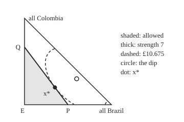
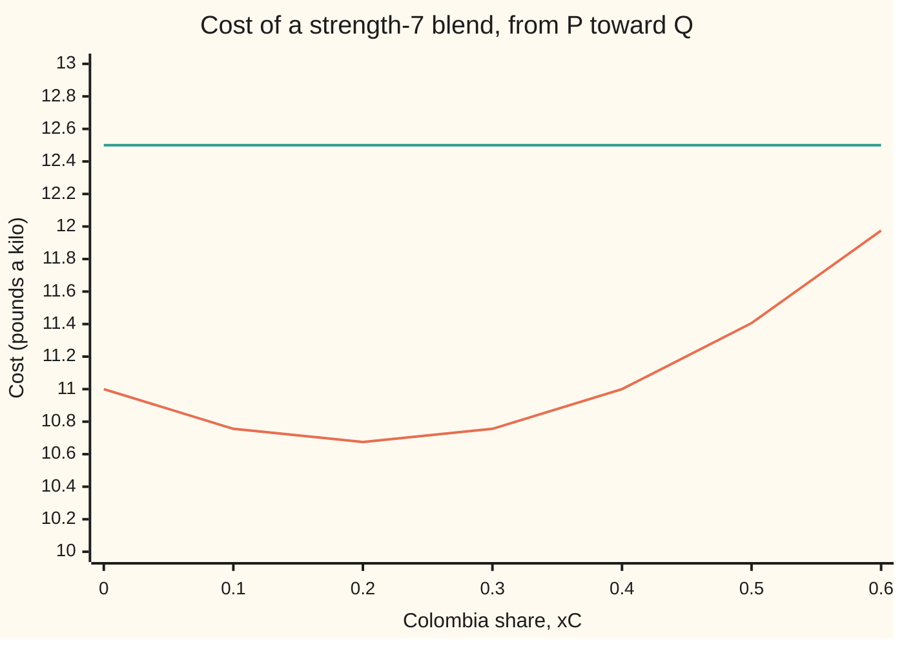

# Convexity pays off: every local bottom of a convex problem is the lowest

[Syllabus](../../../SYLLABUS.md) → [Optimization](../README.md) → [Convexity](../README.md#s01) → Convexity pays off

---

## General Overview

A small roaster makes its house coffee from three beans: Brazil, Colombia and Sumatra. It is a different shop from the roasters on the shelf's earlier cards, with its own beans and prices. It chooses the **shares**, the fraction of each kilo that comes from each bean. It wants the cheapest kilo. One rule limits it: the blend's strength score, a share-weighted average of the beans' scores of 5, 6 and 9, must reach 7.

The prices are not fixed. Each supplier starts at £6, £9 or £11 a kilo and adds 50p a kilo for every tenth of the blend it supplies, because a big order pulls from dearer stock. So the cost per kilo of blend has a dip, like a bowl. The bottom of the bowl, 60% Brazil, 30% Colombia and 10% Sumatra, costs £9.70 a kilo but scores only 5.7. That blend is too weak to sell.

A search program starts from three different blends and makes small cheaper moves until no nearby move helps. All three runs stop at the same place: **35% Brazil, 20% Colombia, 45% Sumatra, at £10.675 a kilo**. A stop like this is only a **local bottom**: nothing *close by* is cheaper. A search alone can never prove more than that ([Local and global minima](01-local-and-global-minima.md)). This card proves that, for this kind of problem, nothing *anywhere* is cheaper either. The roaster can stop searching.

**When the cost is convex and the set of allowed choices is convex, a choice that no nearby allowed choice beats is beaten by no allowed choice at all, and all the cheapest choices together form a convex set.**

**What kind of fact this is:** a theorem, proved on this card in Why it works.

### The picture: every blend, the allowed ones, and the cheapest

<p align="center"></p>

Brazil share runs across and Colombia share runs up; the Sumatra share is whatever is left. Corner E is all Sumatra. The shaded triangle E, P, Q holds every blend that reaches strength 7. The circle is the bowl's bottom, outside it. The dashed curve joins blends costing £10.675. It touches the thick strength-7 edge at one point, the dot x*, and stays outside the shaded region everywhere else.

---

## The formula

Notation first, in words. A blend is $x = (x_B, x_C, x_E)$, the Brazil, Colombia and Sumatra shares. $f(x)$ is its cost in pounds per kilo. $C$ is the **allowed set**: every blend whose shares are at least 0, add to 1 and score at least 7. A **local minimiser** $x^*$, written x* in prose, is an allowed blend with a radius $r$ around it inside which no allowed blend is cheaper, as in [Local and global minima](01-local-and-global-minima.md). $\lVert x - x^* \rVert$ is the straight-line distance between two blends.

The roaster's problem, minimised:

$$f(x) = \sum_{i \in \{B, C, E\}} \big(a_i x_i + 5x_i^2\big), \qquad C = \{x : x \ge 0,\ x_B + x_C + x_E = 1,\ 5x_B + 6x_C + 9x_E \ge 7\}$$

with base prices $a_B, a_C, a_E$ = £6, £9, £11. The theorem:

$$f(x^*) \le f(x) \text{ for every } x \in C \text{ with } \lVert x - x^* \rVert < r \quad\Longrightarrow\quad f(x^*) \le f(y) \text{ for every } y \in C$$

**Read it aloud:** if no allowed blend near x* is cheaper, then no allowed blend anywhere is cheaper, provided $f$ and $C$ are convex.

The second half of the job:

$$\operatorname*{argmin}_{x \in C} f(x) \text{ is a convex set}$$

**Read it aloud:** mix any two cheapest blends and the mix is a cheapest blend too.

The test the code uses to certify the answer, where $\nabla f(x^*)$ is the gradient, the extra cost per unit of each bean at x*:

$$\nabla f(x^*)^{\top}(y - x^*) \ge 0 \text{ for every } y \in C$$

The left side multiplies each bean's gradient entry by the change in that bean's share and adds the three products.

**Read it aloud:** starting at x*, the cost does not fall as you begin to head toward any allowed blend.

| Symbol | Plain meaning | In our example | Push it up and the answer… |
| --- | --- | --- | --- |
| $x = (x_B, x_C, x_E)$ | a blend: the three bean shares, adding to 1 | (0.35, 0.2, 0.45) at the answer | — |
| $f(x)$ | cost of a kilo of the blend, £ | £10.675 at x* | — |
| $a_i$ | bean i's base price per kilo, i being B, C or E | £6, £9, £11 | that bean's share falls |
| $C$ | the allowed set | the shaded triangle E, P, Q | a looser rule widens it; the cost can only fall |
| $x^*$ | a local minimiser: the cheapest blend nearby | (0.35, 0.2, 0.45) | — |
| $y$ | any other allowed blend | E, all Sumatra, £16.00 | — |
| $\theta$ | theta, the weight on x* when mixing it with y | 0.9 and 0.5 | the mix sits closer to x* |
| $r$, $\lVert \cdot \rVert$ | how near counts as nearby; distance between blends | any small radius | — |
| $\nabla f(x^*)$ | the gradient: cost per extra unit of each bean, at x* | (9.5, 11, 15.5), £ a kilo | — |
| $\operatorname{argmin}$ | the set of all cheapest allowed blends | x* alone; under a flat quote, the whole edge P–Q | — |
| $m$, $z$ | the least cost; a mix point used in the proof | £10.675; the 90% mix of x* and E | — |

### When it holds

- **The allowed set is convex**: the straight path between two allowed blends is allowed ([Convex sets](02-convex-sets.md)). Add a rule that each bean is left out or makes at least 40% of the blend, and all Sumatra becomes a false bottom at £16.00 while £11.00 is allowed.
- **The cost is convex**: on every straight path it lies on or below the chord ([Convex functions](03-convex-functions-and-their-tests.md)). A bulk discount, a price that falls as the order grows, bends the cost the wrong way, and the theorem no longer applies.
- **Strictly convex, for one answer.** A flat price list is convex but not strictly. Then a whole edge of blends ties at £12.50, still a convex set, but not one point.
- **Local means local among allowed points.** x* need only beat allowed blends nearby. Forbidden blends next to it, like the bowl's bottom, may be cheaper.
- **A minimiser must exist.** The theorem says nothing if no blend is cheapest. Here $C$ is closed and bounded and $f$ is continuous, so the extreme value theorem supplies one.

---

## Why it works

Without any rules, the calculus wing already proves that a convex function's local minimum is its global one, and that strict convexity allows at most one ([Convex functions](../../06-Calculus%20and%20analysis/07-Several%20Variables/09-convex-functions.md)). What is new here is the rules: the shares add to 1 and the strength must reach 7. So x* sits on the edge of the allowed set, its gradient (9.5, 11, 15.5) is not zero, and the bowl's own bottom is forbidden.

### Step 0: a cheaper blend anywhere would pull the cost down right beside x*

Suppose some allowed blend $y$ were cheaper than x*. Walk the straight path from x* toward $y$. Two facts would then make the cost fall from the very first step. Convexity of $C$ keeps the path allowed. Convexity of $f$ keeps the cost on the path at or below the straight line, the **chord**, joining the two costs. That chord falls from $f(x^*)$ toward the lower $f(y)$. So allowed blends just beside x* would be cheaper than x*, and x* would not be a local bottom. Each half of the hypothesis closes one escape route.

### Step 1: the path to any allowed blend stays allowed

Mixing x* with $y$ at weight $\theta$ gives $\theta x^* + (1 - \theta) y$. Each rule in $C$ is a straight-line inequality or equation. A weighted average of two blends that obey one obeys it too, so $C$ is convex.

In numbers, take $y$ = E, all Sumatra. The 90% mix is (0.315, 0.18, 0.505), strength 7.2. The 50% mix is (0.175, 0.1, 0.725), strength 8. Both are allowed.

### Step 2: the chord pulls the cost down, so a cheaper blend is a contradiction

The cost is convex. Each bean adds a straight line $a_i x_i$ plus an upward parabola $5x_i^2$, and a sum of convex pieces is convex ([Building convex functions](09-operations-that-preserve-convexity.md)). So on the path:

$$f\big(\theta x^* + (1 - \theta) y\big) \le \theta f(x^*) + (1 - \theta) f(y)$$

If $f(y) < f(x^*)$, the right side is below $f(x^*)$ for every $\theta < 1$. Take $\theta$ close enough to 1 and the mix lies within $r$ of x*. It is allowed and cheaper, which contradicts x* being a local bottom.

With E, which is dearer at £16.00, there is no contradiction. The 90% mix costs £10.998 under a chord of £11.208. The 50% mix costs £12.756 under a chord of £13.338. Both stay above £10.675.

<details>
<summary>Detailed proof: a local minimiser of a convex problem is global</summary>

Let $C$ be convex and $f$ convex on $C$. Let $x^* \in C$ and $r > 0$ satisfy $f(x^*) \le f(x)$ for all $x \in C$ with $\lVert x - x^* \rVert < r$.

Suppose some $y \in C$ has $f(y) < f(x^*)$. Then $y \ne x^*$. Choose $\theta$ with $\max\big(0,\ 1 - r / \lVert y - x^* \rVert\big) < \theta < 1$ and put $z = \theta x^* + (1 - \theta) y$.

Then $z \in C$ by convexity of $C$, and $\lVert z - x^* \rVert = (1 - \theta)\lVert y - x^* \rVert < r$. By convexity of $f$,

$$f(z) \le \theta f(x^*) + (1 - \theta) f(y) < \theta f(x^*) + (1 - \theta) f(x^*) = f(x^*).$$

So $z$ is an allowed point within $r$ of x* that is cheaper than x*, a contradiction. Hence $f(x^*) \le f(y)$ for every $y \in C$.

</details>

### Step 3: a certificate the code can print

A search that stops is not proof. The evidence is a slope test. For a differentiable convex function, the tangent plane lies under the graph, the tangent test of [Convex functions](03-convex-functions-and-their-tests.md):

$$f(y) \ge f(x^*) + \nabla f(x^*)^{\top}(y - x^*)$$

So if the slope from x* toward every allowed blend is at least 0, no allowed blend is cheaper. That slope is a straight-line expression in $y$, so over the triangle E, P, Q its smallest value sits at a corner. Three numbers settle it.

The gradient is $a_i + 10x_i$ for each bean: (9.5, 11, 15.5). The slope toward E is 3. The slope toward P is 0, and toward Q it is 0. None is negative, so x* is the cheapest allowed blend: optimal, with a printed certificate.

The test works in both directions. At any local minimiser the slope toward every allowed blend is at least 0, since otherwise a small step that way would be cheaper. Note what it does *not* ask for. The gradient need not be zero. It only has to point "uphill or level" along every allowed direction, and here it is level along the strength-7 edge.

### Step 4: the cheapest blends form a convex set

Let $x$ and $y$ both be cheapest, with cost $m$. Their mix is allowed by Step 1, and by Step 2 it costs at most $\theta m + (1 - \theta) m = m$. It cannot cost less than the minimum, so it costs exactly $m$: the mix is cheapest too.

With strict convexity there is only one. If $x \ne y$ were both cheapest, their midpoint would cost strictly less than $m$, which is impossible. The roaster's cost is strictly convex, because each $5x_i^2$ curves upward, so x* is the only answer.

A second supplier quotes flat prices, with no rise: £9.50, £11 and £15.50 a kilo. These are exactly the gradient at x*: the price list the rising quote looks like to a buyer standing at x*. Each flat price is 2 + 1.5 × the bean's score, so every blend costs 2 + 1.5 × its strength. The cheapest blends are then every blend of strength exactly 7: the whole edge from P to Q, all at £12.50. That edge is a segment, a convex set, as Step 4 promises. On a grid of 1/60 steps, 11 blends tie at £12.50, and every one has strength exactly 7.

### The picture: cost along the strength-7 edge



The curved line is the rising quote: one dip, at a Colombia share of 0.2, so one answer. The flat line is the flat quote: every point ties, so the cheapest set is the whole edge.

---

## Worked numbers, by hand

The strength rule must bind, since the bowl's bottom scores only 5.7. So search the edge where the strength is exactly 7. On that edge the Colombia share $x_C$ fixes the other two shares.

| Step | Arithmetic | Value |
| --- | --- | --- |
| shares on the edge | solve $x_B + x_E = 1 - x_C$ and $5x_B + 9x_E = 7 - 6x_C$ | $x_B = (2 - 3x_C)/4$, $x_E = (2 - x_C)/4$ |
| cost on the edge | put those shares into $f$ and collect terms | $11 - 3.25\,x_C + 8.125\,x_C^2$ |
| slope zero | $-3.25 + 2 \times 8.125\,x_C = 0$ | $x_C = 0.2$ |
| the blend | $x_B = (2 - 0.6)/4$, $x_E = (2 - 0.2)/4$ | (0.35, 0.2, 0.45) |
| base part of the cost | $6(0.35) + 9(0.2) + 11(0.45)$ | 8.85 |
| rise part | $5(0.35^2 + 0.2^2 + 0.45^2)$ | 1.825 |
| cost | 8.85 + 1.825 | 10.675 |
| gradient | $6 + 10(0.35)$, $9 + 10(0.2)$, $11 + 10(0.45)$ | (9.5, 11, 15.5) |
| slope toward E | $9.5(-0.35) + 11(-0.2) + 15.5(0.55)$ | 3 |
| slope toward P and toward Q | the same sum with P's and Q's shares | 0 and 0 |
| **cheapest allowed blend** | no slope negative, so the certificate holds | **35% Brazil, 20% Colombia, 45% Sumatra, £10.675 a kilo** |

The roaster pays £10.675 a kilo, more than the forbidden bowl bottom at £9.70, and the three slopes prove that no allowed blend is cheaper.

### What breaks if you drop a piece

| Mistake | Comes out at | What went wrong |
| --- | --- | --- |
| Dropping the strength rule | (0.6, 0.3, 0.1) at £9.70, strength 5.7 | The bowl's bottom lies outside $C$: cheaper, but not allowed |
| A 40% minimum order, search from all Sumatra | stuck at (0, 0, 1), £16.00 | The rule makes $C$ non-convex: every nearby blend breaks it |
| The same rule, search from (0, 0.4, 0.6) | stuck at (0, 0.6, 0.4), £12.40 | A second false bottom; the best under the rule is P at £11.00 |
| Expecting one answer under the flat quote | 11 grid blends tie at £12.50 | Convex but not strictly: the cheapest set is the whole edge P–Q |

The 40% rule shows exactly where the proof fails. All Sumatra and P are both allowed, and the 90% mix of them, (0.05, 0, 0.95), costs £15.275, below the £16.00 at E. Step 2 did its job. But that mix uses 5% Brazil, which the rule forbids. Step 1 is what broke: the path left the allowed set. The code prints all four rows.

---

## Code, from first principles, and it actually runs

Nothing is imported. The method is **compass search**: from a starting blend, try eight small moves (the six swaps of a step between two beans, and the two moves along the strength-7 edge). Take the cheapest move that stays allowed and saves money. When none does, halve the step. Stop when the step falls below one ten-millionth. It runs from corners E, P and Q, at a starting step of 0.1. Four roads then reach the answer: the search; the parabola along the edge, worked by hand; the certificate, with the gradient checked by central differences and the slope printed toward every corner; and a full count of all 6,801 allowed blends in steps of 1/200. The same tools then show the minimiser set under the flat quote and the false bottoms under the 40% rule.

### Python

```python
# Local minima are global when convex -- the check behind the card.  Nothing is
# imported.  A roaster blends Brazil, Colombia and Sumatra beans.  The shares
# x = (xB, xC, xE) add to 1, the blend's strength score must reach 7, and each
# bean's price per kilo climbs 50p for every tenth of the blend it supplies.
BASE, RISE, SCORE, NEED = (6.0, 9.0, 11.0), 5.0, (5, 6, 9), 7
FLAT = (9.5, 11.0, 15.5)                      # a second quote: flat prices, no rise
E, P, Q = (0.0, 0.0, 1.0), (0.5, 0.0, 0.5), (0.0, 2 / 3, 1 / 3)   # corners of the allowed set

def cost(x): return sum(a * v + RISE * v * v for a, v in zip(BASE, x))   # pounds a kilo
def flat(x): return sum(p * v for p, v in zip(FLAT, x))
def strength(x): return sum(s * v for s, v in zip(SCORE, x))
def allowed(x, need=NEED, least=0.0):         # least > 0: the minimum-order rule
    if min(x) < -1e-12 or strength(x) < need - 1e-12: return False
    return not any(1e-12 < v < least - 1e-12 for v in x)
def mix(x, y, th): return tuple(th * a + (1 - th) * b for a, b in zip(x, y))
def edge(c): return ((2 - 3 * c) / 4, c, (2 - c) / 4)   # strength exactly 7, Colombia share c
def show(x): return "(" + ", ".join(f"{v:.3f}" for v in x) + ")"

MOVES = [tuple(1.0 if k == i else -1.0 if k == j else 0.0 for k in range(3))
         for i in range(3) for j in range(3) if i != j]          # six swaps between two beans
MOVES += [(-0.75, 1.0, -0.25), (0.75, -1.0, 0.25)]                # two moves along strength 7

def compass(x, need=NEED, least=0.0):         # road 1: compass search, looks only nearby
    h, steps = 0.1, 0
    while h > 1e-7:
        tries = [tuple(v + h * d for v, d in zip(x, m)) for m in MOVES]
        tries = [y for y in tries if allowed(y, need, least) and cost(y) < cost(x) - 1e-15]
        if tries:
            x, steps = min(tries, key=cost), steps + 1
        else:
            h /= 2                            # nothing nearby is cheaper: look closer
    return x, steps

def grid(n, least=0.0, price=cost):           # road 4: every blend in steps of 1/n
    pts = [(i / n, j / n, (n - i - j) / n) for i in range(n + 1) for j in range(n + 1 - i)]
    pts = [x for x in pts if allowed(x, NEED, least)]
    best = min(price(x) for x in pts)
    return best, [x for x in pts if price(x) < best + 1e-9], len(pts)

print("bean prices at zero share, pounds a kilo:", BASE, f"; rise per tenth of the blend: {RISE / 10:.2f}")
print("strength scores:", SCORE, "; the blend needs at least", NEED)
print("corners of the allowed set: E", show(E), "P", show(P), "Q", show(Q))
print("cost at the corners:", f"{cost(E):.3f}, {cost(P):.3f}, {cost(Q):.3f}")
runs = []
for name, start in (("E", E), ("P", P), ("Q", Q)):
    x, n = compass(start)
    runs.append(x)
    print(f"compass search from {name}: {show(x)} cost {cost(x):.3f} after {n} moves")
xs = runs[0]
c0, c1, c2 = cost(edge(0.0)), cost(edge(1 / 3)), cost(edge(2 / 3))   # road 2: by hand on the edge
A = (c2 - 2 * c1 + c0) * 9 / 2                # cost along the edge = c0 + B c + A c^2
B = (c1 - c0) * 3 - A / 3
cv = -B / (2 * A)
print(f"along the strength-7 edge: cost = {c0:.3f} + ({B:.3f}) xC + {A:.3f} xC^2")
print(f"slope zero at xC = {cv:.3f}: blend {show(edge(cv))} cost {cost(edge(cv)):.3f}")
print(f"at x*: base part {sum(a * v for a, v in zip(BASE, xs)):.3f}, rise part "
      f"{sum(RISE * v * v for v in xs):.3f}")
g = tuple(a + 2 * RISE * v for a, v in zip(BASE, xs))   # road 3: the certificate
hd = 1e-5
gd = [(cost(tuple(v + (hd if k == i else 0) for k, v in enumerate(xs)))
       - cost(tuple(v - (hd if k == i else 0) for k, v in enumerate(xs)))) / (2 * hd) for i in range(3)]
cert = [sum(gi * (ci - xi) for gi, ci, xi in zip(g, c, xs)) for c in (E, P, Q)]
print("gradient at x*:", show(g), "; by central difference:", show(gd))
print("slope from x* toward E, P, Q:", ", ".join(f"{round(v, 9) + 0.0:.3f}" for v in cert))
best, arg, npts = grid(200)
print(f"every allowed blend in steps of 1/200: {npts} blends, cheapest {best:.3f} at {show(arg[0])}")
for th in (0.9, 0.5):                         # the chord bound on the segment from x* to E
    m = mix(xs, E, th)
    print(f"{th:.0%} x* + {1 - th:.0%} E = {show(m)}, strength {strength(m):.3f}, "
          f"cost {cost(m):.3f}, chord {th * cost(xs) + (1 - th) * cost(E):.3f}")
print(f"flat quote at P, Q, their midpoint, E: {flat(P):.3f}, {flat(Q):.3f}, "
      f"{flat(mix(P, Q, 0.5)):.3f}, {flat(E):.3f}")
print("flat quote minus 2, divided by 1.5:", show([(p - 2) / 1.5 for p in FLAT]), "= the strength scores")
fbest, ties, _ = grid(60, price=flat)
print(f"flat quote, every blend in steps of 1/60: {len(ties)} tie at {fbest:.3f}, "
      f"strengths {min(strength(x) for x in ties):.3f} to {max(strength(x) for x in ties):.3f}")
print("cost along the edge, xC = 0 to 0.6:", ", ".join(f"{cost(edge(k / 10)):.3f}" for k in range(7)))
print("flat quote along the edge:         ", ", ".join(f"{flat(edge(k / 10)):.3f}" for k in range(7)))
u, _ = compass(E, need=0)                     # what breaks 1: the strength rule dropped
gu = tuple(a + 2 * RISE * v for a, v in zip(BASE, u))   # gradient at the dip: equal entries, not zero
print(f"mistake 1, no strength rule: {show(u)} cost {cost(u):.3f}, strength {strength(u):.3f}, gradient {show(gu)}")
s1, _ = compass(E, least=0.4)                 # what breaks 2 and 3: the 40% minimum order
s2, _ = compass((0.0, 0.4, 0.6), least=0.4)
r_best, r_arg, _ = grid(200, least=0.4)
print(f"mistake 2, 40% rule, search from E: stuck at {show(s1)} cost {cost(s1):.3f}")
print(f"mistake 3, 40% rule, search from (0, 0.4, 0.6): stuck at {show(s2)} cost {cost(s2):.3f}")
print(f"40% rule, every allowed blend in steps of 1/200: cheapest {r_best:.3f} at {show(r_arg[0])}")
m = mix(E, P, 0.9)
print(f"the broken step: 90% E + 10% P = {show(m)} cost {cost(m):.3f}, "
      f"allowed under the 40% rule: {'yes' if allowed(m, NEED, 0.4) else 'no'}")
print("figure, E (0, 0), P (0.5, 0), Q (0, 0.667), x* (0.35, 0.2), dip",
      f"({u[0]:.2f}, {u[1]:.2f}), in (xB, xC)")

assert all(max(abs(a - b) for a, b in zip(r, (0.35, 0.2, 0.45))) < 1e-5 for r in runs)
assert abs(cv - 0.2) < 1e-9 and abs(cost(edge(cv)) - cost(xs)) < 1e-9      # by hand = search
assert min(cert) > -1e-6 and max(abs(a - b) for a, b in zip(g, gd)) < 1e-6  # certificate
assert abs(best - cost(xs)) < 1e-9 and arg == [(0.35, 0.2, 0.45)]          # enumeration
assert len(ties) == 11 and all(abs(strength(x) - NEED) < 1e-9 for x in ties)
assert abs(cost(u) - 9.7) < 1e-9 and strength(u) < NEED                    # the dip is not allowed
assert max(gu) - min(gu) < 1e-6 and min(gu) > 0          # its gradient: level along every swap, yet not zero
assert cost(s1) > cost(s2) > r_best + 1 and not allowed(m, NEED, 0.4) and cost(m) < cost(E)
print("ALL CHECKS PASS")
```

**Ran 2026-11-11 on macOS, Python 3.14.10, standard library only. All checks passed. Output, pasted from the run:**

```
bean prices at zero share, pounds a kilo: (6.0, 9.0, 11.0) ; rise per tenth of the blend: 0.50
strength scores: (5, 6, 9) ; the blend needs at least 7
corners of the allowed set: E (0.000, 0.000, 1.000) P (0.500, 0.000, 0.500) Q (0.000, 0.667, 0.333)
cost at the corners: 16.000, 11.000, 12.444
compass search from E: (0.350, 0.200, 0.450) cost 10.675 after 8 moves
compass search from P: (0.350, 0.200, 0.450) cost 10.675 after 2 moves
compass search from Q: (0.350, 0.200, 0.450) cost 10.675 after 24 moves
along the strength-7 edge: cost = 11.000 + (-3.250) xC + 8.125 xC^2
slope zero at xC = 0.200: blend (0.350, 0.200, 0.450) cost 10.675
at x*: base part 8.850, rise part 1.825
gradient at x*: (9.500, 11.000, 15.500) ; by central difference: (9.500, 11.000, 15.500)
slope from x* toward E, P, Q: 3.000, 0.000, 0.000
every allowed blend in steps of 1/200: 6801 blends, cheapest 10.675 at (0.350, 0.200, 0.450)
90% x* + 10% E = (0.315, 0.180, 0.505), strength 7.200, cost 10.998, chord 11.208
50% x* + 50% E = (0.175, 0.100, 0.725), strength 8.000, cost 12.756, chord 13.338
flat quote at P, Q, their midpoint, E: 12.500, 12.500, 12.500, 15.500
flat quote minus 2, divided by 1.5: (5.000, 6.000, 9.000) = the strength scores
flat quote, every blend in steps of 1/60: 11 tie at 12.500, strengths 7.000 to 7.000
cost along the edge, xC = 0 to 0.6: 11.000, 10.756, 10.675, 10.756, 11.000, 11.406, 11.975
flat quote along the edge:          12.500, 12.500, 12.500, 12.500, 12.500, 12.500, 12.500
mistake 1, no strength rule: (0.600, 0.300, 0.100) cost 9.700, strength 5.700, gradient (12.000, 12.000, 12.000)
mistake 2, 40% rule, search from E: stuck at (0.000, 0.000, 1.000) cost 16.000
mistake 3, 40% rule, search from (0, 0.4, 0.6): stuck at (0.000, 0.600, 0.400) cost 12.400
40% rule, every allowed blend in steps of 1/200: cheapest 11.000 at (0.500, 0.000, 0.500)
the broken step: 90% E + 10% P = (0.050, 0.000, 0.950) cost 15.275, allowed under the 40% rule: no
figure, E (0, 0), P (0.5, 0), Q (0, 0.667), x* (0.35, 0.2), dip (0.60, 0.30), in (xB, xC)
ALL CHECKS PASS
```

### Rust

Same numbers, same labels, built with `rustc --edition 2021 -O`.

```rust
// Local minima are global when convex -- the same check as the Python, in Rust.
// No crates.  A roaster blends Brazil, Colombia and Sumatra beans.  The shares
// x = (xB, xC, xE) add to 1, the blend's strength score must reach 7, and each
// bean's price per kilo climbs 50p for every tenth of the blend it supplies.
type X = [f64; 3];
const BASE: X = [6.0, 9.0, 11.0];
const RISE: f64 = 5.0;
const SCORE: X = [5.0, 6.0, 9.0];
const NEED: f64 = 7.0;
const FLAT: X = [9.5, 11.0, 15.5]; // a second quote: flat prices, no rise
const E: X = [0.0, 0.0, 1.0];
const P: X = [0.5, 0.0, 0.5];
const Q: X = [0.0, 2.0 / 3.0, 1.0 / 3.0]; // corners of the allowed set

fn cost(x: &X) -> f64 { (0..3).map(|i| BASE[i] * x[i] + RISE * x[i] * x[i]).sum() }
fn flat(x: &X) -> f64 { (0..3).map(|i| FLAT[i] * x[i]).sum() }
fn strength(x: &X) -> f64 { (0..3).map(|i| SCORE[i] * x[i]).sum() }
fn allowed(x: &X, need: f64, least: f64) -> bool { // least > 0: the minimum-order rule
    if x.iter().any(|&v| v < -1e-12) || strength(x) < need - 1e-12 { return false; }
    !x.iter().any(|&v| v > 1e-12 && v < least - 1e-12)
}
fn mix(x: &X, y: &X, th: f64) -> X { [0, 1, 2].map(|i| th * x[i] + (1.0 - th) * y[i]) }
fn edge(c: f64) -> X { [(2.0 - 3.0 * c) / 4.0, c, (2.0 - c) / 4.0] } // strength exactly 7
fn show(x: &X) -> String { format!("({:.3}, {:.3}, {:.3})", x[0], x[1], x[2]) }
fn list(v: &[f64]) -> String { v.iter().map(|a| format!("{:.3}", a)).collect::<Vec<_>>().join(", ") }

fn moves() -> Vec<X> {
    let mut m = Vec::new();
    for i in 0..3 { for j in 0..3 { if i != j {      // six swaps between two beans
        let mut d = [0.0; 3]; d[i] = 1.0; d[j] = -1.0; m.push(d);
    } } }
    m.push([-0.75, 1.0, -0.25]); m.push([0.75, -1.0, 0.25]); // two moves along strength 7
    m
}

fn compass(start: X, need: f64, least: f64) -> (X, usize) { // road 1: looks only nearby
    let (mut x, mut h, mut steps) = (start, 0.1, 0);
    let ms = moves();
    while h > 1e-7 {
        let mut best: Option<X> = None;
        for m in &ms {
            let y = [0, 1, 2].map(|i| x[i] + h * m[i]);
            if allowed(&y, need, least) && cost(&y) < cost(&x) - 1e-15
                && best.map_or(true, |b| cost(&y) < cost(&b)) { best = Some(y); }
        }
        match best { Some(y) => { x = y; steps += 1; } None => h /= 2.0 } // else look closer
    }
    (x, steps)
}

fn grid(n: usize, least: f64, price: fn(&X) -> f64) -> (f64, Vec<X>, usize) { // road 4
    let mut pts = Vec::new();
    for i in 0..=n { for j in 0..=(n - i) {
        let x = [i as f64 / n as f64, j as f64 / n as f64, (n - i - j) as f64 / n as f64];
        if allowed(&x, NEED, least) { pts.push(x); }
    } }
    let best = pts.iter().map(|x| price(x)).fold(f64::INFINITY, f64::min);
    let arg: Vec<X> = pts.iter().filter(|x| price(x) < best + 1e-9).cloned().collect();
    (best, arg, pts.len())
}

fn main() {
    println!("bean prices at zero share, pounds a kilo: ({:.1}, {:.1}, {:.1}) ; rise per tenth of the blend: {:.2}",
             BASE[0], BASE[1], BASE[2], RISE / 10.0);
    println!("strength scores: ({}, {}, {}) ; the blend needs at least {}", SCORE[0], SCORE[1], SCORE[2], NEED);
    println!("corners of the allowed set: E {} P {} Q {}", show(&E), show(&P), show(&Q));
    println!("cost at the corners: {}", list(&[cost(&E), cost(&P), cost(&Q)]));
    let mut runs = Vec::new();
    for (name, start) in [("E", E), ("P", P), ("Q", Q)] {
        let (x, n) = compass(start, NEED, 0.0);
        runs.push(x);
        println!("compass search from {}: {} cost {:.3} after {} moves", name, show(&x), cost(&x), n);
    }
    let xs = runs[0];
    let (c0, c1, c2) = (cost(&edge(0.0)), cost(&edge(1.0 / 3.0)), cost(&edge(2.0 / 3.0))); // road 2
    let a = (c2 - 2.0 * c1 + c0) * 9.0 / 2.0; // cost along the edge = c0 + b c + a c^2
    let b = (c1 - c0) * 3.0 - a / 3.0;
    let cv = -b / (2.0 * a);
    println!("along the strength-7 edge: cost = {:.3} + ({:.3}) xC + {:.3} xC^2", c0, b, a);
    println!("slope zero at xC = {:.3}: blend {} cost {:.3}", cv, show(&edge(cv)), cost(&edge(cv)));
    println!("at x*: base part {:.3}, rise part {:.3}", (0..3).map(|i| BASE[i] * xs[i]).sum::<f64>(),
             (0..3).map(|i| RISE * xs[i] * xs[i]).sum::<f64>());
    let g: X = [0, 1, 2].map(|i| BASE[i] + 2.0 * RISE * xs[i]); // road 3: the certificate
    let hd = 1e-5;
    let gd: X = [0, 1, 2].map(|i| {
        let (mut up, mut dn) = (xs, xs); up[i] += hd; dn[i] -= hd;
        (cost(&up) - cost(&dn)) / (2.0 * hd)
    });
    let cert: Vec<f64> = [E, P, Q].iter().map(|c| (0..3).map(|i| g[i] * (c[i] - xs[i])).sum()).collect();
    println!("gradient at x*: {} ; by central difference: {}", show(&g), show(&gd));
    let shown: Vec<f64> = cert.iter().map(|v| (v * 1e9).round() / 1e9 + 0.0).collect();
    println!("slope from x* toward E, P, Q: {}", list(&shown));
    let (best, arg, npts) = grid(200, 0.0, cost);
    println!("every allowed blend in steps of 1/200: {} blends, cheapest {:.3} at {}", npts, best, show(&arg[0]));
    for th in [0.9, 0.5] { // the chord bound on the segment from x* to E
        let m = mix(&xs, &E, th);
        println!("{:.0}% x* + {:.0}% E = {}, strength {:.3}, cost {:.3}, chord {:.3}", th * 100.0,
                 (1.0 - th) * 100.0, show(&m), strength(&m), cost(&m), th * cost(&xs) + (1.0 - th) * cost(&E));
    }
    println!("flat quote at P, Q, their midpoint, E: {}", list(&[flat(&P), flat(&Q), flat(&mix(&P, &Q, 0.5)), flat(&E)]));
    println!("flat quote minus 2, divided by 1.5: {} = the strength scores", show(&FLAT.map(|p| (p - 2.0) / 1.5)));
    let (fbest, ties, _) = grid(60, 0.0, flat);
    let st: Vec<f64> = ties.iter().map(strength).collect();
    println!("flat quote, every blend in steps of 1/60: {} tie at {:.3}, strengths {:.3} to {:.3}", ties.len(), fbest,
             st.iter().cloned().fold(f64::INFINITY, f64::min), st.iter().cloned().fold(f64::NEG_INFINITY, f64::max));
    let along: Vec<f64> = (0..7).map(|k| cost(&edge(k as f64 / 10.0))).collect();
    let along_f: Vec<f64> = (0..7).map(|k| flat(&edge(k as f64 / 10.0))).collect();
    println!("cost along the edge, xC = 0 to 0.6: {}", list(&along));
    println!("flat quote along the edge:          {}", list(&along_f));
    let (u, _) = compass(E, 0.0, 0.0); // what breaks 1: the strength rule dropped
    let gu: X = [0, 1, 2].map(|i| BASE[i] + 2.0 * RISE * u[i]); // gradient at the dip: equal entries, not zero
    println!("mistake 1, no strength rule: {} cost {:.3}, strength {:.3}, gradient {}", show(&u), cost(&u), strength(&u), show(&gu));
    let (s1, _) = compass(E, NEED, 0.4); // what breaks 2 and 3: the 40% minimum order
    let (s2, _) = compass([0.0, 0.4, 0.6], NEED, 0.4);
    let (r_best, r_arg, _) = grid(200, 0.4, cost);
    println!("mistake 2, 40% rule, search from E: stuck at {} cost {:.3}", show(&s1), cost(&s1));
    println!("mistake 3, 40% rule, search from (0, 0.4, 0.6): stuck at {} cost {:.3}", show(&s2), cost(&s2));
    println!("40% rule, every allowed blend in steps of 1/200: cheapest {:.3} at {}", r_best, show(&r_arg[0]));
    let m = mix(&E, &P, 0.9);
    println!("the broken step: 90% E + 10% P = {} cost {:.3}, allowed under the 40% rule: {}", show(&m), cost(&m),
             if allowed(&m, NEED, 0.4) { "yes" } else { "no" });
    println!("figure, E (0, 0), P (0.5, 0), Q (0, 0.667), x* (0.35, 0.2), dip ({:.2}, {:.2}), in (xB, xC)", u[0], u[1]);

    assert!(runs.iter().all(|r| (0..3).all(|i| (r[i] - [0.35, 0.2, 0.45][i]).abs() < 1e-5)));
    assert!((cv - 0.2).abs() < 1e-9 && (cost(&edge(cv)) - cost(&xs)).abs() < 1e-9); // by hand = search
    assert!(cert.iter().all(|&v| v > -1e-6) && (0..3).all(|i| (g[i] - gd[i]).abs() < 1e-6)); // certificate
    assert!((best - cost(&xs)).abs() < 1e-9 && arg == vec![[0.35, 0.2, 0.45]]); // enumeration
    assert!(ties.len() == 11 && ties.iter().all(|x| (strength(x) - NEED).abs() < 1e-9));
    assert!((cost(&u) - 9.7).abs() < 1e-9 && strength(&u) < NEED); // the dip is not allowed
    let (gmin, gmax) = (gu.iter().cloned().fold(f64::INFINITY, f64::min), gu.iter().cloned().fold(f64::NEG_INFINITY, f64::max));
    assert!(gmax - gmin < 1e-6 && gmin > 0.0); // its gradient: level along every swap, yet not zero
    assert!(cost(&s1) > cost(&s2) && cost(&s2) > r_best + 1.0 && !allowed(&m, NEED, 0.4) && cost(&m) < cost(&E));
    println!("ALL CHECKS PASS");
}
```

**Ran 2026-11-11 on macOS, rustc 1.98.1, no crates. All checks passed. Output, pasted from the run:**

```
bean prices at zero share, pounds a kilo: (6.0, 9.0, 11.0) ; rise per tenth of the blend: 0.50
strength scores: (5, 6, 9) ; the blend needs at least 7
corners of the allowed set: E (0.000, 0.000, 1.000) P (0.500, 0.000, 0.500) Q (0.000, 0.667, 0.333)
cost at the corners: 16.000, 11.000, 12.444
compass search from E: (0.350, 0.200, 0.450) cost 10.675 after 8 moves
compass search from P: (0.350, 0.200, 0.450) cost 10.675 after 2 moves
compass search from Q: (0.350, 0.200, 0.450) cost 10.675 after 24 moves
along the strength-7 edge: cost = 11.000 + (-3.250) xC + 8.125 xC^2
slope zero at xC = 0.200: blend (0.350, 0.200, 0.450) cost 10.675
at x*: base part 8.850, rise part 1.825
gradient at x*: (9.500, 11.000, 15.500) ; by central difference: (9.500, 11.000, 15.500)
slope from x* toward E, P, Q: 3.000, 0.000, 0.000
every allowed blend in steps of 1/200: 6801 blends, cheapest 10.675 at (0.350, 0.200, 0.450)
90% x* + 10% E = (0.315, 0.180, 0.505), strength 7.200, cost 10.998, chord 11.208
50% x* + 50% E = (0.175, 0.100, 0.725), strength 8.000, cost 12.756, chord 13.338
flat quote at P, Q, their midpoint, E: 12.500, 12.500, 12.500, 15.500
flat quote minus 2, divided by 1.5: (5.000, 6.000, 9.000) = the strength scores
flat quote, every blend in steps of 1/60: 11 tie at 12.500, strengths 7.000 to 7.000
cost along the edge, xC = 0 to 0.6: 11.000, 10.756, 10.675, 10.756, 11.000, 11.406, 11.975
flat quote along the edge:          12.500, 12.500, 12.500, 12.500, 12.500, 12.500, 12.500
mistake 1, no strength rule: (0.600, 0.300, 0.100) cost 9.700, strength 5.700, gradient (12.000, 12.000, 12.000)
mistake 2, 40% rule, search from E: stuck at (0.000, 0.000, 1.000) cost 16.000
mistake 3, 40% rule, search from (0, 0.4, 0.6): stuck at (0.000, 0.600, 0.400) cost 12.400
40% rule, every allowed blend in steps of 1/200: cheapest 11.000 at (0.500, 0.000, 0.500)
the broken step: 90% E + 10% P = (0.050, 0.000, 0.950) cost 15.275, allowed under the 40% rule: no
figure, E (0, 0), P (0.5, 0), Q (0, 0.667), x* (0.35, 0.2), dip (0.60, 0.30), in (xB, xC)
ALL CHECKS PASS
```

The two outputs match line for line.

> [!TIP]
> **Try changing**
> Guess first, then run it. An assert is a line that stops the program if a number comes out wrong; these are pinned to the roaster's answer.
> - **Take away the edge moves.** Delete the two moves along strength 7 from `MOVES`. The problem is still convex, but the search stalls on the edge at £10.735 from E and P, and at £10.711 from Q. A stall is not a local bottom: the search simply has no move that stays allowed. The first assert stops it.
> - **Relax the rule.** Set `NEED` to 5.5. The bowl's bottom is now allowed: all three runs reach (0.6, 0.3, 0.1) at £9.70, and the gradient there is (12, 12, 12), so every slope is 0. The first assert stops it.
> - **Soften the minimum order.** Change `least=0.4` to `least=0.3` in the search from E. It still sticks at all Sumatra, £16.00. The trap holds while the gap is wider than the search's first step of 0.1: at `least=0.1` the first swap of 0.1 is allowed, the search escapes to x* at £10.675, and the last assert stops the run.

---

## The usual mistake

> [!warning]
> **Checking for a zero gradient on a problem with rules.** At x* the gradient is (9.5, 11, 15.5), nowhere near zero, yet x* is the cheapest allowed blend. No blend here has a zero gradient: each entry is a base price plus 10 times a share, so at least 6. Even the bowl's bottom, (0.6, 0.3, 0.1) at £9.70, has gradient (12, 12, 12): the shares must add to 1, and with equal entries, moving share from one bean to another neither saves nor costs. The right test asks only that no allowed direction goes downhill: slopes of 3, 0 and 0 toward the corners.
>
> - **Trusting a local answer when the allowed set has gaps.** Under the 40% rule, a search from all Sumatra stops at £16.00 and one from (0, 0.4, 0.6) stops at £12.40. The best is £11.00.
> - **Reading "convex" as "one answer".** Under the flat quote, 11 grid blends tie at £12.50. Only strict convexity gives one point.
> - **Taking a stalled search for a local bottom.** Without moves along the edge, compass search stops at £10.735, which is not even locally cheapest. The theorem covers true local bottoms, not every place a method happens to stop.

---

## Where you meet it in real life

- **Feed and food blending.** Mills and roasters choose ingredient shares to meet nutrient or taste limits at least cost. Linear limits make the allowed set convex, and with a linear or convex cost a solver's local answer is the answer.
- **Solver reports.** A convex solver prints "optimal" with a certificate. A general nonlinear solver prints "locally optimal", and on a non-convex problem the difference is real money.
- **Portfolios.** The least-risk portfolio for a target return is a convex problem, so any local answer is the frontier point ([The efficient frontier](../../12-Financial%20mathematics/37-Portfolio%20Theory/02-efficient-frontier-and-minimum-variance.md)).
- **Fitting models to data.** Least squares and logistic regression have convex losses, so training that stops at any bottom has found the best fit.

> **Say it back**
> A local bottom beats only the allowed choices close to it. If the allowed set is convex and the cost is convex, a cheaper choice anywhere would drag the cost down along the straight path to it, right next to the local bottom, which is impossible. So the roaster's 35% Brazil, 20% Colombia, 45% Sumatra blend at £10.675 a kilo is the cheapest allowed blend, and slopes of 3, 0 and 0 toward the corners certify it. Mix two cheapest choices and you get another, so the cheapest set is convex; with a flat quote it is a whole edge at £12.50. Break convexity, with a 40% minimum order, and false bottoms appear at £16.00 and £12.40.

---

## What this builds on

- [Convex functions](03-convex-functions-and-their-tests.md): the chord and tangent-plane inequalities, used in Steps 2 and 3.
- [Convex functions](../../06-Calculus%20and%20analysis/07-Several%20Variables/09-convex-functions.md): local is global with no rules at all, and strict convexity allowing one minimiser.

## Where this goes next

- [The standard convex problem](10-the-convex-problem-in-standard-form.md): writes every such problem in one form, with convex costs, convex limits and straight-line equations, so this card's guarantee applies to all of them.

The certificate here needed only three corners. How to certify an answer when the allowed set is cut out by curved limits, with no corners to list, is the question this card leaves open.

---

## Sources

Verified 2026-11-11: every link below resolves to the publisher's page.

- Boyd, Stephen, and Lieven Vandenberghe. *Convex Optimization*. Cambridge University Press, 2004. [doi:10.1017/CBO9780511804441](https://doi.org/10.1017/CBO9780511804441). Section 4.2 proves that a local optimum of a convex problem is global, that the optimal set is convex, and the gradient test of Step 3.
- Rockafellar, R. Tyrrell. *Convex Analysis*. Princeton University Press, 1970. [doi:10.1515/9781400873173](https://doi.org/10.1515/9781400873173). The classic treatment of minimising a convex function over a convex set.
- Nocedal, Jorge, and Stephen J. Wright. *Numerical Optimization*, 2nd ed. Springer, 2006. [doi:10.1007/978-0-387-40065-5](https://doi.org/10.1007/978-0-387-40065-5). States local-is-global for convex functions and the gap between local and global answers in general.
- Kolda, Tamara G., Robert Michael Lewis, and Virginia Torczon. "Optimization by Direct Search: New Perspectives on Some Classical and Modern Methods." *SIAM Review* 45, no. 3 (2003). [doi:10.1137/S003614450242889](https://doi.org/10.1137/S003614450242889). Compass search, and why its moves must include directions along the edges of linear limits.
