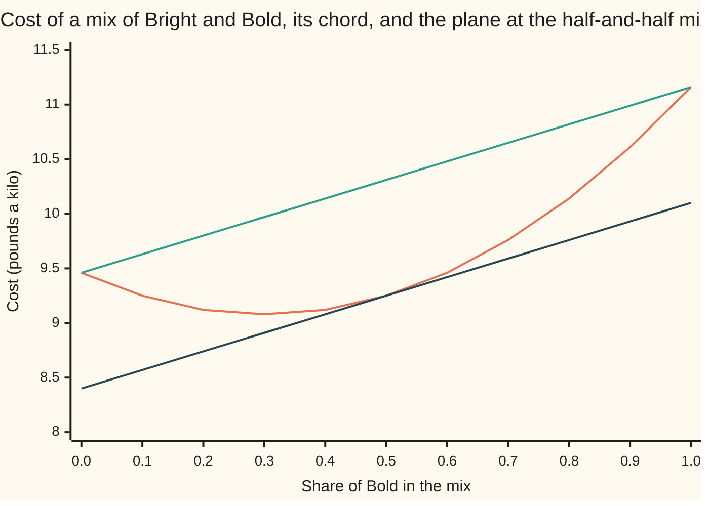

# Jensen's inequality: averaging inside a bowl beats averaging outside

[Syllabus](../../../SYLLABUS.md) → [Optimization](../README.md) → [Convexity](../README.md#s01) → Jensen's inequality

---

## General Overview

A roaster sells two house blends of three beans. **Bold** is 70% Brazil, 10% Colombia and 20% Ethiopia. **Bright** is 30% Brazil, 40% Colombia and 30% Ethiopia. Each blend's cost per kilo has two parts: the beans, at £7, £9 and £12 a kilo, and a taste penalty for missing the house targets of strength 6 and acidity 5. The penalty is the roaster's estimate of the sales a blend loses by missing them, in pounds a kilo. With that cost, Bold comes to £11.16 a kilo and Bright to £9.46.

A café orders the two blends mixed half and half. Before costing the mix, the roaster wants a quick ceiling on its cost. The obvious guess is the average of the two prices, £10.31. The true cost is £9.25, cheaper than either blend. Bold is too strong and too flat, Bright a little sharp, and in the mix the misses partly cancel.

That is no accident of these two blends. The cost here is **convex**, bowl-shaped: every chord (straight segment) between two points of its graph lies on or above the graph ([Convex functions](03-convex-functions-and-their-tests.md)). For any convex cost, a mix costs at most the same mix of the costs. The same fact read the other way gives a floor. When a week's batches wander around a recipe, their average cost is at least the recipe's cost. This card proves both readings in several variables, from one tool: a flat plane that touches the cost at the mix and stays under it everywhere.

**For a convex cost, the cost of an average blend is at most the average of the blends' costs, because a plane touching the bowl at the average stays under it everywhere and passes through averages unchanged.**

**What kind of fact this is:** a theorem, proved on this card in Why it works: a supporting plane exists at every inside point of a convex function's domain, crease or not, and Jensen's inequality follows in one line. The blend cost itself is a model, a stated assumption about one roaster, not a law.

### The picture: the cost along the line from Bright to Bold



Orange is the true cost of each mix, from all Bright on the left to all Bold on the right. Green is the chord, the straight line between the two blends' costs: at the half-and-half mix it reads £10.31, the average of the prices. Dark blue is the supporting plane at the half-and-half mix, seen along this line: it touches the cost at £9.25 and stays under it. The cost curve sits under the chord and over the plane, and that is the whole card.

---

## The formula

Notation first, in words. A blend is written $z = (x, y)$: $x$ is the Brazil share, $y$ the Colombia share, and Ethiopia makes up the rest, $1 - x - y$. Weights $\theta_i$ (theta) are shares of a mix: each at least 0, all adding to 1. Mixing blends $z_1, z_2, \dots$ with those weights gives the average blend $m = \sum_i \theta_i z_i$, as on [Convex sets](02-convex-sets.md).

The roaster's cost, in pounds a kilo:

$$f(x, y) = \underbrace{7x + 9y + 12(1 - x - y)}_{\text{beans}} + (S - 6)^2 + (A - 5)^2$$

with strength $S = 8x + 6y + 4(1 - x - y)$ and acidity $A = 2x + 6y + 8(1 - x - y)$, each bean's score weighted by its share.

**Read it aloud:** what the beans cost, plus the square of the miss on strength, plus the square of the miss on acidity.

The theorem has two halves. A **supporting plane** at $m$ is a flat function $\ell(z) = f(m) + s \cdot (z - m)$ that touches the cost at $m$ and never rises above it:

$$f(z) \;\ge\; f(m) + s \cdot (z - m) \quad \text{for every blend } z$$

**Read it aloud:** the cost anywhere is at least the cost at $m$ plus the slopes times the step away from $m$.

The vector $s$ holds one slope per share; $s \cdot (z - m)$ multiplies each slope by the step in its share and adds. Where $f$ is smooth, $s$ is the gradient $\nabla f(m)$, and the inequality is the gradient test of [Convex functions](03-convex-functions-and-their-tests.md). The new claim is that a plane exists at every inside point, creases included. Jensen's inequality then follows:

$$f\Big(\sum_i \theta_i z_i\Big) \;\le\; \sum_i \theta_i f(z_i)$$

**Read it aloud:** the cost of the average blend is at most the average of the blends' costs.

| Symbol | Plain meaning | In our example | Push it up and the answer… |
| --- | --- | --- | --- |
| $x$, $y$ | Brazil and Colombia shares; Ethiopia is $1 - x - y$ | 0.5 and 0.25 in the mix | — |
| $z$, $z_i$ | a blend as the pair $(x, y)$; the $i$-th blend being mixed | Bold (0.7, 0.1), Bright (0.3, 0.4) | — |
| $\theta_i$ | weight of blend $i$ in the mix, at least 0, all adding to 1 | ½ and ½; ⅕ per batch in the week | the mix moves toward that blend |
| $m$ | the average blend, $\sum_i \theta_i z_i$ | (0.5, 0.25) | — |
| $f$ | cost per kilo: beans plus taste penalty, in pounds | £9.25 at $m$ | — |
| $S$, $A$ | strength and acidity scores of a blend | 6.5 and 4.5 at $m$; targets 6 and 5 | a bigger miss, a squared penalty |
| $\ell$, $s$ | a supporting plane at $m$, and its slope vector | $\ell(z) = 9.25 + 5(x - 0.5) + 1(y - 0.25)$ | a crease allows a range of $s$ |
| $\nabla f$ | gradient: the slope in each share at a point | (5, 1) at $m$ | — |
| $\nabla^2 f$ | Hessian: the table of second slopes | `[[104, 40], [40, 16]]` everywhere | a deeper bowl, a bigger gap |
| $d$, $d_i$ | a step between blends, or from $m$ to blend $i$ | Bold minus Bright: (0.4, −0.3) | the gap grows with its square |
| $\lambda$ | in Step 3, where a plane sits in the range at a crease | 0 to 1 | — |
| $C$, $n$, $v$, $t$, $p(v)$, $\varphi$, $r$, $c$, $u$, $w$ | in the Detailed proof only: an open convex set of points and their number of coordinates; a direction, a step length, the slope along $v$, a slope rule built one direction at a time, a new direction, its chosen slope, two points of the directions done so far | — | — |

The gradient (5, 1) says that at the mix, swapping one percentage point of Ethiopia for Brazil adds 5p a kilo, and one point for Colombia adds 1p.

### When it holds

- **The cost is convex on a convex set of blends.** A market that pays for two styles, strength 6 or strength 7, and charges no acidity penalty, makes the cost dip twice; then the mix of Bold and Bright costs £9.75, above the average £8.75 (What breaks, row 1).
- **The average is an inside point.** The plane argument needs room on every side of $m$. At the edge of a domain a plane can fail: minus the square root of $x$, at $x = 0$, falls with infinite slope, so no plane fits. Jensen still holds there, by the endpoint argument in part 1 of the proof on the measure wing's [Jensen's inequality](../../10-Measure%20and%20integration/07-Sizes%20of%20Functions/04-jensens-inequality.md).
- **The weights are true shares.** They must be at least 0 and add to 1, or the plane's average no longer equals $f(m)$ (Step 0). Weights 0.4 and 0.4 give a real blend, (0.40, 0.20), at £9.44, above 0.4 × £11.16 + 0.4 × £9.46 = £8.25. A negative weight flips its term of the inequality.
- **It bounds; it does not measure.** Jensen says which side is larger. The size of the gap needs more: here, the Hessian and the spread of the blends (Step 4).

---

## Why it works

### Step 0: a flat plane passes through averages unchanged

For a flat function, the average of its values is its value at the average: $\sum_i \theta_i\,\ell(z_i) = \ell(m)$, because the weights add to 1 and the steps $z_i - m$ average to zero. Only a bend breaks that swap. So slide a plane under the bowl, touching at $m$, and let the plane do the averaging. In one variable this is already proved with a supporting line ([Jensen's inequality](../../09-Probability%20and%20statistics/02-Random%20Variables/06-jensens-inequality.md)), on any space of total size 1 ([Jensen's inequality](../../10-Measure%20and%20integration/07-Sizes%20of%20Functions/04-jensens-inequality.md)), and for finite lists by induction from the chord rule ([Convex functions](../../06-Calculus%20and%20analysis/07-Several%20Variables/09-convex-functions.md)). New here is the plane in several variables.

### Step 1: where the cost is smooth, the tangent plane supports it

At the mix, strength misses by +0.5 and acidity by −0.5. The chain rule gives the gradient: the beans contribute (−5, −3), the strength penalty $2(S - 6)(4, 2) = (4, 2)$, the acidity penalty $2(A - 5)(-6, -2) = (6, 2)$. Total: (5, 1).

The tangent plane is $\ell(z) = 9.25 + 5(x - 0.5) + 1(y - 0.25)$. For this cost, the cost minus the plane is exactly the bowl's curvature term, half of $d^{\top}\,\nabla^2 f\,d$ with $d = z - m$. Here $d^{\top}\,\nabla^2 f\,d$ (written d'Hd in the code) multiplies the Hessian by the step on both sides: each entry of the Hessian times the two parts of $d$ it pairs, all added. The Hessian `[[104, 40], [40, 16]]` has determinant 64 and trace 120, both positive, so that term is positive for every step $d \ne 0$. That is the gradient test of [Convex functions](03-convex-functions-and-their-tests.md).

The code checks it two ways. Against this plane on 5,151 blends, the smallest gap is 0, at the mix itself. With the tangent plane at each of 231 blends, in steps of 5 percentage points, against the other 230, none rises above the cost.

### Step 2: average the plane

The cost lies on or above the plane at each blend, so the average cost lies on or above the average of the plane. By Step 0, the plane averages to its value at the mix:

$$\sum_i \theta_i f(z_i) \;\ge\; \sum_i \theta_i\,\ell(z_i) \;=\; f(m) + s \cdot \Big(\sum_i \theta_i z_i - m\Big) \;=\; f(m).$$

The slope term vanishes because the blends average to $m$. That is Jensen's inequality, in any number of shares. For Bold and Bright the plane reads £10.10 and £8.40, the costs £11.16 and £9.46, and the plane's average is £9.25, the cost of the mix.

### Step 3: a crease still has a supporting plane

Suppose the Ethiopian supplier adds a surcharge: £4 a kilo for each whole share of Ethiopia above 25%, so 4p for each percentage point. The mix holds exactly 25% Ethiopia, so the cost now has a crease (a fold with no single tangent) running through the mix. Bold, at 20% Ethiopia, still costs £11.16; Bright, at 30%, now costs £9.66; the mix still costs £9.25, against an average of £10.41.

At a crease the plane is not unique. The surcharge is flat on one side of the fold and slopes by −4 per share in both $x$ and $y$ on the other, so any slope vector $s = (5 - 4\lambda,\ 1 - 4\lambda)$ with $\lambda$ between 0 and 1 gives a supporting plane. The code tries (5, 1), (3, −1) and (1, −3): each stays under the creased cost on all 5,151 blends. A slope just outside the range, (0, −4), rises 0.1388 above it somewhere. The set of all such slopes is the subject of [Subgradients](07-subgradients.md).

Why must some plane exist at every inside point, smooth or not? Along any direction from $m$ the cost is a one-variable convex curve, so it has a slope to the right of $m$ and a slope to the left, and the left slope never exceeds the right ([Jensen's inequality](../../09-Probability%20and%20statistics/02-Random%20Variables/06-jensens-inequality.md) proves this for one variable). The proof then picks the plane's slopes one direction at a time, each squeezed between what the earlier choices allow. Two shares need two choices.

<details>
<summary>Detailed proof: a supporting plane at every inside point</summary>

**Setting.** $C$ is an open convex set of points with $n$ coordinates, $f$ is convex on $C$, and $m$ is in $C$. Claim: some vector $s$ gives $f(z) \ge f(m) + s \cdot (z - m)$ for every $z$ in $C$.

**1. Slopes along a direction.** Fix a direction $v$. The ratio $(f(m + tv) - f(m))/t$ never increases as $t > 0$ shrinks, by the chord rule on the line through $m$ (a convex curve's chord slopes rise from left to right). It is bounded below by minus the same ratio for $-v$, since left slopes never exceed right slopes. So it has a limit as $t$ shrinks to 0, the slope along $v$, written $p(v)$. And because the ratio only falls as $t$ shrinks, its value at $t = 1$ is at least the limit: $f(m + v) - f(m) \ge p(v)$ whenever $m + v$ is in $C$.

**2. Two rules for $p$.** Scaling: $p(cv) = c\,p(v)$ for $c > 0$, by substituting $ct$ for $t$. Splitting: $p(u + w) \le p(u) + p(w)$, because $m + t(u + w)$ is the midpoint of $m + 2tu$ and $m + 2tw$, so the chord rule gives $f(m + t(u + w)) \le \tfrac12 f(m + 2tu) + \tfrac12 f(m + 2tw)$; subtract $f(m)$, divide by $t$ and let $t$ shrink. Also $p(0) = 0$.

**3. Choose slopes one direction at a time.** We build a slope rule $\varphi$ (phi), adding up slopes times steps, with $\varphi(v) \le p(v)$ for every $v$. Start with no directions: $\varphi(0) = 0 \le p(0)$. Suppose $\varphi$ is defined on every combination of the first few coordinate directions, with $\varphi \le p$ there, and add a new direction $r$. For any two such combinations $u$ and $w$, the splitting rule gives $\varphi(u) + \varphi(w) = \varphi(u + w) \le p(u + w) \le p(u - r) + p(w + r)$, so
$$\varphi(u) - p(u - r) \;\le\; p(w + r) - \varphi(w).$$
Every left side is at most every right side, so some number $c$ lies between them all. Set the slope along $r$ to $c$. Then for $t > 0$, scaling and the right-hand inequality with $w = u/t$ give $\varphi(u) + tc \le p(u + t\,r)$; for $t < 0$ the left-hand inequality with $u/\lvert t \rvert$ gives the same. So $\varphi \le p$ still holds with $r$ added. After $n$ directions, $\varphi(v) = s \cdot v$ for one vector $s$.

**4. The plane.** For $z$ in $C$, put $v = z - m$. By parts 1 and 3, $f(z) - f(m) \ge p(v) \ge s \cdot (z - m)$.

**5. Jensen.** For blends $z_i$ in $C$ with weights $\theta_i$, the average $m$ is in $C$ because $C$ is convex. Write part 4 at each $z_i$, multiply by $\theta_i$, add, and use $\sum_i \theta_i (z_i - m) = 0$.

</details>

### Step 4: the size of the gap, for a quadratic bowl

For this cost the gap has an exact size. The cost minus its tangent plane is half of $d^{\top}\,\nabla^2 f\,d$, so the Jensen gap is half the weighted average of that curvature term over the steps from $m$. Two blends at weight ½ sit half a step $d$ either side of the mix, so the gap is $d^{\top}\,\nabla^2 f\,d / 8$. With $d$ = Bold minus Bright = (0.4, −0.3), that is 8.48 / 8 = 1.06: the £10.31 average minus the £9.25 mix.

The bean cost is flat, so it contributes nothing to the gap. All of the £1.06 comes from the curved taste penalty.

---

## Worked numbers, by hand

The mix: 50% Brazil, 25% Colombia, 25% Ethiopia.

| Step | Arithmetic | Value |
| --- | --- | --- |
| Bold: beans, strength, acidity | 4.90 + 0.90 + 2.40; 5.6 + 0.6 + 0.8; 1.4 + 0.6 + 1.6 | 8.20, 7.00, 3.60 |
| Bold: cost | 8.20 + (7 − 6)² + (3.6 − 5)² = 8.20 + 2.96 | **11.16** |
| Bright: cost | 9.30 + (6 − 6)² + (5.4 − 5)² = 9.30 + 0.16 | **9.46** |
| average of the two costs | (11.16 + 9.46) / 2 | 10.31 |
| the mix: beans, strength, acidity | 3.50 + 2.25 + 3.00; 4 + 1.5 + 1; 1 + 1.5 + 2 | 8.75, 6.50, 4.50 |
| the mix: cost | 8.75 + 0.5² + 0.5² | **9.25** |
| gap | 10.31 − 9.25 | **1.06** |
| gap by the Hessian | (104 × 0.16 − 80 × 0.12 + 16 × 0.09) / 8 = 8.48 / 8 | 1.06 |
| plane at Bold | 9.25 + 5 × 0.2 + 1 × (−0.15) | 10.10 |
| plane at Bright | 9.25 + 5 × (−0.2) + 1 × 0.15 | 8.40 |
| plane's average | (10.10 + 8.40) / 2 | **9.25** |

The half-and-half mix costs £9.25 a kilo, £1.06 under the average of the two prices, and the plane at the mix proves it can never come out above that average.

### Using it as a floor: a week of batches

The roaster makes the mix by hand once a day. Each batch misses the recipe by up to 5 percentage points in Brazil and Colombia, Ethiopia taking up the difference, and over the week the misses cancel.

| Batch | Miss (Brazil, Colombia), in points | Cost, £/kg |
| --- | --- | --- |
| 1 | (+5, −5) | 9.50 |
| 2 | (−5, 0) | 9.13 |
| 3 | (0, +5) | 9.32 |
| 4 | (+5, +5) | 9.80 |
| 5 | (−5, −5) | 9.20 |
| **average** | the blends average to the recipe | **9.39** |

Jensen gives the floor before the week starts, from the recipe alone: the average cost is at least £9.25. The true average is £9.39. The £0.14 difference is what the wandering costs, and Step 4 predicts it exactly: half the average of $d^{\top}\,\nabla^2 f\,d$ over the five misses is 0.14. The floor needs only the recipe; the gap needs the spread as well.

### What breaks if you drop a piece

| Mistake | Comes out at | What went wrong |
| --- | --- | --- |
| A cost that is not convex: the market pays for strength 6 or strength 7, penalty 4 × the smaller squared miss, and no acidity penalty | mix £9.75, above the average £8.75 of Bold £8.20 and Bright £9.30 | the mix lands between the two dips; no plane through the mix's cost fits under both blends |
| Costing on beans alone | mix £8.75, exactly the average £8.75 | a flat cost passes averages through unchanged; it misses the true £9.25 mix and the £9.39 week |
| Reading the recipe's cost as a ceiling on the week | £9.25 promised, £9.39 cost, penalty included | Jensen runs the other way: the recipe's cost is a floor |

The code prints every number in the table.

---

## Code, from first principles, and it actually runs

The code costs the blends, then reaches the gap and the floor by three roads. Road 1 costs Bold, Bright and the mix directly. Road 2 builds the supporting plane from the chain-rule gradient, checks it against a central difference (the cost a small step ahead minus a small step behind, over twice the step), and checks the plane stays under the cost on 5,151 blends. Road 3 gets the gap from the Hessian alone, which is itself checked by second differences, and matches the week's average. Then the creased cost is tested with four slope vectors, weights adding to 0.8 are tried, and the three mistakes are printed.

### Python

```python
# Jensen's inequality and supporting planes -- the check behind the card.  Standard
# library only.  A blend is (x, y): the Brazil and Colombia shares, Ethiopia the rest.
# Cost in pounds a kilo = the beans + a taste penalty for missing strength 6, acidity 5.
def parts(x, y):                       # bean cost, strength score, acidity score
    e = 1 - x - y
    return 7 * x + 9 * y + 12 * e, 8 * x + 6 * y + 4 * e, 2 * x + 6 * y + 8 * e
def cost(x, y):
    b, s, a = parts(x, y)
    return b + (s - 6) ** 2 + (a - 5) ** 2
def grad(x, y):                        # the gradient, by the chain rule
    _, s, a = parts(x, y)
    return (-5 + 8 * (s - 6) - 12 * (a - 5), -3 + 4 * (s - 6) - 4 * (a - 5))
HESS = [[104, 40], [40, 16]]           # 2(g g' + h h'), g = (4, 2), h = (-6, -2)
def quad(dx, dy):                      # d' H d
    return HESS[0][0] * dx * dx + 2 * HESS[0][1] * dx * dy + HESS[1][1] * dy * dy
def plane(m, s, x, y):                 # supporting plane at m with slopes s
    return cost(*m) + s[0] * (x - m[0]) + s[1] * (y - m[1])
def grid(step):                        # every blend with shares on the grid
    n = round(1 / step)
    return [(i / n, j / n) for i in range(n + 1) for j in range(n + 1 - i)]
def surcharge(x, y): return cost(x, y) + 4 * max(0.0, (1 - x - y) - 0.25)
def two_style(x, y):                   # NOT convex: two strengths are paid for
    b, s, _ = parts(x, y)
    return b + 4 * min((s - 6) ** 2, (s - 7) ** 2)
f2 = lambda v: f"{v:.2f}"
f4 = lambda v: f"{0.0 if abs(v) < 1e-12 else v:.4f}"   # no "-0.0000" from rounding noise
BOLD, BRIGHT = (0.7, 0.1), (0.3, 0.4)
MIX = ((BOLD[0] + BRIGHT[0]) / 2, (BOLD[1] + BRIGHT[1]) / 2)
print("beans in pounds a kilo: Brazil 7, Colombia 9, Ethiopia 12; targets: strength 6, acidity 5")
print(f"{'blend':<14}{'Brazil':>7}{'Colomb':>7}{'Ethiop':>7}{'beans':>7}{'strgth':>7}"
      f"{'acid':>7}{'penalty':>8}{'cost':>7}")
for name, z in [("Bold", BOLD), ("Bright", BRIGHT), ("half and half", MIX)]:
    b, s, a = parts(*z)
    print(f"{name:<14}" + "".join(f"{v:>7.2f}" for v in (z[0], z[1], 1 - z[0] - z[1], b, s, a))
          + f"{cost(*z) - b:>8.2f}{cost(*z):>7.2f}")
avg2 = (cost(*BOLD) + cost(*BRIGHT)) / 2                   # road 1: cost the blends
d = (BOLD[0] - BRIGHT[0], BOLD[1] - BRIGHT[1])
print(f"average of the two costs {f2(avg2)}; cost of the mix {f2(cost(*MIX))}; "
      f"gap {f2(avg2 - cost(*MIX))}; by the Hessian, d = ({f2(d[0])}, {f2(d[1])}), d'Hd = {f2(quad(*d))}, /8 = {f2(quad(*d) / 8)}")
h = 1e-5                                                   # road 2: the plane
gn = ((cost(MIX[0] + h, MIX[1]) - cost(MIX[0] - h, MIX[1])) / (2 * h),
      (cost(MIX[0], MIX[1] + h) - cost(MIX[0], MIX[1] - h)) / (2 * h))
g = grad(*MIX)
print(f"gradient at the mix, formula ({f2(g[0])}, {f2(g[1])}); central difference "
      f"({f2(gn[0])}, {f2(gn[1])})")
k = 1e-3
def second(i, j):
    def at(a, b): return cost(MIX[0] + a, MIX[1] + b)
    e = [(k, 0), (0, k)]
    p, q = e[i], e[j]
    return (at(p[0] + q[0], p[1] + q[1]) - at(p[0] - q[0], p[1] - q[1])
            - at(q[0] - p[0], q[1] - p[1]) + at(-p[0] - q[0], -p[1] - q[1])) / (4 * k * k)
hn = [[second(i, j) for j in range(2)] for i in range(2)]
det = HESS[0][0] * HESS[1][1] - HESS[0][1] ** 2
print(f"Hessian, formula {HESS}; second differences [[{hn[0][0]:.2f}, {hn[0][1]:.2f}], "
      f"[{hn[1][0]:.2f}, {hn[1][1]:.2f}]]; determinant {det}, trace {HESS[0][0] + HESS[1][1]}")
pb, pr = plane(MIX, g, *BOLD), plane(MIX, g, *BRIGHT)
print(f"plane at the mix: {f2(cost(*MIX))} + {f2(g[0])}(x - 0.50) + {f2(g[1])}(y - 0.25); "
      f"at Bold {f2(pb)}, at Bright {f2(pr)}, average {f2((pb + pr) / 2)}")
fine = grid(0.01)
low = min(fine, key=lambda z: cost(*z) - plane(MIX, g, *z))
print(f"cost minus plane over {len(fine)} blends on a 0.01 grid: smallest "
      f"{f4(cost(*low) - plane(MIX, g, *low))}, at ({f2(low[0])}, {f2(low[1])})")
coarse = grid(0.05)                                        # a plane at every blend
margin = min(cost(*z) - plane(p, grad(*p), *z) for p in coarse for z in coarse if p != z)
print(f"tangent plane at each of {len(coarse)} blends, against the other {len(coarse) - 1}: "
      f"smallest margin {f4(margin)}")
week = [(5, -5), (-5, 0), (0, 5), (5, 5), (-5, -5)]       # road 3: the week's batches
costs = [cost(MIX[0] + a / 100, MIX[1] + b / 100) for a, b in week]
print("week, batch misses in points (Brazil, Colombia), cost: "
      + "; ".join(f"({a:+d}, {b:+d}) {f2(c)}" for (a, b), c in zip(week, costs)))
wavg = sum(costs) / len(costs)
spread = sum(quad(a / 100, b / 100) for a, b in week) / len(week) / 2
print(f"week average {f2(wavg)}; floor from the recipe alone {f2(cost(*MIX))}; "
      f"gap {f2(wavg - cost(*MIX))}; by half the average d'Hd {f2(spread)}")
ts = [i / 10 for i in range(11)]                            # the chart, Bright to Bold
seg = [(BRIGHT[0] + t * d[0], BRIGHT[1] + t * d[1]) for t in ts]
print("chart, share of Bold " + ", ".join(f"{t:.1f}" for t in ts))
print("chart, cost          " + ", ".join(f2(cost(*z)) for z in seg))
print("chart, chord         " + ", ".join(f2(cost(*BRIGHT) + t * (cost(*BOLD) - cost(*BRIGHT))) for t in ts))
print("chart, plane         " + ", ".join(f2(plane(MIX, g, *z)) for z in seg))
worst = {}                                                  # a crease at the mix
for lam in (0.0, 0.5, 1.0, 1.25):
    s = (g[0] - 4 * lam, g[1] - 4 * lam)
    worst[lam] = min(surcharge(*z) - plane(MIX, s, *z) for z in fine)
    print(f"crease, slopes ({f2(s[0])}, {f2(s[1])}): smallest cost minus plane "
          f"{f4(worst[lam])}")
cav = (surcharge(*BOLD) + surcharge(*BRIGHT)) / 2
print(f"crease, Jensen: Bold {f2(surcharge(*BOLD))}, Bright {f2(surcharge(*BRIGHT))}, "
      f"mix {f2(surcharge(*MIX))}, average {f2(cav)}")
wm = (0.4 * (BOLD[0] + BRIGHT[0]), 0.4 * (BOLD[1] + BRIGHT[1]))   # weights 0.4 and 0.4: not shares
print(f"weights 0.4 and 0.4, adding to 0.8: blend ({f2(wm[0])}, {f2(wm[1])}) costs {f2(cost(*wm))}, against "
      f"0.4 x {f2(cost(*BOLD))} + 0.4 x {f2(cost(*BRIGHT))} = {f2(0.4 * cost(*BOLD) + 0.4 * cost(*BRIGHT))}")
tb, tr, tm = two_style(*BOLD), two_style(*BRIGHT), two_style(*MIX)
print(f"mistake 1, two-style cost: Bold {f2(tb)}, Bright {f2(tr)}, mix {f2(tm)}, average {f2((tb + tr) / 2)}")
bb, br, bm = (parts(*z)[0] for z in (BOLD, BRIGHT, MIX))
print(f"mistake 2, beans only: mix {f2(bm)}, average {f2((bb + br) / 2)}; true mix cost "
      f"{f2(cost(*MIX))}, true week average {f2(wavg)}")
print(f"mistake 3, recipe cost as a ceiling: {f2(cost(*MIX))} against the week's {f2(wavg)}")
assert abs(avg2 - cost(*MIX) - quad(*d) / 8) < 1e-9 and abs(avg2 - cost(*MIX) - 1.06) < 1e-9
assert all(abs(g[i] - gn[i]) < 1e-6 and abs(hn[i][j] - HESS[i][j]) < 1e-3 for i in range(2) for j in range(2))
assert pb < cost(*BOLD) and pr < cost(*BRIGHT)
assert abs(cost(*low) - plane(MIX, g, *low)) < 1e-12 and low == (0.5, 0.25) and margin > 0
assert abs(wavg - cost(*MIX) - spread) < 1e-9 and abs(wavg - 9.39) < 1e-9
assert min(worst[0.0], worst[0.5], worst[1.0]) > -1e-12 and worst[1.25] < -0.01 and cav > surcharge(*MIX)
assert cost(*wm) > 0.4 * cost(*BOLD) + 0.4 * cost(*BRIGHT)
assert tm > (tb + tr) / 2
print("ALL CHECKS PASS")
```

**Ran 2026-11-11 on macOS, Python 3.14.10, standard library only. All checks passed. Output, pasted from the run:**

```
beans in pounds a kilo: Brazil 7, Colombia 9, Ethiopia 12; targets: strength 6, acidity 5
blend          Brazil Colomb Ethiop  beans strgth   acid penalty   cost
Bold             0.70   0.10   0.20   8.20   7.00   3.60    2.96  11.16
Bright           0.30   0.40   0.30   9.30   6.00   5.40    0.16   9.46
half and half    0.50   0.25   0.25   8.75   6.50   4.50    0.50   9.25
average of the two costs 10.31; cost of the mix 9.25; gap 1.06; by the Hessian, d = (0.40, -0.30), d'Hd = 8.48, /8 = 1.06
gradient at the mix, formula (5.00, 1.00); central difference (5.00, 1.00)
Hessian, formula [[104, 40], [40, 16]]; second differences [[104.00, 40.00], [40.00, 16.00]]; determinant 64, trace 120
plane at the mix: 9.25 + 5.00(x - 0.50) + 1.00(y - 0.25); at Bold 10.10, at Bright 8.40, average 9.25
cost minus plane over 5151 blends on a 0.01 grid: smallest 0.0000, at (0.50, 0.25)
tangent plane at each of 231 blends, against the other 230: smallest margin 0.0100
week, batch misses in points (Brazil, Colombia), cost: (+5, -5) 9.50; (-5, +0) 9.13; (+0, +5) 9.32; (+5, +5) 9.80; (-5, -5) 9.20
week average 9.39; floor from the recipe alone 9.25; gap 0.14; by half the average d'Hd 0.14
chart, share of Bold 0.0, 0.1, 0.2, 0.3, 0.4, 0.5, 0.6, 0.7, 0.8, 0.9, 1.0
chart, cost          9.46, 9.25, 9.12, 9.08, 9.12, 9.25, 9.46, 9.76, 10.14, 10.61, 11.16
chart, chord         9.46, 9.63, 9.80, 9.97, 10.14, 10.31, 10.48, 10.65, 10.82, 10.99, 11.16
chart, plane         8.40, 8.57, 8.74, 8.91, 9.08, 9.25, 9.42, 9.59, 9.76, 9.93, 10.10
crease, slopes (5.00, 1.00): smallest cost minus plane 0.0000
crease, slopes (3.00, -1.00): smallest cost minus plane 0.0000
crease, slopes (1.00, -3.00): smallest cost minus plane 0.0000
crease, slopes (0.00, -4.00): smallest cost minus plane -0.1388
crease, Jensen: Bold 11.16, Bright 9.66, mix 9.25, average 10.41
weights 0.4 and 0.4, adding to 0.8: blend (0.40, 0.20) costs 9.44, against 0.4 x 11.16 + 0.4 x 9.46 = 8.25
mistake 1, two-style cost: Bold 8.20, Bright 9.30, mix 9.75, average 8.75
mistake 2, beans only: mix 8.75, average 8.75; true mix cost 9.25, true week average 9.39
mistake 3, recipe cost as a ceiling: 9.25 against the week's 9.39
ALL CHECKS PASS
```

### Rust

Same numbers, same labels, built with `rustc --edition 2021 -O`.

```rust
// Jensen's inequality and supporting planes -- the same check as the Python, in Rust.
// No crates.  A blend is (x, y): the Brazil and Colombia shares, Ethiopia the rest.
// Cost in pounds a kilo = the beans + a taste penalty for missing strength 6, acidity 5.
type P = (f64, f64);
fn parts(x: f64, y: f64) -> (f64, f64, f64) {     // bean cost, strength, acidity
    let e = 1.0 - x - y;
    (7.0 * x + 9.0 * y + 12.0 * e, 8.0 * x + 6.0 * y + 4.0 * e, 2.0 * x + 6.0 * y + 8.0 * e)
}
fn cost(x: f64, y: f64) -> f64 {
    let (b, s, a) = parts(x, y);
    b + (s - 6.0).powi(2) + (a - 5.0).powi(2)
}
fn grad(x: f64, y: f64) -> P {                     // the gradient, by the chain rule
    let (_, s, a) = parts(x, y);
    (-5.0 + 8.0 * (s - 6.0) - 12.0 * (a - 5.0), -3.0 + 4.0 * (s - 6.0) - 4.0 * (a - 5.0))
}
const HESS: [[f64; 2]; 2] = [[104.0, 40.0], [40.0, 16.0]];   // 2(g g' + h h')
fn quad(dx: f64, dy: f64) -> f64 { HESS[0][0] * dx * dx + 2.0 * HESS[0][1] * dx * dy + HESS[1][1] * dy * dy }
fn plane(m: P, s: P, x: f64, y: f64) -> f64 { cost(m.0, m.1) + s.0 * (x - m.0) + s.1 * (y - m.1) }
fn grid(step: f64) -> Vec<P> {                      // every blend with shares on the grid
    let n = (1.0 / step).round() as i32;
    let mut v = vec![];
    for i in 0..=n { for j in 0..=(n - i) { v.push((i as f64 / n as f64, j as f64 / n as f64)); } }
    v
}
fn surcharge(x: f64, y: f64) -> f64 { cost(x, y) + 4.0 * (1.0 - x - y - 0.25).max(0.0) }
fn two_style(x: f64, y: f64) -> f64 {              // NOT convex: two strengths are paid for
    let (b, s, _) = parts(x, y);
    b + 4.0 * (s - 6.0).powi(2).min((s - 7.0).powi(2))
}
fn f2(v: f64) -> String { format!("{:.2}", v) }
fn f4(v: f64) -> String { format!("{:.4}", if v.abs() < 1e-12 { 0.0 } else { v }) }
fn minf(it: impl Iterator<Item = f64>) -> f64 { it.fold(f64::INFINITY, f64::min) }
fn main() {
    let (bold, bright): (P, P) = ((0.7, 0.1), (0.3, 0.4));
    let mix: P = ((bold.0 + bright.0) / 2.0, (bold.1 + bright.1) / 2.0);
    println!("beans in pounds a kilo: Brazil 7, Colombia 9, Ethiopia 12; targets: strength 6, acidity 5");
    println!("{:<14}{:>7}{:>7}{:>7}{:>7}{:>7}{:>7}{:>8}{:>7}", "blend", "Brazil", "Colomb", "Ethiop",
             "beans", "strgth", "acid", "penalty", "cost");
    for (name, z) in [("Bold", bold), ("Bright", bright), ("half and half", mix)] {
        let (b, s, a) = parts(z.0, z.1);
        let mut line = format!("{:<14}", name);
        for v in [z.0, z.1, 1.0 - z.0 - z.1, b, s, a] { line.push_str(&format!("{:>7.2}", v)); }
        println!("{}{:>8.2}{:>7.2}", line, cost(z.0, z.1) - b, cost(z.0, z.1));
    }
    let cm = cost(mix.0, mix.1);
    let avg2 = (cost(bold.0, bold.1) + cost(bright.0, bright.1)) / 2.0;   // road 1
    let d = (bold.0 - bright.0, bold.1 - bright.1);
    println!("average of the two costs {}; cost of the mix {}; gap {}; by the Hessian, d = ({}, {}), d'Hd = {}, /8 = {}",
             f2(avg2), f2(cm), f2(avg2 - cm), f2(d.0), f2(d.1), f2(quad(d.0, d.1)), f2(quad(d.0, d.1) / 8.0));
    let h = 1e-5;                                                           // road 2
    let gn = ((cost(mix.0 + h, mix.1) - cost(mix.0 - h, mix.1)) / (2.0 * h),
              (cost(mix.0, mix.1 + h) - cost(mix.0, mix.1 - h)) / (2.0 * h));
    let g = grad(mix.0, mix.1);
    println!("gradient at the mix, formula ({}, {}); central difference ({}, {})", f2(g.0), f2(g.1), f2(gn.0), f2(gn.1));
    let k = 1e-3;
    let at = |a: f64, b: f64| cost(mix.0 + a, mix.1 + b);
    let e = [(k, 0.0), (0.0, k)];
    let mut hn = [[0.0; 2]; 2];
    for i in 0..2 { for j in 0..2 {
        let (p, q) = (e[i], e[j]);
        hn[i][j] = (at(p.0 + q.0, p.1 + q.1) - at(p.0 - q.0, p.1 - q.1) - at(q.0 - p.0, q.1 - p.1)
                    + at(-p.0 - q.0, -p.1 - q.1)) / (4.0 * k * k);
    } }
    let det = HESS[0][0] * HESS[1][1] - HESS[0][1].powi(2);
    println!("Hessian, formula [[104, 40], [40, 16]]; second differences [[{:.2}, {:.2}], [{:.2}, {:.2}]]; determinant {}, trace {}",
             hn[0][0], hn[0][1], hn[1][0], hn[1][1], det, HESS[0][0] + HESS[1][1]);
    let (pb, pr) = (plane(mix, g, bold.0, bold.1), plane(mix, g, bright.0, bright.1));
    println!("plane at the mix: {} + {}(x - 0.50) + {}(y - 0.25); at Bold {}, at Bright {}, average {}",
             f2(cm), f2(g.0), f2(g.1), f2(pb), f2(pr), f2((pb + pr) / 2.0));
    let fine = grid(0.01);
    let gap = |z: &P| cost(z.0, z.1) - plane(mix, g, z.0, z.1);
    let mut low = fine[0];
    for z in &fine { if gap(z) < gap(&low) { low = *z; } }
    println!("cost minus plane over {} blends on a 0.01 grid: smallest {}, at ({}, {})", fine.len(), f4(gap(&low)), f2(low.0), f2(low.1));
    let coarse = grid(0.05);                                                // a plane at every blend
    let mut margin = f64::INFINITY;
    for p in &coarse { for z in &coarse { if p != z {
        margin = margin.min(cost(z.0, z.1) - plane(*p, grad(p.0, p.1), z.0, z.1));
    } } }
    println!("tangent plane at each of {} blends, against the other {}: smallest margin {}", coarse.len(), coarse.len() - 1, f4(margin));
    let week = [(5, -5), (-5, 0), (0, 5), (5, 5), (-5, -5)];                // road 3
    let costs: Vec<f64> = week.iter().map(|&(a, b)| cost(mix.0 + a as f64 / 100.0, mix.1 + b as f64 / 100.0)).collect();
    let list: Vec<String> = week.iter().zip(&costs).map(|(&(a, b), c)| format!("({:+}, {:+}) {}", a, b, f2(*c))).collect();
    println!("week, batch misses in points (Brazil, Colombia), cost: {}", list.join("; "));
    let wavg = costs.iter().sum::<f64>() / costs.len() as f64;
    let spread = week.iter().map(|&(a, b)| quad(a as f64 / 100.0, b as f64 / 100.0)).sum::<f64>() / week.len() as f64 / 2.0;
    println!("week average {}; floor from the recipe alone {}; gap {}; by half the average d'Hd {}", f2(wavg), f2(cm), f2(wavg - cm), f2(spread));
    let ts: Vec<f64> = (0..=10).map(|i| i as f64 / 10.0).collect();         // the chart
    let seg: Vec<P> = ts.iter().map(|t| (bright.0 + t * d.0, bright.1 + t * d.1)).collect();
    let join = |v: Vec<String>| v.join(", ");
    println!("chart, share of Bold {}", join(ts.iter().map(|t| format!("{:.1}", t)).collect()));
    println!("chart, cost          {}", join(seg.iter().map(|z| f2(cost(z.0, z.1))).collect()));
    let (cb, cr) = (cost(bold.0, bold.1), cost(bright.0, bright.1));
    println!("chart, chord         {}", join(ts.iter().map(|t| f2(cr + t * (cb - cr))).collect()));
    println!("chart, plane         {}", join(seg.iter().map(|z| f2(plane(mix, g, z.0, z.1))).collect()));
    let mut worst = vec![];                                                  // a crease at the mix
    for lam in [0.0, 0.5, 1.0, 1.25] {
        let s = (g.0 - 4.0 * lam, g.1 - 4.0 * lam);
        let w = minf(fine.iter().map(|z| surcharge(z.0, z.1) - plane(mix, s, z.0, z.1)));
        println!("crease, slopes ({}, {}): smallest cost minus plane {}", f2(s.0), f2(s.1), f4(w));
        worst.push(w);
    }
    let cav = (surcharge(bold.0, bold.1) + surcharge(bright.0, bright.1)) / 2.0;
    println!("crease, Jensen: Bold {}, Bright {}, mix {}, average {}", f2(surcharge(bold.0, bold.1)),
             f2(surcharge(bright.0, bright.1)), f2(surcharge(mix.0, mix.1)), f2(cav));
    let wm = (0.4 * (bold.0 + bright.0), 0.4 * (bold.1 + bright.1));          // weights 0.4 and 0.4: not shares
    println!("weights 0.4 and 0.4, adding to 0.8: blend ({}, {}) costs {}, against 0.4 x {} + 0.4 x {} = {}",
             f2(wm.0), f2(wm.1), f2(cost(wm.0, wm.1)), f2(cb), f2(cr), f2(0.4 * cb + 0.4 * cr));
    let (tb, tr, tm) = (two_style(bold.0, bold.1), two_style(bright.0, bright.1), two_style(mix.0, mix.1));
    println!("mistake 1, two-style cost: Bold {}, Bright {}, mix {}, average {}", f2(tb), f2(tr), f2(tm), f2((tb + tr) / 2.0));
    let (bb, br, bm) = (parts(bold.0, bold.1).0, parts(bright.0, bright.1).0, parts(mix.0, mix.1).0);
    println!("mistake 2, beans only: mix {}, average {}; true mix cost {}, true week average {}", f2(bm), f2((bb + br) / 2.0), f2(cm), f2(wavg));
    println!("mistake 3, recipe cost as a ceiling: {} against the week's {}", f2(cm), f2(wavg));
    assert!((avg2 - cm - quad(d.0, d.1) / 8.0).abs() < 1e-9 && (avg2 - cm - 1.06).abs() < 1e-9);
    let gv = [g.0, g.1]; let gnv = [gn.0, gn.1];
    for i in 0..2 { assert!((gv[i] - gnv[i]).abs() < 1e-6); for j in 0..2 { assert!((hn[i][j] - HESS[i][j]).abs() < 1e-3); } }
    assert!(pb < cb && pr < cr);
    assert!(gap(&low).abs() < 1e-12 && low == (0.5, 0.25) && margin > 0.0);
    assert!((wavg - cm - spread).abs() < 1e-9 && (wavg - 9.39).abs() < 1e-9);
    assert!(worst[0].min(worst[1]).min(worst[2]) > -1e-12 && worst[3] < -0.01 && cav > surcharge(mix.0, mix.1));
    assert!(cost(wm.0, wm.1) > 0.4 * cb + 0.4 * cr);
    assert!(tm > (tb + tr) / 2.0);
    println!("ALL CHECKS PASS");
}
```

**Ran 2026-11-11 on macOS, rustc 1.98.1, no crates. All checks passed. Output, pasted from the run:**

```
beans in pounds a kilo: Brazil 7, Colombia 9, Ethiopia 12; targets: strength 6, acidity 5
blend          Brazil Colomb Ethiop  beans strgth   acid penalty   cost
Bold             0.70   0.10   0.20   8.20   7.00   3.60    2.96  11.16
Bright           0.30   0.40   0.30   9.30   6.00   5.40    0.16   9.46
half and half    0.50   0.25   0.25   8.75   6.50   4.50    0.50   9.25
average of the two costs 10.31; cost of the mix 9.25; gap 1.06; by the Hessian, d = (0.40, -0.30), d'Hd = 8.48, /8 = 1.06
gradient at the mix, formula (5.00, 1.00); central difference (5.00, 1.00)
Hessian, formula [[104, 40], [40, 16]]; second differences [[104.00, 40.00], [40.00, 16.00]]; determinant 64, trace 120
plane at the mix: 9.25 + 5.00(x - 0.50) + 1.00(y - 0.25); at Bold 10.10, at Bright 8.40, average 9.25
cost minus plane over 5151 blends on a 0.01 grid: smallest 0.0000, at (0.50, 0.25)
tangent plane at each of 231 blends, against the other 230: smallest margin 0.0100
week, batch misses in points (Brazil, Colombia), cost: (+5, -5) 9.50; (-5, +0) 9.13; (+0, +5) 9.32; (+5, +5) 9.80; (-5, -5) 9.20
week average 9.39; floor from the recipe alone 9.25; gap 0.14; by half the average d'Hd 0.14
chart, share of Bold 0.0, 0.1, 0.2, 0.3, 0.4, 0.5, 0.6, 0.7, 0.8, 0.9, 1.0
chart, cost          9.46, 9.25, 9.12, 9.08, 9.12, 9.25, 9.46, 9.76, 10.14, 10.61, 11.16
chart, chord         9.46, 9.63, 9.80, 9.97, 10.14, 10.31, 10.48, 10.65, 10.82, 10.99, 11.16
chart, plane         8.40, 8.57, 8.74, 8.91, 9.08, 9.25, 9.42, 9.59, 9.76, 9.93, 10.10
crease, slopes (5.00, 1.00): smallest cost minus plane 0.0000
crease, slopes (3.00, -1.00): smallest cost minus plane 0.0000
crease, slopes (1.00, -3.00): smallest cost minus plane 0.0000
crease, slopes (0.00, -4.00): smallest cost minus plane -0.1388
crease, Jensen: Bold 11.16, Bright 9.66, mix 9.25, average 10.41
weights 0.4 and 0.4, adding to 0.8: blend (0.40, 0.20) costs 9.44, against 0.4 x 11.16 + 0.4 x 9.46 = 8.25
mistake 1, two-style cost: Bold 8.20, Bright 9.30, mix 9.75, average 8.75
mistake 2, beans only: mix 8.75, average 8.75; true mix cost 9.25, true week average 9.39
mistake 3, recipe cost as a ceiling: 9.25 against the week's 9.39
ALL CHECKS PASS
```

The two outputs match line for line.

### Lean

Lean proves both halves of the theorem for any convex function in any number of coordinates, and the exact gap for the roaster's bowl.

- Jensen's inequality: take a cost that is convex on a convex set, and points of that set. Mix them with weights at least 0 that add to 1. The cost of the average point is at most the same average of the costs.
- A supporting plane exists at every inside point $m$ of the set, crease or not. Some slope vector $s$ gives $f(z) \ge f(m) + s \cdot (z - m)$ for every point $z$ of the set.
- For the roaster's cost, mix any two blends half and half. The average of their costs minus the cost of the mix is exactly $d^{\top}\,\nabla^2 f\,d / 8$, where $d$ is the step between them.
- The hand arithmetic holds exactly: Bold £11.16, Bright £9.46, the mix £9.25, and the gap £1.06, also as 8.48 / 8 by the Hessian.
- The Hessian `[[104, 40], [40, 16]]` has determinant 64 and trace 120, and the chain rule gives the gradient (5, 1) at the mix.
- The plane at the mix reads £10.10 at Bold and £8.40 at Bright, and their average is £9.25.
- The week's five batches cost £9.50, £9.13, £9.32, £9.80 and £9.20. Their average is £9.39, which is £0.14 above the £9.25 floor.
- With the surcharge, Bright costs £9.66 and the average of Bold and Bright is £10.41.
- Weights 0.4 and 0.4 give the blend (0.40, 0.20) at £9.44, above 0.4 × £11.16 + 0.4 × £9.46.
- In the two-style market the mix costs £9.75, above the £8.75 average of Bold at £8.20 and Bright at £9.30.

Grid tests, central and second differences, the crease's range of slopes and the week's gap by the Hessian are left to Python and Rust.

```lean
-- Jensen's inequality: for a convex function on a convex set of points in n coordinates, the value at a weighted average is at most the weighted average of the values, and at every inside point a flat plane touches the function and stays under it.
import Mathlib.Analysis.Convex.Jensen
import Mathlib.Analysis.Convex.Function
import Mathlib.Analysis.Convex.Continuous
import Mathlib.Analysis.LocallyConvex.Separation
import Mathlib.Data.Matrix.Mul
import Mathlib.Topology.Instances.Real.Lemmas
import Mathlib.Tactic.NormNum
import Mathlib.Tactic.Ring

open Finset

/-- Jensen's inequality. Let `f` be convex on a convex set `C` of points with `n` coordinates.
Mix finitely many points `z i` of `C` with weights `θ i` that are each at least 0 and add to 1.
Then the value of `f` at the average point is at most the same average of the values of `f`. -/
theorem jensen_cost_of_average_le_average_of_costs {n : ℕ} {ι : Type*}
    {C : Set (Fin n → ℝ)} {f : (Fin n → ℝ) → ℝ} (hf : ConvexOn ℝ C f)
    (t : Finset ι) (θ : ι → ℝ) (z : ι → Fin n → ℝ)
    (hθ_nonneg : ∀ i ∈ t, 0 ≤ θ i) (hθ_sum : ∑ i ∈ t, θ i = 1)
    (hz : ∀ i ∈ t, z i ∈ C) :
    f (∑ i ∈ t, θ i • z i) ≤ ∑ i ∈ t, θ i * f (z i) := by
  simpa [smul_eq_mul] using hf.map_sum_le hθ_nonneg hθ_sum hz

/-- A supporting plane exists at every inside point, crease or not. Let `f` be convex on a
convex set `C` of points with `n` coordinates, and let `m` be an inside point of `C`. Then
some slope vector `s` gives a flat plane `f m + s · (z - m)` that never rises above `f z`
for any point `z` of `C`. -/
theorem supporting_plane_exists_at_inside_point {n : ℕ}
    {C : Set (Fin n → ℝ)} {f : (Fin n → ℝ) → ℝ} (hf : ConvexOn ℝ C f)
    {m : Fin n → ℝ} (hm : m ∈ interior C) :
    ∃ s : Fin n → ℝ, ∀ z ∈ C, f m + s ⬝ᵥ (z - m) ≤ f z := by
  classical
  set A : Set ((Fin n → ℝ) × ℝ) := {p | p.1 ∈ interior C ∧ f p.1 < p.2} with hA
  have hcont := hf.continuousOn_interior
  have hAopen : IsOpen A := by
    have : A = (interior C ×ˢ (Set.univ : Set ℝ)) ∩
        (fun p : (Fin n → ℝ) × ℝ => p.2 - f p.1) ⁻¹' Set.Ioi 0 := by
      ext p; simp [A, sub_pos]
    rw [this]
    refine ContinuousOn.isOpen_inter_preimage ?_ (isOpen_interior.prod isOpen_univ) isOpen_Ioi
    refine continuous_snd.continuousOn.sub (hcont.comp continuousOn_fst ?_)
    intro p hp; exact hp.1
  have hAconv : Convex ℝ A := by
    rintro ⟨x, s⟩ ⟨hx, hs⟩ ⟨y, t⟩ ⟨hy, ht⟩ a b ha hb hab
    refine ⟨hf.1.interior hx hy ha hb hab, ?_⟩
    have h := hf.2 (interior_subset hx) (interior_subset hy) ha hb hab
    simp only [Prod.smul_mk, Prod.mk_add_mk, smul_eq_mul] at h ⊢
    simp only at hs ht
    rcases ha.eq_or_lt with rfl | ha'
    · have hb1 : b = 1 := by linarith
      subst hb1
      simp only [zero_mul, zero_add, one_mul] at h ⊢
      linarith
    · have h1 := mul_pos ha' (sub_pos.2 hs)
      have h2 := mul_nonneg hb (sub_nonneg.2 ht.le)
      nlinarith
  have hmA : ((m, f m) : (Fin n → ℝ) × ℝ) ∉ A := fun h => lt_irrefl _ h.2
  obtain ⟨L, hL⟩ := geometric_hahn_banach_open_point hAconv hAopen hmA
  set c := L ((0 : Fin n → ℝ), (1 : ℝ)) with hc_def
  have hsplit : ∀ (x : Fin n → ℝ) (t : ℝ), L (x, t) = L (x, 0) + t * c := by
    intro x t
    have : ((x, t) : (Fin n → ℝ) × ℝ) = (x, 0) + t • ((0 : Fin n → ℝ), (1 : ℝ)) := by
      ext <;> simp
    rw [this, map_add, map_smul, smul_eq_mul]
  have hc : c < 0 := by
    have := hL (m, f m + 1) ⟨hm, by linarith⟩
    rw [hsplit, hsplit m (f m)] at this
    linarith
  have hsub : ∀ x y : Fin n → ℝ, L (x - y, 0) = L (x, 0) - L (y, 0) := by
    intro x y
    rw [← map_sub, Prod.mk_sub_mk, sub_zero]
  have hint : ∀ x ∈ interior C, L (x - m, 0) ≤ -c * (f x - f m) := by
    intro x hx
    rw [hsub]
    by_contra hcon
    push Not at hcon
    set δ := L (x, 0) - L (m, 0) - -c * (f x - f m) with hδ
    have hδpos : 0 < δ := by rw [hδ]; linarith
    have hε : 0 < δ / (-c) := div_pos hδpos (neg_pos.2 hc)
    have := hL (x, f x + δ / (-c)) ⟨hx, by linarith⟩
    rw [hsplit, hsplit m (f m)] at this
    have hmul : (δ / (-c)) * c = -δ := by
      rw [div_neg, neg_mul, div_mul_cancel₀ δ hc.ne]
    nlinarith
  set s : Fin n → ℝ := fun i => L ((fun j => if i = j then (1 : ℝ) else 0), 0) / (-c) with hs_def
  have hpi : ∀ v : Fin n → ℝ, L (v, 0) =
      ∑ i, v i • L ((fun j => if i = j then (1 : ℝ) else 0), 0) := by
    intro v
    exact ((L : (Fin n → ℝ) × ℝ →ₗ[ℝ] ℝ).comp (LinearMap.inl ℝ (Fin n → ℝ) ℝ)).pi_apply_eq_sum_univ v
  have hdot : ∀ v : Fin n → ℝ, s ⬝ᵥ v = L (v, 0) / (-c) := by
    intro v
    rw [hpi v, div_eq_mul_inv, Finset.sum_mul, dotProduct]
    refine Finset.sum_congr rfl fun i _ => ?_
    simp only [hs_def, smul_eq_mul, div_eq_mul_inv]
    ring
  have hint' : ∀ x ∈ interior C, f m + s ⬝ᵥ (x - m) ≤ f x := by
    intro x hx
    rw [hdot]
    have h1 := hint x hx
    have h2 : L (x - m, 0) / (-c) ≤ f x - f m := by
      rw [div_le_iff₀ (neg_pos.2 hc)]
      linarith
    linarith
  refine ⟨s, fun z hz => ?_⟩
  have hw : z + (1 / 2 : ℝ) • (m - z) ∈ interior C :=
    hf.1.add_smul_sub_mem_interior hz hm ⟨by norm_num, by norm_num⟩
  have h1 := hint' _ hw
  have hw2 : z + (1 / 2 : ℝ) • (m - z) = (1 / 2 : ℝ) • z + (1 / 2 : ℝ) • m := by
    ext i; simp only [Pi.add_apply, Pi.smul_apply, Pi.sub_apply, smul_eq_mul]; ring
  have hw3 : z + (1 / 2 : ℝ) • (m - z) - m = (1 / 2 : ℝ) • (z - m) := by
    ext i; simp only [Pi.add_apply, Pi.smul_apply, Pi.sub_apply, smul_eq_mul]; ring
  have h2 := hf.2 hz (interior_subset hm) (by norm_num : (0 : ℝ) ≤ 1 / 2)
    (by norm_num : (0 : ℝ) ≤ 1 / 2) (by norm_num)
  rw [← hw2, smul_eq_mul, smul_eq_mul] at h2
  rw [hw3, dotProduct_smul, smul_eq_mul] at h1
  linarith

/-- The roaster's cost in pounds a kilo for a blend with Brazil share `x`, Colombia share `y`
and Ethiopia the rest: the beans at 7, 9 and 12 a kilo, plus the squared miss on strength
(target 6) and the squared miss on acidity (target 5). -/
def blendCost (x y : ℝ) : ℝ :=
  (7 * x + 9 * y + 12 * (1 - x - y))
    + ((8 * x + 6 * y + 4 * (1 - x - y)) - 6) ^ 2
    + ((2 * x + 6 * y + 8 * (1 - x - y)) - 5) ^ 2

/-- The size of the gap for the roaster's bowl (Step 4). For any two blends mixed half and
half, the average of their costs minus the cost of the mix is exactly `d'Hd / 8`, where `d`
is the step between the blends and `H = [[104, 40], [40, 16]]` is the cost's Hessian. -/
theorem blend_cost_half_mix_gap_eq_hessian_term_div_eight (x₁ y₁ x₂ y₂ : ℝ) :
    (blendCost x₁ y₁ + blendCost x₂ y₂) / 2 - blendCost ((x₁ + x₂) / 2) ((y₁ + y₂) / 2)
      = (104 * (x₁ - x₂) ^ 2 + 2 * 40 * (x₁ - x₂) * (y₁ - y₂) + 16 * (y₁ - y₂) ^ 2) / 8 := by
  unfold blendCost
  ring

-- Bold (70% Brazil, 10% Colombia) costs 11.16, Bright (30%, 40%) costs 9.46,
-- the half-and-half mix (50%, 25%) costs 9.25.
example : blendCost (7/10) (1/10) = 279/25 := by norm_num [blendCost]
example : blendCost (3/10) (4/10) = 473/50 := by norm_num [blendCost]
example : blendCost (1/2) (1/4) = 37/4 := by norm_num [blendCost]
-- The average of the two prices is 10.31; the gap is 1.06.
example : (blendCost (7/10) (1/10) + blendCost (3/10) (4/10)) / 2 = 1031/100 := by
  norm_num [blendCost]
example : (blendCost (7/10) (1/10) + blendCost (3/10) (4/10)) / 2 - blendCost (1/2) (1/4)
    = 106/100 := by norm_num [blendCost]
-- Gap by the Hessian: d = (0.4, -0.3), d'Hd = 8.48, divided by 8 is 1.06.
example : (104 * (4/10 : ℝ) ^ 2 + 2 * 40 * (4/10) * (-3/10) + 16 * (-3/10) ^ 2) = 848/100 := by
  norm_num
example : (848/100 : ℝ) / 8 = 106/100 := by norm_num
-- The Hessian [[104, 40], [40, 16]] has determinant 64 and trace 120.
example : (104 : ℤ) * 16 - 40 * 40 = 64 ∧ (104 : ℤ) + 16 = 120 := by decide
-- Gradient at the mix by the chain rule, with strength 6.5 and acidity 4.5: (5, 1).
example : (-5 : ℝ) + 8 * (13/2 - 6) - 12 * (9/2 - 5) = 5 ∧
    (-3 : ℝ) + 4 * (13/2 - 6) - 4 * (9/2 - 5) = 1 := by norm_num
-- The plane 9.25 + 5(x - 0.5) + 1(y - 0.25) reads 10.10 at Bold, 8.40 at Bright, average 9.25.
example : (37/4 : ℝ) + 5 * (7/10 - 1/2) + 1 * (1/10 - 1/4) = 101/10 := by norm_num
example : (37/4 : ℝ) + 5 * (3/10 - 1/2) + 1 * (4/10 - 1/4) = 42/5 := by norm_num
example : ((101/10 : ℝ) + 42/5) / 2 = 37/4 := by norm_num
-- The week of batches: misses (+5, -5), (-5, 0), (0, +5), (+5, +5), (-5, -5) points.
example : blendCost (55/100) (20/100) = 19/2 := by norm_num [blendCost]
example : blendCost (45/100) (25/100) = 913/100 := by norm_num [blendCost]
example : blendCost (50/100) (30/100) = 233/25 := by norm_num [blendCost]
example : blendCost (55/100) (30/100) = 49/5 := by norm_num [blendCost]
example : blendCost (45/100) (20/100) = 46/5 := by norm_num [blendCost]
-- The week's average is 9.39, at least the 9.25 floor; the gap is 0.14.
example : ((19/2 : ℝ) + 913/100 + 233/25 + 49/5 + 46/5) / 5 = 939/100 := by norm_num
example : (939/100 : ℝ) - 37/4 = 14/100 := by norm_num
-- The crease: a surcharge of 4 per share of Ethiopia above 25% makes Bright cost 9.66;
-- the average of Bold and Bright is then 10.41.
example : blendCost (3/10) (4/10) + 4 * max (1 - 3/10 - 4/10 - 1/4) 0 = 483/50 := by
  norm_num [blendCost]
example : ((279/25 : ℝ) + 483/50) / 2 = 1041/100 := by norm_num
-- Weights 0.4 and 0.4 (adding to 0.8): blend (0.40, 0.20) costs 9.44, above 0.4 x 11.16 + 0.4 x 9.46.
example : blendCost (2/5) (1/5) = 236/25 := by norm_num [blendCost]
example : (2/5 : ℝ) * (279/25) + 2/5 * (473/50) < 236/25 := by norm_num
-- Mistake 1, a two-style market (strength 6 or 7, penalty 4 x the smaller squared miss,
-- no acidity): Bold 8.20, Bright 9.30, mix 9.75, above their average 8.75.
example : (41/5 : ℝ) + 4 * min ((7 - 6) ^ 2) ((7 - 7) ^ 2) = 41/5 := by norm_num
example : (93/10 : ℝ) + 4 * min ((6 - 6) ^ 2) ((6 - 7) ^ 2) = 93/10 := by norm_num
example : (35/4 : ℝ) + 4 * min ((13/2 - 6) ^ 2) ((13/2 - 7) ^ 2) = 39/4 := by norm_num
example : ((41/5 : ℝ) + 93/10) / 2 = 35/4 ∧ (35/4 : ℝ) < 39/4 := by norm_num

#print axioms jensen_cost_of_average_le_average_of_costs
#print axioms supporting_plane_exists_at_inside_point
#print axioms blend_cost_half_mix_gap_eq_hessian_term_div_eight
```

**Checked 2026-11-12 on macOS, Lean 4.36.0-rc2, Mathlib v4.36.0-rc2. Every proof is complete and uses only Lean's standard axioms. Output, pasted from the run:**

```
'jensen_cost_of_average_le_average_of_costs' depends on axioms: [propext, Classical.choice, Quot.sound]
'supporting_plane_exists_at_inside_point' depends on axioms: [propext, Classical.choice, Quot.sound]
'blend_cost_half_mix_gap_eq_hessian_term_div_eight' depends on axioms: [propext, Classical.choice, Quot.sound]
```

> [!TIP]
> **Try changing**
> Guess first, then run it. The asserts are pinned to the card's numbers, so expect one to stop the program.
> - **Make the week perfect.** Set every miss in `week` to `(0, 0)`. Guess: the floor and the average meet at £9.25, the gap is 0, and the assert pinned to £9.39 stops it.
> - **Drop the taste penalty.** In `cost`, return the bean cost `b` alone. Guess: the cost is flat, the mix costs exactly the average, and the first assert, which expects a gap of 1.06, stops it.
> - **Halve the surcharge.** In `surcharge`, change `4` to `2`. Guess: the range of slopes at the crease shrinks to (5, 1) through (3, −1), so the plane with slopes (1, −3) now pokes above the cost, and the crease assert stops it.
> - **Penalise the worse miss.** In `two_style`, change `min` to `max`. Guess: a maximum of bowls is a bowl, Jensen holds again, and the last assert stops it.

---

## The usual mistake

> [!warning]
> **Planning on the average input.** Feed the average recipe into a convex cost and you get the floor of the average cost, not the average cost. The roaster who quotes £9.25 for a week of hand-mixed batches finds the week costs £9.39, penalty included. Every wobble around the recipe costs extra, because the bowl rises on every side.
>
> - **Reading it backwards.** The mix costs at most the average of the blends: £9.25 against £10.31. A mix costs more than the average only when the cost is not a bowl: the two-style market gives £9.75 against £8.75.
> - **Using the linear part to show the saving.** Beans alone give £8.75 for the mix and £8.75 for the average. A flat cost never shows a gap; the gap comes only from the bend.
> - **Expecting one plane at a crease.** At the surcharge fold, slopes from (5, 1) to (1, −3) all support the cost. A slope outside the range, (0, −4), rises 0.1388 above it.
> - **Treating the bound as an estimate.** Jensen says £9.25 or more. The £0.14 on top needed the Hessian and the week's spread.

---

## Where you meet it in real life

- **Planning under uncertain inputs.** Replacing a random demand or yield by its average in a convex cost model gives a lower bound on the expected cost: the stochastic programmer's Jensen bound. The gap is what planning on the average hides.
- **Blending and mixing.** Ingredient, fuel and feed blends with quality penalties are convex in the shares, so mixing two acceptable blends never costs more than their average price.
- **Separation and duality.** A supporting plane to the bowl is a supporting plane to the region on and above its graph. The next card turns that into a flat wall between a convex set and a point it misses: [Separating hyperplanes](06-separating-hyperplanes.md).

> **Say it back**
> A convex cost is a bowl, and at every inside point a flat plane touches the bowl and stays under it, even where the bowl has a crease. A plane passes through averages unchanged, so the bowl's average sits above the plane's average, which is the bowl's value at the average point. That is Jensen's inequality: the cost of a mix is at most the mix of the costs. Bold and Bright cost £11.16 and £9.46, and their half-and-half mix costs £9.25, not £10.31. Read the other way, the cost of a recipe is a floor on the average cost of batches that wander around it: £9.25 against the week's £9.39.

---

## What this builds on

- [Convex functions](03-convex-functions-and-their-tests.md): the chord definition and the gradient test, which is the supporting plane wherever the cost is smooth.
- [Jensen's inequality](../../09-Probability%20and%20statistics/02-Random%20Variables/06-jensens-inequality.md): the one-variable proof by a supporting line, and why left slopes never exceed right slopes at a corner.
- [Jensen's inequality](../../10-Measure%20and%20integration/07-Sizes%20of%20Functions/04-jensens-inequality.md): the same proof on any space of total size 1, with the endpoint case.
- [Convex functions](../../06-Calculus%20and%20analysis/07-Several%20Variables/09-convex-functions.md): the Hessian, and the finite Jensen inequality by induction from the chord rule.

## Where this goes next

- [Separating hyperplanes](06-separating-hyperplanes.md): the supporting plane becomes a wall between a convex set and a point outside it, and Farkas' lemma.
- [Subgradients](07-subgradients.md): the whole range of supporting slopes at a crease, given a name and computed.
- [Convex conjugates](08-conjugates-and-fenchel-duality.md): describing a convex function entirely by its supporting planes.

Jensen gives a floor from the average input and, for a quadratic bowl, the exact gap; how tight the floor is for a general convex cost, with only the spread of the inputs known, is left open here.

---

## Sources

Verified 2026-11-11: every link below resolves to the publisher's page.

- Jensen, J. L. W. V. "Sur les fonctions convexes et les inégalités entre les valeurs moyennes." *Acta Mathematica* 30 (1906): 175–193. [doi:10.1007/BF02418571](https://doi.org/10.1007/BF02418571). The original statement of the inequality for convex functions.
- Madansky, Albert. "Bounds on the Expectation of a Convex Function of a Multivariate Random Variable." *Annals of Mathematical Statistics* 30, no. 3 (1959): 743–746. [doi:10.1214/aoms/1177706203](https://doi.org/10.1214/aoms/1177706203). The several-variable Jensen bound used as a floor on an expected cost, as in the week of batches.
- Rockafellar, R. Tyrrell. *Convex Analysis*. Princeton University Press, 1970. [Publisher page](https://press.princeton.edu/books/paperback/9780691015866/convex-analysis). Supporting planes and the existence of subgradients at every inside point, in full generality.
- Boyd, Stephen, and Lieven Vandenberghe. *Convex Optimization*. Cambridge University Press, 2004. [Publisher page](https://doi.org/10.1017/CBO9780511804441). Jensen's inequality, the first-order condition and supporting hyperplanes in the notation of this wing.
