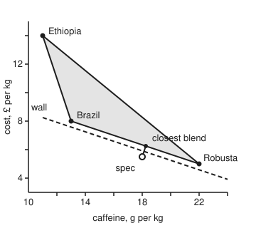

# Separating hyperplanes: a flat wall between a point and a convex set it misses

[Syllabus](../../../SYLLABUS.md) → [Optimization](../README.md) → [Convexity](../README.md#s01) → Separating hyperplanes

---

## General Overview

A roaster stocks three green coffees. Robusta carries 22 g of caffeine per kilo and costs £5 a kilo. A Brazilian arabica carries 13 g and costs £8. An Ethiopian arabica carries 11 g and costs £14. A café asks for a house blend with 18 g of caffeine per kilo at £5.50 a kilo.

Every blend is a weighted average of the three beans. Half Robusta and half Brazil carries 17.5 g and costs £6.50. So each blend's pair of numbers, caffeine and cost, lands inside the triangle whose corners are the three beans. The café's pair sits just below that triangle. No recipe hits it.

Trying recipes can never prove that: a search that finds nothing has only failed. A single line can. Score every bean as caffeine plus 3 × cost. Robusta scores 22 + 15 = 37, Brazil 13 + 24 = 37, Ethiopia 11 + 42 = 53. A blend's score is the same weighted average of its beans' scores, so no blend scores below 37. The café's spec scores 18 + 16.5 = 34.5. Three sums settle it. Read as a price: at 18 g of caffeine, no blend costs less than (37 − 18) / 3 = £6.33 a kilo.

That line is a **separating hyperplane** (a flat wall: a line when there are two numbers, a plane with three, and in general the set where one weighted sum is fixed). This card proves such a wall always exists when a point misses a convex set with its edge included, and shows how to build it: find the closest point of the set, and stand the wall at right angles to the gap. It then reads **Farkas' lemma** (a statement about equations with no negative unknowns) straight off that picture.

**If a point lies outside a closed convex set, a flat wall fits between them, and the closest point of the set tells you where to put it.**

**What kind of fact this is:** a theorem, proved on this card in Why it works, for points and closed convex sets described by finitely many numbers; Farkas' lemma is a second theorem read off from it, also proved here.

### The picture: the blend triangle and the wall

<p align="center"></p>

Drawn to scale, with 1 g/kg across the same length as £1 up. The short segment is the gap from the spec to the closest blend. The dashed wall crosses it at right angles, halfway: every blend lies on one side, the spec on the other.

---

## The formula

Notation first, in words. A point $x$ is a list of numbers; here $x$ = (caffeine in g/kg, cost in £/kg). $C$ is a convex set: the straight segment between any two of its points, every mix $\theta x + (1 - \theta)x'$ of two of its points $x$ and $x'$, with $0 \le \theta \le 1$, stays inside ([Convex sets](02-convex-sets.md)). **Closed** means $C$ contains its own edge. $a^T x$ is the dot product of $a$ and $x$, written as a row times a column ([The dot product](../../03-Algebra/06-Dot%20Products%20and%20Best%20Fits/01-dot-product.md)), and $\lVert a\rVert$ is the length of $a$.

$$x_0 \notin C \quad\Longrightarrow\quad a^T x \;\ge\; a^T p \;>\; a^T x_0 \ \text{ for every } x \in C, \qquad a = p - x_0,$$

where $p$ is the point of $C$ closest to $x_0$. The gap is exact: $a^T p - a^T x_0 = \lVert a\rVert^2$.

**Read it aloud:** take the arrow from the outside point to the nearest point of the set; scored along that arrow, every point of the set beats the outside point by at least the arrow's length squared.

The wall is $\{x : a^T x = \beta\}$ for any level $\beta$ between $a^T x_0$ and $a^T p$. Farkas' lemma is the same fact for equations. For a matrix $A$ and a column $b$, **exactly one** of these holds:

$$\text{(i)}\ \ A\theta = b \text{ with } \theta \ge 0 \qquad\qquad \text{(ii)}\ \ A^T y \ge 0 \text{ and } b^T y < 0$$

Vector inequalities hold entry by entry. Here each column of $A$ is a bean with a 1 on top, so (i) asks for a recipe: weights adding to 1, none negative, hitting both numbers.

| Symbol | Plain meaning | In our example | Push it up and the answer… |
| --- | --- | --- | --- |
| $x$, $x'$ | points: caffeine in g/kg, cost in £/kg | half Robusta, half Brazil: (17.5, 6.50) | — |
| $C$ | the set: every blend's point | the triangle with corners (22, 5), (13, 8), (11, 14) | a bigger set leaves less room for a wall |
| $x_0$ | the point outside: the café's spec | (18, 5.50) | raise its cost to £6.50 and it is inside: a recipe exists |
| $p$ | the closest point of $C$ to $x_0$ | 7/12 Robusta, 5/12 Brazil: (18.25, 6.25) | — |
| $a$ | the wall's normal (the arrow at right angles to it): $p - x_0$ | (0.25, 0.75), or (1, 3) rescaled by 4 | a longer arrow, a wider gap |
| $\lVert a\rVert$ | the gap's length, here in mixed units | 0.7906; squared, 5/8 | — |
| $a^T x$ | the score along $a$ | caffeine + 3 × cost, after rescaling | — |
| $\beta$ | the wall's level | anything from 34.5 to 37; the picture uses 35.75 | 37 touches the triangle's edge |
| $\theta$ | weights in a mix, none negative | 7/12, 5/12, 0 for the closest blend | — |
| $A$, $b$ | the beans as columns (1, caffeine, cost), and the target | columns (1, 22, 5), (1, 13, 8), (1, 11, 14); $b$ = (1, 18, 5.5) | — |
| $y$ | Farkas' certificate: $(-a^T p,\ a)$ | (−37, 1, 3) | — |

### When it holds

- **The set is convex.** Sell the beans only as single-origin bags, no mixing, and the reachable points are three dots. The spec (15, 10) is none of them, yet no line separates it from all three: over 360 directions the best margin is −0.5913, a wall that always leaves a bean on the wrong side.
- **The set is closed.** Insist every blend use some of all three beans and the edge drops out. The spec (19, 6), which is 2/3 Robusta and 1/3 Brazil, is now missed, but blends come within 0.0047 of it, and the wall caffeine + 3 × cost = 37 has a gap of 0: it can only touch, not separate.
- **The point really is outside.** A point inside $C$ has itself as the closest point, $a = 0$, and no wall. Farkas' lemma turns that into option (i).
- **Finitely many numbers.** Step 1 finds the closest point through the extreme value theorem, which needs finitely many numbers. For functions or infinite sequences with length measured as here, by a sum of squares, a closest point still exists by a different argument, and Steps 2 and 3 go through unchanged. With other measures of length a closest point need not exist, and the statement needs the Hahn–Banach theorem from functional analysis.

---

## Why it works

### Step 0: the nearest point decides

Stand at the spec and find the nearest blend. If some other blend lay on the spec's side of the wall through the middle of the gap, walking from the nearest blend a little way toward it would bring you closer to the spec. Convexity says that walk stays among blends. So the nearest blend was not nearest after all. Everything below makes that sentence exact.

### Step 1: a closest point exists

Squared distance to $x_0$ is a smooth bowl. Pick any point of $C$ and keep only the points of $C$ at most that far from $x_0$; that piece is closed and bounded, so the [Extreme value theorem](../../06-Calculus%20and%20analysis/01-Limits%20and%20Continuity/07-extreme-value-theorem.md) from wing 06 gives a minimum. This step minimises; nothing here maximises. Call the winner $p$.

For the blends, the spec sits below the edge from Robusta to Brazil, so the closest point is on that edge. Projecting onto the edge lands 5/12 of the way from Robusta to Brazil: $p$ = 7/12 Robusta and 5/12 Brazil, at 18.25 g/kg and £6.25. Squared distance 0.25² + 0.75² = 5/8.

### Step 2: every point of the set makes an angle of at most 90° with the gap

Take any $x$ in $C$. Mixing $p$ and $x$ stays in $C$, and $p$ is closest, so moving any small fraction $\theta$ from $p$ toward $x$ cannot reduce the distance. Expanding the squared length, as the dot product card does, the first-order term must not be negative:

$$a^T (x - p) \ge 0 \quad \text{for every } x \in C.$$

On the blends, with $a$ rescaled to (1, 3), the three beans give 0, 0 and 16. Robusta and Brazil sit on the wall line itself; Ethiopia sits well clear. A blend's value is the same weighted average, so no blend goes negative.

<details>
<summary>Detailed proof: the closest-point argument, line by line</summary>

Let $x \in C$ and $0 < \theta \le 1$. By convexity $p + \theta(x - p) \in C$, so it is no closer to $x_0$ than $p$:

$$\lVert p + \theta(x - p) - x_0\rVert^2 \ge \lVert p - x_0\rVert^2.$$

With $a = p - x_0$ the left side expands to $\lVert a\rVert^2 + 2\theta\, a^T(x - p) + \theta^2 \lVert x - p\rVert^2$. Cancel $\lVert a\rVert^2$ and divide by $\theta > 0$:

$$2\, a^T(x - p) + \theta \lVert x - p\rVert^2 \ge 0.$$

Let $\theta$ shrink to 0: $a^T(x - p) \ge 0$. Now $a^T x \ge a^T p$, and $a^T p - a^T x_0 = a^T a = \lVert a\rVert^2 > 0$ because $p \ne x_0$. So $a^T x \ge a^T p > a^T x_0$ for every $x$ in $C$, which is the theorem. Any $\beta$ strictly between the two numbers gives a wall with $C$ strictly on one side. The same inequality shows the closest point is unique: if two points were both closest, applying it from each to the other and adding the two results gives minus their squared distance apart at least 0, so they are the same point.

</details>

### Step 3: the wall and its margin

Step 2 says every point of $C$ scores at least $a^T p$. And $a^T p = a^T x_0 + a^T a$, so the spec scores $\lVert a\rVert^2$ less. That is the theorem. In the blend's rescaled numbers, every blend scores at least 37 and the spec 34.5. The gap, 2.5, is the rescaling factor 4 times the squared distance 5/8.

The score line through the edge, caffeine + 3 × cost = 37, is a **price line**. At 18 g/kg it says cost ≥ (37 − 18) / 3 = 19/3, £6.33 a kilo. The blend 5/9 Robusta, 4/9 Brazil reaches exactly 18 g at exactly £6.33, so the bound is met: £6.33 is the cheapest 18-gram blend, with the line as its proof.

The finance wing already ran this argument once: a flat sheet of zero-cost payoffs missing the positive corner has a positive direction at right angles to it, and that direction is the pricing measure ([The fundamental theorems](../../12-Financial%20mathematics/05-Black-Scholes%20from%20the%20Ground%20Up/02-risk-neutral-measure-and-the-fundamental-theorems.md)). That was one special set; this card covers every closed convex set.

### Step 4: Farkas' lemma, read off the wall

Put the recipe question as equations. The unknowns are the weights $\theta$; the columns of $A$ are the beans with a 1 on top; $b$ = (1, 18, 5.5). Then $A\theta = b$ says "weights add to 1 and hit both numbers", and $\theta \ge 0$ says "no negative amounts".

**Not both.** If a recipe $\theta \ge 0$ existed and also a $y$ with $A^T y \ge 0$, then $b^T y = \theta^T (A^T y)$, a sum of products of numbers that are all zero or more, so $b^T y \ge 0$. Option (ii) is impossible.

**At least one.** For this step let $C$ be everything the columns can make, $\{A\theta : \theta \ge 0\}$. It is convex, and closed under stretching by any factor 0 or more: a **cone**. If (i) fails, $b$ is outside $C$, and Step 3 gives an $a$ with $a^T x \ge a^T p > a^T b$ for all $x$ in $C$. Because $C$ is a cone, the zero point is in it, so $a^T p \le 0$; and if some $x$ in $C$ scored below 0, stretching it would push the score below any bound. So $a^T x \ge 0$ on all of $C$, every column included, while $a^T b < 0$. That $a$ is the $y$ of option (ii).

<details>
<summary>Detailed proof: the cone is closed</summary>

Step 3 needs the cone closed. Take any point $A\theta$ with $\theta \ge 0$. If the columns used, those with positive weight, are linearly dependent, some combination of them adds to zero, with at least one coefficient positive. Subtract as much of that combination from $\theta$ as keeps every weight at zero or more: the point is unchanged and one more weight is now zero. Repeat until the columns used are independent. So the cone is the union of the cones built on independent sets of columns, finitely many. Each of those is the image of the closed set $\{\theta \ge 0\}$ under a linear map that can be undone on its image, so each is closed, and a finite union of closed sets is closed.

</details>

For the spec, the certificate is $y$ = (−37, 1, 3): minus the price line's level in the top entry, then the normal. Against a column (1, caffeine, cost) it gives that column's score minus 37, so $A^T y \ge 0$ says every bean is on the far side of the price line. Against the three bean columns it gives 0, 0 and 16, all at least 0. Against $b$ it gives −37 + 18 + 16.5 = −2.5, below 0. Three dot products prove no recipe exists.

### Step 5: why the equations alone don't decide it

Three equations, three unknowns: solving them gives one mix, 25/48 Robusta, 61/96 Brazil and −5/32 Ethiopia. It hits 18 g and £5.50 exactly, but asks for −0.15625 kg of Ethiopian beans in every kilo. Signs are the whole question. With ten beans instead of three, the equations would have endless solutions, and checking their signs one by one would never finish. A complete search is still finite: by the fold in Step 4, a recipe that exists can be cut down to at most three beans, so solving for every choice of three settles it. The certificate does it in three numbers and a handful of products.

For contrast, ask for 15 g at £10. The equations give 1/3 Robusta, 1/6 Brazil, 1/2 Ethiopia, all at least 0: option (i), a real recipe. The old certificate gives $b^T y$ = 8 there, not negative, as the "not both" half requires.

---

## Worked numbers, by hand

| Step | Arithmetic | Value |
| --- | --- | --- |
| Robusta's score | 22 + 3 × 5 | 37 |
| Brazil's score | 13 + 3 × 8 | 37 |
| Ethiopia's score | 11 + 3 × 14 | 53 |
| lowest score any blend can have | the smallest bean score | 37 |
| the spec's score | 18 + 3 × 5.5 | 34.5 |
| the gap | 37 − 34.5 | 2.5 |
| cheapest cost at 18 g/kg | (37 − 18) / 3 | 19/3 = 6.3333 |
| the blend that meets it | 5/9 Robusta, 4/9 Brazil | 18 g/kg at £6.33 |
| the closest blend to the spec | 7/12 Robusta, 5/12 Brazil | (18.25, 6.25) |
| **verdict** | the spec scores below every blend | **no recipe; the nearest 18-gram blend costs £6.33** |

The café cannot have 18 g at £5.50; it can have 18 g at £6.33, or keep £5.50 and accept at least 20.5 g, and the price line shows which trades are on offer.

### What breaks if you drop a piece

| Mistake | Comes out at | What went wrong |
| --- | --- | --- |
| Check each number on its own | caffeine 18 in [11, 22], cost 5.5 in [5, 14]: both pass | Cheap means Robusta-heavy, and Robusta-heavy is too strong; diluting to 18 g needs dearer beans. The pair is what must be reached |
| Build the wall from the nearest bean, not the nearest blend | normal (8, −1): beans 171, 96, 74 against the spec's 138.5 | Robusta is the nearest corner, not the nearest point; two beans land on the spec's side |
| Drop convexity: single-origin bags only | spec (15, 10): best margin over 360 directions −0.5913 | A point between the beans can't be walled off from them |
| Drop closedness: every blend must use all three beans | spec (19, 6): blends within 0.4738, 0.0474, 0.0047; wall gap 0 | The spec is missed but touched; a wall can only lean on it |

The code prints all four.

---

## Code, from first principles, and it actually runs

The code takes three independent roads to the verdict. Road one is the method: project the spec onto each edge of the triangle, keep the closest point, and turn the gap into a wall, in exact fractions. Road two is enumeration: all 65,341 blends on a grid of 1/360 of a kilo, checked exactly, none of which hits the spec, with the closest at 210/360 Robusta and 150/360 Brazil and the lowest score exactly 37. Road three is Farkas: solve the three equations by elimination, see the negative weight, and check the certificate against every bean. Python uses the `fractions` module for exact arithmetic; the Rust writes its own rational type. Neither imports anything that knows the answer.

### Python

```python
# Separating hyperplanes -- the check behind the card.  Standard library only:
# fractions does exact rational arithmetic, math gives cos and sin.  Each bean
# is a point (caffeine in g/kg, cost in pounds/kg); a blend mixes them with
# weights >= 0 adding to 1.  The spec, 18 g/kg at 5.50 a kilo, is shown out of
# reach three ways: the closest-point wall, every blend on a 1/360 grid, and
# Farkas' certificate against the blend equations.  Then four ways to go wrong.
import math
from fractions import Fraction as Fr

NAMES = ["Robusta", "Brazil", "Ethiopia"]
P = [(Fr(22), Fr(5)), (Fr(13), Fr(8)), (Fr(11), Fr(14))]
SPEC, EASY, EDGE = (Fr(18), Fr(11, 2)), (Fr(15), Fr(10)), (Fr(19), Fr(6))
N = 360                                       # grid step: 1/360 of a kilo

def dot(u, v): return sum(a * b for a, b in zip(u, v))
def sub(u, v): return tuple(a - b for a, b in zip(u, v))
def pt(v): return f"({float(v[0]):.2f}, {float(v[1]):.2f})"
def fl(xs): return ", ".join(str(x) for x in xs)

def nearest_on_edge(x, a, b):                 # minimise |a + t(b - a) - x|^2, 0 <= t <= 1
    d = sub(b, a)
    t = min(max(dot(sub(x, a), d) / dot(d, d), Fr(0)), Fr(1))
    return t, (a[0] + t * d[0], a[1] + t * d[1])

def solve3(rows, rhs):                        # Gauss-Jordan elimination, exact
    m = [[Fr(v) for v in r] + [Fr(c)] for r, c in zip(rows, rhs)]
    for c in range(3):
        piv = next(r for r in range(c, 3) if m[r][c] != 0)
        m[c], m[piv] = m[piv], m[c]
        for r in range(3):
            if r != c:
                f = m[r][c] / m[c][c]
                m[r] = [x - f * y for x, y in zip(m[r], m[c])]
    return [m[i][3] / m[i][i] for i in range(3)]

A = [[1, 1, 1], [p[0] for p in P], [p[1] for p in P]]   # columns: (1, caffeine, cost)

half = tuple((u + v) / 2 for u, v in zip(P[0], P[1]))
print(f"half Robusta, half Brazil: {pt(half)}")

# ---- road one: the closest blend, and the wall at right angles to it ----
cands = []
for i, j in [(0, 1), (1, 2), (0, 2)]:
    t, q = nearest_on_edge(SPEC, P[i], P[j])
    cands.append((dot(sub(q, SPEC), sub(q, SPEC)), i, j, t, q))
d2, i, j, t, p = min(cands)
a = sub(p, SPEC)                              # normal: from the spec to the closest blend
k = 1 / a[0]                                  # rescale to whole numbers
y = (k * a[0], k * a[1])
floor, spec_score = k * dot(a, p), dot(y, SPEC)
bean_scores = [dot(y, b) for b in P]
print(f"closest blend: {NAMES[i]} {1 - t}, {NAMES[j]} {t}, at {pt(p)}")
print(f"squared distance {d2}, distance {math.sqrt(d2):.4f}")
print(f"normal {pt(a)}, scaled by {k}: score = caffeine + {y[1]} x cost")
print(f"bean scores {fl(bean_scores)}; every blend >= {floor}")
print(f"spec scores {float(spec_score):.1f}; gap {float(floor - spec_score):.1f} = {k} x {d2};"
      f" midway wall at {float((floor + spec_score) / 2):.2f}")
cheapest, strongest = (floor - SPEC[0]) / y[1], floor - y[1] * SPEC[1]
print(f"price line: cost >= ({floor} - caffeine) / {y[1]}; at {SPEC[0]} g/kg >= {cheapest}"
      f" = {float(cheapest):.4f}; at {float(SPEC[1])} a kilo, caffeine >= {float(strongest)}")

# ---- road two: every blend on a 1/360 grid, in exact fractions ----
best_d = best_s = best_c = None
count = hits = 0
for r in range(N + 1):
    for b in range(N + 1 - r):
        mix = (Fr(r, N), Fr(b, N), Fr(N - r - b, N))
        x = (dot(mix, A[1]), dot(mix, A[2]))  # the blend's caffeine and cost
        dd, s = dot(sub(x, SPEC), sub(x, SPEC)), dot(y, x)
        count, hits = count + 1, hits + (dd == 0)
        if best_d is None or dd < best_d[0]: best_d = (dd, r, b, N - r - b)
        if best_s is None or s < best_s: best_s = s
        if x[0] == SPEC[0] and (best_c is None or x[1] < best_c[0]): best_c = (x[1], r, b, N - r - b)
grid_d2 = best_d[0]
print(f"grid: {count} blends, {hits} hit the spec; closest {best_d[1:]} / {N}, squared distance {grid_d2}")
print(f"grid: lowest score {best_s}; cheapest at exactly {SPEC[0]} g/kg {best_c[1:]} / {N},"
      f" cost {best_c[0]}")

# ---- road three: Farkas, either a recipe with weights >= 0 or a certificate ----
w = solve3(A, (1,) + SPEC)
cert = (-floor, y[0], y[1])
at_cert = [dot(cert, col) for col in zip(*A)]
print(f"the only mix with exact numbers: {fl(w)}; Ethiopia {float(w[2]):.5f}")
print(f"certificate y = ({fl(cert)}): A^T y = ({fl(at_cert)}), "
      f"b.y = {float(dot(cert, (1,) + SPEC)):.1f}")
w_easy = solve3(A, (1,) + EASY)
print(f"reachable spec {pt(EASY)}: weights {fl(w_easy)}, b.y = {dot(cert, (1,) + EASY)}")

# ---- what breaks ----
lo = lambda m: min(q[m] for q in P)
hi = lambda m: max(q[m] for q in P)
print(f"mistake 1, one number at a time: caffeine {SPEC[0]} in [{lo(0)}, {hi(0)}], cost {float(SPEC[1])} in"
      f" [{lo(1)}, {hi(1)}]: both pass")
nb = min(range(3), key=lambda m: dot(sub(P[m], SPEC), sub(P[m], SPEC)))
z = tuple(2 * v for v in sub(P[nb], SPEC))
print(f"mistake 2, wall from nearest bean {NAMES[nb]}: normal {pt(z)}, beans "
      f"{fl(dot(z, q) for q in P)}, spec {float(dot(z, SPEC)):.1f}")
gaps = []
for deg in range(360):
    u = (math.cos(math.radians(deg)), math.sin(math.radians(deg)))
    gaps.append(min(dot(u, sub(q, EASY)) for q in P))
print(f"mistake 3, single origins only, spec {pt(EASY)}: best gap over 360 directions"
      f" {max(gaps):.4f}")
edge_w = solve3(A, (1,) + EDGE)
dists = []
for eps in (Fr(1, 10), Fr(1, 100), Fr(1, 1000)):
    mix = [(1 - eps) * edge_w[m] + eps / 3 for m in range(3)]
    q = (dot(mix, A[1]), dot(mix, A[2]))
    dists.append(math.sqrt(dot(sub(q, EDGE), sub(q, EDGE))))
print(f"mistake 4, all three beans required, spec {pt(EDGE)} = {fl(edge_w)}: "
      f"distances {', '.join(f'{x:.4f}' for x in dists)}; wall gap {dot(y, EDGE) - floor}")
sx = lambda v: 40 + 20 * (v - 10)
sy = lambda v: 270 - 20 * (v - 3)
mid = (floor + spec_score) / 2
w1, w2 = (Fr(11), (mid - 11) / 3), (Fr(24), (mid - 24) / 3)
print("figure, " + ", ".join(f"{float(sx(q[0])):.2f} {float(sy(q[1])):.2f}"
                             for q in P + [SPEC, p, w1, w2]))

assert d2 == grid_d2 == Fr(5, 8) and (best_d[1], best_d[2]) == (210, 150)   # road one = road two
assert all(s >= floor for s in bean_scores) and spec_score < floor and hits == 0
assert best_s == floor and best_c[0] == cheapest             # bound is met
assert min(w) < 0 and all(v >= 0 for v in at_cert) and dot(cert, (1,) + SPEC) < 0
assert all(v >= 0 for v in w_easy) and dot(cert, (1,) + EASY) >= 0
assert max(gaps) <= 1e-12 and dot(y, EDGE) == floor
assert min(dot(z, q) for q in P) < dot(z, SPEC)                  # the nearest-bean line fails
print("ALL CHECKS PASS")
```

**Ran 2026-11-11 on macOS, Python 3.14.10, standard library only. All checks passed. Output, pasted from the run:**

```
half Robusta, half Brazil: (17.50, 6.50)
closest blend: Robusta 7/12, Brazil 5/12, at (18.25, 6.25)
squared distance 5/8, distance 0.7906
normal (0.25, 0.75), scaled by 4: score = caffeine + 3 x cost
bean scores 37, 37, 53; every blend >= 37
spec scores 34.5; gap 2.5 = 4 x 5/8; midway wall at 35.75
price line: cost >= (37 - caffeine) / 3; at 18 g/kg >= 19/3 = 6.3333; at 5.5 a kilo, caffeine >= 20.5
grid: 65341 blends, 0 hit the spec; closest (210, 150, 0) / 360, squared distance 5/8
grid: lowest score 37; cheapest at exactly 18 g/kg (200, 160, 0) / 360, cost 19/3
the only mix with exact numbers: 25/48, 61/96, -5/32; Ethiopia -0.15625
certificate y = (-37, 1, 3): A^T y = (0, 0, 16), b.y = -2.5
reachable spec (15.00, 10.00): weights 1/3, 1/6, 1/2, b.y = 8
mistake 1, one number at a time: caffeine 18 in [11, 22], cost 5.5 in [5, 14]: both pass
mistake 2, wall from nearest bean Robusta: normal (8.00, -1.00), beans 171, 96, 74, spec 138.5
mistake 3, single origins only, spec (15.00, 10.00): best gap over 360 directions -0.5913
mistake 4, all three beans required, spec (19.00, 6.00) = 2/3, 1/3, 0: distances 0.4738, 0.0474, 0.0047; wall gap 0
figure, 280.00 230.00, 100.00 170.00, 60.00 50.00, 200.00 220.00, 205.00 205.00, 60.00 165.00, 320.00 251.67
ALL CHECKS PASS
```

### Rust

Same numbers, same labels, built with `rustc --edition 2021 -O`.

```rust
// Separating hyperplanes -- the same check as the Python, in Rust.  No crates;
// a small rational type does the exact arithmetic.  Each bean is a point
// (caffeine in g/kg, cost in pounds/kg); a blend mixes them with weights >= 0
// adding to 1.  The spec, 18 g/kg at 5.50 a kilo, is shown out of reach three
// ways: the closest-point wall, every blend on a 1/360 grid, and Farkas'
// certificate against the blend equations.  Then four ways to go wrong.
use std::cmp::Ordering;
use std::ops::{Add, Div, Mul, Sub};

#[derive(Clone, Copy, Debug, PartialEq, Eq)]
struct Q { n: i128, d: i128 }                       // n/d in lowest terms, d > 0
fn gcd(a: i128, b: i128) -> i128 { if b == 0 { a.abs() } else { gcd(b, a % b) } }
fn q(n: i128, d: i128) -> Q {
    let g = gcd(n, d) * if d < 0 { -1 } else { 1 };
    Q { n: n / g, d: d / g }
}
fn z(n: i128) -> Q { q(n, 1) }
impl Add for Q { type Output = Q; fn add(self, o: Q) -> Q { q(self.n * o.d + o.n * self.d, self.d * o.d) } }
impl Sub for Q { type Output = Q; fn sub(self, o: Q) -> Q { q(self.n * o.d - o.n * self.d, self.d * o.d) } }
impl Mul for Q { type Output = Q; fn mul(self, o: Q) -> Q { q(self.n * o.n, self.d * o.d) } }
impl Div for Q { type Output = Q; fn div(self, o: Q) -> Q { q(self.n * o.d, self.d * o.n) } }
impl PartialOrd for Q { fn partial_cmp(&self, o: &Q) -> Option<Ordering> { Some(self.cmp(o)) } }
impl Ord for Q { fn cmp(&self, o: &Q) -> Ordering { (self.n * o.d).cmp(&(o.n * self.d)) } }
impl std::fmt::Display for Q {
    fn fmt(&self, f: &mut std::fmt::Formatter) -> std::fmt::Result {
        if self.d == 1 { write!(f, "{}", self.n) } else { write!(f, "{}/{}", self.n, self.d) }
    }
}
impl Q { fn f(self) -> f64 { self.n as f64 / self.d as f64 } }

type V = (Q, Q);
fn dot(u: V, v: V) -> Q { u.0 * v.0 + u.1 * v.1 }
fn sub(u: V, v: V) -> V { (u.0 - v.0, u.1 - v.1) }
fn pt(v: V) -> String { format!("({:.2}, {:.2})", v.0.f(), v.1.f()) }
fn fl(xs: &[Q]) -> String { xs.iter().map(|x| x.to_string()).collect::<Vec<_>>().join(", ") }

fn nearest_on_edge(x: V, a: V, b: V) -> (Q, V) {   // minimise |a + t(b - a) - x|^2, 0 <= t <= 1
    let d = sub(b, a);
    let t = (dot(sub(x, a), d) / dot(d, d)).max(z(0)).min(z(1));
    (t, (a.0 + t * d.0, a.1 + t * d.1))
}

fn solve3(rows: &[[Q; 3]; 3], rhs: [Q; 3]) -> [Q; 3] {   // Gauss-Jordan elimination, exact
    let mut m: Vec<Vec<Q>> = (0..3).map(|r| { let mut v = rows[r].to_vec(); v.push(rhs[r]); v }).collect();
    for c in 0..3 {
        let piv = (c..3).find(|&r| m[r][c] != z(0)).unwrap();
        m.swap(c, piv);
        for r in 0..3 {
            if r != c {
                let f = m[r][c] / m[c][c];
                let pivot_row = m[c].clone();
                for (x, y) in m[r].iter_mut().zip(pivot_row) { *x = *x - f * y; }
            }
        }
    }
    [m[0][3] / m[0][0], m[1][3] / m[1][1], m[2][3] / m[2][2]]
}
fn dot3(u: [Q; 3], v: [Q; 3]) -> Q { u[0] * v[0] + u[1] * v[1] + u[2] * v[2] }

fn main() {
    let names = ["Robusta", "Brazil", "Ethiopia"];
    let p: [V; 3] = [(z(22), z(5)), (z(13), z(8)), (z(11), z(14))];
    let (spec, easy, edge): (V, V, V) = ((z(18), q(11, 2)), (z(15), z(10)), (z(19), z(6)));
    let n: i128 = 360;                                      // grid step: 1/360 of a kilo
    let a_m = [[z(1), z(1), z(1)], [p[0].0, p[1].0, p[2].0], [p[0].1, p[1].1, p[2].1]];
    let col = |j: usize| [a_m[0][j], a_m[1][j], a_m[2][j]];

    println!("half Robusta, half Brazil: {}", pt(((p[0].0 + p[1].0) / z(2), (p[0].1 + p[1].1) / z(2))));
    // ---- road one: the closest blend, and the wall at right angles to it ----
    let mut best: Option<(Q, usize, usize, Q, V)> = None;
    for (i, j) in [(0, 1), (1, 2), (0, 2)] {
        let (t, c) = nearest_on_edge(spec, p[i], p[j]);
        let d2 = dot(sub(c, spec), sub(c, spec));
        if best.map_or(true, |b| d2 < b.0) { best = Some((d2, i, j, t, c)); }
    }
    let (d2, i, j, t, pc) = best.unwrap();
    let a = sub(pc, spec);                                  // normal: spec to closest blend
    let k = z(1) / a.0;                                     // rescale to whole numbers
    let y = (k * a.0, k * a.1);
    let (floor, spec_score) = (k * dot(a, pc), dot(y, spec));
    let bean_scores: Vec<Q> = p.iter().map(|&b| dot(y, b)).collect();
    println!("closest blend: {} {}, {} {}, at {}", names[i], z(1) - t, names[j], t, pt(pc));
    println!("squared distance {}, distance {:.4}", d2, d2.f().sqrt());
    println!("normal {}, scaled by {}: score = caffeine + {} x cost", pt(a), k, y.1);
    println!("bean scores {}; every blend >= {}", fl(&bean_scores), floor);
    println!("spec scores {:.1}; gap {:.1} = {} x {}; midway wall at {:.2}",
             spec_score.f(), (floor - spec_score).f(), k, d2, ((floor + spec_score) / z(2)).f());
    let (cheapest, strongest) = ((floor - spec.0) / y.1, floor - y.1 * spec.1);
    println!("price line: cost >= ({} - caffeine) / {}; at {} g/kg >= {} = {:.4}; at {} a kilo, caffeine >= {}",
             floor, y.1, spec.0, cheapest, cheapest.f(), spec.1.f(), strongest.f());

    // ---- road two: every blend on a 1/360 grid, in exact fractions ----
    let mut best_d: Option<(Q, i128, i128, i128)> = None;
    let (mut best_s, mut best_c): (Option<Q>, Option<(Q, i128, i128, i128)>) = (None, None);
    let (mut count, mut hits) = (0, 0);
    for r in 0..=n {
        for b in 0..=(n - r) {
            let mix = [q(r, n), q(b, n), q(n - r - b, n)];
            let x = (dot3(mix, a_m[1]), dot3(mix, a_m[2]));  // the blend's caffeine and cost
            let (dd, s) = (dot(sub(x, spec), sub(x, spec)), dot(y, x));
            count += 1;
            if dd == z(0) { hits += 1; }
            if best_d.map_or(true, |c| dd < c.0) { best_d = Some((dd, r, b, n - r - b)); }
            if best_s.map_or(true, |c| s < c) { best_s = Some(s); }
            if x.0 == spec.0 && best_c.map_or(true, |c| x.1 < c.0) { best_c = Some((x.1, r, b, n - r - b)); }
        }
    }
    let (best_d, best_s) = (best_d.unwrap(), best_s.unwrap());
    let (best_c, grid_d2) = (best_c.unwrap(), best_d.0);
    println!("grid: {} blends, {} hit the spec; closest ({}, {}, {}) / {}, squared distance {}",
             count, hits, best_d.1, best_d.2, best_d.3, n, grid_d2);
    println!("grid: lowest score {}; cheapest at exactly {} g/kg ({}, {}, {}) / {}, cost {}",
             best_s, spec.0, best_c.1, best_c.2, best_c.3, n, best_c.0);

    // ---- road three: Farkas, either a recipe with weights >= 0 or a certificate ----
    let w = solve3(&a_m, [z(1), spec.0, spec.1]);
    let cert = [z(0) - floor, y.0, y.1];
    let at_cert: Vec<Q> = (0..3).map(|j| dot3(cert, col(j))).collect();
    let by_spec = dot3(cert, [z(1), spec.0, spec.1]);
    println!("the only mix with exact numbers: {}; Ethiopia {:.5}", fl(&w), w[2].f());
    println!("certificate y = ({}): A^T y = ({}), b.y = {:.1}", fl(&cert), fl(&at_cert), by_spec.f());
    let w_easy = solve3(&a_m, [z(1), easy.0, easy.1]);
    let by_easy = dot3(cert, [z(1), easy.0, easy.1]);
    println!("reachable spec {}: weights {}, b.y = {}", pt(easy), fl(&w_easy), by_easy);

    // ---- what breaks ----
    let lo = |m: usize| p.iter().map(|v| if m == 0 { v.0 } else { v.1 }).min().unwrap();
    let hi = |m: usize| p.iter().map(|v| if m == 0 { v.0 } else { v.1 }).max().unwrap();
    println!("mistake 1, one number at a time: caffeine {} in [{}, {}], cost {} in [{}, {}]: both pass",
             spec.0, lo(0), hi(0), spec.1.f(), lo(1), hi(1));
    let nb = (0..3).min_by_key(|&m| dot(sub(p[m], spec), sub(p[m], spec))).unwrap();
    let zz = (z(2) * (p[nb].0 - spec.0), z(2) * (p[nb].1 - spec.1));
    let z_scores: Vec<Q> = p.iter().map(|&b| dot(zz, b)).collect();
    println!("mistake 2, wall from nearest bean {}: normal {}, beans {}, spec {:.1}",
             names[nb], pt(zz), fl(&z_scores), dot(zz, spec).f());
    let mut gaps: Vec<f64> = Vec::new();
    for deg in 0..360 {
        let u = ((deg as f64).to_radians().cos(), (deg as f64).to_radians().sin());
        gaps.push(p.iter().map(|&b| { let s = sub(b, easy); 0.0 + u.0 * s.0.f() + u.1 * s.1.f() })
                  .fold(f64::INFINITY, f64::min));
    }
    let max_gap = gaps.iter().cloned().fold(f64::NEG_INFINITY, f64::max);
    println!("mistake 3, single origins only, spec {}: best gap over 360 directions {:.4}", pt(easy), max_gap);
    let edge_w = solve3(&a_m, [z(1), edge.0, edge.1]);
    let mut dists: Vec<f64> = Vec::new();
    for eps in [q(1, 10), q(1, 100), q(1, 1000)] {
        let mix: Vec<Q> = (0..3).map(|m| (z(1) - eps) * edge_w[m] + eps / z(3)).collect();
        let c = (dot3([mix[0], mix[1], mix[2]], a_m[1]), dot3([mix[0], mix[1], mix[2]], a_m[2]));
        dists.push(dot(sub(c, edge), sub(c, edge)).f().sqrt());
    }
    let ds: Vec<String> = dists.iter().map(|x| format!("{:.4}", x)).collect();
    println!("mistake 4, all three beans required, spec {} = {}: distances {}; wall gap {}",
             pt(edge), fl(&edge_w), ds.join(", "), dot(y, edge) - floor);
    let sx = |v: Q| z(40) + z(20) * (v - z(10));
    let sy = |v: Q| z(270) - z(20) * (v - z(3));
    let mid = (floor + spec_score) / z(2);
    let (w1, w2) = ((z(11), (mid - z(11)) / z(3)), (z(24), (mid - z(24)) / z(3)));
    let fig: Vec<String> = [p[0], p[1], p[2], spec, pc, w1, w2].iter()
        .map(|&v| format!("{:.2} {:.2}", sx(v.0).f(), sy(v.1).f())).collect();
    println!("figure, {}", fig.join(", "));

    assert!(d2 == grid_d2 && d2 == q(5, 8) && (best_d.1, best_d.2) == (210, 150));   // road one = road two
    assert!(bean_scores.iter().all(|&s| s >= floor) && spec_score < floor && hits == 0);
    assert!(best_s == floor && best_c.0 == cheapest);                  // bound is met
    assert!(w.iter().min().unwrap() < &z(0) && at_cert.iter().all(|&v| v >= z(0)) && by_spec < z(0));
    assert!(w_easy.iter().all(|&v| v >= z(0)) && by_easy >= z(0));
    assert!(max_gap <= 1e-12 && dot(y, edge) == floor);
    assert!(*z_scores.iter().min().unwrap() < dot(zz, spec));                        // nearest-bean line fails
    println!("ALL CHECKS PASS");
}
```

**Ran 2026-11-11 on macOS, rustc 1.98.1, no crates. All checks passed. Output, pasted from the run:**

```
half Robusta, half Brazil: (17.50, 6.50)
closest blend: Robusta 7/12, Brazil 5/12, at (18.25, 6.25)
squared distance 5/8, distance 0.7906
normal (0.25, 0.75), scaled by 4: score = caffeine + 3 x cost
bean scores 37, 37, 53; every blend >= 37
spec scores 34.5; gap 2.5 = 4 x 5/8; midway wall at 35.75
price line: cost >= (37 - caffeine) / 3; at 18 g/kg >= 19/3 = 6.3333; at 5.5 a kilo, caffeine >= 20.5
grid: 65341 blends, 0 hit the spec; closest (210, 150, 0) / 360, squared distance 5/8
grid: lowest score 37; cheapest at exactly 18 g/kg (200, 160, 0) / 360, cost 19/3
the only mix with exact numbers: 25/48, 61/96, -5/32; Ethiopia -0.15625
certificate y = (-37, 1, 3): A^T y = (0, 0, 16), b.y = -2.5
reachable spec (15.00, 10.00): weights 1/3, 1/6, 1/2, b.y = 8
mistake 1, one number at a time: caffeine 18 in [11, 22], cost 5.5 in [5, 14]: both pass
mistake 2, wall from nearest bean Robusta: normal (8.00, -1.00), beans 171, 96, 74, spec 138.5
mistake 3, single origins only, spec (15.00, 10.00): best gap over 360 directions -0.5913
mistake 4, all three beans required, spec (19.00, 6.00) = 2/3, 1/3, 0: distances 0.4738, 0.0474, 0.0047; wall gap 0
figure, 280.00 230.00, 100.00 170.00, 60.00 50.00, 200.00 220.00, 205.00 205.00, 60.00 165.00, 320.00 251.67
ALL CHECKS PASS
```

The two outputs match line for line.

### Lean

Lean proves the wall theorem for every closed convex set and Farkas' lemma for every matrix, and checks the café's numbers.

- Points are lists of $n$ numbers, for any $n$. If $x_0$ lies outside a closed convex set $C$ that has a point, $C$ has exactly one closest point $p$.
- Take $a = p - x_0$. Then every $x$ in $C$ has $a^T x \ge a^T p > a^T x_0$. The gap $a^T p - a^T x_0$ is exactly $\lVert a\rVert^2$.
- Some wall $\{x : a^T x = \beta\}$ has $x_0$ strictly on one side and every point of $C$ strictly on the other.
- Farkas' lemma: for any matrix $A$ and column $b$, exactly one of (i) and (ii) holds.
- The beans score 37, 37 and 53 on caffeine + 3 × cost. The spec scores 34.5, and the gap is 2.5.
- Half Robusta, half Brazil lands at (17.5, 6.50).
- 7/12 Robusta, 5/12 Brazil lands at (18.25, 6.25), at squared distance 5/8 from the spec.
- The gap arrow (0.25, 0.75) is at right angles to the Robusta–Brazil edge, and 2.5 = 4 × 5/8.
- At 18 g/kg the price line gives a cost of at least 19/3, and 5/9 Robusta, 4/9 Brazil meets it. At £5.50 the caffeine is at least 20.5 g.
- The certificate (−37, 1, 3) gives 0, 0 and 16 on the beans and −2.5 on the spec.
- The only exact mix, 25/48, 61/96 and −5/32, hits the spec but needs a negative weight.
- The spec (15, 10) has the recipe 1/3, 1/6, 1/2, and the certificate gives 8 there, not negative.
- The nearest-bean normal (8, −1) scores the beans 171, 96 and 74 against the spec's 138.5.

Which blend is closest, the grid search, the 360-direction margin and the near misses at (19, 6) are left to the Python and Rust checks.

```lean
-- Separating hyperplanes: a point outside a closed convex set in n-dimensional space is cut off from it by a flat wall at right angles to the gap to the set's closest point, and Farkas' lemma follows.
import Mathlib.Analysis.InnerProductSpace.PiL2
import Mathlib.Analysis.Convex.Basic
import Mathlib.Data.Matrix.Mul
import Mathlib.Tactic.FinCases
import Mathlib.Analysis.InnerProductSpace.Projection.Minimal
import Mathlib.LinearAlgebra.Matrix.DotProduct

open Matrix

theorem farkas_aux {m : ℕ} {ι : Type*} [DecidableEq ι] (s : Finset ι) :
    ∀ (a : ι → (Fin m → ℝ)) (b : Fin m → ℝ),
      (∃ θ : ι → ℝ, (∀ j, 0 ≤ θ j) ∧ ∑ j ∈ s, θ j • a j = b) ∨
      ∃ y : Fin m → ℝ, (∀ j ∈ s, 0 ≤ a j ⬝ᵥ y) ∧ b ⬝ᵥ y < 0 := by
  induction s using Finset.induction_on with
  | empty =>
    intro a b
    by_cases hb : b = 0
    · left; exact ⟨0, fun _ => le_rfl, by simp [hb]⟩
    · right
      refine ⟨-b, by simp, ?_⟩
      have h1 : 0 ≤ b ⬝ᵥ b := Finset.sum_nonneg fun i _ => mul_self_nonneg (b i)
      have h2 : b ⬝ᵥ b ≠ 0 := by simpa using hb
      rw [dotProduct_neg]
      exact neg_neg_of_pos (lt_of_le_of_ne h1 (Ne.symm h2))
  | insert i s hi ih =>
    intro a b
    rcases ih a b with ⟨θ, hθ, hsum⟩ | ⟨y, hy, hby⟩
    · left
      refine ⟨Function.update θ i 0, fun j => ?_, ?_⟩
      · by_cases hj : j = i
        · subst hj; simp
        · simp [Function.update_of_ne hj, hθ j]
      · rw [Finset.sum_insert hi]
        simp only [Function.update_self, zero_smul, zero_add]
        rw [← hsum]
        refine Finset.sum_congr rfl fun j hj => ?_
        have : j ≠ i := fun h => hi (h ▸ hj)
        rw [Function.update_of_ne this]
    by_cases hc : 0 ≤ a i ⬝ᵥ y
    · right
      refine ⟨y, fun j hj => ?_, hby⟩
      rcases Finset.mem_insert.1 hj with rfl | hj
      · exact hc
      · exact hy j hj
    rw [not_le] at hc
    set c := a i ⬝ᵥ y with hcdef
    have hcne : c ≠ 0 := hc.ne
    rcases ih (fun j => (a j ⬝ᵥ y) • a i - c • a j) ((b ⬝ᵥ y) • a i - c • b) with
      ⟨θ, hθ, hsum⟩ | ⟨y', hy', hby'⟩
    · left
      set T := ∑ j ∈ s, θ j * (a j ⬝ᵥ y) with hT
      have hTnn : 0 ≤ T := Finset.sum_nonneg fun j hj => mul_nonneg (hθ j) (hy j hj)
      refine ⟨Function.update θ i ((T - b ⬝ᵥ y) / (-c)), fun j => ?_, ?_⟩
      · by_cases hj : j = i
        · subst hj
          simp only [Function.update_self]
          apply div_nonneg <;> linarith
        · simp [Function.update_of_ne hj, hθ j]
      · rw [Finset.sum_insert hi, Function.update_self]
        have hs : ∑ j ∈ s, Function.update θ i ((T - b ⬝ᵥ y) / (-c)) j • a j
            = ∑ j ∈ s, θ j • a j := by
          refine Finset.sum_congr rfl fun j hj => ?_
          have : j ≠ i := fun h => hi (h ▸ hj)
          rw [Function.update_of_ne this]
        rw [hs]
        funext k
        have hk := congrFun hsum k
        simp only [Finset.sum_apply, Pi.smul_apply, Pi.sub_apply, smul_eq_mul, Pi.add_apply]
          at hk ⊢
        have e1 : ∑ j ∈ s, θ j * ((a j ⬝ᵥ y) * a i k - c * a j k)
            = T * a i k - c * ∑ j ∈ s, θ j * a j k := by
          rw [hT, Finset.sum_mul, Finset.mul_sum, ← Finset.sum_sub_distrib]
          refine Finset.sum_congr rfl fun j _ => ?_
          ring
        rw [e1] at hk
        field_simp
        linear_combination (-1 : ℝ) * hk
    · right
      refine ⟨y' - ((a i ⬝ᵥ y') / c) • y, fun j hj => ?_, ?_⟩
      · rcases Finset.mem_insert.1 hj with rfl | hj
        · rw [dotProduct_sub, dotProduct_smul, smul_eq_mul, ← hcdef]
          field_simp
          simp
        · have h := hy' j hj
          simp only [sub_dotProduct, smul_dotProduct, smul_eq_mul] at h
          rw [dotProduct_sub, dotProduct_smul, smul_eq_mul]
          have : a j ⬝ᵥ y' - a i ⬝ᵥ y' / c * (a j ⬝ᵥ y)
              = ((a j ⬝ᵥ y) * (a i ⬝ᵥ y') - c * (a j ⬝ᵥ y')) / (-c) := by
            field_simp
            ring
          rw [this]
          apply div_nonneg h
          linarith
      · have h := hby'
        simp only [sub_dotProduct, smul_dotProduct, smul_eq_mul] at h
        rw [dotProduct_sub, dotProduct_smul, smul_eq_mul]
        have : b ⬝ᵥ y' - a i ⬝ᵥ y' / c * (b ⬝ᵥ y)
            = ((b ⬝ᵥ y) * (a i ⬝ᵥ y') - c * (b ⬝ᵥ y')) / (-c) := by
          field_simp
          ring
        rw [this]
        apply div_neg_of_neg_of_pos h
        linarith

#print axioms farkas_aux

/-- If a point `x₀` lies outside a closed convex set `C` of points described by `n` numbers,
then `C` has exactly one point `p` closest to `x₀`, and with the arrow `a = p - x₀` every point
`x` of `C` satisfies `aᵀx ≥ aᵀp > aᵀx₀`, the gap being exactly `aᵀp - aᵀx₀ = ‖a‖²`.
(`C` must have at least one point for "the closest point" to exist.) -/
theorem separating_hyperplane_closest_point {n : ℕ} (C : Set (EuclideanSpace ℝ (Fin n)))
    (hconv : Convex ℝ C) (hclosed : IsClosed C) (hne : C.Nonempty)
    (x₀ : EuclideanSpace ℝ (Fin n)) (hx₀ : x₀ ∉ C) :
    ∃ p ∈ C, (∀ q ∈ C, dist x₀ p ≤ dist x₀ q) ∧
      (∀ p' ∈ C, (∀ q ∈ C, dist x₀ p' ≤ dist x₀ q) → p' = p) ∧
      (∀ x ∈ C, inner ℝ (p - x₀) p ≤ inner ℝ (p - x₀) x) ∧
      inner ℝ (p - x₀) x₀ < inner ℝ (p - x₀) p ∧
      inner ℝ (p - x₀) p - inner ℝ (p - x₀) x₀ = ‖p - x₀‖ ^ 2 := by
  obtain ⟨p, hpC, hp⟩ := exists_norm_eq_iInf_of_complete_convex hne hclosed.isComplete hconv x₀
  have hbdd : BddBelow (Set.range fun w : C => ‖x₀ - (w : EuclideanSpace ℝ (Fin n))‖) :=
    ⟨0, Set.forall_mem_range.2 fun _ => norm_nonneg _⟩
  have hvar := (norm_eq_iInf_iff_real_inner_le_zero hconv hpC).1 hp
  have hgap : inner ℝ (p - x₀) p - inner ℝ (p - x₀) x₀ = ‖p - x₀‖ ^ 2 := by
    rw [← inner_sub_right, real_inner_self_eq_norm_sq]
  have hpne : p - x₀ ≠ 0 := by
    intro h
    rw [sub_eq_zero] at h
    exact hx₀ (h ▸ hpC)
  have hpos : 0 < ‖p - x₀‖ ^ 2 := by positivity
  refine ⟨p, hpC, ?_, ?_, ?_, by linarith, hgap⟩
  · intro q hq
    rw [dist_eq_norm, dist_eq_norm, hp]
    exact ciInf_le hbdd ⟨q, hq⟩
  · intro p' hp'C hp'
    have hp'eq : ‖x₀ - p'‖ = ⨅ w : C, ‖x₀ - w‖ := by
      apply le_antisymm
      · have : Nonempty C := ⟨⟨p', hp'C⟩⟩
        refine le_ciInf fun w => ?_
        have := hp' w w.2
        rwa [dist_eq_norm, dist_eq_norm] at this
      · exact ciInf_le hbdd ⟨p', hp'C⟩
    have hvar' := (norm_eq_iInf_iff_real_inner_le_zero hconv hp'C).1 hp'eq
    have h1 := hvar p' hp'C
    have h2 := hvar' p hpC
    have h3 : inner ℝ (p' - p) (p' - p) ≤ (0 : ℝ) := by
      have e : inner ℝ (p' - p) (p' - p)
          = inner ℝ (x₀ - p) (p' - p) + inner ℝ (x₀ - p') (p - p') := by
        simp only [inner_sub_left, inner_sub_right, real_inner_comm]
        ring
      linarith
    rw [real_inner_self_eq_norm_sq] at h3
    have : ‖p' - p‖ = 0 := by nlinarith [norm_nonneg (p' - p)]
    exact sub_eq_zero.1 (norm_eq_zero.1 this)
  · intro x hx
    have h := hvar x hx
    have e : inner ℝ (p - x₀) x - inner ℝ (p - x₀) p = - inner ℝ (x₀ - p) (x - p) := by
      simp only [inner_sub_left, inner_sub_right]
      ring
    linarith

/-- The wall itself: if a point `x₀` lies outside a closed convex set `C` in `n` dimensions,
there is a direction `a` and a level `β` with `x₀` strictly on one side of the wall
`{x : aᵀx = β}` and every point of `C` strictly on the other. -/
theorem separating_hyperplane_exists {n : ℕ} (C : Set (EuclideanSpace ℝ (Fin n)))
    (hconv : Convex ℝ C) (hclosed : IsClosed C)
    (x₀ : EuclideanSpace ℝ (Fin n)) (hx₀ : x₀ ∉ C) :
    ∃ (a : EuclideanSpace ℝ (Fin n)) (β : ℝ),
      inner ℝ a x₀ < β ∧ ∀ x ∈ C, β < inner ℝ a x := by
  rcases C.eq_empty_or_nonempty with hC | hne
  · exact ⟨0, 1, by simp, by simp [hC]⟩
  obtain ⟨p, hpC, -, -, hle, hlt, -⟩ :=
    separating_hyperplane_closest_point C hconv hclosed hne x₀ hx₀
  refine ⟨p - x₀, (inner ℝ (p - x₀) x₀ + inner ℝ (p - x₀) p) / 2, by linarith, fun x hx => ?_⟩
  have := hle x hx
  linarith

/-- Farkas' lemma: for a matrix `A` and a column `b`, exactly one of these holds:
(i) `Aθ = b` for some `θ ≥ 0`, or (ii) `Aᵀy ≥ 0` and `bᵀy < 0` for some `y`
(vector inequalities entry by entry). -/
theorem farkas_lemma {m k : ℕ} (A : Matrix (Fin m) (Fin k) ℝ) (b : Fin m → ℝ) :
    Xor' (∃ θ : Fin k → ℝ, 0 ≤ θ ∧ A *ᵥ θ = b)
      (∃ y : Fin m → ℝ, 0 ≤ Aᵀ *ᵥ y ∧ b ⬝ᵥ y < 0) := by
  have hnot : ¬ ((∃ θ : Fin k → ℝ, 0 ≤ θ ∧ A *ᵥ θ = b) ∧
      (∃ y : Fin m → ℝ, 0 ≤ Aᵀ *ᵥ y ∧ b ⬝ᵥ y < 0)) := by
    rintro ⟨⟨θ, hθ, hAθ⟩, ⟨y, hy, hby⟩⟩
    have : b ⬝ᵥ y = (Aᵀ *ᵥ y) ⬝ᵥ θ := by
      rw [← hAθ, dotProduct_comm, dotProduct_mulVec, mulVec_transpose]
    have h0 : 0 ≤ (Aᵀ *ᵥ y) ⬝ᵥ θ := dotProduct_nonneg_of_nonneg hy hθ
    linarith
  have hor : (∃ θ : Fin k → ℝ, 0 ≤ θ ∧ A *ᵥ θ = b) ∨
      (∃ y : Fin m → ℝ, 0 ≤ Aᵀ *ᵥ y ∧ b ⬝ᵥ y < 0) := by
    rcases farkas_aux (Finset.univ : Finset (Fin k)) (fun j => Aᵀ j) b with
      ⟨θ, hθ, hsum⟩ | ⟨y, hy, hby⟩
    · left
      refine ⟨θ, fun j => hθ j, ?_⟩
      rw [← hsum]
      funext i
      simp only [mulVec, dotProduct, Finset.sum_apply, Pi.smul_apply, smul_eq_mul, transpose_apply]
      exact Finset.sum_congr rfl fun j _ => mul_comm _ _
    · right
      exact ⟨y, fun j => hy j (Finset.mem_univ j), hby⟩
  rcases hor with h | h
  · exact Or.inl ⟨h, fun h' => hnot ⟨h, h'⟩⟩
  · exact Or.inr ⟨h, fun h' => hnot ⟨h', h⟩⟩

-- The card's worked numbers, in exact fractions (caffeine in g/kg, cost in pounds/kg).

-- Bean scores under caffeine + 3 × cost, the spec's score, and the gap.
example : (22 : ℚ) + 3 * 5 = 37 ∧ (13 : ℚ) + 3 * 8 = 37 ∧ (11 : ℚ) + 3 * 14 = 53 := by norm_num
example : (18 : ℚ) + 3 * (11 / 2) = 69 / 2 ∧ (37 : ℚ) - 69 / 2 = 5 / 2 := by norm_num

-- Half Robusta, half Brazil lands at (17.5, 6.50).
example : (1 / 2 : ℚ) * 22 + 1 / 2 * 13 = 35 / 2 ∧ (1 / 2 : ℚ) * 5 + 1 / 2 * 8 = 13 / 2 := by
  norm_num

-- The closest blend: 7/12 Robusta, 5/12 Brazil at (18.25, 6.25); squared gap 5/8;
-- the gap arrow (1/4, 3/4) is at right angles to the Robusta–Brazil edge; 2.5 = 4 × 5/8.
example : (7 / 12 : ℚ) * 22 + 5 / 12 * 13 = 73 / 4 ∧ (7 / 12 : ℚ) * 5 + 5 / 12 * 8 = 25 / 4 := by
  norm_num
example : ((73 / 4 : ℚ) - 18) ^ 2 + ((25 / 4 : ℚ) - 11 / 2) ^ 2 = 5 / 8 := by norm_num
example : (1 / 4 : ℚ) * (13 - 22) + 3 / 4 * (8 - 5) = 0 := by norm_num
example : (5 / 2 : ℚ) = 4 * (5 / 8) := by norm_num

-- The price line: at 18 g/kg the cost is at least 19/3, met by 5/9 Robusta, 4/9 Brazil;
-- at 5.50 a kilo the caffeine is at least 20.5.
example : ((37 : ℚ) - 18) / 3 = 19 / 3 := by norm_num
example : (5 / 9 : ℚ) * 22 + 4 / 9 * 13 = 18 ∧ (5 / 9 : ℚ) * 5 + 4 / 9 * 8 = 19 / 3 := by norm_num
example : (37 : ℚ) - 3 * (11 / 2) = 41 / 2 := by norm_num

-- Farkas' certificate y = (-37, 1, 3): Aᵀy = (0, 0, 16) and bᵀy = -2.5.
example : (!![1, 1, 1; 22, 13, 11; 5, 8, 14] : Matrix (Fin 3) (Fin 3) ℚ)ᵀ *ᵥ ![-37, 1, 3]
    = ![0, 0, 16] := by
  ext i; fin_cases i <;> norm_num [Matrix.mulVec, dotProduct, Fin.sum_univ_three]
example : (![1, 18, 11 / 2] : Fin 3 → ℚ) ⬝ᵥ ![-37, 1, 3] = -5 / 2 := by
  norm_num [dotProduct, Fin.sum_univ_three]

-- The only exact mix, 25/48, 61/96, -5/32, hits the spec but needs a negative weight.
example : (!![1, 1, 1; 22, 13, 11; 5, 8, 14] : Matrix (Fin 3) (Fin 3) ℚ) *ᵥ ![25 / 48, 61 / 96, -5 / 32]
    = ![1, 18, 11 / 2] := by
  ext i; fin_cases i <;> norm_num [Matrix.mulVec, dotProduct, Fin.sum_univ_three]

-- The reachable spec (15, 10): weights 1/3, 1/6, 1/2, and the certificate gives 8, not negative.
example : (!![1, 1, 1; 22, 13, 11; 5, 8, 14] : Matrix (Fin 3) (Fin 3) ℚ) *ᵥ ![1 / 3, 1 / 6, 1 / 2]
    = ![1, 15, 10] := by
  ext i; fin_cases i <;> norm_num [Matrix.mulVec, dotProduct, Fin.sum_univ_three]
example : (![1, 15, 10] : Fin 3 → ℚ) ⬝ᵥ ![-37, 1, 3] = 8 := by
  norm_num [dotProduct, Fin.sum_univ_three]

-- The nearest-bean mistake: normal (8, -1) scores the beans 171, 96, 74 against the spec's 138.5.
example : (8 : ℚ) * 22 - 5 = 171 ∧ (8 : ℚ) * 13 - 8 = 96 ∧ (8 : ℚ) * 11 - 14 = 74 ∧
    (8 : ℚ) * 18 - 11 / 2 = 277 / 2 := by norm_num

#print axioms separating_hyperplane_closest_point
#print axioms separating_hyperplane_exists
#print axioms farkas_lemma
```

**Checked 2026-11-12 on macOS, Lean 4.36.0-rc2, Mathlib v4.36.0-rc2. Every proof is complete and uses only Lean's standard axioms. Output, pasted from the run:**

```
'farkas_aux' depends on axioms: [propext, Classical.choice, Quot.sound]
'separating_hyperplane_closest_point' depends on axioms: [propext, Classical.choice, Quot.sound]
'separating_hyperplane_exists' depends on axioms: [propext, Classical.choice, Quot.sound]
'farkas_lemma' depends on axioms: [propext, Classical.choice, Quot.sound]
```

> [!TIP]
> **Try changing**
> Guess first, then run it. The asserts are pinned to the café's spec, so expect one to stop the program.
> - **Raise the price the café will pay.** Set the spec to `(Fr(18), Fr(13, 2))`, £6.50. Guess: reachable or not? It scores 37.5, above the floor of 37, so it is inside. The equations give 9/16 Robusta, 13/32 Brazil and 1/32 Ethiopia, all at least 0, and the certificate gives 0.5, not negative; an assert stops it.
> - **Price in pence.** Multiply every cost by 100, so the spec is `Fr(550)`. Guess: does the wall change? The closest blend moves to 25015/30027 Robusta, because distance now weighs pence, but the score comes out as caffeine + 3/100 × cost in pence: the same wall. The assert pinned to the squared distance 5/8 stops it.
> - **Coarsen the grid.** Set `N = 10`. Guess: does the grid still find the true closest blend? No: its closest is 6/10 Robusta and 4/10 Brazil, squared distance 13/20, and its cheapest 18-gram blend costs 37/5, £7.40, because 5/9 is not on a grid of tenths. The first assert stops it.

---

## The usual mistake

> [!warning]
> **Solving the equations and calling it a recipe.** The only mix that hits 18 g and £5.50 exactly is 25/48 Robusta, 61/96 Brazil and −5/32 Ethiopia: it needs −0.15625 kg of Ethiopian beans per kilo. A recipe needs the equations and the signs. The certificate (−37, 1, 3) is what proves no sign-respecting mix exists, and it stays three numbers long however many beans there are.
>
> - **Checking each number on its own.** Caffeine 18 lies between 11 and 22, cost 5.5 between 5 and 14, and the pair is still out of reach.
> - **Walling off the nearest corner.** The normal from the spec to Robusta, (8, −1), scores the beans 171, 96 and 74 against the spec's 138.5: two beans on the wrong side.
> - **Taking a failed search as proof.** The 65,341-blend grid finds no hit, but a grid can also miss a reachable spec; only a certificate covers every blend at once.
> - **Expecting a strict wall at the edge.** With the edge removed, the spec (19, 6) is missed by blends within 0.0047, and the wall at 37 has gap 0.

---

## Where you meet it in real life

- **Blending and feed mixing.** Coffee, animal feed, fuel and steel alloys are all mixed to a spec. When the spec is impossible, a linear-programming solver reports a Farkas certificate: a set of prices on the requirements that every ingredient beats and the spec does not.
- **Pricing without arbitrage.** The positive pricing weights of [The fundamental theorems](../../12-Financial%20mathematics/05-Black-Scholes%20from%20the%20Ground%20Up/02-risk-neutral-measure-and-the-fundamental-theorems.md) are the normal of a wall between the zero-cost trades and the positive corner.
- **Classifying data.** A support vector machine, used as a tool in wing 14, looks for the wall between two clouds of points with the widest gap: the closest-point construction applied to two convex sets at once ([Support vector machines](../06-Conic%2C%20Quadratic%20and%20Stochastic%20Programs/03-support-vector-machines-as-a-quadratic-program.md)).
- **Duality.** Every lower bound a linear program's dual prices give is a wall like the price line here, and [LP duality](../04-Linear%20Programming/04-lp-duality-and-complementary-slackness.md) on shelf 04 is Farkas' lemma with costs attached.

> **Say it back**
> If a point misses a closed convex set, find the set's closest point and draw the wall at right angles to the gap; every point of the set lies on the far side, by at least the gap squared. The café's 18 g at £5.50 misses the blend triangle, and the score caffeine + 3 × cost, at least 37 for every blend but 34.5 for the spec, proves it in three sums. Farkas' lemma is the same fact for equations: either a recipe with no negative amounts exists, or a certificate like (−37, 1, 3) does, never both. Convexity and closedness are both needed: without them a missed point can be impossible to wall off.

---

## What this builds on

- [Convex sets](02-convex-sets.md): what convex and closed mean, and why the blends of three beans fill a triangle.
- [The dot product](../../03-Algebra/06-Dot%20Products%20and%20Best%20Fits/01-dot-product.md): scores, lengths and right angles, and the expansion of a squared length that Step 2 uses.
- [The fundamental theorems](../../12-Financial%20mathematics/05-Black-Scholes%20from%20the%20Ground%20Up/02-risk-neutral-measure-and-the-fundamental-theorems.md): the same closest-point argument, run once for a sheet of trades and the positive corner.

## Where this goes next

- [Subgradients](07-subgradients.md): a wall touching a convex function's graph from below is a subgradient, the slope that still works at a kink.
- [Second-order cone programs](../06-Conic%2C%20Quadratic%20and%20Stochastic%20Programs/04-second-order-cone-programs.md): problems whose infeasibility and optimality are certified by walls against a cone, as in Step 4.
- Separation (planned, wing 18): the same wall between two convex sets that miss each other, and in spaces of functions, where the Hahn–Banach theorem replaces the closest point.

This card separates a point from a set; whether two convex sets that merely touch can still be held apart by one wall, and what that does to duality, is left open here.

---

## Sources

Verified 2026-11-11: every link below resolves to the publisher's page.

- Boyd, Stephen, and Lieven Vandenberghe. *Convex Optimization*. Cambridge University Press, 2004. [doi:10.1017/CBO9780511804441](https://doi.org/10.1017/CBO9780511804441). Section 2.5 proves separating and supporting hyperplane theorems; section 5.8 derives theorems of alternatives such as Farkas' lemma.
- Bertsimas, Dimitris, and John N. Tsitsiklis. *Introduction to Linear Optimization*. Athena Scientific, 1997. [Publisher page](http://www.athenasc.com/linoptbook.html). Chapter 4 proves Farkas' lemma and builds linear-programming duality on separating hyperplanes.
- Farkas, J. "Theorie der einfachen Ungleichungen." *Journal für die reine und angewandte Mathematik* 124 (1902): 1–27. [doi:10.1515/crll.1902.124.1](https://doi.org/10.1515/crll.1902.124.1). The original paper on the lemma.
