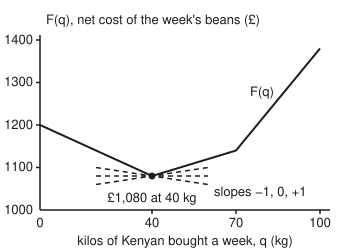

# Subgradients: slopes that still work where the graph has a kink

[Syllabus](../../../SYLLABUS.md) → [Optimization](../README.md) → [Convexity](../README.md#s01) → Subgradients

---

## General Overview

A roaster needs 100 kg of beans a week for its house blend. Two beans can fill it. Kenyan beans come from a small estate that charges more as the order grows: £9 a kilo for the first 40 kg, £14 a kilo for each kilo from 40 to 70, and £20 a kilo past 70. Brazilian beans do the same job in the blend at a flat £12 a kilo. The roaster chooses how many kilos of Kenyan to buy, the rest being Brazilian, and wants the week's bill as small as possible: this card **minimises**.

Calculus says: find where the slope of the bill is zero. But the bill has no zero slope anywhere. Below 40 kg, each extra kilo of Kenyan saves £3 (it costs £9 and replaces a £12 Brazilian kilo). Above 40 kg, each extra kilo costs £2 more (£14 against £12). The bill falls, then rises, and the turn happens at a corner where the slope jumps from −3 to +2. At the corner there is no derivative to set to zero.

The fix is to stop asking for *the* slope at the corner and ask for *every* slope that fits. A straight line through the corner that stays on or below the bill can tilt anywhere from −3 to +2. That range of slopes is called the subdifferential. It contains 0, a flat line, and a flat line under the whole bill proves nothing is cheaper: buy 40 kg of Kenyan and 60 kg of Brazilian, for £1,080.

**A subgradient is the slope of a straight line that touches the graph at a point and stays on or below it everywhere; at a kink there is a whole interval of them, and a point is a minimum exactly when 0 is one of them.**

**What kind of fact this is:** theorems. The one-variable formulas for the absolute value and for a maximum of lines, and the zero-subgradient rule, are proved on this card in Why it works. The many-variable form of the maximum rule is stated, with its source.

### The picture: the net bill and three supporting lines at 40 kg

<p align="center"></p>

The solid line is the net bill $F(q)$ for $q$ kilos of Kenyan. Each dashed line passes through the corner and stays under the graph, so its slope is a subgradient there. The flat one, at £1,080, certifies that 40 kg is the cheapest plan.

---

## The formula

Notation first, in words. A **subgradient** of a function $f$ at a point $x$ is a number $g$ such that the line through $(x, f(x))$ with slope $g$ never rises above the graph. The **subdifferential** $\partial f(x)$, read "the subdifferential of f at x", is the set of all of them, and $g \in \partial f(x)$ says "g is one of them".

$$g \in \partial f(x) \quad\iff\quad f(y) \;\ge\; f(x) + g\,(y - x) \quad \text{for every } y$$

**Read it aloud:** g is a subgradient at x when the straight line through the point with slope g stays on or below the graph at every other point y.

For a convex function of one variable (one whose chords lie on or above its graph, [Convex functions](03-convex-functions-and-their-tests.md)), the set is the interval between the slope just to the left and the slope just to the right:

$$\partial f(x) = \big[\,f'_-(x),\; f'_+(x)\,\big]$$

Two cases the job of this card needs. The absolute value $|x|$ has slope −1 left of 0 and +1 right of it:

$$\partial |x| = \begin{cases} \{-1\} & x < 0 \\ [-1,\ 1] & x = 0 \\ \{+1\} & x > 0 \end{cases}$$

A maximum of straight lines $f(x) = \max_i (a_i x + b_i)$ uses only the lines that reach the top at $x$, called the **active** lines, collected in a set $I$:

$$\partial f(x) = \Big[\,\min_{i \in I} a_i,\; \max_{i \in I} a_i\,\Big]$$

And the rule that makes all this pay off:

$$x^* \text{ minimises } f \quad\iff\quad 0 \in \partial f(x^*)$$

**Read it aloud:** a point is a lowest point exactly when a flat line through it fits under the graph.

The Kenyan bill is a maximum of three lines, one per price tier: $C(q) = \max(9q,\; 14q - 200,\; 20q - 620)$ pounds. At 40 kg the first two read £360 and the third £180, so $I$ holds the £9 and £14 lines and $\partial C(40) = [9, 14]$. The week's net bill adds the Brazilian kilos, $F(q) = C(q) + 12\,(100 - q)$. Adding a straight line of slope −12 lowers every slope by 12, so $\partial F(40) = [-3, 2]$, which contains 0.

In several variables a subgradient is a vector $g$ and $g\,(y - x)$ becomes the dot product; [Jensen's inequality](05-jensen-and-supporting-lines.md) proves that a convex function has one at every inside point. Two functions get their own names here, beside wing 03's length $\|x\|$: $\|x\|_1$, the sum of the absolute entries, and $\|x\|_\infty$, the largest absolute entry. For a maximum of planes the interval becomes the convex hull (the set of all weighted averages) of the active planes' gradients.

| Symbol | Plain meaning | In our example | Push it up and the answer… |
| --- | --- | --- | --- |
| $q$ | kilos of Kenyan bought a week, out of 100 | 40 kg is best | past 40 kg the net bill climbs £2 a kilo |
| $C(q)$ | the Kenyan bill, in pounds | £360 at 40 kg | — |
| $p$ | the Brazilian price, £ a kilo | £12 | past £14 the best buy jumps to 70 kg |
| $F(q)$ | the net bill: $C(q) + p\,(100 - q)$ | £1,080 at 40 kg | — |
| $f$, $x$, $y$ | any function, the point examined, any other point | $f = C$, $x = 40$ | — |
| $g$ | a subgradient: the slope of a line under the graph, touching at $x$ | any number from 9 to 14 for $C$ at 40 kg | — |
| $\partial f(x)$ | the subdifferential: the set of all subgradients at $x$ | $\partial C(40) = [9, 14]$, $\partial F(40) = [-3, 2]$ | a sharper kink, a wider interval |
| $f'_-(x)$, $f'_+(x)$ | the slopes just left and just right of $x$ | 9 and 14 for $C$ at 40 kg | — |
| $a_i$, $b_i$, $I$ | slope and intercept of the $i$-th line; the set of active lines | slopes 9, 14, 20; $I$ = the £9 and £14 lines at 40 kg | — |
| $x^*$ | a minimiser: a point where $f$ is lowest | 40 kg | — |
| $\lvert x \rvert$ | the absolute value: distance from 0 | $\partial\lvert x\rvert = [-1, 1]$ at 0, $\{1\}$ at 2.5 | — |
| $\Vert x\Vert_1$, $\Vert x\Vert_\infty$ | sum of the absolute entries; the largest absolute entry | at $(3, 0)$: $g_1 = 1$, $g_2$ anywhere from −1 to 1 | — |

### When it holds

- **The function is convex around the point.** Then left and right slopes give the whole subdifferential. Turn the surcharge into a discount, £14 a kilo up to 40 kg and £9 after, and the bill bends the wrong way: the slopes run 14 then 9, and no line through the corner stays under the graph. The brute-force search finds 0 subgradients there.
- **The point is inside the range, not at its end.** At an end the line can tilt without limit in one direction. At $q = 0$, any slope of −3 or less fits under $F$, because no plan buys less than 0 kg.
- **Only active lines count.** A tier that is below the top at $x$ does not touch the graph there. Counting the £20 tier at 40 kg gives $[9, 20]$, an interval that is too wide.
- **The limits are part of the function.** Here $q$ must lie between 0 and 100, and 40 kg is strictly inside, so the limits never bite. At a limit, take $F$ on the allowed range only, as at $q = 0$ above. Then $0 \in \partial F$ still certifies the minimum: with the Brazilian at £8, a flat line fits under $F$ at 0 kg, the best buy (Try changing). Treat $F$ as a formula for negative $q$ too and no flat line fits there, because the formula keeps falling below 0 kg. Multipliers, prices attached to the limits, split the same rule into a cost part and a limit part, taken up in [KKT conditions](../03-Constrained%20Optimisation/02-kkt-conditions.md).
- **The bill has no jump.** A price that drops for the whole order past a break, or a one-off fee, makes total cost leap. A leap is not convex, and the interval formula fails there.

---

## Why it works

### Step 0: a subgradient is a supporting line, and convex curves have them

A **supporting line** at $x$ is a straight line that touches the graph at $x$ and lies on or below it everywhere else. Its slope is, by the definition above, a subgradient. The probability wing's [Jensen's inequality](../../09-Probability%20and%20statistics/02-Random%20Variables/06-jensens-inequality.md) card already proves that a convex curve has a supporting line at every inside point, corner included, with any slope between the left and right slopes, as for a call option's payoff at its strike. This card names that set of slopes, computes it, and turns it into a test for a minimum.

### Step 1: for one variable, the subgradients are exactly the slopes between left and right

On a convex graph, chord slopes rise as you move right ([Convex functions](03-convex-functions-and-their-tests.md)). Look at the condition $f(y) \ge f(x) + g\,(y - x)$ one side at a time.

For $y$ to the right of $x$, divide by the positive $y - x$: the condition says $g$ is at most the chord slope from $x$ to $y$. Those chord slopes fall as $y$ moves in toward $x$, down to the right slope $f'_+(x)$. So $g \le f'_+(x)$ covers every $y$ on the right.

For $y$ to the left, divide by the negative $y - x$, which flips the inequality: $g$ is at least the chord slope from $y$ to $x$. Those rise as $y$ moves in, up to the left slope $f'_-(x)$. So $g \ge f'_-(x)$ covers every $y$ on the left.

Both together: $\partial f(x) = [f'_-(x), f'_+(x)]$. Where the graph is smooth the two slopes agree and the set is one number, the ordinary derivative.

<details>
<summary>Detailed proof: why the chord slopes settle on the one-sided slopes</summary>

Fix $x$ inside the interval where $f$ is convex. For $x < y_1 < y_2$, write $y_1$ as a weighted average of $x$ and $y_2$ with weight $t = (y_1 - x)/(y_2 - x)$ on $y_2$, which lies strictly between 0 and 1. The chord inequality $f(y_1) \le (1-t)f(x) + t f(y_2)$ rearranges to

$$\frac{f(y_1) - f(x)}{y_1 - x} \;\le\; \frac{f(y_2) - f(x)}{y_2 - x}.$$

So the right chord slope $r(y) = (f(y) - f(x))/(y - x)$ does not increase as $y$ falls toward $x$. The same rearrangement with a point $z < x$ shows every right chord slope is at least every left chord slope $\ell(z) = (f(x) - f(z))/(x - z)$, and that $\ell(z)$ does not decrease as $z$ rises toward $x$. A non-increasing quantity bounded below has a limit: $f'_+(x) = \lim_{y \downarrow x} r(y) = \inf_{y > x} r(y)$. Likewise $f'_-(x) = \sup_{z < x} \ell(z)$, and $f'_-(x) \le f'_+(x)$.

Now $g \in \partial f(x)$ means $g \le r(y)$ for every $y > x$ and $g \ge \ell(z)$ for every $z < x$. The first holds for all $y$ exactly when $g \le \inf r = f'_+(x)$; the second exactly when $g \ge \sup \ell = f'_-(x)$. Hence $\partial f(x) = [f'_-(x), f'_+(x)]$, never empty.

</details>

### Step 2: the absolute value

Left of 0, $|x| = -x$ with slope −1; right of 0, $|x| = x$ with slope +1. Step 1 gives $\partial|0| = [-1, 1]$. A direct check agrees: at $x = 0$ the definition asks $|y| \ge g\,y$ for every $y$. Try $y = 1$: it needs $g \le 1$. Try $y = -1$: it needs $g \ge -1$. Any $g$ in between passes for every $y$, since $g\,y \le |g|\,|y| \le |y|$. At $x = 2.5$ the graph is smooth, both slopes are 1, and the set is the single number 1.

### Step 3: a maximum of lines

Near $x$, a line that is strictly below the top stays below for a short distance either side, so only the active lines shape the corner. Just right of $x$, the steepest active line climbs fastest and is on top, so $f'_+(x)$ is the largest active slope. Just left of $x$, going backwards, the line with the smallest slope falls least and is on top, so $f'_-(x)$ is the smallest active slope. Step 1 then gives $\partial f(x) = [\min_{i\in I} a_i, \max_{i \in I} a_i]$.

For the Kenyan bill at 40 kg the active slopes are 9 and 14: $\partial C(40) = [9, 14]$. At 55 kg only the £14 line is on top: $\partial C(55) = [14, 14]$, an ordinary derivative. At 70 kg the £14 and £20 lines meet: $\partial C(70) = [14, 20]$.

In several variables the same picture holds with planes. Each active plane's gradient is a subgradient, since that plane lies under the maximum and touches it at $x$. Any weighted average of subgradients is again one, because averaging the inequalities keeps them true. That gives the convex hull of the active gradients inside $\partial f(x)$. That nothing else is in it is the harder half; it is stated here, and proved in Hiriart-Urruty and Lemaréchal, chapter D (Sources).

The two named norms follow. $\|x\|_1 = |x_1| + |x_2|$ splits into one absolute value per entry, so at $(3, 0)$ the first entry must be $g_1 = 1$ and the second can be anything in $[-1, 1]$. $\|x\|_\infty = \max(x_1, -x_1, x_2, -x_2)$ is a maximum of four planes. At $(3, -3)$ two are active, $x_1$ and $-x_2$, with gradients $(1, 0)$ and $(0, -1)$, so $\partial\|x\|_\infty$ is the segment between them.

### Step 4: zero in the subdifferential means a minimum

Put $g = 0$ into the definition. It reads $f(y) \ge f(x^*)$ for every $y$: no point is lower. That is the whole proof, and it runs both ways. If $x^*$ is a lowest point then $f(y) \ge f(x^*) + 0\cdot(y - x^*)$, so $0 \in \partial f(x^*)$.

The rule itself needs no convexity. What convexity adds is Step 1: the subdifferential can be read off from slopes near the point, so a local test certifies a global answer, the theme of [Convexity pays off](04-local-minima-are-global-when-convex.md).

For the roaster, the Brazilian kilos add the straight line $12\,(100 - q)$, which shifts every slope down by 12. So $\partial F(40) = [9 - 12, 14 - 12] = [-3, 2]$. Zero is inside, so 40 kg is the cheapest plan of all, not just of the plans nearby.

The interval says more. With the Brazilian at price $p$ the net slopes at 40 kg are $[9 - p, 14 - p]$, which contains 0 exactly when $p$ is between £9 and £14. So 40 kg stays among the cheapest plans for any Brazilian price in that range, and the subdifferential $[9, 14]$ is that range. A subgradient at a kink is a price at which the kink is the right answer.

---

## Worked numbers, by hand

| Step | Arithmetic | Value |
| --- | --- | --- |
| Kenyan bill at 40 kg | 9 × 40 | £360 |
| Kenyan bill at 70 kg | 360 + 14 × 30 | £780 |
| Kenyan bill at 100 kg | 780 + 20 × 30 | £1,380 |
| the three lines at 40 kg | 9 × 40; 14 × 40 − 200; 20 × 40 − 620 | 360, 360, 180 |
| active slopes at 40 kg | the two lines reading 360 | 9 and 14 |
| $\partial C(40)$ | from the smaller to the larger | [9, 14] |
| $\partial F(40)$ | [9 − 12, 14 − 12] | [−3, 2] |
| net bill at 0, 70 and 100 kg | 12 × 100; 780 + 12 × 30; 1,380 + 0 | £1,200, £1,140, £1,380 |
| net bill at 40 kg | 360 + 12 × 60 = 360 + 720 | **£1,080, and 0 is in [−3, 2]** |

Buy 40 kg of Kenyan and 60 kg of Brazilian for £1,080 a week; the flat supporting line at £1,080 is the proof that no other split is cheaper, and the enumeration of all 201 half-kilo plans agrees.

### What breaks if you drop a piece

| Mistake | Comes out at | What went wrong |
| --- | --- | --- |
| Take the right-hand slope as "the derivative" at 40 kg | +2, so "move left"; 38 kg costs £1,086 | A one-sided slope is one subgradient, not a verdict. Zero is in $[-3, 2]$, so 40 kg was already best |
| Count every tier's slope, active or not | $[9, 20]$; with Brazilian at £18 that keeps 40 kg at £1,440 | The £20 tier is below the top at 40 kg. At £18 the true best is 70 kg at £1,320 |
| Treat a discount tier like a surcharge | slopes 14 then 9, 0 subgradients; 40 kg costs £1,280 | Falling slopes make the bill concave: the corner is the most expensive point nearby. The best is 100 kg at £1,100 |

---

## Code, from first principles, and it actually runs

The script writes the bill as a maximum of three lines. It reaches the subdifferential at 40 kg by three independent roads:

- the maximum rule (active slopes);
- one-sided difference slopes with a step of 0.001 kg;
- a brute-force test of the definition, trying 2,501 candidate slopes, one every penny, against every half kilo from 0 to 100.

A fourth road, enumeration of all 201 half-kilo plans, confirms the minimum the zero rule certifies. The same brute force checks the absolute value and the two norms on a grid, one step along a subgradient of $\Vert x\Vert_1$ is taken, and each mistake in the table above is printed.

### Python

```python
# Subgradients -- the check behind the card.  Standard library only.
# A roaster needs 100 kg of beans a week.  Kenyan beans cost £9/kg for the first
# 40 kg, £14/kg from 40 to 70 kg and £20/kg past 70 kg; Brazilian beans at £12/kg
# fill the rest.  Roads: the max rule, a brute-force test of the definition,
# one-sided difference slopes, and a full enumeration of the purchase.
LINES = [(9, 0), (14, -200), (20, -620)]      # total Kenyan cost C(q) = max of a*q + b
NEED, P, KNEE = 100, 12, 40                   # kg needed, £/kg substitute, the volume break
QS = [i / 2 for i in range(0, 201)]           # every half kilo from 0 to 100

def cost(q, lines=LINES): return max(a * q + b for a, b in lines)
def net(q, p=P, c=cost): return c(q) + p * (NEED - q)   # what the week's beans cost, £

def max_rule(q, lines=LINES):                 # slopes of the lines that touch the top at q
    top = cost(q, lines)
    act = [a for a, b in lines if a * q + b == top]
    return min(act), max(act)

def brute(f, x, ys, gs):                      # every g with f(y) >= f(x) + g (y - x) for all y
    return [g for g in gs if all(f(y) - f(x) >= g * (y - x) for y in ys)]

def one_sided(f, x, h=1e-3): return (f(x) - f(x - h)) / h, (f(x + h) - f(x)) / h

def best(f, qs=QS):
    q = min(qs, key=f)
    return q, f(q)

def num(v): return f"{v:g}"

print("Kenyan cost C(q) at 0, 40, 70, 100 kg:", ", ".join(num(cost(q)) for q in (0, 40, 70, 100)))
print("at 40 kg the three lines read", ", ".join(num(a * KNEE + b) for a, b in LINES) + f"; 60 kg of Brazilian costs £{num(P * (NEED - KNEE))}")
lo, hi = max_rule(KNEE)
left, right = one_sided(cost, KNEE)
G = [i / 100 for i in range(0, 2501)]                  # trial slopes £0.00 .. £25.00 per kg
ok = brute(cost, KNEE, QS, G)
print(f"one-sided slopes of C at 40 kg (h = 0.001): {left:.3f} and {right:.3f}")
print(f"max rule at 40 kg: active slopes {lo} and {hi}, so dC(40) = [{lo}, {hi}]")
print(f"brute force at 40 kg: g from {ok[0]:.2f} to {ok[-1]:.2f} passes ({len(ok)} of {len(G)} tried)")
print("max rule at 55 and 70 kg: dC(55) = [%d, %d], dC(70) = [%d, %d]" % (max_rule(55) + max_rule(70)))
assert abs(left - lo) < 1e-6 and abs(right - hi) < 1e-6          # road 1 against road 3
assert (ok[0], ok[-1]) == (lo, hi) and len(ok) == 501           # road 1 against road 2
assert max_rule(55) == (14, 14) and max_rule(70) == (14, 20)

print("net cost F(q) at 0, 40, 70, 100 kg:", ", ".join(num(net(q)) for q in (0, 40, 70, 100)))
dlo, dhi = lo - P, hi - P
okF = brute(net, KNEE, QS, [i / 100 for i in range(-1000, 1001)])
print(f"dF(40) = dC(40) - 12 = [{dlo}, {dhi}]; brute force gives [{okF[0]:.2f}, {okF[-1]:.2f}]; 0 inside: {dlo <= 0 <= dhi}")
qb, fb = best(net)
print(f"enumeration of all 201 half-kilo plans: cheapest at {num(qb)} kg, £{num(fb)}")
assert (okF[0], okF[-1]) == (dlo, dhi) and dlo <= 0 <= dhi
assert qb == KNEE and fb == 1080
keep = [p / 2 for p in range(0, 61) if net(KNEE, p / 2) == best(lambda q: net(q, p / 2))[1]]
print(f"substitute prices (in 50p steps) at which 40 kg is among the cheapest: £{num(keep[0])} to £{num(keep[-1])}")
for p in (8, 15):
    q, f = best(lambda q: net(q, p))
    print(f"  substitute at £{p}: best buy {num(q)} kg of Kenyan, £{num(f)}")
assert (keep[0], keep[-1]) == (lo, hi)

ab = lambda x: abs(x)
X = [i / 2 for i in range(-10, 11)]
g1 = [i / 100 for i in range(-200, 201)]
a0, a1 = brute(ab, 0, X, g1), brute(ab, 2.5, X, g1)
print(f"|x| at 0: g from {a0[0]:.2f} to {a0[-1]:.2f} passes; at 2.5: only {a1[0]:.2f} ({len(a1)} value)")
assert (a0[0], a0[-1], len(a0)) == (-1, 1, 201) and a1 == [1]
Y2 = [(u / 2, v / 2) for u in range(-10, 11) for v in range(-10, 11)]
G2 = [(u / 4, v / 4) for u in range(-8, 9) for v in range(-8, 9)]
def brute2(f, x):
    return [g for g in G2 if all(f(y) - f(x) >= g[0] * (y[0] - x[0]) + g[1] * (y[1] - x[1]) for y in Y2)]
n1 = lambda y: abs(y[0]) + abs(y[1])
ninf = lambda y: max(abs(y[0]), abs(y[1]))
s1, sinf = brute2(n1, (3, 0)), brute2(ninf, (3, -3))
print(f"||x||_1 at (3, 0): {len(s1)} of {len(G2)} trial g pass, g1 = {num(s1[0][0])}, g2 from {num(s1[0][1])} to {num(s1[-1][1])}")
print("||x||_inf at (3, -3): passing g =", " ".join(f"({num(a)}, {num(b)})" for a, b in sinf))
g11 = s1[-1]                                                     # the subgradient (1, 1) at (3, 0)
st = (3 - g11[0], 0 - g11[1])                                    # one step along minus it
print(f"||x||_1 from (3, 0) along minus ({num(g11[0])}, {num(g11[1])}) to ({num(st[0])}, {num(st[1])}): {num(n1(st))}, was {num(n1((3, 0)))}")
assert s1 == [(1, v / 4) for v in range(-4, 5)]                 # {1} x [-1, 1]
assert sinf == [(t / 4, t / 4 - 1) for t in range(0, 5)]        # segment from (0, -1) to (1, 0)

print("what breaks:")
print(f"  right slope taken as the derivative: +{hi - P} says move left; 38 kg costs £{num(net(38))}")
wrong = (min(a for a, b in LINES), max(a for a, b in LINES))
qw, fw = best(lambda q: net(q, 18))
print(f"  every piece counted, not only active: [{wrong[0]}, {wrong[1]}]; at £18 that keeps 40 kg (£{num(net(40, 18))}), best is {num(qw)} kg at £{num(fw)}")
disc = lambda q: min(14 * q, 9 * q + 200)                      # a discount past 40 kg: concave
dl, dr = one_sided(disc, KNEE)
od = brute(disc, KNEE, QS, G)
qd, fd = best(lambda q: net(q, P, disc))
print(f"  discount tier: slopes {dl:.0f} then {dr:.0f}, {len(od)} subgradients at 40 kg; 40 kg costs £{num(net(40, P, disc))}, best is {num(qd)} kg at £{num(fd)}")
assert net(38) > net(KNEE) and qw == 70 and fw < net(40, 18) and od == [] and qd == 100

sx = lambda q: 40 + 2.8 * q                                      # figure: q 0..100 -> x 40..320
sy = lambda f: 210 - 0.425 * (f - 1000)                          # £1000..£1400 -> y 210..40
pts = " ".join(f"{sx(q):.1f},{sy(net(q)):.1f}" for q in (0, 40, 70, 100))
sup = " ".join(f"{s:+d}:{sx(20):.1f},{sy(1080 + s * -20):.1f}-{sx(60):.1f},{sy(1080 + s * 20):.1f}" for s in (-1, 0, 1))
print("figure, F polyline", pts, "| supporting lines", sup)
print("ALL CHECKS PASS")
```

**Ran 2026-11-11 on macOS, Python 3.14.10, standard library only. All checks passed. Output, pasted from the run:**

```
Kenyan cost C(q) at 0, 40, 70, 100 kg: 0, 360, 780, 1380
at 40 kg the three lines read 360, 360, 180; 60 kg of Brazilian costs £720
one-sided slopes of C at 40 kg (h = 0.001): 9.000 and 14.000
max rule at 40 kg: active slopes 9 and 14, so dC(40) = [9, 14]
brute force at 40 kg: g from 9.00 to 14.00 passes (501 of 2501 tried)
max rule at 55 and 70 kg: dC(55) = [14, 14], dC(70) = [14, 20]
net cost F(q) at 0, 40, 70, 100 kg: 1200, 1080, 1140, 1380
dF(40) = dC(40) - 12 = [-3, 2]; brute force gives [-3.00, 2.00]; 0 inside: True
enumeration of all 201 half-kilo plans: cheapest at 40 kg, £1080
substitute prices (in 50p steps) at which 40 kg is among the cheapest: £9 to £14
  substitute at £8: best buy 0 kg of Kenyan, £800
  substitute at £15: best buy 70 kg of Kenyan, £1230
|x| at 0: g from -1.00 to 1.00 passes; at 2.5: only 1.00 (1 value)
||x||_1 at (3, 0): 9 of 289 trial g pass, g1 = 1, g2 from -1 to 1
||x||_inf at (3, -3): passing g = (0, -1) (0.25, -0.75) (0.5, -0.5) (0.75, -0.25) (1, 0)
||x||_1 from (3, 0) along minus (1, 1) to (2, -1): 3, was 3
what breaks:
  right slope taken as the derivative: +2 says move left; 38 kg costs £1086
  every piece counted, not only active: [9, 20]; at £18 that keeps 40 kg (£1440), best is 70 kg at £1320
  discount tier: slopes 14 then 9, 0 subgradients at 40 kg; 40 kg costs £1280, best is 100 kg at £1100
figure, F polyline 40.0,125.0 152.0,176.0 236.0,150.5 320.0,48.5 | supporting lines -1:96.0,167.5-208.0,184.5 +0:96.0,176.0-208.0,176.0 +1:96.0,184.5-208.0,167.5
ALL CHECKS PASS
```

### Rust

```rust
// Subgradients -- the check behind the card.  Rust std only, no crates.
// A roaster needs 100 kg of beans a week.  Kenyan beans cost £9/kg for the first
// 40 kg, £14/kg from 40 to 70 kg and £20/kg past 70 kg; Brazilian beans at £12/kg
// fill the rest.  Roads: the max rule, a brute-force test of the definition,
// one-sided difference slopes, and a full enumeration of the purchase.
const LINES: [(f64, f64); 3] = [(9.0, 0.0), (14.0, -200.0), (20.0, -620.0)]; // C(q) = max of a*q + b
const NEED: f64 = 100.0; // kg needed
const P: f64 = 12.0; // £/kg substitute
const KNEE: f64 = 40.0; // the volume break

fn cost(q: f64) -> f64 { LINES.iter().map(|&(a, b)| a * q + b).fold(f64::MIN, f64::max) }
fn net_with(q: f64, p: f64, c: &dyn Fn(f64) -> f64) -> f64 { c(q) + p * (NEED - q) }
fn net(q: f64) -> f64 { net_with(q, P, &cost) }

fn max_rule(q: f64) -> (f64, f64) { // slopes of the lines that touch the top at q
    let top = cost(q);
    let act: Vec<f64> = LINES.iter().filter(|&&(a, b)| a * q + b == top).map(|&(a, _)| a).collect();
    (act.iter().cloned().fold(f64::MAX, f64::min), act.iter().cloned().fold(f64::MIN, f64::max))
}
fn brute(f: &dyn Fn(f64) -> f64, x: f64, ys: &[f64], gs: &[f64]) -> Vec<f64> {
    gs.iter().cloned().filter(|&g| ys.iter().all(|&y| f(y) - f(x) >= g * (y - x))).collect()
}
fn one_sided(f: &dyn Fn(f64) -> f64, x: f64) -> (f64, f64) {
    let h = 1e-3;
    ((f(x) - f(x - h)) / h, (f(x + h) - f(x)) / h)
}
fn best(f: &dyn Fn(f64) -> f64, qs: &[f64]) -> (f64, f64) {
    let mut q = qs[0];
    for &x in qs { if f(x) < f(q) { q = x; } }
    (q, f(q))
}
fn num(v: f64) -> String { format!("{}", v) }
fn list(f: &dyn Fn(f64) -> f64, qs: &[f64]) -> String {
    qs.iter().map(|&q| num(f(q))).collect::<Vec<_>>().join(", ")
}

fn main() {
    let qs: Vec<f64> = (0..201).map(|i| i as f64 / 2.0).collect();
    let fourq = [0.0, 40.0, 70.0, 100.0];
    println!("Kenyan cost C(q) at 0, 40, 70, 100 kg: {}", list(&cost, &fourq));
    let at40: Vec<String> = LINES.iter().map(|&(a, b)| num(a * KNEE + b)).collect();
    println!("at 40 kg the three lines read {}; 60 kg of Brazilian costs £{}", at40.join(", "), num(P * (NEED - KNEE)));
    let (lo, hi) = max_rule(KNEE);
    let (left, right) = one_sided(&cost, KNEE);
    let g: Vec<f64> = (0..2501).map(|i| i as f64 / 100.0).collect(); // trial slopes £0.00 .. £25.00
    let ok = brute(&cost, KNEE, &qs, &g);
    println!("one-sided slopes of C at 40 kg (h = 0.001): {:.3} and {:.3}", left, right);
    println!("max rule at 40 kg: active slopes {} and {}, so dC(40) = [{}, {}]", lo, hi, lo, hi);
    println!("brute force at 40 kg: g from {:.2} to {:.2} passes ({} of {} tried)", ok[0], ok[ok.len() - 1], ok.len(), g.len());
    let (m55, m70) = (max_rule(55.0), max_rule(70.0));
    println!("max rule at 55 and 70 kg: dC(55) = [{}, {}], dC(70) = [{}, {}]", m55.0, m55.1, m70.0, m70.1);
    assert!((left - lo).abs() < 1e-6 && (right - hi).abs() < 1e-6); // road 1 against road 3
    assert!(ok[0] == lo && ok[ok.len() - 1] == hi && ok.len() == 501); // road 1 against road 2
    assert!(m55 == (14.0, 14.0) && m70 == (14.0, 20.0));

    println!("net cost F(q) at 0, 40, 70, 100 kg: {}", list(&net, &fourq));
    let (dlo, dhi) = (lo - P, hi - P);
    let gf: Vec<f64> = (-1000..1001).map(|i| i as f64 / 100.0).collect();
    let okf = brute(&net, KNEE, &qs, &gf);
    println!("dF(40) = dC(40) - 12 = [{}, {}]; brute force gives [{:.2}, {:.2}]; 0 inside: {}",
             dlo, dhi, okf[0], okf[okf.len() - 1], if dlo <= 0.0 && 0.0 <= dhi { "True" } else { "False" });
    let (qb, fb) = best(&net, &qs);
    println!("enumeration of all 201 half-kilo plans: cheapest at {} kg, £{}", num(qb), num(fb));
    assert!(okf[0] == dlo && okf[okf.len() - 1] == dhi && dlo <= 0.0 && 0.0 <= dhi);
    assert!(qb == KNEE && fb == 1080.0);
    let keep: Vec<f64> = (0..61).map(|p| p as f64 / 2.0)
        .filter(|&p| net_with(KNEE, p, &cost) == best(&|q| net_with(q, p, &cost), &qs).1).collect();
    println!("substitute prices (in 50p steps) at which 40 kg is among the cheapest: £{} to £{}", num(keep[0]), num(keep[keep.len() - 1]));
    for p in [8.0, 15.0] {
        let (q, f) = best(&|q| net_with(q, p, &cost), &qs);
        println!("  substitute at £{}: best buy {} kg of Kenyan, £{}", p, num(q), num(f));
    }
    assert!(keep[0] == lo && keep[keep.len() - 1] == hi);

    let ab = |x: f64| x.abs();
    let xs: Vec<f64> = (-10..11).map(|i| i as f64 / 2.0).collect();
    let g1: Vec<f64> = (-200..201).map(|i| i as f64 / 100.0).collect();
    let (a0, a1) = (brute(&ab, 0.0, &xs, &g1), brute(&ab, 2.5, &xs, &g1));
    println!("|x| at 0: g from {:.2} to {:.2} passes; at 2.5: only {:.2} ({} value)", a0[0], a0[a0.len() - 1], a1[0], a1.len());
    assert!(a0[0] == -1.0 && a0[a0.len() - 1] == 1.0 && a0.len() == 201 && a1 == vec![1.0]);
    let mut y2 = Vec::new();
    for u in -10..11 { for v in -10..11 { y2.push((u as f64 / 2.0, v as f64 / 2.0)); } }
    let mut g2 = Vec::new();
    for u in -8..9 { for v in -8..9 { g2.push((u as f64 / 4.0, v as f64 / 4.0)); } }
    let brute2 = |f: &dyn Fn((f64, f64)) -> f64, x: (f64, f64)| -> Vec<(f64, f64)> {
        g2.iter().cloned().filter(|g| y2.iter().all(|&y| f(y) - f(x) >= g.0 * (y.0 - x.0) + g.1 * (y.1 - x.1))).collect()
    };
    let n1 = |y: (f64, f64)| y.0.abs() + y.1.abs();
    let ninf = |y: (f64, f64)| y.0.abs().max(y.1.abs());
    let (s1, sinf) = (brute2(&n1, (3.0, 0.0)), brute2(&ninf, (3.0, -3.0)));
    println!("||x||_1 at (3, 0): {} of {} trial g pass, g1 = {}, g2 from {} to {}",
             s1.len(), g2.len(), num(s1[0].0), num(s1[0].1), num(s1[s1.len() - 1].1));
    let pass: Vec<String> = sinf.iter().map(|&(a, b)| format!("({}, {})", num(a), num(b))).collect();
    println!("||x||_inf at (3, -3): passing g = {}", pass.join(" "));
    let g11 = s1[s1.len() - 1]; // the subgradient (1, 1) at (3, 0)
    let st = (3.0 - g11.0, 0.0 - g11.1); // one step along minus it
    println!("||x||_1 from (3, 0) along minus ({}, {}) to ({}, {}): {}, was {}",
             num(g11.0), num(g11.1), num(st.0), num(st.1), num(n1(st)), num(n1((3.0, 0.0))));
    assert!(s1 == (-4..5).map(|v| (1.0, v as f64 / 4.0)).collect::<Vec<_>>()); // {1} x [-1, 1]
    assert!(sinf == (0..5).map(|t| (t as f64 / 4.0, t as f64 / 4.0 - 1.0)).collect::<Vec<_>>());

    println!("what breaks:");
    println!("  right slope taken as the derivative: +{} says move left; 38 kg costs £{}", hi - P, num(net(38.0)));
    let wrong = (LINES.iter().map(|l| l.0).fold(f64::MAX, f64::min), LINES.iter().map(|l| l.0).fold(f64::MIN, f64::max));
    let (qw, fw) = best(&|q| net_with(q, 18.0, &cost), &qs);
    println!("  every piece counted, not only active: [{}, {}]; at £18 that keeps 40 kg (£{}), best is {} kg at £{}",
             wrong.0, wrong.1, num(net_with(40.0, 18.0, &cost)), num(qw), num(fw));
    let disc = |q: f64| (14.0 * q).min(9.0 * q + 200.0); // a discount past 40 kg: concave
    let (dl, dr) = one_sided(&disc, KNEE);
    let od = brute(&disc, KNEE, &qs, &g);
    let (qd, fd) = best(&|q| net_with(q, P, &disc), &qs);
    println!("  discount tier: slopes {:.0} then {:.0}, {} subgradients at 40 kg; 40 kg costs £{}, best is {} kg at £{}",
             dl, dr, od.len(), num(net_with(40.0, P, &disc)), num(qd), num(fd));
    assert!(net(38.0) > net(KNEE) && qw == 70.0 && fw < net_with(40.0, 18.0, &cost) && od.is_empty() && qd == 100.0);

    let sx = |q: f64| 40.0 + 2.8 * q; // figure: q 0..100 -> x 40..320
    let sy = |f: f64| 210.0 - 0.425 * (f - 1000.0); // £1000..£1400 -> y 210..40
    let pts: Vec<String> = fourq.iter().map(|&q| format!("{:.1},{:.1}", sx(q), sy(net(q)))).collect();
    let sup: Vec<String> = [-1i32, 0, 1].iter().map(|&s| format!("{:+}:{:.1},{:.1}-{:.1},{:.1}",
        s, sx(20.0), sy(1080.0 - 20.0 * s as f64), sx(60.0), sy(1080.0 + 20.0 * s as f64))).collect();
    println!("figure, F polyline {} | supporting lines {}", pts.join(" "), sup.join(" "));
    println!("ALL CHECKS PASS");
}
```

**Ran 2026-11-11 on macOS, rustc 1.98.1, no crates. All checks passed. Output, pasted from the run:**

```
Kenyan cost C(q) at 0, 40, 70, 100 kg: 0, 360, 780, 1380
at 40 kg the three lines read 360, 360, 180; 60 kg of Brazilian costs £720
one-sided slopes of C at 40 kg (h = 0.001): 9.000 and 14.000
max rule at 40 kg: active slopes 9 and 14, so dC(40) = [9, 14]
brute force at 40 kg: g from 9.00 to 14.00 passes (501 of 2501 tried)
max rule at 55 and 70 kg: dC(55) = [14, 14], dC(70) = [14, 20]
net cost F(q) at 0, 40, 70, 100 kg: 1200, 1080, 1140, 1380
dF(40) = dC(40) - 12 = [-3, 2]; brute force gives [-3.00, 2.00]; 0 inside: True
enumeration of all 201 half-kilo plans: cheapest at 40 kg, £1080
substitute prices (in 50p steps) at which 40 kg is among the cheapest: £9 to £14
  substitute at £8: best buy 0 kg of Kenyan, £800
  substitute at £15: best buy 70 kg of Kenyan, £1230
|x| at 0: g from -1.00 to 1.00 passes; at 2.5: only 1.00 (1 value)
||x||_1 at (3, 0): 9 of 289 trial g pass, g1 = 1, g2 from -1 to 1
||x||_inf at (3, -3): passing g = (0, -1) (0.25, -0.75) (0.5, -0.5) (0.75, -0.25) (1, 0)
||x||_1 from (3, 0) along minus (1, 1) to (2, -1): 3, was 3
what breaks:
  right slope taken as the derivative: +2 says move left; 38 kg costs £1086
  every piece counted, not only active: [9, 20]; at £18 that keeps 40 kg (£1440), best is 70 kg at £1320
  discount tier: slopes 14 then 9, 0 subgradients at 40 kg; 40 kg costs £1280, best is 100 kg at £1100
figure, F polyline 40.0,125.0 152.0,176.0 236.0,150.5 320.0,48.5 | supporting lines -1:96.0,167.5-208.0,184.5 +0:96.0,176.0-208.0,176.0 +1:96.0,184.5-208.0,167.5
ALL CHECKS PASS
```

The two outputs match line for line.

### Lean

Lean proves the card's three rules for every function and point that meet their conditions, and the card's worked bean numbers.

- Let f be convex on its allowed range, and x strictly inside that range. Then the subgradients at x are exactly the numbers from the left slope to the right slope.
- A point is a lowest point of f on its allowed range exactly when 0 is a subgradient there. This rule needs no convexity.
- For a maximum of finitely many lines, the subgradients at x run from the smallest to the largest active slope.
- At 40 kg the three Kenyan price lines read £360, £360 and £180.
- The Kenyan bill is £0, £360, £780 and £1,380 at 0, 40, 70 and 100 kg.
- The net bill is £1,200, £1,080, £1,140 and £1,380 at the same four points, and £1,086 at 38 kg.
- The net slopes at 40 kg are 9 − 12 = −3 and 14 − 12 = 2, so 0 lies between them.
- With the Brazilian at £18, 40 kg costs £1,440 but 70 kg costs £1,320.
- With the discount tier, 40 kg costs £1,280 and 100 kg costs £1,100.
- With the Brazilian at £15, 70 kg costs £1,230; at £8, 0 kg costs £800.

The absolute value, the two norms, the many-variable rule, the brute-force searches and the enumeration are left to the Python and Rust checks.

```lean
-- Subgradients: for a convex function of one variable the subgradients at an inside point are exactly the slopes from the left slope to the right slope, a point is a minimum exactly when 0 is a subgradient, and for a maximum of lines the subgradients run from the smallest to the largest active slope.
import Mathlib.Analysis.Convex.Deriv
import Mathlib.Order.ConditionallyCompleteLattice.Finset

open Set

/-- The subdifferential of `f` at `x`, with `f` taken on the allowed range `S` only:
every slope `g` such that the line through `(x, f x)` with slope `g` stays on or below
the graph at every point `y` of `S`. -/
def subdifferential (f : ℝ → ℝ) (S : Set ℝ) (x : ℝ) : Set ℝ :=
  {g | ∀ y ∈ S, f x + g * (y - x) ≤ f y}

/-- For a function that is convex on its range, at a point strictly inside the range,
the subgradients are exactly the numbers from the slope just to the left
(the left derivative) to the slope just to the right (the right derivative). -/
theorem subdifferential_eq_icc_left_right_slopes {S : Set ℝ} {f : ℝ → ℝ} {x : ℝ}
    (hf : ConvexOn ℝ S f) (hx : x ∈ interior S) :
    subdifferential f S x = Icc (derivWithin f (Iio x) x) (derivWithin f (Ioi x) x) := by
  ext g
  simp only [subdifferential, mem_ofPred_eq, mem_Icc]
  have hxS : x ∈ S := interior_subset hx
  obtain ⟨l, u, hxlu, hlu⟩ :=
    mem_nhds_iff_exists_Ioo_subset.mp (mem_interior_iff_mem_nhds.mp hx)
  rw [hf.rightDeriv_eq_sInf_slope_of_mem_interior hx,
    hf.leftDeriv_eq_sSup_slope_of_mem_interior hx]
  constructor
  · intro h
    constructor
    · refine csSup_le ⟨slope f x ((l + x) / 2), (l + x) / 2,
        ⟨hlu ⟨by linarith [hxlu.1, hxlu.2], by linarith [hxlu.1, hxlu.2]⟩, by linarith [hxlu.1, hxlu.2]⟩, rfl⟩ ?_
      rintro _ ⟨y, ⟨hyS, hyx⟩, rfl⟩
      have := h y hyS
      rw [slope_def_field, div_le_iff_of_neg (by linarith)]
      linarith
    · refine le_csInf ⟨slope f x ((x + u) / 2), (x + u) / 2,
        ⟨hlu ⟨by linarith [hxlu.1, hxlu.2], by linarith [hxlu.1, hxlu.2]⟩, by linarith [hxlu.1, hxlu.2]⟩, rfl⟩ ?_
      rintro _ ⟨y, ⟨hyS, hxy⟩, rfl⟩
      have := h y hyS
      rw [slope_def_field, le_div_iff₀ (by linarith)]
      linarith
  · rintro ⟨hL, hR⟩ y hyS
    rw [← hf.rightDeriv_eq_sInf_slope_of_mem_interior hx] at hR
    rw [← hf.leftDeriv_eq_sSup_slope_of_mem_interior hx] at hL
    rcases lt_trichotomy y x with hyx | rfl | hxy
    · have h1 := hf.slope_le_leftDeriv_of_mem_interior hyS hx hyx
      rw [slope_def_field, div_le_iff₀ (by linarith)] at h1
      nlinarith
    · simp
    · have h1 := hf.rightDeriv_le_slope_of_mem_interior hx hyS hxy
      rw [slope_def_field, le_div_iff₀ (by linarith)] at h1
      nlinarith

/-- The zero-subgradient rule: a point is a lowest point of `f` on the range `S`
exactly when 0 is a subgradient there, that is, when a flat line through it fits under the graph. -/
theorem is_min_on_iff_zero_mem_subdifferential {S : Set ℝ} {f : ℝ → ℝ} {x : ℝ} :
    IsMinOn f S x ↔ (0 : ℝ) ∈ subdifferential f S x := by
  simp only [subdifferential, mem_ofPred_eq, zero_mul, add_zero, IsMinOn, IsMinFilter,
    Filter.eventually_principal]

/-- The rule for a maximum of finitely many lines `f t = max_i (a_i t + b_i)`: at `x` the
subgradients run from the smallest to the largest slope among the active lines,
the lines that reach the top at `x`. -/
theorem subdifferential_max_of_lines {ι : Type*} [Finite ι] [Nonempty ι] (a b : ι → ℝ) (x : ℝ) :
    subdifferential (fun t => ⨆ i, a i * t + b i) univ x =
      Icc (sInf (a '' {i | a i * x + b i = ⨆ j, a j * x + b j}))
          (sSup (a '' {i | a i * x + b i = ⨆ j, a j * x + b j})) := by
  have hle : ∀ t i, a i * t + b i ≤ ⨆ j, a j * t + b j :=
    fun t i => le_ciSup (f := fun j => a j * t + b j) (Finite.bddAbove_range _) i
  set A := {i | a i * x + b i = ⨆ j, a j * x + b j} with hA
  have hAne : A.Nonempty := by
    obtain ⟨i, hi⟩ := exists_eq_ciSup_of_finite (f := fun j => a j * x + b j)
    exact ⟨i, hi⟩
  have hfin : (a '' A).Finite := (Set.toFinite A).image a
  have hne : (a '' A).Nonempty := hAne.image a
  obtain ⟨i1, hi1A, hi1⟩ := hne.csSup_mem hfin
  obtain ⟨i0, hi0A, hi0⟩ := hne.csInf_mem hfin
  have hmax : ∀ i ∈ A, a i ≤ sSup (a '' A) := fun i hi => le_csSup hfin.bddAbove ⟨i, hi, rfl⟩
  have hmin : ∀ i ∈ A, sInf (a '' A) ≤ a i := fun i hi => csInf_le hfin.bddBelow ⟨i, hi, rfl⟩
  have hcont : ∀ i, Continuous fun y : ℝ => a i * y + b i := fun i => by fun_prop
  ext g
  have hcont' : Continuous fun y : ℝ => (⨆ j, a j * x + b j) + g * (y - x) := by fun_prop
  simp only [subdifferential, mem_ofPred_eq, mem_univ, true_imp_iff, mem_Icc]
  constructor
  · intro h
    by_contra hcon
    rw [not_and_or, not_le, not_le] at hcon
    rcases hcon with hlt | hlt
    · have hev : ∀ i, ∀ᶠ y in nhdsWithin x (Iio x),
          a i * y + b i < (⨆ j, a j * x + b j) + g * (y - x) := by
        intro i
        by_cases hi : i ∈ A
        · filter_upwards [self_mem_nhdsWithin] with y hy
          have e : a i * x + b i = ⨆ j, a j * x + b j := hi
          have hai := hmin i hi
          have hy' : y - x < 0 := by rw [mem_Iio] at hy; linarith
          nlinarith
        · have hlt' : a i * x + b i < ⨆ j, a j * x + b j := lt_of_le_of_ne (hle x i) hi
          exact Filter.Tendsto.eventually_lt
            (((hcont i).tendsto x).mono_left nhdsWithin_le_nhds)
            ((hcont'.tendsto x).mono_left nhdsWithin_le_nhds) (by simpa using hlt')
      obtain ⟨y, hy⟩ := (Filter.eventually_all.2 hev).exists
      obtain ⟨k, hk⟩ := exists_eq_ciSup_of_finite (f := fun j => a j * y + b j)
      have h1 := h y
      have h2 := hy k
      linarith
    · have hev : ∀ i, ∀ᶠ y in nhdsWithin x (Ioi x),
          a i * y + b i < (⨆ j, a j * x + b j) + g * (y - x) := by
        intro i
        by_cases hi : i ∈ A
        · filter_upwards [self_mem_nhdsWithin] with y hy
          have e : a i * x + b i = ⨆ j, a j * x + b j := hi
          have hai := hmax i hi
          have hy' : 0 < y - x := by rw [mem_Ioi] at hy; linarith
          nlinarith
        · have hlt' : a i * x + b i < ⨆ j, a j * x + b j := lt_of_le_of_ne (hle x i) hi
          exact Filter.Tendsto.eventually_lt
            (((hcont i).tendsto x).mono_left nhdsWithin_le_nhds)
            ((hcont'.tendsto x).mono_left nhdsWithin_le_nhds) (by simpa using hlt')
      obtain ⟨y, hy⟩ := (Filter.eventually_all.2 hev).exists
      obtain ⟨k, hk⟩ := exists_eq_ciSup_of_finite (f := fun j => a j * y + b j)
      have h1 := h y
      have h2 := hy k
      linarith
  · rintro ⟨h0, h1⟩ y
    rcases le_total y x with hyx | hxy
    · have e : a i0 * x + b i0 = ⨆ j, a j * x + b j := hi0A
      have := hle y i0
      rw [← hi0] at h0
      nlinarith
    · have e : a i1 * x + b i1 = ⨆ j, a j * x + b j := hi1A
      have := hle y i1
      rw [← hi1] at h1
      nlinarith

-- The card's worked numbers, in whole pounds and kilos.
-- The three price lines at 40 kg read 360, 360 and 180.
example : (9 * 40 : ℤ) = 360 ∧ (14 * 40 - 200 : ℤ) = 360 ∧ (20 * 40 - 620 : ℤ) = 180 := by norm_num
-- The Kenyan bill C(q) = max(9q, 14q - 200, 20q - 620) at 0, 40, 70 and 100 kg.
example : max (max (9 * 0) (14 * 0 - 200)) (20 * 0 - 620) = (0 : ℤ) ∧
    max (max (9 * 40) (14 * 40 - 200)) (20 * 40 - 620) = (360 : ℤ) ∧
    max (max (9 * 70) (14 * 70 - 200)) (20 * 70 - 620) = (780 : ℤ) ∧
    max (max (9 * 100) (14 * 100 - 200)) (20 * 100 - 620) = (1380 : ℤ) := by norm_num
-- The net bill F(q) = C(q) + 12 (100 - q) at 0, 40, 70 and 100 kg, and at 38 kg.
example : (0 + 12 * (100 - 0) : ℤ) = 1200 ∧ (360 + 12 * (100 - 40) : ℤ) = 1080 ∧
    (780 + 12 * (100 - 70) : ℤ) = 1140 ∧ (1380 + 12 * (100 - 100) : ℤ) = 1380 ∧
    (9 * 38 + 12 * (100 - 38) : ℤ) = 1086 := by norm_num
-- The net slopes at 40 kg: [9 - 12, 14 - 12] = [-3, 2], which contains 0.
example : (9 - 12 : ℤ) = -3 ∧ (14 - 12 : ℤ) = 2 ∧ (-3 : ℤ) ≤ 0 ∧ (0 : ℤ) ≤ 2 := by norm_num
-- Brazilian at £18: 40 kg costs £1,440 but 70 kg costs £1,320.
example : (360 + 18 * (100 - 40) : ℤ) = 1440 ∧ (780 + 18 * (100 - 70) : ℤ) = 1320 := by norm_num
-- Discount tier min(14q, 9q + 200): 40 kg costs £1,280, 100 kg costs £1,100.
example : min (14 * 40) (9 * 40 + 200) + 12 * (100 - 40) = (1280 : ℤ) ∧
    min (14 * 100) (9 * 100 + 200) + 12 * (100 - 100) = (1100 : ℤ) := by norm_num
-- Brazilian at £15: 70 kg costs £1,230; at £8: 0 kg costs £800.
example : (780 + 15 * (100 - 70) : ℤ) = 1230 ∧ (0 + 8 * (100 - 0) : ℤ) = 800 := by norm_num

#print axioms subdifferential_eq_icc_left_right_slopes
#print axioms is_min_on_iff_zero_mem_subdifferential
#print axioms subdifferential_max_of_lines
```

**Checked 2026-11-12 on macOS, Lean 4.36.0-rc2, Mathlib v4.36.0-rc2. Every proof is complete and uses only Lean's standard axioms. Output, pasted from the run:**

```
'subdifferential_eq_icc_left_right_slopes' depends on axioms: [propext, Classical.choice, Quot.sound]
'is_min_on_iff_zero_mem_subdifferential' depends on axioms: [propext, Classical.choice, Quot.sound]
'subdifferential_max_of_lines' depends on axioms: [propext, Classical.choice, Quot.sound]
```

> [!TIP]
> **Try changing**
> - Guess first: at what Brazilian price does Kenyan stop being worth buying at all? Change `P` to `8`. The best buy falls to 0 kg, £800, because even the cheapest tier now costs more than the substitute. The asserts pinned to 40 kg stop the run.
> - Guess first: if the Brazilian costs £15, where does the answer move? The output already shows it: 70 kg, £1,230. Zero is now in $\partial F(70) = [14 - 15, 20 - 15] = [-1, 5]$.
> - Guess first: with the Brazilian at exactly £9, which plans are cheapest? Change `P` to `9`. The net bill is flat at £900 from 0 to 40 kg, and $\partial F(40) = [0, 5]$ has 0 at its edge: 40 kg ties with every smaller order. The enumeration reports the first tie, 0 kg, and an assert stops the run.
> - Guess first: move the first break to 42 kg by changing the middle tier to `(14, -210)`. At 40 kg only the £9 line is active now, so $\partial C(40)$ shrinks to the single slope 9 and $\partial F(40) = \{-3\}$ has no 0. The brute-force assert stops the run.

---

## The usual mistake

> [!warning]
> **Setting the derivative to zero when the minimum sits on a kink.** The net bill's slope is −3 on one side of 40 kg and +2 on the other; it is never 0. A search for a zero derivative finds nothing, and a numerical derivative at 40 kg reports whichever side it looks at. The right question is whether 0 lies between the left and right slopes. It does, so 40 kg is the minimum, at £1,080.
>
> - **Stepping along a subgradient expecting the value to fall.** In one variable, away from a minimum, minus a subgradient does point downhill. In two it need not: (1, 1) is a subgradient of $\Vert x\Vert_1$ at (3, 0), yet a step along minus it, to (2, −1), leaves the sum at 3, though (3, 0) is not a minimum. A subgradient bounds the graph from below; it is not a downhill direction.
> - **Counting inactive pieces.** The £20 tier is not touching the top at 40 kg. Including it gives $[9, 20]$, which would keep 40 kg with the Brazilian at £18, at £1,440, when 70 kg costs £1,320.
> - **Calling a discount kink convex.** A tier that gets cheaper with volume has falling slopes. The corner then has 0 subgradients and is a local worst, £1,280; the best plan is 100 kg at £1,100.

---

## Where you meet it in real life

- **Tiered prices and tax bands.** Any bill whose rate per unit rises at breaks is a maximum of lines. At a break the marginal rate is not one number but the interval between the two rates.
- **The lasso.** [Regularisation](../../09-Probability%20and%20statistics/09-Regression/06-ridge-and-lasso.md) adds the absolute value of each coefficient to a fitting error. The kink at 0 is why the soft-threshold rule sets a coefficient exactly to zero: zero stays optimal while the data's pull lies inside the interval the kink allows.
- **Support vector machines.** The hinge loss in [Support vector machines](../../14-Applied%20and%20computational/06-Machine%20Learning%20Mathematics/09-kernels-and-support-vector-machines.md) is $\max(0, 1 - \text{margin})$, a maximum of two lines. Training methods step against one of its subgradients at the kink.
- **The median.** The sum of the distances from $x$ to a set of data points is lowest where 0 is a subgradient: where no more than half the data lie on either side.

> **Say it back**
> At a kink a convex function has no single slope, but many straight lines still touch it there and stay underneath. Their slopes form the subdifferential, which for one variable is the interval from the left slope to the right slope: $[-1, 1]$ for $|x|$ at 0, and from the smallest to the largest active slope for a maximum of lines. A point is a minimum exactly when 0 is in that interval, because a flat line underneath the whole graph means nothing is lower. The roaster's bill has slopes −3 and +2 at 40 kg, so buying 40 kg of Kenyan and 60 kg of Brazilian, for £1,080, is the cheapest plan. The interval $[9, 14]$ is also the range of Brazilian prices for which that plan stays best.

---

## What this builds on

- [Convex functions](03-convex-functions-and-their-tests.md): chords above the graph, and the rising chord slopes that Step 1 turns into the interval of subgradients.
- [Jensen's inequality](../../09-Probability%20and%20statistics/02-Random%20Variables/06-jensens-inequality.md): the proof that a convex curve has a supporting line at every inside point, corner included, with any slope between the left and right slopes.

## Where this goes next

- [Convex conjugates](08-conjugates-and-fenchel-duality.md): describes a function by its supporting lines, one for each slope, so the subdifferential becomes the link between a point and its slopes.
- [Lagrangian relaxation](../05-Integer%20and%20Combinatorial%20Optimisation/07-lagrangian-relaxation-and-decomposition.md): the dual function is a minimum of lines, kinked like the bill here, and subgradients are how it is climbed.
- [Proximal gradient](../06-Conic%2C%20Quadratic%20and%20Stochastic%20Programs/06-proximal-methods-ista-fista-and-the-lasso.md): a method that handles the kink of $|x|$ in one exact step instead of guessing a slope.
- The slope transform: the same bookkeeping of left and right slopes, turned into a transform between a curve and its slopes.

The zero rule checks a point once you have it; finding the kink in a function of thousands of variables, where a subgradient step need not go downhill, is the question this card leaves open.

---

## Sources

Verified 2026-11-11: every link below resolves to the publisher's page.

- Rockafellar, R. T. *Convex Analysis*. Princeton University Press, 1970. [doi:10.1515/9781400873173](https://doi.org/10.1515/9781400873173). The standard reference: subgradients, one-sided derivatives and the subdifferential in sections 23 and 24.
- Hiriart-Urruty, J.-B., and C. Lemaréchal. *Fundamentals of Convex Analysis*. Springer, 2001. [doi:10.1007/978-3-642-56468-0](https://doi.org/10.1007/978-3-642-56468-0). Chapter D: subdifferentials of finite convex functions, with the rule for a maximum of functions stated and proved.
- Shor, N. Z. *Minimization Methods for Non-Differentiable Functions*. Springer, 1985. [doi:10.1007/978-3-642-82118-9](https://doi.org/10.1007/978-3-642-82118-9). The subgradient method, and why its steps need not go downhill.
- Tibshirani, R. "Regression Shrinkage and Selection via the Lasso." *Journal of the Royal Statistical Society, Series B* 58, no. 1 (1996): 267–288. [doi:10.1111/j.2517-6161.1996.tb02080.x](https://doi.org/10.1111/j.2517-6161.1996.tb02080.x). The absolute-value penalty whose kink sets coefficients exactly to zero.
