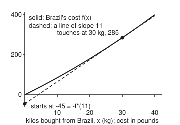
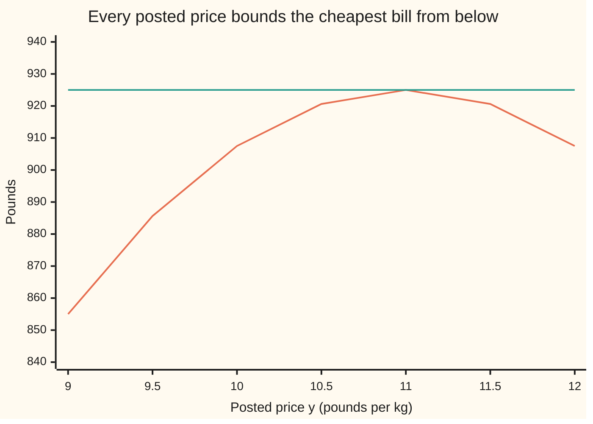

# Convex conjugates: describing a function by its slopes instead of its values

[Syllabus](../../../SYLLABUS.md) → [Optimization](../README.md) → [Convexity](../README.md#s01) → Convex conjugates

---

## General Overview

A roaster needs 100 kg of house blend this week from three estates: Brazil, Colombia and a Robusta farm. Each estate bills at cost, and its cost per kilo climbs as it picks deeper into its crop. Brazil starts at £8 a kilo and adds 10p for every kilo already supplied. Colombia starts at £9 and adds 5p; the Robusta farm starts at £5 and adds 20p. The café's contract fines the roaster £12 for every kilo the delivery is off 100 kg, short or over. The roaster wants the cheapest order, so this is a **minimisation**: choose three amounts, make the total bill smallest.

The answer is 30 kg from Brazil, 40 from Colombia and 30 from the Robusta farm, for £925. Now look at the same problem from the other side. Suppose the roaster just posts one price, £y a kilo, and lets each estate sell whatever amount it likes at that price. Each estate is a **price-taker**: it cannot change the price, only choose how much to sell. At £11 a kilo, the three estates freely offer 30, 40 and 30 kg: exactly 100. The posted price did the planning.

That flip, from "what does each amount cost?" to "how much profit does each price allow?", is the **convex conjugate**. It describes a cost curve by its slopes, the prices, instead of by its values. Done for both halves of a problem at once, it gives a second problem, the **Fenchel dual**, which is a **maximisation** over prices. Every price gives a lower bound on the cheapest bill, and the best price gives exactly £925. A plan and a price that meet are the certificate that no order is cheaper.

**The convex conjugate of a cost is the best profit a price-taker can make at each price; revenue minus that best profit never exceeds the true cost (Fenchel-Young), and for convex costs, when some plan lies inside where both halves are finite, the best price matches the cheapest plan exactly (Fenchel duality).**

**What kind of fact this is:** the conjugate is a definition; the two conjugates and the Fenchel-Young inequality are theorems proved on this card in Why it works; the weak half of Fenchel duality is proved here, and the strong half (no gap) is a theorem stated with its source.

### The picture: a conjugate is where a sloped line touches

<p align="center"></p>

Drawn to scale, 6.5 units per kilo across and 0.4 per pound up. Take a line of slope £11 a kilo and push it up from below until it just touches Brazil's cost curve. It touches at 30 kg, where the curve's own slope is 11. It crosses the vertical axis at −£45. That 45 is Brazil's conjugate at price 11: the profit of selling 30 kg at £11 (£330) against a cost of £285. One number per slope, and the slopes rebuild the curve.

---

## The formula

Notation first, in words. For a cost $f$ of an amount $x$, its **conjugate** $f^*$ (read "f star") is a new function of a price $y$: the largest value of revenue $y\,x$ minus cost $f(x)$, over every amount $x$. The star never means a conjugate transpose on this wing.

$$f^*(y) = \sup_{x}\,\big(\,y\,x - f(x)\,\big)$$

**Read it aloud:** at price $y$, sell whatever amount makes revenue minus cost largest; that largest profit is the conjugate. ("sup" is the smallest number nothing exceeds; it is the maximum when a best amount exists, and it may be $+\infty$ when profit has no ceiling.)

Two conjugates this card computes, for a cost with base price $c$ and climb $q$, and for a fine of $k$ per unit off a target $D$:

$$f(x) = c\,x + \tfrac{q}{2}\,x^2 \;\Rightarrow\; f^*(y) = \frac{(y - c)^2}{2q}, \qquad g(z) = k\,\lvert z - D\rvert \;\Rightarrow\; g^*(w) = \begin{cases} D\,w & \lvert w\rvert \le k \\ +\infty & \lvert w\rvert > k\end{cases}$$

**Read it aloud:** a quadratic cost has a quadratic conjugate; a kinked fine has a conjugate that is a straight line on a band of prices and infinite outside it.

For several amounts $x = (x_1, x_2, x_3)$ and a list of prices $v = (v_1, v_2, v_3)$, one per amount, the definition is the same with revenue $v_1x_1 + v_2x_2 + v_3x_3$, written $v^{\mathsf T}x$: $f^*(v) = \sup_x \big(v^{\mathsf T}x - f(x)\big)$. When the cost is a sum of separate costs, $f(x) = f_1(x_1) + f_2(x_2) + f_3(x_3)$, each estate's profit is made largest on its own, so $f^*(v) = f_1^*(v_1) + f_2^*(v_2) + f_3^*(v_3)$: the sum rule.

Fenchel-Young and Fenchel duality, for convex $f$ and $g$ and a matrix $A$:

$$f(x) + f^*(y) \ge y\,x, \qquad p^* = \min_x \big(f(x) + g(Ax)\big) \;\ge\; d^* = \max_y \big(-f^*(A^{\mathsf T} y) - g^*(-y)\big)$$

**Read it aloud:** a cost plus its conjugate is never below price times amount; the cheapest plan is never below the best price bound, and with convex costs and a plan inside where both are finite, the two are equal.

| Symbol | Plain meaning | In our example | Push it up and the answer… |
| --- | --- | --- | --- |
| $x$, $x_i$ | kilos bought; $x_i$ from estate $i$ | 30, 40, 30 kg | cost rises |
| $y$ | a price per kilo: a slope of the cost | £11 | each estate offers more |
| $f$, $f_i$ | a cost in pounds: the whole order's is $f = f_1 + f_2 + f_3$, estate $i$'s for $x$ kg is $f_i$ | Brazil: $f_1(30)$ = £285 | — |
| $c_i$, $q_i$ | base price (£/kg) and its climb (£/kg per kg) | Brazil 8, 0.1; Colombia 9, 0.05; Robusta 5, 0.2 | dearer, smaller order |
| $f^*$ | the conjugate: best profit at price $y$ | $f_1^*(11)$ = £45 | — |
| $\partial f(x)$ | the slopes of all lines touching $f$ at $x$ from below ([Subgradients](07-subgradients.md)) | $\partial g(100)$ = [−12, 12] | — |
| $g$, $k$, $D$ | the contract fine, £ per kg off, and the target | $k$ = £12, $D$ = 100 kg | larger $k$: price may rise higher |
| $z$, $w$, $A$ | kilos delivered; a price on delivered kilos; the row (1, 1, 1) that adds the three orders | $z = Ax$ = 100 kg; $w = -y$ | — |
| $v$, $A^{\mathsf T}y$ | a list of prices, one per estate; the one that posts the same price $y$ to each: $(y, y, y)$ | (11, 11, 11) | — |
| $p^*$, $d^*$ | cheapest total bill; best price bound (the wing's names, set out on [The standard convex problem](10-the-convex-problem-in-standard-form.md) and [Lagrangian duality](../03-Constrained%20Optimisation/04-lagrangian-duality-weak-and-strong.md)) | £925, £925 | — |
| $f^{**}$ | the conjugate of the conjugate | $f_1^{**}(30)$ = £285 | — |
| $x_0$, $x'$, $t$, $b$, $\ell$ | a point, another amount, a height, a crossing and a line, used inside proofs only | — | — |

The full problem: minimise $f_1(x_1) + f_2(x_2) + f_3(x_3) + 12\,\lvert x_1 + x_2 + x_3 - 100\rvert$ over the three orders.

### When it holds

- **Convex costs.** The conjugate exists for any cost, but $f^{**}$ gives back $f$ only when $f$ is convex and closed. If Robusta comes only in whole 60 kg sacks, the cost is not convex and the best price bound is £1,015 against a true £1,030.
- **A price inside the band of the fine.** $g^*(-y)$ is infinite unless $\lvert y\rvert \le k$. Forget that and at $k$ = £10 the "bound" reads £925, above the true cheapest bill of £907.50.
- **Amounts allowed to be any real number.** The quadratic formula takes the best $x$ as $(y - c)/q$, negative when $y < c$. With orders that cannot be negative, the conjugate is zero below the base price; here every price used is at least £9, so no estate is asked to sell back.
- **A point inside both domains, for the strong half.** Fenchel duality has no gap when some plan lies inside where $f$ and $g$ are finite. Both are finite everywhere here, so it holds.

---

## Why it works

### Step 0: a convex curve is the top edge of its touching lines

A convex cost bends upward. So it sits above each of its touching lines and is the highest of them at every point. A line is fixed by two numbers, a slope and where it crosses the vertical axis. Record, for every slope $y$, how far down the touching line crosses, and the whole curve can be rebuilt. That record is $f^*$: the line of slope $y$ touching $f$ crosses at $-f^*(y)$, because $y\,x - f(x)$ is how far the curve's point at $x$ sits above or below the line $y\,x$.

The Legendre transform on [Hamilton's equations](../../08-Differential%20equations%20and%20dynamics/12-Calculus%20of%20Variations%20and%20Optimal%20Control/05-hamiltons-equations.md) built the swing's Hamiltonian this way: the largest value of momentum times velocity minus the Lagrangian, for a smooth bowl in the velocity. The conjugate is the same recipe for any cost, kinks and walls included.

### Step 1: the conjugate of a quadratic cost

Brazil's profit at price $y$ is $y\,x - 8x - 0.05x^2$. It rises while the price beats the marginal cost $8 + 0.1x$ and falls after, so the best amount is where they are equal: $x = (y - 8)/0.1$. In general $x = (y - c)/q$, and putting it back:

$$f^*(y) = y\,\frac{y-c}{q} - c\,\frac{y-c}{q} - \frac{q}{2}\Big(\frac{y-c}{q}\Big)^2 = \frac{(y-c)^2}{q} - \frac{(y-c)^2}{2q} = \frac{(y-c)^2}{2q}.$$

At £11, Brazil sells 30 kg and makes 9 / 0.2 = £45. Colombia sells 40 kg and makes 4 / 0.1 = £40; Robusta sells 30 kg and makes 36 / 0.4 = £90.

The conjugate's own slope, $(y - c)/q$, is the amount sold. A cost's slopes are prices; its conjugate's slopes are amounts. The code checks this by nudging the price: 30, 40 and 30 kg. That swap of roles is why a conjugate "describes a function by its slopes".

### Step 2: the conjugate of a kinked fine

Start with $k\,\lvert x\rvert$. If $\lvert y\rvert \le k$, then $y\,x \le k\,\lvert x\rvert$ for every $x$, so the profit is never positive and the best is 0, at $x = 0$. If $\lvert y\rvert > k$, pushing $x$ far in the direction of the price's sign earns $\lvert y\rvert - k$ per unit without end: the conjugate is $+\infty$. So the conjugate of $k\,\lvert x\rvert$ is 0 on the band $[-k, k]$ and infinite outside.

Shifting the kink to $D$ adds $D\,w$: $g^*(w) = D\,w$ for $\lvert w\rvert \le k$. At $w$ = −11 that is −£1,100. At $w$ = 13, beyond the £12 band, searching deliveries up to 1,100 kg gives £2,300 and up to 2,100 kg gives £3,300: it keeps growing, which is what $+\infty$ means.

In plain terms: a fine of £12 a kilo caps the value of a kilo at £12. No price above the fine can ever be worth paying.

### Step 3: Fenchel-Young, and when it is tight

The definition says $f^*(y)$ is at least $y\,x - f(x)$ for every $x$. Rearranged:

$$f(x) + f^*(y) \ge y\,x.$$

Equality holds exactly when $x$ is a best amount at price $y$. That means $y\,x - f(x) \ge y\,x' - f(x')$ for every other $x'$, which rearranges to $f(x') \ge f(x) + y\,(x' - x)$: the line of slope $y$ through the curve at $x$ stays below it. That is the definition of a subgradient, so equality holds exactly when $y \in \partial f(x)$.

Brazil at 30 kg: with price 11, £285 + £45 = £330 = 30 × 11, a tie, since 11 is the slope at 30. With price 12: £285 + £80 = £365, which is £5 more than 360. The code tries 117 amount and price pairs; none goes below zero, and the ties fall exactly where the price equals $8 + 0.1x$.

### Step 4: Fenchel duality, the weak half

Take any plan $x$ and any price $y$. Apply Step 3 twice (its proof reads the same with $v^{\mathsf T}x$ in place of $y\,x$): to $f$ at $x$ with price $A^{\mathsf T}y$, and to $g$ at $z = Ax$ with price $-y$:

$$f(x) \ge (A^{\mathsf T}y)^{\mathsf T}x - f^*(A^{\mathsf T}y), \qquad g(Ax) \ge -y^{\mathsf T}Ax - g^*(-y).$$

Add them. The terms with $x$ cancel, since $(A^{\mathsf T}y)^{\mathsf T}x = y^{\mathsf T}Ax$:

$$f(x) + g(Ax) \ge -f^*(A^{\mathsf T}y) - g^*(-y).$$

The left side does not depend on $y$ and the right side does not depend on $x$. So every price bounds every plan: $p^* \ge d^*$. The gap between a plan and a price is the sum of the two Fenchel-Young gaps, zero only when both ties hold.

For the roaster, $A^{\mathsf T}y$ posts the price $y$ to all three estates, so the sum rule gives $f^*(A^{\mathsf T}y) = f_1^*(y) + f_2^*(y) + f_3^*(y)$, and $g^*(-y) = -100y$ inside the band. The dual reads:

$$\text{maximise } 100\,y - f_1^*(y) - f_2^*(y) - f_3^*(y) \quad\text{over } -12 \le y \le 12.$$

In words: pay £y for each of 100 kilos, then take back the profit each estate would have made at that price. At the clearing price, what is left is exactly what the coffee cost to grow.

### Step 5: Fenchel duality, the strong half (stated)

**Theorem (Fenchel duality).** Let $f$ and $g$ be convex and closed, and suppose some plan $x$ has $f(x)$ finite with $g$ finite near $Ax$ (more generally, a point in the relative interior of both domains). Then $p^* = d^*$, and the dual maximum is reached by some $y$. A plan $x$ and price $y$ are both optimal exactly when $A^{\mathsf T}y \in \partial f(x)$ and $-y \in \partial g(Ax)$.

This card states it and does not prove it. The proof separates two convex sets by a flat wall, as in [Separating hyperplanes](06-separating-hyperplanes.md); it is Theorem 3.3.5 in Borwein and Lewis and Theorem 31.1 in Rockafellar (Sources).

The last sentence is the certificate. At 30, 40, 30 kg, each estate's marginal cost is 8 + 3 = 9 + 2 = 5 + 6 = £11, so $(11, 11, 11) \in \partial f(x)$. The delivery is exactly 100 kg, at the fine's kink, where $\partial g(100) = [-12, 12]$ contains −11. Both ties hold, so £925 is proved cheapest.

<details>
<summary>Detailed proof: the conjugate of a closed convex cost gives the cost back</summary>

Fenchel-Moreau theorem: if $f$ is convex, closed and somewhere finite, then $f^{**} = f$.

One direction is Step 3: $f^*(y) \ge y\,x - f(x)$ gives $f(x) \ge y\,x - f^*(y)$ for every $y$, so $f(x) \ge f^{**}(x)$.

For the other, suppose $f^{**}(x_0) < t < f(x_0)$ for some $t$. The point $(x_0, t)$ lies outside the region on or above the graph, which is convex and closed. A flat wall separates them ([Separating hyperplanes](06-separating-hyperplanes.md)). When $f$ is finite near $x_0$ the wall is not vertical, so it is the graph of a line $\ell(x) = y\,x - b$ with $\ell \le f$ everywhere and $\ell(x_0) > t$. Since $\ell \le f$, $b \ge \sup_x (y\,x - f(x)) = f^*(y)$, and then $f^{**}(x_0) \ge y\,x_0 - f^*(y) \ge y\,x_0 - b = \ell(x_0) > t$, a contradiction. (A vertical wall at the edge of the domain is tilted slightly using any non-vertical touching line; Rockafellar, Theorem 12.2.)

For Brazil the code maximises $30\,y - f_1^*(y)$ over prices and finds £285 at $y$ = 11: the cost at 30 kg, rebuilt from slopes alone.

</details>

### Step 6: the chart of the dual

Every price gives a bound at or below £925, and the bound peaks at the price where the estates' offers add to 100 kg.



Orange: the dual value $100\,y - \sum f_i^*(y)$ at each price. Teal: the cheapest bill, £925. They meet only at £11. The dual is a downward bowl here, $925 - 17.5\,(y - 11)^2$, because each conjugate is an upward bowl.

---

## Worked numbers, by hand

| Step | Arithmetic | Value |
| --- | --- | --- |
| price that clears 100 kg | $\sum (y - c_i)/q_i = 100$: $35y - 285 = 100$, using $1/q_i$ = 10, 20, 5 | $y$ = £11 |
| amounts offered | (11 − 8)/0.1, (11 − 9)/0.05, (11 − 5)/0.2 | 30, 40, 30 kg |
| costs | 240 + 45; 360 + 40; 150 + 90 | £285, £400, £240 |
| cheapest bill $p^*$ | 285 + 400 + 240, fine 0 | **£925** |
| conjugates at £11 | 9/0.2, 4/0.1, 36/0.4 | £45, £40, £90 |
| dual value $d^*$ | 100 × 11 − (45 + 40 + 90) | **£925** |
| certificate | marginal costs 11, 11, 11; −11 in [−12, 12] | gap 0 |

The order 30, 40 and 30 kg costs £925, £9.25 a kilo on average, and the posted price of £11 proves nothing cheaper exists. Brute force over all 1,030,301 whole-kilo orders agrees.

### What breaks if you drop a piece

| Mistake | Comes out at | What went wrong |
| --- | --- | --- |
| No ½ in the quadratic conjugate | Brazil £90; dual at £11 is £750 | $(y - c)^2/q$ counts the profit twice over |
| Fine of £10 a kilo, but $-g^*(-y)$ taken as $100\,y$ at every price | "bound" £925, above the true £907.50 | Prices above £10 are infinite in $g^*$; the cap was dropped |
| Robusta only in whole 60 kg sacks, duality trusted | dual £1,015, true cheapest £1,030 | Not convex: the dual sees the half-sack mix $f_3^{**}(30)$ = £330 that cannot be bought |

With the £10 fine the honest answer is to stop buying where the marginal cost reaches £10: 20, 20 and 25 kg, 35 kg short, £907.50 in all, and the dual meets it at $y$ = £10. With sacks, two plans tie as cheapest at £1,030: one 60 kg sack with 20 kg each from Brazil and Colombia, or no Robusta with 40 and 60 kg. The £15 gap to the dual is the price of nonconvexity.

---

## Code, from first principles, and it actually runs

The scripts take three independent roads to £925: the equal-slope formula, brute force over every whole-kilo order from 0 to 100 kg of each bean, and the Fenchel dual maximised by search over prices. They also find each conjugate by searching over amounts and compare it with Step 1's formula, and check the certificate's condition that $-y$ lies in $\partial g$; the marginal costs they print equal the price by construction. They repeat the run with a £10 fine, test Fenchel-Young on a grid, rebuild Brazil's cost from its conjugate, run the sack case and print every wrong answer above. Nothing imported knows the answer: the searches are ternary searches written out (narrowing an interval by thirds on a function with one peak).

### Python

```python
# Convex conjugates and Fenchel duality -- the check behind the card.  Standard library only.
# A roaster needs D = 100 kg of blend from three estates.  Estate i charges f_i(x) = c_i x + q_i x^2 / 2
# pounds for x kg.  The cafe's contract charges k pounds per kg the delivery is off 100 kg, either way.
# Roads to the bill: equal slopes (the formula); every whole-kilo order (brute force); the Fenchel dual
# maximised by search.  Also checked: conjugates by search against their formulas; -y in dg.
NAMES, C, Q, D = ("Brazil", "Colombia", "Robusta"), (8.0, 9.0, 5.0), (0.1, 0.05, 0.2), 100.0

def f(i, x): return C[i] * x + Q[i] * x * x / 2           # estate i's cost of x kg, pounds
def f_formula(i, y): return (y - C[i]) ** 2 / (2 * Q[i])   # its conjugate, from Step 1
def g(z, k): return k * abs(z - D)                         # the contract's penalty on z kg delivered

def top(h, lo, hi):                    # largest value of a concave h on [lo, hi], by ternary search
    for _ in range(200):
        a, b = lo + (hi - lo) / 3, hi - (hi - lo) / 3
        lo, hi = (a, hi) if h(a) < h(b) else (lo, b)
    return h((lo + hi) / 2), (lo + hi) / 2

def f_star(i, y): return top(lambda x: y * x - f(i, x), -2000.0, 2000.0)[0]   # sup over x, by search
def g_star(w, k, R=1000.0):            # sup over z in [D - R, D + R] of w z - g(z): kink or an end
    return max(w * z - g(z, k) for z in (D - R, D, D + R))

def dual(y, k, fs=f_star): return -sum(fs(i, y) for i in range(3)) - g_star(-y, k)   # Fenchel's dual

def by_slopes(c, q, d, k):             # equal slopes: c_i + q_i x_i = y, sum x_i = d, y capped at k
    y = min(k, (d + sum(ci / qi for ci, qi in zip(c, q))) / sum(1 / qi for qi in q))
    x = [(y - ci) / qi for ci, qi in zip(c, q)]
    return y, x, sum(ci * xi + qi * xi * xi / 2 for ci, qi, xi in zip(c, q, x)) + k * abs(sum(x) - d)

def brute(k):                          # every whole-kilo order, 0 to 100 kg of each bean
    tab = [[f(i, x) for x in range(101)] for i in range(3)]
    return min((tab[0][a] + tab[1][b] + tab[2][r] + g(a + b + r, k), a, b, r)
               for a in range(101) for b in range(101) for r in range(101))

out = []
for k in (12.0, 10.0):
    y, x, cost = by_slopes(C, Q, D, k)
    bf = brute(k)
    d_star, y_star = top(lambda t: dual(t, k), -k, k)
    sub_g = (-k, k) if abs(sum(x) - D) < 1e-9 else ((-k, -k) if sum(x) < D else (k, k))   # dg at the total
    out.append((y, x, cost, bf, d_star, y_star, sub_g))
    print(f"k = {k:.0f}: price y = {y:.2f} pounds/kg; kg " + ", ".join(f"{n} {v:.2f}" for n, v in zip(NAMES, x))
          + f"; total {sum(x):.2f} kg")
    print(f"  primal, by slopes: {cost:.2f}; every whole-kilo order: {bf[0]:.2f} at {bf[1]}, {bf[2]}, {bf[3]} kg")
    print(f"  dual, by search: {d_star:.4f} at y = {y_star:.4f}")
    print(f"  certificate: slopes " + ", ".join(f"{C[i] + Q[i] * x[i]:.2f}" for i in range(3))
          + f"; -y = {-y:.2f} lies in dg = [{sub_g[0]:.0f}, {sub_g[1]:.0f}]")
(y, x, cost, bf, d_star, _, sub_g), low = out
for i in range(3):
    print(f"{NAMES[i]}: f({x[i]:.0f}) = {f(i, x[i]):.2f}; f*(11) formula {f_formula(i, 11.0):.2f}, by search"
          f" {f_star(i, 11.0):.4f}; sells y x - f = {11.0 * x[i] - f(i, x[i]):.2f}")
print(f"dual at 11 by hand: 100 x 11 - {sum(f_formula(i, 11.0) for i in range(3)):.2f} = {dual(11.0, 12.0, f_formula):.2f}")
inv, cq = sum(1 / q for q in Q), sum(c / q for c, q in zip(C, Q))
print(f"clearing: sum 1/q = {inv:.0f}, sum c/q = {cq:.0f}; dual = {cost:.0f} - {inv / 2:.1f} (y - 11)^2; average {cost / D:.2f}"
      f" pounds/kg; f1*(12) = {f_formula(0, 12.0):.2f}; k = 10: short by {D - sum(low[1]):.0f} kg; orders searched {101 ** 3}")
print(f"slope of f* at 11 (central difference) = kg offered: " +
      ", ".join(f"{(f_star(i, 11.001) - f_star(i, 10.999)) / 0.002:.4f}" for i in range(3)))
fy = [(f(0, a) + f_star(0, b) - a * b, a, b) for a in range(0, 61, 5) for b in range(6, 15)]   # 117 pairs
eq = [(a, b) for v, a, b in fy if abs(v) < 1e-6]
print(f"Fenchel-Young, Brazil: 30 kg at 11: {f(0, 30) + f_formula(0, 11) - 330:.4f}; 30 kg at 12: "
      f"{f(0, 30) + f_formula(0, 12) - 360:.4f}; grid of 117: {sum(v < -1e-9 for v, _, _ in fy)} below 0, equal at " + ", ".join(f"{a} kg/{b}" for a, b in eq))
print(f"abs conjugate, k = 12: g*(-11) = {g_star(-11, 12):.2f}; g*(13) with R = 1000, 2000: "
      f"{g_star(13, 12):.0f}, {g_star(13, 12, 2000.0):.0f}")
bic = top(lambda t: 30 * t - f_formula(0, t), -100.0, 100.0)
print(f"biconjugate, Brazil at 30 kg: f**(30) = {bic[0]:.4f} at slope {bic[1]:.4f}")
print("chart, dual value at y = 9 to 12 by 0.5: " + ", ".join(f"{dual(9 + t / 2, 12.0, f_formula):.3f}" for t in range(7)))

def sacks(s, k=12.0):                   # Robusta only in whole sacks of s kg: 0 or s
    f3 = lambda t: max(0.0, s * t - f(2, s))                   # its conjugate: max of y x - f over {0, s}
    pr = min(f(2, r) + by_slopes(C[:2], Q[:2], D - r, k)[2] for r in (0.0, s))
    du = top(lambda t: -f_formula(0, t) - f_formula(1, t) - f3(t) - g_star(-t, k), -k, k)
    env = top(lambda t: 30 * t - f3(t), -100.0, 100.0)[0]
    return pr, du[0], du[1], env
s60, s50, ns = sacks(60.0), sacks(50.0), by_slopes(C[:2], Q[:2], D, 12.0)   # ns: no Robusta at all
bf60 = min((f(0, a) + f(1, b) + f(2, r) + g(a + b + r, 12.0), a, b, r)
           for a in range(101) for b in range(101) for r in (0, 60))
print(f"sacks of 60 kg: primal {s60[0]:.2f} (whole kilos {bf60[0]:.2f} at {bf60[1]}, {bf60[2]}, {bf60[3]} kg); "
      f"no sack {ns[2]:.2f} at {ns[1][0]:.0f}, {ns[1][1]:.0f} kg; dual {s60[1]:.2f} at y = {s60[2]:.2f}; gap {s60[0] - s60[1]:.2f}; f3**(30) = {s60[3]:.2f}")
wrong_half = 1100 - sum((11.0 - C[i]) ** 2 / Q[i] for i in range(3))
no_cap = 100 * 11.0 - sum(f_formula(i, 11.0) for i in range(3))
print(f"wrong: no 1/2 in f*: Brazil f*(11) = {(11.0 - 8) ** 2 / 0.1:.2f}, dual at 11 = {wrong_half:.2f}")
print(f"wrong: k = 10 but -g*(-y) taken as 100 y everywhere: 'bound' {no_cap:.2f} above the true {low[2]:.2f}")
print(f"wrong: kilos fed to f*: f1*(30) = {f_formula(0, 30.0):.2f}")
for label, c, q, d in (("try: D = 120", C, Q, 120.0), ("try: Brazil q = 0.2", C, (0.2, 0.05, 0.2), D)):
    ty, tx, tc = by_slopes(c, q, d, 12.0)
    print(f"{label}: y = {ty:.4f}, kg " + ", ".join(f"{v:.2f}" for v in tx) + f", cost {tc:.2f}")
print(f"try: sacks of 50 kg: primal {s50[0]:.2f}, dual {s50[1]:.2f} at y = {s50[2]:.2f}")
pts = lambda cs: " ".join(f"{50 + 6.5 * a:.1f},{190 - 0.4 * b:.1f}" for a, b in cs)   # 6.5 per kg, 0.4 per pound
print("figure, Brazil cost:", pts((a, f(0, a)) for a in range(0, 41, 5)))
print("figure, slope-11 line:", pts(((0, -45.0), (40, 11 * 40 - 45.0))), "| touch", pts([(30, f(0, 30))]))

assert abs(bf[0] - cost) < 1e-9 and abs(low[3][0] - low[2]) < 1e-9          # formula = every whole-kilo order
assert abs(d_star - cost) < 1e-6 and abs(low[4] - low[2]) < 1e-6              # Fenchel dual meets the primal
assert all(abs(f_star(i, t) - f_formula(i, t)) < 1e-6 for i in range(3) for t in (6.0, 9.5, 11.0, 13.0))
assert min(fy)[0] > -1e-9 and eq == [(a, 8 + a // 10) for a in range(0, 61, 10)] and abs(f(0, 30) + f_formula(0, 12) - 360 - 0.05 * (30 - 40) ** 2) < 1e-9
assert g_star(13, 12, 2000.0) > g_star(13, 12) > 1000 and abs(bic[0] - f(0, 30)) < 1e-6
assert abs(bf60[0] - s60[0]) < 1e-9 and abs(ns[2] - s60[0]) < 1e-9 and s60[0] - s60[1] > 10 and abs(s50[0] - s50[1]) < 1e-6
assert no_cap > low[2] + 10 and sub_g[0] <= -y <= sub_g[1] and low[6][0] <= -low[0] <= low[6][1]   # -y in dg
print("ALL CHECKS PASS")
```

**Ran 2026-11-11 on macOS, Python 3.14.10, standard library only. All checks passed. Output, pasted from the run:**

```
k = 12: price y = 11.00 pounds/kg; kg Brazil 30.00, Colombia 40.00, Robusta 30.00; total 100.00 kg
  primal, by slopes: 925.00; every whole-kilo order: 925.00 at 30, 40, 30 kg
  dual, by search: 925.0000 at y = 11.0000
  certificate: slopes 11.00, 11.00, 11.00; -y = -11.00 lies in dg = [-12, 12]
k = 10: price y = 10.00 pounds/kg; kg Brazil 20.00, Colombia 20.00, Robusta 25.00; total 65.00 kg
  primal, by slopes: 907.50; every whole-kilo order: 907.50 at 20, 20, 25 kg
  dual, by search: 907.5000 at y = 10.0000
  certificate: slopes 10.00, 10.00, 10.00; -y = -10.00 lies in dg = [-10, -10]
Brazil: f(30) = 285.00; f*(11) formula 45.00, by search 45.0000; sells y x - f = 45.00
Colombia: f(40) = 400.00; f*(11) formula 40.00, by search 40.0000; sells y x - f = 40.00
Robusta: f(30) = 240.00; f*(11) formula 90.00, by search 90.0000; sells y x - f = 90.00
dual at 11 by hand: 100 x 11 - 175.00 = 925.00
clearing: sum 1/q = 35, sum c/q = 285; dual = 925 - 17.5 (y - 11)^2; average 9.25 pounds/kg; f1*(12) = 80.00; k = 10: short by 35 kg; orders searched 1030301
slope of f* at 11 (central difference) = kg offered: 30.0000, 40.0000, 30.0000
Fenchel-Young, Brazil: 30 kg at 11: 0.0000; 30 kg at 12: 5.0000; grid of 117: 0 below 0, equal at 0 kg/8, 10 kg/9, 20 kg/10, 30 kg/11, 40 kg/12, 50 kg/13, 60 kg/14
abs conjugate, k = 12: g*(-11) = -1100.00; g*(13) with R = 1000, 2000: 2300, 3300
biconjugate, Brazil at 30 kg: f**(30) = 285.0000 at slope 11.0000
chart, dual value at y = 9 to 12 by 0.5: 855.000, 885.625, 907.500, 920.625, 925.000, 920.625, 907.500
sacks of 60 kg: primal 1030.00 (whole kilos 1030.00 at 20, 20, 60 kg); no sack 1030.00 at 40, 60 kg; dual 1015.00 at y = 11.00; gap 15.00; f3**(30) = 330.00
wrong: no 1/2 in f*: Brazil f*(11) = 90.00, dual at 11 = 750.00
wrong: k = 10 but -g*(-y) taken as 100 y everywhere: 'bound' 925.00 above the true 907.50
wrong: kilos fed to f*: f1*(30) = 2420.00
try: D = 120: y = 11.5714, kg 35.71, 51.43, 32.86, cost 1150.71
try: Brazil q = 0.2: y = 11.5000, kg 17.50, 50.00, 32.50, cost 951.25
try: sacks of 50 kg: primal 971.67, dual 971.67 at y = 10.33
figure, Brazil cost: 50.0,190.0 82.5,173.5 115.0,156.0 147.5,137.5 180.0,118.0 212.5,97.5 245.0,76.0 277.5,53.5 310.0,30.0
figure, slope-11 line: 50.0,208.0 310.0,32.0 | touch 245.0,76.0
ALL CHECKS PASS
```

### Rust

Same numbers, same labels, built with `rustc --edition 2021 -O`.

```rust
// Convex conjugates and Fenchel duality -- the same check as the Python, in Rust.  No crates.
// A roaster needs D = 100 kg of blend from three estates.  Estate i charges f_i(x) = c_i x + q_i x^2 / 2
// pounds for x kg.  The cafe's contract charges k pounds per kg the delivery is off 100 kg, either way.
// Roads to the bill: equal slopes (the formula); every whole-kilo order (brute force); the Fenchel dual
// maximised by search.  Also checked: conjugates by search against their formulas; -y in dg.
const NAMES: [&str; 3] = ["Brazil", "Colombia", "Robusta"];
const C: [f64; 3] = [8.0, 9.0, 5.0];
const Q: [f64; 3] = [0.1, 0.05, 0.2];
const D: f64 = 100.0;

fn f(i: usize, x: f64) -> f64 { C[i] * x + Q[i] * x * x / 2.0 }          // estate i's cost of x kg
fn f_formula(i: usize, y: f64) -> f64 { (y - C[i]).powi(2) / (2.0 * Q[i]) } // its conjugate, Step 1
fn g(z: f64, k: f64) -> f64 { k * (z - D).abs() }                           // the contract's penalty

fn top(h: &dyn Fn(f64) -> f64, mut lo: f64, mut hi: f64) -> (f64, f64) {   // max of a concave h, ternary
    for _ in 0..200 {
        let (a, b) = (lo + (hi - lo) / 3.0, hi - (hi - lo) / 3.0);
        if h(a) < h(b) { lo = a } else { hi = b }
    }
    (h((lo + hi) / 2.0), (lo + hi) / 2.0)
}
fn f_star(i: usize, y: f64) -> f64 { top(&|x| y * x - f(i, x), -2000.0, 2000.0).0 }   // sup, by search
fn g_star(w: f64, k: f64, r: f64) -> f64 {           // sup over z in [D - R, D + R]: kink or an end
    [D - r, D, D + r].iter().map(|&z| w * z - g(z, k)).fold(f64::MIN, f64::max)
}
fn dual(y: f64, k: f64, fs: fn(usize, f64) -> f64) -> f64 { -(0..3).map(|i| fs(i, y)).sum::<f64>() - g_star(-y, k, 1000.0) }

fn by_slopes(c: &[f64], q: &[f64], d: f64, k: f64) -> (f64, Vec<f64>, f64) {   // equal slopes, capped at k
    let s1: f64 = c.iter().zip(q).map(|(ci, qi)| ci / qi).sum();
    let s2: f64 = q.iter().map(|qi| 1.0 / qi).sum();
    let y = k.min((d + s1) / s2);
    let x: Vec<f64> = c.iter().zip(q).map(|(ci, qi)| (y - ci) / qi).collect();
    let cost: f64 = (0..c.len()).map(|i| c[i] * x[i] + q[i] * x[i] * x[i] / 2.0).sum::<f64>() + k * (x.iter().sum::<f64>() - d).abs();
    (y, x, cost)
}
fn brute(k: f64, rs: &[usize]) -> (f64, usize, usize, usize) {   // every whole-kilo order, 0 to 100 kg
    let mut best = (f64::MAX, 0, 0, 0);
    for a in 0..101 { for b in 0..101 { for &r in rs {
        let v = f(0, a as f64) + f(1, b as f64) + f(2, r as f64) + g((a + b + r) as f64, k);
        if v < best.0 { best = (v, a, b, r) }
    } } }
    best
}
fn join(v: &[String]) -> String { v.join(", ") }

fn main() {
    let all: Vec<usize> = (0..101).collect();
    let mut out = vec![];
    for k in [12.0, 10.0] {
        let (y, x, cost) = by_slopes(&C, &Q, D, k);
        let bf = brute(k, &all);
        let (d_star, y_star) = top(&|t| dual(t, k, f_star), -k, k);
        let tot: f64 = x.iter().sum();
        let sub_g = if (tot - D).abs() < 1e-9 { (-k, k) } else if tot < D { (-k, -k) } else { (k, k) };
        println!("k = {:.0}: price y = {:.2} pounds/kg; kg {}; total {:.2} kg", k, y,
                 join(&(0..3).map(|i| format!("{} {:.2}", NAMES[i], x[i])).collect::<Vec<_>>()), tot);
        println!("  primal, by slopes: {:.2}; every whole-kilo order: {:.2} at {}, {}, {} kg", cost, bf.0, bf.1, bf.2, bf.3);
        println!("  dual, by search: {:.4} at y = {:.4}", d_star, y_star);
        println!("  certificate: slopes {}; -y = {:.2} lies in dg = [{:.0}, {:.0}]",
                 join(&(0..3).map(|i| format!("{:.2}", C[i] + Q[i] * x[i])).collect::<Vec<_>>()), -y, sub_g.0, sub_g.1);
        out.push((y, x, cost, bf, d_star, sub_g));
    }
    let (y, x, cost, bf, d_star, sub_g) = out[0].clone();
    let low = out[1].clone();
    for i in 0..3 {
        println!("{}: f({:.0}) = {:.2}; f*(11) formula {:.2}, by search {:.4}; sells y x - f = {:.2}",
                 NAMES[i], x[i], f(i, x[i]), f_formula(i, 11.0), f_star(i, 11.0), 11.0 * x[i] - f(i, x[i]));
    }
    println!("dual at 11 by hand: 100 x 11 - {:.2} = {:.2}", (0..3).map(|i| f_formula(i, 11.0)).sum::<f64>(), dual(11.0, 12.0, f_formula));
    let (inv, cq): (f64, f64) = (Q.iter().map(|q| 1.0 / q).sum(), C.iter().zip(Q).map(|(c, q)| c / q).sum());
    println!("clearing: sum 1/q = {:.0}, sum c/q = {:.0}; dual = {:.0} - {:.1} (y - 11)^2; average {:.2} pounds/kg; f1*(12) = {:.2}; k = 10: short by {:.0} kg; orders searched {}",
             inv, cq, cost, inv / 2.0, cost / D, f_formula(0, 12.0), D - low.1.iter().sum::<f64>(), 101 * 101 * 101);
    println!("slope of f* at 11 (central difference) = kg offered: {}",
             join(&(0..3).map(|i| format!("{:.4}", (f_star(i, 11.001) - f_star(i, 10.999)) / 0.002)).collect::<Vec<_>>()));
    let mut fy = vec![];                                                      // 117 pairs
    for a in (0..61).step_by(5) { for b in 6..15 { fy.push((f(0, a as f64) + f_star(0, b as f64) - (a * b) as f64, a, b)) } }
    let eq: Vec<(usize, usize)> = fy.iter().filter(|p| p.0.abs() < 1e-6).map(|p| (p.1, p.2)).collect();
    println!("Fenchel-Young, Brazil: 30 kg at 11: {:.4}; 30 kg at 12: {:.4}; grid of 117: {} below 0, equal at {}",
             f(0, 30.0) + f_formula(0, 11.0) - 330.0, f(0, 30.0) + f_formula(0, 12.0) - 360.0,
             fy.iter().filter(|p| p.0 < -1e-9).count(), join(&eq.iter().map(|(a, b)| format!("{} kg/{}", a, b)).collect::<Vec<_>>()));
    println!("abs conjugate, k = 12: g*(-11) = {:.2}; g*(13) with R = 1000, 2000: {:.0}, {:.0}",
             g_star(-11.0, 12.0, 1000.0), g_star(13.0, 12.0, 1000.0), g_star(13.0, 12.0, 2000.0));
    let bic = top(&|t| 30.0 * t - f_formula(0, t), -100.0, 100.0);
    println!("biconjugate, Brazil at 30 kg: f**(30) = {:.4} at slope {:.4}", bic.0, bic.1);
    println!("chart, dual value at y = 9 to 12 by 0.5: {}",
             join(&(0..7).map(|t| format!("{:.3}", dual(9.0 + t as f64 / 2.0, 12.0, f_formula))).collect::<Vec<_>>()));

    let sacks = |s: f64| {                         // Robusta only in whole sacks of s kg: 0 or s
        let k = 12.0;
        let f3 = move |t: f64| (s * t - f(2, s)).max(0.0);   // its conjugate: max of y x - f over {0, s}
        let pr = [0.0, s].iter().map(|&r| f(2, r) + by_slopes(&C[..2], &Q[..2], D - r, k).2).fold(f64::MAX, f64::min);
        let du = top(&|t| -f_formula(0, t) - f_formula(1, t) - f3(t) - g_star(-t, k, 1000.0), -k, k);
        let env = top(&|t| 30.0 * t - f3(t), -100.0, 100.0).0;
        (pr, du.0, du.1, env)
    };
    let (s60, s50, ns) = (sacks(60.0), sacks(50.0), by_slopes(&C[..2], &Q[..2], D, 12.0));   // ns: no Robusta
    let bf60 = brute(12.0, &[0, 60]);
    println!("sacks of 60 kg: primal {:.2} (whole kilos {:.2} at {}, {}, {} kg); no sack {:.2} at {:.0}, {:.0} kg; dual {:.2} at y = {:.2}; gap {:.2}; f3**(30) = {:.2}",
             s60.0, bf60.0, bf60.1, bf60.2, bf60.3, ns.2, ns.1[0], ns.1[1], s60.1, s60.2, s60.0 - s60.1, s60.3);
    let wrong_half = 1100.0 - (0..3).map(|i| (11.0 - C[i]).powi(2) / Q[i]).sum::<f64>();
    let no_cap = 100.0 * 11.0 - (0..3).map(|i| f_formula(i, 11.0)).sum::<f64>();
    println!("wrong: no 1/2 in f*: Brazil f*(11) = {:.2}, dual at 11 = {:.2}", (11.0f64 - 8.0).powi(2) / 0.1, wrong_half);
    println!("wrong: k = 10 but -g*(-y) taken as 100 y everywhere: 'bound' {:.2} above the true {:.2}", no_cap, low.2);
    println!("wrong: kilos fed to f*: f1*(30) = {:.2}", f_formula(0, 30.0));
    for (label, q, d) in [("try: D = 120", Q, 120.0), ("try: Brazil q = 0.2", [0.2, 0.05, 0.2], D)] {
        let (ty, tx, tc) = by_slopes(&C, &q, d, 12.0);
        println!("{}: y = {:.4}, kg {}, cost {:.2}", label, ty, join(&tx.iter().map(|v| format!("{:.2}", v)).collect::<Vec<_>>()), tc);
    }
    println!("try: sacks of 50 kg: primal {:.2}, dual {:.2} at y = {:.2}", s50.0, s50.1, s50.2);
    let pts = |cs: &[(f64, f64)]| cs.iter().map(|&(a, b)| format!("{:.1},{:.1}", 50.0 + 6.5 * a, 190.0 - 0.4 * b)).collect::<Vec<_>>().join(" ");
    println!("figure, Brazil cost: {}", pts(&(0..9).map(|j| { let a = 5.0 * j as f64; (a, f(0, a)) }).collect::<Vec<_>>()));
    println!("figure, slope-11 line: {} | touch {}", pts(&[(0.0, -45.0), (40.0, 11.0 * 40.0 - 45.0)]), pts(&[(30.0, f(0, 30.0))]));

    assert!((bf.0 - cost).abs() < 1e-9 && (low.3 .0 - low.2).abs() < 1e-9);       // formula = every whole-kilo order
    assert!((d_star - cost).abs() < 1e-6 && (low.4 - low.2).abs() < 1e-6);         // Fenchel dual meets the primal
    assert!((0..3).all(|i| [6.0, 9.5, 11.0, 13.0].iter().all(|&t| (f_star(i, t) - f_formula(i, t)).abs() < 1e-6)));
    let want: Vec<(usize, usize)> = (0..61).step_by(10).map(|a| (a, 8 + a / 10)).collect();
    assert!(fy.iter().all(|p| p.0 > -1e-9) && eq == want && (f(0, 30.0) + f_formula(0, 12.0) - 360.0 - 0.05 * 100.0).abs() < 1e-9);
    assert!(g_star(13.0, 12.0, 2000.0) > g_star(13.0, 12.0, 1000.0) && g_star(13.0, 12.0, 1000.0) > 1000.0 && (bic.0 - f(0, 30.0)).abs() < 1e-6);
    assert!((bf60.0 - s60.0).abs() < 1e-9 && (ns.2 - s60.0).abs() < 1e-9 && s60.0 - s60.1 > 10.0 && (s50.0 - s50.1).abs() < 1e-6);
    assert!(no_cap > low.2 + 10.0 && sub_g.0 <= -y && -y <= sub_g.1 && low.5 .0 <= -low.0 && -low.0 <= low.5 .1);   // -y in dg
    println!("ALL CHECKS PASS");
}
```

**Ran 2026-11-11 on macOS, rustc 1.98.1, no crates. All checks passed. Output, pasted from the run:**

```
k = 12: price y = 11.00 pounds/kg; kg Brazil 30.00, Colombia 40.00, Robusta 30.00; total 100.00 kg
  primal, by slopes: 925.00; every whole-kilo order: 925.00 at 30, 40, 30 kg
  dual, by search: 925.0000 at y = 11.0000
  certificate: slopes 11.00, 11.00, 11.00; -y = -11.00 lies in dg = [-12, 12]
k = 10: price y = 10.00 pounds/kg; kg Brazil 20.00, Colombia 20.00, Robusta 25.00; total 65.00 kg
  primal, by slopes: 907.50; every whole-kilo order: 907.50 at 20, 20, 25 kg
  dual, by search: 907.5000 at y = 10.0000
  certificate: slopes 10.00, 10.00, 10.00; -y = -10.00 lies in dg = [-10, -10]
Brazil: f(30) = 285.00; f*(11) formula 45.00, by search 45.0000; sells y x - f = 45.00
Colombia: f(40) = 400.00; f*(11) formula 40.00, by search 40.0000; sells y x - f = 40.00
Robusta: f(30) = 240.00; f*(11) formula 90.00, by search 90.0000; sells y x - f = 90.00
dual at 11 by hand: 100 x 11 - 175.00 = 925.00
clearing: sum 1/q = 35, sum c/q = 285; dual = 925 - 17.5 (y - 11)^2; average 9.25 pounds/kg; f1*(12) = 80.00; k = 10: short by 35 kg; orders searched 1030301
slope of f* at 11 (central difference) = kg offered: 30.0000, 40.0000, 30.0000
Fenchel-Young, Brazil: 30 kg at 11: 0.0000; 30 kg at 12: 5.0000; grid of 117: 0 below 0, equal at 0 kg/8, 10 kg/9, 20 kg/10, 30 kg/11, 40 kg/12, 50 kg/13, 60 kg/14
abs conjugate, k = 12: g*(-11) = -1100.00; g*(13) with R = 1000, 2000: 2300, 3300
biconjugate, Brazil at 30 kg: f**(30) = 285.0000 at slope 11.0000
chart, dual value at y = 9 to 12 by 0.5: 855.000, 885.625, 907.500, 920.625, 925.000, 920.625, 907.500
sacks of 60 kg: primal 1030.00 (whole kilos 1030.00 at 20, 20, 60 kg); no sack 1030.00 at 40, 60 kg; dual 1015.00 at y = 11.00; gap 15.00; f3**(30) = 330.00
wrong: no 1/2 in f*: Brazil f*(11) = 90.00, dual at 11 = 750.00
wrong: k = 10 but -g*(-y) taken as 100 y everywhere: 'bound' 925.00 above the true 907.50
wrong: kilos fed to f*: f1*(30) = 2420.00
try: D = 120: y = 11.5714, kg 35.71, 51.43, 32.86, cost 1150.71
try: Brazil q = 0.2: y = 11.5000, kg 17.50, 50.00, 32.50, cost 951.25
try: sacks of 50 kg: primal 971.67, dual 971.67 at y = 10.33
figure, Brazil cost: 50.0,190.0 82.5,173.5 115.0,156.0 147.5,137.5 180.0,118.0 212.5,97.5 245.0,76.0 277.5,53.5 310.0,30.0
figure, slope-11 line: 50.0,208.0 310.0,32.0 | touch 245.0,76.0
ALL CHECKS PASS
```

The two outputs match line for line.

> [!TIP]
> **Try changing**
> - Guess first: the café wants 120 kg. Does the price rise past the £12 fine? Setting `D` to 120 is the `try: D = 120` line: the price is £11.5714, the orders 35.71, 51.43 and 32.86 kg, the bill £1,150.71: still inside the band.
> - Guess first: Brazil's climb doubles. Setting Brazil's `Q` to 0.2 is the `try: Brazil q = 0.2` line: Brazil drops to 17.50 kg, Colombia rises to 50.00 and Robusta to 32.50; the price is £11.50 and the bill £951.25.
> - Guess first: Robusta comes in 50 kg sacks instead of 60. Setting the sack to 50 is the `try: sacks of 50 kg` line. The gap closes: primal and dual both £971.67, because at the best price, £10.33, the convex shadow of Robusta's cost picks one full 50 kg sack, an amount that can really be bought.
> - Guess first: the fine falls to £10. Setting `k` to 10 is the second run in the output: the price sticks at £10 and the roaster delivers 65 kg.

---

## The usual mistake

> [!warning]
> **Treating the conjugate as a formula valid at every price.** The conjugate of a fine, a cap or a limit is infinite outside a band, and that infinity is what keeps the dual honest. Drop it and the dual stops being a bound: with a £10 fine it claims £925, while the true cheapest bill is £907.50.
>
> - **Losing the ½.** $(y - c)^2/q$ instead of $(y - c)^2/(2q)$ gives Brazil £90 at £11, not £45, and a dual of £750.
> - **Feeding kilos to the conjugate.** $f^*$ takes a price. $f_1^*(30)$ = £2,420 is Brazil's profit at £30 a kilo, not anything about 30 kg.
> - **Trusting duality on a nonconvex cost.** With 60 kg sacks the best price bound is £1,015 and the true cheapest bill £1,030. The dual only ever sees $f^{**}$, the convex shadow of the cost.

---

## Where you meet it in real life

- **Electricity markets.** A grid operator posts one price per half hour, and each generator supplies up to the point where its marginal cost meets it. The clearing price is the dual of the cheapest-dispatch problem, exactly the roaster's £11.
- **Economics.** A firm's profit function is the conjugate of its cost function, and the rule that supply is the slope of profit in price is Step 1's "conjugate slopes are amounts" (Hotelling's lemma).
- **Thermodynamics.** Free energies are Legendre transforms of internal energy, trading entropy for temperature: [Hamilton's equations](../../08-Differential%20equations%20and%20dynamics/12-Calculus%20of%20Variations%20and%20Optimal%20Control/05-hamiltons-equations.md) use the same swap.
- **Machine learning.** The dual of a support vector machine and the step that handles the lasso's absolute value both use conjugates of kinked functions like Step 2's.

> **Say it back**
> The conjugate of a cost records, for every price, the best profit a price-taker could make; for a quadratic cost it is $(y - c)^2/(2q)$, and for a fine of $k$ per unit it is a straight line on prices from $-k$ to $k$ and infinite outside. Cost plus conjugate is never below price times amount, with a tie exactly when the price is a slope of the cost there. Adding two such inequalities shows that every price bounds the cheapest plan from below. For convex costs, with some plan inside where both halves are finite, the best price meets the cheapest plan: £11 a kilo proves the £925 order. A nonconvex cost, such as whole sacks, leaves a gap.

---

## What this builds on

- [Subgradients](07-subgradients.md): the slopes of touching lines at a kink, which make the Fenchel-Young tie and the duality certificate exact.
- [Hamilton's equations](../../08-Differential%20equations%20and%20dynamics/12-Calculus%20of%20Variations%20and%20Optimal%20Control/05-hamiltons-equations.md): the Legendre transform for a smooth bowl, which the conjugate extends to any cost.

## Where this goes next

- The slope transform: the conjugate taken further, as a tool in its own right.
- [Building convex functions](09-operations-that-preserve-convexity.md): a conjugate is a maximum of lines, one of the operations that cannot break the bowl.
- [The standard convex problem](10-the-convex-problem-in-standard-form.md): the form in which the dual of a constrained problem is written.

The question this card leaves open is how to find the best price when there are many constraints and no formula, which is what Lagrange duality and its algorithms answer.

---

## Sources

Verified 2026-11-11: every link below resolves to the publisher's page; DOIs checked against Crossref.

- Fenchel, Werner. "On conjugate convex functions." *Canadian Journal of Mathematics* 1 (1949). [doi:10.4153/CJM-1949-007-x](https://doi.org/10.4153/CJM-1949-007-x). The paper that defined the conjugate and its duality.
- Rockafellar, R. Tyrrell. *Convex Analysis*. Princeton University Press, 1970. [Publisher's page](https://press.princeton.edu/books/paperback/9780691015866/convex-analysis); [doi:10.1515/9781400873173](https://doi.org/10.1515/9781400873173). Theorem 12.2 (a closed convex function equals its biconjugate) and Theorem 31.1 (Fenchel's duality theorem).
- Borwein, Jonathan, and Adrian Lewis. *Convex Analysis and Nonlinear Optimization*, 2nd ed. Springer, 2006. [doi:10.1007/978-0-387-31256-9](https://doi.org/10.1007/978-0-387-31256-9). Chapter 3, Fenchel duality, in the form $\min f + g(A\,\cdot)$ used here (Theorem 3.3.5).
- Boyd, Stephen, and Lieven Vandenberghe. *Convex Optimization*. Cambridge University Press, 2004. [doi:10.1017/CBO9780511804441](https://doi.org/10.1017/CBO9780511804441). Section 3.3: conjugates of quadratics and norms, Fenchel's inequality, with worked examples.
