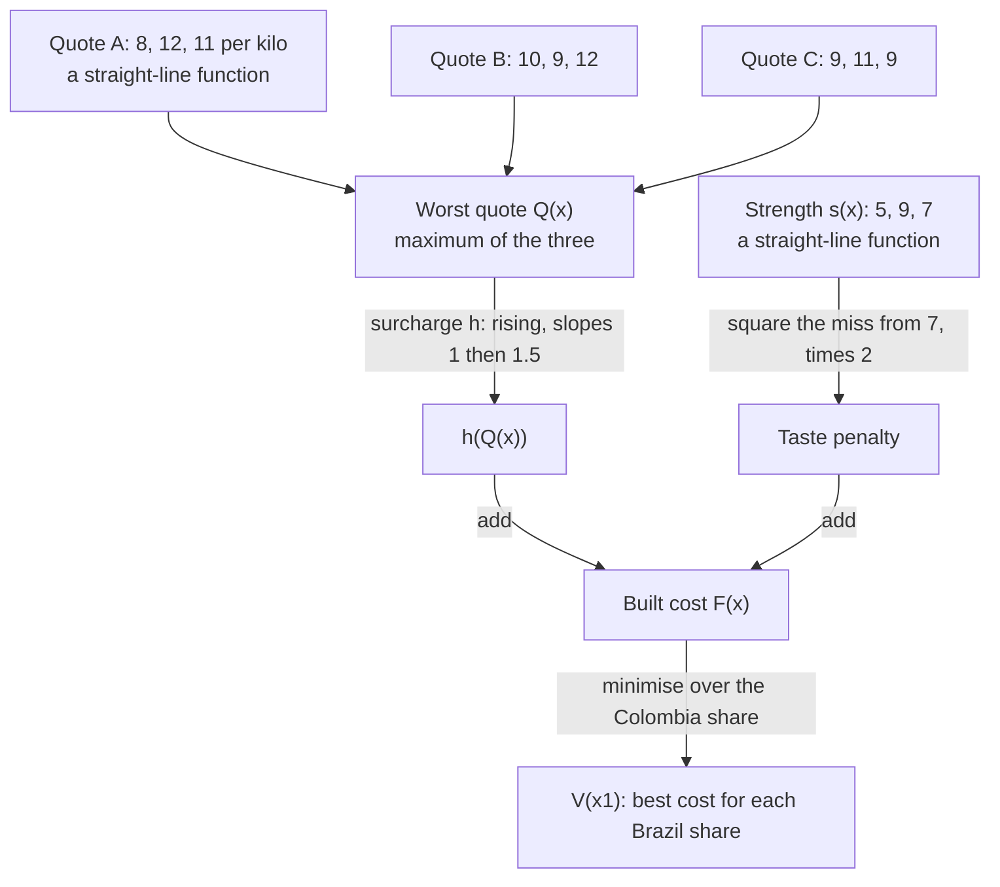
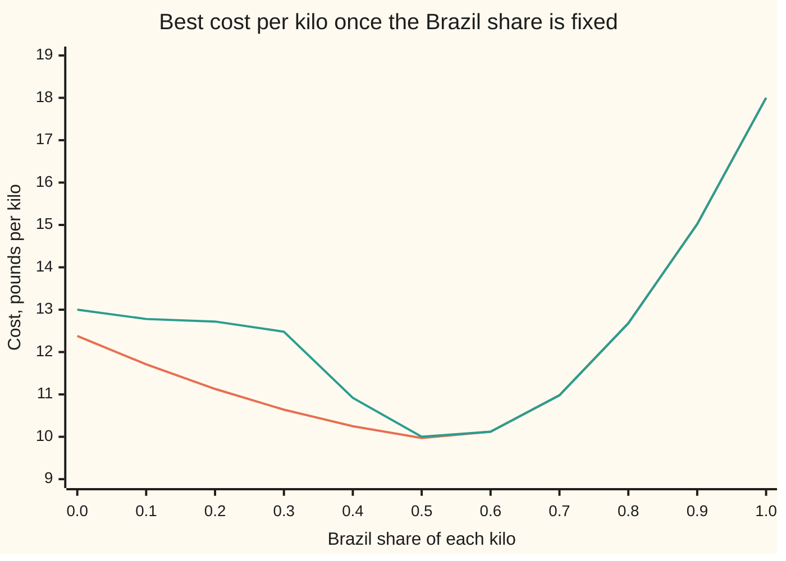

# Building convex functions: the operations that cannot break the bowl

[Syllabus](../../../SYLLABUS.md) → [Optimization](../README.md) → [Convexity](../README.md#s01) → Building convex functions

---

## General Overview

A roaster makes its house coffee from three beans: Brazil, Colombia and Ethiopia. It chooses what share of each kilo goes to each bean. Three suppliers quote a price per kilo for every bean. Supplier A charges £8 for Brazil, £12 for Colombia and £11 for Ethiopia; B charges £10, £9 and £12; C charges £9, £11 and £9.

The roaster must fix the recipe before it knows which supplier will have stock that week. So it plans for the worst: the blend's cost is the **highest of the three quotes**. Two more pieces go on top. Any part of that cost above a £10 budget is bought on credit at half as much again. And the blend should score 7 on a strength scale (Brazil scores 5, Colombia 9, Ethiopia 7); every squared point of miss, too weak or too strong, is costed at £2 a kilo in lost sales.

The roaster minimises this cost. First it wants to know: is the cost a **convex function**, a bowl with no dents, where any local bottom is the true bottom?

The cost has kinks, so the curvature test, a second derivative never negative in any direction, does not apply. And there are too many pairs of recipes to check chords, the straight lines between two points of the graph, which must stay on or above it ([Convex functions](03-convex-functions-and-their-tests.md)).

Instead, each piece is built from simpler ones by an operation proved never to dent a bowl. The finished cost is a bowl by construction, so the bottom a downhill search finds, 52.3% Brazil, 43.0% Colombia and 4.7% Ethiopia at £9.93 a kilo, is the cheapest recipe there is.

**Sums with weights that are not negative, maxima, affine (straight-line) changes of variable, a convex rising function applied to a convex function, and minimising a jointly convex function (convex in all its variables together) over some of its variables all turn convex functions into convex functions, so an objective assembled only from these steps is convex without any further test.**

**What kind of fact this is:** a set of theorems, each proved on this card in Why it works; the coffee costs are a model, an assumed price list, not data.

### The picture: how the cost is assembled



Every arrow is one of the operations on this card. Each one keeps a bowl a bowl, so every box is convex.

---

## The formula

A recipe is a list of three shares $x = (x_1, x_2, x_3)$: Brazil, Colombia, Ethiopia, each at least 0, adding to 1. The quotes are straight-line functions of the shares, for example $q_A(x) = 8x_1 + 12x_2 + 11x_3$. The built cost is

$$F(x) \;=\; h\big(Q(x)\big) + w\,\big(s(x) - 7\big)^2, \qquad Q(x) = \max\{q_A(x),\, q_B(x),\, q_C(x)\}, \qquad h(c) = c + \tfrac12 \max\{0,\, c - 10\}.$$

**Read it aloud:** the worst of three quotes, with half as much again added to any part above £10, plus £2 for every squared point the strength misses 7.

The five rules that certify it, for convex functions $\varphi$ and $\psi$ (read "phi" and "psi"):

$$\varphi + \psi, \quad a\varphi \ (a \ge 0), \qquad \max\{\varphi, \psi\}, \qquad \varphi(Ax + b), \qquad h\big(\varphi(x)\big) \text{ with } h \text{ convex and rising}, \qquad \min_{y \in K} \varphi(x, y) \text{ with } K \text{ convex}$$

**Read it aloud:** add with weights that are not negative, take the larger, feed in a straight-line change of variable, pass through a convex function that never falls, or minimise away some variables over a convex set, and the result is still convex.

The last rule, used on the coffee, fixes the Brazil share (signed months ahead on a forward contract) and lets the roaster choose the rest:

$$V(x_1) = \min_{0 \le x_2 \le 1 - x_1} F(x_1,\, x_2,\, 1 - x_1 - x_2).$$

| Symbol | Plain meaning | In our example | Push it up and the answer… |
| --- | --- | --- | --- |
| $x = (x_1, x_2, x_3)$ | the recipe: shares of Brazil, Colombia, Ethiopia in one kilo | best: 0.5234375, 0.4296875, 0.046875 | — |
| $q_A, q_B, q_C$ | each supplier's price for the blend, £ per kilo | 9.86, 9.66, 9.86 at the best recipe | a higher quote can only raise $Q$ |
| $Q(x)$ | the worst quote, the largest of the three | £9.86 | cost rises one for one below £10 |
| $s(x)$ | the blend's strength score, $5x_1 + 9x_2 + 7x_3$ | 6.8125 | nearer 7 cuts the penalty |
| $w$ | taste weight, £ per squared strength point | 2 | recipes pulled harder toward strength 7 |
| $h(c)$ | the credit surcharge on a cost $c$: slope 1 up to £10, slope 1.5 above | $h(9.86) = 9.86$, below budget | — |
| $F(x)$ | the built cost per kilo, minimised | £9.9296875 at the best recipe | — |
| $V(x_1)$ | best cost once the Brazil share is fixed | £9.97 at $x_1 = 0.5$ | — |
| $\theta$, $x'$, $m$ | a mixing weight between 0 and 1, read "theta"; a second recipe, read "x prime"; and the mixed recipe $\theta x + (1-\theta)x'$ | 0.5, the halfway blend | — |
| $\varphi, \psi$, $a$ | any convex functions, the inputs to a rule, and a weight at least 0 | $q_A$, the taste penalty, $w = 2$ | — |
| $Ax + b$ | an affine map: a matrix times $x$, plus a fixed vector | $s(x) - 7$ | — |
| $y$, $K$, $\varepsilon$ | the variables minimised away, the convex set they range over, and a small slack used in the proof | $x_2$, from 0 to $1 - x_1$ | — |

### When it holds

- **Weights not negative.** Subtracting a convex function can dent the sum.
- **Maximum, not minimum.** The best of three quotes dents by £1.00 at the blend of half Brazil, half Colombia.
- **Outer function convex and never falling.** Squaring the miss from the £10 budget dents by 0.0625, because the square falls as the cost climbs toward £10; a discount above £10 is not convex and dents by £0.075.
- **Partial minimisation over a convex set of a jointly convex function.** Colombia at 0 or all the rest dents the best-cost curve by £0.66.
- **Only straight-line maps are free inside.** $\varphi(Ax+b)$ needs no condition; a curved inner function needs a rising outer one.

---

## Why it works

### Step 0: a bowl is a convex region above the graph

A function is convex exactly when its **epigraph**, everything on or above its graph, is a convex set: a chord staying above the graph is the same as a segment between two points of the epigraph staying inside it ([Convex sets](02-convex-sets.md) defines convex sets; [Convex functions](03-convex-functions-and-their-tests.md) gives the chord test).

Convex regions survive overlapping, casting a shadow on fewer axes, and pulling back through a straight-line map. Every rule below is one of these, or a direct chord argument using the chord test: for any recipes $x$, $x'$ and weight $\theta$ between 0 and 1,

$$\varphi\big(\theta x + (1-\theta) x'\big) \;\le\; \theta\,\varphi(x) + (1-\theta)\,\varphi(x').$$

### Step 1: sums with weights that are not negative

Write the chord test for $\varphi$ and for $\psi$, and add: the inequalities point the same way, so the sum obeys the chord test too. Multiplying by a weight $a \ge 0$ keeps an inequality's direction; a negative weight would flip it.

### Step 2: the maximum is the overlap of the regions

The point (recipe, amount) lies above the worst quote exactly when it lies above all three quotes. So the epigraph of $Q$ is the overlap of three epigraphs. Each is a half-space above a sloping plane, which is convex, and an overlap of convex sets is convex: a segment inside all three is inside their overlap.

The minimum gets no such rule. Its epigraph is the union of three regions, and a union can have a dent between its parts, which is exactly the £1 bulge in the best-quote example.

### Step 3: straight-line maps inside are free

The strength miss $s(x) - 7$ is an affine map: multiply the shares by fixed numbers and add. It sends a mixed recipe to the same mix of outputs, so the chord test for the square at the two outputs is the chord test for the penalty at the two recipes. The square is convex, so the penalty is. Each quote is affine too, with its chord exactly on its graph.

### Step 4: a convex function that never falls, applied on top

The surcharge $h$ has slope 1 up to £10, then 1.5: its slopes rise, so it is convex, and they are positive, so it never falls. Let $\varphi$ be convex and $m = \theta x + (1-\theta)x'$ a mixed recipe. Then

$$h\big(\varphi(m)\big) \;\le\; h\big(\theta\varphi(x) + (1-\theta)\varphi(x')\big) \;\le\; \theta\,h\big(\varphi(x)\big) + (1-\theta)\,h\big(\varphi(x')\big).$$

The first step uses that $h$ never falls: $\varphi(m)$ is at most its chord, so $h$ of it is at most $h$ of the chord. The second step is the chord test for $h$. Drop the first hypothesis and a falling $h$ turns a valley into a hump, as the squared budget miss does; drop the second and the chord bends down, as the bulk discount does.

The same proof covers several inner functions, if $h$ never falls in any input; the maximum of Step 2 is this rule with $h$ = the largest input.

### Step 5: minimising away some variables

Fix the Brazil share $x_1$; the roaster picks the Colombia share and Ethiopia fills the rest. Take two Brazil shares and the best Colombia share for each. Mix both the Brazil shares and their Colombia shares with the same weight $\theta$. The mixed recipe is allowed, because the allowed set is convex. Its cost is at most the chord of the two best costs, because $F$ is convex in all its shares together. And $V$ at the mixed Brazil share is at most the cost of this one allowed choice. So $V$ obeys the chord test.

In regions: the epigraph of $V$ is the shadow of the epigraph of $F$, and a shadow of a convex set is convex.

<details>
<summary>Detailed proof: partial minimisation keeps convexity</summary>

Let $\varphi(x, y)$ be convex in the pair $(x, y)$, let $K$ be a convex set, and let $V(x) = \inf_{y \in K} \varphi(x, y)$, where inf is the greatest lower bound, the minimum when one is reached. Suppose $V$ is never $-\infty$.

Take $x$, $x'$, a weight $\theta$, and any small $\varepsilon > 0$. Choose $y$, $y'$ in $K$ with $\varphi(x, y) \le V(x) + \varepsilon$ and $\varphi(x', y') \le V(x') + \varepsilon$. The point $\theta y + (1-\theta)y'$ is in $K$ because $K$ is convex. Then

$$V\big(\theta x + (1-\theta)x'\big) \le \varphi\big(\theta x + (1-\theta)x',\ \theta y + (1-\theta)y'\big) \le \theta\varphi(x, y) + (1-\theta)\varphi(x', y') \le \theta V(x) + (1-\theta)V(x') + \varepsilon.$$

The first inequality holds because $V$ is the lowest value over all of $K$; the second is joint convexity. Since $\varepsilon$ was any positive number, the chord test holds with $\varepsilon = 0$.

On the coffee the allowed $y$ depends on $x$ ($0 \le y \le 1 - x$); the proof still works because the allowed pairs $(x, y)$ form a convex set.

</details>

### Step 6: the certificate for the coffee cost

Read the build tree upward. Each quote is affine, so convex (Step 3). The worst quote is a maximum, so convex (Step 2). The surcharge is convex and never falls, so $h(Q)$ is convex (Step 4). The strength miss is affine and the square is convex, so the penalty is convex (Step 3), and £2 times it is a weight that is not negative. The sum is convex (Step 1). $V$ is a partial minimum of it over an interval, so convex (Step 5).

That is the whole certificate, with no derivatives, which $F$ lacks at its kinks. Modelling software runs the same check, called **disciplined convex programming**: it builds this tree and refuses any step not on the list.

The payoff: every local bottom of a convex function is the lowest ([Convexity pays off](04-local-minima-are-global-when-convex.md)). So a search that only ever walks downhill, here a ternary search that keeps the lower two thirds of an interval, is entitled to trust its answer.

---

## Worked numbers, by hand

The two searches in the code agree on the recipe 67/128 Brazil, 55/128 Colombia, 6/128 Ethiopia. Check it by hand.

| Step | Arithmetic | Value |
| --- | --- | --- |
| Quote A | (8 × 67 + 12 × 55 + 11 × 6) ÷ 128 = 1262 ÷ 128 | £9.859375 |
| Quote B | (10 × 67 + 9 × 55 + 12 × 6) ÷ 128 = 1237 ÷ 128 | £9.6640625 |
| Quote C | (9 × 67 + 11 × 55 + 9 × 6) ÷ 128 = 1262 ÷ 128 | £9.859375 |
| Worst quote | A and C tie | £9.859375 |
| Surcharge | below £10, slope 1, nothing added | £9.859375 |
| Strength | (5 × 67 + 9 × 55 + 7 × 6) ÷ 128 = 872 ÷ 128 | 6.8125 |
| Taste penalty | 2 × (6.8125 − 7)², a miss of −0.1875 | £0.0703125 |
| Built cost | 9.859375 + 0.0703125 | **£9.9296875 a kilo** |

The best recipe sits where suppliers A and C quote the same, with the strength a little short of 7: pushing it to 7 would cost more in quotes than it saves in taste.

**Why nothing is cheaper.** Average the price lists of the two tied suppliers: half of A plus half of C is (£8.50, £11.50, £10.00) per kilo of each bean. Add the slope of the taste penalty, 2w times the miss times each bean's score: (−3.75, −6.75, −5.25). The sum is (4.75, 4.75, 4.75), the same for every bean.

That sum is a **subgradient** of $F$ at this recipe: a slope that the bowl lies above everywhere ([Subgradients](07-subgradients.md)).

It qualifies for two reasons. Any average of the tied suppliers' price lists is a subgradient of the worst quote, by the maximum rule on that card. And the surcharge has slope 1 below £10, so it passes that slope through unchanged, while the taste penalty adds its own.

Any change of recipe keeps the total at one kilo, so against equal entries it changes the tangent by 4.75 times zero. The bowl lies above a flat tangent, so £9.9296875 is the certified minimum, not just the best found.

### The picture: the best cost for each Brazil contract



The orange line is $V(x_1)$, with the Colombia share chosen freely: a bowl, as Step 5 promised. A second difference is the two neighbouring values minus twice the middle one; a bowl never gives a negative one. Its smallest second difference on this grid is +0.09. The green line allows Colombia only at 0 or at all the rest. That choice is not a convex set, and the line dents at Brazil 0.3, second difference −1.32. From Brazil 0.6 on, the two lines agree: there all the rest goes to Colombia anyway.

### What breaks if you drop a piece

Each row breaks one rule and measures the bulge: the midpoint value minus the chord. A bowl never bulges.

| Mistake | Comes out at | What went wrong |
| --- | --- | --- |
| Best quote instead of worst | Brazil-only £8, Colombia-only £9, half-and-half £9.50 against a chord of £8.50: bulge £1.00 | A minimum is a union of regions, not an overlap |
| Squared miss of the £10 budget | two recipes exactly on budget (Brazil only; half Brazil, half Colombia) score 0, their midpoint 0.0625: bulge 0.0625 | The outer square falls below £10, so a valley of $Q$ becomes a hump |
| Bulk discount, slope 0.5 above £10 | recipes at £9.70 and £10.20, midpoint £10.025 against a chord of £9.95: bulge £0.075 | Slopes that fall make a concave outer function |
| Colombia all or nothing | Brazil 0.2, 0.3, 0.4 cost £12.72, £12.48, £10.92: bulge £0.66 at 0.3 | Minimising over a set that is not convex |

---

## Code, from first principles, and it actually runs

The script prints the inputs, then reaches the best recipe by two searches, certifies it with a subgradient, and tests convexity on random chords. Road 1 is a nested ternary search: for each Brazil share it narrows the Colombia share to the bottom, then narrows the Brazil share the same way; it is valid only because Steps 5 and 6 proved both levels are bowls. Road 2 lists all 8,385 recipes whose shares are multiples of 1/128 and keeps the cheapest. Road 3, the subgradient certificate, shows nothing is cheaper. Road 4 tests the chord on 20,000 random pairs of recipes with random weights, drawn by a SplitMix64 generator written out in both languages: no pair bulges for the built cost, and 11,358 bulge for the best-quote cost. The four broken rules are then measured one chord each.

### Python

```python
# Building convex functions -- the check behind the card.  Nothing is imported.
# A roaster blends Brazil, Colombia and Ethiopia beans (shares x1, x2, x3 of a
# kilo).  Cost: the worst of three supplier quotes, a 50% surcharge on any part
# above a £10 budget, and a £2 taste penalty per squared strength point off 7.
# Roads: nested ternary search, every blend on a 1/128 grid, a subgradient
# certificate, and chord tests on random pairs.  Breaking a rule shows a dent.
QUOTES = {"A": (8, 12, 11), "B": (10, 9, 12), "C": (9, 11, 9)}
STRENGTH, TARGET, W, BUDGET = (5, 9, 7), 7, 2, 10

def dot(p, x): return p[0] * x[0] + p[1] * x[1] + p[2] * x[2]
def worst(x): return max(dot(q, x) for q in QUOTES.values())
def best_quote(x): return min(dot(q, x) for q in QUOTES.values())
def surcharge(c): return c + 0.5 * max(0.0, c - BUDGET)        # slopes 1, then 1.5
def discount(c): return c - 0.5 * max(0.0, c - BUDGET)         # slopes 1, then 0.5
def taste(x): d = dot(STRENGTH, x) - TARGET; return W * d * d
def cost(x): return surcharge(worst(x)) + taste(x)

def ternary(fn, lo, hi):                     # valid only because fn is convex
    for _ in range(100):
        m1, m2 = lo + (hi - lo) / 3, hi - (hi - lo) / 3
        if fn(m1) <= fn(m2): hi = m2
        else: lo = m1
    return (lo + hi) / 2

def inner(x1):                               # V(x1): best Colombia share for a fixed Brazil share
    r = 1 - x1
    x2 = ternary(lambda t: cost((x1, t, r - t)), 0.0, r)
    return cost((x1, x2, r - x2)), x2

def all_or_nothing(x1):                      # Colombia either 0 or all the rest: not a convex choice
    return min(cost((x1, 0.0, 1 - x1)), cost((x1, 1 - x1, 0.0)))

def splitmix(state):
    state = (state + 0x9E3779B97F4A7C15) & 0xFFFFFFFFFFFFFFFF
    z = state
    z = ((z ^ (z >> 30)) * 0xBF58476D1CE4E5B9) & 0xFFFFFFFFFFFFFFFF
    z = ((z ^ (z >> 27)) * 0x94D049BB133111EB) & 0xFFFFFFFFFFFFFFFF
    return state, (z ^ (z >> 31)) >> 11

def chord_test(fn, pairs, seed):             # count mixes that rise above the chord
    state, bad, worst_gap = seed, 0, 0.0
    for _ in range(pairs):
        u = []
        for _ in range(5):
            state, r = splitmix(state)
            u.append(r / 2.0 ** 53)
        def blend(a, b):
            lo, hi = min(a, b), max(a, b)
            return (lo, hi - lo, 1 - hi)
        x, y, th = blend(u[0], u[1]), blend(u[2], u[3]), u[4]
        m = tuple(th * x[i] + (1 - th) * y[i] for i in range(3))
        gap = fn(m) - (th * fn(x) + (1 - th) * fn(y))
        if gap > 1e-9: bad += 1
        worst_gap = max(worst_gap, gap)
    return bad, worst_gap

def fmt(v): return "(" + ", ".join(f"{t:.2f}" for t in v) + ")"
def ints(v): return "(" + ", ".join(str(int(t)) for t in v) + ")"

print("inputs: quotes " + ", ".join(f"{k} {ints(q)}" for k, q in QUOTES.items())
      + f"; strength {ints(STRENGTH)}, target {TARGET}, weight {W}, budget {BUDGET}")

# Road 1: nested ternary search, outer over Brazil, inner over Colombia.
x1 = ternary(lambda t: inner(t)[0], 0.0, 1.0)
v1, x2 = inner(x1)
print(f"road 1, nested ternary search: shares {x1:.7f}, {x2:.7f}, {1 - x1 - x2:.7f}; cost {v1:.7f}")
# Road 2: every blend whose shares are multiples of 1/128.
n, grid = 128, (None, None)
for i in range(n + 1):
    for j in range(n + 1 - i):
        c = cost((i / n, j / n, (n - i - j) / n))
        if grid[0] is None or c < grid[0]: grid = (c, (i, j, n - i - j))
print(f"road 2, all {(n + 1) * (n + 2) // 2} blends in steps of 1/128: best {grid[1][0]}/128, "
      f"{grid[1][1]}/128, {grid[1][2]}/128; cost {grid[0]:.7f}")
xs = tuple(k / n for k in grid[1])
qa, qb, qc = (dot(QUOTES[k], xs) for k in "ABC")
s = dot(STRENGTH, xs)
print("in 128ths of a pound: quotes " + ", ".join(f"{k} {dot(QUOTES[k], grid[1])}" for k in "ABC")
      + f"; strength {dot(STRENGTH, grid[1])} in 128ths of a point")
print(f"at that blend: quotes A {qa:.7f}, B {qb:.7f}, C {qc:.7f}; worst {worst(xs):.7f}, "
      f"after surcharge {surcharge(worst(xs)):.7f}")
print(f"strength {s:.4f}, miss {s - TARGET:.4f}, taste penalty {taste(xs):.7f}; total {cost(xs):.7f}")
# Road 3: the certificate.  Half of A's prices plus half of C's, plus the taste slope.
half = tuple((QUOTES["A"][i] + QUOTES["C"][i]) / 2 for i in range(3))
slope = tuple(2 * W * (s - TARGET) * STRENGTH[i] for i in range(3))
cert = tuple(half[i] + slope[i] for i in range(3))
print(f"certificate: half A + half C {fmt(half)}, taste slope {fmt(slope)}, sum {fmt(cert)}")
# Road 4: chord tests on 20000 random pairs of blends and random mixes.
bad, gap = chord_test(cost, 20000, 2026)
print(f"chord test, built cost: {bad} of 20000 mixes above the chord")
bad_b, gap_b = chord_test(best_quote, 20000, 2026)
print(f"chord test, best quote instead of worst: {bad_b} of 20000 above, worst by {gap_b:.4f}")
# The chart: V(x1), best cost for each Brazil share, against the all-or-nothing version.
ts = [k / 10 for k in range(11)]
vs = [inner(t)[0] for t in ts]
an = [all_or_nothing(t) for t in ts]
print("chart, V by Brazil share 0.0 to 1.0:", ", ".join(f"{v:.2f}" for v in vs))
print("chart, all-or-nothing Colombia:     ", ", ".join(f"{v:.2f}" for v in an))
d2 = [vs[k - 1] + vs[k + 1] - 2 * vs[k] for k in range(1, 10)]
d2n = [an[k - 1] + an[k + 1] - 2 * an[k] for k in range(1, 10)]
print(f"smallest second difference: V {min(d2):.4f}; all-or-nothing {min(d2n):.4f} at Brazil "
      f"{ts[1 + d2n.index(min(d2n))]:.1f}")
# What breaks: one chord each, mid = the halfway blend.
def show(label, fn, x, y):
    m = tuple((x[i] + y[i]) / 2 for i in range(3))
    mid, chord = fn(m), (fn(x) + fn(y)) / 2
    print(f"{label}: ends {fn(x):.4f} and {fn(y):.4f}, midpoint {mid:.4f}, chord {chord:.4f}, "
          f"bulge {mid - chord:.4f}")
    return mid - chord
b1 = show("break 1, best quote", best_quote, (1, 0, 0), (0, 1, 0))
b2 = show("break 2, squared miss of budget", lambda x: (worst(x) - BUDGET) ** 2, (1, 0, 0), (0.5, 0.5, 0))
b3 = show("break 3, bulk discount above budget", lambda x: discount(worst(x)), (0.7, 0.3, 0), (0.8, 0, 0.2))
print(f"break 4, all-or-nothing Colombia: at Brazil 0.2, 0.3, 0.4 cost {an[2]:.4f}, {an[3]:.4f}, "
      f"{an[4]:.4f}; bulge {an[3] - (an[2] + an[4]) / 2:.4f}")
assert abs(v1 - grid[0]) < 1e-9 and abs(x1 - xs[0]) < 1e-6      # two searches, one answer
assert abs(cert[0] - cert[1]) < 1e-12 and abs(cert[1] - cert[2]) < 1e-12 and worst(xs) < BUDGET
assert bad == 0 and bad_b > 0                                  # rules hold, broken rule shows
assert min(d2) > -1e-9 and min(d2n) < 0                        # V is a bowl, the dented one is not
assert b1 > 0 and b2 > 0 and b3 > 0                            # each broken rule bulges
print("ALL CHECKS PASS")
```

**Ran 2026-11-11 on macOS, Python 3.14.10, standard library only. All checks passed. Output, pasted from the run:**

```
inputs: quotes A (8, 12, 11), B (10, 9, 12), C (9, 11, 9); strength (5, 9, 7), target 7, weight 2, budget 10
road 1, nested ternary search: shares 0.5234375, 0.4296875, 0.0468750; cost 9.9296875
road 2, all 8385 blends in steps of 1/128: best 67/128, 55/128, 6/128; cost 9.9296875
in 128ths of a pound: quotes A 1262, B 1237, C 1262; strength 872 in 128ths of a point
at that blend: quotes A 9.8593750, B 9.6640625, C 9.8593750; worst 9.8593750, after surcharge 9.8593750
strength 6.8125, miss -0.1875, taste penalty 0.0703125; total 9.9296875
certificate: half A + half C (8.50, 11.50, 10.00), taste slope (-3.75, -6.75, -5.25), sum (4.75, 4.75, 4.75)
chord test, built cost: 0 of 20000 mixes above the chord
chord test, best quote instead of worst: 11358 of 20000 above, worst by 1.0155
chart, V by Brazil share 0.0 to 1.0: 12.38, 11.71, 11.13, 10.64, 10.25, 9.97, 10.12, 10.98, 12.68, 15.02, 18.00
chart, all-or-nothing Colombia:      13.00, 12.78, 12.72, 12.48, 10.92, 10.00, 10.12, 10.98, 12.68, 15.02, 18.00
smallest second difference: V 0.0900; all-or-nothing -1.3200 at Brazil 0.3
break 1, best quote: ends 8.0000 and 9.0000, midpoint 9.5000, chord 8.5000, bulge 1.0000
break 2, squared miss of budget: ends 0.0000 and 0.0000, midpoint 0.0625, chord 0.0000, bulge 0.0625
break 3, bulk discount above budget: ends 9.7000 and 10.2000, midpoint 10.0250, chord 9.9500, bulge 0.0750
break 4, all-or-nothing Colombia: at Brazil 0.2, 0.3, 0.4 cost 12.7200, 12.4800, 10.9200; bulge 0.6600
ALL CHECKS PASS
```

### Rust

Same numbers, same labels, built with `rustc --edition 2021 -O`.

```rust
// Building convex functions -- the same check as the Python, in Rust.  No crates.
// A roaster blends Brazil, Colombia and Ethiopia beans (shares x1, x2, x3 of a
// kilo).  Cost: the worst of three supplier quotes, a 50% surcharge on any part
// above a £10 budget, and a £2 taste penalty per squared strength point off 7.
// Roads: nested ternary search, every blend on a 1/128 grid, a subgradient
// certificate, and chord tests on random pairs.  Breaking a rule shows a dent.
type V3 = [f64; 3];
const QUOTES: [V3; 3] = [[8.0, 12.0, 11.0], [10.0, 9.0, 12.0], [9.0, 11.0, 9.0]];
const STRENGTH: V3 = [5.0, 9.0, 7.0];
const TARGET: f64 = 7.0;
const W: f64 = 2.0;
const BUDGET: f64 = 10.0;

fn dot(p: &V3, x: &V3) -> f64 { p[0] * x[0] + p[1] * x[1] + p[2] * x[2] }
fn worst(x: &V3) -> f64 { QUOTES.iter().map(|q| dot(q, x)).fold(f64::MIN, f64::max) }
fn best_quote(x: &V3) -> f64 { QUOTES.iter().map(|q| dot(q, x)).fold(f64::MAX, f64::min) }
fn surcharge(c: f64) -> f64 { c + 0.5 * f64::max(0.0, c - BUDGET) }     // slopes 1, then 1.5
fn discount(c: f64) -> f64 { c - 0.5 * f64::max(0.0, c - BUDGET) }      // slopes 1, then 0.5
fn taste(x: &V3) -> f64 { let d = dot(&STRENGTH, x) - TARGET; W * d * d }
fn cost(x: &V3) -> f64 { surcharge(worst(x)) + taste(x) }

fn ternary(f: &dyn Fn(f64) -> f64, mut lo: f64, mut hi: f64) -> f64 {   // valid only because f is convex
    for _ in 0..100 {
        let (m1, m2) = (lo + (hi - lo) / 3.0, hi - (hi - lo) / 3.0);
        if f(m1) <= f(m2) { hi = m2 } else { lo = m1 }
    }
    (lo + hi) / 2.0
}

fn inner(x1: f64) -> (f64, f64) {          // V(x1): best Colombia share for a fixed Brazil share
    let r = 1.0 - x1;
    let x2 = ternary(&|t| cost(&[x1, t, r - t]), 0.0, r);
    (cost(&[x1, x2, r - x2]), x2)
}

fn all_or_nothing(x1: f64) -> f64 {        // Colombia either 0 or all the rest: not a convex choice
    f64::min(cost(&[x1, 0.0, 1.0 - x1]), cost(&[x1, 1.0 - x1, 0.0]))
}

fn splitmix(state: u64) -> (u64, u64) {
    let s = state.wrapping_add(0x9E3779B97F4A7C15);
    let mut z = s;
    z = (z ^ (z >> 30)).wrapping_mul(0xBF58476D1CE4E5B9);
    z = (z ^ (z >> 27)).wrapping_mul(0x94D049BB133111EB);
    (s, (z ^ (z >> 31)) >> 11)
}

fn chord_test(f: &dyn Fn(&V3) -> f64, pairs: usize, seed: u64) -> (usize, f64) {
    let (mut state, mut bad, mut worst_gap) = (seed, 0, 0.0f64);
    for _ in 0..pairs {
        let mut u = [0.0; 5];
        for k in 0..5 {
            let (s, r) = splitmix(state);
            state = s;
            u[k] = r as f64 / 9007199254740992.0;
        }
        let blend = |a: f64, b: f64| { let (lo, hi) = (a.min(b), a.max(b)); [lo, hi - lo, 1.0 - hi] };
        let (x, y, th) = (blend(u[0], u[1]), blend(u[2], u[3]), u[4]);
        let m: V3 = [0, 1, 2].map(|i| th * x[i] + (1.0 - th) * y[i]);
        let gap = f(&m) - (th * f(&x) + (1.0 - th) * f(&y));
        if gap > 1e-9 { bad += 1 }
        worst_gap = worst_gap.max(gap);
    }
    (bad, worst_gap)
}

fn fmt(v: &V3) -> String { format!("({:.2}, {:.2}, {:.2})", v[0], v[1], v[2]) }
fn ints(v: &V3) -> String { format!("({}, {}, {})", v[0] as i64, v[1] as i64, v[2] as i64) }
fn join(v: &[f64]) -> String { v.iter().map(|t| format!("{:.2}", t)).collect::<Vec<_>>().join(", ") }

fn show(label: &str, f: &dyn Fn(&V3) -> f64, x: V3, y: V3) -> f64 {
    let m: V3 = [0, 1, 2].map(|i| (x[i] + y[i]) / 2.0);
    let (mid, chord) = (f(&m), (f(&x) + f(&y)) / 2.0);
    println!("{}: ends {:.4} and {:.4}, midpoint {:.4}, chord {:.4}, bulge {:.4}",
             label, f(&x), f(&y), mid, chord, mid - chord);
    mid - chord
}

fn main() {
    println!("inputs: quotes A {}, B {}, C {}; strength {}, target {}, weight {}, budget {}",
             ints(&QUOTES[0]), ints(&QUOTES[1]), ints(&QUOTES[2]), ints(&STRENGTH), TARGET, W, BUDGET);
    // Road 1: nested ternary search, outer over Brazil, inner over Colombia.
    let x1 = ternary(&|t| inner(t).0, 0.0, 1.0);
    let (v1, x2) = inner(x1);
    println!("road 1, nested ternary search: shares {:.7}, {:.7}, {:.7}; cost {:.7}", x1, x2, 1.0 - x1 - x2, v1);
    // Road 2: every blend whose shares are multiples of 1/128.
    let n = 128usize;
    let (mut gbest, mut gat) = (f64::MAX, (0, 0, 0));
    for i in 0..=n {
        for j in 0..=(n - i) {
            let c = cost(&[i as f64 / n as f64, j as f64 / n as f64, (n - i - j) as f64 / n as f64]);
            if c < gbest { gbest = c; gat = (i, j, n - i - j) }
        }
    }
    println!("road 2, all {} blends in steps of 1/128: best {}/128, {}/128, {}/128; cost {:.7}",
             (n + 1) * (n + 2) / 2, gat.0, gat.1, gat.2, gbest);
    let xs: V3 = [gat.0 as f64 / n as f64, gat.1 as f64 / n as f64, gat.2 as f64 / n as f64];
    let (qa, qb, qc) = (dot(&QUOTES[0], &xs), dot(&QUOTES[1], &xs), dot(&QUOTES[2], &xs));
    let s = dot(&STRENGTH, &xs);
    let g: V3 = [gat.0 as f64, gat.1 as f64, gat.2 as f64];
    println!("in 128ths of a pound: quotes A {}, B {}, C {}; strength {} in 128ths of a point",
             dot(&QUOTES[0], &g), dot(&QUOTES[1], &g), dot(&QUOTES[2], &g), dot(&STRENGTH, &g));
    println!("at that blend: quotes A {:.7}, B {:.7}, C {:.7}; worst {:.7}, after surcharge {:.7}",
             qa, qb, qc, worst(&xs), surcharge(worst(&xs)));
    println!("strength {:.4}, miss {:.4}, taste penalty {:.7}; total {:.7}", s, s - TARGET, taste(&xs), cost(&xs));
    // Road 3: the certificate.  Half of A's prices plus half of C's, plus the taste slope.
    let half: V3 = [0, 1, 2].map(|i| (QUOTES[0][i] + QUOTES[2][i]) / 2.0);
    let slope: V3 = [0, 1, 2].map(|i| 2.0 * W * (s - TARGET) * STRENGTH[i]);
    let cert: V3 = [0, 1, 2].map(|i| half[i] + slope[i]);
    println!("certificate: half A + half C {}, taste slope {}, sum {}", fmt(&half), fmt(&slope), fmt(&cert));
    // Road 4: chord tests on 20000 random pairs of blends and random mixes.
    let (bad, _gap) = chord_test(&cost, 20000, 2026);
    println!("chord test, built cost: {} of 20000 mixes above the chord", bad);
    let (bad_b, gap_b) = chord_test(&best_quote, 20000, 2026);
    println!("chord test, best quote instead of worst: {} of 20000 above, worst by {:.4}", bad_b, gap_b);
    // The chart: V(x1), best cost for each Brazil share, against the all-or-nothing version.
    let ts: Vec<f64> = (0..11).map(|k| k as f64 / 10.0).collect();
    let vs: Vec<f64> = ts.iter().map(|&t| inner(t).0).collect();
    let an: Vec<f64> = ts.iter().map(|&t| all_or_nothing(t)).collect();
    println!("chart, V by Brazil share 0.0 to 1.0: {}", join(&vs));
    println!("chart, all-or-nothing Colombia:      {}", join(&an));
    let d2: Vec<f64> = (1..10).map(|k| vs[k - 1] + vs[k + 1] - 2.0 * vs[k]).collect();
    let d2n: Vec<f64> = (1..10).map(|k| an[k - 1] + an[k + 1] - 2.0 * an[k]).collect();
    let (min_d2, min_d2n) = (d2.iter().cloned().fold(f64::MAX, f64::min), d2n.iter().cloned().fold(f64::MAX, f64::min));
    let at = d2n.iter().position(|&v| v == min_d2n).unwrap();
    println!("smallest second difference: V {:.4}; all-or-nothing {:.4} at Brazil {:.1}", min_d2, min_d2n, ts[1 + at]);
    // What breaks: one chord each, mid = the halfway blend.
    let b1 = show("break 1, best quote", &best_quote, [1.0, 0.0, 0.0], [0.0, 1.0, 0.0]);
    let b2 = show("break 2, squared miss of budget", &|x| (worst(x) - BUDGET) * (worst(x) - BUDGET),
                  [1.0, 0.0, 0.0], [0.5, 0.5, 0.0]);
    let b3 = show("break 3, bulk discount above budget", &|x| discount(worst(x)), [0.7, 0.3, 0.0], [0.8, 0.0, 0.2]);
    println!("break 4, all-or-nothing Colombia: at Brazil 0.2, 0.3, 0.4 cost {:.4}, {:.4}, {:.4}; bulge {:.4}",
             an[2], an[3], an[4], an[3] - (an[2] + an[4]) / 2.0);
    assert!((v1 - gbest).abs() < 1e-9 && (x1 - xs[0]).abs() < 1e-6);      // two searches, one answer
    assert!((cert[0] - cert[1]).abs() < 1e-12 && (cert[1] - cert[2]).abs() < 1e-12 && worst(&xs) < BUDGET);
    assert!(bad == 0 && bad_b > 0);                                      // rules hold, broken rule shows
    assert!(min_d2 > -1e-9 && min_d2n < 0.0);                            // V is a bowl, the dented one is not
    assert!(b1 > 0.0 && b2 > 0.0 && b3 > 0.0);                           // each broken rule bulges
    println!("ALL CHECKS PASS");
}
```

**Ran 2026-11-11 on macOS, rustc 1.98.1, no crates. All checks passed. Output, pasted from the run:**

```
inputs: quotes A (8, 12, 11), B (10, 9, 12), C (9, 11, 9); strength (5, 9, 7), target 7, weight 2, budget 10
road 1, nested ternary search: shares 0.5234375, 0.4296875, 0.0468750; cost 9.9296875
road 2, all 8385 blends in steps of 1/128: best 67/128, 55/128, 6/128; cost 9.9296875
in 128ths of a pound: quotes A 1262, B 1237, C 1262; strength 872 in 128ths of a point
at that blend: quotes A 9.8593750, B 9.6640625, C 9.8593750; worst 9.8593750, after surcharge 9.8593750
strength 6.8125, miss -0.1875, taste penalty 0.0703125; total 9.9296875
certificate: half A + half C (8.50, 11.50, 10.00), taste slope (-3.75, -6.75, -5.25), sum (4.75, 4.75, 4.75)
chord test, built cost: 0 of 20000 mixes above the chord
chord test, best quote instead of worst: 11358 of 20000 above, worst by 1.0155
chart, V by Brazil share 0.0 to 1.0: 12.38, 11.71, 11.13, 10.64, 10.25, 9.97, 10.12, 10.98, 12.68, 15.02, 18.00
chart, all-or-nothing Colombia:      13.00, 12.78, 12.72, 12.48, 10.92, 10.00, 10.12, 10.98, 12.68, 15.02, 18.00
smallest second difference: V 0.0900; all-or-nothing -1.3200 at Brazil 0.3
break 1, best quote: ends 8.0000 and 9.0000, midpoint 9.5000, chord 8.5000, bulge 1.0000
break 2, squared miss of budget: ends 0.0000 and 0.0000, midpoint 0.0625, chord 0.0000, bulge 0.0625
break 3, bulk discount above budget: ends 9.7000 and 10.2000, midpoint 10.0250, chord 9.9500, bulge 0.0750
break 4, all-or-nothing Colombia: at Brazil 0.2, 0.3, 0.4 cost 12.7200, 12.4800, 10.9200; bulge 0.6600
ALL CHECKS PASS
```

The two outputs match line for line.

### Lean

Lean proves the five rules for every function that meets their conditions, and the coffee cost's convexity and exact minimum.

- Adding two convex functions, or multiplying one by a weight at least 0, gives a convex function.
- The larger of two convex functions is convex.
- A convex function fed a straight-line change of variable, $\varphi(Ax + b)$, is convex, with no further condition.
- A convex function that never falls, applied on top of a convex function, gives a convex function.
- Minimising away some variables of a jointly convex function over a convex set $K$, not empty, gives a convex $V$, if $V$ is never $-\infty$.
- The built cost $F$ is convex on the allowed recipes: shares at least 0 that add to 1.
- The recipe 67/128 Brazil, 55/128 Colombia, 6/128 Ethiopia costs exactly £9.9296875 a kilo, and no allowed recipe costs less.
- In 128ths of a pound, quotes A, B and C come to 1262, 1237 and 1262; the strength is 872 in 128ths of a point.
- The taste penalty is 9/128, so the built cost is 1271/128, and the 1/128 grid holds 8,385 recipes.
- The certificate's three entries are all equal, 4.75 each.

The dents from broken rules, the coffee's best-cost curve $V$, the searches and the random chord tests are left to the Python and Rust checks.

```lean
-- Building convex functions: sums with weights that are not negative, maxima, affine changes of variable, convex rising outer functions and partial minimisation over a convex set keep convex functions convex, and the coffee cost built this way is convex with least value 1271/128 at the recipe (67/128, 55/128, 6/128).
import Mathlib.Analysis.Convex.Function
import Mathlib.Analysis.Convex.StdSimplex
import Mathlib.LinearAlgebra.AffineSpace.AffineMap
import Mathlib.Data.Fin.VecNotation

/-- The card's coffee cost per kilo for a recipe `x = (x₁, x₂, x₃)` of Brazil, Colombia and
Ethiopia shares: the worst of the three quotes A (8, 12, 11), B (10, 9, 12), C (9, 11, 9),
plus half of any part above the £10 budget, plus £2 times the squared miss of the strength
`5x₁ + 9x₂ + 7x₃` from 7. -/
noncomputable def coffeeCost (x : Fin 3 → ℝ) : ℝ :=
  let Q := max (max (8 * x 0 + 12 * x 1 + 11 * x 2) (10 * x 0 + 9 * x 1 + 12 * x 2))
    (9 * x 0 + 11 * x 1 + 9 * x 2)
  (Q + 1 / 2 * max 0 (Q - 10)) + 2 * (5 * x 0 + 9 * x 1 + 7 * x 2 - 7) ^ 2

/-- A function `c₀ x₀ + c₁ x₁ + c₂ x₂ + d` is convex on all of `ℝ³`. -/
theorem coffee_affine_convexOn (c₀ c₁ c₂ d : ℝ) :
    ConvexOn ℝ Set.univ (fun x : Fin 3 → ℝ => c₀ * x 0 + c₁ * x 1 + c₂ * x 2 + d) := by
  refine ⟨convex_univ, fun x _ y _ a b _ _ hab => le_of_eq ?_⟩
  simp only [Pi.add_apply, Pi.smul_apply, smul_eq_mul]
  linear_combination (-d) * hab

/-- The taste penalty `2 (5x₀ + 9x₁ + 7x₂ − 7)²` is convex on all of `ℝ³`. -/
theorem coffee_taste_convexOn :
    ConvexOn ℝ Set.univ (fun x : Fin 3 → ℝ => 2 * (5 * x 0 + 9 * x 1 + 7 * x 2 - 7) ^ 2) := by
  refine ⟨convex_univ, fun x _ y _ a b ha hb hab => ?_⟩
  simp only [Pi.add_apply, Pi.smul_apply, smul_eq_mul]
  have hb' : b = 1 - a := by linarith
  subst hb'
  nlinarith [mul_nonneg ha hb, sq_nonneg ((5 * x 0 + 9 * x 1 + 7 * x 2) - (5 * y 0 + 9 * y 1 + 7 * y 2)),
    mul_nonneg (mul_nonneg ha hb) (sq_nonneg ((5 * x 0 + 9 * x 1 + 7 * x 2) - (5 * y 0 + 9 * y 1 + 7 * y 2)))]

/-- The budget step `t ↦ t + ½ max 0 (t − 10)` is convex on all of `ℝ`. -/
theorem coffee_budget_convexOn :
    ConvexOn ℝ Set.univ (fun t : ℝ => t + 1 / 2 * max 0 (t - 10)) := by
  have h1 : ConvexOn ℝ Set.univ (fun t : ℝ => t) := convexOn_id convex_univ
  have h2 : ConvexOn ℝ Set.univ (fun t : ℝ => max 0 (t - 10)) :=
    (convexOn_const 0 convex_univ).sup ((convexOn_id convex_univ).add_const (-10)) |>.congr
      (fun t _ => by simp [sub_eq_add_neg])
  exact h1.add (h2.smul (by norm_num : (0:ℝ) ≤ 1 / 2))

theorem coffee_budget_monotone : Monotone (fun t : ℝ => t + 1 / 2 * max 0 (t - 10)) := by
  intro s t hst
  have : max 0 (s - 10) ≤ max 0 (t - 10) := max_le_max le_rfl (by linarith)
  simp only
  linarith

/-- The five rules. For convex functions `φ` and `ψ`:
(1) `φ + ψ` and `a φ` with `a ≥ 0` are convex;
(2) the larger of the two, `max φ ψ`, is convex;
(3) `φ (A x + b)` is convex for any affine (straight-line) map, with no further condition;
(4) `h (φ x)` is convex when `h` is convex and never falls;
(5) `V x = inf_{y ∈ K} φ (x, y)` is convex when `φ` is convex in the pair `(x, y)`, `K` is a
convex set, and `V` is never `-∞` (each infimum is bounded below; `K` is not empty). -/
theorem operations_preserve_convexity
    {E F : Type*} [AddCommGroup E] [Module ℝ E] [AddCommGroup F] [Module ℝ F] :
    (∀ (s : Set E) (φ ψ : E → ℝ) (a : ℝ), ConvexOn ℝ s φ → ConvexOn ℝ s ψ → 0 ≤ a →
        ConvexOn ℝ s (fun x => φ x + ψ x) ∧ ConvexOn ℝ s (fun x => a * φ x)) ∧
    (∀ (s : Set E) (φ ψ : E → ℝ), ConvexOn ℝ s φ → ConvexOn ℝ s ψ →
        ConvexOn ℝ s (fun x => max (φ x) (ψ x))) ∧
    (∀ (t : Set F) (φ : F → ℝ) (A : E →ᵃ[ℝ] F), ConvexOn ℝ t φ →
        ConvexOn ℝ (A ⁻¹' t) (fun x => φ (A x))) ∧
    (∀ (s : Set E) (φ : E → ℝ) (h : ℝ → ℝ), ConvexOn ℝ s φ → ConvexOn ℝ Set.univ h →
        Monotone h → ConvexOn ℝ s (fun x => h (φ x))) ∧
    (∀ (K : Set F) (φ : E × F → ℝ), Convex ℝ K → K.Nonempty →
        ConvexOn ℝ (Set.univ ×ˢ K) φ → (∀ x, BddBelow ((fun y => φ (x, y)) '' K)) →
        ConvexOn ℝ Set.univ (fun x => sInf ((fun y => φ (x, y)) '' K))) := by
  refine ⟨?_, ?_, ?_, ?_, ?_⟩
  · intro s φ ψ a hφ hψ ha
    exact ⟨hφ.add hψ, hφ.smul ha⟩
  · intro s φ ψ hφ hψ
    exact hφ.sup hψ
  · intro t φ A hφ
    exact hφ.comp_affineMap A
  · intro s φ h hφ hh hmono
    exact ⟨hφ.1, fun x hx y hy a b ha hb hab =>
      (hmono (hφ.2 hx hy ha hb hab)).trans (hh.2 (Set.mem_univ _) (Set.mem_univ _) ha hb hab)⟩
  · intro K φ hK hKne hφ hbdd
    refine ⟨convex_univ, ?_⟩
    intro x₁ _ x₂ _ a b ha hb hab
    have hne : ∀ x, ((fun y => φ (x, y)) '' K).Nonempty := fun x => hKne.image _
    show sInf _ ≤ a • sInf _ + b • sInf _
    simp only [smul_eq_mul]
    refine le_of_forall_pos_le_add fun ε hε => ?_
    obtain ⟨_, ⟨y₁, hy₁, rfl⟩, h₁⟩ :=
      exists_lt_of_csInf_lt (hne x₁) (lt_add_of_pos_right (sInf ((fun y => φ (x₁, y)) '' K)) hε)
    obtain ⟨_, ⟨y₂, hy₂, rfl⟩, h₂⟩ :=
      exists_lt_of_csInf_lt (hne x₂) (lt_add_of_pos_right (sInf ((fun y => φ (x₂, y)) '' K)) hε)
    have hy : a • y₁ + b • y₂ ∈ K := hK hy₁ hy₂ ha hb hab
    have hle : sInf ((fun y => φ (a • x₁ + b • x₂, y)) '' K) ≤ φ (a • x₁ + b • x₂, a • y₁ + b • y₂) :=
      csInf_le (hbdd _) ⟨_, hy, rfl⟩
    have hconv := hφ.2 (x := (x₁, y₁)) (y := (x₂, y₂)) ⟨Set.mem_univ _, hy₁⟩ ⟨Set.mem_univ _, hy₂⟩
      ha hb hab
    simp only [Prod.smul_mk, Prod.mk_add_mk, smul_eq_mul] at hconv
    simp only at h₁ h₂
    have e1 : a * φ (x₁, y₁) ≤ a * (sInf ((fun y => φ (x₁, y)) '' K) + ε) :=
      mul_le_mul_of_nonneg_left h₁.le ha
    have e2 : b * φ (x₂, y₂) ≤ b * (sInf ((fun y => φ (x₂, y)) '' K) + ε) :=
      mul_le_mul_of_nonneg_left h₂.le hb
    have hε' : a * ε + b * ε = ε := by rw [← add_mul, hab, one_mul]
    nlinarith

/-- Step 6, the certificate: the coffee cost, assembled only from the five rules, is convex
on the set of recipes (shares at least 0 that add to 1). -/
theorem coffee_cost_convex : ConvexOn ℝ (stdSimplex ℝ (Fin 3)) coffeeCost := by
  have hA := coffee_affine_convexOn 8 12 11 0
  have hB := coffee_affine_convexOn 10 9 12 0
  have hC := coffee_affine_convexOn 9 11 9 0
  simp only [add_zero] at hA hB hC
  have hQ := (hA.sup hB).sup hC
  have hH : ConvexOn ℝ Set.univ (fun x : Fin 3 → ℝ =>
      (fun t : ℝ => t + 1 / 2 * max 0 (t - 10))
        (max (max (8 * x 0 + 12 * x 1 + 11 * x 2) (10 * x 0 + 9 * x 1 + 12 * x 2))
          (9 * x 0 + 11 * x 1 + 9 * x 2))) :=
    ⟨convex_univ, fun x hx y hy a b ha hb hab =>
      (coffee_budget_monotone (hQ.2 hx hy ha hb hab)).trans
        (coffee_budget_convexOn.2 (Set.mem_univ _) (Set.mem_univ _) ha hb hab)⟩
  exact (hH.add coffee_taste_convexOn).subset (Set.subset_univ _) (convex_stdSimplex ℝ (Fin 3))


/-- The worked numbers and the subgradient certificate: the recipe 67/128 Brazil,
55/128 Colombia, 6/128 Ethiopia costs exactly £9.9296875 = 1271/128 a kilo, and no recipe
is cheaper. -/
theorem coffee_cost_minimum :
    coffeeCost ![67 / 128, 55 / 128, 6 / 128] = 1271 / 128 ∧
      ∀ x ∈ stdSimplex ℝ (Fin 3), (1271 / 128 : ℝ) ≤ coffeeCost x := by
  refine ⟨?_, ?_⟩
  · simp only [coffeeCost, Matrix.cons_val_zero, Matrix.cons_val_one, Matrix.cons_val_two,
      Matrix.head_cons, Matrix.tail_cons]
    norm_num
  · intro x hx
    obtain ⟨h0, hsum⟩ := hx
    simp only [Fin.sum_univ_three] at hsum
    have hx0 := h0 0
    have hx1 := h0 1
    have hx2 := h0 2
    simp only [coffeeCost]
    set A := 8 * x 0 + 12 * x 1 + 11 * x 2
    set B := 10 * x 0 + 9 * x 1 + 12 * x 2
    set C := 9 * x 0 + 11 * x 1 + 9 * x 2
    set Q := max (max A B) C with hQ
    have hAQ : A ≤ Q := (le_max_left A B).trans (le_max_left _ C)
    have hCQ : C ≤ Q := le_max_right _ C
    have hP : 0 ≤ max 0 (Q - 10) := le_max_left _ _
    nlinarith [sq_nonneg (5 * x 0 + 9 * x 1 + 7 * x 2 - 872 / 128)]

-- The worked numbers, in 128ths: quotes A, B, C and the strength at the best recipe.
example : 8 * 67 + 12 * 55 + 11 * 6 = 1262 := by norm_num
example : 10 * 67 + 9 * 55 + 12 * 6 = 1237 := by norm_num
example : 9 * 67 + 11 * 55 + 9 * 6 = 1262 := by norm_num
example : 5 * 67 + 9 * 55 + 7 * 6 = 872 := by norm_num
example : 67 + 55 + 6 = 128 := by norm_num
-- The grid search lists (128 + 1)(128 + 2)/2 = 8385 recipes.
example : (128 + 1) * (128 + 2) / 2 = 8385 := by norm_num
-- Built cost in 128ths: worst quote 1262 plus taste penalty 9 (2 × (872/128 − 7)² = 9/128).
example : (2 : ℚ) * (872 / 128 - 7) ^ 2 = 9 / 128 := by norm_num
example : 1262 + 9 = 1271 := by norm_num
-- Certificate: A + C prices plus twice the taste slope are equal for every bean (2 × 4.75 = 9.5).
example : ((8 + 9 : ℚ) + 2 * (2 * 2 * (872 / 128 - 7) * 5)) = 19 / 2 ∧
    ((12 + 11 : ℚ) + 2 * (2 * 2 * (872 / 128 - 7) * 9)) = 19 / 2 ∧
    ((11 + 9 : ℚ) + 2 * (2 * 2 * (872 / 128 - 7) * 7)) = 19 / 2 := by norm_num

#print axioms coffee_affine_convexOn
#print axioms coffee_taste_convexOn
#print axioms coffee_budget_convexOn
#print axioms coffee_budget_monotone
#print axioms operations_preserve_convexity
#print axioms coffee_cost_convex
#print axioms coffee_cost_minimum
```

**Checked 2026-11-12 on macOS, Lean 4.36.0-rc2, Mathlib v4.36.0-rc2. Every proof is complete and uses only Lean's standard axioms. Output, pasted from the run:**

```
'coffee_affine_convexOn' depends on axioms: [propext, Classical.choice, Quot.sound]
'coffee_taste_convexOn' depends on axioms: [propext, Classical.choice, Quot.sound]
'coffee_budget_convexOn' depends on axioms: [propext, Classical.choice, Quot.sound]
'coffee_budget_monotone' depends on axioms: [propext, Classical.choice, Quot.sound]
'operations_preserve_convexity' depends on axioms: [propext, Classical.choice, Quot.sound]
'coffee_cost_convex' depends on axioms: [propext, Classical.choice, Quot.sound]
'coffee_cost_minimum' depends on axioms: [propext, Classical.choice, Quot.sound]
```

> [!TIP]
> **Try changing**
> - **Guess first:** what happens if the taste weight `W` goes from 2 to 20? The search moves to about 50.2% Brazil, 49.3% Colombia and 0.5% Ethiopia, strength almost exactly 7, at £9.9930. That recipe is off the 1/128 grid, whose best is £9.9971, so the first assert stops the run.
> - **Guess first:** what if the surcharge becomes the bulk discount? In `cost`, change `surcharge` to `discount`. The best recipe is unchanged, since it sits under £10, but the chord test now finds 390 bulges in 20,000 and the third assert stops the run.
> - **Guess first:** what if the plan uses the best quote? In `cost`, change `worst(x)` to `best_quote(x)`. Both searches land on all Ethiopia at £9, yet the chord test finds 2,386 bulges, and the certificate's entries come out unequal (8.50, 11.50, 10.00), so the second assert stops the run. Two searches agreeing once is no certificate.
> - **Guess first:** what if the strength target is 9, Colombia's own score? Set `TARGET` to 9. The best recipe drops Ethiopia: 9.4% Brazil, 90.6% Colombia, £12.72. Only quote A is the worst there, so the half-A-half-C certificate gives unequal entries (1.00, −2.00, −0.50) and the second assert stops the run. At an edge of the allowed recipes a certificate must be built differently.

---

## The usual mistake

> [!warning]
> **Treating "convex of convex" as convex.** A convex function of a convex function is convex only when the outer one never falls. Squaring the worst quote's miss from the £10 budget looks harmless, since both pieces are bowls. Yet two recipes exactly on budget score 0 while the recipe halfway between them scores 0.0625. The outer square falls on the way down to £10, and that flips a valley of $Q$ into a hump.
>
> - **Best case instead of worst case.** Planning on the cheapest of three quotes gives a cost that is not convex: £9.50 at the half-and-half blend against a chord of £8.50. A local search can then stop in the wrong dip.
> - **Slopes that fall.** A bulk discount, slope 1 up to £10 and 0.5 above, is concave; the composition bulges by £0.075. A piecewise-linear cost is convex only if its slopes rise.
> - **Minimising over choices that are not a convex set.** Colombia 0 or all the rest dents the best-cost curve by £0.66 at Brazil 0.3.
> - **A sampled chord test taken as proof.** 20,000 pairs with no bulge is evidence; a narrow dent can hide between samples. The rules are the proof.

---

## Where you meet it in real life

- **Robust planning.** Planning for the worst of several scenarios, prices, demands or forecasts, is a maximum of costs, so it stays convex; that is why worst-case plans are solvable at scale.
- **Machine learning losses.** The hinge loss of a support vector machine is a maximum of 0 and an affine function; the lasso adds a sum of absolute values to a least-squares fit. Both are certified by Steps 1 to 3 ([The standard convex problem](10-the-convex-problem-in-standard-form.md) puts them in solver form).
- **Contracts and capacities.** The best cost as a capacity, budget or contract size changes is a partial minimum, so convex whenever the model is jointly convex.

> **Say it back**
> A function is convex exactly when the region above its graph is a convex set. Adding with weights that are not negative, taking a maximum, feeding in a straight-line map, applying a convex function that never falls, and minimising away some variables over a convex set all keep that region convex. So an objective built only from these steps is a bowl by construction, with no test on the finished function. The coffee cost, the worst of three quotes with a surcharge plus a taste penalty, is certified this way, and its minimum, £9.93 a kilo, is confirmed by a subgradient whose entries are all equal. Use a minimum instead of a maximum, a falling outer function, or a set that is not convex, and the bowl can dent.

---

## What this builds on

- [Convex functions](03-convex-functions-and-their-tests.md): the chord test and the curvature test, which this card replaces by rules when a function is built from pieces or has kinks.
- [Convex sets](02-convex-sets.md): shapes where the segment between any two points stays inside; Step 0 turns every rule on this card into a fact about such sets.
- [Subgradients](07-subgradients.md): slopes that still work at a kink, which certify that the best coffee recipe is the cheapest.
- [Convexity pays off](04-local-minima-are-global-when-convex.md): every local bottom of a convex function is the lowest, the reason the downhill search can be trusted.

## Where this goes next

- [The standard convex problem](10-the-convex-problem-in-standard-form.md): writes a certified convex objective and its constraints in the form every solver expects; a maximum of quotes becomes a new variable and three inequalities.

These rules certify convexity from the way a function is built; when a function arrives with no recipe, deciding whether it is convex can be far harder, and no simple list settles it.

---

## Sources

Verified 2026-11-11: every link below resolves to the publisher's page.

- Boyd, Stephen, and Lieven Vandenberghe. *Convex Optimization*. Cambridge University Press, 2004. [doi:10.1017/CBO9780511804441](https://doi.org/10.1017/CBO9780511804441). Section 3.2 lists the operations that preserve convexity, with the composition and partial-minimisation rules.
- Rockafellar, R. Tyrrell. *Convex Analysis*. Princeton University Press, 1970. [Publisher page](https://press.princeton.edu/books/paperback/9780691015866/convex-analysis). The epigraph view and the operations on convex sets and functions, in full rigour.
- Grant, Michael, Stephen Boyd, and Yinyu Ye. "Disciplined Convex Programming." In *Global Optimization: From Theory to Implementation*, Springer, 2006, 155–210. [doi:10.1007/0-387-30528-9_7](https://doi.org/10.1007/0-387-30528-9_7). Turns these rules into the rule set modelling software checks.
- Ben-Tal, Aharon, Laurent El Ghaoui, and Arkadi Nemirovski. *Robust Optimization*. Princeton University Press, 2009. [Publisher page](https://press.princeton.edu/books/hardcover/9780691143682/robust-optimization). Planning against the worst case, the maximum used for the supplier quotes.
