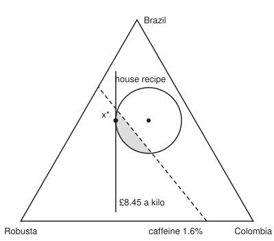

# The standard convex problem: the shape every solver expects

[Syllabus](../../../SYLLABUS.md) → [Optimization](../README.md) → [Convexity](../README.md#s01) → The standard convex problem

---

## General Overview

A roaster sells one blend, made from three beans. Brazil costs £9 a kilo and is 1.2 percent caffeine. Colombia costs £12 and is 1.4 percent. Robusta costs £6 and is 2.4 percent. The house recipe is half Brazil, 30 percent Colombia, 20 percent Robusta: it costs £9.30 a kilo and is 1.5 percent caffeine.

A new spec asks for at least 1.6 percent caffeine. The regulars must not notice, so the recipe may only drift a little: the squared changes in the three shares must add to at most 0.04, which keeps every share within 0.2 (20 percentage points) of where it was. The roaster **chooses** how much of each bean goes into one kilo, wants the **cost made as small as possible**, and is **limited** by the caffeine floor, the taste rule, the kilo adding up to one kilo, and no bean used in a negative amount.

Typed into a modelling program for convex problems, the whole job is five lines:

```text
variable   x[3]                                    # kilos of Brazil, Colombia, Robusta
minimise   9*x[1] + 12*x[2] + 6*x[3]               # pounds for one kilo of blend
subject to x[1] + x[2] + x[3] == 1
           1.2*x[1] + 1.4*x[2] + 2.4*x[3] >= 1.6
           sum_squares(x - [0.5, 0.3, 0.2]) <= 0.04,  x >= 0
```

The program does not solve this on trust. It first reads each line against a short rulebook: the thing minimised must be bowl-shaped (convex), every "at most" must have a bowl-shaped left side (an "at least" is first flipped into an "at most"), and every "equals" must be flat (a weighted sum plus a constant). Each line passes, so the problem is convex, so whatever bottom the solver finds is the true bottom.

The answer: 50 percent Brazil, 15.86 percent Colombia, 34.14 percent Robusta, at **£8.45 a kilo**, with 1.64 percent caffeine. A one-line inequality on this card proves no allowed blend is cheaper.

**A convex problem in standard form minimises a convex function, keeps convex functions at or below zero and affine functions at exactly zero; a problem in that shape has a convex set of allowed points, so any local bottom is the global one, and a solver checks the shape by reading the formula, piece by piece.**

**What kind of fact this is:** a definition, the standard form, plus a theorem about it: a problem in this form has a convex feasible set, proved on this card in Why it works. That every local minimum is then global is quoted from [Convexity pays off](04-local-minima-are-global-when-convex.md). The rulebook a solver applies is a convention: whatever passes it is convex, but some convex formulas fail it.

### The picture: every blend is a point of a triangle

<p align="center"></p>

Each corner is a pure bean; each point inside is a blend, nearer the bean it holds more of. The circle is the taste rule. The dashed line is 1.6 percent caffeine, and the shaded piece of the circle, on the Robusta side, is every allowed blend. Cost is the same along every vertical line and falls to the left, so the cheapest allowed blend is where a vertical line last touches the shaded piece: x*. The house recipe, the dot at the centre, sits on the wrong side of the caffeine line.

---

## The formula

This card introduces the wing's names for a problem's parts, in words first. The **objective** $f_0$ is the function to minimise. Each **inequality function** $f_i$ must stay at or below zero; each **equality function** $h_j$ must equal zero exactly. A point that meets all of them is **feasible**. The **optimal value** $p^\star$ is the lowest objective over all feasible points.

$$
\begin{aligned}
\text{minimise}\quad & f_0(x)\\
\text{subject to}\quad & f_i(x) \le 0, \qquad i = 1, \dots, m\\
& h_j(x) = 0, \qquad j = 1, \dots, p
\end{aligned}
\qquad\text{with } f_0, f_1, \dots, f_m \text{ convex and } h_1, \dots, h_p \text{ affine.}
$$

**Read it aloud:** make a convex cost as small as possible while some convex quantities stay at or below zero and some flat ones sit exactly at zero.

An **affine** function is a weighted sum of the variables plus a constant, such as $x_1 + x_2 + x_3 - 1$: its graph is flat. A **convex** function bends upward or not at all: its chord between any two points sits on or above its graph ([Convex functions](03-convex-functions-and-their-tests.md)).

The blend, moved into this shape. Write $c = (9, 12, 6)$ for the prices, $s = (1.2, 1.4, 2.4)$ for the caffeine, $r = (0.5, 0.3, 0.2)$ for the house recipe, and $c^{\mathsf T}x = 9x_1 + 12x_2 + 6x_3$ for a price-weighted sum (the code writes it `c.x`). Every "at least" is flipped into "at most zero" by moving everything to one side:

| Piece | Formula | Kind |
| --- | --- | --- |
| $f_0$, the cost to minimise | $c^{\mathsf T}x$, pounds a kilo | affine, so convex |
| $f_1$, the caffeine shortfall | $1.6 - s^{\mathsf T}x \le 0$ | affine |
| $f_2$, the taste excess | $\lVert x - r\rVert^2 - 0.04 \le 0$ | convex |
| $f_3, f_4, f_5$, no negative beans | $-x_1 \le 0$, $-x_2 \le 0$, $-x_3 \le 0$ | affine |
| $h_1$, one kilo in all | $x_1 + x_2 + x_3 - 1 = 0$ | affine |

Here $m = 5$ and $p = 1$. Call $\lVert x - r\rVert^2$, the squared distance from the recipe, the **taste** of a blend.

| Symbol | Plain meaning | In our example | Push it up and the answer… |
| --- | --- | --- | --- |
| $x = (x_1, x_2, x_3)$ | the choice: kilos of Brazil, Colombia, Robusta in one kilo | (0.5000, 0.1586, 0.3414) at the best | — |
| $f_0$ | the objective: the function minimised | cost, $c^{\mathsf T}x$ | — |
| $f_i$ | an inequality function, kept at or below 0 | caffeine shortfall, taste excess, minus each share | raise its limit and $p^\star$ can only fall |
| $h_j$ | an equality function, held at exactly 0 | $x_1 + x_2 + x_3 - 1$ | — |
| $m$, $p$; $i$, $j$ | how many inequalities and equalities; the counters that number them | 5 and 1 | more pieces, fewer feasible points |
| $p^\star$ | the optimal value: lowest objective over feasible points | £8.4515 a kilo | — |
| $x^\star$ | a minimiser: a feasible point whose objective is $p^\star$ | (0.5000, 0.1586, 0.3414) | — |
| $c$ | the price of each bean, £ a kilo | (9, 12, 6) | $p^\star$ rises |
| $s$ | the caffeine of each bean, percent | (1.2, 1.4, 2.4) | the floor is easier to meet |
| $r$ | the house recipe | (0.5, 0.3, 0.2) | — |
| $\theta$, $y$ | a mixing weight between 0 and 1, and a second blend to mix $x$ with | one half, in the midpoint test | — |
| $\lVert v\rVert$ | the length of a vector $v$: square root of its squared entries added | $\lVert x^\star - r\rVert = 0.2$ | — |

### When it holds

- **Every $f_i$ is convex.** Then "at most zero" cuts out a region with no dents. Flip the taste rule to "at least 0.04 away" and the allowed blends are the triangle with a hole in it: two blends on opposite sides of the hole mix to one inside it.
- **Every $h_j$ is affine.** A curved function set equal to a number is a thin curve, not a region. "Taste exactly 0.04" is the circle itself, and the mix of two points on it lands inside.
- **The objective is convex, and minimised.** To maximise, minimise its negative, which needs the original to be concave. A ratio such as cost per caffeine point is neither, and the rulebook rejects it.
- **Something is feasible.** A caffeine floor above Robusta's own 2.4 percent rules out every blend; the solver reports the problem infeasible and $p^\star$ is taken to be $+\infty$.

---

## Why it works

### Step 0: judge the formula, not the set

Deciding whether an arbitrary formula is convex is hard. For polynomials of degree four it is already NP-hard, meaning no method is known that settles every case quickly (the quartic-polynomials paper in Sources). The standard form swaps that question for an easy, local one. Each piece is checked on its own, and convexity of the whole follows from three short facts: a convex function's "at most zero" region is convex, an affine function's "equals zero" region is flat, and overlapping convex regions stay convex.

### Step 1: a convex function at most zero cuts out a convex region

Take two blends $x$ and $y$ that both pass $f_i \le 0$, and mix them with weight $\theta$ between 0 and 1: the point $\theta x + (1 - \theta) y$ ([Convex sets](02-convex-sets.md)). Convexity says the function at the mix is at most the same mix of its values:

$$f_i(\theta x + (1-\theta)y) \le \theta f_i(x) + (1-\theta) f_i(y) \le 0.$$

Both values on the right are at most zero, so their weighted average is too. The mix passes. On the blend: two blends inside the taste circle mix to a blend inside it.

### Step 2: equalities must be flat

For an affine $h_j$ the mixing inequality is an equality, so two points with $h_j = 0$ mix to a point with $h_j = 0$: the set is a flat plane, and planes are convex.

Why not allow a convex $h_j$? The rule "$h_j = 0$" is the pair "$h_j \le 0$ and $-h_j \le 0$". Step 1 needs both $h_j$ and $-h_j$ to be convex, so $h_j$ bends neither up nor down: it is affine.

The taste circle shows the failure. The cheapest blend x* = (0.5000, 0.1586, 0.3414) and its mirror image through the recipe, (0.5000, 0.4414, 0.0586), both have taste exactly 0.0400. Their midpoint is the recipe itself, taste 0.0000: off the circle.

### Step 3: overlap keeps convexity

A point is feasible when it passes every piece. If $x$ and $y$ are feasible, Steps 1 and 2 put every mix of them inside each piece's region, so inside all of them at once. The feasible set of a standard-form problem is convex. For the blend it is the shaded piece of the circle in the picture.

### Step 4: a convex objective on a convex set has no false bottoms

On a convex feasible set, every local minimum of a convex objective is global ([Convexity pays off](04-local-minima-are-global-when-convex.md)). That is why solvers want this shape: a method that only looks nearby, such as walking downhill, cannot stop in a dip that is not the lowest point.

### Step 5: the rulebook checks curvature from the parts

The solver cannot test convexity numerically on every point, so it reads the formula as a tree of known parts and applies the operations of [Building convex functions](09-operations-that-preserve-convexity.md):

1. **Known atoms.** An affine expression is affine. The square of an affine expression is convex. A length $\lVert v\rVert$ is convex. A square root is concave (bends down) and increasing.
2. **Sums and multiples.** A sum of convex pieces is convex; a positive multiple keeps the shape and a negative one flips it.
3. **Composition.** A convex atom applied to an affine expression stays convex. An increasing convex atom applied to a convex expression stays convex, and an increasing concave atom applied to a concave expression stays concave.
4. **Anything else is "unknown"**, and an unknown piece is rejected.

The taste piece passes in three moves: $x_1 - 0.5$ is affine, so its square is convex; three convex squares add to a convex sum; subtracting 0.04 keeps it convex.

The rulebook is cautious, not clever. Write the same taste rule as $\sqrt{\lVert x - r\rVert^2} - 0.2 \le 0$ and it fails: a concave square root of a convex sum has no rule, though the result is the length $\lVert x - r\rVert$, which is convex. The code shows this twice: the rules say "unknown", and 0 of 2,000 random midpoint tests find a dent. Squared as above, it passes; written with rule 1's length atom it would pass too, though the code's small rulebook leaves that atom out.

This discipline, building every formula from parts whose shape is known, is called **disciplined convex programming** (the paper of that name in Sources).

### Step 6: a certificate for the blend

The rules prove the problem is convex; they do not say what the answer is. The wing's honesty rule asks for evidence that nothing does better, and for the blend one inequality gives it.

Every blend $x$ and the recipe $r$ both add to 1, so $x - r$ adds to 0. Subtracting the same number from every price therefore leaves $c^{\mathsf T}(x - r)$ unchanged. Subtract the average price, 9: the prices become (0, 3, −3). The average is the choice that makes this price vector shortest, so the bound below is as tight as it can be. Then

$$c^{\mathsf T}x = c^{\mathsf T}r + (0, 3, -3)^{\mathsf T}(x - r) \;\ge\; 9.30 - \lVert(0, 3, -3)\rVert \cdot \lVert x - r\rVert \;\ge\; 9.30 - 4.2426 \times 0.2 = 8.4515.$$

The middle step is the Cauchy–Schwarz inequality: a dot product is at least minus the product of the two lengths. The last step uses the taste rule, $\lVert x - r\rVert \le 0.2$. So no blend that tastes right costs less than £8.4515 a kilo, whatever its caffeine.

The bound is met when $x - r$ points exactly against (0, 3, −3) with length 0.2: $x^\star = r - 0.2 \times (0, 3, -3)/4.2426$. That blend has 1.6414 percent caffeine, above the floor, and no negative bean. It is feasible and meets the bound, so it is optimal, and $p^\star = 8.4515$.

The caffeine floor is not tight at the answer: it rules out the recipe, but the cheapest tasting-right blend clears it anyway. When a floor is tight, the certificate needs a price on that constraint too, a Lagrange multiplier; that general version waits for the [KKT conditions](../03-Constrained%20Optimisation/02-kkt-conditions.md) (named for Karush, Kuhn and Tucker) on the constrained-optimisation shelf.

---

## Worked numbers, by hand

| Step | Arithmetic | Value |
| --- | --- | --- |
| recipe cost | 0.5 × 9 + 0.3 × 12 + 0.2 × 6 | £9.3000 |
| recipe caffeine | 0.5 × 1.2 + 0.3 × 1.4 + 0.2 × 2.4 | 1.5000, short of 1.6 |
| average price | (9 + 12 + 6) ÷ 3 | 9 |
| prices minus the average | (9 − 9, 12 − 9, 6 − 9) | (0, 3, −3) |
| its length | √(0 + 9 + 9) | 4.2426 |
| lower bound on every blend | 9.3000 − 0.2 × 4.2426 | 8.4515 |
| step from the recipe | −0.2 × (0, 3, −3) ÷ 4.2426 | (0.0000, −0.1414, 0.1414) |
| the blend | (0.5, 0.3, 0.2) plus the step | (0.5000, 0.1586, 0.3414) |
| its caffeine | 1.2 × 0.5 + 1.4 × 0.1586 + 2.4 × 0.3414 | 1.6414, at least 1.6 |
| its taste | 0 + 0.1414² + 0.1414² | 0.0400, at most 0.04 |
| its cost | 9 × 0.5 + 12 × 0.1586 + 6 × 0.3414, with the shares before rounding | **£8.4515 a kilo** |

The blend meets the bound, so nothing tastes right and costs less: switch to 50 percent Brazil, 15.86 percent Colombia and 34.14 percent Robusta, which is cheaper than the old recipe and passes the caffeine spec.

### What breaks if you drop a piece

| Mistake | Comes out at | What went wrong |
| --- | --- | --- |
| Taste written as "exactly 0.04" | rejected; x* and its mirror both have taste 0.0400, their midpoint 0.0000 | A curved equality is a circle, not a region |
| Taste written as $\sqrt{\text{taste}} - 0.2 \le 0$ | rejected, though 0 of 2,000 midpoint tests fail | The rules have no case for a concave root of a convex sum |
| Minimise cost per caffeine point | rejected; Brazil 7.5000, Colombia 8.5714, half and half 8.0769, above their average 8.0357 | A ratio of affine functions is not convex |
| Caffeine floor typed the wrong way round, "at most 1.6" | accepted; £8.4916 a kilo | The rules check shape, not meaning |

The cost-per-caffeine ratio fails the midpoint test on 218 of the 2,000 random pairs. It is **quasiconvex**: each "ratio at most some level" region is a half-plane, so convex. A separate method solves it: bisect on the level, solving one convex feasibility problem per step. The code prints every row.

---

## Code, from first principles, and it actually runs

Nothing is imported. The code writes the five pieces as small formula trees and judges each one twice: by the rulebook of Step 5, and by a midpoint test on 2,000 pairs of random blends from a SplitMix64 generator with seed 2026, a road that never looks at the formula's shape. It then reaches the answer twice: by the Cauchy–Schwarz certificate of Step 6, and by listing all 501,501 blends on a grid of 0.001 kilo, testing each in whole thousandths so no rounding decides a borderline blend. The grid can only be as good as its spacing, so it is asserted to land at or above the bound and within 0.005 of it. The wrong-way caffeine answer is found exactly, where the caffeine line cuts the circle, and checked against the grid too.

### Python

```python
# The standard convex problem -- the check behind the card.  Nothing is imported.
# One kilo of coffee blended from Brazil, Colombia and Robusta beans: x[i] is the
# kilos of bean i.  Minimise the cost in pounds per kilo, keep caffeine at or
# above 1.6 percent, stay within 0.2 of the house recipe 50/30/20.  Each piece is
# judged twice: by the rules a solver applies to the formula, and by a midpoint
# test on random blends.  The answer is found twice: by a Cauchy-Schwarz bound
# that one blend meets, and by listing every blend on a 0.001 grid.
COST, CAF, REF, R2, N = [9.0, 12.0, 6.0], [1.2, 1.4, 2.4], [0.5, 0.3, 0.2], 0.04, 2000
def add(v):                                              # left to right, as Rust adds
    s = 0.0
    for t in v: s += t
    return s
def dot(a, x): return add(p * q for p, q in zip(a, x))
def aff(a, b): return ("aff", a, b)                      # a . x + b
def taste(): return ("sum", [("sq", aff([1.0 if j == i else 0.0 for j in range(3)], -REF[i]))
                             for i in range(3)])         # squared distance from the recipe
PIECES = [("f0 = c.x, cost to minimise", "min", aff(COST, 0.0)),
          ("h1 = x1 + x2 + x3 - 1", "eq", aff([1.0, 1.0, 1.0], -1.0)),
          ("f1 = 1.6 - s.x, caffeine", "le", aff([-c for c in CAF], 1.6)),
          ("f2 = taste - 0.04", "le", ("sum", [taste(), aff([0.0] * 3, -R2)]))] + \
         [(f"f{3 + i} = -x{i + 1}, no negative kilos", "le", aff([-1.0 if j == i else 0.0 for j in range(3)], 0.0))
          for i in range(3)]
BROKEN = [("taste = 0.04, the circle", "eq", ("sum", [taste(), aff([0.0] * 3, -R2)])),
          ("sqrt(taste) - 0.2 <= 0", "le", ("sum", [("sqrt", taste()), aff([0.0] * 3, -0.2)])),
          ("cost per caffeine, minimise", "min", ("div", aff(COST, 0.0), aff(CAF, 0.0)))]

def ev(e, x):                                            # the value of a formula at x
    k = e[0]
    if k == "aff": return dot(e[1], x) + e[2]
    if k == "sq": return ev(e[1], x) * ev(e[1], x)
    if k == "sqrt": return ev(e[1], x) ** 0.5
    if k == "sum": return add(ev(t, x) for t in e[1])
    return ev(e[1], x) / ev(e[2], x)                     # "div"

def curv(e):                                             # road one: the solver's rules
    k = e[0]
    if k == "aff": return "affine"
    if k == "sq": return "convex" if curv(e[1]) == "affine" else "unknown"
    if k == "sqrt": return "concave" if curv(e[1]) in ("affine", "concave") else "unknown"
    if k == "sum":
        kinds = {curv(t) for t in e[1]} - {"affine"}
        if not kinds: return "affine"
        return kinds.pop() if len(kinds) == 1 and "unknown" not in kinds else "unknown"
    return "unknown"                                     # no rule for a ratio

def accepted(role, e):
    return curv(e) == "affine" if role == "eq" else curv(e) in ("affine", "convex")

state = [2026]
def rnd():                                               # SplitMix64, seed 2026
    state[0] = (state[0] + 0x9E3779B97F4A7C15) & 0xFFFFFFFFFFFFFFFF
    z = state[0]
    z = ((z ^ (z >> 30)) * 0xBF58476D1CE4E5B9) & 0xFFFFFFFFFFFFFFFF
    z = ((z ^ (z >> 27)) * 0x94D049BB133111EB) & 0xFFFFFFFFFFFFFFFF
    return ((z ^ (z >> 31)) >> 11) / 9007199254740992.0

def blend():                                             # a random point of the triangle
    u, v = rnd(), rnd()
    if u + v > 1.0: u, v = 1.0 - u, 1.0 - v
    return [u, v, 1.0 - u - v]

PAIRS = [(blend(), blend()) for _ in range(N)]
def misses(role, e):                                     # road two: the midpoint test
    bad = 0
    for a, b in PAIRS:
        mid = ev(e, [(p + q) / 2 for p, q in zip(a, b)])
        avg = (ev(e, a) + ev(e, b)) / 2
        bad += abs(mid - avg) > 1e-9 if role == "eq" else mid > avg + 1e-9
    return bad

def feasible(x):
    caf = dot(CAF, x)
    return (abs(add(x) - 1) < 1e-9 and min(x) >= 0 and ev(taste(), x) <= R2 + 1e-12
            and caf >= 1.6)
def on_grid(i, j, k, flip):                              # the same tests in whole thousandths
    caf = 12 * i + 14 * j + 24 * k - 16000
    near = (i - 500) ** 2 + (j - 300) ** 2 + (k - 200) ** 2 <= R2 * 10 ** 6
    return near and (caf <= 0 if flip else caf >= 0)

def cost(x): return dot(COST, x)
def grid(flip=False):                                    # every blend on a 0.001 grid
    best, where, count = 1e9, None, 0
    for i in range(1001):
        for j in range(1001 - i):
            x = [i / 1000, j / 1000, (1000 - i - j) / 1000]
            if on_grid(i, j, 1000 - i - j, flip):
                count += 1
                if cost(x) < best: best, where = cost(x), x
    return best, where, count

print(f"Brazil, Colombia, Robusta: pounds a kilo {COST}, caffeine percent {CAF}")
print(f"{'piece':<28}{'rule says':<10}{'accepted':<10}midpoint misses in {N}")
results = []
for name, role, e in PIECES + BROKEN:
    ok, bad = accepted(role, e), misses(role, e)
    results.append((ok, bad))
    print(f"{name:<28}{curv(e):<10}{'yes' if ok else 'no':<10}{bad}")
print(f"house recipe {REF}: cost {cost(REF):.4f}, caffeine {dot(CAF, REF):.4f}")
m = add(COST) / 3
pc = [c - m for c in COST]                               # the cost with its even part removed
norm = dot(pc, pc) ** 0.5
bound = cost(REF) - R2 ** 0.5 * norm                     # Cauchy-Schwarz on the taste ball
xs = [r - R2 ** 0.5 * p / norm for r, p in zip(REF, pc)]
print(f"projected cost {pc}, its length {norm:.4f}; lower bound {cost(REF):.4f} - {R2 ** 0.5:.1f} x {norm:.4f} = {bound:.4f}")
print(f"step from the recipe: [{xs[0] - REF[0]:.4f}, {xs[1] - REF[1]:.4f}, {xs[2] - REF[2]:.4f}]")
print(f"blend meeting it: x* = [{xs[0]:.4f}, {xs[1]:.4f}, {xs[2]:.4f}], cost {cost(xs):.4f}, "
      f"caffeine {dot(CAF, xs):.4f}, taste {ev(taste(), xs):.4f}, feasible {'yes' if feasible(xs) else 'no'}")
gc, gx, gn = grid()
print(f"grid: {gn} of 501501 blends feasible; best {gx} at cost {gc:.4f}, {gc - bound:.4f} above the bound")
fc, fx, fn = grid(flip=True)
P, Q = [0.0, 0.8, 0.2], [2 / 3, 0.0, 1 / 3]              # where caffeine 1.6 meets the edges
d = [q - p for p, q in zip(P, Q)]
e0 = [p - r for p, r in zip(P, REF)]
qa, qb = dot(d, d), 2 * dot(d, e0)
qc = dot(e0, e0) - R2
root = (qb * qb - 4 * qa * qc) ** 0.5
cut = [[p + t * s for p, s in zip(P, d)] for t in ((-qb - root) / (2 * qa), (-qb + root) / (2 * qa))]
fl = min(cost(x) for x in cut)                           # a linear cost is least at an end of the chord
print(f"mistake, caffeine flipped to at most 1.6: exact {fl:.4f}; grid best {fx} at {fc:.4f}")
a, b = [2 * r - x for r, x in zip(REF, xs)], xs        # x* and its mirror through the recipe
mid = [(p + q) / 2 for p, q in zip(a, b)]
print(f"mistake, circle: x* and [{a[0]:.4f}, {a[1]:.4f}, {a[2]:.4f}] have taste {ev(taste(), a):.4f}, {ev(taste(), b):.4f}; "
      f"midpoint taste {ev(taste(), mid):.4f}")
ratio = BROKEN[2][2]
br, co = [1.0, 0.0, 0.0], [0.0, 1.0, 0.0]
rm, ra = ev(ratio, [0.5, 0.5, 0.0]), (ev(ratio, br) + ev(ratio, co)) / 2
print(f"mistake, ratio: Brazil {ev(ratio, br):.4f}, Colombia {ev(ratio, co):.4f}, "
      f"half and half {rm:.4f} above their average {ra:.4f}")
def px(x):                                               # the figure: 240 px per unit, to scale
    u, w = (x[1] - x[2]) / 2 ** 0.5, (2 * x[0] - x[1] - x[2]) / 6 ** 0.5
    return f"({200 + 240 * u:.1f} {225 - 240 * w:.1f})"
print("figure, Brazil", px(br), "Colombia", px(co), "Robusta", px([0, 0, 1]), "recipe", px(REF),
      f"radius {240 * 0.2:.1f}", "x*", px(xs), "caffeine line", px(P), px(Q),
      "cuts circle", px(cut[0]), px(cut[1]))
assert all(bad == 0 for ok, bad in results[:7]) and all(ok for ok, bad in results[:7])
assert results[8][1] == 0 and not results[8][0]          # rejected, yet convex: the rules are cautious
assert not results[7][0] and not results[9][0] and results[7][1] > 0 and results[9][1] > 0 and rm > ra   # rejected, and truly not convex
assert feasible(xs) and abs(cost(xs) - bound) < 1e-12 and 0 <= gc - bound < 0.005
assert 0 <= fc - fl < 0.005 and fl > bound + 0.03 and ev(taste(), mid) < R2
print("ALL CHECKS PASS")
```

**Ran 2026-11-11 on macOS, Python 3.14.10, standard library only. All checks passed. Output, pasted from the run:**

```
Brazil, Colombia, Robusta: pounds a kilo [9.0, 12.0, 6.0], caffeine percent [1.2, 1.4, 2.4]
piece                       rule says accepted  midpoint misses in 2000
f0 = c.x, cost to minimise  affine    yes       0
h1 = x1 + x2 + x3 - 1       affine    yes       0
f1 = 1.6 - s.x, caffeine    affine    yes       0
f2 = taste - 0.04           convex    yes       0
f3 = -x1, no negative kilos affine    yes       0
f4 = -x2, no negative kilos affine    yes       0
f5 = -x3, no negative kilos affine    yes       0
taste = 0.04, the circle    convex    no        2000
sqrt(taste) - 0.2 <= 0      unknown   no        0
cost per caffeine, minimise unknown   no        218
house recipe [0.5, 0.3, 0.2]: cost 9.3000, caffeine 1.5000
projected cost [0.0, 3.0, -3.0], its length 4.2426; lower bound 9.3000 - 0.2 x 4.2426 = 8.4515
step from the recipe: [0.0000, -0.1414, 0.1414]
blend meeting it: x* = [0.5000, 0.1586, 0.3414], cost 8.4515, caffeine 1.6414, taste 0.0400, feasible yes
grid: 12247 of 501501 blends feasible; best [0.488, 0.165, 0.347] at cost 8.4540, 0.0025 above the bound
mistake, caffeine flipped to at most 1.6: exact 8.4916; grid best [0.55, 0.141, 0.309] at 8.4960
mistake, circle: x* and [0.5000, 0.4414, 0.0586] have taste 0.0400, 0.0400; midpoint taste 0.0000
mistake, ratio: Brazil 7.5000, Colombia 8.5714, half and half 8.0769 above their average 8.0357
figure, Brazil (200.0 29.0) Colombia (369.7 323.0) Robusta (30.3 323.0) recipe (217.0 176.0) radius 48.0 x* (169.0 176.0) caffeine line (301.8 323.0) (143.4 127.0) cuts circle (221.6 223.8) (171.2 161.4)
ALL CHECKS PASS
```

### Rust

Same numbers, same labels, built with `rustc --edition 2021 -O`.

```rust
// The standard convex problem -- the same check as the Python, in Rust.  No crates.
// One kilo of coffee blended from Brazil, Colombia and Robusta beans: x[i] is the
// kilos of bean i.  Minimise the cost in pounds per kilo, keep caffeine at or
// above 1.6 percent, stay within 0.2 of the house recipe 50/30/20.  Each piece is
// judged twice: by the rules a solver applies to the formula, and by a midpoint
// test on random blends.  The answer is found twice: by a Cauchy-Schwarz bound
// that one blend meets, and by listing every blend on a 0.001 grid.
const COST: [f64; 3] = [9.0, 12.0, 6.0];
const CAF: [f64; 3] = [1.2, 1.4, 2.4];
const REF: [f64; 3] = [0.5, 0.3, 0.2];
const R2: f64 = 0.04;
const N: usize = 2000;

#[derive(Clone)] enum E { Aff(Vec<f64>, f64), Sq(Box<E>), Sqrt(Box<E>), Sum(Vec<E>), Div(Box<E>, Box<E>) }

fn unit(i: usize, s: f64) -> Vec<f64> { (0..3).map(|j| if j == i { s } else { 0.0 }).collect() }
fn taste() -> E {                                        // squared distance from the recipe
    E::Sum((0..3).map(|i| E::Sq(Box::new(E::Aff(unit(i, 1.0), -REF[i])))).collect())
}

fn ev(e: &E, x: &[f64]) -> f64 {                         // the value of a formula at x
    match e {
        E::Aff(a, b) => a.iter().zip(x).fold(0.0, |s, (p, q)| s + p * q) + b,
        E::Sq(t) => ev(t, x) * ev(t, x),
        E::Sqrt(t) => ev(t, x).powf(0.5),
        E::Sum(ts) => ts.iter().fold(0.0, |s, t| s + ev(t, x)),
        E::Div(t, u) => ev(t, x) / ev(u, x),
    }
}

fn curv(e: &E) -> &'static str {                        // road one: the solver's rules
    match e {
        E::Aff(..) => "affine",
        E::Sq(t) => if curv(t) == "affine" { "convex" } else { "unknown" },
        E::Sqrt(t) => if curv(t) == "affine" || curv(t) == "concave" { "concave" } else { "unknown" },
        E::Sum(ts) => {
            let mut kinds: Vec<&str> = ts.iter().map(curv).filter(|k| *k != "affine").collect();
            kinds.sort();
            kinds.dedup();
            if kinds.is_empty() { "affine" } else if kinds.len() == 1 && kinds[0] != "unknown" { kinds[0] } else { "unknown" }
        }
        E::Div(..) => "unknown",                         // no rule for a ratio
    }
}

fn accepted(role: &str, e: &E) -> bool {
    if role == "eq" { curv(e) == "affine" } else { curv(e) == "affine" || curv(e) == "convex" }
}

struct Rng(u64);
impl Rng {                                               // SplitMix64, seed 2026
    fn next(&mut self) -> f64 {
        self.0 = self.0.wrapping_add(0x9E3779B97F4A7C15);
        let mut z = self.0;
        z = (z ^ (z >> 30)).wrapping_mul(0xBF58476D1CE4E5B9);
        z = (z ^ (z >> 27)).wrapping_mul(0x94D049BB133111EB);
        ((z ^ (z >> 31)) >> 11) as f64 / 9007199254740992.0
    }
    fn blend(&mut self) -> Vec<f64> {                    // a random point of the triangle
        let (mut u, mut v) = (self.next(), self.next());
        if u + v > 1.0 { u = 1.0 - u; v = 1.0 - v; }
        vec![u, v, 1.0 - u - v]
    }
}

fn misses(role: &str, e: &E, pairs: &[(Vec<f64>, Vec<f64>)]) -> usize {   // road two
    let mut bad = 0;
    for (a, b) in pairs {
        let m: Vec<f64> = a.iter().zip(b).map(|(p, q)| (p + q) / 2.0).collect();
        let (mid, avg) = (ev(e, &m), (ev(e, a) + ev(e, b)) / 2.0);
        if (role == "eq" && (mid - avg).abs() > 1e-9) || (role != "eq" && mid > avg + 1e-9) { bad += 1; }
    }
    bad
}

fn dot(a: &[f64], x: &[f64]) -> f64 { a.iter().zip(x).fold(0.0, |s, (p, q)| s + p * q) }
fn cost(x: &[f64]) -> f64 { dot(&COST, x) }
fn feasible(x: &[f64]) -> bool {
    let caf = dot(&CAF, x);
    let total = x.iter().fold(0.0, |s, v| s + v);
    (total - 1.0).abs() < 1e-9 && x.iter().all(|v| *v >= 0.0) && ev(&taste(), x) <= R2 + 1e-12
        && caf >= 1.6
}
fn on_grid(i: i64, j: i64, k: i64, flip: bool) -> bool {  // the same tests in whole thousandths
    let caf = 12 * i + 14 * j + 24 * k - 16000;
    let near = (i - 500).pow(2) + (j - 300).pow(2) + (k - 200).pow(2) <= (R2 * 1e6) as i64;
    near && (if flip { caf <= 0 } else { caf >= 0 })
}

fn grid(flip: bool) -> (f64, Vec<f64>, usize) {         // every blend on a 0.001 grid
    let (mut best, mut at, mut count) = (1e9, vec![], 0);
    for i in 0..=1000i64 {
        for j in 0..=(1000 - i) {
            let x = vec![i as f64 / 1000.0, j as f64 / 1000.0, (1000 - i - j) as f64 / 1000.0];
            if on_grid(i, j, 1000 - i - j, flip) {
                count += 1;
                if cost(&x) < best { best = cost(&x); at = x; }
            }
        }
    }
    (best, at, count)
}

fn px(x: &[f64]) -> String {                             // the figure: 240 px per unit, to scale
    let (u, w) = ((x[1] - x[2]) / 2f64.powf(0.5), (2.0 * x[0] - x[1] - x[2]) / 6f64.powf(0.5));
    format!("({:.1} {:.1})", 200.0 + 240.0 * u, 225.0 - 240.0 * w)
}
fn v4(x: &[f64]) -> String { format!("[{:.4}, {:.4}, {:.4}]", x[0], x[1], x[2]) }

fn main() {
    let tz = E::Sum(vec![taste(), E::Aff(vec![0.0; 3], -R2)]);
    let mut pieces: Vec<(String, &str, E)> = vec![
        ("f0 = c.x, cost to minimise".into(), "min", E::Aff(COST.to_vec(), 0.0)),
        ("h1 = x1 + x2 + x3 - 1".into(), "eq", E::Aff(vec![1.0; 3], -1.0)),
        ("f1 = 1.6 - s.x, caffeine".into(), "le", E::Aff(CAF.iter().map(|c| -c).collect(), 1.6)),
        ("f2 = taste - 0.04".into(), "le", tz.clone())];
    for i in 0..3 { pieces.push((format!("f{} = -x{}, no negative kilos", 3 + i, i + 1), "le", E::Aff(unit(i, -1.0), 0.0))); }
    let ratio = E::Div(Box::new(E::Aff(COST.to_vec(), 0.0)), Box::new(E::Aff(CAF.to_vec(), 0.0)));
    pieces.push(("taste = 0.04, the circle".into(), "eq", tz));
    pieces.push(("sqrt(taste) - 0.2 <= 0".into(), "le", E::Sum(vec![E::Sqrt(Box::new(taste())), E::Aff(vec![0.0; 3], -0.2)])));
    pieces.push(("cost per caffeine, minimise".into(), "min", ratio.clone()));
    let mut rng = Rng(2026);
    let pairs: Vec<(Vec<f64>, Vec<f64>)> = (0..N).map(|_| { let a = rng.blend(); (a, rng.blend()) }).collect();
    println!("Brazil, Colombia, Robusta: pounds a kilo {:?}, caffeine percent {:?}", COST, CAF);
    println!("{:<28}{:<10}{:<10}midpoint misses in {}", "piece", "rule says", "accepted", N);
    let mut results = vec![];
    for (name, role, e) in &pieces {
        let (ok, bad) = (accepted(role, e), misses(role, e, &pairs));
        results.push((ok, bad));
        println!("{:<28}{:<10}{:<10}{}", name, curv(e), if ok { "yes" } else { "no" }, bad);
    }
    println!("house recipe {:?}: cost {:.4}, caffeine {:.4}", REF, cost(&REF), dot(&CAF, &REF));
    let m = COST.iter().fold(0.0, |s, c| s + c) / 3.0;
    let pc: Vec<f64> = COST.iter().map(|c| c - m).collect();   // the cost with its even part removed
    let norm = pc.iter().fold(0.0, |s, p| s + p * p).powf(0.5);
    let bound = cost(&REF) - R2.powf(0.5) * norm;               // Cauchy-Schwarz on the taste ball
    let xs: Vec<f64> = REF.iter().zip(&pc).map(|(r, p)| r - R2.powf(0.5) * p / norm).collect();
    println!("projected cost {:?}, its length {:.4}; lower bound {:.4} - {:.1} x {:.4} = {:.4}", pc, norm, cost(&REF), R2.powf(0.5), norm, bound);
    println!("step from the recipe: [{:.4}, {:.4}, {:.4}]", xs[0] - REF[0], xs[1] - REF[1], xs[2] - REF[2]);
    println!("blend meeting it: x* = {}, cost {:.4}, caffeine {:.4}, taste {:.4}, feasible {}", v4(&xs), cost(&xs),
             dot(&CAF, &xs), ev(&taste(), &xs), if feasible(&xs) { "yes" } else { "no" });
    let (gc, gx, gn) = grid(false);
    println!("grid: {} of 501501 blends feasible; best {:?} at cost {:.4}, {:.4} above the bound", gn, gx, gc, gc - bound);
    let (fc, fx, _) = grid(true);
    let (p, q) = ([0.0, 0.8, 0.2], [2.0 / 3.0, 0.0, 1.0 / 3.0]); // where caffeine 1.6 meets the edges
    let d: Vec<f64> = p.iter().zip(&q).map(|(a, b)| b - a).collect();
    let e0: Vec<f64> = p.iter().zip(&REF).map(|(a, r)| a - r).collect();
    let (qa, qb, qc) = (dot(&d, &d), 2.0 * dot(&d, &e0), dot(&e0, &e0) - R2);
    let root = (qb * qb - 4.0 * qa * qc).powf(0.5);
    let cut: Vec<Vec<f64>> = [(-qb - root) / (2.0 * qa), (-qb + root) / (2.0 * qa)].iter()
        .map(|t| p.iter().zip(&d).map(|(a, s)| a + t * s).collect()).collect();
    let fl = cost(&cut[0]).min(cost(&cut[1]));                  // a linear cost is least at an end of the chord
    println!("mistake, caffeine flipped to at most 1.6: exact {:.4}; grid best {:?} at {:.4}", fl, fx, fc);
    let a: Vec<f64> = REF.iter().zip(&xs).map(|(r, x)| 2.0 * r - x).collect();   // x* mirrored
    let mid: Vec<f64> = a.iter().zip(&xs).map(|(p, q)| (p + q) / 2.0).collect();
    println!("mistake, circle: x* and {} have taste {:.4}, {:.4}; midpoint taste {:.4}",
             v4(&a), ev(&taste(), &a), ev(&taste(), &xs), ev(&taste(), &mid));
    let (br, co) = ([1.0, 0.0, 0.0], [0.0, 1.0, 0.0]);
    let (rm, ra) = (ev(&ratio, &[0.5, 0.5, 0.0]), (ev(&ratio, &br) + ev(&ratio, &co)) / 2.0);
    println!("mistake, ratio: Brazil {:.4}, Colombia {:.4}, half and half {:.4} above their average {:.4}",
             ev(&ratio, &br), ev(&ratio, &co), rm, ra);
    println!("figure, Brazil {} Colombia {} Robusta {} recipe {} radius {:.1} x* {} caffeine line {} {} cuts circle {} {}",
             px(&br), px(&co), px(&[0.0, 0.0, 1.0]), px(&REF), 240.0 * 0.2, px(&xs), px(&p), px(&q), px(&cut[0]), px(&cut[1]));
    assert!(results[..7].iter().all(|(ok, bad)| *ok && *bad == 0));
    assert!(results[8].1 == 0 && !results[8].0);                 // rejected, yet convex: the rules are cautious
    assert!(!results[7].0 && !results[9].0 && results[7].1 > 0 && results[9].1 > 0 && rm > ra);    // rejected, and truly not convex
    assert!(feasible(&xs) && (cost(&xs) - bound).abs() < 1e-12 && gc - bound >= 0.0 && gc - bound < 0.005);
    assert!(fc - fl >= 0.0 && fc - fl < 0.005 && fl > bound + 0.03 && ev(&taste(), &mid) < R2);
    println!("ALL CHECKS PASS");
}
```

**Ran 2026-11-11 on macOS, rustc 1.98.1, no crates. All checks passed. Output, pasted from the run:**

```
Brazil, Colombia, Robusta: pounds a kilo [9.0, 12.0, 6.0], caffeine percent [1.2, 1.4, 2.4]
piece                       rule says accepted  midpoint misses in 2000
f0 = c.x, cost to minimise  affine    yes       0
h1 = x1 + x2 + x3 - 1       affine    yes       0
f1 = 1.6 - s.x, caffeine    affine    yes       0
f2 = taste - 0.04           convex    yes       0
f3 = -x1, no negative kilos affine    yes       0
f4 = -x2, no negative kilos affine    yes       0
f5 = -x3, no negative kilos affine    yes       0
taste = 0.04, the circle    convex    no        2000
sqrt(taste) - 0.2 <= 0      unknown   no        0
cost per caffeine, minimise unknown   no        218
house recipe [0.5, 0.3, 0.2]: cost 9.3000, caffeine 1.5000
projected cost [0.0, 3.0, -3.0], its length 4.2426; lower bound 9.3000 - 0.2 x 4.2426 = 8.4515
step from the recipe: [0.0000, -0.1414, 0.1414]
blend meeting it: x* = [0.5000, 0.1586, 0.3414], cost 8.4515, caffeine 1.6414, taste 0.0400, feasible yes
grid: 12247 of 501501 blends feasible; best [0.488, 0.165, 0.347] at cost 8.4540, 0.0025 above the bound
mistake, caffeine flipped to at most 1.6: exact 8.4916; grid best [0.55, 0.141, 0.309] at 8.4960
mistake, circle: x* and [0.5000, 0.4414, 0.0586] have taste 0.0400, 0.0400; midpoint taste 0.0000
mistake, ratio: Brazil 7.5000, Colombia 8.5714, half and half 8.0769 above their average 8.0357
figure, Brazil (200.0 29.0) Colombia (369.7 323.0) Robusta (30.3 323.0) recipe (217.0 176.0) radius 48.0 x* (169.0 176.0) caffeine line (301.8 323.0) (143.4 127.0) cuts circle (221.6 223.8) (171.2 161.4)
ALL CHECKS PASS
```

The two outputs match line for line.

### Lean

Lean proves the standard-form facts for any number of variables and pieces, and proves the blend's cheapest cost exactly.

- If every inequality function is convex and every equality function is affine, the feasible set is convex: any mix of two feasible points is feasible.
- With a convex objective on that feasible set, a feasible point lowest among the feasible points near it is lowest among all of them.
- No feasible blend costs less than 9.30 − 0.2 × √18, which is 93/10 − 3√2/5, about £8.4515 a kilo.
- The blend (0.5, 0.3 − √2/10, 0.2 + √2/10) is feasible and costs exactly that, so the optimal value $p^\star$ is 93/10 − 3√2/5.
- The hand arithmetic holds exactly: the recipe costs £9.30 at 1.5 percent caffeine. Prices minus their average 9 are (0, 3, −3), squared length 18.
- The ratio mistake holds exactly: Brazil 7.5, Colombia 60/7, half and half 105/13, above their average 225/28.

The rulebook verdicts, the midpoint tests, the grid search and the wrong-way caffeine answer are left to the Python and Rust checks.

```lean
-- The standard convex problem: a problem that keeps convex functions at or below zero and affine functions at exactly zero has a convex set of allowed points, a local bottom of a convex objective on it is the global bottom, and the card's coffee blend costs at least 93/10 - 3√2/5 pounds a kilo, a bound one allowed blend meets.
import Mathlib.Analysis.Convex.Function
import Mathlib.Analysis.Convex.Extrema
import Mathlib.LinearAlgebra.AffineSpace.AffineMap
import Mathlib.Analysis.SpecialFunctions.Pow.Real
import Mathlib.Order.Bounds.Basic
import Mathlib.Tactic.NormNum

open Set

/-- A problem in standard form has a convex feasible set. The choice is `x`, a list of `n`
real numbers. Keep `m` convex functions `f i` at or below zero and `p` affine functions `h j`
(a weighted sum plus a constant) at exactly zero. Then the allowed points have no dents: any mix
of two allowed points is allowed. -/
theorem standard_form_feasible_set_is_convex {n m p : ℕ}
    (f : Fin m → (Fin n → ℝ) → ℝ) (h : Fin p → (Fin n → ℝ) →ᵃ[ℝ] ℝ)
    (hf : ∀ i, ConvexOn ℝ univ (f i)) :
    Convex ℝ {x : Fin n → ℝ | (∀ i, f i x ≤ 0) ∧ ∀ j, h j x = 0} := by
  intro x hx y hy a b ha hb hab
  refine ⟨fun i => ?_, fun j => ?_⟩
  · have key := (hf i).2 (mem_univ x) (mem_univ y) ha hb hab
    simp only [smul_eq_mul] at key
    have h1 := hx.1 i
    have h2 := hy.1 i
    nlinarith [mul_nonpos_of_nonneg_of_nonpos ha h1, mul_nonpos_of_nonneg_of_nonpos hb h2]
  · rw [Convex.combo_affine_apply hab, hx.2 j, hy.2 j]
    simp

/-- No false bottoms. Minimise a convex objective `f₀` over the feasible set of a standard-form
problem (convex `f i` at or below zero, affine `h j` at zero). If an allowed point `x` is lowest
among the allowed points near it, then it is lowest among all allowed points. -/
theorem standard_form_local_minimum_is_global {n m p : ℕ}
    (f₀ : (Fin n → ℝ) → ℝ) (f : Fin m → (Fin n → ℝ) → ℝ) (h : Fin p → (Fin n → ℝ) →ᵃ[ℝ] ℝ)
    (hf₀ : ConvexOn ℝ univ f₀) (hf : ∀ i, ConvexOn ℝ univ (f i)) (x : Fin n → ℝ)
    (hx : x ∈ {y : Fin n → ℝ | (∀ i, f i y ≤ 0) ∧ ∀ j, h j y = 0})
    (hloc : IsLocalMinOn f₀ {y : Fin n → ℝ | (∀ i, f i y ≤ 0) ∧ ∀ j, h j y = 0} x) :
    IsMinOn f₀ {y : Fin n → ℝ | (∀ i, f i y ≤ 0) ∧ ∀ j, h j y = 0} x := by
  have hS : Convex ℝ {y : Fin n → ℝ | (∀ i, f i y ≤ 0) ∧ ∀ j, h j y = 0} := by
    intro x hx y hy a b ha hb hab
    refine ⟨fun i => ?_, fun j => ?_⟩
    · have key := (hf i).2 (mem_univ x) (mem_univ y) ha hb hab
      simp only [smul_eq_mul] at key
      have h1 := hx.1 i
      have h2 := hy.1 i
      nlinarith [mul_nonpos_of_nonneg_of_nonpos ha h1, mul_nonpos_of_nonneg_of_nonpos hb h2]
    · rw [Convex.combo_affine_apply hab, hx.2 j, hy.2 j]
      simp
  exact IsMinOn.of_isLocalMinOn_of_convexOn hx hloc (hf₀.subset (subset_univ _) hS)

/-- The certificate for the blend. Shares `x 0, x 1, x 2` of Brazil, Colombia and Robusta that
add to one kilo, are never negative, give at least 1.6 percent caffeine (1.2, 1.4 and 2.4 percent
per bean) and stay within squared distance 0.04 of the house recipe (0.5, 0.3, 0.2). Their cost,
9, 12 and 6 pounds a kilo per bean, is never below 9.30 - 0.2 × √18 = 93/10 - 3√2/5 (about
£8.4515), and the blend (0.5, 0.3 - √2/10, 0.2 + √2/10) is allowed and costs exactly that. So the
optimal value p⋆ is 93/10 - 3√2/5. -/
theorem blend_optimal_value :
    IsLeast ((fun x : Fin 3 → ℝ => 9 * x 0 + 12 * x 1 + 6 * x 2) ''
      {x : Fin 3 → ℝ | x 0 + x 1 + x 2 = 1 ∧
        8 / 5 ≤ 6 / 5 * x 0 + 7 / 5 * x 1 + 12 / 5 * x 2 ∧
        (x 0 - 1 / 2) ^ 2 + (x 1 - 3 / 10) ^ 2 + (x 2 - 1 / 5) ^ 2 ≤ 1 / 25 ∧
        0 ≤ x 0 ∧ 0 ≤ x 1 ∧ 0 ≤ x 2})
      (93 / 10 - 3 * Real.sqrt 2 / 5) := by
  have hs0 : 0 ≤ Real.sqrt 2 := Real.sqrt_nonneg 2
  have hs2 : Real.sqrt 2 ^ 2 = 2 := Real.sq_sqrt (by norm_num)
  have hs1 : 1 ≤ Real.sqrt 2 := by nlinarith
  have hs3 : Real.sqrt 2 < 3 / 2 := by nlinarith
  constructor
  · refine ⟨![1 / 2, 3 / 10 - Real.sqrt 2 / 10, 1 / 5 + Real.sqrt 2 / 10], ?_, ?_⟩
    · simp only [Set.mem_ofPred_eq, Matrix.cons_val_zero, Matrix.cons_val_one,
        Matrix.cons_val_two, Matrix.head_cons, Matrix.tail_cons]
      refine ⟨by ring, by nlinarith, by nlinarith, by norm_num, by nlinarith, by nlinarith⟩
    · simp only [Matrix.cons_val_zero, Matrix.cons_val_one,
        Matrix.cons_val_two, Matrix.head_cons, Matrix.tail_cons]
      ring
  · rintro c ⟨x, ⟨hsum, -, hdist, -, -, -⟩, rfl⟩
    show 93 / 10 - 3 * Real.sqrt 2 / 5 ≤ 9 * x 0 + 12 * x 1 + 6 * x 2
    have ht : ((x 2 - 1 / 5) - (x 1 - 3 / 10)) ^ 2 ≤ 2 / 25 := by
      nlinarith [sq_nonneg (x 1 - 3 / 10 + (x 2 - 1 / 5)), sq_nonneg (x 0 - 1 / 2)]
    have hle : (x 2 - 1 / 5) - (x 1 - 3 / 10) ≤ Real.sqrt 2 / 5 := by
      nlinarith [sq_nonneg ((x 2 - 1 / 5) - (x 1 - 3 / 10) - Real.sqrt 2 / 5)]
    nlinarith

-- The house recipe 50/30/20: cost £9.30 a kilo, caffeine 1.5 percent, short of 1.6.
example : (9 : ℚ) * (1 / 2) + 12 * (3 / 10) + 6 * (1 / 5) = 93 / 10 := by norm_num
example : (6 / 5 : ℚ) * (1 / 2) + 7 / 5 * (3 / 10) + 12 / 5 * (1 / 5) = 3 / 2 := by norm_num
example : (3 / 2 : ℚ) < 8 / 5 := by norm_num
-- The house recipe adds to one kilo and has taste 0.
example : (1 / 2 : ℚ) + 3 / 10 + 1 / 5 = 1 := by norm_num
-- Average price 9; prices minus the average are (0, 3, -3), whose squared length is 18.
example : ((9 : ℤ) + 12 + 6) / 3 = 9 := by decide
example : ((9 : ℤ) - 9, (12 : ℤ) - 9, (6 : ℤ) - 9) = (0, 3, -3) := by decide
example : (0 : ℤ) ^ 2 + 3 ^ 2 + (-3) ^ 2 = 18 := by decide
-- The ratio mistake: Brazil 7.5, Colombia 60/7, half and half 105/13, above their average 225/28.
example : (9 : ℚ) / (6 / 5) = 15 / 2 := by norm_num
example : (12 : ℚ) / (7 / 5) = 60 / 7 := by norm_num
example : ((9 + 12) / 2 : ℚ) / ((6 / 5 + 7 / 5) / 2) = 105 / 13 := by norm_num
example : ((15 / 2 : ℚ) + 60 / 7) / 2 = 225 / 28 := by norm_num
example : (225 / 28 : ℚ) < 105 / 13 := by norm_num

#print axioms standard_form_feasible_set_is_convex
#print axioms standard_form_local_minimum_is_global
#print axioms blend_optimal_value
```

**Checked 2026-11-12 on macOS, Lean 4.36.0-rc2, Mathlib v4.36.0-rc2. Every proof is complete and uses only Lean's standard axioms. Output, pasted from the run:**

```
'standard_form_feasible_set_is_convex' depends on axioms: [propext, Classical.choice, Quot.sound]
'standard_form_local_minimum_is_global' depends on axioms: [propext, Classical.choice, Quot.sound]
'blend_optimal_value' depends on axioms: [propext, Classical.choice, Quot.sound]
```

> [!TIP]
> **Try changing**
> Guess first, then run it. The asserts are pinned to this blend's facts, so some experiments stop the program.
> - **Loosen the taste rule.** Set `R2` to `0.09`, so shares may move 0.3. Guess: the bound falls. It does: £8.0272 a kilo at (0.5000, 0.0879, 0.4121), with the grid 0.0008 above, and every check passes.
> - **Make Robusta dear.** Set the third price in `COST` to `10.0`. Guess: does the same certificate still give the answer? The certificate now points toward Brazil, and its blend has only 1.5062 percent caffeine, so it is not feasible: the bound £9.6680 is not met, the grid's best is £9.7330, and the fourth assert stops it. A tight caffeine floor needs a multiplier.
> - **Make taste an equality.** Change the role of `f2` from `"le"` to `"eq"`. Guess: do the rules accept it? They reject it, 2,000 of 2,000 pairs fail the flatness test, and the first assert stops it.

---

## The usual mistake

> [!warning]
> **Setting a curved quantity equal to a number.** "The taste distance is exactly 0.04" sounds as harmless as "at most 0.04", but it asks for a thin circle, not the disc inside it. The mix of x* and its mirror blend is the recipe, taste 0.0000, so the set has gaps and a solver may stop at a point that is not the lowest. The rulebook rejects it because only affine functions may be set equal to zero.
>
> - **Getting the direction wrong.** "Caffeine at most 1.6" is still convex and is accepted, and the answer, £8.4916 a kilo, answers the wrong question. The rules check shape, not meaning.
> - **Taking a rejection as proof of non-convexity.** $\sqrt{\text{taste}} - 0.2 \le 0$ is rejected, yet 0 of 2,000 midpoint tests fail: it is a convex length written in a form the rules cannot read. Rewrite it with a known atom.
> - **Taking a passed midpoint test as proof.** Random tests can only find dents, never rule them out; the ratio fails on 218 of 2,000 pairs, and a smaller sample could miss them all.
> - **Calling a search's best answer optimal without a certificate.** The grid's best, £8.4540, is 0.0025 above the true answer; only the bound shows that £8.4515 is the floor.

---

## Where you meet it in real life

- **Modelling software for convex problems.** Programs in several languages accept a problem written almost exactly as the five lines above, check it with these rules, and hand it to a solver; the modelling-language paper in Sources describes one.
- **Blending and diet problems.** Feed mills, refineries and roasters choose fractions of ingredients to meet nutrient or quality floors at least cost. With only straight-line limits it is a linear program.
- **Portfolios.** Choosing weights on assets to keep risk, a convex quadratic, below a limit at the best expected return is a standard-form problem; [The efficient frontier](../../12-Financial%20mathematics/37-Portfolio%20Theory/02-efficient-frontier-and-minimum-variance.md) is a family of them.
- **Machine learning.** Fitting a lasso (least squares with a penalty on the size of the weights) or a support vector machine (a classifier that finds the widest gap between two groups) is a convex problem; writing it in standard form is what lets a general solver fit it.
- **Control.** Model predictive control solves one small convex problem at every time step, so its shape must be certified once, before the controller runs.

> **Say it back**
> A standard convex problem minimises a convex function, keeps convex functions at or below zero, and holds affine functions at exactly zero. Each convex "at most zero" cuts out a region with no dents, each affine "equals zero" cuts out a flat one, and their overlap has no dents either. A convex objective on such a set has no false bottoms. A solver checks the shape by reading each formula from known parts, which proves convexity when it passes but can reject a formula that is convex. The blend passes, and a Cauchy–Schwarz bound shows £8.4515 a kilo is the cheapest blend that tastes right.

---

## What this builds on

- [Building convex functions](09-operations-that-preserve-convexity.md): the sums, multiples and compositions that keep a function convex, which the rulebook applies one by one.
- [Convexity pays off](04-local-minima-are-global-when-convex.md): a convex objective on a convex set has every local minimum global, the reason solvers want this shape.

## Where this goes next

- [Linear programs](../04-Linear%20Programming/01-linear-programs-and-polyhedra.md): the standard form with every piece affine. Drop the taste circle and the blend becomes one, and its answer moves to a corner of the feasible region.
- [KKT conditions](../03-Constrained%20Optimisation/02-kkt-conditions.md): adds a price, a multiplier, for each limit, so a certificate like Step 6's still works when a limit such as the caffeine floor is tight.

The certificate here worked because only one inequality, the taste rule, was tight; what evidence proves an answer optimal when several limits press at once is the question the constrained-optimisation shelf answers with multipliers.

---

## Sources

Verified 2026-11-11: every link below resolves to the publisher's page.

- Boyd, Stephen, and Lieven Vandenberghe. *Convex Optimization*. Cambridge University Press, 2004. [Publisher page](https://www.cambridge.org/core/books/convex-optimization/17D2FAA54F641A2F62C7CCD01DFA97C4). Section 4.2 sets out the standard form, equivalent rewrites and quasiconvex problems solved by bisection.
- Grant, Michael, Stephen Boyd, and Yinyu Ye. "Disciplined Convex Programming." In *Global Optimization: From Theory to Implementation*, Springer, 2006. [doi:10.1007/0-387-30528-9_7](https://doi.org/10.1007/0-387-30528-9_7). The rulebook of Step 5: atoms, composition rules and why they are sufficient but not necessary.
- Diamond, Steven, and Stephen Boyd. "CVXPY: A Python-Embedded Modeling Language for Convex Optimization." *Journal of Machine Learning Research* 17 (2016). [Journal page](https://www.jmlr.org/papers/v17/15-408.html). A modelling program that checks a problem with these rules before solving it.
- Ahmadi, Amir Ali, Alex Olshevsky, Pablo A. Parrilo, and John N. Tsitsiklis. "NP-hardness of Deciding Convexity of Quartic Polynomials and Related Problems." *Mathematical Programming* 137 (2013). [doi:10.1007/s10107-011-0499-2](https://doi.org/10.1007/s10107-011-0499-2). Why a solver checks the formula's parts instead of testing convexity directly.
