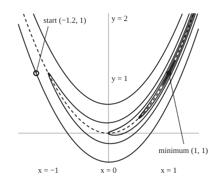

# Optimality conditions: flat slope first, upward curvature second

[Syllabus](../../../SYLLABUS.md) → [Optimization](../README.md) → [Unconstrained Methods](../README.md#s02) → Optimality conditions

---

## General Overview

The banana valley is a landscape of two numbers, x and y. Its height is

$$f(x, y) = (1 - x)^2 + 100\,(y - x^2)^2 .$$

The job is to **minimise** it: choose x and y to make f as small as possible, with nothing limiting the choice. H. H. Rosenbrock built it in 1960 to test search methods, and it is this shelf's running example. The classic start is (−1.2, 1), at height 24.2. The floor of the valley follows the curve y = x², with steep walls on both sides. Along the floor the ground falls gently to the lowest point, (1, 1), at height 0. Heights here are pure numbers, with no units.

A method that walks downhill needs a way to know when it has arrived. This card gives two tests. **First test: the ground is flat.** At a lowest point with no edge nearby, no direction leads down, so every slope is zero. That narrows the search to a few candidates, called flat spots. **Second test: the ground curves up.** A flat spot can be a pit, a peak or a pass. If the ground curves upward in every direction, it is a pit.

At (1, 1) both tests pass, but with a twist. Measured across the valley, the curvature is 1001.600639; along the floor it is only 0.399361. The bowl is about 2,500 times stiffer one way than the other. It is still a bowl, so (1, 1) is a true minimum. Add two more variables by chaining the same valley, and a search from 625 starting points finds a second pit and a pass. Flat slope alone cannot tell the three apart; the curvature can.

**At an unconstrained minimum of a smooth function, the gradient is zero and the Hessian curves up or stays level in every direction; a zero gradient with a Hessian that curves strictly up in every direction guarantees a strict local minimum.**

**What kind of fact this is:** two theorems, the necessary and the sufficient condition, both proved on this card in Why it works. The banana's single flat spot is found exactly by algebra. The four-variable list is what Newton's method finds from 625 starts: evidence, not a proof that nothing else exists.

### The picture: the banana valley, to scale

<p align="center"></p>

Each curve joins points of equal height: f = 0.01, 0.25, 1, 4 and 24.2. Only the smallest, f = 0.01, closes inside the frame. The next, f = 0.25, closes just above it: its tip, on the floor at x = 1.50, lies above y = 2, the top of the frame. The others run further past it. They are drawn to scale, one unit the same length on both axes. The dashed curve is the valley floor, y = x². Contour f = c reaches from x = 1 − √c to x = 1 + √c. So the innermost sliver, f = 0.01, spans x from 0.90 to 1.10, and f = 1 has its tip at the origin. The outermost curve, f = 24.2, passes through the start. Each contour is long and thin because the walls are steep and the floor is nearly level.

---

## The formula

Notation first, in words. The inputs form a list $x = (x_1, \dots, x_n)$: two for the banana, four for the chained valley. The **gradient** $\nabla f$ lists the n slopes, one per input ([Extrema in several variables](../../06-Calculus%20and%20analysis/07-Several%20Variables/06-multivariable-extrema.md)). The **Hessian** $\nabla^2 f$ is the square table of second derivatives. It is the calculus wing's H, written the way optimisation writes it ([Hessian](../../06-Calculus%20and%20analysis/07-Several%20Variables/05-hessian-and-second-order-approximation.md)). A minimiser is written $x^*$.

The **chained valley** lines up n inputs so that each neighbouring pair forms one banana, with wall steepness b (100 throughout, unless a line says otherwise):

$$f(x) = \sum_{i=1}^{n-1} \Big[\, b\,(x_{i+1} - x_i^2)^2 + (1 - x_i)^2 \Big].$$

With n = 2 this is the banana itself.

For a direction d of length 1, the number $d^{\mathsf T}\,\nabla^2 f\,d$ is the **curvature along d**: the second derivative of f as you walk a straight line through the point in direction d. The Hessian is **positive semidefinite**, written $\nabla^2 f \succeq 0$, when that curvature is zero or above for every d. It is **positive definite**, written $\nabla^2 f \succ 0$, when it is above zero for every d ([Quadratic forms](../../03-Algebra/07-Eigenvalues%20and%20Symmetric%20Matrices/05-quadratic-forms-and-positive-definite.md)).

**Necessary condition.** If $x^*$ is a local minimiser and f has continuous second derivatives near it, then

$$\nabla f(x^*) = 0 \quad\text{and}\quad \nabla^2 f(x^*) \succeq 0 .$$

**Sufficient condition.** If f has continuous second derivatives near $x^*$, and

$$\nabla f(x^*) = 0 \quad\text{and}\quad \nabla^2 f(x^*) \succ 0 ,$$

then $x^*$ is a strict local minimiser: every other point close enough is strictly higher.

**Read it aloud:** at a minimum the ground is flat and nowhere curves down; flat ground that curves up in every direction is guaranteed to be a minimum.

The curvatures along all directions run from the smallest eigenvalue $\lambda_{\min}$ of the Hessian to the largest, $\lambda_{\max}$. So "curves up in every direction" is the same as $\lambda_{\min} > 0$. The hand test uses **pivots**, the numbers on the diagonal after elimination: the Hessian is positive definite exactly when every pivot is above zero.

| Symbol | Plain meaning | In our example | Push it up and the answer… |
| --- | --- | --- | --- |
| $f$, $c$ | the height to be made smallest; c is one fixed height, drawn as a contour | 24.2 at the start, 0 at (1, 1) | — |
| $x$, $y$, $x_i$, $n$ | the inputs, $x = (x_1, \dots, x_n)$, and how many there are | (1, 1) at the bottom; n = 2, or 4 for the chained valley | more room for saddles: 3 flat spots found at n = 4 |
| $b$ | how steep the walls are; the banana uses 100 | 100 | the stretch grows: 33.97 at b = 1, 2508.01 at b = 100 |
| $x^*$ | a minimiser | (1, 1) | — |
| $\nabla f$, $\partial$ | the gradient: one slope per input; $\partial f/\partial x$ is the slope in x alone | (0, 0) at (1, 1) | a nonzero slope means some way down |
| $\nabla^2 f$; $A$, $B$, $C$, $D$ | the Hessian, the table of second derivatives; with two inputs, its entries A, B, C and $D = AC - B^2$ | `[[802, -400], [-400, 200]]` at (1, 1); D = 400 | — |
| $d$, $t$, $h$ | a direction of length 1; a distance along it; a short step in any direction | flat direction (0.446499, 0.894784) | — |
| $\varphi$, $\tau$, $\theta$, $E$, $\delta$ | height along a straight walk; in-between points where Taylor's theorem reads a derivative; the Hessian's drift and the radius where it stays small (proof only) | — | — |
| $d^{\mathsf T}\nabla^2 f\,d$ | curvature along d | between 0.399361 and 1001.600639 | below 0 in any direction: not a minimum |
| $\lambda_{\min}$, $\lambda_{\max}$ | smallest and largest eigenvalue: the least and most curvature | 0.399361 and 1001.600639 | a small $\lambda_{\min}$ still passes, but slows downhill methods |
| $\succeq 0$, $\succ 0$ | curves up or stays level everywhere; curves strictly up everywhere | $\succ 0$ at (1, 1) | — |
| $p_k$; $L$, $P$, $u$, $e_k$ | pivots from elimination; the triangular table and pivot table it builds, the reshaped direction, the k-th axis direction | pivots 802 and 0.498753 | one below 0: a way down exists |

### When it holds

- **Continuous second derivatives near the point.** Without them there may be no Hessian at all. The function $|x| + y^2$ is lowest at (0, 0), where it has a kink and no slope in x; [Subgradients](../01-Convexity/07-subgradients.md) handle that case.
- **No constraints, or the point is inside the allowed region.** At an edge, the lowest point can sit on a slope. The constrained tests are [Second-order conditions under constraints](../03-Constrained%20Optimisation/03-second-order-conditions-for-constrained-problems.md).
- **Strictly positive curvature, for the sufficient test.** If the smallest curvature is exactly zero, there is no verdict. The functions $x^2 + y^4$ and $x^2 - y^4$ share the Hessian diag(2, 0) at the origin. The first has a minimum there; the second does not.
- **Local only.** Both tests look at one point and its immediate neighbourhood. The chained valley's second pit passes both tests at height 3.701429, while the true bottom is 0. Global needs a separate argument, such as convexity or a lower bound.
- **Minimising.** For a maximum, flip every sign: the curvature must be at most zero, and strictly below zero for the guarantee.

---

## Why it works

The calculus wing already proves that an interior minimum has a zero gradient, and it sorts two-variable flat spots with $D = AC - B^2$ ([Extrema in several variables](../../06-Calculus%20and%20analysis/07-Several%20Variables/06-multivariable-extrema.md)). This section does the same for any number of inputs.

### Step 0: walk a straight line, and n inputs become one

Pick a direction d and walk along it from $x^*$: at distance t you are at $x^* + t\,d$. The height along the walk, $\varphi(t) = f(x^* + t\,d)$, depends on one number, t. By the chain rule, its slope at t = 0 is $\nabla f(x^*) \cdot d$, and its second derivative is $d^{\mathsf T}\,\nabla^2 f(x^*)\,d$ ([Hessian](../../06-Calculus%20and%20analysis/07-Several%20Variables/05-hessian-and-second-order-approximation.md)). A minimum in n inputs is a minimum along every line through it. One-variable facts about each line give the n-variable result.

### Step 1: flat slope is necessary

If $x^*$ is a local minimiser, then t = 0 is a local minimum of $\varphi$ for every d. A one-variable minimum inside an interval has slope zero, so $\nabla f(x^*) \cdot d = 0$ for every d. Taking d along each axis in turn makes every entry of the gradient zero.

On the banana, the slope in y is $200(y - x^2)$, which is zero only on the floor, $y = x^2$. The slope in x is $-2(1 - x) - 400x(y - x^2)$. On the floor the second part vanishes, leaving $-2(1 - x)$, zero only at x = 1. So (1, 1) is the **only** flat spot of the banana anywhere.

### Step 2: no downward curvature is necessary too

Suppose some direction d had $d^{\mathsf T}\nabla^2 f(x^*)\,d < 0$. By continuity, the curvature stays negative for a short way along that line. Taylor's theorem with the slope term already zero says $\varphi(t) = \varphi(0) + \tfrac12 t^2 \varphi''(\tau)$ for some $\tau$ between 0 and t. That is below $\varphi(0)$, so $x^*$ would not be a minimum. Hence no direction curves down: $\nabla^2 f(x^*) \succeq 0$.

### Step 3: flat slope plus upward curvature everywhere is sufficient

Now suppose the gradient is zero and every curvature is at least $\lambda_{\min} > 0$. Taylor along the line from $x^*$ to $x^* + h$ gives

$$f(x^* + h) - f(x^*) = \tfrac12\,h^{\mathsf T}\,\nabla^2 f(x^* + \theta h)\,h \quad\text{for some } \theta \text{ in } (0, 1).$$

If the Hessian were read at $x^*$ itself, the right side would be at least $\tfrac12\lambda_{\min}|h|^2$. Close to $x^*$ the Hessian barely changes, so the right side stays at least $\tfrac14\lambda_{\min}|h|^2$, which is above zero. Every nearby point is higher: a strict local minimum.

<details>
<summary>Detailed proof: the Hessian's drift cannot undo the bowl</summary>

Let $E = \nabla^2 f(x^* + \theta h) - \nabla^2 f(x^*)$. Continuity gives $\delta > 0$ such that every entry of E is smaller than $\lambda_{\min}/(2n)$ in size whenever $|h| < \delta$. Then

$$|h^{\mathsf T} E h| \le \sum_{i,j} |E_{ij}|\,|h_i|\,|h_j| < \frac{\lambda_{\min}}{2n}\Big(\sum_i |h_i|\Big)^2 \le \frac{\lambda_{\min}}{2n}\cdot n\,|h|^2 = \tfrac12\lambda_{\min}|h|^2,$$

using $(\sum_i |h_i|)^2 \le n|h|^2$ (Cauchy–Schwarz). So for $0 < |h| < \delta$,

$$f(x^* + h) - f(x^*) \ge \tfrac12\big(\lambda_{\min} - \tfrac12\lambda_{\min}\big)|h|^2 = \tfrac14\lambda_{\min}|h|^2 > 0 .$$

The bound $h^{\mathsf T}\nabla^2 f(x^*)\,h \ge \lambda_{\min}|h|^2$ is the spectral theorem: write h in the Hessian's perpendicular eigenvector directions, and the form becomes a sum of eigenvalues times squares. ∎

</details>

### Step 4: pivots test every direction at once

Checking curvature direction by direction never ends. Elimination does it in one pass. Eliminating below each diagonal entry, without swapping rows and with no zero pivot on the way, writes the Hessian as $L\,P\,L^{\mathsf T}$. Here L is a lower-triangular table with ones on its diagonal, and P holds the pivots $p_1, \dots, p_n$ on its diagonal. Then for any direction d, with $u = L^{\mathsf T} d$,

$$d^{\mathsf T}\,\nabla^2 f\,d = p_1 u_1^2 + p_2 u_2^2 + \dots + p_n u_n^2 .$$

This is completing the square, done n times. L can be undone, so u = 0 only when d = 0.

- **Every pivot above zero:** every nonzero d gives a sum above zero. Positive definite.
- **Some pivot $p_k$ below zero:** solve $L^{\mathsf T} d = e_k$, the k-th axis direction. Then $u = e_k$, and $d^{\mathsf T}\nabla^2 f\,d = p_k < 0$. Scaled to length 1, d still curves down, by $p_k$ divided by d's squared length. That d is a concrete way down.

The banana's pivots are 802 and 400/802 = 0.498753. Both are above zero. For two inputs they are the calculus wing's A and D/A, so this is the same test. With more inputs the count of negative pivots equals the count of negative eigenvalues: Sylvester's law of inertia.

### Step 5: the gap between the two conditions

The chain runs one way only:

positive definite Hessian ⇒ strict local minimum ⇒ local minimum ⇒ positive semidefinite Hessian.

Neither end reverses. The function $x^4 + y^4$ has a strict minimum at the origin, yet its Hessian there is all zeros, so the sufficient test is silent. The function $x^2 - y^4$ passes the necessary test at the origin, with Hessian diag(2, 0), yet $f(0, 0.1) = -0.000100$. The gap is exactly a zero eigenvalue. Along that level direction, terms beyond the square decide.

### Step 6: the banana's stretch, and what it means

The banana's Hessian at (1, 1) has eigenvalues 1001.600639 and 0.399361, a ratio of 2508.01. The weak direction, (0.446499, 0.894784), runs along the floor. It is close to the floor's own direction at (1, 1), where $y = x^2$ climbs 2 for every 1 across. The stiff direction, (0.894784, −0.446499), cuts straight across. Near the bottom, the quadratic model's contour f = 0.01 reaches 0.2238 along the floor and only 0.0045 across.

None of this weakens the verdict, because a small positive curvature is still positive. It does make the bottom slow to reach. A method that follows the slope zigzags between the walls. That cost is the subject of [Gradient descent](02-gradient-descent-and-its-rate.md) and [Convergence rates](03-rates-of-convergence-and-conditioning.md).

### Step 7: local becomes global for the banana

The banana is a sum of two squares, so f is never below zero. At (1, 1) it is exactly zero. No point is lower, so (1, 1) is the **global** minimiser, certified by that lower bound rather than by the curvature tests. A brute-force grid over [−2, 2] × [−2, 2] with spacing 0.01 agrees: lowest f = 0.000000 at (1.00, 1.00).

---

## Worked numbers, by hand

The banana, $f(x, y) = (1 - x)^2 + 100(y - x^2)^2$.

| Step | Arithmetic | Value |
| --- | --- | --- |
| slope in y | $200(y - x^2) = 0$ | $y = x^2$, the floor |
| slope in x, on the floor | $-2(1 - x) - 400x \cdot 0 = 0$ | x = 1, so the flat spot is (1, 1) |
| height there | $(1 - 1)^2 + 100(1 - 1)^2$ | 0 |
| $\partial^2 f/\partial x^2 = 1200x^2 - 400y + 2$ | $1200 - 400 + 2$ | 802 |
| $\partial^2 f/\partial x\,\partial y = -400x$ | $-400 \times 1$ | −400 |
| $\partial^2 f/\partial y^2$ | $2 \times 100$ | 200 |
| trace, the sum of the diagonal | $802 + 200$ | 1002 |
| determinant | $802 \times 200 - 400^2$ | 400 |
| eigenvalues | $(1002 \pm \sqrt{1002^2 - 4 \times 400})/2$ | 1001.600639 and 0.399361 |
| stretch | $1001.600639 / 0.399361$ | 2508.01 |
| pivots | 802, then $200 - 400^2/802 = 400/802$ | 802 and 0.498753 |
| verdict | both pivots above zero; f is a sum of squares, 0 here | **strict local minimum, and global: f(1, 1) = 0** |

So the bottom of the banana is (1, 1), height 0, and nothing in the plane is lower. Its curvature is about 2,500 times stronger across the valley than along it.

### What breaks if you drop a piece

| Mistake | Comes out at | What went wrong |
| --- | --- | --- |
| Stop at the flat slope | chained valley, flat spot (−0.656125, 0.443120, 0.204312, 0.041743), f = 3.708242; a step of 0.01 along the downhill direction changes f by −2.4658e−05 | a saddle: pivots 341.351, 154.116, 31.542, −11.747 |
| Accept level curvature as enough | $x^2 - y^4$: Hessian diag(2, 0) passes the necessary test; f(0, 0.1) = −0.000100 | a zero eigenvalue gives no verdict |
| Use the two-variable rule with three inputs | $x^2 - y^2 - z^2$: determinant 8 and top-left entry 2 both pass; f(0, 0.1, 0) = −0.010000 | pivots 2, −2, −2: a saddle with 2 ways down |
| Call a pit global | chained valley's second pit: f = 3.701429, against 0.000000 at (1, 1, 1, 1) | both tests are local |

---

## Code, from first principles, and it actually runs

The code finds flat spots with Newton's method on the equation ∇f = 0. It solves each linear system by elimination and classifies each spot by its pivots. It takes four independent roads. **Road one:** slopes and second derivatives worked out by hand, with eigenvalues from the trace and determinant. **Road two:** the same slopes and second derivatives from f alone, by central differences. **Road three:** brute force. It scans the curvature over 3,600 directions, measures real rises on a circle of radius 0.01, and grid-searches the square [−2, 2] × [−2, 2]. **Road four,** for the saddle: build the downhill direction from the pivots and step along it. Every assert compares two roads.

Newton on ∇f = 0 hunts for flat ground, not low ground. From the classic start its second step jumps to height 1411.85 before settling at (1, 1) within seven steps. On the chained valley, 35 of 625 starts converge to the saddle.

### Python

```python
# Optimality conditions on the banana valley.  Standard library only.
# Minimise f(x) = sum over i of b(x[i+1] - x[i]^2)^2 + (1 - x[i])^2.  Two variables: the banana.
import functools, itertools, math

def total(terms): return functools.reduce(lambda t, v: t + v, terms, 0.0)   # plain left-to-right sum, as in Rust
def f(x, b=100.0):
    return total(b * (x[i + 1] - x[i] * x[i]) * (x[i + 1] - x[i] * x[i]) + (1 - x[i]) * (1 - x[i]) for i in range(len(x) - 1))
def grad(x, b=100.0):                                  # the slopes, by hand
    g = [0.0] * len(x)
    for i in range(len(x) - 1):
        w = x[i + 1] - x[i] * x[i]
        g[i] += -4 * b * x[i] * w - 2 * (1 - x[i])
        g[i + 1] += 2 * b * w
    return g
def hess(x, b=100.0):                                  # the second derivatives, by hand
    H = [[0.0] * len(x) for _ in x]
    for i in range(len(x) - 1):
        H[i][i] += 12 * b * x[i] * x[i] - 4 * b * x[i + 1] + 2
        H[i][i + 1] -= 4 * b * x[i]; H[i + 1][i] -= 4 * b * x[i]
        H[i + 1][i + 1] += 2 * b
    return H
def solve(A, r):                                       # elimination with row swaps; None if singular
    n = len(r); M = [A[i][:] + [r[i]] for i in range(n)]
    for c in range(n):
        p = max(range(c, n), key=lambda i: abs(M[i][c]))
        if M[p][c] == 0: return None
        M[c], M[p] = M[p], M[c]
        for i in range(c + 1, n):
            m = M[i][c] / M[c][c]
            for k in range(c, n + 1): M[i][k] -= m * M[c][k]
    z = [0.0] * n
    for i in reversed(range(n)):
        z[i] = (M[i][n] - total(M[i][k] * z[k] for k in range(i + 1, n))) / M[i][i]
    return z

def pivots(H):                                         # elimination without swaps: H = L P L^T
    n = len(H); A = [row[:] for row in H]; L = [[float(i == j) for j in range(n)] for i in range(n)]
    for c in range(n):
        if A[c][c] == 0: return [A[i][i] if i <= c else 0.0 for i in range(n)], L
        for i in range(c + 1, n):
            L[i][c] = A[i][c] / A[c][c]
            for k in range(c, n): A[i][k] -= L[i][c] * A[c][k]
    return [A[i][i] for i in range(n)], L
def verdict(piv):                                      # signs of pivots = signs of eigenvalues
    if 0.0 in piv: return "no verdict"
    neg = sum(p < 0 for p in piv)
    return "strict local minimum" if neg == 0 else "strict local maximum" if neg == len(piv) else f"saddle ({neg} negative)"
def newton(x):                                         # Newton on grad f = 0: finds flat spots of any kind
    for _ in range(50):
        if max(abs(v) for v in x) > 1e3: return None
        d = solve(hess(x), grad(x))
        if d is None: return None
        x = [a - e for a, e in zip(x, d)]
    return x if max(abs(v) for v in grad(x)) < 1e-9 else None
def flat_spots(n):                                     # Newton from every start in a grid of 5^n points
    found, fails = {}, 0
    for s in itertools.product((-1.2, -0.5, 0.0, 0.5, 1.2), repeat=n):
        z = newton(list(s))
        if z is None: fails += 1; continue
        found.setdefault(fmt(z), [z, 0])[1] += 1
    return sorted(found.values(), key=lambda p: f(p[0])), fails

def step(x, d, t): return [a + t * u for a, u in zip(x, d)]
def unit(v): s = math.sqrt(total(a * a for a in v)); return [a / s for a in v]
def fmt(v, p=6): return "(" + ", ".join(f"{a:.{p}f}" for a in v) + ")"
def by_differences(x, h=1e-5):                         # road 2: slopes and bends from f alone
    E = [[float(i == j) for j in range(len(x))] for i in range(len(x))]
    g = [(f(step(x, e, h)) - f(step(x, e, -h))) / (2 * h) for e in E]
    H = [[(f(step(step(x, a, h), c, h)) - f(step(step(x, a, h), c, -h)) - f(step(step(x, a, -h), c, h))
           + f(step(step(x, a, -h), c, -h))) / (4 * h * h) for c in E] for a in E]
    return g, H

# ---- the banana, n = 2 ----
x = [-1.2, 1.0]; heights = []
for k in range(7):
    x = step(x, solve(hess(x), grad(x)), -1.0); heights.append(f(x))
print(f"start (-1.2, 1): f = {f([-1.2, 1.0]):.6f}; newton on grad = 0, f after steps 1-7: " + " ".join(f"{v:.2f}" for v in heights))
xs = x; H = hess(xs); gd, Hd = by_differences(xs)
print(f"flat spot {fmt(xs)}: f = {f(xs):.6f}, gradient {fmt(grad(xs))}, by differences {fmt([abs(v) for v in gd])}")
print(f"hessian by hand {H[0][0]:.3f} {H[0][1]:.3f} {H[1][1]:.3f}; by differences {Hd[0][0]:.3f} {Hd[0][1]:.3f} {Hd[1][1]:.3f}")
assert max(abs(Hd[i][j] - H[i][j]) for i in range(2) for j in range(2)) < 0.01 and max(map(abs, gd)) < 1e-4
def eig2(H):                                           # eigenvalues of a 2 by 2 table from trace and det
    T, D = H[0][0] + H[1][1], H[0][0] * H[1][1] - H[0][1] * H[1][0]
    return T, D, (T + math.sqrt(T * T - 4 * D)) / 2, (T - math.sqrt(T * T - 4 * D)) / 2
T, D, lmax, lmin = eig2(H)
print(f"trace {T:.6f}, det {D:.6f}, eigenvalues {lmax:.6f} and {lmin:.6f}, stretch {lmax / lmin:.2f}")
q = [H[0][0] * c * c + 2 * H[0][1] * c * s + H[1][1] * s * s
     for c, s in ((math.cos(k * math.pi / 3600), math.sin(k * math.pi / 3600)) for k in range(3600))]
print(f"d'Hd over 3600 unit directions: largest {max(q):.4f}, smallest {min(q):.4f}")
assert abs(min(q) - lmin) < 1e-3 and abs(max(q) - lmax) < 1e-3
piv, _ = pivots(H)
print(f"pivots {piv[0]:.6f} and {piv[1]:.6f}: {verdict(piv)}")
vflat, vsteep = unit([-H[0][1], H[0][0] - lmin]), unit([-H[0][1], H[0][0] - lmax])
print(f"flat direction {fmt(vflat)}, steep direction {fmt(vsteep)}")
print(f"contour f = 0.01, quadratic model: {math.sqrt(0.02 / lmin):.4f} along the flat way, {math.sqrt(0.02 / lmax):.4f} along the steep way")
r = 0.01
rise = min(f(step(xs, [math.cos(k * math.pi / 1800), math.sin(k * math.pi / 1800)], r)) for k in range(3600)) - f(xs)
print(f"circle of radius 0.01: smallest rise {rise:.4e}; model lmin r^2/2 = {lmin * r * r / 2:.4e}")
assert 0 < rise and abs(rise - lmin * r * r / 2) < 0.1 * lmin * r * r / 2
best = min((f([i / 100, j / 100]), i / 100, j / 100) for i in range(-200, 201) for j in range(-200, 201))
print(f"grid over [-2, 2] x [-2, 2], spacing 0.01: lowest f = {best[0]:.6f} at ({best[1]:.2f}, {best[2]:.2f})")
assert best[1:] == (1.0, 1.0) and best[0] == f(xs)

# ---- the chained banana, n = 4 ----
pts, fails = flat_spots(4)
dirs = [unit(list(s)) for s in itertools.product((-1, 0, 1), repeat=4) if any(s)]
print(f"n = 4: Newton from 625 starts finds {len(pts)} flat spots; {fails} starts did not settle")
for z, count in pts:
    piv, _ = pivots(hess(z)); gd, Hd = by_differences(z)
    assert max(abs(Hd[i][j] - hess(z)[i][j]) for i in range(4) for j in range(4)) < 0.05 and max(map(abs, gd)) < 1e-4
    low = min(f(step(z, d, 1e-3)) for d in dirs) - f(z)
    print(f"{fmt(z)} f = {f(z):.6f} from {count:3d} starts; pivots {fmt(piv, 3)}: {verdict(piv)}; 80-direction rise {low:.3e}")
sad = pts[-1][0]; Hs = hess(sad); piv, L = pivots(Hs)
k = piv.index(min(piv)); d = [float(i == k) for i in range(4)]
for i in range(k - 1, -1, -1): d[i] = -total(L[j][i] * d[j] for j in range(i + 1, 4))   # solve L^T d = e_k
d = unit(d); curv = total(d[i] * Hs[i][j] * d[j] for i in range(4) for j in range(4))
drop = f(step(sad, d, 0.01)) - f(sad)
print(f"saddle: diagonal {fmt([Hs[i][i] for i in range(4)], 3)}; downhill direction {fmt(d)}")
print(f"saddle: d'Hd = {curv:.4f}; a step of 0.01 along d changes f by {drop:.4e} (model {curv * 0.0001 / 2:.4e})")
assert curv < 0 and drop < 0 and min(Hs[i][i] for i in range(4)) > 0
assert [verdict(pivots(hess(z))[0]) for z, _ in pts[:2]] == ["strict local minimum"] * 2

# ---- what breaks ----
for name, sgn in (("x^2 + y^4", 1.0), ("x^2 - y^4", -1.0)):
    Hb = [[2.0, 0.0], [0.0, 0.0]]                          # second derivatives 2 and 12y^2 at (0, 0)
    print(f"breaks, {name}: hessian at 0 is diag(2, 0): {verdict(pivots(Hb)[0])}; f(0, 0.1) = {sgn * 0.1 * 0.1 * 0.1 * 0.1:.6f}")
p3 = pivots([[2.0, 0.0, 0.0], [0.0, -2.0, 0.0], [0.0, 0.0, -2.0]])[0]
print(f"breaks, x^2 - y^2 - z^2: det {p3[0] * p3[1] * p3[2]:.0f} and top-left {p3[0]:.0f}, yet pivots {fmt(p3, 0)}: {verdict(p3)}; f(0, 0.1, 0) = {-0.1 * 0.1:.6f}")
assert verdict(p3) != "strict local minimum" and p3[0] * p3[1] * p3[2] > 0
print(f"breaks, local read as global: f = {f(pts[1][0]):.6f} at the second pit, {f(pts[0][0]):.6f} at (1, 1, 1, 1)")

# ---- try changing, and the figure ----
H1 = hess([1.0, 1.0], b=1.0); _, _, l1, l2 = eig2(H1)
print(f"try b = 1: hessian {H1[0][0]:.0f} {H1[0][1]:.0f} {H1[1][1]:.0f}, eigenvalues {l1:.4f} and {l2:.4f}, stretch {l1 / l2:.2f}")
pm = pivots([[-v for v in row] for row in H])[0]
print(f"try minus f: pivots {fmt(pm)}: {verdict(pm)}")
p3s, _ = flat_spots(3)
print(f"try n = 3: Newton from 125 starts finds {len(p3s)} flat spot(s): " + ", ".join(fmt(z) for z, _ in p3s))
print("figure, contour f = c runs from x = 1 - sqrt(c) to 1 + sqrt(c): " + "; ".join(f"c = {c}: {1 - math.sqrt(c):.2f} to {1 + math.sqrt(c):.2f}" for c in (0.01, 0.25, 1, 4, 24.2)))
print("ALL CHECKS PASS")
```

**Ran 2026-11-11 on macOS, Python 3.14.10, standard library only. All checks passed. Output, pasted from the run:**

```
start (-1.2, 1): f = 24.200000; newton on grad = 0, f after steps 1-7: 4.73 1411.85 0.06 0.31 0.00 0.00 0.00
flat spot (1.000000, 1.000000): f = 0.000000, gradient (0.000000, 0.000000), by differences (0.000000, 0.000000)
hessian by hand 802.000 -400.000 200.000; by differences 802.000 -400.000 200.000
trace 1002.000000, det 400.000000, eigenvalues 1001.600639 and 0.399361, stretch 2508.01
d'Hd over 3600 unit directions: largest 1001.6005, smallest 0.3995
pivots 802.000000 and 0.498753: strict local minimum
flat direction (0.446499, 0.894784), steep direction (0.894784, -0.446499)
contour f = 0.01, quadratic model: 0.2238 along the flat way, 0.0045 along the steep way
circle of radius 0.01: smallest rise 1.9912e-05; model lmin r^2/2 = 1.9968e-05
grid over [-2, 2] x [-2, 2], spacing 0.01: lowest f = 0.000000 at (1.00, 1.00)
n = 4: Newton from 625 starts finds 3 flat spots; 20 starts did not settle
(1.000000, 1.000000, 1.000000, 1.000000) f = 0.000000 from 432 starts; pivots (802.000, 802.499, 802.623, 0.654): strict local minimum; 80-direction rise 7.568e-05
(-0.775659, 0.613093, 0.382063, 0.145972) f = 3.701429 from 138 starts; pivots (478.739, 299.158, 117.742, 1.638): strict local minimum; 80-direction rise 1.012e-05
(-0.656125, 0.443120, 0.204312, 0.041743) f = 3.708242 from  35 starts; pivots (341.351, 154.116, 31.542, -11.747): saddle (1 negative); 80-direction rise 8.852e-06
saddle: diagonal (341.351, 355.902, 235.395, 200.000); downhill direction (-0.490227, 0.637606, 0.554393, 0.213971)
saddle: d'Hd = -0.5378; a step of 0.01 along d changes f by -2.4658e-05 (model -2.6890e-05)
breaks, x^2 + y^4: hessian at 0 is diag(2, 0): no verdict; f(0, 0.1) = 0.000100
breaks, x^2 - y^4: hessian at 0 is diag(2, 0): no verdict; f(0, 0.1) = -0.000100
breaks, x^2 - y^2 - z^2: det 8 and top-left 2, yet pivots (2, -2, -2): saddle (2 negative); f(0, 0.1, 0) = -0.010000
breaks, local read as global: f = 3.701429 at the second pit, 0.000000 at (1, 1, 1, 1)
try b = 1: hessian 10 -4 2, eigenvalues 11.6569 and 0.3431, stretch 33.97
try minus f: pivots (-802.000000, -0.498753): strict local maximum
try n = 3: Newton from 125 starts finds 1 flat spot(s): (1.000000, 1.000000, 1.000000)
figure, contour f = c runs from x = 1 - sqrt(c) to 1 + sqrt(c): c = 0.01: 0.90 to 1.10; c = 0.25: 0.50 to 1.50; c = 1: 0.00 to 2.00; c = 4: -1.00 to 3.00; c = 24.2: -3.92 to 5.92
ALL CHECKS PASS
```

### Rust

```rust
// Optimality conditions on the banana valley -- the same check as optimality_conditions_check.py.
// Minimise f(x) = sum over i of b(x[i+1] - x[i]^2)^2 + (1 - x[i])^2.  Two variables: the banana.  No crates.
use std::f64::consts::PI;
type Mat = Vec<Vec<f64>>;

fn f(x: &[f64], b: f64) -> f64 {
    (0..x.len() - 1).fold(0.0, |t, i| { let w = x[i + 1] - x[i] * x[i]; t + (b * w * w + (1.0 - x[i]) * (1.0 - x[i])) })
}
fn fb(x: &[f64]) -> f64 { f(x, 100.0) }
fn grad(x: &[f64]) -> Vec<f64> { // the slopes, by hand
    let (b, mut g) = (100.0, vec![0.0; x.len()]);
    for i in 0..x.len() - 1 { let w = x[i + 1] - x[i] * x[i]; g[i] += -4.0 * b * x[i] * w - 2.0 * (1.0 - x[i]); g[i + 1] += 2.0 * b * w; }
    g
}
fn hess(x: &[f64], b: f64) -> Mat { // the second derivatives, by hand
    let (n, mut h) = (x.len(), vec![vec![0.0; x.len()]; x.len()]);
    for i in 0..n - 1 {
        h[i][i] += 12.0 * b * x[i] * x[i] - 4.0 * b * x[i + 1] + 2.0;
        h[i][i + 1] -= 4.0 * b * x[i]; h[i + 1][i] -= 4.0 * b * x[i]; h[i + 1][i + 1] += 2.0 * b;
    }
    h
}
fn eye(n: usize) -> Mat { (0..n).map(|i| (0..n).map(|j| if i == j { 1.0 } else { 0.0 }).collect()).collect() }
fn maxabs(v: &[f64]) -> f64 { v.iter().fold(0.0_f64, |m, a| m.max(a.abs())) }
fn solve(a: &Mat, r: &[f64]) -> Option<Vec<f64>> { // elimination with row swaps; None if singular
    let n = r.len();
    let mut m: Mat = (0..n).map(|i| { let mut row = a[i].clone(); row.push(r[i]); row }).collect();
    for c in 0..n {
        let p = (c..n).fold(c, |p, i| if m[i][c].abs() > m[p][c].abs() { i } else { p });
        if m[p][c] == 0.0 { return None; }
        m.swap(c, p);
        for i in c + 1..n { let mu = m[i][c] / m[c][c]; for k in c..=n { m[i][k] -= mu * m[c][k]; } }
    }
    let mut z = vec![0.0; n];
    for i in (0..n).rev() { z[i] = (m[i][n] - (i + 1..n).fold(0.0, |t, k| t + m[i][k] * z[k])) / m[i][i]; }
    Some(z)
}
fn pivots(h: &Mat) -> (Vec<f64>, Mat) { // elimination without swaps: H = L P L^T
    let (n, mut a, mut l) = (h.len(), h.clone(), eye(h.len()));
    for c in 0..n {
        if a[c][c] == 0.0 { return ((0..n).map(|i| if i <= c { a[i][i] } else { 0.0 }).collect(), l); }
        for i in c + 1..n { l[i][c] = a[i][c] / a[c][c]; for k in c..n { a[i][k] -= l[i][c] * a[c][k]; } }
    }
    ((0..n).map(|i| a[i][i]).collect(), l)
}
fn verdict(piv: &[f64]) -> String { // signs of pivots = signs of eigenvalues
    let neg = piv.iter().filter(|&&p| p < 0.0).count();
    if piv.contains(&0.0) { "no verdict".into() } else if neg == 0 { "strict local minimum".into() }
    else if neg == piv.len() { "strict local maximum".into() } else { format!("saddle ({} negative)", neg) }
}
fn newton(mut x: Vec<f64>) -> Option<Vec<f64>> { // Newton on grad f = 0: finds flat spots of any kind
    for _ in 0..50 {
        if maxabs(&x) > 1e3 { return None; }
        x = step(&x, &solve(&hess(&x, 100.0), &grad(&x))?, -1.0);
    }
    if maxabs(&grad(&x)) < 1e-9 { Some(x) } else { None }
}
fn flat_spots(n: usize) -> (Vec<(Vec<f64>, usize)>, usize) { // Newton from every start in a grid of 5^n points
    let vals = [-1.2, -0.5, 0.0, 0.5, 1.2];
    let (mut found, mut fails): (Vec<(String, Vec<f64>, usize)>, usize) = (vec![], 0);
    for code in 0..5usize.pow(n as u32) {
        let s: Vec<f64> = (0..n).map(|i| vals[code / 5usize.pow((n - 1 - i) as u32) % 5]).collect();
        let Some(z) = newton(s) else { fails += 1; continue };
        match found.iter_mut().find(|e| e.0 == fmt(&z, 6)) { Some(e) => e.2 += 1, None => found.push((fmt(&z, 6), z, 1)) }
    }
    found.sort_by(|a, b| fb(&a.1).partial_cmp(&fb(&b.1)).unwrap());
    (found.into_iter().map(|e| (e.1, e.2)).collect(), fails)
}
fn step(x: &[f64], d: &[f64], t: f64) -> Vec<f64> { x.iter().zip(d).map(|(a, u)| a + t * u).collect() }
fn unit(v: &[f64]) -> Vec<f64> { let s = v.iter().fold(0.0, |t, a| t + a * a).sqrt(); v.iter().map(|a| a / s).collect() }
fn fmt(v: &[f64], p: usize) -> String { format!("({})", v.iter().map(|a| format!("{:.*}", p, a)).collect::<Vec<_>>().join(", ")) }
fn sci(v: f64, p: usize) -> String { // Python's e-format: two-digit exponent with a sign
    let s = format!("{:.*e}", p, v); let (m, e) = s.split_once('e').unwrap(); let e: i32 = e.parse().unwrap();
    format!("{}e{}{:02}", m, if e < 0 { '-' } else { '+' }, e.abs())
}
fn by_differences(x: &[f64]) -> (Vec<f64>, Mat) { // road 2: slopes and bends from f alone
    let (e, h) = (eye(x.len()), 1e-5);
    let g = e.iter().map(|ei| (fb(&step(x, ei, h)) - fb(&step(x, ei, -h))) / (2.0 * h)).collect();
    let hd = e.iter().map(|a| e.iter().map(|c| (fb(&step(&step(x, a, h), c, h)) - fb(&step(&step(x, a, h), c, -h))
        - fb(&step(&step(x, a, -h), c, h)) + fb(&step(&step(x, a, -h), c, -h))) / (4.0 * h * h)).collect()).collect();
    (g, hd)
}
fn worst(a: &Mat, b: &Mat) -> f64 { a.iter().zip(b).flat_map(|(r, s)| r.iter().zip(s).map(|(u, v)| (u - v).abs())).fold(0.0, f64::max) }
fn eig2(h: &Mat) -> (f64, f64, f64, f64) { // eigenvalues of a 2 by 2 table from trace and det
    let (t, d) = (h[0][0] + h[1][1], h[0][0] * h[1][1] - h[0][1] * h[1][0]);
    (t, d, (t + (t * t - 4.0 * d).sqrt()) / 2.0, (t - (t * t - 4.0 * d).sqrt()) / 2.0)
}
fn join(v: impl Iterator<Item = String>, sep: &str) -> String { v.collect::<Vec<_>>().join(sep) }

fn main() {
    // ---- the banana, n = 2 ----
    let (mut x, mut heights) = (vec![-1.2, 1.0], vec![]);
    for _ in 0..7 { x = step(&x, &solve(&hess(&x, 100.0), &grad(&x)).unwrap(), -1.0); heights.push(fb(&x)); }
    println!("start (-1.2, 1): f = {:.6}; newton on grad = 0, f after steps 1-7: {}", fb(&[-1.2, 1.0]), join(heights.iter().map(|v| format!("{:.2}", v)), " "));
    let (xs, h, (gd, hd)) = (x.clone(), hess(&x, 100.0), by_differences(&x));
    println!("flat spot {}: f = {:.6}, gradient {}, by differences {}", fmt(&xs, 6), fb(&xs), fmt(&grad(&xs), 6),
             fmt(&gd.iter().map(|v| v.abs()).collect::<Vec<_>>(), 6));
    println!("hessian by hand {:.3} {:.3} {:.3}; by differences {:.3} {:.3} {:.3}", h[0][0], h[0][1], h[1][1], hd[0][0], hd[0][1], hd[1][1]);
    assert!(worst(&hd, &h) < 0.01 && maxabs(&gd) < 1e-4);
    let (t, d, lmax, lmin) = eig2(&h);
    println!("trace {:.6}, det {:.6}, eigenvalues {:.6} and {:.6}, stretch {:.2}", t, d, lmax, lmin, lmax / lmin);
    let q: Vec<f64> = (0..3600).map(|k| ((k as f64 * PI / 3600.0).cos(), (k as f64 * PI / 3600.0).sin()))
        .map(|(c, s)| h[0][0] * c * c + 2.0 * h[0][1] * c * s + h[1][1] * s * s).collect();
    let (qmax, qmin) = (q.iter().cloned().fold(f64::MIN, f64::max), q.iter().cloned().fold(f64::MAX, f64::min));
    println!("d'Hd over 3600 unit directions: largest {:.4}, smallest {:.4}", qmax, qmin);
    assert!((qmin - lmin).abs() < 1e-3 && (qmax - lmax).abs() < 1e-3);
    let (piv, _) = pivots(&h); println!("pivots {:.6} and {:.6}: {}", piv[0], piv[1], verdict(&piv));
    let (vflat, vsteep) = (unit(&[-h[0][1], h[0][0] - lmin]), unit(&[-h[0][1], h[0][0] - lmax]));
    println!("flat direction {}, steep direction {}", fmt(&vflat, 6), fmt(&vsteep, 6));
    println!("contour f = 0.01, quadratic model: {:.4} along the flat way, {:.4} along the steep way", (0.02 / lmin).sqrt(), (0.02 / lmax).sqrt());
    let r = 0.01; let rise = (0..3600).map(|k| fb(&step(&xs, &[(k as f64 * PI / 1800.0).cos(), (k as f64 * PI / 1800.0).sin()], r)))
        .fold(f64::MAX, f64::min) - fb(&xs);
    println!("circle of radius 0.01: smallest rise {}; model lmin r^2/2 = {}", sci(rise, 4), sci(lmin * r * r / 2.0, 4));
    assert!(0.0 < rise && (rise - lmin * r * r / 2.0).abs() < 0.1 * lmin * r * r / 2.0);
    let mut best = (f64::MAX, 0.0, 0.0);
    for (u, v) in (-200..=200).flat_map(|i| (-200..=200).map(move |j| (i as f64 / 100.0, j as f64 / 100.0))) {
        if fb(&[u, v]) < best.0 { best = (fb(&[u, v]), u, v); } }
    println!("grid over [-2, 2] x [-2, 2], spacing 0.01: lowest f = {:.6} at ({:.2}, {:.2})", best.0, best.1, best.2);
    assert!(best.1 == 1.0 && best.2 == 1.0 && best.0 == fb(&xs));

    // ---- the chained banana, n = 4 ----
    let (pts, fails) = flat_spots(4);
    let dirs: Vec<Vec<f64>> = (0..81usize).map(|c| (0..4).map(|i| (c / 3usize.pow(3 - i as u32) % 3) as f64 - 1.0).collect::<Vec<f64>>())
        .filter(|s| s.iter().any(|&a| a != 0.0)).map(|s| unit(&s)).collect();
    println!("n = 4: Newton from 625 starts finds {} flat spots; {} starts did not settle", pts.len(), fails);
    for (z, count) in &pts {
        let ((piv, _), (gd, hd)) = (pivots(&hess(z, 100.0)), by_differences(z));
        assert!(worst(&hd, &hess(z, 100.0)) < 0.05 && maxabs(&gd) < 1e-4);
        let low = dirs.iter().map(|dd| fb(&step(z, dd, 1e-3))).fold(f64::MAX, f64::min) - fb(z);
        println!("{} f = {:.6} from {:3} starts; pivots {}: {}; 80-direction rise {}", fmt(z, 6), fb(z), count, fmt(&piv, 3), verdict(&piv), sci(low, 3));
    }
    let (sad, hs) = (&pts[pts.len() - 1].0, hess(&pts[pts.len() - 1].0, 100.0)); let (piv, l) = pivots(&hs);
    let k = (0..4).fold(0, |m, i| if piv[i] < piv[m] { i } else { m });
    let mut dv: Vec<f64> = (0..4).map(|i| if i == k { 1.0 } else { 0.0 }).collect();
    for i in (0..k).rev() { dv[i] = -(i + 1..4).fold(0.0, |t, j| t + l[j][i] * dv[j]); } // solve L^T d = e_k
    let dv = unit(&dv); let curv = (0..4).flat_map(|i| (0..4).map(move |j| (i, j))).fold(0.0, |t, (i, j)| t + dv[i] * hs[i][j] * dv[j]);
    let drop = fb(&step(sad, &dv, 0.01)) - fb(sad);
    println!("saddle: diagonal {}; downhill direction {}", fmt(&(0..4).map(|i| hs[i][i]).collect::<Vec<_>>(), 3), fmt(&dv, 6));
    println!("saddle: d'Hd = {:.4}; a step of 0.01 along d changes f by {} (model {})", curv, sci(drop, 4), sci(curv * 0.0001 / 2.0, 4));
    assert!(curv < 0.0 && drop < 0.0 && (0..4).all(|i| hs[i][i] > 0.0));
    assert!(pts[..2].iter().all(|(z, _)| verdict(&pivots(&hess(z, 100.0)).0) == "strict local minimum"));

    // ---- what breaks ----
    for (name, sgn) in [("x^2 + y^4", 1.0), ("x^2 - y^4", -1.0)] {
        let hb = vec![vec![2.0, 0.0], vec![0.0, 0.0]]; // second derivatives 2 and 12y^2 at (0, 0)
        println!("breaks, {}: hessian at 0 is diag(2, 0): {}; f(0, 0.1) = {:.6}", name, verdict(&pivots(&hb).0), sgn * 0.1 * 0.1 * 0.1 * 0.1);
    }
    let p3 = pivots(&vec![vec![2.0, 0.0, 0.0], vec![0.0, -2.0, 0.0], vec![0.0, 0.0, -2.0]]).0;
    println!("breaks, x^2 - y^2 - z^2: det {:.0} and top-left {:.0}, yet pivots {}: {}; f(0, 0.1, 0) = {:.6}",
             p3[0] * p3[1] * p3[2], p3[0], fmt(&p3, 0), verdict(&p3), -0.1 * 0.1);
    assert!(verdict(&p3) != "strict local minimum" && p3[0] * p3[1] * p3[2] > 0.0);
    println!("breaks, local read as global: f = {:.6} at the second pit, {:.6} at (1, 1, 1, 1)", fb(&pts[1].0), fb(&pts[0].0));

    // ---- try changing, and the figure ----
    let h1 = hess(&[1.0, 1.0], 1.0); let (_, _, l1, l2) = eig2(&h1);
    println!("try b = 1: hessian {:.0} {:.0} {:.0}, eigenvalues {:.4} and {:.4}, stretch {:.2}", h1[0][0], h1[0][1], h1[1][1], l1, l2, l1 / l2);
    let pm = pivots(&h.iter().map(|row| row.iter().map(|v| -v).collect()).collect()).0;
    println!("try minus f: pivots {}: {}", fmt(&pm, 6), verdict(&pm));
    let (p3s, _) = flat_spots(3);
    println!("try n = 3: Newton from 125 starts finds {} flat spot(s): {}", p3s.len(), join(p3s.iter().map(|(z, _)| fmt(z, 6)), ", "));
    let spans = [("0.01", 0.01_f64), ("0.25", 0.25), ("1", 1.0), ("4", 4.0), ("24.2", 24.2)].iter()
        .map(|(lab, c)| format!("c = {}: {:.2} to {:.2}", lab, 1.0 - c.sqrt(), 1.0 + c.sqrt()));
    println!("figure, contour f = c runs from x = 1 - sqrt(c) to 1 + sqrt(c): {}", join(spans, "; "));
    println!("ALL CHECKS PASS");
}
```

**Ran 2026-11-11 on macOS, rustc 1.98.1, no crates. All checks passed. Output, pasted from the run:**

```
start (-1.2, 1): f = 24.200000; newton on grad = 0, f after steps 1-7: 4.73 1411.85 0.06 0.31 0.00 0.00 0.00
flat spot (1.000000, 1.000000): f = 0.000000, gradient (0.000000, 0.000000), by differences (0.000000, 0.000000)
hessian by hand 802.000 -400.000 200.000; by differences 802.000 -400.000 200.000
trace 1002.000000, det 400.000000, eigenvalues 1001.600639 and 0.399361, stretch 2508.01
d'Hd over 3600 unit directions: largest 1001.6005, smallest 0.3995
pivots 802.000000 and 0.498753: strict local minimum
flat direction (0.446499, 0.894784), steep direction (0.894784, -0.446499)
contour f = 0.01, quadratic model: 0.2238 along the flat way, 0.0045 along the steep way
circle of radius 0.01: smallest rise 1.9912e-05; model lmin r^2/2 = 1.9968e-05
grid over [-2, 2] x [-2, 2], spacing 0.01: lowest f = 0.000000 at (1.00, 1.00)
n = 4: Newton from 625 starts finds 3 flat spots; 20 starts did not settle
(1.000000, 1.000000, 1.000000, 1.000000) f = 0.000000 from 432 starts; pivots (802.000, 802.499, 802.623, 0.654): strict local minimum; 80-direction rise 7.568e-05
(-0.775659, 0.613093, 0.382063, 0.145972) f = 3.701429 from 138 starts; pivots (478.739, 299.158, 117.742, 1.638): strict local minimum; 80-direction rise 1.012e-05
(-0.656125, 0.443120, 0.204312, 0.041743) f = 3.708242 from  35 starts; pivots (341.351, 154.116, 31.542, -11.747): saddle (1 negative); 80-direction rise 8.852e-06
saddle: diagonal (341.351, 355.902, 235.395, 200.000); downhill direction (-0.490227, 0.637606, 0.554393, 0.213971)
saddle: d'Hd = -0.5378; a step of 0.01 along d changes f by -2.4658e-05 (model -2.6890e-05)
breaks, x^2 + y^4: hessian at 0 is diag(2, 0): no verdict; f(0, 0.1) = 0.000100
breaks, x^2 - y^4: hessian at 0 is diag(2, 0): no verdict; f(0, 0.1) = -0.000100
breaks, x^2 - y^2 - z^2: det 8 and top-left 2, yet pivots (2, -2, -2): saddle (2 negative); f(0, 0.1, 0) = -0.010000
breaks, local read as global: f = 3.701429 at the second pit, 0.000000 at (1, 1, 1, 1)
try b = 1: hessian 10 -4 2, eigenvalues 11.6569 and 0.3431, stretch 33.97
try minus f: pivots (-802.000000, -0.498753): strict local maximum
try n = 3: Newton from 125 starts finds 1 flat spot(s): (1.000000, 1.000000, 1.000000)
figure, contour f = c runs from x = 1 - sqrt(c) to 1 + sqrt(c): c = 0.01: 0.90 to 1.10; c = 0.25: 0.50 to 1.50; c = 1: 0.00 to 2.00; c = 4: -1.00 to 3.00; c = 24.2: -3.92 to 5.92
ALL CHECKS PASS
```

The two outputs agree line for line, and every assert compares two independent roads. Hand-worked derivatives match central differences to the third decimal. The scanned curvatures land on the eigenvalues: largest 1001.6005, smallest 0.3995. The smallest real rise on the circle, 1.9912e−05, sits close to the model's 1.9968e−05. The grid's lowest point is Newton's flat spot.

The four-variable rows hold a lesson of their own. At the saddle, all 80 test directions go up; the smallest rise is 8.852e−06. Sampling missed the one way down. The pivots found it: one is −11.747, and stepping 0.01 along the direction it gives lowers f by 2.4658e−05.

> [!TIP]
> **Try changing**
> - Guess first: soften the walls from 100 to 1. Will (1, 1) still be the bottom, and how stretched will the bowl be? The line `H1 = hess([1.0, 1.0], b=1.0)` runs this case. The Hessian becomes `[[10, -4], [-4, 2]]`, the eigenvalues 11.6569 and 0.3431, and the stretch 33.97 instead of 2508.01. The bottom does not move.
> - Guess first: turn the valley upside down. What do the pivots say? Negate the Hessian, as the line computing `pm` does. The pivots become −802.000000 and −0.498753: a strict local maximum.
> - Guess first: does a three-link chain also hide a second pit? Run `flat_spots(3)`. Newton from 125 starts finds 1 flat spot, (1.000000, 1.000000, 1.000000). In these runs the second pit first shows up at four inputs.

---

## The usual mistake

> [!warning]
> **Treating a flat slope as a minimum.** A zero gradient finds pits, peaks and passes alike. Newton's method on ∇f = 0 cannot tell them apart. On the chained valley it lands on the saddle at height 3.708242 from 35 of 625 starts. Only the curvature, through the pivots, shows the way down.
>
> Smaller traps:
> - **Judging by the diagonal.** The saddle's Hessian has every diagonal entry above zero: 341.351, 355.902, 235.395, 200.000. Yet its curvature along the downhill direction is −0.5378. The off-diagonal entries matter.
> - **Carrying the two-variable rule into more inputs.** "Determinant above zero and top-left entry above zero" works only for two inputs. For $x^2 - y^2 - z^2$ the determinant is 8 and the top-left entry is 2, and it is a saddle.
> - **Reading a tiny eigenvalue as failure.** 0.399361 beside 1001.600639 looks like nearly zero, but it is positive, and the sufficient test passes. Smallness costs speed, not the verdict. Only an eigenvalue of exactly zero leaves the question open.
> - **Testing a handful of directions.** At the saddle, all 80 sampled directions go up, the smallest by 8.852e−06. The one direction that goes down was not among them.

---

## Where you meet it in real life

- **Stopping a solver.** Unconstrained solvers usually stop when the gradient is small. Methods that use curvature, such as [Newton and BFGS](05-newton-and-quasi-newton-bfgs.md) and [Trust regions](08-trust-region-methods.md), can also check the true Hessian. That separates a pit from a pass. A BFGS approximation cannot do it: it is kept positive definite by design, so it never shows a pass.
- **Chemistry.** On a molecule's energy surface, a pit is a stable shape. A saddle with exactly one negative eigenvalue is a transition state, the top of the easiest path from one shape to another. Chemists classify flat spots by counting negative curvatures, exactly as this card does.
- **Fitting models to data.** A least-squares fit is a pit of the error. A stretched Hessian there means two parameters can trade off along a long, flat valley with little change in the fit ([Nonlinear least squares](09-nonlinear-least-squares-gauss-newton-and-levenberg-marquardt.md)).
- **High-dimensional landscapes.** Kok and Sandrock found that the chained valley, run to many inputs, keeps only two pits but gains many saddles. Two saddles have a single negative eigenvalue and look like near-minima. Uniform random search and particle swarms (a family of search methods that move many sample points at once) struggle to escape them.

> **Say it back**
> At a minimum with no constraints, every slope is zero; that is the first test, and it only finds candidates. At a minimum the curvature along every direction is also zero or above; that is the second necessary test. If every curvature is strictly above zero, shown by all-positive pivots or eigenvalues, the flat spot is guaranteed to be a strict local minimum. A zero eigenvalue falls in the gap between the two conditions, and no verdict follows. The banana's one flat spot, (1, 1), passes, with curvature 2508.01 times stronger across the valley than along it, and a sum-of-squares bound makes it global.

---

## What this builds on

- [Local and global minima](../01-Convexity/01-local-and-global-minima.md): what local, global and strict mean, and $x^*$ for a minimiser.
- [Extrema in several variables](../../06-Calculus%20and%20analysis/07-Several%20Variables/06-multivariable-extrema.md): the zero-gradient proof and the two-variable test D = AC − B², which this card extends to n inputs.
- [Hessian](../../06-Calculus%20and%20analysis/07-Several%20Variables/05-hessian-and-second-order-approximation.md): the table of second derivatives and the quadratic model with its remainder, used in Steps 0 and 3.

## Where this goes next

- [Gradient descent](02-gradient-descent-and-its-rate.md): the next card. It walks downhill on the banana and shows what the 2508.01 stretch costs in steps.
- [Automatic differentiation](10-automatic-differentiation-and-backpropagation.md): exact gradients and Hessians from code, so both tests can run on functions too long to differentiate by hand.
- [Second-order conditions under constraints](../03-Constrained%20Optimisation/03-second-order-conditions-for-constrained-problems.md): the same two tests when the minimum sits against a constraint, with curvature checked only along allowed directions.

Left open: when the Hessian has a zero eigenvalue, the second-order tests fall silent. Deciding whether that flat spot is a minimum needs higher derivatives or a global argument.

---

## Sources

Verified 2026-11-11: every link below resolves to the publisher's page.

- Rosenbrock, H. H. "An Automatic Method for Finding the Greatest or Least Value of a Function." *The Computer Journal* 3, no. 3 (1960): 175–184. [doi:10.1093/comjnl/3.3.175](https://doi.org/10.1093/comjnl/3.3.175). The original banana valley.
- Nocedal, Jorge, and Stephen J. Wright. *Numerical Optimization*, 2nd ed. Springer, 2006. [doi:10.1007/978-0-387-40065-5](https://doi.org/10.1007/978-0-387-40065-5). Chapter 2 states and proves the first-order necessary, second-order necessary and second-order sufficient conditions in n variables.
- Kok, Schalk, and Carl Sandrock. "Locating and Characterizing the Stationary Points of the Extended Rosenbrock Function." *Evolutionary Computation* 17, no. 3 (2009): 437–453. [doi:10.1162/evco.2009.17.3.437](https://doi.org/10.1162/evco.2009.17.3.437). Multi-start Newton on the chained valley: two minimisers, many saddles, classified by Hessian eigenvalues.
- Strang, Gilbert. *Introduction to Linear Algebra*, 6th ed. Wellesley-Cambridge Press, 2023. [Publisher's page](https://wellesleycambridge.com/books/introduction-to-linear-algebra-6th-edition). Positive definite matrices by pivots and eigenvalues, and why their signs agree.
