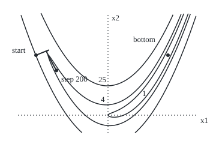
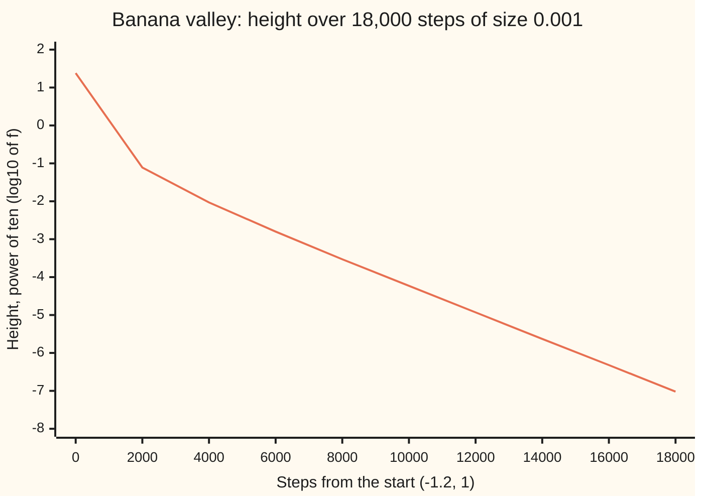

# Gradient descent: step downhill, and how the shape of the valley sets the pace

[Syllabus](../../../SYLLABUS.md) → [Optimization](../README.md) → [Unconstrained Methods](../README.md#s02) → Gradient descent

---

## General Overview

Choose two numbers, $x_1$ and $x_2$, to make one height as small as possible. The height is the Rosenbrock function, a standard test valley since 1960:

$$f(x_1, x_2) = (1 - x_1)^2 + 100\,(x_2 - x_1^2)^2.$$

This is a minimisation with no limits on the choice. Read $f$ as the height of the ground over a map. The second term is a steep wall, 100 times heavier than the first, and it is zero along the curve $x_2 = x_1^2$. So the ground forms a long, narrow valley bent like a banana. The first term tilts the valley floor gently down towards its lowest point, $(1, 1)$, where the height is 0.

Gradient descent ignores the map and feels only the slope underfoot. From the start $(-1.2, 1)$, height 24.2 and 2.2 map units from the bottom, it steps straight downhill 200 times. Each move is the slope times a fixed step size, 0.001, so steep ground gives long moves and flat ground short ones. The first step drops the height from 24.2 to 5.3529: it falls off the steep wall onto the valley floor. The other 199 steps only crawl along the floor, down to 3.4622. After all 200 the walk is still 1.8762 from the bottom. Run on, it needs 17,082 steps to come within 0.001 of $(1, 1)$.

Both halves of that story are theorems. If the step is below 2 over the steepest curvature, every step is guaranteed to go down. How fast it goes down is set by the gentlest curvature, and in a narrow valley the gentlest curvature is tiny.

**Gradient descent repeats one move, a fixed step against the gradient; a step under 2/L guarantees the height falls every time, and near the bottom the error shrinks by a fixed factor per step set by the flattest direction, so a long, narrow valley is slow.**

**What kind of fact this is:** a method, with three theorems proved on this card in Why it works: the descent guarantee, the bound on the gradient for any smooth function, and the fixed-factor rate under strong convexity. The answer $(1, 1)$ is certified: $f$ is a sum of two squares, so it is never below 0, and it equals 0 only at $(1, 1)$.

The applied wing already runs this walk on a regression and adds a noisy version ([Gradient descent](../../14-Applied%20and%20computational/06-Machine%20Learning%20Mathematics/02-gradient-descent-and-stochastic-gradient.md)). This card proves why it works and how fast.

### The picture: 200 steps on the banana

<p align="center"></p>

To scale: 100 px per unit on both axes, dotted lines at $x_1 = 0$ and $x_2 = 0$. The start is $(-1.2, 1)$, at height 24.2, just inside the height-25 contour. Step 1 lands at $(-0.9844, 1.0880)$ and step 2 bounces back to $(-1.0273, 1.0642)$: one zigzag across the floor. Step 200 is at $(-0.8590, 0.7459)$, just inside the height-4 contour. The bottom $(1, 1)$ sits inside the thin height-1 contour, on the far side.

---

## The formula

Notation first, in words. This card introduces $x_k$ for the point after $k$ steps (the **iterate**), $\alpha_k$ for the step size and $d_k$ for the direction of step $k$. Here the step size is fixed, written $\alpha$ (alpha), and the direction is $d_k = -\nabla f(x_k)$, minus the gradient ([Gradient](../../06-Calculus%20and%20analysis/07-Several%20Variables/03-gradient-and-directional-derivatives.md)). Counting starts at $k = 0$, the start point.

$$x_{k+1} = x_k - \alpha\,\nabla f(x_k)$$

**Read it aloud:** the next point is this point, moved a fixed fraction of the gradient's length straight downhill.

Two numbers describe the shape of the ground. The **curvature** along a direction is how fast the slope changes along it. At each point the largest and smallest curvatures are the eigenvalues $\lambda$ of the Hessian $\nabla^2 f$, the table of second derivatives ([Hessian](../../06-Calculus%20and%20analysis/07-Several%20Variables/05-hessian-and-second-order-approximation.md)). $L$ is the largest curvature anywhere the walk goes, called **smoothness**; $\mu$ (mu) is the smallest, called **strong convexity** when it is positive ([Convex functions](../01-Convexity/03-convex-functions-and-their-tests.md)). The length of the gradient is $\|\nabla f\|$.

The **descent guarantee**, for a step under $2/L$:

$$f(x_{k+1}) \le f(x_k) - \alpha\Bigl(1 - \frac{L\alpha}{2}\Bigr)\,\|\nabla f(x_k)\|^2$$

**Read it aloud:** each step lowers the height by at least the step size, times a safety factor, times the slope's length squared.

The **gradient bound**, for any $f$ that never goes below a number $f_{\text{low}}$, after $K$ steps:

$$\min_{0 \le k < K} \|\nabla f(x_k)\|^2 \le \frac{f(x_0) - f_{\text{low}}}{K\,\alpha\,(1 - L\alpha/2)}$$

**Read it aloud:** somewhere in the first $K$ steps the slope was small, and the guaranteed bound on its square shrinks like one over $K$.

The **linear rate**, when $\mu > 0$ and $x^*$ is the minimiser:

$$f(x_{k+1}) - f(x^*) \le \Bigl(1 - 2\mu\alpha\Bigl(1 - \frac{L\alpha}{2}\Bigr)\Bigr)\bigl(f(x_k) - f(x^*)\bigr)$$

**Read it aloud:** with curvature at least $\mu$ in every direction, the height still to lose shrinks by a fixed factor every step.

| Symbol | Plain meaning | In our example | Push it up and the answer… |
| --- | --- | --- | --- |
| $f$ | the height being minimised | 24.2 at the start, 0 at the bottom | — |
| $x = (x_1, x_2)$ | the two chosen numbers: a point on the map | the start $(-1.2, 1)$ | — |
| $x_k$, $k$, $K$ | the iterate after $k$ steps; the step count; how many steps the gradient bound counts | $x_{200} = (-0.8590, 0.7459)$; $K = 200$ | larger $K$, smaller guaranteed slope |
| $d_k$ | the direction of step $k$, here minus the gradient | $(215.6, 88)$ at the start | — |
| $\alpha$ | the step size | 0.001 | faster, until it passes $2/L$; then steps can climb |
| $\nabla f$, $\Vert\nabla f\Vert$ | the gradient (steepest climb) and its length | $(-215.6, -88)$; length squared 54227.36 | bigger guaranteed drop |
| $\nabla^2 f$, $\lambda$ | the Hessian; an eigenvalue of it, the largest or smallest curvature at a point | 1001.6006 and 0.3994 at the bottom | — |
| $L$ | the largest curvature where the walk goes | 1506.3670 on the path; 1001.6006 at the bottom | smaller safe step |
| $\mu$ | the smallest curvature, near the bottom | 0.3994 | faster final approach |
| $x^*$, $f(x^*)$ | the minimiser; its height | $(1, 1)$; 0 | — |
| $f_{\text{low}}$ | a floor the height never goes under | 0, since $f$ is a sum of squares | a tighter (smaller) gradient bound |
| $y$, $s$, $t$, $c$ | in the proof only: a second point; the move $y - x$; the fraction of the way along it; the safety constant $\alpha(1 - L\alpha/2)$ | $c = 0.001 \times 0.2468$ | larger $c$, faster guaranteed fall |

### When it holds

- **Curvature at most $L$ on the ground the walk covers.** The banana has no single $L$: its curvature grows like $1200 x_1^2$ far out. From $(-2, 2)$ the curvature is 4163.4745, the step 0.001 is above $2/L$ there, and the first step climbs from 409 to 505.8398.
- **A step under $2/L$.** On the path $2/L = 0.0013277$. At step 0.002 the guarantee is gone, and the first step climbs from 24.2 to 37.3449.
- **A floor under $f$.** The gradient bound needs only this floor, not a bowl. A height with no floor, such as a tilted plane, can fall for ever.
- **Positive curvature in every direction, for the linear rate.** The banana is not a bowl everywhere: above the floor its $x_1$-curvature $1200x_1^2 - 400x_2 + 2$ goes negative near $x_1 = 0$. The linear rate is a statement about the last stretch, near the bottom, where $\mu = 0.3994$.
- **The exact gradient.** A gradient estimated from a sample is noisy, and a fixed step then jitters around the bottom instead of settling: Stochastic gradient (planned).

---

## Why it works

### Step 0: the slope cannot change faster than L

Close up, the ground is nearly a tilted plane, and the plane says: step against the gradient by $\alpha$ and you drop by $\alpha\|\nabla f\|^2$. The plane is wrong because the ground curves. But if the curvature is at most $L$, the plane's error after a move is at most $\tfrac{L}{2}$ times the move's length squared. A move of length $\alpha\|\nabla f\|$ therefore drops at least $\alpha\|\nabla f\|^2 - \tfrac{L}{2}\alpha^2\|\nabla f\|^2$. That is positive exactly when $\alpha < 2/L$. Everything else on this card is that one inequality, added up or combined with a second one.

### Step 1: every step goes down

The inequality in Step 0 is the **descent lemma**, proved in the fold below. On the banana's path the steepest curvature, sampled at 11 points along every step, is $L = 1506.3670$, so the limit is $2/L = 0.0013277$ and the step 0.001 is under it. The safety factor is $1 - L\alpha/2 = 0.2468$.

At the start the gradient's length squared is 54227.36, so the promised drop for step 1 is $0.001 \times 0.2468 \times 54227.36 = 13.3842$. The actual drop is 18.8471. The check compares promise and drop at all 200 steps: the promise is kept 200 times out of 200. The promise is a floor, not a forecast.

### Step 2: the slope must get small, at a rate of one over K

Add the guarantee over $K$ steps. The drops add up to at most the total height available, $f(x_0) - f_{\text{low}}$, so the slopes squared, weighted by $\alpha(1 - L\alpha/2)$, add up to at most that too. The smallest of $K$ numbers is at most their average. That is the gradient bound, and it needs no bowl: it holds on any smooth ground with a floor.

On the banana, $f_{\text{low}} = 0$ and $K = 200$ give a bound of 490.2427 for the smallest slope squared. The walk's smallest is 3.1497. The bound is honest but loose, and it promises only a flat spot, not a minimum: a saddle or a ridge top is flat too.

### Step 3: strong convexity turns a small slope into a small error

On ground with curvature at least $\mu$ in every direction, a slope of length $\|\nabla f\|$ means the bottom is at most $\|\nabla f\|^2/(2\mu)$ below you. Turn that around: $\|\nabla f\|^2 \ge 2\mu\,(f(x) - f(x^*))$. Put it into the descent guarantee and each step removes at least the fraction $2\mu\alpha(1 - L\alpha/2)$ of the height still to lose. That is the linear rate: "linear" because the logarithm of the error falls in a straight line.

At the banana's bottom the curvatures are $L = 1001.6006$ and $\mu = 0.3994$. The theorem needs bounds that hold over the whole region the walk covers; taking these values from the bottom point alone, its factor per step is 0.999601. The walk, measured between steps 17,000 and 17,001, shrinks its height by 0.999201 per step: inside the bound.

<details>
<summary>Detailed proof: the descent lemma, the gradient bound and the linear rate</summary>

Suppose the gradient changes by at most $L$ times the distance moved: $\|\nabla f(y) - \nabla f(x)\| \le L\|y - x\|$ on a convex region holding the walk. For a twice-differentiable $f$ this is every curvature lying between $-L$ and $L$ there.

**Descent lemma.** Write $s = y - x$. By the fundamental theorem of calculus along the segment,

$$f(y) - f(x) - \nabla f(x)\cdot s = \int_0^1 \bigl(\nabla f(x + ts) - \nabla f(x)\bigr)\cdot s\,dt \le \int_0^1 L\,t\,\|s\|^2\,dt = \frac{L}{2}\|s\|^2,$$

using the Cauchy–Schwarz inequality inside the integral. Put $s = -\alpha\nabla f(x)$: then $f(y) \le f(x) - \alpha\|\nabla f(x)\|^2 + \frac{L\alpha^2}{2}\|\nabla f(x)\|^2$, which is the guarantee.

**Gradient bound.** Write $c = \alpha(1 - L\alpha/2) > 0$. Summing the guarantee for $k = 0, \dots, K-1$, the heights telescope: $c\sum_{k<K}\|\nabla f(x_k)\|^2 \le f(x_0) - f(x_K) \le f(x_0) - f_{\text{low}}$. The minimum of the $K$ terms is at most their mean, which gives the bound.

**Linear rate.** Strong convexity with $\mu > 0$ says $f(y) \ge f(x) + \nabla f(x)\cdot(y - x) + \frac{\mu}{2}\|y - x\|^2$ for all $x, y$. The right side is smallest at $y = x - \nabla f(x)/\mu$, where it equals $f(x) - \|\nabla f(x)\|^2/(2\mu)$. Taking $y = x^*$ on the left gives $f(x^*) \ge f(x) - \|\nabla f(x)\|^2/(2\mu)$, so $\|\nabla f(x)\|^2 \ge 2\mu\,(f(x) - f(x^*))$. Subtract $f(x^*)$ from both sides of the guarantee and use this:

$$f(x_{k+1}) - f(x^*) \le f(x_k) - f(x^*) - c\cdot 2\mu\,\bigl(f(x_k) - f(x^*)\bigr) = (1 - 2\mu c)\bigl(f(x_k) - f(x^*)\bigr).$$

At $\alpha = 1/L$ the factor is $1 - \mu/L$, the best this argument gives.

</details>

### Step 4: in a stretched bowl the factors are exact, and one of them zigzags

Near its bottom the banana is almost exactly a bowl: the quadratic model whose Hessian is $\nabla^2 f(1, 1)$, with rows 802, −400 and −400, 200. The check scans 3600 directions and finds the curvatures 1001.6005 and 0.3995, against 1001.6006 and 0.3994 from the formula. The steep direction runs across the valley floor; the gentle one runs along it.

In a bowl the gradient is the Hessian times the error $x - x^*$, so one step multiplies the error along each curvature direction by exactly $1 - \alpha\lambda$. Two things follow.

- **Across the floor**, $\lambda = 1001.6006$. If $\alpha\lambda > 1$, the factor is negative: the error flips side every step. That is the zigzag. It dies quickly when the factor is near 0 and lingers when it is near −1. Past $\alpha = 2/\lambda = 0.0019968$ it is below −1 and the zigzag grows.
- **Along the floor**, $\lambda = 0.3994$, and the factor $1 - 0.001 \times 0.3994 = 0.999601$ is almost 1. The height counts the error squared, so it shrinks by $0.999601^2 = 0.999201$ per step: the value the banana walk measured. A tenfold drop takes 2882 steps.

No fixed step helps much: the step must stay under $2/1001.6006$ for the across direction, so the along direction never gets a factor much below $1 - 2 \times 0.3994/1001.6006$. The ratio of the two curvatures, 2508.0 here, sets the pace; [Convergence rates](03-rates-of-convergence-and-conditioning.md) names it and measures its cost. [Newton and BFGS](05-newton-and-quasi-newton-bfgs.md) remove it by using the curvature itself.

---

## Worked numbers, by hand

The first step, then the pace at the bottom.

| Step | Arithmetic | Value |
| --- | --- | --- |
| height at the start | $(1 + 1.2)^2 + 100\,(1 - 1.44)^2 = 4.84 + 19.36$ | 24.2 |
| gradient at the start | $(-2 \times 2.2 - 400 \times (-1.2) \times (-0.44),\ 200 \times (-0.44))$ | $(-215.6, -88)$ |
| step 1 | $(-1.2 + 0.001 \times 215.6,\ 1 + 0.001 \times 88)$ | $(-0.9844, 1.0880)$, height 5.3529 |
| slope length squared | $215.6^2 + 88^2 = 46483.36 + 7744$ | 54227.36 |
| safety factor | $1 - 1506.3670 \times 0.001 / 2$ | 0.2468 |
| promised drop | $0.001 \times 0.2468 \times 54227.36$ | 13.3842, against 18.8471 actual |
| along-floor factor | $1 - 0.001 \times 0.3994$ | 0.999601 |
| height factor per step | $0.999601^2$ | 0.999201 |
| steps for a tenfold drop | $\ln 10 \div (-\ln 0.999201)$ | **2882 steps** |

Every 2882 steps buys one more correct digit of height, which is why 200 steps along the floor barely register and 17,082 are needed to come within 0.001.

### What breaks if you drop a piece

| Mistake | Comes out at | What went wrong |
| --- | --- | --- |
| Step 0.002, above $2/L = 0.0013277$ | height 37.3449 after step 1, up from 24.2 | The steep wall overshoots: the guarantee needs the step under $2/L$ |
| Start at $(-2, 2)$ with step 0.001 | height 505.8398 after step 1, up from 409 | Curvature there is 4163.4745: the banana's $L$ holds only on a region |
| Stepping with the gradient, not against it | height 56216.2293 after 3 steps | The gradient points uphill |
| Stopping when one step drops less than 0.01 | stops at step 3, still 2.0278 from the bottom | A slow floor looks like a finished walk |
| Step 0.0021 in the stretched bowl | across-floor error 24.4701 after 50 steps, from 0.1790 | Factor −1.1034: past $2/\lambda$ the zigzag grows |

---

## The zigzag, step by step

The puzzle: a bigger step should be faster. Across the valley it is, up to a point. Along the valley it barely matters. Which one decides the pace?

### One story: the across-floor error at step 0.0019

The stretched bowl, started at $(0.8, 1)$: 0.1790 across the floor and 0.0893 along it. Step 0.0019 gives an across factor of −0.9030.

| Step | 0 | 1 | 2 | 3 | 4 | 5 | 6 |
| --- | ---: | ---: | ---: | ---: | ---: | ---: | ---: |
| across-floor error | 0.1790 | −0.1616 | 0.1459 | −0.1318 | 0.1190 | −0.1075 | 0.0970 |

The sign flips every step: the walk bounces from wall to wall. After 50 steps the bounce is down to 0.0011, while the along-floor error has shrunk only by the factor 0.999241 per step.

### One force at a time: the step size, across the floor

How much of the across-floor error survives one step (the size of $1 - \alpha\lambda$):

```
step 0.001     ▏                                         0.0016
step 0.0015    ██████████████████▏                       0.5024
step 0.0019    ████████████████████████████████▊         0.9030
step 0.0021    ████████████████████████████████████████  1.1034  grows
```

On the banana itself the walk reverses direction once in 200 steps at step 0.001, 4 times at 0.0013 and 13 times at 0.0017. The bigger step zigzags more, since more of the across error survives each bounce.

### One force at a time: the step size, along the floor

At the same four steps the along-floor factors are 0.999601, 0.999401, 0.999241 and 0.999161. Doubling the step barely moves them, and the last step is already past the limit across the floor. The along direction sets the pace, and a bigger step cannot fix it.

### Both forces in one picture



The one line is the height of the banana walk, as a power of ten. The first drop is the jump onto the floor and the bend of the banana. After that the line is straight: about 0.7 of a power of ten per 2000 steps, which is the factor 0.999201 per step. A straight line on this scale is what "linear rate" means.

---

## Code, from first principles, and it actually runs

The code runs the walk on the banana and checks each claim by a second road: the gradient formula against central differences of the height; the closed-form curvatures against a scan of 3600 directions; the descent promise against the actual drop at every step; the predicted rate $(1 - \alpha\mu)^2$ against the ratio measured deep in the run; and the bowl's iteration against its closed form $(1 - \alpha\lambda)^{50}$. Five roads, plus the certificate that $f \ge 0$ with $f(1, 1) = 0$.

### Python

```python
# Gradient descent on the Rosenbrock banana, with the proofs' bounds checked.
# Standard library only: the gradient, the curvatures and the walk are written out.
import math

def f(x): return (1 - x[0])**2 + 100 * (x[1] - x[0]**2)**2
def grad(x): return [-2 * (1 - x[0]) - 400 * x[0] * (x[1] - x[0]**2), 200 * (x[1] - x[0]**2)]
def curv(x):   # the two curvatures (eigenvalues of the Hessian), largest first
    a, b, c = 1200 * x[0]**2 - 400 * x[1] + 2, -400 * x[0], 200.0
    m, r = (a + c) / 2, math.sqrt(((a - c) / 2)**2 + b * b)
    return m + r, m - r
def walk(x, alpha, steps, sign=1.0):   # x_{k+1} = x_k - alpha * grad f(x_k)
    path = [x]
    for _ in range(steps):
        g = grad(x)
        x = [x[0] - sign * alpha * g[0], x[1] - sign * alpha * g[1]]
        path.append(x)
    return path
def dist(x): return math.sqrt((x[0] - 1)**2 + (x[1] - 1)**2)
def reversals(p): return sum(1 for k in range(1, len(p) - 1) if (p[k][0] - p[k-1][0]) * (p[k+1][0] - p[k][0]) + (p[k][1] - p[k-1][1]) * (p[k+1][1] - p[k][1]) < 0)
def show(label, *v): print(f"{label:<44}" + " ".join(v))
F4 = lambda v: f"{v:.4f}".replace("-0.0000", "0.0000")

# ---- the valley and its certificate ----
x0, alpha, xs = [-1.2, 1.0], 0.001, [1.0, 1.0]
g0, h = grad(x0), 1e-6
cd = [(f([x0[0] + h, x0[1]]) - f([x0[0] - h, x0[1]])) / (2 * h), (f([x0[0], x0[1] + h]) - f([x0[0], x0[1] - h])) / (2 * h)]
show("start: height, gradient, distance", F4(f(x0)), F4(g0[0]), F4(g0[1]), F4(dist(x0)))
show("gradient by central differences", F4(cd[0]), F4(cd[1]))
L0, mu0 = curv(xs)
H = [[802.0, -400.0], [-400.0, 200.0]]   # Hessian at the bottom
scan = [H[0][0] * math.cos(t)**2 + 2 * H[0][1] * math.cos(t) * math.sin(t) + H[1][1] * math.sin(t)**2 for t in [i * math.pi / 3600 for i in range(3600)]]
show("bottom (1, 1): height, gradient", F4(f(xs)), F4(grad(xs)[0]), F4(grad(xs)[1]))
show("bottom curvatures: formula", F4(L0), F4(mu0))
show("bottom curvatures: 3600 directions scanned", F4(max(scan)), F4(min(scan)))
show("bottom: 1/L, 2/L, L/mu", f"{1 / L0:.7f}", f"{2 / L0:.7f}", f"{L0 / mu0:.1f}")

# ---- 200 steps at alpha = 0.001 ----
p = walk(x0, alpha, 200)
L = max(curv([p[k][0] + j / 10 * (p[k+1][0] - p[k][0]), p[k][1] + j / 10 * (p[k+1][1] - p[k][1])])[0] for k in range(200) for j in range(11))
gn = [grad(q)[0]**2 + grad(q)[1]**2 for q in p]
promise = [alpha * (1 - L * alpha / 2) * gn[k] for k in range(200)]
held = sum(1 for k in range(200) if f(p[k]) - f(p[k+1]) >= promise[k] > 0)
show("steepest curvature on the path L, 2/L", F4(L), f"{2 / L:.7f}")
show("step 1: point, height", F4(p[1][0]), F4(p[1][1]), F4(f(p[1])))
show("|grad|^2 at start, 1 - L alpha/2", F4(gn[0]), F4(1 - L * alpha / 2))
show("step 1: promised drop, actual drop", F4(promise[0]), F4(f(p[0]) - f(p[1])))
show("descent promise kept, of 200 steps", str(held))
show("height at steps 0 1 2 10 50 100 150 200", *[F4(f(p[k])) for k in (0, 1, 2, 10, 50, 100, 150, 200)])
show("step 200: point, distance to the bottom", F4(p[200][0]), F4(p[200][1]), F4(dist(p[200])))
bound = (f(x0) - 0.0) / (200 * alpha * (1 - L * alpha / 2))
show("smallest |grad|^2 in 200 steps, bound", F4(min(gn[:200])), F4(bound))
show("step reversals in 200 steps, step 0.001", str(reversals(p)))
show("step reversals, steps 0.0013 and 0.0017", str(reversals(walk(x0, 0.0013, 200))), str(reversals(walk(x0, 0.0017, 200))))

# ---- the long run, and the rate near the bottom ----
q, k, hit, logs = x0, 0, None, []
while k <= 18000:
    if k % 2000 == 0: logs.append(math.log10(f(q)))
    if hit is None and dist(q) < 1e-3: hit = k
    if k == 17000: fa = f(q)
    if k == 17001: fb = f(q)
    q, k = walk(q, alpha, 1)[1], k + 1
pred = (1 - alpha * mu0)**2
show("steps until within 0.001 of the bottom", str(hit))
show("log10 height every 2000 steps", *[f"{v:.2f}" for v in logs])
show("height ratio per step at 17000: measured", f"{fb / fa:.6f}")
show("predicted (1 - alpha mu)^2, proved bound", f"{pred:.6f}", f"{1 - 2 * mu0 * alpha * (1 - L0 * alpha / 2):.6f}")
show("steps for a tenfold drop", f"{math.log(10) / -math.log(pred):.0f}")

# ---- the stretched bowl: the banana's bottom, magnified ----
v = [(L0 - 200) / 400 * -1, 1.0]   # across direction (curvature L0), unnormalised
n = math.sqrt(v[0]**2 + v[1]**2); v = [v[0] / n, v[1] / n]; w = [-v[1], v[0]]   # w: along the floor
e0 = [-0.2, 0.0]   # start at (0.8, 1.0)
c0 = [e0[0] * v[0] + e0[1] * v[1], e0[0] * w[0] + e0[1] * w[1]]
show("bowl start: across, along", F4(c0[0]), F4(c0[1]))
for a in (0.001, 0.0015, 0.0019, 0.0021):
    e = e0
    for _ in range(50): e = [e[0] - a * (H[0][0] * e[0] + H[0][1] * e[1]), e[1] - a * (H[1][0] * e[0] + H[1][1] * e[1])]
    across = e[0] * v[0] + e[1] * v[1]
    assert abs(across - (1 - a * L0)**50 * c0[0]) < 1e-9 * max(1.0, abs(across))   # iteration = closed form
    show(f"step {a}: across, along, across at 50", F4(1 - a * L0), f"{1 - a * mu0:.6f}", F4(across))
show("step 0.0019: across error, steps 0 to 6", *[f"{(1 - 0.0019 * L0)**k * c0[0]:.4f}" for k in range(7)])

# ---- what breaks ----
show("step 0.002: height after step 1", F4(f(walk(x0, 0.002, 1)[1])))
show("far start (-2, 2): f, f after 1, L there", F4(f([-2.0, 2.0])), F4(f(walk([-2.0, 2.0], alpha, 1)[1])), F4(curv([-2.0, 2.0])[0]))
show("uphill sign: height after 3 steps", F4(f(walk(x0, alpha, 3, -1.0)[3])))
stop = next(k for k in range(1, 200) if f(p[k-1]) - f(p[k]) < 0.01)
show("stop when the drop < 0.01: step, distance", str(stop), F4(dist(p[stop])))
print("figure," + ",".join(f"{c:.4f}" for c in p[0] + p[1] + p[2] + p[200] + xs) + ",contours,25,4,1")

assert all(abs(g0[i] - cd[i]) < 1e-4 for i in range(2))                      # gradient formula vs differences
assert abs(max(scan) - L0) < 1e-3 and abs(min(scan) - mu0) < 1e-3              # curvature formula vs scan
assert held == 200 and min(gn[:200]) <= bound                                  # descent lemma and its sum
assert abs(fb / fa - pred) < 1e-5 and fb / fa <= 1 - 2 * mu0 * alpha * (1 - L0 * alpha / 2)   # the rate
assert hit is not None and dist(p[200]) > 1                                    # reaches the bottom; still far at 200
print("ALL CHECKS PASS")
```

**Ran 2026-11-11 on macOS, Python 3.14.10, standard library only. All checks passed. Output, pasted from the run:**

```
start: height, gradient, distance           24.2000 -215.6000 -88.0000 2.2000
gradient by central differences             -215.6000 -88.0000
bottom (1, 1): height, gradient             0.0000 0.0000 0.0000
bottom curvatures: formula                  1001.6006 0.3994
bottom curvatures: 3600 directions scanned  1001.6005 0.3995
bottom: 1/L, 2/L, L/mu                      0.0009984 0.0019968 2508.0
steepest curvature on the path L, 2/L       1506.3670 0.0013277
step 1: point, height                       -0.9844 1.0880 5.3529
|grad|^2 at start, 1 - L alpha/2            54227.3600 0.2468
step 1: promised drop, actual drop          13.3842 18.8471
descent promise kept, of 200 steps          200
height at steps 0 1 2 10 50 100 150 200     24.2000 5.3529 4.1178 4.0925 3.9649 3.8019 3.6345 3.4622
step 200: point, distance to the bottom     -0.8590 0.7459 1.8762
smallest |grad|^2 in 200 steps, bound       3.1497 490.2427
step reversals in 200 steps, step 0.001     1
step reversals, steps 0.0013 and 0.0017     4 13
steps until within 0.001 of the bottom      17082
log10 height every 2000 steps               1.38 -1.11 -2.03 -2.80 -3.53 -4.23 -4.93 -5.63 -6.32 -7.02
height ratio per step at 17000: measured    0.999201
predicted (1 - alpha mu)^2, proved bound    0.999201 0.999601
steps for a tenfold drop                    2882
bowl start: across, along                   0.1790 0.0893
step 0.001: across, along, across at 50     -0.0016 0.999601 0.0000
step 0.0015: across, along, across at 50    -0.5024 0.999401 0.0000
step 0.0019: across, along, across at 50    -0.9030 0.999241 0.0011
step 0.0021: across, along, across at 50    -1.1034 0.999161 24.4701
step 0.0019: across error, steps 0 to 6     0.1790 -0.1616 0.1459 -0.1318 0.1190 -0.1075 0.0970
step 0.002: height after step 1             37.3449
far start (-2, 2): f, f after 1, L there    409.0000 505.8398 4163.4745
uphill sign: height after 3 steps           56216.2293
stop when the drop < 0.01: step, distance   3 2.0278
figure,-1.2000,1.0000,-0.9844,1.0880,-1.0273,1.0642,-0.8590,0.7459,1.0000,1.0000,contours,25,4,1
ALL CHECKS PASS
```

### Rust

```rust
// Gradient descent on the Rosenbrock banana, with the proofs' bounds checked.
// std only: the gradient, the curvatures and the walk are written out.
type P = [f64; 2];

fn f(x: P) -> f64 { (1.0 - x[0]).powi(2) + 100.0 * (x[1] - x[0].powi(2)).powi(2) }
fn grad(x: P) -> P { [-2.0 * (1.0 - x[0]) - 400.0 * x[0] * (x[1] - x[0].powi(2)), 200.0 * (x[1] - x[0].powi(2))] }
fn curv(x: P) -> (f64, f64) { // the two curvatures (eigenvalues of the Hessian), largest first
    let (a, b, c) = (1200.0 * x[0].powi(2) - 400.0 * x[1] + 2.0, -400.0 * x[0], 200.0);
    let (m, r) = ((a + c) / 2.0, (((a - c) / 2.0).powi(2) + b * b).sqrt());
    (m + r, m - r)
}
fn walk(mut x: P, alpha: f64, steps: usize, sign: f64) -> Vec<P> { // x_{k+1} = x_k - alpha * grad f(x_k)
    let mut path = vec![x];
    for _ in 0..steps {
        let g = grad(x);
        x = [x[0] - sign * alpha * g[0], x[1] - sign * alpha * g[1]];
        path.push(x);
    }
    path
}
fn dist(x: P) -> f64 { ((x[0] - 1.0).powi(2) + (x[1] - 1.0).powi(2)).sqrt() }
fn reversals(p: &[P]) -> usize {
    (1..p.len() - 1).filter(|&k| (p[k][0] - p[k - 1][0]) * (p[k + 1][0] - p[k][0]) + (p[k][1] - p[k - 1][1]) * (p[k + 1][1] - p[k][1]) < 0.0).count()
}
fn show(label: &str, v: &[String]) { println!("{:<44}{}", label, v.join(" ")); }
fn f4(v: f64) -> String { format!("{:.4}", v).replace("-0.0000", "0.0000") }

fn main() {
    // ---- the valley and its certificate ----
    let (x0, alpha, xs): (P, f64, P) = ([-1.2, 1.0], 0.001, [1.0, 1.0]);
    let (g0, h) = (grad(x0), 1e-6);
    let cd = [(f([x0[0] + h, x0[1]]) - f([x0[0] - h, x0[1]])) / (2.0 * h), (f([x0[0], x0[1] + h]) - f([x0[0], x0[1] - h])) / (2.0 * h)];
    show("start: height, gradient, distance", &[f4(f(x0)), f4(g0[0]), f4(g0[1]), f4(dist(x0))]);
    show("gradient by central differences", &[f4(cd[0]), f4(cd[1])]);
    let (l0, mu0) = curv(xs);
    let hm = [[802.0, -400.0], [-400.0, 200.0]]; // Hessian at the bottom
    let scan: Vec<f64> = (0..3600).map(|i| i as f64 * std::f64::consts::PI / 3600.0)
        .map(|t| hm[0][0] * t.cos().powi(2) + 2.0 * hm[0][1] * t.cos() * t.sin() + hm[1][1] * t.sin().powi(2)).collect();
    let (smax, smin) = (scan.iter().cloned().fold(f64::MIN, f64::max), scan.iter().cloned().fold(f64::MAX, f64::min));
    show("bottom (1, 1): height, gradient", &[f4(f(xs)), f4(grad(xs)[0]), f4(grad(xs)[1])]);
    show("bottom curvatures: formula", &[f4(l0), f4(mu0)]);
    show("bottom curvatures: 3600 directions scanned", &[f4(smax), f4(smin)]);
    show("bottom: 1/L, 2/L, L/mu", &[format!("{:.7}", 1.0 / l0), format!("{:.7}", 2.0 / l0), format!("{:.1}", l0 / mu0)]);

    // ---- 200 steps at alpha = 0.001 ----
    let p = walk(x0, alpha, 200, 1.0);
    let mut l = f64::MIN;
    for k in 0..200 {
        for j in 0..11 {
            let t = j as f64 / 10.0;
            l = l.max(curv([p[k][0] + t * (p[k + 1][0] - p[k][0]), p[k][1] + t * (p[k + 1][1] - p[k][1])]).0);
        }
    }
    let gn: Vec<f64> = p.iter().map(|&q| grad(q)[0].powi(2) + grad(q)[1].powi(2)).collect();
    let promise: Vec<f64> = (0..200).map(|k| alpha * (1.0 - l * alpha / 2.0) * gn[k]).collect();
    let held = (0..200).filter(|&k| f(p[k]) - f(p[k + 1]) >= promise[k] && promise[k] > 0.0).count();
    show("steepest curvature on the path L, 2/L", &[f4(l), format!("{:.7}", 2.0 / l)]);
    show("step 1: point, height", &[f4(p[1][0]), f4(p[1][1]), f4(f(p[1]))]);
    show("|grad|^2 at start, 1 - L alpha/2", &[f4(gn[0]), f4(1.0 - l * alpha / 2.0)]);
    show("step 1: promised drop, actual drop", &[f4(promise[0]), f4(f(p[0]) - f(p[1]))]);
    show("descent promise kept, of 200 steps", &[held.to_string()]);
    show("height at steps 0 1 2 10 50 100 150 200", &[0, 1, 2, 10, 50, 100, 150, 200].iter().map(|&k| f4(f(p[k]))).collect::<Vec<_>>());
    show("step 200: point, distance to the bottom", &[f4(p[200][0]), f4(p[200][1]), f4(dist(p[200]))]);
    let bound = (f(x0) - 0.0) / (200.0 * alpha * (1.0 - l * alpha / 2.0));
    let gmin = gn[..200].iter().cloned().fold(f64::MAX, f64::min);
    show("smallest |grad|^2 in 200 steps, bound", &[f4(gmin), f4(bound)]);
    show("step reversals in 200 steps, step 0.001", &[reversals(&p).to_string()]);
    show("step reversals, steps 0.0013 and 0.0017", &[reversals(&walk(x0, 0.0013, 200, 1.0)).to_string(), reversals(&walk(x0, 0.0017, 200, 1.0)).to_string()]);

    // ---- the long run, and the rate near the bottom ----
    let (mut q, mut hit, mut logs, mut fa, mut fb) = (x0, None, vec![], 0.0, 0.0);
    for k in 0..=18000usize {
        if k % 2000 == 0 { logs.push(format!("{:.2}", f(q).log10())); }
        if hit.is_none() && dist(q) < 1e-3 { hit = Some(k); }
        if k == 17000 { fa = f(q); }
        if k == 17001 { fb = f(q); }
        q = walk(q, alpha, 1, 1.0)[1];
    }
    let pred = (1.0 - alpha * mu0).powi(2);
    let proved = 1.0 - 2.0 * mu0 * alpha * (1.0 - l0 * alpha / 2.0);
    show("steps until within 0.001 of the bottom", &[hit.unwrap().to_string()]);
    show("log10 height every 2000 steps", &logs);
    show("height ratio per step at 17000: measured", &[format!("{:.6}", fb / fa)]);
    show("predicted (1 - alpha mu)^2, proved bound", &[format!("{:.6}", pred), format!("{:.6}", proved)]);
    show("steps for a tenfold drop", &[format!("{:.0}", 10f64.ln() / -pred.ln())]);

    // ---- the stretched bowl: the banana's bottom, magnified ----
    let v0 = [(l0 - 200.0) / 400.0 * -1.0, 1.0]; // across direction (curvature l0), unnormalised
    let n = (v0[0].powi(2) + v0[1].powi(2)).sqrt();
    let v = [v0[0] / n, v0[1] / n];
    let w = [-v[1], v[0]]; // along the floor
    let e0 = [-0.2, 0.0]; // start at (0.8, 1.0)
    let c0 = [e0[0] * v[0] + e0[1] * v[1], e0[0] * w[0] + e0[1] * w[1]];
    show("bowl start: across, along", &[f4(c0[0]), f4(c0[1])]);
    for a in [0.001, 0.0015, 0.0019, 0.0021] {
        let mut e = e0;
        for _ in 0..50 { e = [e[0] - a * (hm[0][0] * e[0] + hm[0][1] * e[1]), e[1] - a * (hm[1][0] * e[0] + hm[1][1] * e[1])]; }
        let across = e[0] * v[0] + e[1] * v[1];
        assert!((across - (1.0 - a * l0).powi(50) * c0[0]).abs() < 1e-9 * across.abs().max(1.0)); // iteration = closed form
        show(&format!("step {}: across, along, across at 50", a), &[f4(1.0 - a * l0), format!("{:.6}", 1.0 - a * mu0), f4(across)]);
    }
    show("step 0.0019: across error, steps 0 to 6", &(0..7).map(|k| format!("{:.4}", (1.0 - 0.0019 * l0).powi(k) * c0[0])).collect::<Vec<_>>());

    // ---- what breaks ----
    show("step 0.002: height after step 1", &[f4(f(walk(x0, 0.002, 1, 1.0)[1]))]);
    show("far start (-2, 2): f, f after 1, L there", &[f4(f([-2.0, 2.0])), f4(f(walk([-2.0, 2.0], alpha, 1, 1.0)[1])), f4(curv([-2.0, 2.0]).0)]);
    show("uphill sign: height after 3 steps", &[f4(f(walk(x0, alpha, 3, -1.0)[3]))]);
    let stop = (1..200).find(|&k| f(p[k - 1]) - f(p[k]) < 0.01).unwrap();
    show("stop when the drop < 0.01: step, distance", &[stop.to_string(), f4(dist(p[stop]))]);
    let fig: Vec<String> = [p[0], p[1], p[2], p[200], xs].iter().flat_map(|c| c.iter().map(|v| format!("{:.4}", v))).collect();
    println!("figure,{},contours,25,4,1", fig.join(","));

    assert!((0..2).all(|i| (g0[i] - cd[i]).abs() < 1e-4)); // gradient formula vs differences
    assert!((smax - l0).abs() < 1e-3 && (smin - mu0).abs() < 1e-3); // curvature formula vs scan
    assert!(held == 200 && gmin <= bound); // descent lemma and its sum
    assert!((fb / fa - pred).abs() < 1e-5 && fb / fa <= proved); // the rate
    assert!(hit.is_some() && dist(p[200]) > 1.0); // reaches the bottom; still far at 200
    println!("ALL CHECKS PASS");
}
```

**Ran 2026-11-11 on macOS, rustc 1.98.1, no crates. All checks passed. Output, pasted from the run:**

```
start: height, gradient, distance           24.2000 -215.6000 -88.0000 2.2000
gradient by central differences             -215.6000 -88.0000
bottom (1, 1): height, gradient             0.0000 0.0000 0.0000
bottom curvatures: formula                  1001.6006 0.3994
bottom curvatures: 3600 directions scanned  1001.6005 0.3995
bottom: 1/L, 2/L, L/mu                      0.0009984 0.0019968 2508.0
steepest curvature on the path L, 2/L       1506.3670 0.0013277
step 1: point, height                       -0.9844 1.0880 5.3529
|grad|^2 at start, 1 - L alpha/2            54227.3600 0.2468
step 1: promised drop, actual drop          13.3842 18.8471
descent promise kept, of 200 steps          200
height at steps 0 1 2 10 50 100 150 200     24.2000 5.3529 4.1178 4.0925 3.9649 3.8019 3.6345 3.4622
step 200: point, distance to the bottom     -0.8590 0.7459 1.8762
smallest |grad|^2 in 200 steps, bound       3.1497 490.2427
step reversals in 200 steps, step 0.001     1
step reversals, steps 0.0013 and 0.0017     4 13
steps until within 0.001 of the bottom      17082
log10 height every 2000 steps               1.38 -1.11 -2.03 -2.80 -3.53 -4.23 -4.93 -5.63 -6.32 -7.02
height ratio per step at 17000: measured    0.999201
predicted (1 - alpha mu)^2, proved bound    0.999201 0.999601
steps for a tenfold drop                    2882
bowl start: across, along                   0.1790 0.0893
step 0.001: across, along, across at 50     -0.0016 0.999601 0.0000
step 0.0015: across, along, across at 50    -0.5024 0.999401 0.0000
step 0.0019: across, along, across at 50    -0.9030 0.999241 0.0011
step 0.0021: across, along, across at 50    -1.1034 0.999161 24.4701
step 0.0019: across error, steps 0 to 6     0.1790 -0.1616 0.1459 -0.1318 0.1190 -0.1075 0.0970
step 0.002: height after step 1             37.3449
far start (-2, 2): f, f after 1, L there    409.0000 505.8398 4163.4745
uphill sign: height after 3 steps           56216.2293
stop when the drop < 0.01: step, distance   3 2.0278
figure,-1.2000,1.0000,-0.9844,1.0880,-1.0273,1.0642,-0.8590,0.7459,1.0000,1.0000,contours,25,4,1
ALL CHECKS PASS
```

The two outputs match line for line.

> [!TIP]
> **Try changing**
> Guess first, then run it. The asserts are pinned to the step 0.001 and the start $(-1.2, 1)$, so a change may stop the program.
> - **Guess first: does step 0.002 still go down every time?** In the line that sets `x0, alpha, xs`, set `alpha` to `0.002`. No: the first step climbs to 37.3449. The step is above $2/L = 0.0013277$, so no step carries a promise, the count of kept promises falls to 0, and its assert stops the program.
> - **Guess first: does a far start matter?** Set `x0` to `[-2.0, 2.0]`. The steepest curvature on the path becomes 4163.4745, the first step climbs from 409 to 505.8398, and the same assert stops it.
> - **Guess first: does a bigger step zigzag more?** Read the reversal line first: 1 reversal at 0.001, 4 at 0.0013, 13 at 0.0017. Then set `alpha` to `0.0017`. The walk still goes down, but 0.0017 is above 0.0013277, so the theorem promises nothing: the count falls to 0 and the assert stops it.

---

## The usual mistake

> [!warning]
> **Reading a slow walk as a finished one.** Step 3 lowers the banana's height by less than 0.01. A stop rule on that halts at step 3, still 2.0278 from the bottom. The walk has not arrived. It is crawling along a flat floor at a factor of 0.999201 per step. Stop on the gradient's length, or on a certificate, and quote the start, the test and its tolerance: here, 17,082 steps from $(-1.2, 1)$ to within 0.001.
>
> - **Taking $L$ from the bottom only.** There $2/L = 0.0019968$, but on the path the steepest curvature is 1506.3670 and the limit is 0.0013277. Step 0.002 climbs to 37.3449 on step 1.
> - **Quoting the linear rate from the start.** The rate needs positive curvature everywhere the walk goes. The banana has it only near the bottom; in the first 200 steps the height fell from 24.2 to 3.4622 by no fixed factor.
> - **Raising the step to beat the crawl.** The along-floor factor moves from 0.999601 to 0.999161 as the step doubles, while the across-floor factor reaches −1.1034 and the zigzag grows.

---

## Where you meet it in real life

- **Fitting models to data.** Training a statistical or machine-learning model is gradient descent on an average loss, usually with a noisy gradient; the applied wing runs it on 20,000 orders ([Gradient descent](../../14-Applied%20and%20computational/06-Machine%20Learning%20Mathematics/02-gradient-descent-and-stochastic-gradient.md)).
- **Echo cancellers.** The least-mean-squares filter takes one gradient step per sound sample, and its safe step is the same 2 over the steepest curvature ([Wiener and LMS](../../13-Engineering%20mathematics/05-Signals/07-adaptive-and-optimal-filters.md)).
- **Medical scanners.** Iterative reconstruction in CT scanning can be run as gradient descent on the mismatch between measured and predicted X-ray readings; a badly stretched problem needs many more passes.
- **Testing optimisers.** The banana valley is the standard first test for any new minimisation method because it punishes exactly the weakness on this card: a narrow, curved floor.

> **Say it back**
> Gradient descent steps a fixed amount against the gradient, again and again. If the step is under 2 over the steepest curvature, the height falls at every step, by at least a guaranteed amount. Adding those drops proves that the slope must get small, at a rate of one over the number of steps. Where the curvature is at least μ in every direction, the height still to lose shrinks by a fixed factor per step. In a stretched valley the steep direction caps the step and the flat direction sets the pace, so the walk zigzags across and crawls along.

---

## What this builds on

- [Optimality conditions](01-optimality-conditions.md): a flat slope and upward curvature at $(1, 1)$, the target this walk is aiming for.
- [Gradient](../../06-Calculus%20and%20analysis/07-Several%20Variables/03-gradient-and-directional-derivatives.md): why minus the gradient is the steepest way down.
- [Gradient descent](../../14-Applied%20and%20computational/06-Machine%20Learning%20Mathematics/02-gradient-descent-and-stochastic-gradient.md): the same walk run on a regression, with the step limit on a quadratic loss and the noisy version.

## Where this goes next

- [Convergence rates](03-rates-of-convergence-and-conditioning.md): linear, superlinear and quadratic rates, and what the curvature ratio 2508.0 costs.
- [Line search](04-line-search-armijo-and-wolfe.md): choosing each step $\alpha_k$ as the walk goes, with no $L$ known in advance.
- [Stochastic gradient](../06-Conic%2C%20Quadratic%20and%20Stochastic%20Programs/08-stochastic-gradient-and-sample-average-approximation.md): the same step, followed by a shrink, for costs with a corner.
- [Stochastic gradient](../06-Conic%2C%20Quadratic%20and%20Stochastic%20Programs/08-stochastic-gradient-and-sample-average-approximation.md): the noisy gradient, and the shrinking steps that make it settle.
- [Optimality conditions](01-optimality-conditions.md): stepping downhill on a curved surface instead of a flat map.

What, other than the curvature itself, could let a method stop zigzagging across the floor and run along it?

---

## Sources

Verified 2026-11-11: every link below resolves to the publisher's page.

- Rosenbrock, H. H. "An Automatic Method for Finding the Greatest or Least Value of a Function." *The Computer Journal* 3, no. 3 (1960): 175–184. [doi:10.1093/comjnl/3.3.175](https://doi.org/10.1093/comjnl/3.3.175). The paper that introduced the banana valley as a test.
- Polyak, B. T. "Gradient Methods for the Minimisation of Functionals." *USSR Computational Mathematics and Mathematical Physics* 3, no. 4 (1963): 864–878. [doi:10.1016/0041-5553(63)90382-3](https://doi.org/10.1016/0041-5553(63)90382-3). The inequality between slope and remaining height used in Step 3, and the linear rate it gives.
- Nesterov, Yurii. *Introductory Lectures on Convex Optimization: A Basic Course.* Springer, 2004. [doi:10.1007/978-1-4419-8853-9](https://doi.org/10.1007/978-1-4419-8853-9). The descent lemma and the rates of gradient methods under smoothness and strong convexity, proved in full.
- Nocedal, Jorge, and Stephen J. Wright. *Numerical Optimization.* 2nd ed. Springer, 2006. [doi:10.1007/978-0-387-40065-5](https://doi.org/10.1007/978-0-387-40065-5). Steepest descent, its zigzag in stretched valleys, and the role of the curvature ratio.
- Boyd, Stephen, and Lieven Vandenberghe. *Convex Optimization.* Cambridge University Press, 2004. [doi:10.1017/CBO9780511804441](https://doi.org/10.1017/CBO9780511804441). The gradient method's analysis with curvature bounds, and its slow progress on badly stretched problems.
