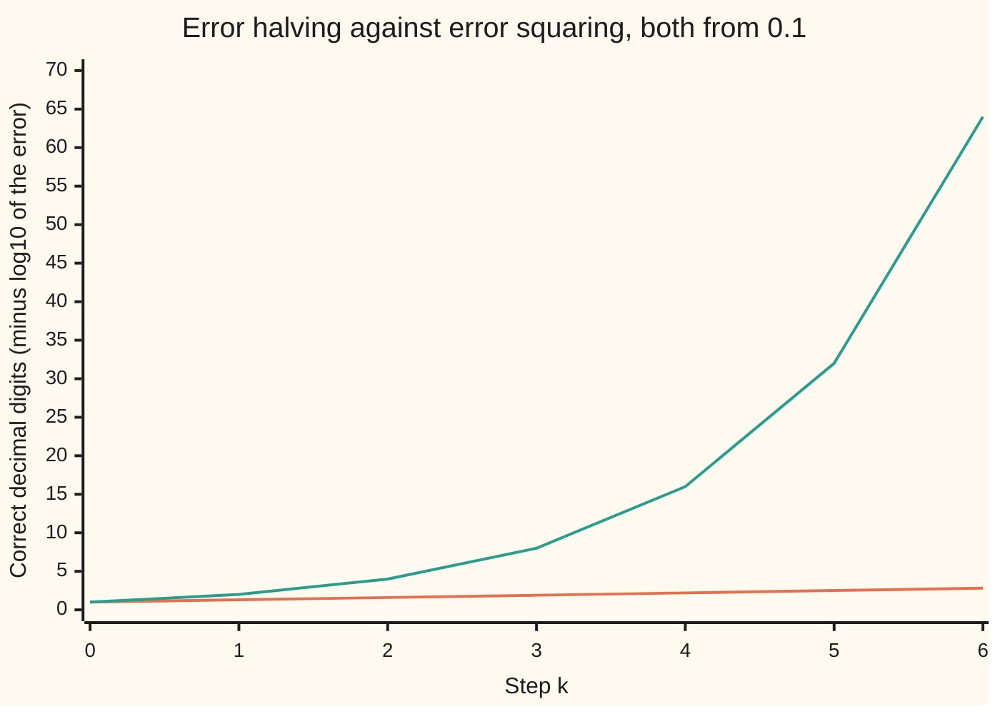

# Convergence rates: linear, superlinear, quadratic, and what stretch costs you

[Syllabus](../../../SYLLABUS.md) → [Optimization](../README.md) → [Unconstrained Methods](../README.md#s02) → Convergence rates

---

## General Overview

Two methods hunt for the same answer, and both start 0.1 away from it. The first halves its error every step. The second squares it. After one step they are close: 0.05 against 0.01. After four steps the first is at 0.00625 and the second at 0.0000000000000001, which is 1 in 10^16. To get within 10^−12, twelve correct decimal places, the halver needs 37 steps and the squarer needs 4.

That gap is what a **rate of convergence** measures: how each step's error compares with the one before. Halving adds the same small amount of accuracy every step, 0.301 decimal digits. Squaring doubles the number of correct digits every step: 1, 2, 4, 8, 16.

The same split shows up in a real search. The Rosenbrock valley is a long, curved, narrow trough whose lowest point is at (1, 1). Gradient descent (step downhill by a fixed multiple of the slope) starts at (−1.2, 1) and needs 34,429 steps to come within 10^−6 of the bottom. Newton's method (fit a bowl to the local curvature and jump to its bottom) needs 6. Both methods **minimise** the same height. The difference is the shape of the valley: it is 2508 times more sharply curved across than along, and that ratio, the **condition number**, sets gradient descent's pace.

**A method's rate is how its next error compares with this one: a fixed fraction (linear), a fraction that shrinks to zero (superlinear), or a multiple of the square (quadratic); for gradient descent with step 1/L, one over the sharpest curvature, the fixed fraction is 1 − 1/κ, where κ is the valley's stretch, so each extra correct digit costs about 2.3 κ steps.**

**What kind of fact this is:** the three rates are definitions. Two theorems are proved on this card in Why it works: gradient descent's rate on a bowl is set by κ, and Newton's error near an ordinary minimum shrinks like its square (proved here in one variable; the several-variable case is cited in Step 4). The Rosenbrock step counts are measurements, printed by the code.

### The picture: correct digits, step by step



The lower, nearly flat line is halving: it climbs 0.301 digits a step, a straight line. The upper line is squaring: it doubles the digits every step, from 1 to 64 in six steps. A straight line on this chart is a linear rate. A line that bends upward is faster than linear.

---

## The formula

Notation first, in words. The iterate $x_k$ is the method's guess after $k$ steps, counting from $k = 0$ at the start, and $x^*$ is the minimiser, the point being hunted (as in [Gradient descent](02-gradient-descent-and-its-rate.md)). The **error** $e_k = \|x_k - x^*\|$ is the straight-line distance from the guess to the answer.

$$\lim_{k\to\infty}\frac{e_{k+1}}{e_k} = c \;\text{ with } 0 < c < 1 \;\text{(linear)}, \qquad \frac{e_{k+1}}{e_k} \to 0 \;\text{(superlinear)}, \qquad \frac{e_{k+1}}{e_k^{\,2}} \to M \;\text{(quadratic)}$$

**Read it aloud:** linear means each error is eventually the same fraction $c$ of the last; superlinear means that fraction shrinks to nothing; quadratic means each error is a fixed multiple $M$ of the last one squared.

More generally a method has **order** $p$ when $e_{k+1} \approx M\,e_k^{\,p}$: order 1 with $M = c$ is linear, order 2 is quadratic, and anything above 1 is superlinear. The order can be read off any three errors in a row:

$$p_k = \frac{\ln(e_{k+1}/e_k)}{\ln(e_k/e_{k-1})}$$

The second formula is the job of the card. Near the minimiser the height is a bowl. Call its sharpest curvature $L$ and its gentlest $\mu$ (the largest and smallest eigenvalues of the Hessian $\nabla^2 f$, the matrix of second derivatives). The **condition number** is introduced here as their ratio, the bowl's stretch (this κ is not the κ used in the differential-equations and finance wings):

$$\kappa = \frac{L}{\mu}, \qquad c_{\text{GD}} = 1 - \frac{1}{\kappa}, \qquad \text{steps per decimal digit} = \frac{\ln 10}{-\ln(1 - 1/\kappa)} \approx 2.303\,\kappa$$

**Read it aloud:** with step $1/L$, gradient descent keeps the fraction $1 - 1/\kappa$ of its error each step, so every extra correct digit costs about 2.3 times the stretch in steps.

| Symbol | Plain meaning | In our example | Push it up and the answer… |
| --- | --- | --- | --- |
| $f$, $x_1$, $x_2$, $b$ | the valley's height $(1 - x_1)^2 + b\,(x_2 - x_1^2)^2$ over the point $(x_1, x_2)$; $b$ sets how steep the walls are | $b = 100$ | steeper walls, larger $\kappa$, slower descent |
| $x_k$, $k$ | the guess after $k$ steps; $k$ counts from 0 | $x_0 = (-1.2, 1)$ | — |
| $x^*$ | the minimiser, the lowest point | $(1, 1)$, height 0 | — |
| $e_k$, $\epsilon_k$, $v_k$ | the error: distance from $x_k$ to $x^*$; in the proofs, its signed value on a line and its vector $x_k - x^*$ | $e_0 = 2.20$ | — |
| $c$ | the linear rate: the fraction of the error kept each step | 0.5 for halving, 0.999601 for gradient descent | closer to 1, more steps per digit |
| $M$ | the quadratic constant | 1.4963 for Newton on the slice $x_2 = 1$ | larger errors next step, same doubling of digits |
| $p$, $p_k$ | the order, and its estimate from three errors in a row | 1, 1.618, 2 | higher order, digits multiply faster |
| $\nabla^2 f$, $A$, $I$ | the Hessian, the matrix of second derivatives; $A$ the bowl's matrix in the proof; $I$ the identity matrix | `[[802, -400], [-400, 200]]` at $(1, 1)$ | — |
| $\lambda_i$, $u_i$, $a_i$, $n$, $L$, $\mu$ | curvatures (eigenvalues) along the eigen-directions $u_i$, with $a_i$ the start's share along each and $n$ the number of variables; $L$ the largest curvature, $\mu$ the smallest | $L = 1001.6006$, $\mu = 0.399361$ | — |
| $\kappa$ | the condition number $L/\mu$: how stretched the bowl is | 2508.01 | linear rate creeps toward 1 |
| $\alpha$ | the step size in gradient descent | $1/L = 0.000998$ | above $2/L$ the descent blows up |
| $h$, $\xi$, $\varphi$ | the height along the slice $x_2 = 1$; a point between guess and answer in Taylor's theorem; the golden ratio, the secant method's order | $h(x_1) = f(x_1, 1)$; $\varphi = 1.618$ | — |

### When it holds

- **The rate is a statement about the end of the run.** Early errors follow no pattern. Gradient descent's error goes from 2.20 only to 1.12 in its first 1000 steps while it slides into the trough, and Newton's error rises from 2.20 to 4.18 before it falls. Rates measured there mean nothing (What breaks shows one: an order of 168.8).
- **For $c = 1 - 1/\kappa$: the bottom is a genuine bowl, $\mu > 0$, and the step is $1/L$.** With $\mu = 0$ the bottom is flat in some direction, $\kappa$ is infinite and the linear rate is lost. With a step above $2/L$ the across-valley error grows and the run diverges ([Gradient descent](02-gradient-descent-and-its-rate.md) shows it).
- **$L$ and $\mu$ are taken at the minimiser.** The valley's curvature changes along the path, so $\kappa$ predicts only the final phase. There it is sharp: 17,320 steps measured from error 10^−3 to 10^−6, against 17,321 predicted.
- **For Newton's quadratic rate: the Hessian at $x^*$ is invertible.** On the flat-bottomed $f(x) = x^4$ it is zero, and Newton keeps exactly 0.666667 of its error each step: linear, 35 steps to 10^−6.
- **The errors stay well above rounding.** Computer arithmetic keeps a limited number of digits. Once the errors approach that floor, ratios of errors are noise, so the code stops the order estimates at 10^−9.

---

## Why it works

### Step 0: near the answer, every method multiplies its error

Any method is a rule that turns one guess into the next, a map with the minimiser as its fixed point. [Fixed points of a map](../../08-Differential%20equations%20and%20dynamics/11-Discrete%20Dynamics%20and%20Chaos/02-fixed-points-of-a-map.md) shows that near a fixed point the gap is multiplied by the map's slope there, and that Newton's map has slope zero at its root. Everything on this card follows from that one fact. A slope of size $c$ between 0 and 1 gives a linear rate with that $c$. A slope of zero lets the next term of the Taylor expansion, the square, take over: a quadratic rate.

### Step 1: what each rate does to the digits

The number of correct decimal digits is $-\log_{10} e_k$. Take logs of each definition.

Linear, $e_{k+1} = c\,e_k$: the digits go up by $-\log_{10} c$ each step, a fixed amount. Halving gains $-\log_{10} 0.5 = 0.301$ digits a step, so it needs about 3.3 steps per digit. From 0.1 to below 10^−12 is 11 more digits, and 11 / 0.301 rounded up is 37 steps.

Quadratic, $e_{k+1} = e_k^2$: the digits double, $-\log_{10} e_{k+1} = 2\,(-\log_{10} e_k)$. From 1 digit, four doublings reach 16 digits, past the 12 needed: 4 steps. A constant $M$ only shifts each step's digit count by $\log_{10} M$; once $M e_k < 1$ the doubling wins.

Superlinear sits between. The digits gained per step keep growing, but they need not double.

### Step 2: reading the order from the errors

Suppose $e_{k+1} = M\,e_k^{\,p}$. Divide this by the same equation one step earlier, $e_k = M\,e_{k-1}^{\,p}$. The unknown $M$ cancels and $e_{k+1}/e_k = (e_k/e_{k-1})^{p}$. Take logs and divide: that is $p_k$ in The formula. It needs no knowledge of the answer's constants, only three errors in a row.

For halving every $p_k$ is exactly 1.000. For squaring every $p_k$ is exactly 2.000. For a real method the estimates settle as the run goes on. On the slice $x_2 = 1$ of the valley, Newton's method gives 1.817, 1.970, 1.999, and the secant method (Newton with the second derivative replaced by the slope through the last two guesses) gives 2.172, 1.350, 1.689, 1.585, 1.630, swinging in toward $\varphi = 1.618$.

### Step 3: gradient descent pays for the stretch

[Gradient descent](02-gradient-descent-and-its-rate.md) shows that in a bowl one step of size $\alpha$ multiplies the error along each eigen-direction of the Hessian by $1 - \alpha\lambda_i$. Read that with the condition number in mind.

The step has to suit the sharpest direction: past $2/L$ the across-valley factor exceeds 1 in size and the run blows up. The natural choice is $\alpha = 1/L$. Then the sharp direction's factor is $1 - L/L = 0$: that error dies in one step. The gentle direction's factor is $1 - \mu/L = 1 - 1/\kappa$, and it is the worst of all. After the fast errors are gone, only that one is left, so the error ratio settles on $1 - 1/\kappa$.

Each digit takes $\ln 10 / (-\ln(1 - 1/\kappa))$ steps. For a large $\kappa$, $-\ln(1 - 1/\kappa)$ is very close to $1/\kappa$, so the cost is about $\ln 10 \times \kappa = 2.303\,\kappa$ steps per digit. It grows in step with the stretch:

```text
steps per decimal digit, step 1/L
kappa 2      #                                            3.3
kappa 10     #                                           21.9
kappa 100    ##                                         229.1
kappa 1000   ################                          2301.4
kappa 2508   ########################################  5773.8
```

No fixed step does much better. The best one makes the two extreme factors equal in size, $1 - \alpha\mu = -(1 - \alpha L)$, which gives $\alpha = 2/(L + \mu)$ and the rate $(\kappa - 1)/(\kappa + 1)$. For our valley that is 0.999203, or 2887 steps per digit: half the cost, still proportional to $\kappa$.

<details>
<summary>Detailed proof: the error ratio of gradient descent on a bowl tends to 1 − 1/κ</summary>

Take the bowl $f(x) = f(x^*) + \tfrac12 (x - x^*)^{T} A\,(x - x^*)$ with $A$ symmetric and positive definite ([Quadratic forms](../../03-Algebra/07-Eigenvalues%20and%20Symmetric%20Matrices/05-quadratic-forms-and-positive-definite.md)). Its gradient is $A(x - x^*)$, so with $v_k = x_k - x^*$ one step gives $v_{k+1} = (I - \alpha A)\,v_k$.

Write $v_0 = \sum_i a_i u_i$ in the orthonormal eigenvectors $u_i$ of $A$, with eigenvalues $\mu = \lambda_1 \le \dots \le \lambda_n = L$. Then $v_k = \sum_i a_i (1 - \alpha\lambda_i)^k u_i$ and, by Pythagoras, $e_k^2 = \sum_i a_i^2 (1 - \alpha\lambda_i)^{2k}$.

With $\alpha = 1/L$ every factor $1 - \lambda_i/L$ lies in $[0, 1 - 1/\kappa]$. So $e_{k+1} \le (1 - 1/\kappa)\,e_k$ at every step, from any start: the bound is a theorem, not just a limit. If $a_1 \ne 0$ and $\mu$ is a simple eigenvalue, the term with the largest factor dominates as $k$ grows and $e_{k+1}/e_k \to 1 - 1/\kappa$ exactly.

**Sketch, not a full proof, for a general f.** For a general smooth $f$ with an invertible Hessian at $x^*$, Taylor's theorem gives $\nabla f(x) = \nabla^2 f(x^*)(x - x^*) + O(\|x - x^*\|^2)$, where $O(\|x - x^*\|^2)$ is a remainder no bigger than a fixed multiple of the squared distance. Near the end the step is the bowl's step plus an error of smaller size, and the same limit holds with $A = \nabla^2 f(x^*)$. This is why the Rosenbrock run's last ratio is the bowl's 0.999601.

</details>

### Step 4: Newton squares its error

On one variable, Newton's step to a minimum is $x_{k+1} = x_k - h'(x_k)/h''(x_k)$: it fits a parabola with the right slope and curvature and jumps to its lowest point. Expand the slope around the answer, where $h'(x^*) = 0$. Writing $\epsilon_k = x_k - x^*$, the signed error,

$$0 = h'(x^*) = h'(x_k) - h''(x_k)\,\epsilon_k + \tfrac12 h'''(\xi)\,\epsilon_k^2$$

for some $\xi$ between $x_k$ and $x^*$. Divide by $h''(x_k)$ and rearrange:

$$\epsilon_{k+1} = \epsilon_k - \frac{h'(x_k)}{h''(x_k)} = \frac{h'''(\xi)}{2\,h''(x_k)}\,\epsilon_k^2 \quad\Rightarrow\quad \frac{e_{k+1}}{e_k^2} \to M = \left|\frac{h'''(x^*)}{2\,h''(x^*)}\right|$$

On the valley's slice $x_2 = 1$, $h'(x_1) = 400x_1^3 - 398x_1 - 2$, with second derivative 802 and third derivative 2400 at $x_1 = 1$. So $M = 2400/(2 \times 802) = 1.4963$. Newton from 1.2 measures 1.0226, 1.3664, 1.4883, 1.4962: the prediction, arrived at from below.

The proof divides by $h''$. When $h''(x^*) = 0$, as for $x^4$, Newton's step is $x - 4x^3/(12x^2) = \tfrac23 x$: the slope of the map is $\tfrac23$, not 0, and Step 0 says linear. In several variables the same argument runs with the Hessian in place of $h''$; it needs the Hessian invertible at $x^*$ (Nocedal and Wright, chapter 3, in Sources).

### Step 5: between the two

The secant method uses a slope through the last two guesses instead of the true second derivative. Its error obeys $e_{k+1} \approx M\,e_k\,e_{k-1}$. Trying $e_{k+1} = M e_k^{\,p}$ in that gives $p^2 = p + 1$, so $p = \varphi = 1.618$: superlinear, not quadratic. This is stated here, not proved; Ortega and Rheinboldt prove it (Sources). Quasi-Newton methods such as BFGS are superlinear in the same sense ([Newton and BFGS](05-newton-and-quasi-newton-bfgs.md)): they get the curvature right in the limit, not on the first step.

---

## Worked numbers, by hand

The prediction for gradient descent at the bottom of the Rosenbrock valley, $b = 100$, step $1/L$.

| Step | Arithmetic | Value |
| --- | --- | --- |
| Hessian at $(1, 1)$ | second derivatives: $2 - 400 \times 0 + 800$, then $-400 \times 1$, then $2 \times 100$ | 802, −400, 200 |
| mean of the diagonal | $(802 + 200)/2$ | 501 |
| half the gap | $(802 - 200)/2$ | 301 |
| radius | $\sqrt{301^2 + 400^2}$ | 500.6006 |
| sharpest curvature $L$ | $501 + 500.6006$ | 1001.6006 |
| gentlest curvature $\mu$ | $501 - 500.6006$ | 0.399361 |
| condition number $\kappa$ | $1001.6006 / 0.399361$ | 2508.01 |
| linear rate $c$ | $1 - 1/2508.01$ | 0.999601 |
| steps per digit | $\ln 10 \div (-\ln(1 - 1/2508.01))$ | 5774 |
| steps from $10^{-3}$ to $10^{-6}$ | $3 \times 5773.8$ | **17,321 predicted; 17,320 measured** |

At the bottom of this valley every extra correct digit costs gradient descent about 5774 steps, and the run confirms it to within one step; Newton needs 6 steps for the whole trip. [Gradient descent](02-gradient-descent-and-its-rate.md) quotes about half as many steps per digit because it counts digits of height, and height near the bottom is about the error squared; this card counts digits of distance.

The eigenvalues come from the 2-by-2 rule: for a symmetric 2-by-2 matrix they are the mean of the two diagonal entries plus or minus $\sqrt{(\text{half the gap})^2 + (\text{off-diagonal entry})^2}$.

### What breaks if you drop a piece

| Mistake | Comes out at | What went wrong |
| --- | --- | --- |
| Treat the valley as round, $\kappa = 1$ | 1 step | Real run: 34,429 steps. A step of $1/L$ finishes a round bowl at once; the stretch is the whole cost. |
| Use $L$ alone as the stretch, forgetting to divide by $\mu$ | 2305 steps per digit | True cost 5774. $\mu = 0.399361$ is below 1, so dividing by it raises $\kappa$ to 2508.01. |
| Expect Newton to be quadratic at a flat bottom, $f(x) = x^4$ | ratio 0.666667, 35 steps to $10^{-6}$ | The Hessian is zero at the minimum. Newton's map has slope $\tfrac23$ there, not 0, so the rate is linear. |
| Read the order from Newton's first steps on the valley | $p_1 = 168.8$ | The errors 2.20, 2.21, 4.18 are far from the answer, where no rate applies. |

---

## Code, from first principles, and it actually runs

The code runs the two model errors, then gradient descent and Newton on the Rosenbrock valley, then Newton and the secant method on its slice $x_2 = 1$. It takes three independent roads. The rate predicted from $\kappa$, with the eigenvalues found both by the closed form and by power iteration (repeatedly multiplying a vector by the Hessian), is checked against the ratio gradient descent actually measures. Newton's constant $M$ predicted from derivatives is checked against the measured $e_{k+1}/e_k^2$. And orders read from error sequences are checked against the known 1, $\varphi$ and 2. Speed is counted in steps, never in clock time.

### Python

```python
# Convergence rates -- the check behind the card.  Standard library only.
# Part 1: an error that halves each step against one that squares, from 0.1.
# Part 2: the Rosenbrock valley f = (1 - x1)^2 + b (x2 - x1^2)^2, b = 100, written
# with x = x1, y = x2 below, minimised at (1, 1).  Roads: the rate predicted from the condition number
# against the rate measured from gradient descent's own errors; Newton's
# constant predicted from derivatives against the measured one; orders
# measured from error sequences against the known 1, phi and 2.
import math

def sci(v):  # 3 significant figures, same text in Python and Rust
    e = math.floor(math.log10(v)); m = v / 10 ** e
    if m >= 9.995: m, e = m / 10, e + 1
    return f"{m:.2f}e{e}"

def order(es, i):  # p estimated from three successive errors
    return math.log(es[i + 1] / es[i]) / math.log(es[i] / es[i - 1])

def model(step, e0, tol):  # run an error map until the error drops below tol
    es = [e0]
    while es[-1] >= tol: es.append(step(es[-1]))
    return es

# ---- 1. halving against squaring ----
half, sq = model(lambda e: e / 2, 0.1, 1e-12), model(lambda e: e * e, 0.1, 1e-12)
print("chart, halving digits", " ".join(f"{-math.log10(0.1 / 2 ** k):.2f}" for k in range(7)))
print("chart, squaring digits", " ".join(f"{-math.log10(0.1) * 2 ** k:.0f}" for k in range(7)))
print(f"after 1 step: halving {sci(half[1])}, squaring {sci(sq[1])}; after 4: halving {sci(half[4])}, squaring {sci(sq[4])}")
print(f"digits gained per step by halving {-math.log10(0.5):.3f}")
print(f"steps to error < 1e-12: halving {len(half) - 1}, squaring {len(sq) - 1}")
assert len(half) - 1 == math.ceil(math.log2(0.1 / 1e-12))   # 0.1 / 2^k < 1e-12
assert len(sq) - 1 == math.ceil(math.log2(12))             # 10^-(2^k) < 1e-12
print(f"order estimates: halving {order(half, 5):.3f}, squaring {order(sq, 2):.3f}")
assert abs(order(half, 5) - 1) < 1e-9
assert abs(order(sq, 2) - 2) < 1e-9

# ---- 2. the condition number at the bottom of the valley ----
def grad(x, y, b=100): return (-2 * (1 - x) - 4 * b * x * (y - x * x), 2 * b * (y - x * x))
def hess(x, y, b=100): return (2 - 4 * b * (y - x * x) + 8 * b * x * x, -4 * b * x, 2.0 * b)
def dist(x, y): return math.sqrt((x - 1) * (x - 1) + (y - 1) * (y - 1))
def eig(b):  # closed form for a symmetric 2x2: mean of the diagonal plus or minus a radius
    p, q, r = hess(1, 1, b); m, h = (p + r) / 2, (p - r) / 2
    rad = math.sqrt(h * h + q * q)
    return m + rad, m - rad
L, mu = eig(100); kap = L / mu
p, q, r = hess(1, 1); v = (1.0, 0.0)
for _ in range(60):  # power iteration: an independent road to L
    w = (p * v[0] + q * v[1], q * v[0] + r * v[1]); n = math.sqrt(w[0] * w[0] + w[1] * w[1]); v = (w[0] / n, w[1] / n)
Lpow = v[0] * (p * v[0] + q * v[1]) + v[1] * (q * v[0] + r * v[1])
print(f"Hessian at (1, 1): {p:.0f} {q:.0f} {r:.0f}; L {L:.4f} (power iteration {Lpow:.4f}), mu {mu:.6f}")
assert abs(Lpow - L) < 1e-6
assert abs((p - mu) * (r - mu) - q * q) < 1e-6              # mu really is an eigenvalue
print(f"by hand: mean {(p + r) / 2:.0f}, half-gap {(p - r) / 2:.0f}, radius {L - (p + r) / 2:.4f}; step 1/L {1 / L:.6f}; ln 10 {math.log(10):.3f}")
rate, best = 1 - 1 / kap, (kap - 1) / (kap + 1)
spd = lambda c: math.log(10) / -math.log(c)                 # steps per decimal digit
print(f"kappa {kap:.2f}; predicted rate 1 - 1/kappa {rate:.6f}, {spd(rate):.0f} steps per digit")
print(f"best fixed step 2/(L + mu): rate {best:.6f}, {spd(best):.0f} steps per digit")

def gd(x, y, tol, b=100, best=False):  # fixed step 1/L (or 2/(L + mu)); error = distance to (1, 1)
    Lb, mb = eig(b); a = 2 / (Lb + mb) if best else 1 / Lb; es = [dist(x, y)]
    while es[-1] >= tol:
        g = grad(x, y, b); x, y = x - a * g[0], y - a * g[1]
        es.append(dist(x, y))
    return es
es = gd(-1.2, 1.0, 1e-6)
print(f"GD from (-1.2, 1): {len(es) - 1} steps to error < 1e-6; last ratio {es[-1] / es[-2]:.6f}")
print("GD error at k = 0, 1000, 10000, 20000, 30000:", " ".join(sci(es[k]) for k in (0, 1000, 10000, 20000, 30000)))
k3, k6 = next(k for k, e in enumerate(es) if e < 1e-3), len(es) - 1
print(f"steps from 1e-3 to 1e-6: measured {k6 - k3}, predicted {3 * spd(rate):.0f}")
assert abs(es[-1] / es[-2] - rate) < 1e-6                   # measured rate = condition-number rate
assert abs((k6 - k3) / (3 * spd(rate)) - 1) < 0.01

def newton(x, y, tol):
    es = [dist(x, y)]
    while es[-1] >= tol:
        g = grad(x, y); a, c, d = hess(x, y); det = a * d - c * c
        x, y = x - (d * g[0] - c * g[1]) / det, y - (a * g[1] - c * g[0]) / det
        es.append(dist(x, y))
    return es
ne = newton(-1.2, 1.0, 1e-6)
print(f"Newton from (-1.2, 1): {len(ne) - 1} steps; errors", " ".join(sci(e) for e in ne))

# ---- 3. measuring the order on the valley's slice y = 1: h'(x) = 400x^3 - 398x - 2 ----
dh, d2h, d3h = (lambda x: 400 * x * x * x - 398 * x - 2), (lambda x: 1200 * x * x - 398), (lambda x: 2400 * x)
x, nt = 1.2, [0.2]
while nt[-1] > 1e-9: x = x - dh(x) / d2h(x); nt.append(abs(x - 1))
x0, x1, se = 1.2, 1.1, [0.2, 0.1]
while se[-1] > 1e-9: x0, x1 = x1, x1 - dh(x1) * (x1 - x0) / (dh(x1) - dh(x0)); se.append(abs(x1 - 1))
M = d3h(1) / (2 * d2h(1))
print("slice Newton errors", " ".join(sci(e) for e in nt), "| secant", " ".join(sci(e) for e in se))
print("Newton e(k+1)/e(k)^2:", " ".join(f"{nt[i + 1] / (nt[i] * nt[i]):.4f}" for i in range(len(nt) - 1)), f"| predicted {M:.4f}")
print("order estimates: Newton", " ".join(f"{order(nt, i):.3f}" for i in range(1, len(nt) - 1)),
      "| secant", " ".join(f"{order(se, i):.3f}" for i in range(1, len(se) - 1)))
assert abs(nt[-1] / (nt[-2] * nt[-2]) - M) < 0.01
assert abs(order(nt, len(nt) - 2) - 2) < 0.05
assert abs(order(se, len(se) - 2) - (1 + math.sqrt(5)) / 2) < 0.05
print(f"golden ratio phi {(1 + math.sqrt(5)) / 2:.3f}; slice second derivative {d2h(1):.0f}, third {d3h(1):.0f}")

# ---- what breaks ----
x4 = model(lambda e: e - 4 * e * e * e / (12 * e * e), 1.0, 1e-6)   # Newton on x^4: flat bottom
rx, ry, rk = -1.2, 1.0, 0   # GD, step 1/L, on a round bowl (L/2)|x - (1, 1)|^2, where kappa = 1
while dist(rx, ry) >= 1e-6: rx, ry, rk = rx - L * (rx - 1) / L, ry - L * (ry - 1) / L, rk + 1
print(f"round-valley guess {rk} step, real {len(es) - 1}; kappa from L alone: {spd(1 - 1 / L):.0f} steps per digit")
print(f"Newton on x^4: ratio {x4[1] / x4[0]:.6f}, {len(x4) - 1} steps to 1e-6; early order estimate {order(ne, 1):.1f}")
assert abs(x4[1] / x4[0] - 2 / 3) < 1e-12
assert len(x4) - 1 == math.ceil(6 * math.log(10) / math.log(1.5))

# ---- try changing ----
b1 = eig(1); g1 = gd(-1.2, 1.0, 1e-6, b=1)
print(f"b = 1: kappa {b1[0] / b1[1]:.2f}, GD {len(g1) - 1} steps; tol 1e-9: GD {len(gd(-1.2, 1.0, 1e-9)) - 1}, Newton {len(newton(-1.2, 1.0, 1e-9)) - 1}")
print(f"step 2/(L + mu): GD {len(gd(-1.2, 1.0, 1e-6, best=True)) - 1} steps")
print("bars, steps per digit:", " ".join(f"kappa {c}: {spd(1 - 1 / c):.1f}" for c in (2, 10, 100, 1000)), f"kappa {kap:.0f}: {spd(rate):.1f}")
print("ALL CHECKS PASS")
```

**Ran 2026-11-11 on macOS, Python 3.14.10, standard library only. All checks passed. Output, pasted from the run:**

```text
chart, halving digits 1.00 1.30 1.60 1.90 2.20 2.51 2.81
chart, squaring digits 1 2 4 8 16 32 64
after 1 step: halving 5.00e-2, squaring 1.00e-2; after 4: halving 6.25e-3, squaring 1.00e-16
digits gained per step by halving 0.301
steps to error < 1e-12: halving 37, squaring 4
order estimates: halving 1.000, squaring 2.000
Hessian at (1, 1): 802 -400 200; L 1001.6006 (power iteration 1001.6006), mu 0.399361
by hand: mean 501, half-gap 301, radius 500.6006; step 1/L 0.000998; ln 10 2.303
kappa 2508.01; predicted rate 1 - 1/kappa 0.999601, 5774 steps per digit
best fixed step 2/(L + mu): rate 0.999203, 2887 steps per digit
GD from (-1.2, 1): 34429 steps to error < 1e-6; last ratio 0.999601
GD error at k = 0, 1000, 10000, 20000, 30000: 2.20e0 1.12e0 1.72e-2 3.16e-4 5.85e-6
steps from 1e-3 to 1e-6: measured 17320, predicted 17321
Newton from (-1.2, 1): 6 steps; errors 2.20e0 2.21e0 4.18e0 4.80e-1 5.60e-2 9.62e-6 1.85e-11
slice Newton errors 2.00e-1 4.09e-2 2.29e-3 7.78e-6 9.05e-11 | secant 2.00e-1 1.00e-1 2.22e-2 2.91e-3 9.37e-5 4.06e-7 5.69e-11
Newton e(k+1)/e(k)^2: 1.0226 1.3664 1.4883 1.4962 | predicted 1.4963
order estimates: Newton 1.817 1.970 1.999 | secant 2.172 1.350 1.689 1.585 1.630
golden ratio phi 1.618; slice second derivative 802, third 2400
round-valley guess 1 step, real 34429; kappa from L alone: 2305 steps per digit
Newton on x^4: ratio 0.666667, 35 steps to 1e-6; early order estimate 168.8
b = 1: kappa 33.97, GD 453 steps; tol 1e-9: GD 51750, Newton 6
step 2/(L + mu): GD 17179 steps
bars, steps per digit: kappa 2: 3.3 kappa 10: 21.9 kappa 100: 229.1 kappa 1000: 2301.4 kappa 2508: 5773.8
ALL CHECKS PASS
```

### Rust

```rust
// Convergence rates -- the check behind the card.  No crates.
// Part 1: an error that halves each step against one that squares, from 0.1.
// Part 2: the Rosenbrock valley f = (1 - x1)^2 + b (x2 - x1^2)^2, b = 100, written
// with x = x1, y = x2 below, minimised at (1, 1).  Same roads as the Python: condition-number rate against
// measured rate, Newton's predicted constant against measured, measured orders.

fn sci(v: f64) -> String { // 3 significant figures, same text in Python and Rust
    let mut e = v.log10().floor() as i32;
    let mut m = v / 10f64.powf(e as f64);
    if m >= 9.995 { m /= 10.0; e += 1; }
    format!("{:.2}e{}", m, e)
}
fn order(es: &[f64], i: usize) -> f64 { (es[i + 1] / es[i]).ln() / (es[i] / es[i - 1]).ln() }
fn model(step: impl Fn(f64) -> f64, e0: f64, tol: f64) -> Vec<f64> {
    let mut es = vec![e0];
    while *es.last().unwrap() >= tol { let e = step(*es.last().unwrap()); es.push(e); }
    es
}
fn grad(x: f64, y: f64, b: f64) -> (f64, f64) { (-2.0 * (1.0 - x) - 4.0 * b * x * (y - x * x), 2.0 * b * (y - x * x)) }
fn hess(x: f64, y: f64, b: f64) -> (f64, f64, f64) { (2.0 - 4.0 * b * (y - x * x) + 8.0 * b * x * x, -4.0 * b * x, 2.0 * b) }
fn dist(x: f64, y: f64) -> f64 { ((x - 1.0) * (x - 1.0) + (y - 1.0) * (y - 1.0)).sqrt() }
fn eig(b: f64) -> (f64, f64) {
    let (p, q, r) = hess(1.0, 1.0, b);
    let (m, h) = ((p + r) / 2.0, (p - r) / 2.0);
    let rad = (h * h + q * q).sqrt();
    (m + rad, m - rad)
}
fn spd(c: f64) -> f64 { 10f64.ln() / -c.ln() } // steps per decimal digit
fn gd(mut x: f64, mut y: f64, tol: f64, b: f64, best: bool) -> Vec<f64> {
    let (lb, mb) = eig(b);
    let a = if best { 2.0 / (lb + mb) } else { 1.0 / lb };
    let mut es = vec![dist(x, y)];
    while *es.last().unwrap() >= tol {
        let g = grad(x, y, b);
        x -= a * g.0; y -= a * g.1;
        es.push(dist(x, y));
    }
    es
}
fn newton(mut x: f64, mut y: f64, tol: f64) -> Vec<f64> {
    let mut es = vec![dist(x, y)];
    while *es.last().unwrap() >= tol {
        let g = grad(x, y, 100.0);
        let (a, c, d) = hess(x, y, 100.0);
        let det = a * d - c * c;
        let (nx, ny) = (x - (d * g.0 - c * g.1) / det, y - (a * g.1 - c * g.0) / det);
        x = nx; y = ny;
        es.push(dist(x, y));
    }
    es
}
fn join(v: &[String]) -> String { v.join(" ") }

fn main() {
    // ---- 1. halving against squaring ----
    let half = model(|e| e / 2.0, 0.1, 1e-12);
    let sq = model(|e| e * e, 0.1, 1e-12);
    println!("chart, halving digits {}", join(&(0..7).map(|k| format!("{:.2}", -(0.1 / 2f64.powi(k)).log10())).collect::<Vec<_>>()));
    println!("chart, squaring digits {}", join(&(0..7).map(|k| format!("{:.0}", -(0.1f64).log10() * 2f64.powi(k))).collect::<Vec<_>>()));
    println!("after 1 step: halving {}, squaring {}; after 4: halving {}, squaring {}", sci(half[1]), sci(sq[1]), sci(half[4]), sci(sq[4]));
    println!("digits gained per step by halving {:.3}", -(0.5f64).log10());
    println!("steps to error < 1e-12: halving {}, squaring {}", half.len() - 1, sq.len() - 1);
    assert!(half.len() - 1 == (0.1f64 / 1e-12).log2().ceil() as usize);
    assert!(sq.len() - 1 == 12f64.log2().ceil() as usize);
    println!("order estimates: halving {:.3}, squaring {:.3}", order(&half, 5), order(&sq, 2));
    assert!((order(&half, 5) - 1.0).abs() < 1e-9);
    assert!((order(&sq, 2) - 2.0).abs() < 1e-9);

    // ---- 2. the condition number at the bottom of the valley ----
    let (l, mu) = eig(100.0);
    let kap = l / mu;
    let (p, q, r) = hess(1.0, 1.0, 100.0);
    let mut v = (1.0, 0.0);
    for _ in 0..60 { // power iteration: an independent road to L
        let w = (p * v.0 + q * v.1, q * v.0 + r * v.1);
        let n = (w.0 * w.0 + w.1 * w.1).sqrt();
        v = (w.0 / n, w.1 / n);
    }
    let lpow = v.0 * (p * v.0 + q * v.1) + v.1 * (q * v.0 + r * v.1);
    println!("Hessian at (1, 1): {:.0} {:.0} {:.0}; L {:.4} (power iteration {:.4}), mu {:.6}", p, q, r, l, lpow, mu);
    assert!((lpow - l).abs() < 1e-6);
    assert!(((p - mu) * (r - mu) - q * q).abs() < 1e-6);
    println!("by hand: mean {:.0}, half-gap {:.0}, radius {:.4}; step 1/L {:.6}; ln 10 {:.3}", (p + r) / 2.0, (p - r) / 2.0, l - (p + r) / 2.0, 1.0 / l, 10f64.ln());
    let (rate, best) = (1.0 - 1.0 / kap, (kap - 1.0) / (kap + 1.0));
    println!("kappa {:.2}; predicted rate 1 - 1/kappa {:.6}, {:.0} steps per digit", kap, rate, spd(rate));
    println!("best fixed step 2/(L + mu): rate {:.6}, {:.0} steps per digit", best, spd(best));
    let es = gd(-1.2, 1.0, 1e-6, 100.0, false);
    let n = es.len();
    println!("GD from (-1.2, 1): {} steps to error < 1e-6; last ratio {:.6}", n - 1, es[n - 1] / es[n - 2]);
    println!("GD error at k = 0, 1000, 10000, 20000, 30000: {}", join(&[0, 1000, 10000, 20000, 30000].iter().map(|&k| sci(es[k])).collect::<Vec<_>>()));
    let k3 = es.iter().position(|&e| e < 1e-3).unwrap();
    let k6 = n - 1;
    println!("steps from 1e-3 to 1e-6: measured {}, predicted {:.0}", k6 - k3, 3.0 * spd(rate));
    assert!((es[n - 1] / es[n - 2] - rate).abs() < 1e-6);
    assert!(((k6 - k3) as f64 / (3.0 * spd(rate)) - 1.0).abs() < 0.01);
    let ne = newton(-1.2, 1.0, 1e-6);
    println!("Newton from (-1.2, 1): {} steps; errors {}", ne.len() - 1, join(&ne.iter().map(|&e| sci(e)).collect::<Vec<_>>()));

    // ---- 3. measuring the order on the valley's slice y = 1: h'(x) = 400x^3 - 398x - 2 ----
    let dh = |x: f64| 400.0 * x * x * x - 398.0 * x - 2.0;
    let d2h = |x: f64| 1200.0 * x * x - 398.0;
    let d3h = |x: f64| 2400.0 * x;
    let (mut x, mut nt) = (1.2, vec![0.2]);
    while *nt.last().unwrap() > 1e-9 { x = x - dh(x) / d2h(x); nt.push((x - 1.0f64).abs()); }
    let (mut x0, mut x1, mut se) = (1.2, 1.1, vec![0.2, 0.1]);
    while *se.last().unwrap() > 1e-9 {
        let x2 = x1 - dh(x1) * (x1 - x0) / (dh(x1) - dh(x0));
        x0 = x1; x1 = x2; se.push((x1 - 1.0f64).abs());
    }
    let m = d3h(1.0) / (2.0 * d2h(1.0));
    println!("slice Newton errors {} | secant {}", join(&nt.iter().map(|&e| sci(e)).collect::<Vec<_>>()), join(&se.iter().map(|&e| sci(e)).collect::<Vec<_>>()));
    println!("Newton e(k+1)/e(k)^2: {} | predicted {:.4}", join(&(0..nt.len() - 1).map(|i| format!("{:.4}", nt[i + 1] / (nt[i] * nt[i]))).collect::<Vec<_>>()), m);
    println!("order estimates: Newton {} | secant {}", join(&(1..nt.len() - 1).map(|i| format!("{:.3}", order(&nt, i))).collect::<Vec<_>>()),
             join(&(1..se.len() - 1).map(|i| format!("{:.3}", order(&se, i))).collect::<Vec<_>>()));
    let (a, b) = (nt.len(), se.len());
    assert!((nt[a - 1] / (nt[a - 2] * nt[a - 2]) - m).abs() < 0.01);
    assert!((order(&nt, a - 2) - 2.0).abs() < 0.05);
    assert!((order(&se, b - 2) - (1.0 + 5f64.sqrt()) / 2.0).abs() < 0.05);
    println!("golden ratio phi {:.3}; slice second derivative {:.0}, third {:.0}", (1.0 + 5f64.sqrt()) / 2.0, d2h(1.0), d3h(1.0));

    // ---- what breaks ----
    let x4 = model(|e| e - 4.0 * e * e * e / (12.0 * e * e), 1.0, 1e-6); // Newton on x^4: flat bottom
    let (mut rx, mut ry, mut rk) = (-1.2f64, 1.0f64, 0); // GD, step 1/L, on a round bowl (L/2)|x - (1, 1)|^2, where kappa = 1
    while dist(rx, ry) >= 1e-6 { rx -= l * (rx - 1.0) / l; ry -= l * (ry - 1.0) / l; rk += 1; }
    println!("round-valley guess {} step, real {}; kappa from L alone: {:.0} steps per digit", rk, n - 1, spd(1.0 - 1.0 / l));
    println!("Newton on x^4: ratio {:.6}, {} steps to 1e-6; early order estimate {:.1}", x4[1] / x4[0], x4.len() - 1, order(&ne, 1));
    assert!((x4[1] / x4[0] - 2.0 / 3.0).abs() < 1e-12);
    assert!(x4.len() - 1 == (6.0 * 10f64.ln() / 1.5f64.ln()).ceil() as usize);

    // ---- try changing ----
    let b1 = eig(1.0);
    let g1 = gd(-1.2, 1.0, 1e-6, 1.0, false);
    println!("b = 1: kappa {:.2}, GD {} steps; tol 1e-9: GD {}, Newton {}", b1.0 / b1.1, g1.len() - 1,
             gd(-1.2, 1.0, 1e-9, 100.0, false).len() - 1, newton(-1.2, 1.0, 1e-9).len() - 1);
    println!("step 2/(L + mu): GD {} steps", gd(-1.2, 1.0, 1e-6, 100.0, true).len() - 1);
    let bars: Vec<String> = [2.0, 10.0, 100.0, 1000.0].iter().map(|&c: &f64| format!("kappa {}: {:.1}", c, spd(1.0 - 1.0 / c))).collect();
    println!("bars, steps per digit: {} kappa {:.0}: {:.1}", join(&bars), kap, spd(rate));
    println!("ALL CHECKS PASS");
}
```

**Ran 2026-11-11 on macOS, rustc 1.98.1, no crates. All checks passed. Output, pasted from the run:**

```text
chart, halving digits 1.00 1.30 1.60 1.90 2.20 2.51 2.81
chart, squaring digits 1 2 4 8 16 32 64
after 1 step: halving 5.00e-2, squaring 1.00e-2; after 4: halving 6.25e-3, squaring 1.00e-16
digits gained per step by halving 0.301
steps to error < 1e-12: halving 37, squaring 4
order estimates: halving 1.000, squaring 2.000
Hessian at (1, 1): 802 -400 200; L 1001.6006 (power iteration 1001.6006), mu 0.399361
by hand: mean 501, half-gap 301, radius 500.6006; step 1/L 0.000998; ln 10 2.303
kappa 2508.01; predicted rate 1 - 1/kappa 0.999601, 5774 steps per digit
best fixed step 2/(L + mu): rate 0.999203, 2887 steps per digit
GD from (-1.2, 1): 34429 steps to error < 1e-6; last ratio 0.999601
GD error at k = 0, 1000, 10000, 20000, 30000: 2.20e0 1.12e0 1.72e-2 3.16e-4 5.85e-6
steps from 1e-3 to 1e-6: measured 17320, predicted 17321
Newton from (-1.2, 1): 6 steps; errors 2.20e0 2.21e0 4.18e0 4.80e-1 5.60e-2 9.62e-6 1.85e-11
slice Newton errors 2.00e-1 4.09e-2 2.29e-3 7.78e-6 9.05e-11 | secant 2.00e-1 1.00e-1 2.22e-2 2.91e-3 9.37e-5 4.06e-7 5.69e-11
Newton e(k+1)/e(k)^2: 1.0226 1.3664 1.4883 1.4962 | predicted 1.4963
order estimates: Newton 1.817 1.970 1.999 | secant 2.172 1.350 1.689 1.585 1.630
golden ratio phi 1.618; slice second derivative 802, third 2400
round-valley guess 1 step, real 34429; kappa from L alone: 2305 steps per digit
Newton on x^4: ratio 0.666667, 35 steps to 1e-6; early order estimate 168.8
b = 1: kappa 33.97, GD 453 steps; tol 1e-9: GD 51750, Newton 6
step 2/(L + mu): GD 17179 steps
bars, steps per digit: kappa 2: 3.3 kappa 10: 21.9 kappa 100: 229.1 kappa 1000: 2301.4 kappa 2508: 5773.8
ALL CHECKS PASS
```

### Lean

Lean proves the gradient-descent rate on every bowl with $\mu > 0$, Newton's quadratic rate in one variable, and the card's exact hand numbers.

- On a bowl with $\mu > 0$ and step $1/L$, every step keeps at most the fraction $1 - 1/\kappa$ of the error, from any start.
- If the start's share $a_i$ along the gentlest eigen-direction is not zero, and no other curvature equals $\mu$, the error ratio tends to exactly $1 - 1/\kappa$.
- In one variable, let $h$ have three continuous derivatives near $x^*$, with $h'(x^*) = 0$ and $h''(x^*) \ne 0$.
- If Newton's guesses then tend to $x^*$ without landing on it, $e_{k+1}/e_k^2$ tends to $M = |h'''(x^*)/(2\,h''(x^*))|$.
- For every $\kappa > 1$, the steps per decimal digit lie between $(\kappa - 1) \ln 10$ and $\kappa \ln 10$.
- Halving and squaring hold exactly: 0.05 and 0.01 after one step, 0.00625 and $10^{-16}$ after four, and 37 and 4 steps.
- The valley's numbers hold exactly: the Hessian 802, −400, 200, its mean 501 and half gap 301, and the slice's 802 and 2400.
- So do $M = 2400/(2 \times 802) = 600/401$, the round bowl's one step, and Newton's $\tfrac23$ on $x^4$ with 35 steps.

The decimals, the Rosenbrock runs, the best fixed step, the order estimates and the secant method are left to the Python and Rust checks.

```lean
-- Convergence rates: on a bowl whose curvatures run from μ > 0 up to L, gradient descent with step 1/L keeps at most the fraction 1 − 1/κ (κ = L/μ) of its error every step and exactly that fraction in the limit, Newton's error near a minimum with nonzero second derivative shrinks like M times its square, and each decimal digit costs between (κ − 1) ln 10 and κ ln 10 steps; the card's exact numbers are checked as fractions.
import Mathlib.Analysis.Matrix.Spectrum
import Mathlib.Analysis.Calculus.Gradient.Basic
import Mathlib.Analysis.Calculus.ContDiff.Basic
import Mathlib.Analysis.SpecialFunctions.Log.Basic
import Mathlib.LinearAlgebra.Matrix.Determinant.Basic
import Mathlib.Tactic.FieldSimp
import Mathlib.Tactic.NormNum
import Mathlib.Tactic.Ring
import Mathlib.Analysis.Calculus.ContDiff.Deriv
import Mathlib.Analysis.Calculus.LHopital
import Mathlib.Analysis.InnerProductSpace.Calculus
import Mathlib.Analysis.SpecialFunctions.Sqrt
import Mathlib.Analysis.SpecificLimits.Basic

open Filter Topology Real Matrix
open scoped Gradient RealInnerProductSpace

/-! The space is `EuclideanSpace ℝ (Fin n)`: n variables, with the straight-line distance.
The bowl's matrix `A` is a real symmetric matrix (`A.IsHermitian`), acting on a point as
`toEuclideanLin A`. Its curvatures are Mathlib's `hA.eigenvalues i`, with orthonormal
eigen-directions `hA.eigenvectorBasis i`. The bowl is
`f x = f(x*) + ½ (x − x*)ᵀ A (x − x*)`, and `∇ f x` is Mathlib's gradient of `f` at `x`.
`μ` is the gentlest curvature (the smallest eigenvalue, reached by some `i`) and `L` the
sharpest (the largest, reached by some `i`); the condition number is `κ = L / μ`.
Gradient descent with step `1/L` is `x (k + 1) = x k - (1 / L) • ∇ f (x k)`, and the error is
`e_k = ‖x k - x*‖`. -/

theorem quad_gradient_eq {n : ℕ}
    (A : Matrix (Fin n) (Fin n) ℝ) (hA : A.IsHermitian)
    (f : EuclideanSpace ℝ (Fin n) → ℝ) (xstar : EuclideanSpace ℝ (Fin n)) (fstar : ℝ)
    (hf : ∀ x, f x = fstar + (1 / 2) * ⟪x - xstar, toEuclideanLin A (x - xstar)⟫)
    (y : EuclideanSpace ℝ (Fin n)) : ∇ f y = toEuclideanLin A (y - xstar) := by
  have hsym : (toEuclideanLin A).IsSymmetric := isSymmetric_toEuclideanLin_iff.mpr hA
  set B : EuclideanSpace ℝ (Fin n) →L[ℝ] EuclideanSpace ℝ (Fin n) :=
    LinearMap.toContinuousLinearMap (toEuclideanLin A) with hB
  have hfB : f = fun x => fstar + (1 / 2) * ⟪x - xstar, B (x - xstar)⟫ := by
    funext x; rw [hf x]; rfl
  have d1 : HasFDerivAt (fun x : EuclideanSpace ℝ (Fin n) => x - xstar)
      (ContinuousLinearMap.id ℝ _) y := (hasFDerivAt_id y).sub_const xstar
  have d2 : HasFDerivAt (fun x : EuclideanSpace ℝ (Fin n) => B (x - xstar)) B y := by
    have := B.hasFDerivAt.comp y d1
    rwa [ContinuousLinearMap.comp_id] at this
  have d3 := ((d1.inner ℝ d2).const_mul (1 / 2 : ℝ)).const_add fstar
  apply HasGradientAt.gradient
  rw [hasGradientAt_iff_hasFDerivAt, hfB]
  convert d3 using 1
  ext v
  simp [fderivInnerCLM_apply]
  have hBv : ∀ w, B w = toEuclideanLin A w := fun w => rfl
  simp only [hBv]
  have h1 : ⟪y - xstar, toEuclideanLin A v⟫ =
      ⟪toEuclideanLin A y, v⟫ - ⟪toEuclideanLin A xstar, v⟫ := by
    rw [← hsym, map_sub, inner_sub_left]
  have h2 : ⟪v, toEuclideanLin A y - toEuclideanLin A xstar⟫ =
      ⟪toEuclideanLin A y, v⟫ - ⟪toEuclideanLin A xstar, v⟫ := by
    rw [real_inner_comm, inner_sub_left]
  rw [h1, h2]; ring

#print axioms quad_gradient_eq

theorem eig_coord_apply {n : ℕ} (A : Matrix (Fin n) (Fin n) ℝ) (hA : A.IsHermitian)
    (i : Fin n) (v : EuclideanSpace ℝ (Fin n)) :
    ⟪hA.eigenvectorBasis i, toEuclideanLin A v⟫ = hA.eigenvalues i * ⟪hA.eigenvectorBasis i, v⟫ := by
  have hsym : (toEuclideanLin A).IsSymmetric := isSymmetric_toEuclideanLin_iff.mpr hA
  have hT : toEuclideanLin A (hA.eigenvectorBasis i) =
      hA.eigenvalues i • hA.eigenvectorBasis i := by
    rw [toLpLin_apply, hA.mulVec_eigenvectorBasis]
    rfl
  rw [← hsym, hT, real_inner_smul_left]

#print axioms eig_coord_apply

theorem eig_norm_sq {n : ℕ} (A : Matrix (Fin n) (Fin n) ℝ) (hA : A.IsHermitian)
    (v : EuclideanSpace ℝ (Fin n)) :
    ‖v‖ ^ 2 = ∑ i, ⟪hA.eigenvectorBasis i, v⟫ ^ 2 := by
  rw [← real_inner_self_eq_norm_sq, ← hA.eigenvectorBasis.sum_inner_mul_inner v v]
  refine Finset.sum_congr rfl fun i _ => ?_
  rw [real_inner_comm v, sq]

#print axioms eig_norm_sq

/-- **Gradient descent pays for the stretch.** Take the bowl
`f(x) = f(x*) + ½ (x − x*)ᵀ A (x − x*)` with `A` symmetric, let `μ` and `L` be its smallest and
largest curvatures (eigenvalues), with `μ > 0` (a genuine bowl), and run gradient descent with
step `1/L` from any start. Then every step keeps at most the fraction `1 − 1/κ` of the error,
`κ = L/μ`: `e_{k+1} ≤ (1 − 1/κ) e_k`. And if the start has a nonzero share `a₁` along the
gentlest eigen-direction and `μ` is a simple eigenvalue (no other eigenvalue equals it), the
error ratio `e_{k+1}/e_k` tends to exactly `1 − 1/κ`: a linear rate with that constant. -/
theorem gradient_descent_rate_one_minus_inv_condition_number {n : ℕ}
    (A : Matrix (Fin n) (Fin n) ℝ) (hA : A.IsHermitian)
    (f : EuclideanSpace ℝ (Fin n) → ℝ) (xstar : EuclideanSpace ℝ (Fin n)) (fstar : ℝ)
    (hf : ∀ x, f x = fstar + (1 / 2) * ⟪x - xstar, toEuclideanLin A (x - xstar)⟫)
    (μ L : ℝ) (hμ : ∀ i, μ ≤ hA.eigenvalues i) (hμmem : ∃ i, hA.eigenvalues i = μ)
    (hL : ∀ i, hA.eigenvalues i ≤ L) (hLmem : ∃ i, hA.eigenvalues i = L)
    (hμpos : 0 < μ)
    (x : ℕ → EuclideanSpace ℝ (Fin n)) (hstep : ∀ k, x (k + 1) = x k - (1 / L) • ∇ f (x k)) :
    (∀ k, ‖x (k + 1) - xstar‖ ≤ (1 - 1 / (L / μ)) * ‖x k - xstar‖) ∧
    (∀ i₀, hA.eigenvalues i₀ = μ → (∀ j, j ≠ i₀ → hA.eigenvalues j ≠ μ) →
      ⟪hA.eigenvectorBasis i₀, x 0 - xstar⟫ ≠ 0 →
      Tendsto (fun k => ‖x (k + 1) - xstar‖ / ‖x k - xstar‖) atTop
        (𝓝 (1 - 1 / (L / μ)))) := by
  obtain ⟨i1, hi1⟩ := hμmem
  have hLpos : 0 < L := lt_of_lt_of_le hμpos (hi1 ▸ hL i1)
  have hρ : 1 - 1 / (L / μ) = 1 - μ / L := by rw [one_div_div]
  rw [hρ]
  set ρ := 1 - μ / L with hρdef
  set b := hA.eigenvectorBasis with hb
  set r : Fin n → ℝ := fun i => 1 - hA.eigenvalues i / L with hr
  have he : ∀ k, x (k + 1) - xstar =
      (x k - xstar) - (1 / L) • toEuclideanLin A (x k - xstar) := by
    intro k
    rw [hstep, quad_gradient_eq A hA f xstar fstar hf]
    abel
  have hc : ∀ k i, ⟪b i, x (k + 1) - xstar⟫ = r i * ⟪b i, x k - xstar⟫ := by
    intro k i
    rw [he, inner_sub_right, real_inner_smul_right, eig_coord_apply A hA]
    simp only [hr]; ring
  have hr0 : ∀ i, 0 ≤ r i := by
    intro i
    have : hA.eigenvalues i / L ≤ 1 := (div_le_one hLpos).mpr (hL i)
    simp only [hr]; linarith
  have hrρ : ∀ i, r i ≤ ρ := by
    intro i
    have : μ / L ≤ hA.eigenvalues i / L := div_le_div_of_nonneg_right (hμ i) hLpos.le
    simp only [hr, hρdef]; linarith
  have hρ0 : 0 ≤ ρ := le_trans (hr0 i1) (hrρ i1)
  have part1 : ∀ k, ‖x (k + 1) - xstar‖ ≤ ρ * ‖x k - xstar‖ := by
    intro k
    have hsq : ‖x (k + 1) - xstar‖ ^ 2 ≤ (ρ * ‖x k - xstar‖) ^ 2 := by
      rw [eig_norm_sq A hA, mul_pow, eig_norm_sq A hA, Finset.mul_sum]
      apply Finset.sum_le_sum
      intro i _
      rw [hc, mul_pow]
      exact mul_le_mul_of_nonneg_right (pow_le_pow_left₀ (hr0 i) (hrρ i) 2) (sq_nonneg _)
    exact (pow_le_pow_iff_left₀ (norm_nonneg _) (mul_nonneg hρ0 (norm_nonneg _))
      two_ne_zero).mp hsq
  refine ⟨part1, ?_⟩
  intro i₀ hi₀ hsimple ha
  set a : Fin n → ℝ := fun i => ⟪b i, x 0 - xstar⟫ with hadef
  have hck : ∀ k i, ⟪b i, x k - xstar⟫ = r i ^ k * a i := by
    intro k i
    induction k with
    | zero => simp [hadef]
    | succ k ih => rw [hc, ih]; ring
  rcases hρ0.eq_or_lt with h0 | hpos
  · rw [← h0]
    refine tendsto_const_nhds.congr' (Eventually.of_forall fun k => ?_)
    have h1 := part1 k
    rw [← h0, zero_mul] at h1
    show _ = ‖x (k + 1) - xstar‖ / ‖x k - xstar‖
    rw [le_antisymm h1 (norm_nonneg _), zero_div]
  · set q : Fin n → ℝ := fun i => r i / ρ with hq
    set Tk : ℕ → ℝ := fun k => ∑ i, (q i ^ k * a i) ^ 2 with hTk
    have hnormk : ∀ k, ‖x k - xstar‖ = ρ ^ k * Real.sqrt (Tk k) := by
      intro k
      have hsq : ‖x k - xstar‖ ^ 2 = (ρ ^ k) ^ 2 * Tk k := by
        rw [eig_norm_sq A hA, hTk, Finset.mul_sum]
        refine Finset.sum_congr rfl fun i _ => ?_
        rw [hck, show r i = ρ * q i by simp only [hq]; field_simp]
        ring_nf
      rw [← Real.sqrt_sq (norm_nonneg _), hsq, Real.sqrt_mul (by positivity),
        Real.sqrt_sq (by positivity)]
    have hq1 : q i₀ = 1 := by
      simp only [hq, hr, hi₀, hρdef]; exact div_self hpos.ne'
    have hT : Tendsto Tk atTop (𝓝 (a i₀ ^ 2)) := by
      have hi : ∀ i, Tendsto (fun k => (q i ^ k * a i) ^ 2) atTop
          (𝓝 (if i = i₀ then a i ^ 2 else 0)) := by
        intro i
        by_cases hii : i = i₀
        · subst hii; simp [hq1]
        · have hlt : r i < ρ := by
            have hgt : μ < hA.eigenvalues i := lt_of_le_of_ne (hμ i) (hsimple i hii).symm
            have : μ / L < hA.eigenvalues i / L := div_lt_div_of_pos_right hgt hLpos
            simp only [hr, hρdef]; linarith
          have hq0 : 0 ≤ q i := div_nonneg (hr0 i) hpos.le
          have hqlt : q i < 1 := (div_lt_one hpos).mpr hlt
          have := ((tendsto_pow_atTop_nhds_zero_of_lt_one hq0 hqlt).mul_const (a i)).pow 2
          simpa [hii] using this
      have := tendsto_finsetSum Finset.univ (fun i _ => hi i)
      simpa [Finset.sum_ite_eq'] using this
    have hTne : Real.sqrt (a i₀ ^ 2) ≠ 0 := by
      rw [Real.sqrt_sq_eq_abs]; exact abs_ne_zero.mpr ha
    have lim := ((hT.comp (tendsto_add_atTop_nat 1)).sqrt.div hT.sqrt hTne).const_mul ρ
    rw [div_self hTne, mul_one] at lim
    refine lim.congr' (Eventually.of_forall fun k => ?_)
    show ρ * (√(Tk (k + 1)) / √(Tk k)) = ‖x (k + 1) - xstar‖ / ‖x k - xstar‖
    rw [hnormk, hnormk, pow_succ, mul_assoc, mul_div_mul_left _ _ (pow_ne_zero k hpos.ne'),
      mul_div_assoc]

/-- **Newton squares its error.** Let the height `h` of one variable have three continuous
derivatives near `x*`, with `h'(x*) = 0` and `h''(x*) ≠ 0` (an ordinary minimum: the second
derivative, the one-variable Hessian, is invertible). Let Newton's guesses
`x_{k+1} = x_k − h'(x_k)/h''(x_k)` tend to `x*` (the end of the run) without landing on it.
Then `e_{k+1}/e_k²` tends to `M = |h'''(x*) / (2 h''(x*))|`, where `e_k = |x_k − x*|`:
a quadratic rate. -/
theorem newton_error_ratio_to_square_tendsto {h : ℝ → ℝ} {xstar : ℝ} {x : ℕ → ℝ}
    (hh : ContDiffAt ℝ 3 h xstar) (hcrit : deriv h xstar = 0)
    (hinv : deriv (deriv h) xstar ≠ 0)
    (hstep : ∀ k, x (k + 1) = x k - deriv h (x k) / deriv (deriv h) (x k))
    (hne : ∀ k, x k ≠ xstar) (hlim : Tendsto x atTop (𝓝 xstar)) :
    Tendsto (fun k => |x (k + 1) - xstar| / |x k - xstar| ^ 2) atTop
      (𝓝 |deriv (deriv (deriv h)) xstar / (2 * deriv (deriv h) xstar)|) := by
  set g := deriv h with hg
  set g1 := deriv g with hg1
  set g2 := deriv g1 with hg2
  have c2 : ContDiffAt ℝ 2 g xstar := hh.derivWithin (by norm_num)
  have c1 : ContDiffAt ℝ 1 g1 xstar := c2.derivWithin (by norm_num)
  have c0 : ContinuousAt g2 xstar := (c1.derivWithin (m := 0) (by norm_num)).continuousAt
  have e2 : ∀ᶠ y in 𝓝 xstar, ContDiffAt ℝ 2 g y := c2.eventually (by simp)
  have e1 : ∀ᶠ y in 𝓝 xstar, ContDiffAt ℝ 1 g1 y := c1.eventually (by simp)
  have dg : ∀ᶠ y in 𝓝 xstar, HasDerivAt g (g1 y) y :=
    e2.mono fun y hy => (hy.differentiableAt (by norm_num)).hasDerivAt
  have dg1 : ∀ᶠ y in 𝓝 xstar, HasDerivAt g1 (g2 y) y :=
    e1.mono fun y hy => (hy.differentiableAt (by norm_num)).hasDerivAt
  have cg : ContinuousAt g xstar := c2.continuousAt
  have cg1 : ContinuousAt g1 xstar := c1.continuousAt
  set F : ℝ → ℝ := fun y => g1 y * (y - xstar) - g y with hF
  set G : ℝ → ℝ := fun y => (y - xstar) ^ 2 with hG
  have dF : ∀ᶠ y in 𝓝[≠] xstar, HasDerivAt F (g2 y * (y - xstar)) y := by
    refine nhdsWithin_le_nhds ((dg.and dg1).mono fun y ⟨h0, h1⟩ => ?_)
    have := (h1.mul ((hasDerivAt_id y).sub_const xstar)).sub h0
    convert this using 1
    · funext z; simp [hF]
    · simp
  have dG : ∀ᶠ y in 𝓝[≠] xstar, HasDerivAt G (2 * (y - xstar)) y := by
    refine Eventually.of_forall fun y => ?_
    have := ((hasDerivAt_id y).sub_const xstar).pow 2
    convert this using 1
    · funext z; simp [hG]
    · simp
  have nG : ∀ᶠ y in 𝓝[≠] xstar, 2 * (y - xstar) ≠ 0 := by
    filter_upwards [self_mem_nhdsWithin] with y hy
    exact mul_ne_zero two_ne_zero (sub_ne_zero.mpr hy)
  have tF : Tendsto F (𝓝[≠] xstar) (𝓝 0) := by
    have : ContinuousAt F xstar :=
      (cg1.mul (continuousAt_id.sub continuousAt_const)).sub cg
    have h0 : F xstar = 0 := by simp [hF, hcrit]
    rw [← h0]; exact this.tendsto.mono_left nhdsWithin_le_nhds
  have tG : Tendsto G (𝓝[≠] xstar) (𝓝 0) := by
    have : ContinuousAt G xstar := (continuousAt_id.sub continuousAt_const).pow 2
    have h0 : G xstar = 0 := by simp [hG]
    rw [← h0]; exact this.tendsto.mono_left nhdsWithin_le_nhds
  have tdiv : Tendsto (fun y => g2 y * (y - xstar) / (2 * (y - xstar))) (𝓝[≠] xstar)
      (𝓝 (g2 xstar / 2)) := by
    have : Tendsto (fun y => g2 y / 2) (𝓝[≠] xstar) (𝓝 (g2 xstar / 2)) :=
      (c0.tendsto.mono_left nhdsWithin_le_nhds).div_const 2
    refine this.congr' ?_
    filter_upwards [self_mem_nhdsWithin] with y hy
    have : y - xstar ≠ 0 := sub_ne_zero.mpr hy
    field_simp
  have hL := HasDerivAt.lhopital_zero_nhdsNE dF dG nG tF tG tdiv
  have hx' : Tendsto x atTop (𝓝[≠] xstar) :=
    tendsto_nhdsWithin_iff.mpr ⟨hlim, Eventually.of_forall hne⟩
  have t1 : Tendsto (fun k => F (x k) / G (x k)) atTop (𝓝 (g2 xstar / 2)) := hL.comp hx'
  have t2 : Tendsto (fun k => g1 (x k)) atTop (𝓝 (g1 xstar)) := cg1.tendsto.comp hlim
  have t3 := (t1.abs).div (t2.abs) (abs_ne_zero.mpr hinv)
  have hlimval : |g2 xstar / 2| / |g1 xstar| = |g2 xstar / (2 * g1 xstar)| := by
    rw [abs_div, abs_div, abs_mul, div_div]
  rw [hlimval] at t3
  refine t3.congr' ?_
  have ev : ∀ᶠ k in atTop, g1 (x k) ≠ 0 := t2.eventually_ne hinv
  filter_upwards [ev] with k hk
  have hek : x k - xstar ≠ 0 := sub_ne_zero.mpr (hne k)
  show |F (x k) / G (x k)| / |g1 (x k)| = |x (k + 1) - xstar| / |x k - xstar| ^ 2
  have e1 : x (k + 1) - xstar = F (x k) / g1 (x k) := by
    rw [hstep k]; simp only [hF]; field_simp; ring
  have e2 : G (x k) = |x k - xstar| ^ 2 := by simp only [hG, sq_abs]
  rw [e1, e2, abs_div, abs_div, abs_pow, abs_abs, div_div, div_div, mul_comm]

/-- **About 2.3 κ steps per digit.** At the rate `1 − 1/κ` with `κ > 1`, one more correct
decimal digit takes `ln 10 / (−ln(1 − 1/κ))` steps, and that number lies between
`(κ − 1) ln 10` and `κ ln 10`: so it is about `2.303 κ`, growing in step with the stretch. -/
theorem steps_per_digit_about_ln_ten_times_kappa {κ : ℝ} (hκ : 1 < κ) :
    (κ - 1) * log 10 ≤ log 10 / -log (1 - 1 / κ) ∧
      log 10 / -log (1 - 1 / κ) ≤ κ * log 10 := by
  have hκ0 : 0 < κ := by linarith
  have hl10 : 0 < log 10 := Real.log_pos (by norm_num)
  have hpos : 0 < 1 - 1 / κ := by
    rw [sub_pos, div_lt_one hκ0]; exact hκ
  have h1 : log (1 - 1 / κ) ≤ -(1 / κ) := by
    have := Real.log_le_sub_one_of_pos hpos; linarith
  have h2 : -log (1 - 1 / κ) ≤ 1 / (κ - 1) := by
    have hinv : (1 - 1 / κ)⁻¹ = κ / (κ - 1) := by
      field_simp
    have := Real.log_le_sub_one_of_pos (inv_pos.mpr hpos)
    rw [Real.log_inv, hinv] at this
    have e : κ / (κ - 1) - 1 = 1 / (κ - 1) := by
      field_simp; ring
    linarith
  have hD : 0 < -log (1 - 1 / κ) := by
    have : 0 < 1 / κ := by positivity
    linarith
  constructor
  · rw [le_div_iff₀ hD]
    have hk1 : 0 < κ - 1 := by linarith
    have : (κ - 1) * -log (1 - 1 / κ) ≤ 1 := by
      have := mul_le_mul_of_nonneg_left h2 hk1.le
      rwa [mul_one_div_cancel hk1.ne'] at this
    nlinarith
  · rw [div_le_iff₀ hD]
    have : 1 ≤ κ * -log (1 - 1 / κ) := by
      have := mul_le_mul_of_nonneg_left (show 1 / κ ≤ -log (1 - 1 / κ) by linarith) hκ0.le
      rwa [mul_one_div_cancel hκ0.ne'] at this
    nlinarith

/-! The card's exact numbers. -/

-- Both errors start at 0.1. Halving: 0.05 after one step and 0.00625 after four.
example : (1 / 10 : ℚ) / 2 = 5 / 100 ∧ (1 / 10 : ℚ) / 2 ^ 4 = 625 / 100000 := by norm_num
-- Squaring: 0.01 after one step and 10^−16 after four (the digits go 1, 2, 4, 8, 16).
example : (1 / 10 : ℚ) ^ 2 = 1 / 100 ∧ (1 / 10 : ℚ) ^ (2 ^ 4) = 1 / 10 ^ 16 := by norm_num
example : [2 ^ 0, 2 ^ 1, 2 ^ 2, 2 ^ 3, 2 ^ 4] = [1, 2, 4, 8, 16] := by decide
-- Halving needs 37 steps to get below 10^−12: 0.1/2^k < 10^−12 means 2^k > 10^11,
-- and 2^36 ≤ 10^11 < 2^37.
example : 2 ^ 36 ≤ 10 ^ 11 ∧ 10 ^ 11 < 2 ^ 37 := by norm_num
-- Squaring needs 4 steps: 10^−(2^k) < 10^−12 means 2^k > 12, and 2^3 ≤ 12 < 2^4.
example : 2 ^ 3 ≤ 12 ∧ 12 < 2 ^ 4 := by norm_num

-- The Rosenbrock valley f = (1 − x1)² + 100 (x2 − x1²)², minimised at (1, 1):
-- the gradient there is zero.
example : -2 * (1 - (1 : ℚ)) - 400 * 1 * (1 - 1 ^ 2) = 0 ∧ 200 * (1 - (1 : ℚ) ^ 2) = 0 := by
  norm_num
-- The Hessian at (1, 1): 2 − 400 × 0 + 800 = 802, then −400 × 1 = −400, then 2 × 100 = 200.
example : (2 : ℚ) - 400 * (1 - 1 ^ 2) + 800 * 1 ^ 2 = 802 ∧ (-400 : ℚ) * 1 = -400 ∧
    (2 : ℚ) * 100 = 200 := by norm_num
-- Mean of the diagonal 501, half the gap 301, radius squared 301² + 400² = 250601.
example : ((802 : ℚ) + 200) / 2 = 501 ∧ ((802 : ℚ) - 200) / 2 = 301 ∧
    (301 : ℚ) ^ 2 + 400 ^ 2 = 250601 := by norm_num
-- L and μ are 501 ± radius: their sum is the trace 1002 and their product the determinant
-- 501² − 250601 = 400 = 802 × 200 − 400².
example : (501 : ℚ) ^ 2 - 250601 = 400 ∧ (802 : ℚ) * 200 - (-400) ^ 2 = 400 := by norm_num
example : (!![802, -400; -400, 200] : Matrix (Fin 2) (Fin 2) ℚ).det = 400 := by
  rw [det_fin_two_of]; norm_num
-- The start (−1.2, 1) is 2.2 from (1, 1).
example : ((-6 / 5 : ℚ) - 1) ^ 2 + (1 - 1) ^ 2 = (11 / 5) ^ 2 := by norm_num

-- The slice x2 = 1: h(x1) = (1 − x1)² + 100 (1 − x1²)² has slope 400 x1³ − 398 x1 − 2,
-- which is 0 at x1 = 1; its second derivative there is 1200 − 398 = 802, its third 2400.
example (t : ℚ) : -2 * (1 - t) + 100 * (2 * (1 - t ^ 2) * (-2 * t)) = 400 * t ^ 3 - 398 * t - 2 := by
  ring
example : (400 : ℚ) * 1 ^ 3 - 398 * 1 - 2 = 0 ∧ (1200 : ℚ) * 1 ^ 2 - 398 = 802 ∧
    (2400 : ℚ) * 1 = 2400 := by norm_num
-- Newton's constant on the slice: M = 2400 / (2 × 802) = 600/401 (1.4963).
example : (2400 : ℚ) / (2 * 802) = 600 / 401 := by norm_num

-- A round bowl (κ = 1): one step of size 1/L lands exactly on the answer.
example (L x xs : ℚ) (hL : L ≠ 0) : x - (1 / L) * (L * (x - xs)) = xs := by
  field_simp; ring
-- Flat bottom x⁴: Newton's step is x − 4x³/(12x²) = (2/3) x, a linear rate 2/3.
example (t : ℚ) (ht : t ≠ 0) : t - 4 * t ^ 3 / (12 * t ^ 2) = 2 / 3 * t := by
  field_simp; ring
-- From 1, it needs 35 steps to get below 10^−6: (2/3)^35 < 10^−6 ≤ (2/3)^34.
example : (2 / 3 : ℚ) ^ 35 < 1 / 10 ^ 6 ∧ 1 / 10 ^ 6 ≤ (2 / 3 : ℚ) ^ 34 := by norm_num

#print axioms gradient_descent_rate_one_minus_inv_condition_number
#print axioms newton_error_ratio_to_square_tendsto
#print axioms steps_per_digit_about_ln_ten_times_kappa
```

**Checked 2026-11-12 on macOS, Lean 4.36.0-rc2, Mathlib v4.36.0-rc2. Every proof is complete and uses only Lean's standard axioms. Output, pasted from the run:**

```
'quad_gradient_eq' depends on axioms: [propext, Classical.choice, Quot.sound]
'eig_coord_apply' depends on axioms: [propext, Classical.choice, Quot.sound]
'eig_norm_sq' depends on axioms: [propext, Classical.choice, Quot.sound]
'gradient_descent_rate_one_minus_inv_condition_number' depends on axioms: [propext, Classical.choice, Quot.sound]
'newton_error_ratio_to_square_tendsto' depends on axioms: [propext, Classical.choice, Quot.sound]
'steps_per_digit_about_ln_ten_times_kappa' depends on axioms: [propext, Classical.choice, Quot.sound]
```

> [!TIP]
> **Try changing**
> - Guess first: soften the walls to `b = 1`. Does gradient descent get a little faster, or a lot? $\kappa$ falls to 33.97, and the run takes 453 steps instead of 34,429.
> - Guess first: tighten the stopping test from $10^{-6}$ to $10^{-9}$. Gradient descent needs 51,750 steps, about 3 × 5774 more. Newton still needs 6, because its sixth error is already 1.85e-11.
> - Guess first: switch to the best fixed step $2/(L + \mu)$, with `best=True`. Gradient descent takes 17,179 steps, about half, just as the rate 0.999203 predicts.
> - Guess first: start the order estimate earlier, at `order(ne, 1)`. It reads 168.8, a meaningless number, because the run is nowhere near the answer yet.

---

## The usual mistake

> [!warning]
> **Hearing "converges linearly" as "converges fast".** Linear says nothing about speed until you know $c$. Halving, $c = 0.5$, costs 3.3 steps per digit. Gradient descent in the Rosenbrock valley, $c = 0.999601$, costs 5774 steps per digit. Both are linear. The constant is $1 - 1/\kappa$, so the question to ask of any linearly convergent method is "what is $\kappa$?"
>
> Smaller traps:
> - **Measuring a rate too early.** Newton's error rises from 2.20 to 4.18 before it falls; the first order estimate is 168.8. Use the last few errors, not the first.
> - **Assuming Newton is always quadratic.** At a flat-bottomed minimum such as $x^4$ it keeps 0.666667 of its error each step and needs 35 steps to $10^{-6}$.
> - **Taking $\kappa$ as $L$ alone.** A gentlest curvature of 0.399361 is below 1, and dropping it predicts 2305 steps per digit instead of 5774.
> - **Measuring the error against the answer you just computed.** The ratio $e_{k+1}/e_k$ needs the true $x^*$. If it is unknown, use the step lengths $\|x_{k+1} - x_k\|$ instead, which shrink at the same rate.

---

## Where you meet it in real life

- **Training machine-learning models.** When one input is measured in thousands and another in fractions, the loss surface is a stretched valley and gradient methods crawl. Rescaling each input to a similar spread lowers $\kappa$, which is why it is a standard first step.
- **Square roots and division in hardware.** Some processors compute reciprocals and square roots by Newton's method from a rough table value, because doubling the correct digits reaches full precision in a handful of steps.
- **Structural and fluid simulations.** Engineering solvers spend most of their time on huge linear systems. Their iteration counts are governed by a condition number, and preconditioning (changing variables to make the bowl rounder) is how they are kept practical.
- **Pricing options.** A trading desk backs out the volatility implied by a market price with Newton's method, since a few steps give full accuracy ([Solving for implied volatility](../../12-Financial%20mathematics/11-Implied%20volatility%20and%20the%20vanilla%20inverses/02-implied-volatility-by-newton-and-bisection.md)).
- **Ranking web pages.** The PageRank vector is found by power iteration, a linearly convergent method whose rate is set by the ratio of the two largest eigenvalues.

> **Say it back**
> A rate of convergence compares each error with the one before. Linear keeps a fixed fraction, adding the same number of digits each step; quadratic squares the error, doubling the digits; superlinear sits between. The order can be read off any three errors in a row near the end of a run. For gradient descent with step $1/L$ the fraction is $1 - 1/\kappa$, where $\kappa = L/\mu$ is the bowl's stretch, so each digit costs about 2.3 κ steps: 5774 in the Rosenbrock valley. Newton is quadratic because its map is flat at the answer, provided the Hessian there is invertible.

---

## What this builds on

- [Gradient descent](02-gradient-descent-and-its-rate.md): the method itself, the step limit $2/L$, and the factor $1 - \alpha\lambda$ per eigen-direction that this card turns into a cost in steps.
- [Quadratic forms](../../03-Algebra/07-Eigenvalues%20and%20Symmetric%20Matrices/05-quadratic-forms-and-positive-definite.md): the bowl $x^{T} A x$, its eigen-directions, and positive definite meaning every direction curves up, so $\mu > 0$.
- [Fixed points of a map](../../08-Differential%20equations%20and%20dynamics/11-Discrete%20Dynamics%20and%20Chaos/02-fixed-points-of-a-map.md): a slope below 1 in size pulls points into a fixed point geometrically, and Newton is a map with slope zero at its root.

## Where this goes next

- [Newton and BFGS](05-newton-and-quasi-newton-bfgs.md): uses the curvature, measured or remembered, to escape the $\kappa$ penalty, quadratically or superlinearly.
- [Conjugate gradient](07-conjugate-gradient-method.md): on a bowl its cost per digit grows like $\sqrt{\kappa}$ instead of $\kappa$.
- [Momentum and Adam](../06-Conic%2C%20Quadratic%20and%20Stochastic%20Programs/09-momentum-adam-and-step-size-schedules.md): adds memory of past steps to gradient descent. Heavy-ball momentum on a bowl, and Nesterov's method in general, bring the cost down to the square root of $\kappa$; Adam carries no such guarantee.
- [Newton and secant](../../16-Numerical%20analysis/02-Root%20Finding%20and%20Fixed%20Points/02-newton-and-secant-with-convergence-orders.md): the same rates for solving equations rather than minimising.
- [Matrix norms and the condition number](../../16-Numerical%20analysis/03-Numerical%20Linear%20Algebra/01-matrix-norms-and-the-condition-number.md): the condition number in general, as the amplifier of errors in a linear system.

The condition number here is read off the minimiser, which is not known in advance; how to estimate the stretch, or change variables to remove it, before the run starts is the question this card leaves open.

---

## Sources

Verified 2026-11-11: every link below resolves to the publisher's page.

- Nocedal, J., and S. J. Wright. *Numerical Optimization*, 2nd ed. Springer, 2006. [doi:10.1007/978-0-387-40065-5](https://doi.org/10.1007/978-0-387-40065-5). Defines Q-linear, Q-superlinear and Q-quadratic rates; chapter 3 gives the steepest-descent rate in terms of the Hessian's eigenvalues and proves Newton's quadratic rate.
- Boyd, S., and L. Vandenberghe. *Convex Optimization*. Cambridge University Press, 2004. [doi:10.1017/CBO9780511804441](https://doi.org/10.1017/CBO9780511804441). Section 9.3: gradient descent's linear rate bounded through the condition number, with worked examples of slow progress in stretched bowls.
- Ortega, J. M., and W. C. Rheinboldt. *Iterative Solution of Nonlinear Equations in Several Variables*. SIAM, 2000. [doi:10.1137/1.9780898719468](https://doi.org/10.1137/1.9780898719468). The precise definitions of the order of convergence, and the analysis of secant-type methods, whose order is the golden ratio.
- Nesterov, Y. *Introductory Lectures on Convex Optimization*. Springer, 2004. [doi:10.1007/978-1-4419-8853-9](https://doi.org/10.1007/978-1-4419-8853-9). Chapter 2: rates for smooth strongly convex functions in terms of $L$ and $\mu$, and the lower bound showing that first-order methods cannot beat a cost of order $\sqrt{\kappa}$ per digit.
- Rosenbrock, H. H. "An Automatic Method for Finding the Greatest or Least Value of a Function." *The Computer Journal* 3, no. 3 (1960). [doi:10.1093/comjnl/3.3.175](https://doi.org/10.1093/comjnl/3.3.175). The curved valley used on this card as a hard test for search methods.
