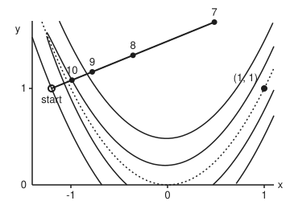
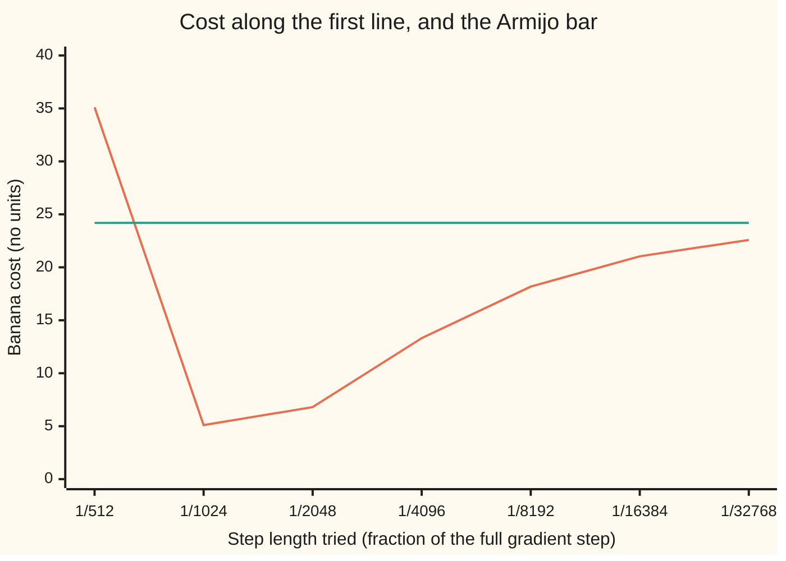

# Line search: how far to go once you have picked a direction

[Syllabus](../../../SYLLABUS.md) → [Optimization](../README.md) → [Unconstrained Methods](../README.md#s02) → Line search

---

## General Overview

The Rosenbrock banana is a test landscape with two dials, x and y. Its cost is $f(x, y) = (1 - x)^2 + 100\,(y - x^2)^2$, and the job is to **minimise** it: choose x and y to make the cost as small as possible. The low ground is a narrow curved valley that follows the parabola $y = x^2$, and the bottom of it is the point (1, 1), where the cost is 0. Nothing can be lower, because the cost is a sum of squares, so (1, 1) is the global minimum, certified.

Start at the standard point (−1.2, 1), where the cost is 24.2. The steepest way down points almost straight across the valley, not along it. [Gradient descent](02-gradient-descent-and-its-rate.md) has picked that direction. It has not said how far to walk. Walk a full unit of the gradient and you land at (214.4, 89.0), where the cost is 210,482,437,168.52: you jumped the valley and climbed a cliff on the far side.

So halve the step. Halve it again. After ten halvings, at 1/1024 of the full step, the cost is 5.10. That is not just lower than 24.2. It is lower by enough, measured against what the slope promised. That test, "the cost really falls", is the **Armijo condition**, and the halving loop is **backtracking**. A second test, the **curvature condition**, stops steps that are too short. Together they are the **Wolfe conditions**, and they are what lets a quasi-Newton method (one that builds its own picture of the valley's curvature from past steps) keep that picture sane.

**A line search tries step lengths along a chosen downhill direction and accepts the first one that lowers the cost by a fixed fraction of what the slope promised (Armijo) and, for quasi-Newton methods, that also flattens the slope enough (curvature); together these make every step useful and keep the curvature picture positive.**

**What kind of fact this is:** the Armijo and Wolfe conditions are design rules (definitions). Three theorems are proved on this card in Why it works: an Armijo step always exists and backtracking finds it, a Wolfe step always exists, and a Wolfe step makes $s_k^{\mathsf T} y_k > 0$. A fourth, Zoutendijk's theorem, is stated with its source. The run's end point is "the best found"; the minimum it approaches is certified by the sum-of-squares argument above.

<p align="center"></p>

Drawn to scale. The start sits on the outer pair of curves, cost 24.2. The downhill line crosses the valley. Dot 7 (step 1/128) is far up the opposite wall, cost 211.3521; dot 9 (1/512) still costs 35.1074; dot 10 (1/1024) is on the inner pair, cost 5.1011. The minimum (1, 1) lies on the floor to the right.

---

## The formula

Notation first, in words. As in [Gradient descent](02-gradient-descent-and-its-rate.md), $x_k$ is the point after $k$ steps, $d_k$ the chosen direction, $\alpha_k$ the step length, and $\nabla f$ the gradient (the list of slopes, one per dial). Here $d_k = -\nabla f(x_k)$. Along the line, the cost is a function of one number, the step: $\varphi(\alpha) = f(x_k + \alpha d_k)$, read "phi of alpha". Its slope at the start is $\varphi'(0) = \nabla f(x_k)^{\mathsf T} d_k$, negative because $d_k$ points downhill.

The **Armijo condition**, also called sufficient decrease:

$$f(x_k + \alpha d_k) \;\le\; f(x_k) + c_1\,\alpha\,\nabla f(x_k)^{\mathsf T} d_k$$

**Read it aloud:** the new cost must sit at or below a line that starts at today's cost and falls at a fixed fraction $c_1$ of today's slope.

The **curvature condition**:

$$\nabla f(x_k + \alpha d_k)^{\mathsf T} d_k \;\ge\; c_2\,\nabla f(x_k)^{\mathsf T} d_k, \qquad 0 < c_1 < c_2 < 1$$

**Read it aloud:** at the new point the downhill slope along the line must have eased off to at most a fraction $c_2$ of the slope you started with.

Both together are the **Wolfe conditions**. The **strong Wolfe** version puts absolute values on both sides of the second test, so a slope that has turned steeply uphill is rejected as well.

**Backtracking** is the loop: try $\alpha = 1$; while Armijo fails, halve $\alpha$; accept the first that passes.

| Symbol | Plain meaning | In our example | Push it up and the answer… |
| --- | --- | --- | --- |
| $f$; x, y | the cost being minimised; its two dials (x, y are not $x_k$, $y_k$) | the banana, 24.2 at the start (−1.2, 1) | — |
| $x_k$ | the point after $k$ steps, counted from $k = 0$ at the start | (−1.2, 1) | — |
| $\nabla f(x_k)$ | the gradient: slope in x, slope in y | (−215.60, −88.00) | bigger trial steps overshoot more |
| $d_k$ | the direction chosen, here straight downhill | (215.60, 88.00) | — |
| $\alpha$, $\alpha_k$; $\bar\alpha$, $\alpha'$, $\alpha''$ | step length tried, step length accepted; in the proofs, the end of an interval where Armijo holds, the first step where the cost meets the Armijo line, and a step where the slope is exactly $c_1\varphi'(0)$ | 1/1024 accepted | the step lands further along the line |
| $\varphi(\alpha)$, $\ell(\alpha)$ | cost along the line, $f(x_k + \alpha d_k)$; the Armijo line $\varphi(0) + c_1\alpha\varphi'(0)$, used in Step 3 | 5.1011 and 24.1947 at $\alpha$ = 1/1024 | — |
| $\varphi'(0)$ | slope along the line at the start | −54,227.36 | (towards 0) a shallower promise, an easier bar |
| $c_1$ | the share of the promised fall Armijo demands | 0.0001 | fewer steps pass; 0.5 needs 11 halvings |
| $c_2$ | the share of the starting slope the new slope may keep | 0.9 | more short steps pass |
| $s_k$, $y_k$ | the step taken, $x_{k+1} - x_k$; the change in gradient over it, $\nabla f(x_{k+1}) - \nabla f(x_k)$ | at step 30, $s^{\mathsf T}y$ = −92.39 (Armijo only), 61.32 (Wolfe) | — |
| $\theta_k$ | angle between $d_k$ and straight downhill, used in Step 5 | 0 for gradient descent | (towards 90°) each step gains less |
| $B_k$, $v$ | a quasi-Newton method's stand-in for the Hessian (the matrix of second slopes); v, any nonzero direction in the test for positive definite | $I$, the identity, at the first update | — |

### When it holds

- **The direction must point downhill**, $\varphi'(0) < 0$. If it points uphill, no small step lowers the cost and backtracking halves forever.
- **The cost must be smooth along the line** (a continuous slope). At a kink the Taylor argument in Step 1 fails and a small step need not win; that is the territory of [Subgradients](../01-Convexity/07-subgradients.md).
- **The cost must be bounded below along the line** for the existence proof in Step 3. Without it a Wolfe step can fail to exist: on a straight line that falls forever, the slope never eases, and the curvature test is never met.
- **$0 < c_1 < c_2 < 1$.** With $c_1 \ge c_2$ the two tests can exclude every step. With $c_1 = 0$, "any fall at all" passes, and steps whose falls shrink to nothing can stall a run short of the minimum.

---

## Why it works

### Step 0: one direction turns a two-dial problem into a one-number problem

Once $d_k$ is fixed, the only choice left is $\alpha$, and the cost along the line is $\varphi(\alpha)$. Two dangers sit at the two ends. Too long, and the step crosses the valley and climbs the far wall: the full step costs 210 billion. Too short, and the step barely moves: the cost falls, but by almost nothing. Armijo guards the long end. The curvature condition guards the short end. Neither needs the exact best $\alpha$, which would cost far more cost evaluations than it saves.

### Step 1: a short enough step always passes Armijo, so backtracking stops

Near $\alpha = 0$ the cost along the line is almost straight: $\varphi(\alpha) \approx \varphi(0) + \alpha\,\varphi'(0)$. The Armijo line $\varphi(0) + c_1 \alpha \varphi'(0)$ falls more gently, since $c_1 < 1$ and $\varphi'(0) < 0$. So for small enough $\alpha$ the curve is below the line, and Armijo holds. Halving reaches any small number in finitely many tries.

On the banana, the bar after ten halvings is 24.1947 and the cost is 5.1011: a pass. After nine, the bar is 24.1894 and the cost is 35.1074: a fail.

<details>
<summary>Detailed proof: Armijo holds on a whole interval (0, ᾱ]</summary>

Since $\varphi$ has a slope at 0, $\big(\varphi(\alpha) - \varphi(0)\big)/\alpha \to \varphi'(0)$ as $\alpha \to 0$ from above. Because $\varphi'(0) < 0$ and $c_1 < 1$, the limit $\varphi'(0)$ is strictly less than $c_1 \varphi'(0)$. So there is an $\bar\alpha > 0$ with $\big(\varphi(\alpha) - \varphi(0)\big)/\alpha \le c_1\varphi'(0)$ for every $\alpha$ in $(0, \bar\alpha]$. Multiplying by $\alpha > 0$ gives Armijo. Halving from 1 passes below $\bar\alpha$ after at most $\lceil \log_2(1/\bar\alpha) \rceil$ tries, and stops at the first pass, possibly sooner.

</details>

Backtracking also never accepts a silly short step when it starts from $\alpha = 1$. Unless the full step passes, the step it accepts is half of a step that failed Armijo. That is its quiet substitute for the curvature condition: it stops within a factor of 2 of a step that was too long. On the banana the Armijo boundary along the first line is at $\alpha$ = 0.0017034, about 1/587.1, and backtracking stops at 1/1024, the first power of ½ below it.

### Step 2: the curvature condition rules out steps that stop too soon

Armijo alone accepts a step of one millionth: cost 24.1458, a pass, and almost no progress. The slope there is still −54,145.79, barely eased from −54,227.36. The curvature condition asks the slope to ease to −48,804.62 or flatter (0.9 of the start). It fails, so the step is rejected.

The test reads as: "you have not stopped while the ground is still falling steeply". A step that passes it has used up a real share of the descent the line offered.

### Step 3: a step passing both tests always exists

If the cost is bounded below along the line and $0 < c_1 < c_2 < 1$, there is a whole interval of Wolfe steps. The cost curve must cross the falling Armijo line somewhere. Between 0 and that crossing, the mean value theorem (some point on a curve has the slope of the chord) gives a point where the slope is exactly $c_1 \varphi'(0)$, which is flatter than $c_2 \varphi'(0)$. That point passes both tests.

<details>
<summary>Detailed proof: Wolfe steps exist</summary>

Let $\ell(\alpha) = \varphi(0) + c_1 \alpha \varphi'(0)$. It falls without bound, while $\varphi$ is bounded below, so $\varphi(\alpha) = \ell(\alpha)$ for some $\alpha > 0$; let $\alpha'$ be the smallest such. By Step 1, $\varphi < \ell$ on $(0, \alpha')$, so Armijo holds there. The mean value theorem gives $\alpha''$ in $(0, \alpha')$ with
$$\varphi'(\alpha'') = \frac{\varphi(\alpha') - \varphi(0)}{\alpha'} = c_1\varphi'(0) > c_2 \varphi'(0),$$
the last because $c_1 < c_2$ and $\varphi'(0) < 0$. So $\alpha''$ passes both tests, and by continuity of the slope so does an interval around it. As $|\varphi'(\alpha'')| = c_1 |\varphi'(0)| < c_2|\varphi'(0)|$, it passes the strong version too.

</details>

A search that finds one is short. Keep a lower and an upper end, start at 1: if Armijo fails, the step is too long, so it becomes the upper end; if curvature fails, it is too short, so it becomes the lower end; then try the midpoint, or double if no upper end is known yet. Lewis and Overton prove this bisection stops for a smooth cost bounded below along the line.

### Step 4: the curvature condition is exactly what quasi-Newton needs

A quasi-Newton method such as [Newton and BFGS](05-newton-and-quasi-newton-bfgs.md) keeps a matrix $B_k$ that stands in for the Hessian (the matrix of second slopes) and takes the direction $d_k = -B_k^{-1}\nabla f(x_k)$. After each step it records two vectors: the step $s_k = x_{k+1} - x_k$ and the change in gradient $y_k = \nabla f(x_{k+1}) - \nabla f(x_k)$. Its new matrix must obey the secant equation (the curvature it learned along the step) $B_{k+1} s_k = y_k$.

Multiply both sides by $s_k$:

$$s_k^{\mathsf T} B_{k+1} s_k = s_k^{\mathsf T} y_k.$$

The direction $-B^{-1}\nabla f$ is downhill for every possible gradient only when $B$ is positive definite ($v^{\mathsf T} B v > 0$ for every nonzero $v$). Taking $v = s_k$, a positive definite $B_{k+1}$ needs $s_k^{\mathsf T} y_k > 0$. The curvature condition supplies it in one line:

$$s_k^{\mathsf T} y_k = \alpha_k\big(\varphi'(\alpha_k) - \varphi'(0)\big) \;\ge\; \alpha_k (c_2 - 1)\,\varphi'(0) \;>\; 0.$$

Armijo alone does not. On the banana, gradient descent with backtracking hits such a case at step 30, at (−0.9852, 0.9712), cost 3.9409. Backtracking accepts $\alpha = $ 1/2: the cost falls to 2.2766, so Armijo is happy. But the slope along the line got steeper, from −13.76 to −198.54: the ground curves away beneath the step. Then $s^{\mathsf T}y$ = −92.39. Feed that pair to a BFGS update from $B = I$ and $s^{\mathsf T} B s$ comes out at −92.39, as the secant equation forces. The next direction has slope +102.27: uphill.

A Wolfe search at the same point tries 1, 0.5, 0.75, 0.625, 0.5625 and accepts 0.53125. The cost falls to 0.4693, lower than Armijo's 2.2766, and $s^{\mathsf T}y$ = 61.32, above the guaranteed floor of 0.7310.

### Step 5: what the conditions buy over a whole run

Zoutendijk's theorem (Nocedal and Wright, Theorem 3.2): if the cost is bounded below, its gradient is Lipschitz (its slope changes no faster than a fixed rate), and every step satisfies the Wolfe conditions, then $\sum_k \cos^2\theta_k \,\|\nabla f(x_k)\|^2$ is finite, where $\theta_k$ is the angle between $d_k$ and the downhill direction. For gradient descent $\cos\theta_k = 1$, so the gradient shrinks to 0. This card states it with that source and does not prove it. Backtracking from $\alpha = 1$ has the same guarantee for gradient descent. Neither promises speed; the rate is the business of [Convergence rates](03-rates-of-convergence-and-conditioning.md).

---

## Worked numbers, by hand

The first line search from (−1.2, 1), with $c_1$ = 0.0001.

| Step | Arithmetic | Value |
| --- | --- | --- |
| cost at the start | $(1 + 1.2)^2 + 100\,(1 - 1.44)^2 = 4.84 + 19.36$ | 24.2 |
| slope in x | $-2(2.2) - 400(-1.2)(-0.44) = -4.4 - 211.2$ | −215.60 |
| slope in y | $200(1 - 1.44)$ | −88.00 |
| slope along the line, $\varphi'(0)$ | $-(215.6^2 + 88^2) = -(46{,}483.36 + 7{,}744)$ | −54,227.36 |
| full step lands at | $(-1.2 + 215.6,\ 1 + 88)$ | (214.4, 89.0), cost 210,482,437,168.52 |
| Armijo bar for step $\alpha$ | $24.2 - 0.0001 \times 54{,}227.36 \times \alpha$ | — |
| 9 halvings, $\alpha$ = 1/512 | bar 24.1894; cost 35.1074 | fail |
| 10 halvings, $\alpha$ = 1/1024 | $(-1.2 + 215.6/1024,\ 1 + 88/1024)$ | (−0.9895, 1.0859) |
| its cost | bar 24.1947 | **5.1011, pass** |

Ten halvings, eleven cost evaluations, and the cost drops from 24.2 to 5.1011 in one step.



The first line (orange) is the cost at each trial step; the second (green) is the Armijo bar. Every step from 1/1024 down passes Armijo. The two shortest, 1/16384 and 1/32768, fail the curvature test: the slope there is still steeper than the −48,804.62 allowed.

Over a whole run, gradient descent with backtracking reaches $\|\nabla f\| < 10^{-4}$ in 8,058 steps and 80,044 cost evaluations, ending at (0.9999, 0.9998) with cost 0.00000000633. That is the best found, close to the certified minimum (1, 1).

### What breaks if you drop a piece

| Mistake | Comes out at | What went wrong |
| --- | --- | --- |
| No search: take the full step $\alpha = 1$ | cost 210,482,437,168.5 | The slope is a promise only near the start; one unit of it jumps the valley |
| Start the search at $10^{-6}$ and accept the first fall | cost 24.1458 after the step | Armijo passes, curvature fails: slope −54,145.79 against the bar −48,804.62 |
| Armijo-only step handed to BFGS (step 30) | $s^{\mathsf T}y$ = −92.39; next direction uphill, slope +102.27 | The secant equation forces $s^{\mathsf T}Bs = s^{\mathsf T}y < 0$ |
| A fixed step of 1/1024, the first step reused | 21,041 steps, against 8,058 | One length cannot suit the valley's walls and its floor |

The code prints every row.

---

## Code, from first principles, and it actually runs

Nothing is imported. The code takes the first backtracking search, prints every trial, runs gradient descent with backtracking to the end, finds the step where $s^{\mathsf T}y$ turns negative, builds the BFGS matrix there, and runs a Wolfe bisection search at the same point. It then runs the three cases in the "Try changing" box. It takes four independent roads. The gradient formula is checked against central differences. The cost along the first line is rebuilt as a quartic polynomial by algebra, and bisection on that polynomial finds the true Armijo boundary, 1/587.1: the direct Armijo test must pass just below it and fail just above, and backtracking must stop within a factor of 2 under it. The secant identity $s^{\mathsf T}Bs = s^{\mathsf T}y$ is checked on the matrix itself. And the Wolfe step's $s^{\mathsf T}y$ is checked against the floor the proof promises.

### Python

```python
# Line search, Armijo and Wolfe -- the check behind the card.  Nothing is
# imported.  The cost is the Rosenbrock banana f(x, y) = (1 - x)^2 + 100 (y - x^2)^2,
# minimised; the start is (-1.2, 1); the direction is straight downhill, d = -grad f.
C1, C2 = 1e-4, 0.9                    # sufficient-decrease and curvature constants

def f(p):
    x, y = p
    return (1 - x) * (1 - x) + 100 * (y - x * x) * (y - x * x)

def grad(p):                           # the slope in x and in y, by hand
    x, y = p
    return (-2 * (1 - x) - 400 * x * (y - x * x), 200 * (y - x * x))

def dot(a, b): return a[0] * b[0] + a[1] * b[1]
def move(p, a, d): return (p[0] + a * d[0], p[1] + a * d[1])
def yn(b): return "yes" if b else "no"

def checks(p, d, a, c1=C1, c2=C2):     # Armijo test, curvature test, new slope
    g0, q = grad(p), move(p, a, d)
    s0, s1 = dot(g0, d), dot(grad(q), d)
    return f(q) <= f(p) + c1 * a * s0, s1 >= c2 * s0, s1

def backtrack(p, d, c1=C1, cut=2):     # halve (or cut) until the Armijo test passes
    a, n = 1.0, 0
    while not checks(p, d, a, c1)[0]:
        a, n = a / cut, n + 1
    return a, n

def wolfe(p, d, c2=C2):                # bisection search for both Wolfe tests
    lo, hi, a, trials = 0.0, None, 1.0, []
    while True:
        arm, cur, _ = checks(p, d, a, C1, c2)
        trials.append(a)
        if not arm: hi = a
        elif not cur: lo = a
        else: return a, trials
        a = (lo + hi) / 2 if hi is not None else 2 * lo

x0 = (-1.2, 1.0)
g0 = grad(x0); d0 = (-g0[0], -g0[1]); slope0 = dot(g0, d0)
h = 1e-6                               # road 2 for the slope: central differences
cd = ((f((x0[0] + h, x0[1])) - f((x0[0] - h, x0[1]))) / (2 * h),
      (f((x0[0], x0[1] + h)) - f((x0[0], x0[1] - h))) / (2 * h))
print(f"start (-1.2, 1), cost {f(x0):.4f}; gradient ({g0[0]:.2f}, {g0[1]:.2f}); "
      f"by central differences ({cd[0]:.2f}, {cd[1]:.2f})")
print(f"direction d = ({d0[0]:.2f}, {d0[1]:.2f}); slope along d at step 0: {slope0:.2f}")
print("halvings  step              cost after   Armijo bar  Armijo  curvature")
for j in range(16):
    a = 0.5 ** j
    arm, cur, _ = checks(x0, d0, a)
    print(f"{j:>8}  1/{2 ** j:<6} {f(move(x0, a, d0)):>22.4f} {f(x0) + C1 * a * slope0:>11.4f}"
          f"  {yn(arm):>6}  {yn(cur):>9}")
a0, n0 = backtrack(x0, d0)
x1 = move(x0, a0, d0)
print(f"backtracking: {n0} halvings, step 1/{round(1 / a0)}, lands at ({x1[0]:.4f}, {x1[1]:.4f}), "
      f"cost {f(x1):.4f}")
# Road 2: phi(a) = f(x0 + a d0) as a quartic, coefficients built by polynomial algebra
u = [1 - x0[0], -d0[0]]                                   # 1 - x
v = [x0[1] - x0[0] ** 2, d0[1] - 2 * x0[0] * d0[0], -d0[0] ** 2]   # y - x^2
def pmul(p, q):
    out = [0.0] * (len(p) + len(q) - 1)
    for i, pi in enumerate(p):
        for k, qk in enumerate(q): out[i + k] += pi * qk
    return out
uu, vv = pmul(u, u), pmul(v, v)
phi = [vv[i] * 100 + (uu[i] if i < 3 else 0) for i in range(5)]
def pval(a): return sum(c * a ** i for i, c in enumerate(phi))
print("phi(a) coefficients, a^0..a^4: " + ", ".join(f"{c:.1f}" for c in phi))
lo, hi = 0.5 ** 12, 0.5 ** 6              # Armijo holds at lo, fails at hi
for _ in range(60):
    mid = (lo + hi) / 2
    if pval(mid) <= phi[0] + C1 * mid * phi[1]: lo = mid
    else: hi = mid
gap = max(abs(pval(0.5 ** j) - f(move(x0, 0.5 ** j, d0))) / f(move(x0, 0.5 ** j, d0)) for j in range(16))
print(f"phi'(0) = {phi[1]:.2f}; Armijo holds up to a = {lo:.7f} = 1/{1 / lo:.1f}; "
      f"quartic matches f to 1e-9: {yn(gap < 1e-9)}")
def descend(c1=C1, cut=2):             # gradient descent with backtracking, to |grad| < 1e-4; watch the sign of s.y
    p, k, evals, bad = x0, 0, 0, []
    while dot(grad(p), grad(p)) ** 0.5 >= 1e-4:
        g = grad(p); d = (-g[0], -g[1])
        a, n = backtrack(p, d, c1, cut); evals += n + 1
        q = move(p, a, d); gq = grad(q)
        if a * (dot(gq, d) - dot(g, d)) <= 0: bad.append(k)
        p, k = q, k + 1
    return p, k, evals, bad
p, k, evals, bad = descend()
print(f"descent + backtracking: {k} iterations, {evals} cost evaluations, ends at "
      f"({p[0]:.4f}, {p[1]:.4f}), cost {f(p):.11f}; steps with s.y <= 0: {bad}")
p = x0
for _ in range(bad[0]): g = grad(p); p = move(p, backtrack(p, (-g[0], -g[1]))[0], (-g[0], -g[1]))
g = grad(p); d = (-g[0], -g[1]); sl = dot(g, d)
a, n = backtrack(p, d); arm, cur, s1 = checks(p, d, a)
s = (a * d[0], a * d[1]); q = move(p, a, d); yv = (grad(q)[0] - g[0], grad(q)[1] - g[1])
sy, ss = dot(s, yv), dot(s, s)
print(f"step {bad[0]}: at ({p[0]:.4f}, {p[1]:.4f}), cost {f(p):.4f}, slope {sl:.2f}")
print(f"  Armijo step 1/{round(1 / a)}: cost {f(q):.4f}, new slope {s1:.2f}, "
      f"curvature {yn(cur)}, s.y = {sy:.2f}")
B = [[(i == j) - s[i] * s[j] / ss + yv[i] * yv[j] / sy for j in range(2)] for i in range(2)]
sBs = sum(s[i] * B[i][j] * s[j] for i in range(2) for j in range(2))
det = B[0][0] * B[1][1] - B[0][1] * B[1][0]
gq = grad(q); dn = (-(B[1][1] * gq[0] - B[0][1] * gq[1]) / det, -(B[0][0] * gq[1] - B[1][0] * gq[0]) / det)
print(f"  BFGS update from B = I: s.B.s = {sBs:.2f}; next direction "
      f"({dn[0]:.4f}, {dn[1]:.4f}), slope {dot(gq, dn):.2f} (uphill)")
aw, tr = wolfe(p, d); qw = move(p, aw, d)
syw = aw * (dot(grad(qw), d) - sl)
print("  Wolfe trials: " + ", ".join(f"{t:.5f}" for t in tr) +
      f"; accepted {aw:.5f}, cost {f(qw):.4f}, s.y = {syw:.2f}, "
      f"floor (1 - c2) a |slope| = {(1 - C2) * aw * -sl:.4f}")
# The three mistakes, and the fixed step for comparison
tiny = move(x0, 1e-6, d0); arm_t, cur_t, s_t = checks(x0, d0, 1e-6)
pf, kf = x0, 0
while dot(grad(pf), grad(pf)) ** 0.5 >= 1e-4:
    g = grad(pf); pf, kf = move(pf, -a0, g), kf + 1
print(f"mistake 1, no search, step 1: lands at ({x0[0] + d0[0]:.1f}, {x0[1] + d0[1]:.1f}), "
      f"cost {f(move(x0, 1, d0)):.1f}")
print(f"mistake 2, start at step 1e-6: cost {f(tiny):.4f}; Armijo {yn(arm_t)}, curvature {yn(cur_t)}"
      f" (slope {s_t:.2f} against bar {C2 * slope0:.2f})")
print(f"mistake 3, fixed step 1/1024 throughout: {kf} iterations, against {k} with backtracking")
# Try changing: c1 = 0.5; cutting the step by 10; c2 = 0.1 (the run above is unchanged)
a5, n5 = backtrack(x0, d0, 0.5)
print(f"try c1 = 0.5: first search {n5} halvings, step 1/{round(1 / a5)}, cost {f(move(x0, a5, d0)):.4f}; {descend(0.5)[1]} iterations")
a10 = backtrack(x0, d0, C1, 10)[0]; _, k10, _, bad10 = descend(C1, 10)
print(f"try cut by 10: first step 1/{round(1 / a10)}, cost {f(move(x0, a10, d0)):.4f}; {k10} iterations; steps with s.y <= 0: {bad10}")
fails = [j for j in range(16) if not checks(x0, d0, 0.5 ** j, C1, 0.1)[1]]
both = [j for j in range(16) if all(checks(x0, d0, 0.5 ** j, C1, 0.1)[:2])]
aw1 = wolfe(p, d, 0.1)[0]
print(f"try c2 = 0.1: curvature fails after halvings {fails}, both pass only after {both}; "
      f"step {bad[0]} Wolfe accepts {aw1:.5f}, floor {(1 - 0.1) * aw1 * -sl:.4f}")
print("figure, start (-1.2, 1); trials 7-10 at " +
      "; ".join(f"({move(x0, 0.5 ** j, d0)[0]:.3f}, {move(x0, 0.5 ** j, d0)[1]:.3f})" for j in range(7, 11)) +
      "; minimum (1, 1)")
assert abs(cd[0] - g0[0]) < 1e-4 and abs(cd[1] - g0[1]) < 1e-4    # slope: formula vs differences
assert n0 == 10 and 2 * a0 > lo >= a0                             # backtracking vs quartic boundary
assert gap < 1e-9 and abs(phi[1] - slope0) < 1e-6                 # quartic vs direct cost
assert checks(x0, d0, lo * (1 - 1e-6))[0] and not checks(x0, d0, hi * (1 + 1e-6))[0]  # direct test vs quartic
assert sy < 0 and abs(sBs - sy) < 1e-6 * abs(sy) and dot(gq, dn) > 0   # secant: s.B.s = s.y
assert syw >= (1 - C2) * aw * -sl > 0 and f(qw) < f(q)
assert arm_t and not cur_t and kf > 2 * k
print("ALL CHECKS PASS")
```

**Ran 2026-11-11 on macOS, Python 3.14.10, standard library only. All checks passed. Output, pasted from the run:**

```
start (-1.2, 1), cost 24.2000; gradient (-215.60, -88.00); by central differences (-215.60, -88.00)
direction d = (215.60, 88.00); slope along d at step 0: -54227.36
halvings  step              cost after   Armijo bar  Armijo  curvature
       0  1/1           210482437168.5200     18.7773      no        yes
       1  1/2            12810991198.7200     21.4886      no        yes
       2  1/4              758614013.3000     22.8443      no        yes
       3  1/8               42388850.4531     23.5222      no        yes
       4  1/16               2078788.2100     23.8611      no        yes
       5  1/32                 72456.4239     24.0305      no        yes
       6  1/64                   543.5463     24.1153      no        yes
       7  1/128                  211.3521     24.1576      no        yes
       8  1/256                  149.6412     24.1788      no        yes
       9  1/512                   35.1074     24.1894      no        yes
      10  1/1024                   5.1011     24.1947     yes        yes
      11  1/2048                   6.8046     24.1974     yes        yes
      12  1/4096                  13.3112     24.1987     yes        yes
      13  1/8192                  18.1781     24.1993     yes        yes
      14  1/16384                 21.0409     24.1997     yes         no
      15  1/32768                 22.5829     24.1998     yes         no
backtracking: 10 halvings, step 1/1024, lands at (-0.9895, 1.0859), cost 5.1011
phi(a) coefficients, a^0..a^4: 24.2, -54227.4, 40792778.4, -5628577095.7, 216070275689.0
phi'(0) = -54227.36; Armijo holds up to a = 0.0017034 = 1/587.1; quartic matches f to 1e-9: yes
descent + backtracking: 8058 iterations, 80044 cost evaluations, ends at (0.9999, 0.9998), cost 0.00000000633; steps with s.y <= 0: [30]
step 30: at (-0.9852, 0.9712), cost 3.9409, slope -13.76
  Armijo step 1/2: cost 2.2766, new slope -198.54, curvature no, s.y = -92.39
  BFGS update from B = I: s.B.s = -92.39; next direction (-0.7320, 2.1242), slope 102.27 (uphill)
  Wolfe trials: 1.00000, 0.50000, 0.75000, 0.62500, 0.56250, 0.53125; accepted 0.53125, cost 0.4693, s.y = 61.32, floor (1 - c2) a |slope| = 0.7310
mistake 1, no search, step 1: lands at (214.4, 89.0), cost 210482437168.5
mistake 2, start at step 1e-6: cost 24.1458; Armijo yes, curvature no (slope -54145.79 against bar -48804.62)
mistake 3, fixed step 1/1024 throughout: 21041 iterations, against 8058 with backtracking
try c1 = 0.5: first search 11 halvings, step 1/2048, cost 6.8046; 1277 iterations
try cut by 10: first step 1/1000, cost 5.3529; 880 iterations; steps with s.y <= 0: []
try c2 = 0.1: curvature fails after halvings [7, 11, 12, 13, 14, 15], both pass only after [10]; step 30 Wolfe accepts 0.53125, floor 6.5792
figure, start (-1.2, 1); trials 7-10 at (0.484, 1.688); (-0.358, 1.344); (-0.779, 1.172); (-0.989, 1.086); minimum (1, 1)
ALL CHECKS PASS
```

### Rust

Same numbers, same labels, built with `rustc --edition 2021 -O`.

```rust
// Line search, Armijo and Wolfe -- the same check as the Python, in Rust.  No
// crates.  The cost is the Rosenbrock banana f(x, y) = (1 - x)^2 + 100 (y - x^2)^2,
// minimised; the start is (-1.2, 1); the direction is straight downhill, d = -grad f.
const C1: f64 = 1e-4; // sufficient-decrease constant
const C2: f64 = 0.9; // curvature constant
type P = (f64, f64);

fn f(p: P) -> f64 { let (x, y) = p; (1.0 - x) * (1.0 - x) + 100.0 * (y - x * x) * (y - x * x) }
fn grad(p: P) -> P {                       // the slope in x and in y, by hand
    let (x, y) = p;
    (-2.0 * (1.0 - x) - 400.0 * x * (y - x * x), 200.0 * (y - x * x))
}
fn dot(a: P, b: P) -> f64 { a.0 * b.0 + a.1 * b.1 }
fn mv(p: P, a: f64, d: P) -> P { (p.0 + a * d.0, p.1 + a * d.1) }
fn yn(b: bool) -> &'static str { if b { "yes" } else { "no" } }
fn norm(p: P) -> f64 { dot(p, p).sqrt() }

fn checks_with(p: P, d: P, a: f64, c1: f64, c2: f64) -> (bool, bool, f64) { // Armijo, curvature, new slope
    let (s0, q) = (dot(grad(p), d), mv(p, a, d));
    let s1 = dot(grad(q), d);
    (f(q) <= f(p) + c1 * a * s0, s1 >= c2 * s0, s1)
}
fn checks(p: P, d: P, a: f64) -> (bool, bool, f64) { checks_with(p, d, a, C1, C2) }
fn backtrack_with(p: P, d: P, c1: f64, cut: f64) -> (f64, u32) { // halve (or cut) until the Armijo test passes
    let (mut a, mut n) = (1.0, 0);
    while !checks_with(p, d, a, c1, C2).0 { a /= cut; n += 1; }
    (a, n)
}
fn backtrack(p: P, d: P) -> (f64, u32) { backtrack_with(p, d, C1, 2.0) }
fn wolfe(p: P, d: P, c2: f64) -> (f64, Vec<f64>) { // bisection search for both Wolfe tests
    let (mut lo, mut hi, mut a, mut trials) = (0.0, f64::INFINITY, 1.0, Vec::new());
    loop {
        let (arm, cur, _) = checks_with(p, d, a, C1, c2);
        trials.push(a);
        if !arm { hi = a } else if !cur { lo = a } else { return (a, trials) }
        a = if hi.is_finite() { (lo + hi) / 2.0 } else { 2.0 * lo };
    }
}
fn descend(x0: P, c1: f64, cut: f64) -> (P, usize, u32, Vec<usize>) { // gradient descent with backtracking, to |grad| < 1e-4; watch the sign of s.y
    let (mut p, mut k, mut evals, mut bad) = (x0, 0usize, 0u32, Vec::new());
    while norm(grad(p)) >= 1e-4 {
        let g = grad(p);
        let d = (-g.0, -g.1);
        let (a, n) = backtrack_with(p, d, c1, cut);
        evals += n + 1;
        let q = mv(p, a, d);
        if a * (dot(grad(q), d) - dot(g, d)) <= 0.0 { bad.push(k) }
        p = q; k += 1;
    }
    (p, k, evals, bad)
}
fn pmul(p: &[f64], q: &[f64]) -> Vec<f64> {
    let mut out = vec![0.0; p.len() + q.len() - 1];
    for (i, pi) in p.iter().enumerate() { for (k, qk) in q.iter().enumerate() { out[i + k] += pi * qk } }
    out
}

fn main() {
    let x0: P = (-1.2, 1.0);
    let g0 = grad(x0);
    let d0 = (-g0.0, -g0.1);
    let slope0 = dot(g0, d0);
    let h = 1e-6;                          // road 2 for the slope: central differences
    let cd = ((f((x0.0 + h, x0.1)) - f((x0.0 - h, x0.1))) / (2.0 * h),
              (f((x0.0, x0.1 + h)) - f((x0.0, x0.1 - h))) / (2.0 * h));
    println!("start (-1.2, 1), cost {:.4}; gradient ({:.2}, {:.2}); by central differences ({:.2}, {:.2})",
             f(x0), g0.0, g0.1, cd.0, cd.1);
    println!("direction d = ({:.2}, {:.2}); slope along d at step 0: {:.2}", d0.0, d0.1, slope0);
    println!("halvings  step              cost after   Armijo bar  Armijo  curvature");
    for j in 0..16 {
        let a = 0.5f64.powi(j);
        let (arm, cur, _) = checks(x0, d0, a);
        println!("{:>8}  1/{:<6} {:>22.4} {:>11.4}  {:>6}  {:>9}", j, 1u64 << j, f(mv(x0, a, d0)),
                 f(x0) + C1 * a * slope0, yn(arm), yn(cur));
    }
    let (a0, n0) = backtrack(x0, d0);
    let x1 = mv(x0, a0, d0);
    println!("backtracking: {} halvings, step 1/{}, lands at ({:.4}, {:.4}), cost {:.4}",
             n0, (1.0 / a0).round(), x1.0, x1.1, f(x1));
    // Road 2: phi(a) = f(x0 + a d0) as a quartic, coefficients built by polynomial algebra
    let u = [1.0 - x0.0, -d0.0];
    let v = [x0.1 - x0.0 * x0.0, d0.1 - 2.0 * x0.0 * d0.0, -d0.0 * d0.0];
    let (uu, vv) = (pmul(&u, &u), pmul(&v, &v));
    let phi: Vec<f64> = (0..5).map(|i| vv[i] * 100.0 + if i < 3 { uu[i] } else { 0.0 }).collect();
    let pval = |a: f64| -> f64 { phi.iter().enumerate().map(|(i, c)| c * a.powi(i as i32)).sum() };
    let cs: Vec<String> = phi.iter().map(|c| format!("{:.1}", c)).collect();
    println!("phi(a) coefficients, a^0..a^4: {}", cs.join(", "));
    let (mut lo, mut hi) = (0.5f64.powi(12), 0.5f64.powi(6));
    for _ in 0..60 {
        let mid = (lo + hi) / 2.0;
        if pval(mid) <= phi[0] + C1 * mid * phi[1] { lo = mid } else { hi = mid }
    }
    let gap = (0..16).map(|j| { let a = 0.5f64.powi(j); let t = f(mv(x0, a, d0)); (pval(a) - t).abs() / t })
        .fold(0.0, f64::max);
    println!("phi'(0) = {:.2}; Armijo holds up to a = {:.7} = 1/{:.1}; quartic matches f to 1e-9: {}",
             phi[1], lo, 1.0 / lo, yn(gap < 1e-9));
    let (p, k, evals, bad) = descend(x0, C1, 2.0);
    println!("descent + backtracking: {} iterations, {} cost evaluations, ends at ({:.4}, {:.4}), cost {:.11}; steps with s.y <= 0: {:?}",
             k, evals, p.0, p.1, f(p), bad);
    let mut p = x0;
    for _ in 0..bad[0] { let g = grad(p); let d = (-g.0, -g.1); p = mv(p, backtrack(p, d).0, d); }
    let g = grad(p);
    let d = (-g.0, -g.1);
    let sl = dot(g, d);
    let (a, _) = backtrack(p, d);
    let (_, cur, s1) = checks(p, d, a);
    let s = [a * d.0, a * d.1];
    let q = mv(p, a, d);
    let gq = grad(q);
    let yv = [gq.0 - g.0, gq.1 - g.1];
    let (sy, ss) = (s[0] * yv[0] + s[1] * yv[1], s[0] * s[0] + s[1] * s[1]);
    println!("step {}: at ({:.4}, {:.4}), cost {:.4}, slope {:.2}", bad[0], p.0, p.1, f(p), sl);
    println!("  Armijo step 1/{}: cost {:.4}, new slope {:.2}, curvature {}, s.y = {:.2}",
             (1.0 / a).round(), f(q), s1, yn(cur), sy);
    let mut b = [[0.0; 2]; 2];
    for i in 0..2 { for j in 0..2 {
        b[i][j] = (if i == j { 1.0 } else { 0.0 }) - s[i] * s[j] / ss + yv[i] * yv[j] / sy;
    } }
    let mut sbs = 0.0;
    for i in 0..2 { for j in 0..2 { sbs += s[i] * b[i][j] * s[j] } }
    let det = b[0][0] * b[1][1] - b[0][1] * b[1][0];
    let dn = (-(b[1][1] * gq.0 - b[0][1] * gq.1) / det, -(b[0][0] * gq.1 - b[1][0] * gq.0) / det);
    println!("  BFGS update from B = I: s.B.s = {:.2}; next direction ({:.4}, {:.4}), slope {:.2} (uphill)",
             sbs, dn.0, dn.1, dot(gq, dn));
    let (aw, tr) = wolfe(p, d, C2);
    let qw = mv(p, aw, d);
    let syw = aw * (dot(grad(qw), d) - sl);
    let ts: Vec<String> = tr.iter().map(|t| format!("{:.5}", t)).collect();
    println!("  Wolfe trials: {}; accepted {:.5}, cost {:.4}, s.y = {:.2}, floor (1 - c2) a |slope| = {:.4}",
             ts.join(", "), aw, f(qw), syw, (1.0 - C2) * aw * -sl);
    // The three mistakes, and the fixed step for comparison
    let tiny = mv(x0, 1e-6, d0);
    let (arm_t, cur_t, s_t) = checks(x0, d0, 1e-6);
    let (mut pf, mut kf) = (x0, 0usize);
    while norm(grad(pf)) >= 1e-4 { let g = grad(pf); pf = mv(pf, -a0, g); kf += 1; }
    println!("mistake 1, no search, step 1: lands at ({:.1}, {:.1}), cost {:.1}",
             x0.0 + d0.0, x0.1 + d0.1, f(mv(x0, 1.0, d0)));
    println!("mistake 2, start at step 1e-6: cost {:.4}; Armijo {}, curvature {} (slope {:.2} against bar {:.2})",
             f(tiny), yn(arm_t), yn(cur_t), s_t, C2 * slope0);
    println!("mistake 3, fixed step 1/1024 throughout: {} iterations, against {} with backtracking", kf, k);
    // Try changing: c1 = 0.5; cutting the step by 10; c2 = 0.1 (the run above is unchanged)
    let (a5, n5) = backtrack_with(x0, d0, 0.5, 2.0);
    println!("try c1 = 0.5: first search {} halvings, step 1/{}, cost {:.4}; {} iterations",
             n5, (1.0 / a5).round(), f(mv(x0, a5, d0)), descend(x0, 0.5, 2.0).1);
    let a10 = backtrack_with(x0, d0, C1, 10.0).0;
    let (_, k10, _, bad10) = descend(x0, C1, 10.0);
    println!("try cut by 10: first step 1/{}, cost {:.4}; {} iterations; steps with s.y <= 0: {:?}",
             (1.0 / a10).round(), f(mv(x0, a10, d0)), k10, bad10);
    let fails: Vec<i32> = (0..16).filter(|&j| !checks_with(x0, d0, 0.5f64.powi(j), C1, 0.1).1).collect();
    let both: Vec<i32> = (0..16).filter(|&j| { let (a, c, _) = checks_with(x0, d0, 0.5f64.powi(j), C1, 0.1); a && c }).collect();
    let aw1 = wolfe(p, d, 0.1).0;
    println!("try c2 = 0.1: curvature fails after halvings {:?}, both pass only after {:?}; step {} Wolfe accepts {:.5}, floor {:.4}",
             fails, both, bad[0], aw1, (1.0 - 0.1) * aw1 * -sl);
    let pts: Vec<String> = (7..11).map(|j| { let t = mv(x0, 0.5f64.powi(j), d0); format!("({:.3}, {:.3})", t.0, t.1) }).collect();
    println!("figure, start (-1.2, 1); trials 7-10 at {}; minimum (1, 1)", pts.join("; "));
    assert!((cd.0 - g0.0).abs() < 1e-4 && (cd.1 - g0.1).abs() < 1e-4); // slope: formula vs differences
    assert!(n0 == 10 && 2.0 * a0 > lo && lo >= a0);                    // backtracking vs quartic boundary
    assert!(gap < 1e-9 && (phi[1] - slope0).abs() < 1e-6);             // quartic vs direct cost
    assert!(checks(x0, d0, lo * (1.0 - 1e-6)).0 && !checks(x0, d0, hi * (1.0 + 1e-6)).0); // direct test vs quartic
    assert!(sy < 0.0 && (sbs - sy).abs() < 1e-6 * sy.abs() && dot(gq, dn) > 0.0); // secant: s.B.s = s.y
    assert!(syw >= (1.0 - C2) * aw * -sl && (1.0 - C2) * aw * -sl > 0.0 && f(qw) < f(q));
    assert!(arm_t && !cur_t && kf > 2 * k);
    println!("ALL CHECKS PASS");
}
```

**Ran 2026-11-11 on macOS, rustc 1.98.1, no crates. All checks passed. Output, pasted from the run:**

```
start (-1.2, 1), cost 24.2000; gradient (-215.60, -88.00); by central differences (-215.60, -88.00)
direction d = (215.60, 88.00); slope along d at step 0: -54227.36
halvings  step              cost after   Armijo bar  Armijo  curvature
       0  1/1           210482437168.5200     18.7773      no        yes
       1  1/2            12810991198.7200     21.4886      no        yes
       2  1/4              758614013.3000     22.8443      no        yes
       3  1/8               42388850.4531     23.5222      no        yes
       4  1/16               2078788.2100     23.8611      no        yes
       5  1/32                 72456.4239     24.0305      no        yes
       6  1/64                   543.5463     24.1153      no        yes
       7  1/128                  211.3521     24.1576      no        yes
       8  1/256                  149.6412     24.1788      no        yes
       9  1/512                   35.1074     24.1894      no        yes
      10  1/1024                   5.1011     24.1947     yes        yes
      11  1/2048                   6.8046     24.1974     yes        yes
      12  1/4096                  13.3112     24.1987     yes        yes
      13  1/8192                  18.1781     24.1993     yes        yes
      14  1/16384                 21.0409     24.1997     yes         no
      15  1/32768                 22.5829     24.1998     yes         no
backtracking: 10 halvings, step 1/1024, lands at (-0.9895, 1.0859), cost 5.1011
phi(a) coefficients, a^0..a^4: 24.2, -54227.4, 40792778.4, -5628577095.7, 216070275689.0
phi'(0) = -54227.36; Armijo holds up to a = 0.0017034 = 1/587.1; quartic matches f to 1e-9: yes
descent + backtracking: 8058 iterations, 80044 cost evaluations, ends at (0.9999, 0.9998), cost 0.00000000633; steps with s.y <= 0: [30]
step 30: at (-0.9852, 0.9712), cost 3.9409, slope -13.76
  Armijo step 1/2: cost 2.2766, new slope -198.54, curvature no, s.y = -92.39
  BFGS update from B = I: s.B.s = -92.39; next direction (-0.7320, 2.1242), slope 102.27 (uphill)
  Wolfe trials: 1.00000, 0.50000, 0.75000, 0.62500, 0.56250, 0.53125; accepted 0.53125, cost 0.4693, s.y = 61.32, floor (1 - c2) a |slope| = 0.7310
mistake 1, no search, step 1: lands at (214.4, 89.0), cost 210482437168.5
mistake 2, start at step 1e-6: cost 24.1458; Armijo yes, curvature no (slope -54145.79 against bar -48804.62)
mistake 3, fixed step 1/1024 throughout: 21041 iterations, against 8058 with backtracking
try c1 = 0.5: first search 11 halvings, step 1/2048, cost 6.8046; 1277 iterations
try cut by 10: first step 1/1000, cost 5.3529; 880 iterations; steps with s.y <= 0: []
try c2 = 0.1: curvature fails after halvings [7, 11, 12, 13, 14, 15], both pass only after [10]; step 30 Wolfe accepts 0.53125, floor 6.5792
figure, start (-1.2, 1); trials 7-10 at (0.484, 1.688); (-0.358, 1.344); (-0.779, 1.172); (-0.989, 1.086); minimum (1, 1)
ALL CHECKS PASS
```

The two outputs match line for line. The column "curvature" reads yes for the huge steps because their slope has turned sharply uphill, which the weak test allows; the strong test would reject them, and Armijo rejects them anyway.

> [!TIP]
> **Try changing**
> Guess first, then read the matching `try` line in the output. The asserts are pinned to the card's settings, so editing a constant may stop the program.
> - **Guess first:** does a stricter Armijo bar slow the whole run down? The `try c1 = 0.5` line answers. The first search needs 11 halvings (step 1/2048, cost 6.8046), and the run finishes in 1,277 steps instead of 8,058. The long steps that $c_1$ = 0.0001 allows zigzag across the valley. Set `C1` to `0.5` yourself and the second assert stops the program.
> - **Guess first:** what changes with a strict curvature test? The `try c2 = 0.1` line answers. Backtracking never looks at $c_2$, so the run is the same. In the table, the trials at 1/128, 1/2048, 1/4096 and 1/8192 now fail curvature too, so only 1/1024 passes both tests. At step 30 the Wolfe search still accepts 0.53125, with its floor raised to 6.5792. Set `C2` to `0.1` yourself and all asserts still pass.
> - **Guess first:** cut the step by 10 instead of 2. The `try cut by 10` line runs it, through the `cut` argument of `backtrack`. The first search stops at 1/1000 (cost 5.3529), and the run needs 880 steps. No step has $s^{\mathsf T}y \le 0$ any more: the printed list is empty.

---

## The usual mistake

> [!warning]
> **Accepting any step that lowers the cost.** "It went down" is not enough. Steps whose falls shrink towards nothing can add up to a finite total and leave a run stuck short of the minimum. Armijo ties the fall to the step and the slope: on the banana it demands 0.0001 × 54,227.36 × $\alpha$. And a step can fall nicely yet ruin a quasi-Newton update: at step 30 the cost fell from 3.9409 to 2.2766 while $s^{\mathsf T}y$ came out at −92.39.
>
> - **Starting the search small.** From $10^{-6}$ the first trial passes Armijo with cost 24.1458 and wastes the step. Start at 1, the step a Newton-type method expects.
> - **Using Armijo alone inside BFGS.** The next direction at step 30 goes uphill, slope +102.27. Use a Wolfe search, or skip the update when $s^{\mathsf T}y \le 0$.
> - **One fixed step.** 1/1024 works at the start but needs 21,041 steps to finish, against 8,058.
> - **Reading the iteration count as fixed.** It moves a lot with the settings: 8,058 with $c_1$ = 0.0001, 1,277 with $c_1$ = 0.5, 880 when cutting by 10. The guarantee is that the gradient goes to 0, not how fast.

---

## Where you meet it in real life

- **Quasi-Newton solvers in scientific software.** The standard BFGS and L-BFGS routines run a strong Wolfe search on every step, for exactly the reason in Step 4; see [L-BFGS](06-l-bfgs-and-limited-memory-updates.md).
- **Nonlinear conjugate gradient.** With the Fletcher–Reeves formula, its directions are guaranteed downhill when steps meet the strong Wolfe conditions with $c_2 < 1/2$; see [Conjugate gradient](07-conjugate-gradient-method.md).
- **Fitting models to data.** Curve fits and calibrations take Gauss-Newton steps and backtrack when a full step overshoots; see [Nonlinear least squares](09-nonlinear-least-squares-gauss-newton-and-levenberg-marquardt.md).
- **Molecular geometry.** Chemistry codes relax a molecule's atom positions with BFGS and a line search, the energy playing the part of the banana's cost.
- **The other way to choose a step.** [Trust regions](08-trust-region-methods.md) fix how far first and choose the direction second.

> **Say it back**
> Once a downhill direction is chosen, a line search picks how far to go along it. The Armijo condition accepts a step only if the cost falls by a fixed share of what the starting slope promised, and backtracking halves from a full step until that happens: ten halvings on the banana, cost 24.2 to 5.10. The curvature condition also rejects steps where the slope is still steep, so no step stops too soon. A step passing both makes $s^{\mathsf T}y$ positive, which a quasi-Newton update needs to keep pointing downhill; at step 30 an Armijo-only step gave −92.39 and an uphill next direction, where a Wolfe step gave +61.32.

---

## What this builds on

- [Gradient descent](02-gradient-descent-and-its-rate.md): the downhill direction $d_k = -\nabla f(x_k)$, the notation $x_k, \alpha_k, d_k$, and why a fixed step needs to be below 2/L.

## Where this goes next

- [Newton and BFGS](05-newton-and-quasi-newton-bfgs.md): the BFGS update itself, and the proof that it keeps $B_k$ positive definite whenever $s_k^{\mathsf T} y_k > 0$, the fact this card's Wolfe steps supply.
- [Optimality conditions](01-optimality-conditions.md): pure Newton steps that head for a saddle or overshoot, and how a line search and a curvature check repair them.

This card finds a good step along one direction; when the direction itself is poor, as on the banana's floor, how much a better direction saves is still open.

---

## Sources

Verified 2026-11-11: every link below resolves to the publisher's page.

- Armijo, Larry. "Minimization of Functions Having Lipschitz Continuous First Partial Derivatives." *Pacific Journal of Mathematics* 16, no. 1 (1966): 1–3. [doi:10.2140/pjm.1966.16.1](https://doi.org/10.2140/pjm.1966.16.1). The sufficient-decrease test and its convergence result.
- Wolfe, Philip. "Convergence Conditions for Ascent Methods." *SIAM Review* 11, no. 2 (1969): 226–235. [doi:10.1137/1011036](https://doi.org/10.1137/1011036). The curvature condition, paired with sufficient decrease.
- Rosenbrock, H. H. "An Automatic Method for Finding the Greatest or Least Value of a Function." *The Computer Journal* 3, no. 3 (1960): 175–184. [doi:10.1093/comjnl/3.3.175](https://doi.org/10.1093/comjnl/3.3.175). The banana valley and its standard start (−1.2, 1).
- Nocedal, Jorge, and Stephen J. Wright. *Numerical Optimization*, 2nd ed. Springer, 2006. [doi:10.1007/978-0-387-40065-5](https://doi.org/10.1007/978-0-387-40065-5). Chapter 3: backtracking, the Wolfe conditions, Lemma 3.1 on their existence and Zoutendijk's Theorem 3.2.
- Lewis, Adrian S., and Michael L. Overton. "Nonsmooth Optimization via Quasi-Newton Methods." *Mathematical Programming* 141, no. 1–2 (2013): 135–163. [doi:10.1007/s10107-012-0514-2](https://doi.org/10.1007/s10107-012-0514-2). The bisection search for weak Wolfe steps used in the code, with its proof that it stops.
