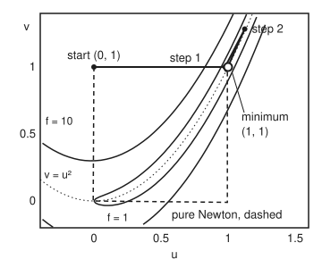

# Newton and BFGS: use curvature, measured or remembered

[Syllabus](../../../SYLLABUS.md) → [Optimization](../README.md) → [Unconstrained Methods](../README.md#s02) → Newton and BFGS

---

## General Overview

The banana valley is the shelf's test landscape. Its height over the map point (u, v) is $f(u, v) = (1 - u)^2 + 100\,(v - u^2)^2$, and the job is to **minimise** it: choose u and v to make the height as small as possible, with nothing limiting the choice. The floor of the valley follows the curve $v = u^2$, with steep walls either side, and falls gently along that curve to the lowest point, (1, 1), at height 0. (Some of the shelf's other cards call the coordinates x and y. This card needs the letter y for something else.)

Start at (0, 1), one unit above the floor where it crosses u = 0. The height there is 101. Feeling only the slope, gradient descent with a careful step length needs 20,494 steps to get the slope below $10^{-8}$. Newton's method also measures how the slope *bends*, and gets there in **eight steps**. BFGS (named after Broyden, Fletcher, Goldfarb and Shanno, who each found it in 1970) never measures the bend. It works it out from how the slope changed between its own steps, and gets there in 27.

Both use one idea: near any point, the land looks like a bowl, so measure or estimate its curvature and jump to its bottom. Two things can go wrong. At the start the land curves *down* across the valley, so the "bowl" is a saddle and its centre is no place to go. And a bowl fitted at one point can be wildly wrong a long way off.

**Newton fits a bowl to the land from its second derivatives, lifts the bowl wherever the land curves down, and walks towards the bowl's bottom only as far as the land agrees; BFGS builds the same bowl from the change in slope between steps, so it gets close to Newton's speed from slopes alone.**

**What kind of fact this is:** two methods. Proved on this card in Why it works: the lifted Newton step always points downhill, and BFGS's matrix matches every measured change in slope and stays a true bowl. Stated with sources: Newton's error squaring near a minimum (proved in one variable on [Convergence rates](03-rates-of-convergence-and-conditioning.md)) and BFGS's superlinear rate. BFGS's exact finish on a bowl is checked, not proved. The answer (1, 1) is the global minimum, certified because f is a sum of two squares, so it is never below 0, and f(1, 1) = 0.

### The picture: eight Newton steps on the banana

<p align="center"></p>

Drawn to scale, 150 units per map unit on both axes. The solid path is the lifted Newton method with a line search. Its first step is almost flat in v: it strides 0.977 across in u and lands just above the valley floor, at height 0.2136. Step 2 overshoots up the floor to (1.124, 1.283), and from step 3 on every step lands so close to (1, 1) that the dots merge. The dashed path is plain Newton with neither fix. It also finishes, in 5 steps, but only by luck: on the way it sits at height 99.99, almost back where it began.

---

## The formula

Notation from [Gradient descent](02-gradient-descent-and-its-rate.md): $x_k$ is the point after $k$ steps, counting from $k = 0$ at the start, $d_k$ the direction and $\alpha_k$ the step length. This card introduces three more: $s_k$ for the step actually taken, $y_k$ for the change in gradient it caused, and $B_k$ for the curvature matrix BFGS remembers. $B_k$ is never written $H_k$, to keep it apart from the true Hessian.

**Newton's step, lifted where needed.** This lift is the **Hessian modification**. Solve for the direction, then search along it ($^{\mathsf T}$, transpose, turns a column into a row):

$$\bigl(\nabla^2 f(x_k) + \tau_k I\bigr)\, d_k = -\nabla f(x_k), \qquad \tau_k = \max\bigl(0,\; \delta - \lambda_{\min}(\nabla^2 f(x_k))\bigr), \qquad x_{k+1} = x_k + \alpha_k d_k$$

**Read it aloud:** add just enough curvature in every direction that the lowest curvature is at least δ, jump towards the bottom of that bowl, and let a line search decide how far.

**BFGS.** Same search, but the matrix is remembered, not measured:

$$B_k d_k = -\nabla f(x_k), \quad s_k = x_{k+1} - x_k, \quad y_k = \nabla f(x_{k+1}) - \nabla f(x_k), \quad B_{k+1} = B_k - \frac{B_k s_k s_k^{\mathsf T} B_k}{s_k^{\mathsf T} B_k s_k} + \frac{y_k y_k^{\mathsf T}}{y_k^{\mathsf T} s_k}$$

**Read it aloud:** after each step, wipe out what the old matrix believed about curvature along the step, and write in what the step actually measured.

| Symbol | Plain meaning | In our example | Push it up and the answer… |
| --- | --- | --- | --- |
| $f$, $u$, $v$ | the height being minimised; the two map coordinates | $f(0, 1) = 101$ | — |
| $x_k$, $k$, $x^*$ | the point (u, v) after k steps; the minimiser | $x_0 = (0, 1)$; $x^* = (1, 1)$ | — |
| $\nabla f$ | the gradient: slope in u, slope in v | $(-2, 200)$ at the start | — |
| $\nabla^2 f$, $I$ | the Hessian (table of second derivatives); the identity matrix (1 on the diagonal, 0 elsewhere) | `[[-398, 0], [0, 200]]` at the start | — |
| $\lambda_{\min}$ | the lowest curvature in any direction: the Hessian's smallest eigenvalue | −398 at the start; 0.3994 at (1, 1) | — |
| $\delta$, $\tau_k$ | the curvature floor; the lift added to every direction | δ = 0.001; $\tau_0$ = 398.001 | δ = 10: 390 steps, not 8 |
| $m_k(d)$ | the bowl (quadratic model) fitted at $x_k$, as a function of the move d | — | — |
| $d_k$ | the direction, the move to the bowl's bottom | $(2000, -0.334)$ at k = 0 | — |
| $\alpha_k$, $c_1$, $c_2$ | step length from the line search; the Armijo and curvature constants | $\alpha_0$ = 1/2048; 0.0001 and 0.9 | — |
| $s_k$, $y_k$, $t$ | the step taken, $\alpha_k d_k$; the change in gradient across it; how far along the step, 0 to 1 | — | — |
| $B_k$, $w$ | BFGS's remembered Hessian; any direction, in proofs | $B_0 = I$; `[[800.5, -399.3], [-399.3, 199.6]]` at the end | — |
| $e_k$, $C$ | the error: distance from $x_k$ to (1, 1); the constant in Newton's squaring rule | $e_{k+1}/e_k^2$ from 3.35 to 10.87 | — |

### When it holds

- **Two smooth derivatives.** The Hessian must exist and change smoothly. Where the land has a crease, the bowl fitted on one side says nothing about the other; that case needs [Subgradients](../01-Convexity/07-subgradients.md).
- **A lift whenever the land curves down.** Without it, the step heads for the centre of a saddle. At (0.7, 0.5) plain Newton climbs, from height 0.10 to 1.17.
- **A small floor δ.** The lift must switch off near the bottom. With δ = 10, above the true lowest curvature 0.3994 at (1, 1), the lift never switches off and Newton slows from 8 steps to 390.
- **A line search.** The bowl is only local. Without the search the lifted first step lands at u = 2000, height 1.600e+15.
- **For BFGS, the curvature condition: $y_k^{\mathsf T} s_k > 0$.** The update divides by it. A Wolfe line search guarantees it ([Line search](04-line-search-armijo-and-wolfe.md)); without it the remembered matrix can stop being a bowl.

---

## Why it works

### Step 0: near any point, the land is a bowl, and a bowl's bottom can be found exactly

Taylor's theorem for two variables ([Hessian](../../06-Calculus%20and%20analysis/07-Several%20Variables/05-hessian-and-second-order-approximation.md)) says that close to $x_k$ the height is nearly

$$m_k(d) = f(x_k) + \nabla f(x_k)^{\mathsf T} d + \tfrac12\, d^{\mathsf T} \nabla^2 f(x_k)\, d .$$

**Read it aloud:** today's height, plus the slope times the move, plus half the curvature times the move twice.

If the Hessian is positive definite (curves up in every direction), $m_k$ is a bowl, and its bottom is where its own gradient is zero: $\nabla f(x_k) + \nabla^2 f(x_k)\,d = 0$. That is Newton's step with no lift. It is also [Newton's method](../../06-Calculus%20and%20analysis/03-What%20Derivatives%20Tell%20You/06-newtons-method.md) applied to the equation "gradient = 0": the tangent-line trick, done with a tangent plane for each slope.

### Step 1: when the land curves down, the model's centre is a saddle

At the start the Hessian is `[[-398, 0], [0, 200]]`. Across u the land curves *down*, by −398: moving sideways from (0, 1), either way, brings the point nearer the floor curve $v = u^2$, so the height falls faster and faster. A model that curves down one way and up the other is a saddle, and "the point where its gradient is zero" is the top of the pass, not a bottom.

Sometimes that point is still downhill, sometimes not. At (0.7, 0.5) the lowest curvature is −0.6772, and the plain Newton step has slope +0.16 along it: it points uphill. Taking it raises the height from 0.10 to 1.17.

### Step 2: the lift makes every step point downhill

Adding $\tau I$ adds τ to the curvature in every direction, because $(\nabla^2 f + \tau I) w = \nabla^2 f\, w + \tau w$. So every eigenvalue rises by exactly τ. Choosing $\tau_k = \max(0, \delta - \lambda_{\min})$ makes the lowest one at least δ, so the lifted matrix is positive definite. Its inverse is positive definite too (its eigenvalues are the reciprocals), and then

$$\nabla f^{\mathsf T} d = -\nabla f^{\mathsf T} \bigl(\nabla^2 f + \tau I\bigr)^{-1} \nabla f < 0$$

whenever the gradient is not zero. **Read it aloud:** the slope along the lifted step is minus a positive number, so the step goes downhill. At (0.7, 0.5) the lifted step's slope is −126.07.

If the Hessian already curves up by at least δ, τ = 0 and this is plain Newton. That is what lets the fast finish in Step 4 happen.

### Step 3: the line search decides how far

At the start τ = 398.001, and the lifted matrix is `[[0.001, 0], [0, 598.001]]`. Across u the bowl is now almost flat, so its bottom is far away: the direction is (2000, −0.334). A bowl fitted at one point means nothing 2000 units off. Backtracking (halve until the height drops by at least $c_1 = 0.0001$ of what the slope promised; [Line search](04-line-search-armijo-and-wolfe.md)) accepts 1/2048 of it. That lands at (0.976563, 0.999837), just above the valley floor, and the height falls from 101 to 0.2136.

The next two steps also need a lift (3.468, then 0.954) and cut steps (1/512, 1/256). From step 3 the Hessian curves up everywhere, τ = 0, and the full step passes the test.

### Step 4: near the bottom, the error squares

Once τ = 0 and α = 1, this is exactly Newton's method on the gradient. [Convergence rates](03-rates-of-convergence-and-conditioning.md) proves in one variable that the error then shrinks like its square, $e_{k+1} \le C\,e_k^2$ for some constant C. In several variables the same argument holds provided the Hessian at the minimum is invertible and changes smoothly near it (Nocedal and Wright, chapter 3, in Sources). Here it is `[[802, -400], [-400, 200]]`, with determinant 400 and lowest curvature 0.3994, so it is positive definite.

The measured ratios $e_{k+1}/e_k^2$ for k = 4 to 7 are 3.35, 10.25, 3.97 and 10.87 (the last is partly rounding error: $e_8$ is only a few times the smallest gap between neighbouring numbers the computer can store near 1). They stay bounded while the errors shrink towards 0. That is the quadratic rate. The slope falls from 1.94e-07 to 9.89e-14 in the last step, and the run stops.

The price is the Hessian. It holds a second derivative for every pair of variables, and solving with it costs far more than one gradient. For the banana that is nothing; for a model with a million variables it is out of reach.

### Step 5: BFGS remembers curvature from the slopes

Walk from $x_k$ to $x_{k+1}$. The gradient changes by $y_k$. Along the straight step, the change in gradient is the Hessian, averaged along the step, times the step:

$$y_k = \Bigl(\int_0^1 \nabla^2 f(x_k + t s_k)\, dt\Bigr)\, s_k .$$

**Read it aloud:** the slopes changed by the average curvature along the step times the step, where $t$ runs from 0 to 1 along it. So any matrix that claims to be the curvature should send $s_k$ to $y_k$. That is the **secant equation**, the many-variable version of using a slope through two points:

$$B_{k+1} s_k = y_k .$$

The BFGS formula meets it exactly. Multiply the update by $s_k$: the middle term gives $B_k s_k \cdot (s_k^{\mathsf T} B_k s_k)/(s_k^{\mathsf T} B_k s_k) = B_k s_k$, cancelling the first, and the last gives $y_k (y_k^{\mathsf T} s_k)/(y_k^{\mathsf T} s_k) = y_k$. In the run the worst miss over all 27 updates is 1.7e-14 of the size of $y_k$: rounding error.

One equation does not fix a whole matrix: in two variables it pins down the curvature along the step only. BFGS picks one by a least-change rule: its inverse is the symmetric matrix closest to the old inverse, in a weighted sense, among all that satisfy the secant equation (Nocedal and Wright, chapter 6, in Sources). It is a **rank-two update**: it adds two matrices, each of the form "a column times a row". Practical codes update the inverse of $B_k$ by an equally cheap formula, so a step costs arithmetic on the order of the square of the number of variables, against the cube for solving with a fresh Hessian.

### Step 6: the memory stays a bowl when the curvature condition holds

<details>
<summary>Detailed proof: if $B_k$ is positive definite and $y_k^{\mathsf T} s_k > 0$, so is $B_{k+1}$</summary>

Take any direction $w \ne 0$. Multiply the update by $w$ on both sides:

$$w^{\mathsf T} B_{k+1} w = \Bigl(w^{\mathsf T} B_k w - \frac{(w^{\mathsf T} B_k s_k)^2}{s_k^{\mathsf T} B_k s_k}\Bigr) + \frac{(y_k^{\mathsf T} w)^2}{y_k^{\mathsf T} s_k}.$$

Because $B_k$ is positive definite, $w^{\mathsf T} B_k s_k$ behaves like a dot product ([Quadratic forms](../../03-Algebra/07-Eigenvalues%20and%20Symmetric%20Matrices/05-quadratic-forms-and-positive-definite.md)), and the Cauchy–Schwarz inequality for it, $(w^{\mathsf T} B_k s_k)^2 \le (w^{\mathsf T} B_k w)(s_k^{\mathsf T} B_k s_k)$, makes the bracket at least 0. The last term is at least 0 because $y_k^{\mathsf T} s_k > 0$. The bracket is 0 only when $w$ is a nonzero multiple of $s_k$. Then $y_k^{\mathsf T} w$ is that multiple times $y_k^{\mathsf T} s_k$, which is not 0, so the last term is positive. Either way the total is strictly positive.

</details>

In words: the update removes the old curvature along the step and puts back the curvature the step measured. If that is positive, nothing goes flat or negative. A Wolfe line search guarantees $y_k^{\mathsf T} s_k > 0$ at every step, proved on [Line search](04-line-search-armijo-and-wolfe.md). So BFGS never needs a lift: starting from $B_0 = I$, every $B_k$ is a bowl and every direction points downhill, by Step 2's argument.

### Step 7: how fast BFGS gets there

BFGS is **superlinear**: the ratio $e_{k+1}/e_k$ falls towards 0, though the error does not square. Over its last five steps the run measures 0.3063, 0.0340, 0.0480, 0.0080 and 0.0022. This is stated, not proved here. Dennis and Moré showed that a quasi-Newton method is superlinear exactly when $B_k$ becomes right along the steps it takes; Nocedal and Wright (chapter 6) prove BFGS does this near a minimum where the Hessian is positive definite and does not change too fast (Sources). The memory shows it: at the end $B_k$ is `[[800.5, -399.3], [-399.3, 199.6]]` against the true `[[802, -400], [-400, 200]]`.

On an exact bowl, with each step going to the lowest point along its line, BFGS is known to do better still: it finishes in as many steps as there are variables, and its matrix then equals the bowl's curvature exactly. This card does not prove that. The code checks it on the bowl with curvature `[[3, 1], [1, 2]]`: after two steps it stands at (0.200000, 0.400000), the true bottom, with $B_2$ = `[[3.000000, 1.000000], [1.000000, 2.000000]]`.

---

## Worked numbers, by hand

The first lifted Newton step, from (0, 1):

| Step | Arithmetic | Value |
| --- | --- | --- |
| Height | $(1 - 0)^2 + 100\,(1 - 0)^2$ | 101 |
| Slope in u | $-2(1 - 0) - 400 \times 0 \times (1 - 0)$ | −2 |
| Slope in v | $200\,(1 - 0)$ | 200 |
| Hessian | $2 - 400 \times 1 + 1200 \times 0$; $-400 \times 0$; 200 | `[[-398, 0], [0, 200]]` |
| Lowest curvature | the smaller diagonal entry, since the off-diagonal entries are 0 | −398 |
| Lift | $0.001 - (-398)$ | 398.001 |
| Lifted matrix | $-398 + 398.001$; $200 + 398.001$ | `[[0.001, 0], [0, 598.001]]` |
| Direction | $2 / 0.001$; $-200 / 598.001$ | (2000, −0.334) |
| Line search | halve from 1 until the Armijo test passes | 1/2048 |
| New point | $0 + 2000/2048$; v moves by a hair | (0.976563, 0.999837), height 0.2136 |
| Seven more steps | lifts 3.468 and 0.954, then plain Newton | **(1, 1) after 8 steps, slope 9.89e-14** |

The run stops at the bottom, (1, 1), height 0, after eight steps, as the shelf's example says; the sum-of-squares argument certifies it as the global minimum, and the Hessian there, with determinant 400 and lowest curvature 0.3994, confirms it is a strict one.

### What breaks if you drop a piece

| Mistake | Comes out at | What went wrong |
| --- | --- | --- |
| Plain Newton at (0.7, 0.5), where the lowest curvature is −0.6772 | slope along the step +0.16; height 0.10 rises to 1.17 | The model is a saddle; its centre is uphill. |
| Lift, but no line search | first step lands at u = 2000, height 1.600e+15 | The lifted bowl is nearly flat across u, so its bottom is absurdly far. |
| Floor δ = 10 instead of 0.001 | 390 steps instead of 8 | The lift never switches off near (1, 1), whose true lowest curvature is 0.3994, so Newton turns into a slow, linear method. |
| BFGS that never updates $B_k$ | 20,494 steps instead of 27 | With $B_k = I$ forever, the direction is minus the gradient: gradient descent. The memory is the method. |

---

## Code, from first principles, and it actually runs

The code runs the lifted Newton method with backtracking, and BFGS with a weak Wolfe line search found by bisection, both from (0, 1), with stopping test "length of the gradient below $10^{-8}$". Linear systems are solved by elimination. It takes five independent roads:

1. The two methods reach the same point.
2. The certificate: f is a sum of squares, so (1, 1) with f = 0 is the global minimum, and the Hessian there is positive definite.
3. The hand-written gradient and Hessian match central differences (slopes from tiny steps either side) at three points.
4. Every BFGS matrix is checked against the secant equation.
5. On a bowl, BFGS with exact steps recovers the bowl's matrix and its bottom, checked against Cramer's rule (the determinant formula for a 2 × 2 system).

It then prints the four breaks, the Armijo trap from The usual mistake, the "Try changing" runs and the figure's coordinates.

### Python

```python
import math
def f(p): return (1 - p[0])**2 + 100 * (p[1] - p[0]**2)**2
def grad(p):
    u, v = p
    return (-2 * (1 - u) - 400 * u * (v - u * u), 200 * (v - u * u))
def hess(p):
    u, v = p
    return (2 - 400 * v + 1200 * u * u, -400 * u + 0.0, 200.0)
def solve(a, b, c, r):  # [[a, b], [b, c]] d = r, by elimination
    m = b / a
    d2 = (r[1] - m * r[0]) / (c - m * b)
    return ((r[0] - b * d2) / a, d2)
def lam_min(a, b, c): return (a + c) / 2 - math.sqrt(((a - c) / 2)**2 + b * b)
def dot(u, v): return u[0] * v[0] + u[1] * v[1]
def norm(u): return math.sqrt(dot(u, u))
def step(p, d, t): return (p[0] + t * d[0], p[1] + t * d[1])
def err(p): return norm((p[0] - 1, p[1] - 1))
def newton(p, delta=1e-3, tol=1e-8, search=True, modify=True, cap=1000):
    rows = []
    for k in range(cap):
        g = grad(p)
        a, b, c = hess(p)
        tau = max(0.0, delta - lam_min(a, b, c)) if modify else 0.0
        if norm(g) < tol:
            return rows + [(k, p, f(p), norm(g), tau, 0.0)]
        d = solve(a + tau, b, c + tau, (-g[0], -g[1]))
        t = 1.0
        while search and f(step(p, d, t)) > f(p) + 1e-4 * t * dot(g, d): t /= 2
        rows.append((k, p, f(p), norm(g), tau, t))
        p = step(p, d, t)
    return rows
def wolfe(p, d, g):  # weak Wolfe by bisection, c1 = 0.0001, c2 = 0.9
    lo, hi, t = 0.0, math.inf, 1.0
    for _ in range(60):
        if f(step(p, d, t)) > f(p) + 1e-4 * t * dot(g, d): hi = t
        elif dot(grad(step(p, d, t)), d) < 0.9 * dot(g, d): lo = t
        else: break
        t = (lo + hi) / 2 if hi < math.inf else 2 * t
    return t
def bfgs_update(B, s, y):
    Bs = (B[0] * s[0] + B[1] * s[1], B[1] * s[0] + B[2] * s[1])
    sBs, sy = dot(s, Bs), dot(s, y)
    return (B[0] - Bs[0] * Bs[0] / sBs + y[0] * y[0] / sy,
            B[1] - Bs[0] * Bs[1] / sBs + y[0] * y[1] / sy,
            B[2] - Bs[1] * Bs[1] / sBs + y[1] * y[1] / sy)
def bfgs(p, tol=1e-8, learn=True, cap=50000):
    B, errs, worst = (1.0, 0.0, 1.0), [], 0.0
    for k in range(cap):
        g = grad(p)
        errs.append(err(p))
        if norm(g) < tol: break
        d = solve(B[0], B[1], B[2], (-g[0], -g[1]))
        q = step(p, d, wolfe(p, d, g))
        s, y = (q[0] - p[0], q[1] - p[1]), (grad(q)[0] - g[0], grad(q)[1] - g[1])
        if learn:
            B = bfgs_update(B, s, y)
            worst = max(worst, norm((B[0] * s[0] + B[1] * s[1] - y[0], B[1] * s[0] + B[2] * s[1] - y[1])) / norm(y))
        p = q
    return k, p, B, errs, worst

# Road 1: modified Newton with Armijo backtracking, from (0, 1)
start = (0.0, 1.0)
a, b, c = hess(start)
print(f"start (0, 1): f = {f(start):.0f}, gradient ({grad(start)[0]:.0f}, {grad(start)[1]:.0f})")
print(f"Hessian at start [[{a:.0f}, {b:.0f}], [{b:.0f}, {c:.0f}]], lowest curvature {lam_min(a, b, c):.0f}")
tau0 = 1e-3 - lam_min(a, b, c)
d0 = solve(a + tau0, b, c + tau0, (-grad(start)[0], -grad(start)[1]))
print(f"shifted by tau = {tau0:.3f}: [[{a + tau0:.3f}, {b:.0f}], [{b:.0f}, {c + tau0:.3f}]], step d = ({d0[0]:.0f}, {d0[1]:.3f})")
rows = newton(start)
print(" k         u          v          f     |grad|       tau     alpha")
for k, p, fv, gn, tau, t in rows:
    frac = "-" if t == 0 else "1" if t == 1 else f"1/{round(1 / t)}"
    print(f"{k:2d} {p[0]:10.6f} {p[1]:10.6f} {fv:10.3e} {gn:9.2e} {tau:9.3f} {frac:>9}")
ne = [err(r[1]) for r in rows]
print("Newton e(k+1)/e(k)^2, k = 4..7:" + "".join(f" {ne[k + 1] / ne[k]**2:.2f}" for k in range(4, 8)))
# Road 2: the certificate at (1, 1): f is a sum of two squares, so f >= 0 = f(1, 1)
a, b, c = hess((1.0, 1.0))
print(f"Hessian at (1, 1) [[{a:.0f}, {b:.0f}], [{b:.0f}, {c:.0f}]], det {a * c - b * b:.0f}, lowest curvature {lam_min(a, b, c):.4f}")
# Road 3: BFGS with weak Wolfe steps, from the same start, B_0 = identity
nb, pb, B, be, worst = bfgs(start)
print(f"BFGS steps {nb}, final ({pb[0]:.10f}, {pb[1]:.10f}), worst secant miss {worst:.1e}")
print("BFGS e(k+1)/e(k), last five:" + "".join(f" {be[k + 1] / be[k]:.4f}" for k in range(nb - 5, nb)))
print(f"BFGS remembered B [[{B[0]:.1f}, {B[1]:.1f}], [{B[1]:.1f}, {B[2]:.1f}]] vs true [[802, -400], [-400, 200]]")
# Road 4: derivatives against central differences
h, worst_g, worst_h = 1e-5, 0.0, 0.0
for p in (start, (0.7, 0.5), (1.2, 1.3)):
    for i in range(2):
        up, dn = list(p), list(p); up[i] += h; dn[i] -= h
        worst_g = max(worst_g, abs((f(up) - f(dn)) / (2 * h) - grad(p)[i]))
        col = [(grad(up)[j] - grad(dn)[j]) / (2 * h) for j in range(2)]
        worst_h = max(worst_h, abs(col[0] - hess(p)[i]), abs(col[1] - hess(p)[i + 1]))
print(f"central difference miss: gradient {worst_g:.1e}, Hessian {worst_h:.1e}")
# Road 5: on a quadratic with exact line search, BFGS learns A in two steps
A, rhs, x, Bq = (3.0, 1.0, 2.0), (1.0, 1.0), (0.0, 0.0), (1.0, 0.0, 1.0)
for _ in range(2):
    g = (A[0] * x[0] + A[1] * x[1] - rhs[0], A[1] * x[0] + A[2] * x[1] - rhs[1])
    d = solve(Bq[0], Bq[1], Bq[2], (-g[0], -g[1]))
    t = -dot(g, d) / dot(d, (A[0] * d[0] + A[1] * d[1], A[1] * d[0] + A[2] * d[1]))
    s = (t * d[0], t * d[1])
    Bq, x = bfgs_update(Bq, s, (A[0] * s[0] + A[1] * s[1], A[1] * s[0] + A[2] * s[1])), step(x, s, 1.0)
print(f"quadratic: x_2 = ({x[0]:.6f}, {x[1]:.6f}), B_2 = [[{Bq[0]:.6f}, {Bq[1]:.6f}], [{Bq[1]:.6f}, {Bq[2]:.6f}]]")
# What breaks
p = (0.7, 0.5); g = grad(p); a, b, c = hess(p)
dp = solve(a, b, c, (-g[0], -g[1]))
dm = solve(a + 1e-3 - lam_min(a, b, c), b, c + 1e-3 - lam_min(a, b, c), (-g[0], -g[1]))
print(f"break: pure Newton at (0.7, 0.5), lowest curvature {lam_min(a, b, c):.4f}, slope along step {dot(g, dp):+.2f}, f {f(p):.2f} -> {f(step(p, dp, 1)):.2f}")
print(f"  modified step there: slope along step {dot(g, dm):+.2f}")
n10 = len(newton(start, delta=10.0)) - 1
print(f"break: floor delta = 10 instead of 0.001, Newton steps {n10}")
wild = newton(start, search=False, cap=2)
print(f"break: shift but no line search, first step lands at u = {wild[1][1][0]:.0f}, f = {wild[1][2]:.3e}")
ngd = bfgs(start, learn=False)[0]
print(f"break: B never updated (gradient descent with Wolfe), steps {ngd}")
pa = (-1.2, 1.0)                                 # BFGS fed an Armijo-only step: descent to step 30, as on Line search
for _ in range(31):
    ga, t = grad(pa), 1.0
    while f(step(pa, ga, -t)) > f(pa) - 1e-4 * t * dot(ga, ga): t /= 2
    qa, pa = pa, step(pa, ga, -t)
sa, ya = (pa[0] - qa[0], pa[1] - qa[1]), (grad(pa)[0] - ga[0], grad(pa)[1] - ga[1])
Ba, gn = bfgs_update((1.0, 0.0, 1.0), sa, ya), grad(pa)
print(f"break: BFGS fed an Armijo-only step at step 30 from (-1.2, 1): s.y {dot(sa, ya):.2f}, next slope {dot(gn, solve(Ba[0], Ba[1], Ba[2], (-gn[0], -gn[1]))):+.2f}")
# Try changing
print(f"try: start (-1.2, 1): Newton {len(newton((-1.2, 1.0))) - 1}, BFGS {bfgs((-1.2, 1.0))[0]}")
raw = newton(start, search=False, modify=False)
print(f"try: pure Newton from (0, 1), no shift, no search: steps {len(raw) - 1}, highest f after the start {max(r[2] for r in raw[1:]):.2f}")
print(f"try: tolerance 1e-12: Newton {len(newton(start, tol=1e-12)) - 1}, BFGS {bfgs(start, tol=1e-12)[0]}")
print("figure, Newton path" + "".join(f" ({r[1][0]:.3f}, {r[1][1]:.3f})" for r in rows[:5]))
print("figure, pure Newton path" + "".join(f" ({r[1][0]:.3f}, {r[1][1]:.3f})" for r in raw[:4]))

assert len(rows) - 1 == 8 and err(rows[-1][1]) < 1e-9, "Newton reaches (1, 1) in eight steps"
assert err(pb) < 1e-8 and nb == 27, "BFGS reaches the same floor"
assert a * c - b * b < 0 and dot(g, dp) > 0 and f(step(p, dp, 1)) > f(p), "pure Newton climbs at an indefinite point"
assert dot(g, dm) < 0, "the modified step points downhill"
assert worst < 1e-10, "every BFGS matrix satisfies the secant equation B s = y"
assert max(abs(B[0] - 802) / 802, abs(B[1] + 400) / 400, abs(B[2] - 200) / 200) < 0.01, "BFGS memory near the true Hessian"
assert worst_g < 1e-4 and worst_h < 1e-3, "analytic derivatives match central differences"
assert abs(x[0] - 0.2) < 1e-12 and abs(x[1] - 0.4) < 1e-12, "quadratic minimiser by Cramer: (2 - 1, 3 - 1) / 5"
assert max(abs(Bq[0] - 3), abs(Bq[1] - 1), abs(Bq[2] - 2)) < 1e-12, "BFGS recovers A after two exact steps"
assert ne[7] / ne[6]**2 < 20 and be[nb] / be[nb - 1] < 0.01, "quadratic for Newton, superlinear for BFGS"
print("ALL CHECKS PASS")
```

**Ran 2026-11-11 on macOS, Python 3.14.10, standard library only. All checks passed. Output, pasted from the run:**

```
start (0, 1): f = 101, gradient (-2, 200)
Hessian at start [[-398, 0], [0, 200]], lowest curvature -398
shifted by tau = 398.001: [[0.001, 0], [0, 598.001]], step d = (2000, -0.334)
 k         u          v          f     |grad|       tau     alpha
 0   0.000000   1.000000  1.010e+02  2.00e+02   398.001    1/2048
 1   0.976563   0.999837  2.136e-01  2.03e+01     3.468     1/512
 2   1.124192   1.283173  5.293e-02  9.30e+00     0.954     1/256
 3   0.989557   0.981822  7.852e-04  1.17e+00     0.000         1
 4   1.011316   1.022286  1.505e-04  2.34e-01     0.000         1
 5   1.000979   1.001852  2.100e-06  4.96e-02     0.000         1
 6   1.000020   1.000040  5.038e-10  4.48e-04     0.000         1
 7   1.000000   1.000000  3.173e-17  1.94e-07     0.000         1
 8   1.000000   1.000000  4.980e-30  9.89e-14     0.000         -
Newton e(k+1)/e(k)^2, k = 4..7: 3.35 10.25 3.97 10.87
Hessian at (1, 1) [[802, -400], [-400, 200]], det 400, lowest curvature 0.3994
BFGS steps 27, final (0.9999999999, 0.9999999999), worst secant miss 1.7e-14
BFGS e(k+1)/e(k), last five: 0.3063 0.0340 0.0480 0.0080 0.0022
BFGS remembered B [[800.5, -399.3], [-399.3, 199.6]] vs true [[802, -400], [-400, 200]]
central difference miss: gradient 4.8e-08, Hessian 4.7e-08
quadratic: x_2 = (0.200000, 0.400000), B_2 = [[3.000000, 1.000000], [1.000000, 2.000000]]
break: pure Newton at (0.7, 0.5), lowest curvature -0.6772, slope along step +0.16, f 0.10 -> 1.17
  modified step there: slope along step -126.07
break: floor delta = 10 instead of 0.001, Newton steps 390
break: shift but no line search, first step lands at u = 2000, f = 1.600e+15
break: B never updated (gradient descent with Wolfe), steps 20494
break: BFGS fed an Armijo-only step at step 30 from (-1.2, 1): s.y -92.39, next slope +102.27
try: start (-1.2, 1): Newton 21, BFGS 35
try: pure Newton from (0, 1), no shift, no search: steps 5, highest f after the start 99.99
try: tolerance 1e-12: Newton 8, BFGS 29
figure, Newton path (0.000, 1.000) (0.977, 1.000) (1.124, 1.283) (0.990, 0.982) (1.011, 1.022)
figure, pure Newton path (0.000, 1.000) (-0.005, 0.000) (0.995, -0.010) (0.995, 0.990)
ALL CHECKS PASS
```

### Rust

```rust
type V = (f64, f64);
type M = (f64, f64, f64); // symmetric [[a, b], [b, c]]
fn f(p: V) -> f64 { (1.0 - p.0).powi(2) + 100.0 * (p.1 - p.0 * p.0).powi(2) }
fn grad(p: V) -> V { (-2.0 * (1.0 - p.0) - 400.0 * p.0 * (p.1 - p.0 * p.0), 200.0 * (p.1 - p.0 * p.0)) }
fn hess(p: V) -> M { (2.0 - 400.0 * p.1 + 1200.0 * p.0 * p.0, -400.0 * p.0 + 0.0, 200.0) }
fn solve(a: f64, b: f64, c: f64, r: V) -> V { // [[a, b], [b, c]] d = r, by elimination
    let m = b / a;
    let d2 = (r.1 - m * r.0) / (c - m * b);
    ((r.0 - b * d2) / a, d2)
}
fn lam_min(m: M) -> f64 { (m.0 + m.2) / 2.0 - (((m.0 - m.2) / 2.0).powi(2) + m.1 * m.1).sqrt() }
fn dot(u: V, v: V) -> f64 { u.0 * v.0 + u.1 * v.1 }
fn norm(u: V) -> f64 { dot(u, u).sqrt() }
fn step(p: V, d: V, t: f64) -> V { (p.0 + t * d.0, p.1 + t * d.1) }
fn err(p: V) -> f64 { norm((p.0 - 1.0, p.1 - 1.0)) }
fn neg(g: V) -> V { (-g.0, -g.1) }
fn mul(m: M, s: V) -> V { (m.0 * s.0 + m.1 * s.1, m.1 * s.0 + m.2 * s.1) }
fn e(v: f64, prec: usize) -> String { // Python-style scientific notation
    let s = format!("{:.*e}", prec, v);
    let (mant, ex) = s.split_once('e').unwrap();
    let n: i32 = ex.parse().unwrap();
    format!("{}e{}{:02}", mant, if n < 0 { '-' } else { '+' }, n.abs())
}
struct Row { k: usize, p: V, f: f64, gn: f64, tau: f64, t: f64 }
fn newton(mut p: V, delta: f64, tol: f64, search: bool, modify: bool, cap: usize) -> Vec<Row> {
    let mut rows = Vec::new();
    for k in 0..cap {
        let g = grad(p);
        let h = hess(p);
        let tau = if modify { (delta - lam_min(h)).max(0.0) } else { 0.0 };
        if norm(g) < tol { rows.push(Row { k, p, f: f(p), gn: norm(g), tau, t: 0.0 }); return rows; }
        let d = solve(h.0 + tau, h.1, h.2 + tau, neg(g));
        let mut t = 1.0;
        while search && f(step(p, d, t)) > f(p) + 1e-4 * t * dot(g, d) { t /= 2.0; }
        rows.push(Row { k, p, f: f(p), gn: norm(g), tau, t });
        p = step(p, d, t);
    }
    rows
}
fn wolfe(p: V, d: V, g: V) -> f64 { // weak Wolfe by bisection, c1 = 0.0001, c2 = 0.9
    let (mut lo, mut hi, mut t) = (0.0, f64::INFINITY, 1.0);
    for _ in 0..60 {
        if f(step(p, d, t)) > f(p) + 1e-4 * t * dot(g, d) { hi = t; }
        else if dot(grad(step(p, d, t)), d) < 0.9 * dot(g, d) { lo = t; }
        else { break; }
        t = if hi < f64::INFINITY { (lo + hi) / 2.0 } else { 2.0 * t };
    }
    t
}
fn bfgs_update(b: M, s: V, y: V) -> M {
    let bs = mul(b, s);
    let (sbs, sy) = (dot(s, bs), dot(s, y));
    (b.0 - bs.0 * bs.0 / sbs + y.0 * y.0 / sy, b.1 - bs.0 * bs.1 / sbs + y.0 * y.1 / sy,
     b.2 - bs.1 * bs.1 / sbs + y.1 * y.1 / sy)
}
fn bfgs(mut p: V, tol: f64, learn: bool, cap: usize) -> (usize, V, M, Vec<f64>, f64) {
    let (mut b, mut errs, mut worst, mut k) = ((1.0, 0.0, 1.0), Vec::new(), 0.0f64, 0);
    while k < cap {
        let g = grad(p);
        errs.push(err(p));
        if norm(g) < tol { break; }
        let d = solve(b.0, b.1, b.2, neg(g));
        let q = step(p, d, wolfe(p, d, g));
        let (s, y) = ((q.0 - p.0, q.1 - p.1), (grad(q).0 - g.0, grad(q).1 - g.1));
        if learn {
            b = bfgs_update(b, s, y);
            let bs = mul(b, s);
            worst = worst.max(norm((bs.0 - y.0, bs.1 - y.1)) / norm(y));
        }
        p = q;
        k += 1;
    }
    (k, p, b, errs, worst)
}
fn main() {
    // Road 1: modified Newton with Armijo backtracking, from (0, 1)
    let start = (0.0, 1.0);
    let h = hess(start);
    println!("start (0, 1): f = {:.0}, gradient ({:.0}, {:.0})", f(start), grad(start).0, grad(start).1);
    println!("Hessian at start [[{:.0}, {:.0}], [{:.0}, {:.0}]], lowest curvature {:.0}", h.0, h.1, h.1, h.2, lam_min(h));
    let tau0 = 1e-3 - lam_min(h);
    let d0 = solve(h.0 + tau0, h.1, h.2 + tau0, neg(grad(start)));
    println!("shifted by tau = {:.3}: [[{:.3}, {:.0}], [{:.0}, {:.3}]], step d = ({:.0}, {:.3})", tau0, h.0 + tau0, h.1, h.1, h.2 + tau0, d0.0, d0.1);
    let rows = newton(start, 1e-3, 1e-8, true, true, 1000);
    println!(" k         u          v          f     |grad|       tau     alpha");
    for r in &rows {
        let frac = if r.t == 0.0 { "-".to_string() } else if r.t == 1.0 { "1".to_string() } else { format!("1/{}", (1.0 / r.t).round()) };
        println!("{:2} {:10.6} {:10.6} {:>10} {:>9} {:9.3} {:>9}", r.k, r.p.0, r.p.1, e(r.f, 3), e(r.gn, 2), r.tau, frac);
    }
    let ne: Vec<f64> = rows.iter().map(|r| err(r.p)).collect();
    let mut line = String::from("Newton e(k+1)/e(k)^2, k = 4..7:");
    for k in 4..8 { line += &format!(" {:.2}", ne[k + 1] / ne[k].powi(2)); }
    println!("{}", line);
    // Road 2: the certificate at (1, 1): f is a sum of two squares, so f >= 0 = f(1, 1)
    let h1 = hess((1.0, 1.0));
    println!("Hessian at (1, 1) [[{:.0}, {:.0}], [{:.0}, {:.0}]], det {:.0}, lowest curvature {:.4}", h1.0, h1.1, h1.1, h1.2, h1.0 * h1.2 - h1.1 * h1.1, lam_min(h1));
    // Road 3: BFGS with weak Wolfe steps, from the same start, B_0 = identity
    let (nb, pb, b, be, worst) = bfgs(start, 1e-8, true, 50000);
    println!("BFGS steps {}, final ({:.10}, {:.10}), worst secant miss {}", nb, pb.0, pb.1, e(worst, 1));
    let mut line = String::from("BFGS e(k+1)/e(k), last five:");
    for k in nb - 5..nb { line += &format!(" {:.4}", be[k + 1] / be[k]); }
    println!("{}", line);
    println!("BFGS remembered B [[{:.1}, {:.1}], [{:.1}, {:.1}]] vs true [[802, -400], [-400, 200]]", b.0, b.1, b.1, b.2);
    // Road 4: derivatives against central differences
    let (hh, mut worst_g, mut worst_h) = (1e-5, 0.0f64, 0.0f64);
    for p in [start, (0.7, 0.5), (1.2, 1.3)] {
        for i in 0..2 {
            let (up, dn) = if i == 0 { ((p.0 + hh, p.1), (p.0 - hh, p.1)) } else { ((p.0, p.1 + hh), (p.0, p.1 - hh)) };
            let gi = if i == 0 { grad(p).0 } else { grad(p).1 };
            worst_g = worst_g.max(((f(up) - f(dn)) / (2.0 * hh) - gi).abs());
            let col = ((grad(up).0 - grad(dn).0) / (2.0 * hh), (grad(up).1 - grad(dn).1) / (2.0 * hh));
            let hp = hess(p);
            let (h0, h1) = if i == 0 { (hp.0, hp.1) } else { (hp.1, hp.2) };
            worst_h = worst_h.max((col.0 - h0).abs()).max((col.1 - h1).abs());
        }
    }
    println!("central difference miss: gradient {}, Hessian {}", e(worst_g, 1), e(worst_h, 1));
    // Road 5: on a quadratic with exact line search, BFGS learns A in two steps
    let (a, rhs) = ((3.0, 1.0, 2.0), (1.0, 1.0));
    let (mut x, mut bq) = ((0.0, 0.0), (1.0, 0.0, 1.0));
    for _ in 0..2 {
        let ax = mul(a, x);
        let g = (ax.0 - rhs.0, ax.1 - rhs.1);
        let d = solve(bq.0, bq.1, bq.2, neg(g));
        let t = -dot(g, d) / dot(d, mul(a, d));
        let s = (t * d.0, t * d.1);
        bq = bfgs_update(bq, s, mul(a, s));
        x = step(x, s, 1.0);
    }
    println!("quadratic: x_2 = ({:.6}, {:.6}), B_2 = [[{:.6}, {:.6}], [{:.6}, {:.6}]]", x.0, x.1, bq.0, bq.1, bq.1, bq.2);
    // What breaks
    let p = (0.7, 0.5);
    let (g, hp) = (grad(p), hess(p));
    let lm = lam_min(hp);
    let dp = solve(hp.0, hp.1, hp.2, neg(g));
    let dm = solve(hp.0 + 1e-3 - lm, hp.1, hp.2 + 1e-3 - lm, neg(g));
    println!("break: pure Newton at (0.7, 0.5), lowest curvature {:.4}, slope along step {:+.2}, f {:.2} -> {:.2}", lm, dot(g, dp), f(p), f(step(p, dp, 1.0)));
    println!("  modified step there: slope along step {:+.2}", dot(g, dm));
    println!("break: floor delta = 10 instead of 0.001, Newton steps {}", newton(start, 10.0, 1e-8, true, true, 1000).len() - 1);
    let wild = newton(start, 1e-3, 1e-8, false, true, 2);
    println!("break: shift but no line search, first step lands at u = {:.0}, f = {}", wild[1].p.0, e(wild[1].f, 3));
    println!("break: B never updated (gradient descent with Wolfe), steps {}", bfgs(start, 1e-8, false, 50000).0);
    let (mut pa, mut qa, mut ga) = ((-1.2, 1.0), (0.0, 0.0), (0.0, 0.0)); // BFGS fed an Armijo-only step: descent to step 30, as on Line search
    for _ in 0..31 { let (g, mut t) = (grad(pa), 1.0); while f(step(pa, g, -t)) > f(pa) - 1e-4 * t * dot(g, g) { t /= 2.0; } (qa, ga, pa) = (pa, g, step(pa, g, -t)); }
    let (sa, ya, gn) = ((pa.0 - qa.0, pa.1 - qa.1), (grad(pa).0 - ga.0, grad(pa).1 - ga.1), grad(pa));
    let ba = bfgs_update((1.0, 0.0, 1.0), sa, ya);
    println!("break: BFGS fed an Armijo-only step at step 30 from (-1.2, 1): s.y {:.2}, next slope {:+.2}", dot(sa, ya), dot(gn, solve(ba.0, ba.1, ba.2, neg(gn))));
    // Try changing
    println!("try: start (-1.2, 1): Newton {}, BFGS {}", newton((-1.2, 1.0), 1e-3, 1e-8, true, true, 1000).len() - 1, bfgs((-1.2, 1.0), 1e-8, true, 50000).0);
    let raw = newton(start, 1e-3, 1e-8, false, false, 1000);
    let top = raw[1..].iter().map(|r| r.f).fold(f64::MIN, f64::max);
    println!("try: pure Newton from (0, 1), no shift, no search: steps {}, highest f after the start {:.2}", raw.len() - 1, top);
    println!("try: tolerance 1e-12: Newton {}, BFGS {}", newton(start, 1e-3, 1e-12, true, true, 1000).len() - 1, bfgs(start, 1e-12, true, 50000).0);
    let path = |rs: &[Row]| rs.iter().map(|r| format!(" ({:.3}, {:.3})", r.p.0, r.p.1)).collect::<String>();
    println!("figure, Newton path{}", path(&rows[..5]));
    println!("figure, pure Newton path{}", path(&raw[..4]));

    let det = hp.0 * hp.2 - hp.1 * hp.1;
    assert!(rows.len() - 1 == 8 && err(rows[rows.len() - 1].p) < 1e-9, "Newton reaches (1, 1) in eight steps");
    assert!(err(pb) < 1e-8 && nb == 27, "BFGS reaches the same floor");
    assert!(det < 0.0 && dot(g, dp) > 0.0 && f(step(p, dp, 1.0)) > f(p), "pure Newton climbs at an indefinite point");
    assert!(dot(g, dm) < 0.0, "the modified step points downhill");
    assert!(worst < 1e-10, "every BFGS matrix satisfies the secant equation B s = y");
    assert!(((b.0 - 802.0) / 802.0).abs().max(((b.1 + 400.0) / 400.0).abs()).max(((b.2 - 200.0) / 200.0).abs()) < 0.01, "BFGS memory near the true Hessian");
    assert!(worst_g < 1e-4 && worst_h < 1e-3, "analytic derivatives match central differences");
    assert!((x.0 - 0.2).abs() < 1e-12 && (x.1 - 0.4).abs() < 1e-12, "quadratic minimiser by Cramer: (2 - 1, 3 - 1) / 5");
    assert!((bq.0 - 3.0).abs().max((bq.1 - 1.0).abs()).max((bq.2 - 2.0).abs()) < 1e-12, "BFGS recovers A after two exact steps");
    assert!(ne[7] / ne[6].powi(2) < 20.0 && be[nb] / be[nb - 1] < 0.01, "quadratic for Newton, superlinear for BFGS");
    println!("ALL CHECKS PASS");
}
```

**Ran 2026-11-11 on macOS, rustc 1.98.1, no crates. All checks passed. Output, pasted from the run:**

```
start (0, 1): f = 101, gradient (-2, 200)
Hessian at start [[-398, 0], [0, 200]], lowest curvature -398
shifted by tau = 398.001: [[0.001, 0], [0, 598.001]], step d = (2000, -0.334)
 k         u          v          f     |grad|       tau     alpha
 0   0.000000   1.000000  1.010e+02  2.00e+02   398.001    1/2048
 1   0.976563   0.999837  2.136e-01  2.03e+01     3.468     1/512
 2   1.124192   1.283173  5.293e-02  9.30e+00     0.954     1/256
 3   0.989557   0.981822  7.852e-04  1.17e+00     0.000         1
 4   1.011316   1.022286  1.505e-04  2.34e-01     0.000         1
 5   1.000979   1.001852  2.100e-06  4.96e-02     0.000         1
 6   1.000020   1.000040  5.038e-10  4.48e-04     0.000         1
 7   1.000000   1.000000  3.173e-17  1.94e-07     0.000         1
 8   1.000000   1.000000  4.980e-30  9.89e-14     0.000         -
Newton e(k+1)/e(k)^2, k = 4..7: 3.35 10.25 3.97 10.87
Hessian at (1, 1) [[802, -400], [-400, 200]], det 400, lowest curvature 0.3994
BFGS steps 27, final (0.9999999999, 0.9999999999), worst secant miss 1.7e-14
BFGS e(k+1)/e(k), last five: 0.3063 0.0340 0.0480 0.0080 0.0022
BFGS remembered B [[800.5, -399.3], [-399.3, 199.6]] vs true [[802, -400], [-400, 200]]
central difference miss: gradient 4.8e-08, Hessian 4.7e-08
quadratic: x_2 = (0.200000, 0.400000), B_2 = [[3.000000, 1.000000], [1.000000, 2.000000]]
break: pure Newton at (0.7, 0.5), lowest curvature -0.6772, slope along step +0.16, f 0.10 -> 1.17
  modified step there: slope along step -126.07
break: floor delta = 10 instead of 0.001, Newton steps 390
break: shift but no line search, first step lands at u = 2000, f = 1.600e+15
break: B never updated (gradient descent with Wolfe), steps 20494
break: BFGS fed an Armijo-only step at step 30 from (-1.2, 1): s.y -92.39, next slope +102.27
try: start (-1.2, 1): Newton 21, BFGS 35
try: pure Newton from (0, 1), no shift, no search: steps 5, highest f after the start 99.99
try: tolerance 1e-12: Newton 8, BFGS 29
figure, Newton path (0.000, 1.000) (0.977, 1.000) (1.124, 1.283) (0.990, 0.982) (1.011, 1.022)
figure, pure Newton path (0.000, 1.000) (-0.005, 0.000) (0.995, -0.010) (0.995, 0.990)
ALL CHECKS PASS
```

### Lean

Lean proves the card's three proved facts in any number of variables, and checks the whole-number worked values exactly.

- With two smooth derivatives and a floor δ above 0, the lifted Newton step points downhill wherever the gradient is not zero.
- Starting from $B_0 = I$, if the curvature condition $y_k^{\mathsf T} s_k > 0$ holds at every step, every $B_k$ is positive definite.
- Each BFGS update meets the secant equation $B_{k+1} s_k = y_k$.
- The banana valley has height 0 at (1, 1), and no point is lower.
- At the start the height is 101, the slopes are −2 and 200, and the Hessian is `[[-398, 0], [0, 200]]`.
- At (1, 1) the Hessian is `[[802, -400], [-400, 200]]` with determinant 400, and the test bowl's bottom is (0.2, 0.4).

Step counts, line searches, Newton's squaring error, BFGS's superlinear rate and its exact finish on a bowl are left to Python and Rust.

```lean
-- Newton and BFGS: the lifted Newton step always points downhill, every BFGS matrix started from the identity sends each step to its change in slope and stays positive definite while the curvature condition holds, the banana valley's lowest point is (1, 1), and the card's whole-number worked values come out exactly.
import Mathlib.Analysis.Calculus.FDeriv.Basic
import Mathlib.Analysis.Calculus.ContDiff.Defs
import Mathlib.LinearAlgebra.Matrix.PosDef
import Mathlib.Order.ConditionallyCompleteLattice.Indexed
import Mathlib.Tactic.NormNum
import Mathlib.Tactic.Positivity
import Mathlib.Algebra.Order.Star.Real
import Mathlib.Analysis.SpecialFunctions.Pow.Real

open Matrix

/-- The gradient of `f` at `x`: entry `i` is the slope of `f` along coordinate `i`. -/
noncomputable def gradVec {n : ℕ} (f : (Fin n → ℝ) → ℝ) (x : Fin n → ℝ) : Fin n → ℝ :=
  fun i => fderiv ℝ f x (Pi.single i 1)

/-- The Hessian of `f` at `x`: entry `(i, j)` is the slope along coordinate `i` of the slope of `f`
along coordinate `j`. -/
noncomputable def hessMat {n : ℕ} (f : (Fin n → ℝ) → ℝ) (x : Fin n → ℝ) :
    Matrix (Fin n) (Fin n) ℝ :=
  Matrix.of fun i j => fderiv ℝ (fun z => fderiv ℝ f z (Pi.single j 1)) x (Pi.single i 1)

/-- The lowest curvature of a matrix `H` in any direction: the smallest value of `wᵀ H w` over
directions `w` of length 1. For a symmetric matrix such as a Hessian this is its smallest
eigenvalue, the card's `λ_min`. -/
noncomputable def lowestCurvature {n : ℕ} (H : Matrix (Fin n) (Fin n) ℝ) : ℝ :=
  ⨅ w : {w : Fin n → ℝ // w ⬝ᵥ w = 1}, w.1 ⬝ᵥ (H *ᵥ w.1)

theorem lowestCurvature_bddBelow {n : ℕ} (H : Matrix (Fin n) (Fin n) ℝ) :
    BddBelow (Set.range fun w : {w : Fin n → ℝ // w ⬝ᵥ w = 1} => w.1 ⬝ᵥ (H *ᵥ w.1)) := by
  refine ⟨-∑ i, ∑ j, |H i j|, ?_⟩
  rintro _ ⟨⟨w, hw⟩, rfl⟩
  have hwi : ∀ i, |w i| ≤ 1 := by
    intro i
    have h1 : w i * w i ≤ ∑ j, w j * w j :=
      Finset.single_le_sum (f := fun j => w j * w j) (fun j _ => mul_self_nonneg (w j))
        (Finset.mem_univ i)
    have h2 : w i ^ 2 ≤ 1 := by
      have : ∑ j, w j * w j = 1 := by simpa [dotProduct] using hw
      nlinarith
    exact (sq_le_one_iff_abs_le_one _).mp h2
  simp only [dotProduct, mulVec, Finset.mul_sum]
  rw [← Finset.sum_neg_distrib]
  refine Finset.sum_le_sum fun i _ => ?_
  rw [← Finset.sum_neg_distrib]
  refine Finset.sum_le_sum fun j _ => ?_
  have hab : |w i * (H i j * w j)| ≤ |H i j| := by
    rw [abs_mul, abs_mul]
    have := hwi i; have := hwi j
    have := abs_nonneg (H i j); have := abs_nonneg (w i); have := abs_nonneg (w j)
    calc |w i| * (|H i j| * |w j|) ≤ 1 * (|H i j| * 1) := by gcongr
      _ = |H i j| := by ring
  exact (abs_le.mp hab).1

theorem quad_ge_lowestCurvature {n : ℕ} (H : Matrix (Fin n) (Fin n) ℝ) (d : Fin n → ℝ)
    (hd : d ≠ 0) : lowestCurvature H * (d ⬝ᵥ d) ≤ d ⬝ᵥ (H *ᵥ d) := by
  have hpos : 0 < d ⬝ᵥ d := by
    have h0 : 0 ≤ d ⬝ᵥ d := Finset.sum_nonneg fun i _ => mul_self_nonneg (d i)
    exact lt_of_le_of_ne h0 (fun h => hd (dotProduct_self_eq_zero.mp h.symm))
  set c := Real.sqrt (d ⬝ᵥ d) with hc
  have hcpos : 0 < c := Real.sqrt_pos.mpr hpos
  have hc2 : c ^ 2 = d ⬝ᵥ d := Real.sq_sqrt hpos.le
  have hw : (c⁻¹ • d) ⬝ᵥ (c⁻¹ • d) = 1 := by
    rw [smul_dotProduct, dotProduct_smul, smul_eq_mul, smul_eq_mul, ← hc2]
    field_simp
  have hle := ciInf_le (lowestCurvature_bddBelow H) ⟨c⁻¹ • d, hw⟩
  simp only [mulVec_smul, smul_dotProduct, dotProduct_smul, smul_eq_mul] at hle
  change lowestCurvature H ≤ _ at hle
  rw [← hc2]
  have : c⁻¹ * (c⁻¹ * (d ⬝ᵥ (H *ᵥ d))) = (d ⬝ᵥ (H *ᵥ d)) / c ^ 2 := by field_simp
  rw [this, le_div_iff₀ (by positivity)] at hle
  exact hle

theorem fderiv_eq_dot {n : ℕ} (L : (Fin n → ℝ) →L[ℝ] ℝ) (d : Fin n → ℝ) :
    L d = (fun i => L (Pi.single i 1)) ⬝ᵥ d := by
  have : d = ∑ i, d i • Pi.single i (1 : ℝ) := by
    ext j; simp [Pi.single_apply]
  conv_lhs => rw [this]
  simp [map_sum, map_smul, dotProduct, mul_comm]

theorem bfgs_rank_one_mulVec {n : ℕ} (B : Matrix (Fin n) (Fin n) ℝ) (s z : Fin n → ℝ) :
    (B * vecMulVec s s * B) *ᵥ z = (s ⬝ᵥ (B *ᵥ z)) • (B *ᵥ s) := by
  rw [mul_vecMulVec, vecMulVec_mul, vecMulVec_mulVec, ← dotProduct_mulVec]
  simp [op_smul_eq_smul]

theorem symm_dot {n : ℕ} (B : Matrix (Fin n) (Fin n) ℝ) (hB : Bᵀ = B) (u v : Fin n → ℝ) :
    u ⬝ᵥ (B *ᵥ v) = v ⬝ᵥ (B *ᵥ u) := by
  rw [dotProduct_mulVec, dotProduct_comm, ← mulVec_transpose, hB]

theorem bfgs_step {n : ℕ} (B : Matrix (Fin n) (Fin n) ℝ) (s y : Fin n → ℝ) (hB : B.PosDef)
    (hc : 0 < y ⬝ᵥ s) :
    (B - (s ⬝ᵥ (B *ᵥ s))⁻¹ • (B * vecMulVec s s * B)
        + (y ⬝ᵥ s)⁻¹ • vecMulVec y y).PosDef ∧
    (B - (s ⬝ᵥ (B *ᵥ s))⁻¹ • (B * vecMulVec s s * B)
        + (y ⬝ᵥ s)⁻¹ • vecMulVec y y) *ᵥ s = y := by
  have hBT : Bᵀ = B := by
    have := hB.isHermitian
    rwa [IsHermitian, conjTranspose_eq_transpose_of_trivial] at this
  have hs0 : s ≠ 0 := by
    rintro rfl; simp at hc
  have hBpos : ∀ v : Fin n → ℝ, v ≠ 0 → 0 < v ⬝ᵥ (B *ᵥ v) := by
    intro v hv; simpa using hB.dotProduct_mulVec_pos hv
  have ha : 0 < s ⬝ᵥ (B *ᵥ s) := hBpos s hs0
  have hmul : ∀ z, (B - (s ⬝ᵥ (B *ᵥ s))⁻¹ • (B * vecMulVec s s * B)
        + (y ⬝ᵥ s)⁻¹ • vecMulVec y y) *ᵥ z
      = B *ᵥ z - ((s ⬝ᵥ (B *ᵥ s))⁻¹ * (s ⬝ᵥ (B *ᵥ z))) • (B *ᵥ s)
        + ((y ⬝ᵥ s)⁻¹ * (y ⬝ᵥ z)) • y := by
    intro z
    rw [add_mulVec, sub_mulVec, smul_mulVec, smul_mulVec, bfgs_rank_one_mulVec,
      vecMulVec_mulVec, op_smul_eq_smul, smul_smul, smul_smul]
  refine ⟨?_, ?_⟩
  · refine PosDef.of_dotProduct_mulVec_pos ?_ ?_
    · rw [IsHermitian, conjTranspose_eq_transpose_of_trivial]
      simp only [transpose_add, transpose_sub, transpose_smul, transpose_mul, transpose_vecMulVec,
        hBT, Matrix.mul_assoc]
    · intro z hz
      simp only [star_trivial]
      rw [hmul, dotProduct_add, dotProduct_sub, dotProduct_smul, dotProduct_smul, smul_eq_mul,
        smul_eq_mul, symm_dot B hBT z s]
      set a := s ⬝ᵥ (B *ᵥ s)
      set b := s ⬝ᵥ (B *ᵥ z)
      set Z := z ⬝ᵥ (B *ᵥ z)
      set c := y ⬝ᵥ s
      set e := y ⬝ᵥ z
      rw [dotProduct_comm z y]
      -- v = a z - b s
      have hv : (a • z - b • s) ⬝ᵥ (B *ᵥ (a • z - b • s)) = a * (a * Z - b ^ 2) := by
        simp only [mulVec_sub, mulVec_smul, dotProduct_sub, sub_dotProduct, dotProduct_smul,
          smul_dotProduct, smul_eq_mul]
        rw [symm_dot B hBT z s]
        ring
      by_cases hv0 : a • z - b • s = 0
      · have hb : b ≠ 0 := by
          rintro hb0
          rw [hb0, zero_smul, sub_zero] at hv0
          exact hz ((smul_eq_zero.mp hv0).resolve_left ha.ne')
        have hze : a * e = b * c := by
          have := congrArg (fun v => y ⬝ᵥ v) hv0
          simpa [dotProduct_sub, dotProduct_smul, sub_eq_zero] using this
        have hZ : a * Z - b ^ 2 = 0 := by
          have := hv; rw [hv0] at this; simp at this
          rcases this.symm with h | h
          · exact h
          · exact absurd h ha.ne'
        have he : e ≠ 0 := by
          rintro he0; rw [he0, mul_zero] at hze
          exact (mul_ne_zero hb hc.ne') hze.symm
        have h1 : Z - a⁻¹ * b * b = 0 := by
          field_simp; nlinarith
        have h2 : 0 < c⁻¹ * e * e := by
          have : 0 < e * e := mul_self_pos.mpr he
          rw [mul_assoc]; exact mul_pos (inv_pos.mpr hc) this
        linarith
      · have hpos := hBpos _ hv0
        rw [hv] at hpos
        have h1 : 0 < a * Z - b ^ 2 := pos_of_mul_pos_right hpos ha.le
        have h1' : 0 < Z - a⁻¹ * b * b := by
          have : Z - a⁻¹ * b * b = (a * Z - b ^ 2) / a := by field_simp
          rw [this]; positivity
        have h2 : 0 ≤ c⁻¹ * e * e := by
          have : 0 ≤ e * e := mul_self_nonneg e
          have : 0 ≤ c⁻¹ := inv_nonneg.mpr hc.le
          nlinarith
        linarith
  · rw [hmul, symm_dot B hBT s s, inv_mul_cancel₀ ha.ne', inv_mul_cancel₀ hc.ne', one_smul,
      one_smul]
    abel

/-- The lifted Newton step points downhill. Let `f` have two continuous derivatives, take a point
`x` where the gradient `∇f(x)` is not zero, and a floor `δ > 0`. Lift the Hessian by
`τ = max(0, δ - λ_min(∇²f(x)))` in every direction and solve `(∇²f(x) + τ I) d = -∇f(x)`
for the direction `d`. Then the slope of `f` along `d` is negative: `d` goes downhill. -/
theorem lifted_newton_step_points_downhill {n : ℕ} (f : (Fin n → ℝ) → ℝ) (hf : ContDiff ℝ 2 f)
    (x : Fin n → ℝ) (δ : ℝ) (hδ : 0 < δ) (τ : ℝ)
    (hτ : τ = max 0 (δ - lowestCurvature (hessMat f x)))
    (d : Fin n → ℝ) (hd : (hessMat f x + τ • (1 : Matrix (Fin n) (Fin n) ℝ)) *ᵥ d = -gradVec f x)
    (hg : gradVec f x ≠ 0) :
    fderiv ℝ f x d < 0 := by
  have hfd : fderiv ℝ f x d = gradVec f x ⬝ᵥ d := fderiv_eq_dot _ d
  have hd0 : d ≠ 0 := by
    rintro rfl
    apply hg
    have := hd
    rw [mulVec_zero] at this
    exact neg_eq_zero.mp this.symm
  have hpos : 0 < d ⬝ᵥ d := by
    have h0 : 0 ≤ d ⬝ᵥ d := Finset.sum_nonneg fun i _ => mul_self_nonneg (d i)
    exact lt_of_le_of_ne h0 (fun h => hd0 (dotProduct_self_eq_zero.mp h.symm))
  have hq := quad_ge_lowestCurvature (hessMat f x) d hd0
  have hτ' : δ - lowestCurvature (hessMat f x) ≤ τ := hτ ▸ le_max_right _ _
  have key : d ⬝ᵥ ((hessMat f x + τ • (1 : Matrix (Fin n) (Fin n) ℝ)) *ᵥ d)
      = d ⬝ᵥ (hessMat f x *ᵥ d) + τ * (d ⬝ᵥ d) := by
    rw [add_mulVec, smul_mulVec, one_mulVec, dotProduct_add, dotProduct_smul, smul_eq_mul]
  rw [hd, dotProduct_neg, dotProduct_comm] at key
  rw [hfd]
  nlinarith

/-- BFGS remembers curvature and stays a bowl. Start from `B₀ = I`. After each step `s_k`, with
change in slope `y_k`, update
`B_{k+1} = B_k - (B_k s_k s_kᵀ B_k) / (s_kᵀ B_k s_k) + (y_k y_kᵀ) / (y_kᵀ s_k)`.
If the curvature condition `y_kᵀ s_k > 0` holds at every step, then every `B_k` is positive
definite (a true bowl), and every updated matrix meets the secant equation `B_{k+1} s_k = y_k`. -/
theorem bfgs_meets_secant_and_stays_positive_definite {n : ℕ}
    (B : ℕ → Matrix (Fin n) (Fin n) ℝ) (s y : ℕ → Fin n → ℝ)
    (h0 : B 0 = 1)
    (hupdate : ∀ k, B (k + 1) =
      B k - (s k ⬝ᵥ (B k *ᵥ s k))⁻¹ • (B k * vecMulVec (s k) (s k) * B k)
        + (y k ⬝ᵥ s k)⁻¹ • vecMulVec (y k) (y k))
    (hcurv : ∀ k, 0 < y k ⬝ᵥ s k) :
    ∀ k, (B k).PosDef ∧ B (k + 1) *ᵥ s k = y k := by
  have hpd : ∀ k, (B k).PosDef := by
    intro k
    induction k with
    | zero => rw [h0]; exact PosDef.one
    | succ k ih => rw [hupdate k]; exact (bfgs_step (B k) (s k) (y k) ih (hcurv k)).1
  intro k
  refine ⟨hpd k, ?_⟩
  rw [hupdate k]
  exact (bfgs_step (B k) (s k) (y k) (hpd k) (hcurv k)).2


/-- The banana valley, the card's test landscape: `f(u, v) = (1 - u)² + 100 (v - u²)²`. -/
def banana (u v : ℝ) : ℝ := (1 - u) ^ 2 + 100 * (v - u ^ 2) ^ 2

/-- The answer is the global minimum. The banana valley has height 0 at `(1, 1)`, and no point
of the plane is lower. -/
theorem banana_global_minimum_at_one_one :
    banana 1 1 = 0 ∧ ∀ u v : ℝ, banana 1 1 ≤ banana u v := by
  refine ⟨by norm_num [banana], fun u v => ?_⟩
  have : banana 1 1 = 0 := by norm_num [banana]
  rw [this, banana]
  positivity

/-! The card's whole-number worked values, checked exactly. -/

-- height at the start (0, 1): (1 - 0)² + 100 (1 - 0)² = 101
example : banana 0 1 = 101 := by norm_num [banana]
-- slopes at (0, 1): -2(1 - 0) - 400 × 0 × (1 - 0) = -2 and 200 (1 - 0) = 200
example : -2 * (1 - (0 : ℤ)) - 400 * 0 * (1 - 0 ^ 2) = -2 ∧ 200 * (1 - (0 : ℤ) ^ 2) = 200 := by
  norm_num
-- Hessian at (0, 1): 2 - 400 × 1 + 1200 × 0 = -398, -400 × 0 = 0, and 200
example : (2 : ℤ) - 400 * 1 + 1200 * 0 ^ 2 = -398 ∧ (-400 : ℤ) * 0 = 0 := by norm_num
-- Hessian at (1, 1): 2 - 400 + 1200 = 802, -400 × 1 = -400, 200; determinant 802 × 200 - 400² = 400
example : (2 : ℤ) - 400 * 1 + 1200 * 1 ^ 2 = 802 ∧ (-400 : ℤ) * 1 = -400 := by norm_num
example : !![(802 : ℤ), -400; -400, 200].det = 400 := by
  simp [Matrix.det_fin_two_of]
-- the test bowl [[3, 1], [1, 2]]: its bottom solves A x = (1, 1), and by Cramer's rule
-- x = ((2 - 1)/5, (3 - 1)/5) = (1/5, 2/5), the card's (0.2, 0.4)
example : !![(3 : ℚ), 1; 1, 2] *ᵥ ![1 / 5, 2 / 5] = ![1, 1] := by
  ext i; fin_cases i <;> norm_num [Matrix.mulVec, dotProduct, Fin.sum_univ_two]

#print axioms lowestCurvature_bddBelow
#print axioms quad_ge_lowestCurvature
#print axioms fderiv_eq_dot
#print axioms bfgs_rank_one_mulVec
#print axioms symm_dot
#print axioms bfgs_step
#print axioms lifted_newton_step_points_downhill
#print axioms bfgs_meets_secant_and_stays_positive_definite
#print axioms banana_global_minimum_at_one_one
```

**Checked 2026-11-12 on macOS, Lean 4.36.0-rc2, Mathlib v4.36.0-rc2. Every proof is complete and uses only Lean's standard axioms. Output, pasted from the run:**

```
'lowestCurvature_bddBelow' depends on axioms: [propext, Classical.choice, Quot.sound]
'quad_ge_lowestCurvature' depends on axioms: [propext, Classical.choice, Quot.sound]
'fderiv_eq_dot' depends on axioms: [propext, Classical.choice, Quot.sound]
'bfgs_rank_one_mulVec' depends on axioms: [propext, Classical.choice, Quot.sound]
'symm_dot' depends on axioms: [propext, Classical.choice, Quot.sound]
'bfgs_step' depends on axioms: [propext, Classical.choice, Quot.sound]
'lifted_newton_step_points_downhill' depends on axioms: [propext, Classical.choice, Quot.sound]
'bfgs_meets_secant_and_stays_positive_definite' depends on axioms: [propext, Classical.choice, Quot.sound]
'banana_global_minimum_at_one_one' depends on axioms: [propext, Classical.choice, Quot.sound]
```

> [!TIP]
> **Try changing**
> - Guess first: from the classic start (−1.2, 1), where the Hessian already curves up, does lifted Newton still win by the same margin? Set `start = (-1.2, 1.0)`. Newton takes 21 steps and BFGS 35: the line search keeps cutting Newton's steps as it follows the curved floor.
> - Guess first: plain Newton from (0, 1), with no lift and no line search (`modify=False, search=False`). It finishes in 5 steps, but the highest height after the start is 99.99. It got lucky.
> - Guess first: tighten the tolerance from $10^{-8}$ to $10^{-12}$. Newton still takes 8, because its last step already took the slope from 1.94e-07 to 9.89e-14. BFGS needs 29, two more.

---

## The usual mistake

> [!warning]
> **Treating the Newton step as a downhill step.** It is the step to the point where the model's gradient is zero. That point is the model's lowest only when the Hessian curves up in every direction. Where it does not, the step can point uphill: at (0.7, 0.5) plain Newton raises the height from 0.10 to 1.17. Lift the Hessian first.
>
> - **Lifting without a line search.** The lift makes the step downhill, not sensible in size: the first step from (0, 1) would land at u = 2000.
> - **A floor δ set too high.** A lift that stays on at the bottom throws away the quadratic rate: δ = 10 takes 390 steps.
> - **BFGS with a plain Armijo search.** Nothing then guarantees $y_k^{\mathsf T} s_k > 0$. On the banana from (−1.2, 1), the Armijo step at step 30 of gradient descent gives $s_k^{\mathsf T} y_k$ = −92.39 ([Line search](04-line-search-armijo-and-wolfe.md)); a BFGS update from $B = I$ with that pair is no longer a bowl, and the next direction climbs, slope +102.27. Use Wolfe steps, or skip the update when the test fails.

---

## Where you meet it in real life

- **Statistics packages.** Fitting a model by maximum likelihood minimises a smooth function of a few dozen parameters, and BFGS is a standard choice. At the end its $B_k$ can serve as a rough Hessian for standard errors.
- **Chemistry.** Finding a molecule's resting shape minimises its energy over atom positions. True Hessians are costly there, so geometry optimisers update a remembered Hessian with BFGS-type formulas.
- **Structural engineering.** Nonlinear finite element solvers find equilibrium by Newton's method on the stored energy's gradient. Near buckling the stiffness matrix (the Hessian) stops being positive definite, so a plain Newton step can head the wrong way, as in Step 1. Solvers then guard the step, typically by arc-length control: stepping a fixed distance along the path of load and displacement instead of raising the load.
- **Machine learning.** Logistic regression and other smooth models with many weights are trained by [L-BFGS](06-l-bfgs-and-limited-memory-updates.md), which keeps only the last few $(s_k, y_k)$ pairs instead of the full matrix.

> **Say it back**
> Near any point the land looks like a bowl, and Newton's method jumps towards the bottom of the bowl fitted from the second derivatives. Where the land curves down, the fitted shape is a saddle, so Newton adds just enough curvature to make it a bowl, which makes the step point downhill. A line search then decides how far to trust the bowl. BFGS skips the second derivatives: it builds its bowl from how the slope changed across each step, and a Wolfe line search keeps that bowl from going flat. On the banana from (0, 1), Newton takes 8 steps, BFGS 27, and gradient descent 20,494.

---

## What this builds on

- [Line search](04-line-search-armijo-and-wolfe.md): the Armijo test that trims Newton's steps, and the Wolfe test that guarantees $y_k^{\mathsf T} s_k > 0$ for BFGS.
- [Convergence rates](03-rates-of-convergence-and-conditioning.md): what linear, superlinear and quadratic mean, and the proof that Newton's error squares near a minimum.
- [Newton's method](../../06-Calculus%20and%20analysis/03-What%20Derivatives%20Tell%20You/06-newtons-method.md): the tangent-line step for one equation, here applied to the gradient.

---

## Where this goes next

- [L-BFGS](06-l-bfgs-and-limited-memory-updates.md): BFGS when there are a million variables and no room for the matrix.
- [Trust regions](08-trust-region-methods.md): the other cure for a bad bowl, limiting the step's length before solving instead of searching along it after.
- [Nonlinear least squares](09-nonlinear-least-squares-gauss-newton-and-levenberg-marquardt.md): when the height is a sum of squared misses, a Hessian estimate comes free from first derivatives.
- [Sequential quadratic programming](../03-Constrained%20Optimisation/09-sequential-quadratic-programming.md): Newton and BFGS with constraints, fitting a bowl to the Lagrangian (the height plus a multiple of each constraint).
- [Newton in several unknowns, and Broyden when a Jacobian is too expensive](../../16-Numerical%20analysis/02-Root%20Finding%20and%20Fixed%20Points/07-newton-for-systems-and-broyden.md): the same two ideas for systems of equations that are not gradients.

Both methods here find a point where the slope is zero and the land curves up; which of several such pits they reach depends on the start, and no amount of local curvature can tell them whether a lower pit lies elsewhere.

---

## Sources

Verified 2026-11-11: every link below resolves to the publisher's page.

- Nocedal, J. and Wright, S. J. (2006). *Numerical Optimization*, 2nd edition. Springer. [doi:10.1007/978-0-387-40065-5](https://doi.org/10.1007/978-0-387-40065-5). Chapter 3 for Newton's method with Hessian modification and its quadratic rate; chapter 6 for BFGS, its least-change property, positive definiteness and superlinear rate.
- Rosenbrock, H. H. (1960). An automatic method for finding the greatest or least value of a function. *The Computer Journal* 3(3), 175–184. [doi:10.1093/comjnl/3.3.175](https://doi.org/10.1093/comjnl/3.3.175). The banana valley's origin.
- Broyden, C. G. (1970). The convergence of a class of double-rank minimization algorithms 1. General considerations. *IMA Journal of Applied Mathematics* 6(1), 76–90. [doi:10.1093/imamat/6.1.76](https://doi.org/10.1093/imamat/6.1.76). One of the four 1970 papers that derived the update independently and gave BFGS its letters.
- Fletcher, R. (1970). A new approach to variable metric algorithms. *The Computer Journal* 13(3), 317–322. [doi:10.1093/comjnl/13.3.317](https://doi.org/10.1093/comjnl/13.3.317). Another of the four independent derivations of the update.
- Dennis, J. E. and Moré, J. J. (1974). A characterization of superlinear convergence and its application to quasi-Newton methods. *Mathematics of Computation* 28(126), 549–560. [doi:10.1090/S0025-5718-1974-0343581-1](https://doi.org/10.1090/S0025-5718-1974-0343581-1). The condition on $B_k$ that makes a quasi-Newton method superlinear.
