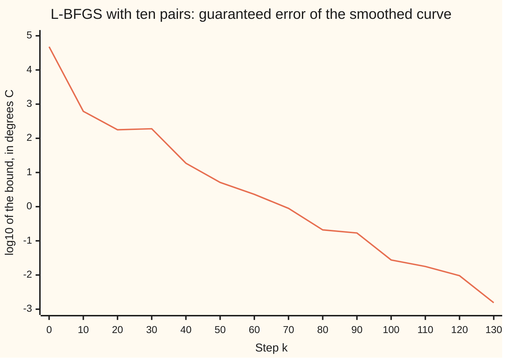

# L-BFGS: quasi-Newton when there are a million variables

[Syllabus](../../../SYLLABUS.md) → [Optimization](../README.md) → [Unconstrained Methods](../README.md#s02) → L-BFGS

---

## General Overview

A weather station logs the air temperature every ten minutes. After 347.2 days it holds 50,000 readings. Each one jitters by up to 1.5 °C of sensor noise around the true temperature. The station wants a smooth curve: one smoothed value per reading, so **50,000 numbers to choose**. The curve should stay close to the readings and should not jump from one reading to the next. Those two wishes pull against each other, and one cost adds them up. The job is to make that cost as small as possible, with no limits on the values. It is a minimisation.

[Newton and BFGS](05-newton-and-quasi-newton-bfgs.md) solves problems like this by remembering curvature: how the slope changes as you move. BFGS keeps that memory as a square table with one row and one column per variable. Here that is 50,000 × 50,000 = 2,500,000,000 numbers, or 20.0 GB. Every step would read and rewrite all of it.

**L-BFGS** ("limited-memory BFGS") keeps only the last ten steps instead: where it moved, and how the slope changed. That is 1,000,000 numbers, 8.0 MB. From those ten records it rebuilds the BFGS direction whenever it needs one, without ever writing the table down. Starting from the raw readings, it reaches the smooth curve in 138 steps. A printed certificate then shows that every smoothed value lies within 0.000759 °C of the best possible curve.

This particular cost is also a test bench. It is quadratic, and each value is tied only to its two neighbours, so elimination along the chain solves it exactly in one sweep each way, with fewer operations than L-BFGS; the code uses that exact answer to check the certificate. L-BFGS needs only the cost and its slope, so the same 8.0 MB recipe still works where no such shortcut exists, for example when the roughness penalty is not a square.

**L-BFGS never stores the BFGS table: it keeps the last few steps and slope changes, and replays them as a short recipe that turns the current slope into the BFGS direction.**

**What kind of fact this is:** a method. That the recipe gives exactly the BFGS direction is a theorem, proved on this card in Why it works. That this run reached the best curve is certified by a printed bound. How fast L-BFGS converges in general is a theorem stated here with its source, not proved.

### The picture: the guaranteed error, step by step

The certificate (Step 4 below) bounds how far the current curve can be from the best one. Its log10 is plotted every ten steps, from step k = 0 at the raw readings.



The one line is the bound. It starts loose at 10^4.68 °C, because the raw readings are very rough. It falls steadily, with small bumps: L-BFGS does not promise that the slope shrinks at every step. It ends below 0.001 °C at step 138.

---

## The formula

Notation first, in words. The readings are $T_1, \dots, T_n$ in °C, with $n$ = 50,000. The smoothed values are $c_1, \dots, c_n$. The cost to minimise is

$$f(c) = \sum_{i=1}^{n} (c_i - T_i)^2 \;+\; \lambda \sum_{i=1}^{n-1} (c_{i+1} - c_i)^2$$

The first sum is the misfit. The second is the roughness, weighted by $\lambda$ (lambda) = 100.

From [Gradient descent](02-gradient-descent-and-its-rate.md): $x_k$ is the iterate at step $k$ (here the whole list of 50,000 values), $d_k$ the search direction and $\alpha_k$ the step length. $\nabla f(x_k)$ is the gradient, the slope of the cost in every coordinate at once. From [Newton and BFGS](05-newton-and-quasi-newton-bfgs.md): the step pair is

$$s_k = x_{k+1} - x_k, \qquad y_k = \nabla f(x_{k+1}) - \nabla f(x_k)$$

and $B_k$ is BFGS's curvature table. This card works with its inverse, $B_k^{-1}$, because the direction is $d_k = -B_k^{-1} \nabla f(x_k)$. With $\sigma_k$ (sigma) $= 1 / (y_k^{\mathsf T} s_k)$, the BFGS update of the inverse is

$$B_{k+1}^{-1} = V_k^{\mathsf T} B_k^{-1} V_k + \sigma_k s_k s_k^{\mathsf T}, \qquad V_k = I - \sigma_k y_k s_k^{\mathsf T}$$

where $I$ is the identity matrix. L-BFGS starts each step from the plain guess $B^{-1} = \gamma_k I$, with $\gamma_k = s_{k-1}^{\mathsf T} y_{k-1} / y_{k-1}^{\mathsf T} y_{k-1}$, and applies this update for the last $m$ pairs only. It never forms the matrix. It runs the **two-loop recursion** on $q = \nabla f(x_k)$:

$$\begin{aligned}
&\text{newest pair to oldest:} && a_i = \sigma_i\, s_i^{\mathsf T} q, \qquad q \leftarrow q - a_i y_i \\
&\text{then:} && z = \gamma_k\, q \\
&\text{oldest pair to newest:} && b_i = \sigma_i\, y_i^{\mathsf T} z, \qquad z \leftarrow z + (a_i - b_i)\, s_i \\
&\text{finally:} && d_k = -z
\end{aligned}$$

**Read it aloud:** take the current slope; newest pair first, remove the part of it that each remembered slope change explains; scale what is left by the latest curvature guess; then, oldest pair first, add back the matching remembered steps; flip the sign, and that is the BFGS direction.

| Symbol | Plain meaning | In our example | Push it up and the answer… |
| --- | --- | --- | --- |
| $T_i$, $c_i$, $c^*$, $n$ | reading $i$; its smoothed value; the best curve; how many readings | 50,000 readings; at reading 25,000, raw 14.046 °C, smoothed 15.856 °C | more readings: more memory per pair; the curvature bounds 2 and 802 do not change |
| $\lambda$ | weight on roughness | 100 | smoother curve; more steps |
| $f(c)$, $f^*$ | the cost: misfit plus weighted roughness, °C²; its lowest value | $f^*$ = 99,322.2350, at the best curve | — |
| $x_k$, $d_k$, $\alpha_k$; $u$, $v$ | iterate, direction, step length at step $k$; on the banana, the point's two coordinates | $x_0$ = the raw readings; on the banana, (−1.2, 1) | — |
| $\nabla f(x_k)$, $g$ | the gradient, written $g$ in the proofs; its length $\lVert \nabla f \rVert$ | length 94,741.5 at $k$ = 0; 0.001519 at the end | — |
| $s_k$, $y_k$ | one step taken; the change in slope across it | two lists of 50,000 numbers per pair | — |
| $\sigma_k$ | one over $y_k^{\mathsf T} s_k$; must be positive (textbooks write $\rho_k$, which this wing keeps for the trust-region ratio) | — | — |
| $B_k^{-1}$, $W_j$, $V_k$, $I$ | the inverse curvature table, never stored; the same table after $j$ of the stored updates; one update's correction; the identity | 2,500,000,000 entries if stored | — |
| $\gamma_k$ | the starting guess for $B^{-1}$: one over the latest curvature | between 1/802 and 1/2 here | longer trial steps |
| $m$ | how many pairs are kept | 10 | more memory; here barely fewer steps |
| $a_i$, $b_i$, $q$, $z$ | the two-loop's working numbers and lists | at the banana's step 1: $a$ = 0.216318, $b$ = 0.000506 | — |
| $\mu$, $L$, $r$ | least and greatest curvature of $f$; the fixed factor in the rate theorem | 2 and 802; the theorem does not give $r$ | — |

### When it holds

- **Every stored pair has $y_i^{\mathsf T} s_i > 0$**: the slope rose along the step. Then every rebuilt direction points downhill (proof below). On the banana valley, a line search that checks only sufficient decrease (the Armijo test) lets a bad pair in, and the next direction points uphill: the run sticks at step 7. Skip bad pairs, as the code does, and it reaches (1, 1) in 45 steps. The Wolfe test of [Line search](04-line-search-armijo-and-wolfe.md) rules them out.
- **The gradient is exact and cheap.** Here it costs a few passes over the list. Estimated by small nudges, it would cost two evaluations per value, 50,000 times over.
- **The start guess $\gamma_k$ has the right size.** With $\gamma_k = 1$ instead, at step 40 the first trial step is 64.9 long instead of 0.443, and the line search must halve it 8 times.
- **For a rate, the curvature is bounded.** If every curvature of $f$ lies between $\mu > 0$ and $L$ and every step passes the Wolfe tests, the cost's excess over its lowest value obeys $f(x_k) - f^* \le r^k\,(f(x_0) - f^*)$ for some fixed $r < 1$ (Liu and Nocedal, 1989, Theorem 6.1; stated, not proved here). This **R-linear** rate caps the whole history; it does not promise a fixed shrink at every step. Here $\mu$ = 2 and $L$ = 802. This card's runs backtrack instead of testing Wolfe; the paper notes the proof can be adapted to backtracking, and on the quadratic fit every pair has $y^{\mathsf T} s > 0$, so every direction points downhill. Unlike full BFGS, no faster rate is promised.
- **No limits on the values.** Bounds, such as a floor under the values, need a variant that projects each step back inside them.

---

## Why it works

### Step 0: the BFGS update is a recipe, so it can be replayed instead of stored

Look at the update again. The new table is the old table wrapped in $V_k$ on both sides, plus one extra term. $V_k$ is the identity minus a single product $y_k s_k^{\mathsf T}$. So multiplying a list by $V_k$ needs only two lists, $s_k$ and $y_k$: one dot product and one subtraction. The whole table is the start guess with $m$ such wrappings around it. Keep the $m$ pairs, and you can apply the table to any list without writing it down.

### Step 1: unwrapping one layer gives the two loops

Apply the updated table to a slope $g$:

$$B_{k+1}^{-1} g = V_k^{\mathsf T} \big( B_k^{-1} (V_k g) \big) + \sigma_k s_k (s_k^{\mathsf T} g)$$

Work from the inside out.

1. $V_k g = g - \sigma_k y_k (s_k^{\mathsf T} g) = g - a\, y_k$, with $a = \sigma_k s_k^{\mathsf T} g$. That is one line of the first loop.
2. Apply the older table $B_k^{-1}$ to the result. It is itself wrapped by older pairs, so the same move repeats, pair by pair, back to the start guess $\gamma_k I$. That is why the first loop runs newest to oldest.
3. Coming back out, $V_k^{\mathsf T} z = z - \sigma_k s_k (y_k^{\mathsf T} z) = z - b\, s_k$, with $b = \sigma_k y_k^{\mathsf T} z$. The extra term adds $a\, s_k$. Together, $z \leftarrow z + (a - b) s_k$: one line of the second loop. The layers close in the reverse order they opened, oldest to newest.

Each pair costs two dot products and two list updates, so the direction costs about $4mn$ multiply-adds, plus $n$ for the scaling.

In numbers, on the shelf's house example, the banana valley $f(u, v) = (1 - u)^2 + 100\,(v - u^2)^2$ of [Newton and BFGS](05-newton-and-quasi-newton-bfgs.md), minimised at (1, 1). Start at the classic point $x_0$ = (−1.2, 1), rather than that card's (0, 1), because from here a careless run fails (What breaks, below). With no pairs yet, the code takes the downhill slope scaled to length 1 as the first direction, and the line search lands at $x_1$ = (−0.9685, 1.0945), where the slope is $g_1$ = (56.6579, 31.2816). The one pair is $s_0$ = (0.23146, 0.09447) and $y_0$ = (272.2579, 119.2816), with $s_0^{\mathsf T} y_0$ = 74.2864, $y_0^{\mathsf T} y_0$ = 88,352.45 and $s_0^{\mathsf T} g_1$ = 16.0694. Then $a$ = 16.0694 / 74.2864 = 0.216318, and $q = g_1 - a y_0$ = (−2.2363, 5.4789). The guess is $\gamma$ = 74.2864 / 88,352.45 = 0.0008408. Then $b$ = 0.000506, and the direction is $d_1$ = (−0.048072, −0.024995).

<details>
<summary>Detailed proof: the two loops give exactly the BFGS direction, and it points downhill</summary>

Write $W_{0} = \gamma I$ and $W_{j} = V_j^{\mathsf T} W_{j-1} V_j + \sigma_j s_j s_j^{\mathsf T}$ for the stored pairs $j = 1, \dots, m$, oldest first. L-BFGS's direction is $-W_{m} g$.

**Claim.** For any list $g$, the two loops return $W_{m} g$.

**Proof by induction on $m$.** For $m = 0$ there are no loops and the result is $\gamma g = W_{0} g$. Suppose the claim holds for $m - 1$ pairs. With $m$ pairs, the first loop's first line uses the newest pair: $a_m = \sigma_m s_m^{\mathsf T} g$ and $q = g - a_m y_m = V_m g$. The rest of the first loop, the scaling and the second loop up to pair $m - 1$ are exactly the two loops for pairs $1, \dots, m - 1$ applied to $V_m g$. By the hypothesis they give $z = W_{m-1} V_m g$. The last line of the second loop gives

$$z + (a_m - b_m) s_m = z - \sigma_m s_m (y_m^{\mathsf T} z) + \sigma_m s_m (s_m^{\mathsf T} g) = V_m^{\mathsf T} z + \sigma_m s_m s_m^{\mathsf T} g = W_{m} g.$$

**Downhill.** Suppose $\gamma > 0$ and every $\sigma_j > 0$. If $W_{j-1}$ is positive definite, then for any $g \neq 0$,

$$g^{\mathsf T} W_{j} g = (V_j g)^{\mathsf T} W_{j-1} (V_j g) + \sigma_j (s_j^{\mathsf T} g)^2 \ge 0.$$

Both terms are zero only if $V_j g = 0$ and $s_j^{\mathsf T} g = 0$. But then $V_j g = g - \sigma_j y_j (s_j^{\mathsf T} g) = g$, so $g = 0$. Hence $W_{j}$ is positive definite, and by induction so is $W_{m}$. The slope along $d = -W_{m} g$ is $g^{\mathsf T} d = -g^{\mathsf T} W_{m} g < 0$: downhill.

If some $\sigma_j < 0$, the second term can be negative and the argument fails. That is the banana's stuck run.

</details>

The code checks the claim directly on the banana. At step 6, with six pairs, it builds the 2 × 2 table by the update, pair by pair, and multiplies. The two-loop gives (0.187363, −0.324799); the table gives (0.187363, −0.324799).

### Step 2: keep the newest pairs, and start from the latest curvature

Each pair records the curvature along one direction: after the update, $B_{k+1}^{-1} y_k = s_k$, the secant equation of [Newton and BFGS](05-newton-and-quasi-newton-bfgs.md). Older pairs describe the ground the iterate has left, so the oldest is dropped first.

The start guess covers every direction the pairs say nothing about. Here the curvature along any step lies between $\mu$ = 2 and $L$ = 802, so $\gamma_k$, one over the latest curvature, lies between 1/802 and 1/2. It sets the size of each trial step. Without it the step at $k$ = 40 is 64.9 long instead of 0.443.

### Step 3: what ten pairs buy, and what they do not

Ten pairs hold curvature along at most ten of 50,000 directions, so the rebuilt direction is nowhere near Newton's full step. At step 40 the code solves for Newton's step exactly and compares each direction with it in two ways: the cosine of the angle between them (1 when they point the same way), and the length as a fraction of Newton's. With no pairs, L-BFGS would use the slope scaled by $\gamma_{40}$: cosine 0.549, length 0.032. Ten pairs turn the direction a little towards Newton's, cosine 0.681, and lengthen it to 0.163. Twenty pairs give 0.675 and 0.162, nothing more than ten.

The steps tell the same story. The same run with different memory, to the same certificate:

```
pairs m   memory     steps to the certificate
   1      0.8 MB   ################################ 159
   3      2.4 MB   ############################## 150
   5      4.0 MB   ############################# 143
  10      8.0 MB   ############################ 138
  20     16.0 MB   ############################ 140
```

One pair needs 159 steps and ten need 138, for ten times the memory; twenty pairs need 140. The one-pair count is fragile: adding the same sums in a different order moves it noticeably, while the counts for three or more pairs move by a step at most. L-BFGS works here because successive directions cooperate, each one not undoing the last. That is the idea of [Conjugate gradient](07-conjugate-gradient-method.md), and on a quadratic it explains why memory buys so little: if every step went to the lowest point along its line, L-BFGS would retrace conjugate gradient's steps whatever the number of pairs. Backtracking steps are not exact, so the counts differ a little. This sweep therefore says nothing about a cost whose curvature changes from place to place, where old pairs go stale and the memory has to be weighed on the problem itself. Gradient descent with step $1/L$ is guaranteed to reach the same certificate only within 7,079 steps, an estimate from its rate rather than a run.

### Step 4: a certificate that the curve is the best one

The cost's curvature is at least $\mu$ = 2 in every direction, because the misfit alone contributes 2 and the roughness term only adds. For such a cost, the slope grows at least as fast as $\mu$ times the distance from the minimiser $c^*$. So

$$\lVert c - c^* \rVert \le \frac{\lVert \nabla f(c) \rVert}{\mu}$$

and no single value can be off by more than the length of the whole error list. The cost is strictly convex, so $c^*$ is the only minimiser. At the end, $\lVert \nabla f \rVert$ = 0.001519, so every smoothed value lies within 0.000759 °C of the best curve. Because the cost is quadratic, the code can also solve for $c^*$ directly by elimination. The true largest gap is 1.41e-05 °C, well inside the bound.

---

## Worked numbers, by hand

The bill for one direction, on the 50,000-reading fit with ten pairs:

| Step | Arithmetic | Value |
| --- | --- | --- |
| entries in a stored BFGS table | 50,000 × 50,000 | 2,500,000,000 |
| its memory, 8 bytes per number | 2,500,000,000 × 8 | 20.0 GB |
| numbers in ten pairs | 2 × 10 × 50,000 | 1,000,000 |
| their memory | 1,000,000 × 8 | 8.0 MB |
| multiply-adds, table times slope | 50,000 × 50,000 | 2,500,000,000 |
| multiply-adds, two loops | 4 × 10 × 50,000 + 50,000 | 2,050,000 |
| steps from the raw readings to the certificate | the run, $k$ = 0 to 138 | 138 steps, 144 cost evaluations |
| guaranteed error at the end | 0.001519 / 2 | 0.000759 °C |
| **the answer** | ten pairs instead of the table | **8.0 MB and 2,050,000 multiply-adds per direction; every value within 0.000759 °C of the best curve after 138 steps** |

The station gets the smooth curve in 8.0 MB with a printed guarantee, where plain BFGS would need 20.0 GB. For this quadratic cost, elimination along the chain is exact and cheaper still (road 3 of the code); L-BFGS is the tool when the cost is not quadratic and no such shortcut exists.

### What breaks if you drop a piece

| Mistake | Comes out at | What went wrong |
| --- | --- | --- |
| Storing a pair with $y^{\mathsf T} s \le 0$ (banana, Armijo-only line search) | stuck at step 7, slope +2.0443, cost 3.3379 | A negative $\sigma$ breaks the downhill proof: the direction points uphill |
| Starting from $\gamma_k = 1$ (the fit, at step 40) | first trial step 64.9 long instead of 0.443; cost 366,168 instead of 99,343.8; 8 halvings | The start guess has the wrong size, so every step must be cut back |
| Reversing each loop: the first oldest first, the second newest first (banana) | 127 steps and 286 evaluations instead of 45 and 55 | The layers close in the wrong order: the direction is not BFGS's |
| Keeping the full BFGS table | 20.0 GB | The method is right; the memory is not there |

---

## Code, from first principles, and it actually runs

The script builds the readings from a seasonal swing, a daily cycle and SplitMix64 noise (seed 2026), so both languages see the same data. The cost, gradient, two loops and backtracking line search are written by hand. Four roads meet: the L-BFGS run; the certificate from the gradient's length, with the gradient checked against small nudges at the raw readings and at the exact fit; the exact best curve by elimination; and, on the banana, the two loops against the table built by the BFGS update. Then come the memory sweep and the broken versions.

### Python

```python
# L-BFGS -- the check behind the card.  Only math is imported.  A weather station logs
# air temperature every ten minutes: 50,000 readings d.  The smoothed curve c has one
# coefficient per reading and minimises f(c) = sum (c_i - d_i)^2 + LAM sum (c_{i+1} - c_i)^2.
# L-BFGS keeps the last M step pairs (s, y) and rebuilds each direction by the two-loop
# recursion.  Roads: the run; the gradient certificate; elimination; the dense update.
import math
N, LAM, M, TOL = 50000, 100.0, 10, 0.002       # TOL on |g|: every value within 0.001 C
MASK, state = (1 << 64) - 1, 2026              # SplitMix64, seed 2026: the sensor noise
def rnd():
    global state
    state = z = (state + 0x9E3779B97F4A7C15) & MASK
    z = ((z ^ (z >> 30)) * 0xBF58476D1CE4E5B9) & MASK
    z = ((z ^ (z >> 27)) * 0x94D049BB133111EB) & MASK
    return ((z ^ (z >> 31)) >> 11) / 2.0 ** 53
d = [11 - 7 * math.cos(2 * math.pi * i / 52560) + 4 * math.sin(2 * math.pi * i / 144)
     + 3 * (rnd() - 0.5) for i in range(N)]
dot = math.sumprod
def norm(v): return math.sqrt(dot(v, v))
def fg(c):                                      # cost and gradient, written out
    r = [a - b for a, b in zip(c, d)]
    df = [c[i + 1] - c[i] for i in range(N - 1)]
    g = [2 * x for x in r]
    for i, x in enumerate(df):
        g[i] -= 2 * LAM * x
        g[i + 1] += 2 * LAM * x
    return dot(r, r) + LAM * dot(df, df), g
def solve(b):                                   # A x = b by elimination; A = 2(I + LAM D^T D)
    off, cp, bp = -2 * LAM, [0.0] * N, [0.0] * N
    for i in range(N):
        dg = 2 * (1 + LAM) if i in (0, N - 1) else 2 * (1 + 2 * LAM)
        den = dg - (off * cp[i - 1] if i else 0.0)
        cp[i], bp[i] = off / den, (b[i] - (off * bp[i - 1] if i else 0.0)) / den
    x = bp[:]
    for i in range(N - 2, -1, -1):
        x[i] -= cp[i] * x[i + 1]
    return x
def two_loop(g, S, Y, order=1, gam=None):       # d = -B^-1 g from the stored pairs
    q, al = g[:], []
    for s, y in list(zip(S, Y))[::-order]:      # newest pair first
        a = dot(s, q) / dot(y, s)
        al.append(a)
        q = [u - a * v for u, v in zip(q, y)]
    if gam is None:
        gam = dot(S[-1], Y[-1]) / dot(Y[-1], Y[-1]) if S else 1 / norm(g)
    r = [gam * u for u in q]
    for (s, y), a in zip(list(zip(S, Y))[::order], al[::-1]):   # oldest pair first
        b = dot(y, r) / dot(y, s)
        r = [u + (a - b) * v for u, v in zip(r, s)]
    return [-u for u in r]
def lbfgs(f_g, x, m, tol, keep=0, probe=None, skip=True, order=1):
    f, g = f_g(x)
    S, Y, k, ev, hist, out = [], [], 0, 1, [], None
    while norm(g) > tol and k < 400:
        hist.append(norm(g))
        if k == probe:
            out = (x, g, S[:], Y[:])
        dd = two_loop(g, S[-m:], Y[-m:], order) if m else two_loop(g, [], [])
        slope, t = dot(g, dd), 1.0
        if slope >= 0:
            return x, k, ev, hist, ("uphill", slope)
        while True:                             # backtrack until the cost falls enough
            xn = [a + t * b for a, b in zip(x, dd)]
            fn, gn = f_g(xn)
            ev += 1
            if fn <= f + 1e-4 * t * slope or t < 1e-12:   # floor: never loop forever
                break
            t *= 0.5
        s, y = [a - b for a, b in zip(xn, x)], [a - b for a, b in zip(gn, g)]
        if dot(s, y) > 0 or not skip:           # curvature test: keep only s.y > 0
            S.append(s), Y.append(y)
        S, Y, x, f, g, k = S[-max(m, keep):], Y[-max(m, keep):], xn, fn, gn, k + 1
    return x, k, ev, hist, out
cs = solve([2 * v for v in d])                  # road 3: the exact fit
fs, gs = fg(cs)
print(f"readings {N}, {N * 10 / 1440:.1f} days; LAM {LAM:.0f}; exact fit cost {fs:.4f}, |g| {norm(gs):.1e}")
h = 0.01                                        # nudge the raw readings and the exact fit, where c - d is not zero
fd = max(abs((fg(p[:i] + [p[i] + h] + p[i + 1:])[0] - fg(p[:i] + [p[i] - h] + p[i + 1:])[0]) / (2 * h) - fg(p)[1][i])
         for p in (d, cs) for i in (0, 25000, N - 1))
print(f"gradient vs central difference at values 0, 25000, 49999 of the readings and the exact fit: largest gap {fd:.1e}")
x, k, ev, hist, pr = lbfgs(fg, d[:], M, TOL, keep=20, probe=40)
assert pr[0] != "uphill", "every direction on the fit points downhill"
xp, gp, Sp, Yp = pr
(f, g), gap = fg(x), max(abs(a - b) for a, b in zip(x, cs))
print(f"L-BFGS, m={M}, from k=0 at the raw readings (|g| {hist[0]:.1f}): {k} iterations, {ev} cost evaluations")
print(f"cost {f:.4f}; certificate: |g| {norm(g):.6f}, so every value within |g|/2 = {norm(g) / 2:.6f} C")
print(f"largest gap to the exact fit: {gap:.2e} C")
print(f"reading 25000 (day {25000 * 10 / 1440:.1f}): raw {d[25000]:.3f} C, smoothed {x[25000]:.3f} C")
print(f"dense matrix: {N * N} numbers = {N * N * 8 / 1e9:.1f} GB; {M} pairs: {2 * M * N} numbers = {2 * M * N * 8 / 1e6:.1f} MB")
print(f"multiply-adds per direction: dense {N * N}, two-loop 4mn + n = {4 * M * N + N}")
print(f"gradient descent, step 1/L: L = {2 + 8 * LAM:.0f}, mu = 2, needs about "
      f"{math.ceil(math.log(hist[0] / TOL) / -math.log(1 - 2 / (2 + 8 * LAM)))} iterations (estimate)")
print("chart, log10 bound every 10 iterations: " + " ".join(f"{math.log10(v / 2):.2f}" for v in hist[::10]))
sweep = {m: lbfgs(fg, d[:], m, TOL)[1:3] for m in (1, 3, 5, 20)} | {M: (k, ev)}
for m in sorted(sweep):
    print(f"sweep m={m:<2}: {sweep[m][0]:3d} iterations, {sweep[m][1]:3d} evaluations, {2 * m * N * 8 / 1e6:4.1f} MB")
newton, g40 = solve([-v for v in gp]), dot(Sp[-1], Yp[-1]) / dot(Yp[-1], Yp[-1])   # Newton's step at k = 40
dirs = [two_loop(gp, Sp[-m:], Yp[-m:]) if m else two_loop(gp, [], [], gam=g40) for m in (0, 10, 20)]
print("at k=40 vs Newton's step, m = 0 10 20: cosine " + " ".join(f"{dot(v, newton) / norm(v) / norm(newton):.3f}" for v in dirs)
      + "; length ratio " + " ".join(f"{norm(v) / norm(newton):.3f}" for v in dirs))
right, ones = two_loop(gp, Sp[-M:], Yp[-M:]), two_loop(gp, Sp[-M:], Yp[-M:], gam=1.0)
t, fp = 1.0, fg(xp)[0]
while fg([a + t * b for a, b in zip(xp, ones)])[0] > fp + 1e-4 * t * dot(gp, ones):
    t *= 0.5
print(f"break, no scaling: step {norm(ones):.1f} long (right {norm(right):.3f}); cost at t=1 "
      f"{fg([a + b for a, b in zip(xp, ones)])[0]:.0f} (right {fg([a + b for a, b in zip(xp, right)])[0]:.1f}); "
      f"halvings {round(-math.log2(t))}")
def banana(v):                                  # the house example, minimised at (1, 1)
    a, b = v
    return 100 * (b - a * a) ** 2 + (1 - a) ** 2, [-400 * a * (b - a * a) - 2 * (1 - a), 200 * (b - a * a)]
b1 = lbfgs(banana, [-1.2, 1.0], 1, 1e-6, probe=1)
x1, g1, (s0,), (y0,) = b1[4]
sy, yy, sg = dot(s0, y0), dot(y0, y0), dot(s0, g1)
print(f"banana, x1 = ({x1[0]:.4f}, {x1[1]:.4f}), g1 = ({g1[0]:.4f}, {g1[1]:.4f})")
print(f"  s0 = ({s0[0]:.5f}, {s0[1]:.5f}), y0 = ({y0[0]:.4f}, {y0[1]:.4f}), s.y {sy:.4f}, y.y {yy:.2f}, s.g1 {sg:.4f}")
al = sg / sy                                    # the two-loop with one pair, by hand
q = [u - al * v for u, v in zip(g1, y0)]
dh, be = two_loop(g1, [s0], [y0]), dot(y0, [sy / yy * u for u in q]) / sy
print(f"  alpha {al:.6f}, q = ({q[0]:.4f}, {q[1]:.4f}), gamma {sy / yy:.7f}, beta {be:.6f}, d1 = ({dh[0]:.6f}, {dh[1]:.6f})")
_, _, _, _, (x6, g6, S6, Y6) = lbfgs(banana, [-1.2, 1.0], 10, 1e-6, probe=6)
Bi = [[dot(S6[-1], Y6[-1]) / dot(Y6[-1], Y6[-1]) * (i == j) for j in range(2)] for i in range(2)]
for s, y in zip(S6, Y6):                        # road 4: the dense inverse update, pair by pair
    p = 1 / dot(s, y)
    V = [[(i == j) - p * y[i] * s[j] for j in range(2)] for i in range(2)]
    Bi = [[sum(V[a][i] * Bi[a][b] * V[b][j] for a in range(2) for b in range(2)) + p * s[i] * s[j]
           for j in range(2)] for i in range(2)]
dd6, tl6 = [-dot(row, g6) for row in Bi], two_loop(g6, S6, Y6)
print(f"banana k=6, {len(S6)} pairs: two-loop ({tl6[0]:.6f}, {tl6[1]:.6f}), dense ({dd6[0]:.6f}, {dd6[1]:.6f})")
bad = lbfgs(banana, [-1.2, 1.0], 10, 1e-6, skip=False)
good = lbfgs(banana, [-1.2, 1.0], 10, 1e-6)
rev = lbfgs(banana, [-1.2, 1.0], 10, 1e-6, order=-1)   # break: each loop in reverse order
print(f"banana, no curvature test: stuck at k={bad[1]}, slope {bad[4][1]:+.4f} (uphill), cost {banana(bad[0])[0]:.4f}")
print(f"banana, with the test: ({good[0][0]:.6f}, {good[0][1]:.6f}) after {good[1]} iterations, {good[2]} evaluations")
print(f"banana, each loop reversed: {rev[1]} iterations, {rev[2]} evaluations")
assert norm(gs) < 1e-8 and fd < 1e-4,              "elimination solves A c = 2d; gradient matches differences"
assert gap <= norm(g) / 2 and gap < 1e-3,          "the certificate bounds the true gap to the exact fit"
assert abs(f - fs) < 1e-6 * fs,                    "L-BFGS reaches the exact fit's cost"
assert max(abs(a - b) for a, b in zip(tl6, dd6)) < 1e-9, "two-loop equals the dense inverse update"
assert bad[4][0] == "uphill" and max(abs(v - 1) for v in good[0]) < 1e-6, "s.y > 0 is needed and enough"
assert sweep[M][0] < sweep[1][0] and rev[2] > good[2], "ten pairs beat one; loop order matters"
print("ALL CHECKS PASS")
```

**Ran 2026-11-11 on macOS, Python 3.14.10, standard library only. All checks passed. Output, pasted from the run:**

```
readings 50000, 347.2 days; LAM 100; exact fit cost 99322.2350, |g| 8.0e-11
gradient vs central difference at values 0, 25000, 49999 of the readings and the exact fit: largest gap 3.2e-08
L-BFGS, m=10, from k=0 at the raw readings (|g| 94741.5): 138 iterations, 144 cost evaluations
cost 99322.2350; certificate: |g| 0.001519, so every value within |g|/2 = 0.000759 C
largest gap to the exact fit: 1.41e-05 C
reading 25000 (day 173.6): raw 14.046 C, smoothed 15.856 C
dense matrix: 2500000000 numbers = 20.0 GB; 10 pairs: 1000000 numbers = 8.0 MB
multiply-adds per direction: dense 2500000000, two-loop 4mn + n = 2050000
gradient descent, step 1/L: L = 802, mu = 2, needs about 7079 iterations (estimate)
chart, log10 bound every 10 iterations: 4.68 2.79 2.25 2.28 1.27 0.71 0.36 -0.05 -0.68 -0.77 -1.56 -1.75 -2.02 -2.81
sweep m=1 : 159 iterations, 168 evaluations,  0.8 MB
sweep m=3 : 150 iterations, 161 evaluations,  2.4 MB
sweep m=5 : 143 iterations, 150 evaluations,  4.0 MB
sweep m=10: 138 iterations, 144 evaluations,  8.0 MB
sweep m=20: 140 iterations, 147 evaluations, 16.0 MB
at k=40 vs Newton's step, m = 0 10 20: cosine 0.549 0.681 0.675; length ratio 0.032 0.163 0.162
break, no scaling: step 64.9 long (right 0.443); cost at t=1 366168 (right 99343.8); halvings 8
banana, x1 = (-0.9685, 1.0945), g1 = (56.6579, 31.2816)
  s0 = (0.23146, 0.09447), y0 = (272.2579, 119.2816), s.y 74.2864, y.y 88352.45, s.g1 16.0694
  alpha 0.216318, q = (-2.2363, 5.4789), gamma 0.0008408, beta 0.000506, d1 = (-0.048072, -0.024995)
banana k=6, 6 pairs: two-loop (0.187363, -0.324799), dense (0.187363, -0.324799)
banana, no curvature test: stuck at k=7, slope +2.0443 (uphill), cost 3.3379
banana, with the test: (1.000000, 1.000000) after 45 iterations, 55 evaluations
banana, each loop reversed: 127 iterations, 286 evaluations
ALL CHECKS PASS
```

### Rust

Same numbers, same labels, built with `rustc --edition 2021 -O`. The dot product is summed with error compensation, as Python's `math.sumprod` is, so the two outputs agree to the last digit.

```rust
// L-BFGS -- the check behind the card.  std only.  A weather station logs air
// temperature every ten minutes: 50,000 readings d.  The smoothed curve c has one
// coefficient per reading and minimises f(c) = sum (c_i - d_i)^2 + LAM sum (c_{i+1} - c_i)^2.
// L-BFGS keeps the last M step pairs (s, y) and rebuilds each direction by the two-loop
// recursion.  Roads: the run; the gradient certificate; elimination; the dense update.
const N: usize = 50000; const LAM: f64 = 100.0; const M: usize = 10;
const TOL: f64 = 0.002; // on |g|: every value within 0.001 C
type V = Vec<f64>;
struct Run { x: V, k: usize, ev: usize, hist: V, probe: Option<(V, V, Vec<V>, Vec<V>)>, uphill: Option<f64> }

fn rnd(state: &mut u64) -> f64 { // SplitMix64
    *state = state.wrapping_add(0x9E3779B97F4A7C15);
    let z = (*state ^ (*state >> 30)).wrapping_mul(0xBF58476D1CE4E5B9);
    let z = (z ^ (z >> 27)).wrapping_mul(0x94D049BB133111EB);
    ((z ^ (z >> 31)) >> 11) as f64 / 9007199254740992.0
}
fn dot(a: &[f64], b: &[f64]) -> f64 { // compensated, to match the Python sumprod
    let (mut s, mut c) = (0.0f64, 0.0f64);
    for (x, y) in a.iter().zip(b) {
        let (p, t) = (x * y, s + x * y);
        let pe = x.mul_add(*y, -p);
        c += if s.abs() >= p.abs() { (s - t) + p } else { (p - t) + s } + pe;
        s = t;
    }
    s + c
}
fn norm(v: &[f64]) -> f64 { dot(v, v).sqrt() }
fn sub(a: &[f64], b: &[f64]) -> V { a.iter().zip(b).map(|(x, y)| x - y).collect() }
fn sci(x: f64, p: usize) -> String { // Python-style exponent: 3.2e-08
    let s = format!("{:.*e}", p, x);
    let (m, e) = s.split_once('e').unwrap();
    let e: i32 = e.parse().unwrap();
    format!("{}e{}{:02}", m, if e < 0 { '-' } else { '+' }, e.abs())
}
fn fg(c: &[f64], d: &[f64]) -> (f64, V) {
    let r = sub(c, d);
    let df: V = (0..c.len() - 1).map(|i| c[i + 1] - c[i]).collect();
    let mut g: V = r.iter().map(|x| 2.0 * x).collect();
    for (i, x) in df.iter().enumerate() { g[i] -= 2.0 * LAM * x; g[i + 1] += 2.0 * LAM * x; }
    (dot(&r, &r) + LAM * dot(&df, &df), g)
}
fn solve(b: &[f64]) -> V { // A x = b by elimination; A = 2(I + LAM D^T D)
    let (off, mut cp, mut bp) = (-2.0 * LAM, vec![0.0; N], vec![0.0; N]);
    for i in 0..N {
        let dg = if i == 0 || i == N - 1 { 2.0 * (1.0 + LAM) } else { 2.0 * (1.0 + 2.0 * LAM) };
        let den = dg - if i > 0 { off * cp[i - 1] } else { 0.0 };
        (cp[i], bp[i]) = (off / den, (b[i] - if i > 0 { off * bp[i - 1] } else { 0.0 }) / den);
    }
    for i in (0..N - 1).rev() { bp[i] -= cp[i] * bp[i + 1]; }
    bp
}
fn two_loop(g: &[f64], s: &[V], y: &[V], order: i32, gam: Option<f64>) -> V {
    let n = s.len();
    let idx: Vec<usize> = if order == 1 { (0..n).rev().collect() } else { (0..n).collect() };
    let (mut q, mut al) = (g.to_vec(), vec![0.0; n]);
    for &i in &idx { // newest pair first
        al[i] = dot(&s[i], &q) / dot(&y[i], &s[i]);
        for j in 0..q.len() { q[j] -= al[i] * y[i][j]; } }
    let gam = gam.unwrap_or(if n > 0 { dot(&s[n - 1], &y[n - 1]) / dot(&y[n - 1], &y[n - 1]) } else { 1.0 / norm(g) });
    let mut r: V = q.iter().map(|u| gam * u).collect();
    for &i in idx.iter().rev() { // oldest pair first
        let b = dot(&y[i], &r) / dot(&y[i], &s[i]);
        for j in 0..r.len() { r[j] += (al[i] - b) * s[i][j]; } }
    r.iter().map(|u| -u).collect()
}
fn lbfgs(f_g: &dyn Fn(&[f64]) -> (f64, V), x0: V, m: usize, tol: f64, keep: usize, probe: Option<usize>, skip: bool, order: i32) -> Run {
    let (mut x, (mut f, mut g)) = (x0.clone(), f_g(&x0));
    let (mut s, mut y, mut k, mut ev, mut hist, mut pr): (Vec<V>, Vec<V>, usize, usize, V, _) = (vec![], vec![], 0, 1, vec![], None);
    while norm(&g) > tol && k < 400 {
        hist.push(norm(&g));
        if probe == Some(k) { pr = Some((x.clone(), g.clone(), s.clone(), y.clone())); }
        let lo = s.len().saturating_sub(m);
        let dd = if m > 0 { two_loop(&g, &s[lo..], &y[lo..], order, None) } else { two_loop(&g, &[], &[], 1, None) };
        let (slope, mut t) = (dot(&g, &dd), 1.0);
        if slope >= 0.0 { return Run { x, k, ev, hist, probe: None, uphill: Some(slope) }; }
        let (xn, fn_, gn) = loop { // backtrack until the cost falls enough
            let xn: V = x.iter().zip(&dd).map(|(a, b)| a + t * b).collect();
            let (fn_, gn) = f_g(&xn);
            ev += 1;
            if fn_ <= f + 1e-4 * t * slope || t < 1e-12 { break (xn, fn_, gn); } else { t *= 0.5; } // floor
        };
        let (sk, yk) = (sub(&xn, &x), sub(&gn, &g));
        if dot(&sk, &yk) > 0.0 || !skip { s.push(sk); y.push(yk); } // curvature test
        let cap = m.max(keep);
        if s.len() > cap { s.drain(..s.len() - cap); y.drain(..y.len() - cap); }
        (x, f, g, k) = (xn, fn_, gn, k + 1);
    }
    Run { x, k, ev, hist, probe: pr, uphill: None }
}
fn banana(v: &[f64]) -> (f64, V) { // the house example, minimised at (1, 1)
    let (a, b) = (v[0], v[1]);
    (100.0 * (b - a * a).powi(2) + (1.0 - a).powi(2), vec![-400.0 * a * (b - a * a) - 2.0 * (1.0 - a), 200.0 * (b - a * a)])
}
fn main() {
    let (mut st, pi) = (2026u64, std::f64::consts::PI);
    let d: V = (0..N).map(|i| { let i = i as f64; 11.0 - 7.0 * (2.0 * pi * i / 52560.0).cos() + 4.0 * (2.0 * pi * i / 144.0).sin() + 3.0 * (rnd(&mut st) - 0.5) }).collect();
    let fit = |c: &[f64]| fg(c, &d);
    let cs = solve(&d.iter().map(|v| 2.0 * v).collect::<V>());
    let (fs, gs) = fit(&cs);
    println!("readings {}, {:.1} days; LAM {:.0}; exact fit cost {:.4}, |g| {}", N, N as f64 * 10.0 / 1440.0, LAM, fs, sci(norm(&gs), 1));
    let h = 0.01; // nudge the raw readings and the exact fit, where c - d is not zero
    let fd = [&d, &cs].iter().flat_map(|p| [0, 25000, N - 1].map(|i| { let (mut up, mut dn) = (p.to_vec(), p.to_vec()); (up[i], dn[i]) = (up[i] + h, dn[i] - h);
        ((fit(&up).0 - fit(&dn).0) / (2.0 * h) - fit(&p[..]).1[i]).abs() })).fold(0.0, f64::max);
    println!("gradient vs central difference at values 0, 25000, 49999 of the readings and the exact fit: largest gap {}", sci(fd, 1));
    let run = lbfgs(&fit, d.clone(), M, TOL, 20, Some(40), true, 1);
    assert!(run.uphill.is_none(), "every direction on the fit points downhill");
    let (xp, gp, sp, yp) = run.probe.clone().unwrap();
    let (f, g) = fit(&run.x);
    let (gap, h0) = (run.x.iter().zip(&cs).map(|(a, b)| (a - b).abs()).fold(0.0, f64::max), run.hist[0]);
    println!("L-BFGS, m={}, from k=0 at the raw readings (|g| {:.1}): {} iterations, {} cost evaluations", M, h0, run.k, run.ev);
    println!("cost {:.4}; certificate: |g| {:.6}, so every value within |g|/2 = {:.6} C", f, norm(&g), norm(&g) / 2.0);
    println!("largest gap to the exact fit: {} C", sci(gap, 2));
    println!("reading 25000 (day {:.1}): raw {:.3} C, smoothed {:.3} C", 25000.0 * 10.0 / 1440.0, d[25000], run.x[25000]);
    println!("dense matrix: {} numbers = {:.1} GB; {} pairs: {} numbers = {:.1} MB", N * N, (N * N * 8) as f64 / 1e9, M, 2 * M * N, (2 * M * N * 8) as f64 / 1e6);
    println!("multiply-adds per direction: dense {}, two-loop 4mn + n = {}", N * N, 4 * M * N + N);
    let lip = 2.0 + 8.0 * LAM; // L, the steepest curvature
    println!("gradient descent, step 1/L: L = {:.0}, mu = 2, needs about {} iterations (estimate)", lip, ((h0 / TOL).ln() / -(1.0 - 2.0 / lip).ln()).ceil());
    println!("chart, log10 bound every 10 iterations: {}", run.hist.iter().step_by(10).map(|v| format!("{:.2}", (v / 2.0).log10())).collect::<Vec<_>>().join(" "));
    let mut sweep: Vec<(usize, usize, usize)> = [1, 3, 5, 20].iter().map(|&m| { let r = lbfgs(&fit, d.clone(), m, TOL, 0, None, true, 1); (m, r.k, r.ev) }).collect();
    sweep.push((M, run.k, run.ev)); sweep.sort();
    for (m, k, ev) in &sweep { println!("sweep m={:<2}: {:3} iterations, {:3} evaluations, {:4.1} MB", m, k, ev, (2 * m * N * 8) as f64 / 1e6); }
    let (newton, g40) = (solve(&gp.iter().map(|v| -v).collect::<V>()), dot(&sp[sp.len() - 1], &yp[yp.len() - 1]) / dot(&yp[yp.len() - 1], &yp[yp.len() - 1])); // Newton's step at k = 40
    let dirs: Vec<V> = [0usize, 10, 20].iter().map(|&m| two_loop(&gp, &sp[sp.len() - m..], &yp[yp.len() - m..], 1, if m > 0 { None } else { Some(g40) })).collect();
    let show = |f: &dyn Fn(&V) -> f64| dirs.iter().map(|v| format!("{:.3}", f(v))).collect::<Vec<_>>().join(" ");
    println!("at k=40 vs Newton's step, m = 0 10 20: cosine {}; length ratio {}", show(&|v| dot(v, &newton) / norm(v) / norm(&newton)), show(&|v| norm(v) / norm(&newton)));
    let lo = sp.len() - M;
    let (right, ones) = (two_loop(&gp, &sp[lo..], &yp[lo..], 1, None), two_loop(&gp, &sp[lo..], &yp[lo..], 1, Some(1.0)));
    let (mut t, fp) = (1.0f64, fit(&xp).0);
    let step = |dd: &V, t: f64| xp.iter().zip(dd).map(|(a, b)| a + t * b).collect::<V>();
    while fit(&step(&ones, t)).0 > fp + 1e-4 * t * dot(&gp, &ones) { t *= 0.5; }
    println!("break, no scaling: step {:.1} long (right {:.3}); cost at t=1 {:.0} (right {:.1}); halvings {}",
             norm(&ones), norm(&right), fit(&step(&ones, 1.0)).0, fit(&step(&right, 1.0)).0, (-t.log2()).round());
    let b1 = lbfgs(&banana, vec![-1.2, 1.0], 1, 1e-6, 0, Some(1), true, 1);
    let (x1, g1, s1, y1) = b1.probe.unwrap();
    let (s0, y0) = (&s1[0], &y1[0]);
    let (sy, yy, sg) = (dot(s0, y0), dot(y0, y0), dot(s0, &g1));
    println!("banana, x1 = ({:.4}, {:.4}), g1 = ({:.4}, {:.4})", x1[0], x1[1], g1[0], g1[1]);
    println!("  s0 = ({:.5}, {:.5}), y0 = ({:.4}, {:.4}), s.y {:.4}, y.y {:.2}, s.g1 {:.4}", s0[0], s0[1], y0[0], y0[1], sy, yy, sg);
    let al = sg / sy; // the two-loop with one pair, by hand
    let (q, dh): (V, V) = (g1.iter().zip(y0).map(|(u, v)| u - al * v).collect(), two_loop(&g1, &s1, &y1, 1, None));
    let be = dot(y0, &q.iter().map(|u| sy / yy * u).collect::<V>()) / sy;
    println!("  alpha {:.6}, q = ({:.4}, {:.4}), gamma {:.7}, beta {:.6}, d1 = ({:.6}, {:.6})", al, q[0], q[1], sy / yy, be, dh[0], dh[1]);
    let (_, g6, s6, y6) = lbfgs(&banana, vec![-1.2, 1.0], 10, 1e-6, 0, Some(6), true, 1).probe.unwrap();
    let n6 = s6.len();
    let gm = dot(&s6[n6 - 1], &y6[n6 - 1]) / dot(&y6[n6 - 1], &y6[n6 - 1]);
    let mut bi = [[gm, 0.0], [0.0, gm]];
    for (s, y) in s6.iter().zip(&y6) { // road 4: the dense inverse update, pair by pair
        let p = 1.0 / dot(s, y);
        let v = |i: usize, j: usize| (i == j) as i32 as f64 - p * y[i] * s[j];
        let e = |i: usize, j: usize| (0..4).map(|ab| v(ab / 2, i) * bi[ab / 2][ab % 2] * v(ab % 2, j)).sum::<f64>() + p * s[i] * s[j];
        bi = [[e(0, 0), e(0, 1)], [e(1, 0), e(1, 1)]];
    }
    let (dd6, tl6): (V, V) = (bi.iter().map(|row| -dot(row, &g6)).collect(), two_loop(&g6, &s6, &y6, 1, None));
    println!("banana k=6, {} pairs: two-loop ({:.6}, {:.6}), dense ({:.6}, {:.6})", n6, tl6[0], tl6[1], dd6[0], dd6[1]);
    let bad = lbfgs(&banana, vec![-1.2, 1.0], 10, 1e-6, 0, None, false, 1);
    let good = lbfgs(&banana, vec![-1.2, 1.0], 10, 1e-6, 0, None, true, 1);
    let rev = lbfgs(&banana, vec![-1.2, 1.0], 10, 1e-6, 0, None, true, -1); // break: each loop in reverse order
    println!("banana, no curvature test: stuck at k={}, slope {:+.4} (uphill), cost {:.4}", bad.k, bad.uphill.unwrap(), banana(&bad.x).0);
    println!("banana, with the test: ({:.6}, {:.6}) after {} iterations, {} evaluations", good.x[0], good.x[1], good.k, good.ev);
    println!("banana, each loop reversed: {} iterations, {} evaluations", rev.k, rev.ev);
    assert!(norm(&gs) < 1e-8 && fd < 1e-4, "elimination solves A c = 2d; gradient matches differences");
    assert!(gap <= norm(&g) / 2.0 && gap < 1e-3, "the certificate bounds the true gap to the exact fit");
    assert!((f - fs).abs() < 1e-6 * fs, "L-BFGS reaches the exact fit's cost");
    assert!(tl6.iter().zip(&dd6).all(|(a, b)| (a - b).abs() < 1e-9), "two-loop equals the dense inverse update");
    assert!(bad.uphill.is_some() && good.x.iter().all(|v| (v - 1.0).abs() < 1e-6), "s.y > 0 is needed and enough");
    assert!(sweep.iter().find(|r| r.0 == M).unwrap().1 < sweep[0].1 && rev.ev > good.ev, "ten pairs beat one; loop order matters");
    println!("ALL CHECKS PASS");
}
```

**Ran 2026-11-11 on macOS, rustc 1.98.1, no crates. All checks passed. Output, pasted from the run:**

```
readings 50000, 347.2 days; LAM 100; exact fit cost 99322.2350, |g| 8.0e-11
gradient vs central difference at values 0, 25000, 49999 of the readings and the exact fit: largest gap 3.2e-08
L-BFGS, m=10, from k=0 at the raw readings (|g| 94741.5): 138 iterations, 144 cost evaluations
cost 99322.2350; certificate: |g| 0.001519, so every value within |g|/2 = 0.000759 C
largest gap to the exact fit: 1.41e-05 C
reading 25000 (day 173.6): raw 14.046 C, smoothed 15.856 C
dense matrix: 2500000000 numbers = 20.0 GB; 10 pairs: 1000000 numbers = 8.0 MB
multiply-adds per direction: dense 2500000000, two-loop 4mn + n = 2050000
gradient descent, step 1/L: L = 802, mu = 2, needs about 7079 iterations (estimate)
chart, log10 bound every 10 iterations: 4.68 2.79 2.25 2.28 1.27 0.71 0.36 -0.05 -0.68 -0.77 -1.56 -1.75 -2.02 -2.81
sweep m=1 : 159 iterations, 168 evaluations,  0.8 MB
sweep m=3 : 150 iterations, 161 evaluations,  2.4 MB
sweep m=5 : 143 iterations, 150 evaluations,  4.0 MB
sweep m=10: 138 iterations, 144 evaluations,  8.0 MB
sweep m=20: 140 iterations, 147 evaluations, 16.0 MB
at k=40 vs Newton's step, m = 0 10 20: cosine 0.549 0.681 0.675; length ratio 0.032 0.163 0.162
break, no scaling: step 64.9 long (right 0.443); cost at t=1 366168 (right 99343.8); halvings 8
banana, x1 = (-0.9685, 1.0945), g1 = (56.6579, 31.2816)
  s0 = (0.23146, 0.09447), y0 = (272.2579, 119.2816), s.y 74.2864, y.y 88352.45, s.g1 16.0694
  alpha 0.216318, q = (-2.2363, 5.4789), gamma 0.0008408, beta 0.000506, d1 = (-0.048072, -0.024995)
banana k=6, 6 pairs: two-loop (0.187363, -0.324799), dense (0.187363, -0.324799)
banana, no curvature test: stuck at k=7, slope +2.0443 (uphill), cost 3.3379
banana, with the test: (1.000000, 1.000000) after 45 iterations, 55 evaluations
banana, each loop reversed: 127 iterations, 286 evaluations
ALL CHECKS PASS
```

The two outputs match line for line.

> [!TIP]
> **Try changing**
> Guess first, then run it. An assert is a line that stops the program if a number comes out wrong.
> - **Smooth harder.** Set `LAM` to 400. The largest curvature becomes 3,202, four times higher. Guess how many more steps. L-BFGS takes 280, about double, not four times; the gradient-descent estimate grows to 30,506.
> - **Ask for a 100 times tighter guarantee.** Set `TOL` to 0.00002. It takes 189 steps, 51 more, and the true gap falls to 1.60e-07 °C.
> - **Keep one pair.** Set `M` to 1. The run takes 159 steps and 168 evaluations and still meets the certificate, but the assert "ten pairs beat one" stops it.

---

## The usual mistake

> [!warning]
> **Thinking that L-BFGS approximates Newton's step.** Ten pairs see ten directions out of 50,000. At step 40 the rebuilt direction is only 0.163 of the length of Newton's step, and the cosine of the angle between them is 0.681, against 0.549 for the slope alone; twenty pairs give 0.162 and 0.675. What L-BFGS gets right is the curvature along its recent steps, which is enough for the steps to work together. On this quadratic fit, memory past ten pairs bought nothing: twenty pairs took 140 steps, ten took 138.
>
> - **Storing every pair.** One pair with $y^{\mathsf T} s \le 0$ sends the banana run uphill; it sticks at cost 3.3379.
> - **Running the loops in the wrong order.** Nothing crashes, but the banana takes 127 steps instead of 45.
> - **Reading the stopping test as the error.** A gradient length becomes an error bound only after dividing by the least curvature: 0.001519 / 2 = 0.000759 °C.

---

## Where you meet it in real life

- **Statistics software.** Fitting a logistic regression is a smooth minimisation with one variable per feature. L-BFGS is the default solver in scikit-learn, and SciPy offers a bounded version.
- **Weather forecasting.** Variational data assimilation fits millions of atmospheric values to a day's observations by minimising a misfit-plus-roughness cost, using limited-memory quasi-Newton and conjugate-gradient methods.
- **Signal smoothing.** The cost on this card is the Whittaker smoother, used for chromatography baselines and sensor logs. When the cost is quadratic and banded, as here, a direct solve is faster; L-BFGS is the tool when it is not, for example with a misfit that ignores outliers.
- **Molecular modelling.** Minimising the energy of a protein moves tens of thousands of atoms. Only the gradient, the forces, is cheap to compute, so L-BFGS fits.

> **Say it back**
> BFGS remembers curvature in a table with one row and column per variable, which for 50,000 values is 20.0 GB. L-BFGS keeps only the last ten steps and slope changes, 8.0 MB, and replays the BFGS update as two loops: strip each remembered slope change newest first, scale, then add each remembered step back oldest first. Each pair must show the slope rising along its step, or the direction can point uphill. On the weather station's fit, 138 steps from the raw readings give every value within 0.000759 °C of the best curve, certified by the gradient's length divided by the least curvature, 2. Ten pairs do not rebuild Newton's step; they make the steps work together, and on this quadratic fit more pairs barely help.

---

## What this builds on

- [Newton and BFGS](05-newton-and-quasi-newton-bfgs.md): the BFGS update, the step pair $s_k$, $y_k$, the curvature table $B_k$ and the secant equation, which this card replays from memory instead of storing.

## Where this goes next

- [Conjugate gradient](07-conjugate-gradient-method.md), the next card: directions that never undo each other's work, which explains why ten pairs can do the job of 50,000 here.
- [Nonlinear least squares](09-nonlinear-least-squares-gauss-newton-and-levenberg-marquardt.md): when the cost is a sum of squared misfits, the curvature can be built from first derivatives instead of remembered.
- [Automatic differentiation](10-automatic-differentiation-and-backpropagation.md): the exact, cheap gradient that L-BFGS needs at every trial point.

How many pairs a given problem needs, and how to tell in advance rather than by trying, is the question this card leaves open.

---

## Sources

Verified 2026-11-11: every link below resolves to the publisher's page.

- Nocedal, Jorge. "Updating Quasi-Newton Matrices with Limited Storage." *Mathematics of Computation* 35, no. 151 (1980): 773–782. [doi:10.1090/S0025-5718-1980-0572855-7](https://doi.org/10.1090/S0025-5718-1980-0572855-7). The original limited-memory update and the recursion that applies it without storing the matrix.
- Liu, Dong C., and Jorge Nocedal. "On the Limited Memory BFGS Method for Large Scale Optimization." *Mathematical Programming* 45 (1989): 503–528. [doi:10.1007/BF01589116](https://doi.org/10.1007/BF01589116). Theorem 6.1, the R-linear convergence of the cost for bounded curvature with Wolfe steps, and tests of how the number of pairs affects the work.
- Nocedal, Jorge, and Stephen J. Wright. *Numerical Optimization*, 2nd ed. Springer, 2006. [doi:10.1007/978-0-387-40065-5](https://doi.org/10.1007/978-0-387-40065-5). Chapter 7 gives the two-loop recursion, the scaling $\gamma_k$ and practical advice on how many pairs to keep.
- Whittaker, E. T. "On a New Method of Graduation." *Proceedings of the Edinburgh Mathematical Society* 41 (1922): 63–75. [doi:10.1017/S0013091500077853](https://doi.org/10.1017/S0013091500077853). The misfit-plus-roughness cost used here to smooth the readings.
- Eilers, Paul H. C. "A Perfect Smoother." *Analytical Chemistry* 75, no. 14 (2003): 3631–3636. [doi:10.1021/ac034173t](https://doi.org/10.1021/ac034173t). The Whittaker smoother in modern use, and its banded direct solve.
