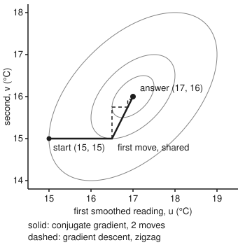
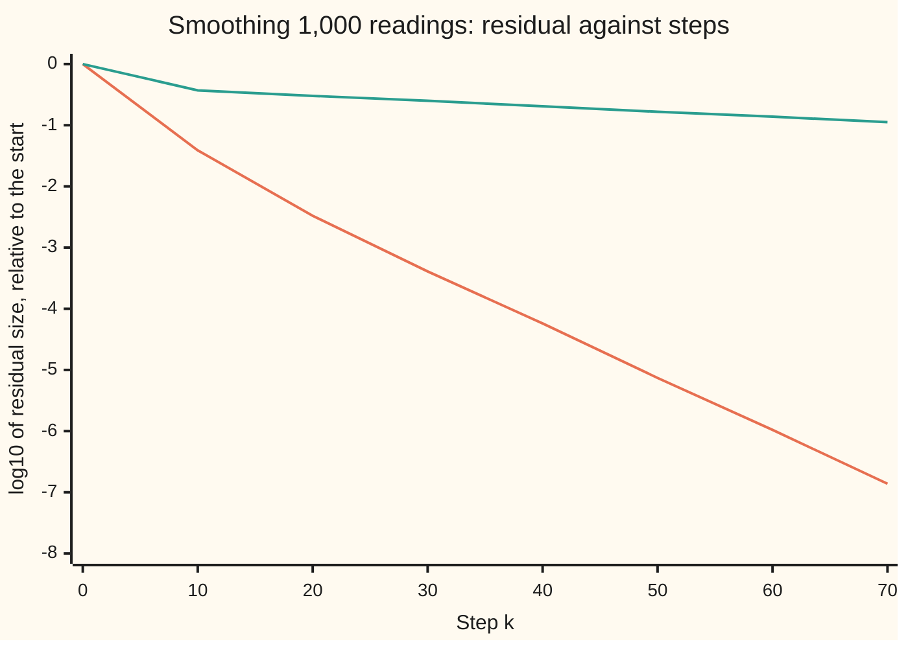

# Conjugate gradient: directions that never undo each other's work

[Syllabus](../../../SYLLABUS.md) → [Optimization](../README.md) → [Unconstrained Methods](../README.md#s02) → Conjugate gradient

---

## General Overview

A greenhouse thermometer logs the air once a minute for 1,000 minutes. The true temperature climbs steadily from 15 °C to 25 °C, but each reading jitters by up to 1 °C either way. The grower wants a smooth curve: 1,000 numbers, one per minute, that stay close to the readings without jumping much from one minute to the next. The card **minimises** a cost: the squared misses from the readings, plus 25 times the squared jumps between neighbouring minutes.

That cost is a bowl in 1,000 dimensions. Its lowest point solves a linear system whose matrix has 1,000,000 entries, almost all zero. Conjugate gradient never writes the matrix down. It needs one rule, "multiply the matrix into a list of 1,000 numbers", and each entry of the answer uses only a minute and its two neighbours. It holds four lists: 4,000 numbers.

For a single chain of minutes like this one, elimination along the chain is cheaper still, one sweep forward and one back, and exact. The code uses it as a check. Conjugate gradient pays off on grids in two or three dimensions, such as a photograph, where elimination turns many of the zeros into numbers it must store (see Where you meet it in real life).

From a flat 15 °C start, it shrinks the cost's slope to $10^{-8}$ of its starting size in 84 steps. Gradient descent, with the best step length each time, needs 882. The smoothed curve sits 0.129 °C from the true warming, root-mean-square (the typical size of a miss); the raw readings sit 0.573 °C from it.

The difference is the directions. Gradient descent heads straight downhill, and each step partly undoes the last, so it zigzags. Conjugate gradient picks each direction so that moving along it keeps the progress made along every earlier one. With n unknowns, n directions finish the job.

**Conjugate gradient minimises a quadratic bowl along directions chosen so that no step spoils the progress of earlier ones; each new direction is the downhill slope plus a multiple of the last direction, each step costs one matrix-times-list product, and in exact arithmetic the bottom arrives within n steps.**

**What kind of fact this is:** a theorem, proved on this card in Why it works. On a symmetric positive definite bowl the directions are conjugate and the method ends within n steps in exact arithmetic. The speed bound in Step 3 is stated, with its source. The nonlinear version is a method with no step-count promise; on the banana valley (a curved test problem, in How it moves) its answer is certified by the cost's floor of 0.

### The picture: two readings, two moves

The same smoother with two readings, 18 °C and 15 °C, and jump weight 1. The axes are the two smoothed values, u and v; the ovals are contours of the cost; the bottom is (17, 16).

<p align="center"></p>

Both methods first move right to (16.5, 15), where the path touches an oval. Gradient descent then turns a right angle and zigzags, each move cutting the cost gap (how far the cost sits above its lowest value) to a quarter. Conjugate gradient turns along a direction conjugate to the first, and lands on (17, 16) exactly.

---

## The formula

Notation first, in words. The cost is a **quadratic**, a bowl set by a matrix $A$ and a list $b$. For two lists $u$ and $v$, $u^T v$ is their dot product: multiply entry by entry and add. Its gradient is $Ax - b$, so the bottom is where $Ax = b$. The **residual** $r = b - Ax$ is minus the gradient: the downhill direction. Directions $d_i$ and $d_j$ are **conjugate** when $d_i^T A\, d_j = 0$: perpendicular once the bowl's stretch is counted.

$$f(x) = \tfrac12\, x^T A\, x - b^T x, \qquad \text{start } d_0 = r_0 = b - A x_0,$$

$$\alpha_k = \frac{r_k^T r_k}{d_k^T A\, d_k}, \quad x_{k+1} = x_k + \alpha_k d_k, \quad r_{k+1} = r_k - \alpha_k A d_k, \quad \beta_k = \frac{r_{k+1}^T r_{k+1}}{r_k^T r_k}, \quad d_{k+1} = r_{k+1} + \beta_k d_k$$

**Read it aloud:** go to the lowest point along the current direction, update the downhill slope, and make the next direction that slope plus a fraction of the old direction.

For the thermometer, the cost $f(x) = \tfrac12 \sum_i (x_i - y_i)^2 + \tfrac{w}{2} \sum_i (x_{i+1} - x_i)^2$ is the quadratic above plus a constant, with $b = y$. Row $i$ of $Ax$ is $x_i + w\,(x_i - x_{i-1}) + w\,(x_i - x_{i+1})$, dropping the missing neighbour at each end. That line is all the code knows about $A$. This is the same smoother as on [L-BFGS](06-l-bfgs-and-limited-memory-updates.md), at half the scale and with its own letters. Halving the cost halves every curvature, so the least curvature here is $\mu = 1$, not 2.

| Symbol | Plain meaning | In our example | Push it up and the answer… |
| --- | --- | --- | --- |
| $x$, $x_i$, $x^*$; $u$, $v$ | the smoothed curve; its value at minute $i$ (on the banana, $x_1$, $x_2$ are the point's coordinates); $x^*$ the exact bottom; the two smoothed values in the two-reading example | 20.584 °C read at minute 500 becomes 19.817 °C; $(u, v)$ = (17, 16) at the two-reading bottom | the answer, not an input |
| $y$, $b$ | the readings, which play the part of $b$ | 1,000 readings, 15.716 °C at minute 0 | the curve follows them |
| $w$ | the jump weight: how much a minute-to-minute jump costs | 25 | smoother curve, more steps |
| $A$ | the bowl's matrix, never stored: row $i$ of $Ax$ as above | 1,000 × 1,000, three non-zero entries a row | — |
| $f(x)$, $\lVert z \rVert_A$ | the cost being minimised, in °C²; the length of a list $z$ in the bowl's own units, $\sqrt{z^T A z}$ | 16,758.2945 at the start, 148.620606 at the bottom | — |
| $x_k$, $k$ | the guess after $k$ steps, counting from $k = 0$ | $x_0$ = flat 15 °C; 84 steps to the tolerance | — |
| $r_k$, $g_k$ | the residual $b - A x_k$, the downhill slope; off a bowl, $g_k = \nabla f(x_k)$ and $r_k = -g_k$ | falls to $10^{-8}$ of its starting size | — |
| $d_k$, $c_i$ | the $k$-th direction (`p` in the code); $c_i$ an amount of $d_i$ in a mix | $d_0 = r_0$ | — |
| $\alpha_k$ | the step length along $d_k$ that reaches the lowest point on that line | 0.5, then 0.6667, for the two readings | — |
| $\beta_k$, $\beta_k^{\text{FR}}$, $\beta_k^{\text{PR+}}$ | how much of the old direction joins the new slope; the two nonlinear versions | 0.25 for the two readings | 0 turns the method into gradient descent |
| $n$ | the number of unknowns | 1,000 | the most steps exact arithmetic can need |
| $\kappa = L/\mu$ | the stretch: largest eigenvalue $L$ of $A$ (the bowl's steepest curvature) over the smallest $\mu$ (its gentlest) | 101.00, from $L \approx 1 + 4w$ and $\mu = 1$ | more steps, growing like $\sqrt{\kappa}$ |

### When it holds

- **$A$ is symmetric.** Otherwise the short recipe for $\beta_k$ stops producing conjugate directions, and the n-step promise is gone.
- **$A$ is positive definite** (every direction curves upward: a bowl; see [Quadratic forms](../../03-Algebra/07-Eigenvalues%20and%20Symmetric%20Matrices/05-quadratic-forms-and-positive-definite.md)). Otherwise $d_k^T A d_k$ can be negative, there is no lowest point along $d_k$, and on the saddle in "What breaks" the method ends higher than it started.
- **The arithmetic is exact, for the n-step promise.** Rounding slowly spoils conjugacy. The worst A-cosine (the cosine of the angle between two directions, measured the bowl's way: 0 when conjugate) is $10^{-13.36}$ among the first 20 directions and $10^{-12.17}$ among all 84. It creeps up as the run goes on, though here it stays tiny. Real codes stop on a residual tolerance.
- **The stretch is modest, for speed.** The step count grows with $\sqrt{\kappa}$; n is only the ceiling.
- **Off a bowl, the line search is accurate.** Steps must pass the strong Wolfe tests ([Line search](04-line-search-armijo-and-wolfe.md)): the cost drops enough and the slope along the line flattens enough. Without the second test the banana run takes 1,124 iterations, not 34.

---

## Why it works

### Step 0: why gradient descent undoes its own work, and what to ask for instead

Stop at the lowest point along a direction $d_0$: there the slope along $d_0$ is zero. Now move an amount $\alpha$ along a second direction $d_1$. In a bowl that changes the gradient by $\alpha A d_1$, so the slope along $d_0$ changes by $\alpha\, d_0^T A d_1$. Unless that is zero, the first step's work is partly undone. Gradient descent takes $d_1$ perpendicular to $d_0$, which does not make $d_0^T A d_1$ zero, so it undoes.

So ask for $d_0^T A d_1 = 0$, which is conjugacy. With n mutually conjugate directions, minimising once along each finishes the job, in any order.

### Step 1: in conjugate directions the bowl splits into n separate one-dimensional problems

Write any point as the start plus a mix of the directions: $x = x_0 + \sum_i c_i d_i$. Expand the cost:

$$f(x) = f(x_0) + \sum_i \Big( \tfrac12 c_i^2\, d_i^T A d_i - c_i\, d_i^T r_0 \Big).$$

The cross terms $c_i c_j\, d_i^T A d_j$ have vanished, because the directions are conjugate. What is left is n parabolas, one per amount $c_i$, that do not interact: each has its own best $c_i = d_i^T r_0 / d_i^T A d_i$, and fixing one never moves another. That is the card's title as algebra.

The directions are also independent: if $\sum_i c_i d_i = 0$, multiplying by $d_j^T A$ leaves $c_j\, d_j^T A d_j = 0$, and $d_j^T A d_j > 0$ in a bowl, so $c_j = 0$. So n of them reach every point, the bottom included.

### Step 2: the next direction needs only the last one

Correcting each new slope against all earlier directions would mean storing them all. The recipe stores one. Step length first: along $d_k$ the cost's slope is $-d_k^T r_k + \alpha\, d_k^T A d_k$, zero at $\alpha = d_k^T r_k / d_k^T A d_k$. Since $d_k = r_k + \beta_{k-1} d_{k-1}$ and $r_k$ is perpendicular to $d_{k-1}$, the top is $r_k^T r_k$: the formula's $\alpha_k$.

Then $\beta_k$: make $d_{k+1} = r_{k+1} + \beta_k d_k$ conjugate to $d_k$, so $\beta_k = -r_{k+1}^T A d_k / d_k^T A d_k$. Put in $A d_k = (r_k - r_{k+1})/\alpha_k$ and use that successive residuals are perpendicular: $\beta_k = r_{k+1}^T r_{k+1} / r_k^T r_k$.

Conjugacy to all the earlier directions comes free: $A$ times an earlier direction is a difference of earlier residuals, and the new residual is perpendicular to all of those.

<details>
<summary>Detailed proof: every direction is conjugate to every earlier one, and the method ends within n steps</summary>

Claim, for every $k$ and every $j < k$: (i) $r_k^T d_j = 0$; (ii) $r_k^T r_j = 0$; (iii) $d_k^T A d_j = 0$. Induction on $k$; for $k = 0$ there is nothing to prove.

(i) Unroll the residual update: $r_k = r_{j+1} - \sum_{i=j+1}^{k-1} \alpha_i A d_i$. The first term is perpendicular to $d_j$ because $\alpha_j$ put $x_{j+1}$ at the lowest point along $d_j$, where the slope along $d_j$ is $-d_j^T r_{j+1} = 0$. Every other term contains $d_j^T A d_i$ with $i > j$, which is zero by (iii) for the earlier steps.

(ii) $r_j = d_j - \beta_{j-1} d_{j-1}$ (with $r_0 = d_0$) lies in the span of $d_j$ and $d_{j-1}$, and (i) makes $r_k$ perpendicular to both.

(iii) For $j = k-1$ this is how $\beta_{k-1}$ was chosen. For $j < k-1$, write $d_k = r_k + \beta_{k-1} d_{k-1}$. The second part gives $d_{k-1}^T A d_j = 0$ by induction. The first gives $r_k^T A d_j = r_k^T (r_j - r_{j+1})/\alpha_j = 0$ by (ii).

Finish: $d_0, \dots, d_{n-1}$ are conjugate and non-zero, so independent (Step 1), so they span all n dimensions. By (i), $r_n$ is perpendicular to all of them, so $r_n = 0$ and $x_n$ is the bottom. If some $r_k = 0$ earlier, the method has already stopped there.

</details>

### Step 3: how fast, when n is far away

For the thermometer, 1,000 steps would be no bargain. What matters is the speed bound, stated here and proved with Chebyshev polynomials in Shewchuk's report, section 9.2 (Sources). Measuring error in the bowl's own units, $\lVert z \rVert_A = \sqrt{z^T A z}$ for any list $z$:

$$\lVert x_k - x^* \rVert_A \;\le\; 2 \left( \frac{\sqrt{\kappa} - 1}{\sqrt{\kappa} + 1} \right)^{k} \lVert x_0 - x^* \rVert_A ,$$

Gradient descent with exact steps has the factor $(\kappa - 1)/(\kappa + 1)$ instead, in the same units (Shewchuk, section 6.2; [Convergence rates](03-rates-of-convergence-and-conditioning.md) finds the same factor for the best fixed step). For the thermometer, $\kappa = 101.00$ gives 0.8190 a step against 0.9804.

Measured the bounds' way, as the error in the bowl's units from the exact bottom found by elimination, the average shrink per step was 0.7906 and 0.9790, both inside. The code asserts each bound at the last step. A digit costs about $\sqrt{\kappa}$ steps instead of $\kappa$, each step one pass over the 1,000 minutes.



Steep line: conjugate gradient, crossing $-8$ at step 84. Flat line: gradient descent with exact steps, which needs 882.

### Step 4: the nonlinear version

Off a bowl, three things change. The residual becomes $-g_k$, minus the gradient $g_k = \nabla f(x_k)$. The step length comes from a line search. And $\beta_k$ must use only gradients. The two classic choices:

$$\beta_k^{\text{FR}} = \frac{g_{k+1}^T g_{k+1}}{g_k^T g_k}, \qquad \beta_k^{\text{PR+}} = \max\!\left(0,\ \frac{g_{k+1}^T (g_{k+1} - g_k)}{g_k^T g_k}\right),$$

Fletcher–Reeves, and Polak–Ribière with a "plus" floor at 0. On a bowl with exact line searches both equal the linear $\beta_k$, because successive gradients are perpendicular. Off a bowl they differ: when progress stalls, $g_{k+1} \approx g_k$, Polak–Ribière drops toward 0 and restarts itself downhill. If a direction ever fails to point downhill, the code restarts along $-g_k$.

---

## Worked numbers, by hand

The two-reading smoother from the picture: readings 18 °C and 15 °C, weight $w = 1$. Call the two smoothed values $u$ and $v$. The cost is $\tfrac12(u - 18)^2 + \tfrac12(v - 15)^2 + \tfrac12(v - u)^2$, so $A$ = `[[2, -1], [-1, 2]]` and $b = (18, 15)$. Start at $x_0 = (15, 15)$, where the cost is 3.0000 above its lowest value.

| Step | Arithmetic | Value |
| --- | --- | --- |
| residual $r_0 = b - A x_0$ | $(18, 15) - (15, 15)$ | $(3, 0)$ |
| first direction $d_0 = r_0$ | | $(3, 0)$ |
| $A d_0$ | $(2 \times 3 - 0,\ -3 + 2 \times 0)$ | $(6, -3)$ |
| $\alpha_0 = r_0^T r_0 / d_0^T A d_0$ | $9 / 18$ | $0.5$ |
| $x_1 = x_0 + \alpha_0 d_0$ | $(15 + 0.5 \times 3,\ 15)$ | $(16.5, 15)$, gap 0.75 |
| $r_1 = r_0 - \alpha_0 A d_0$ | $(3 - 3,\ 0 + 1.5)$ | $(0, 1.5)$ |
| $\beta_0 = r_1^T r_1 / r_0^T r_0$ | $2.25 / 9$ | $0.25$ |
| $d_1 = r_1 + \beta_0 d_0$ | $(0 + 0.25 \times 3,\ 1.5)$ | $(0.75, 1.5)$ |
| conjugate? $d_1^T A d_0$ | $0.75 \times 6 + 1.5 \times (-3)$ | $0$ |
| $A d_1$ | $(1.5 - 1.5,\ -0.75 + 3)$ | $(0, 2.25)$ |
| $\alpha_1 = r_1^T r_1 / d_1^T A d_1$ | $2.25 / 3.375$ | $0.6667$ |
| $x_2 = x_1 + \alpha_1 d_1$ | $(16.5 + 0.5,\ 15 + 1)$ | **$(17, 16)$**, gap 0 |

Two readings, two steps, exact: smoothed temperatures 17 °C and 16 °C, the 3 °C jump pulled in to 1 °C. Gradient descent visits (16.5, 15), (16.5, 15.75), (16.875, 15.75), (16.875, 15.9375), (16.9688, 15.9375), its gap falling 0.75, 0.1875, 0.0469, 0.0117, 0.0029: a factor of 4 a step, never zero. It needs 40 steps to bring the residual below $10^{-12}$ of its start.

### What breaks if you drop a piece

| Mistake | Comes out at | What went wrong |
| --- | --- | --- |
| Drop $\beta$: set $\beta_k = 0$ (gradient descent with exact steps) | 882 steps on the thermometer instead of 84; 40 on the two readings instead of 2 | each direction is perpendicular to the last, not conjugate, so it partly undoes it: the zigzag |
| Run it on `[[1, 2], [2, 1]]` with $b = (3, 0)$, which is not positive definite | $d_1^T A d_1 = -108.0$; it stops at $(-1, 2)$ with cost 1.5000, above the start's 0.0000, while $f(10, -10) = -130.0$ | a saddle: $Ax = b$ is solved, but the cost has no bottom |
| Nonlinear version with a line search that checks only sufficient decrease | 1,124 iterations and 986 restarts on the banana, instead of 34 and 0 | the slope along the old line is left steep, so the new direction often points uphill and is thrown away |

---

## How it moves: the nonlinear version in the banana valley

The Rosenbrock valley is the shelf's narrow curved trough, $f(x_1, x_2) = 100\,(x_2 - x_1^2)^2 + (1 - x_1)^2$, minimised. Every run starts at $(-1.2, 1)$ with $k = 0$, stops when the gradient's length is below $10^{-6}$, and uses one line search: bisection until the strong Wolfe tests pass, constants $10^{-4}$ and 0.1.

| Iteration $k$ | Polak–Ribière+ is at |
| --- | --- |
| 1 | (−1.042, 1.064) |
| 5 | (−0.126, −0.008) |
| 10 | (0.686, 0.469) |
| 15 | (0.988, 0.975) |
| 20 | (1.001, 1.001) |
| 34 | (1.000000, 1.000000), stop |

The walk follows the curved floor from the banana's left arm to the bottom. Three ways down:

```
iterations to |gradient| < 1e-6, from (-1.2, 1)
Polak-Ribiere+    ▏                                            34
Fletcher-Reeves   ▏                                            92
gradient descent  ████████████████████████████████████████  13736
```

All three end at (1, 1) to five decimal places. The certificate: the cost is a sum of two squares, never below 0, and exactly 0 at (1, 1), so (1, 1) is the global minimum. Fletcher–Reeves takes 92 iterations because it does not reset itself when progress stalls; gradient descent, with the same line search, takes 13,736.

---

## Code, from first principles, and it actually runs

The script never stores the matrix; it multiplies by it with the three-neighbour rule. Three independent roads reach the bottom. Road 1 is conjugate gradient. Road 2 is elimination on the three-diagonal system (forward sweep, back substitution, as in [Solving A x = b](../../03-Algebra/05-Solving%20Systems/01-matrix-equation-ax-b.md)); the two agree to $10^{-7.45}$ °C.

Road 3 is a certificate: the final residual has size $10^{-5.80}$, and with smallest eigenvalue $\mu = 1$ no smoothed value is further than that from the exact bottom. The two-reading answer is checked against $A$'s inverse, the banana runs against the floor of 0 at (1, 1). Asserts test all three roads, conjugacy, both rate bounds in the bowl's units, that smoothing cuts the error by more than 3 times, and the banana counts, Polak–Ribière+'s 34 included.

### Python

```python
# Conjugate gradient, the card's check. Standard library only: every product, step and elimination is written out.
from math import sqrt, log10, cos, pi
def dot(u, v):                                  # a plain loop, so Python and Rust add in the same order
    s = 0.0
    for a, b in zip(u, v): s += a * b
    return s
def cg(Av, b, x, tol, bmul=1.0, keep=0):
    # Solve A x = b, i.e. minimise f(x) = 1/2 x.Ax - b.x, knowing A only as the rule Av(v).
    r = [bi - qi for bi, qi in zip(b, Av(x))]   # residual b - Ax = minus the gradient
    p, rr, steps, dirs = r[:], dot(r, r), [], []
    r0, hist = sqrt(rr), [1.0]
    while sqrt(rr) / r0 > tol and len(steps) < 20000:
        Ap = Av(p); pAp = dot(p, Ap)
        if len(dirs) < keep: dirs.append((p, Ap))   # kept only to test conjugacy
        a = rr / pAp                            # exact step to the lowest point along p
        x = [xi + a * pi_ for xi, pi_ in zip(x, p)]
        r = [ri - a * qi for ri, qi in zip(r, Ap)]; rn = dot(r, r)
        beta = bmul * rn / rr                   # bmul = 0: gradient descent with exact steps
        steps.append((p[0], p[1], pAp, a, x[0], x[1], r[0], r[1], beta))
        p, rr = [ri + beta * pi_ for ri, pi_ in zip(r, p)], rn
        hist.append(sqrt(rr) / r0)
    return x, steps, hist, dirs
def f2(A, b, x):                                # f = 1/2 x.Ax - b.x for a 2 by 2 example
    return 0.5 * dot(x, [dot(A[0], x), dot(A[1], x)]) - dot(b, x)

# ---- by hand: two readings, 18 and 15 C, weight w = 1, start from a flat 15 C ----
A2, y2 = [[2.0, -1.0], [-1.0, 2.0]], [18.0, 15.0]
mv2 = lambda v: [dot(A2[0], v), dot(A2[1], v)]
x2, st2, _, _ = cg(mv2, y2, [15.0, 15.0], 1e-12); sd2 = cg(mv2, y2, [15.0, 15.0], 1e-12, bmul=0.0)[1]
fstar = f2(A2, y2, [17.0, 16.0])                # the answer from A's inverse, (1/3)[[2, 1], [1, 2]] y
print(f"hand: start (15, 15), residual (3, 0), gap f - f* {f2(A2, y2, [15.0, 15.0]) - fstar:.4f},"
      f" conjugacy d1.Ad0 {dot(st2[1][:2], mv2(st2[0][:2])):.4f}")
for k, s in enumerate(st2):
    print(f"hand cg k={k}: r.r {s[3] * s[2]:.4f} p ({s[0]:.4f}, {s[1]:.4f}) Ap ({mv2(s[:2])[0]:.4f}, {mv2(s[:2])[1]:.4f})"
          f" pAp {s[2]:.4f} alpha {s[3]:.4f} -> x ({s[4]:.4f}, {s[5]:.4f})"
          f" r ({s[6]:.4f}, {s[7]:.4f}) beta {s[8]:.4f}\n            gap {f2(A2, y2, [s[4], s[5]]) - fstar:.4f}")
print("hand gd:", " ".join(f"({s[4]:.4f}, {s[5]:.4f})" for s in sd2[:5]),
      "gaps", " ".join(f"{f2(A2, y2, [s[4], s[5]]) - fstar:.4f}" for s in sd2[:5]), f"steps to 1e-12: {len(sd2)}")
print("figure, centre (17, 16), long axis along (1, 1); semi-axes sqrt(2c), sqrt(2c/3) at gap c:",
      ", ".join(f"c={c:g} {sqrt(2 * c):.4f} {sqrt(2 * c / 3):.4f}" for c in (3.0, 0.75, 0.1875)))
assert len(st2) == 2 and abs(x2[0] - 17.0) < 1e-12 and abs(x2[1] - 16.0) < 1e-12   # exact in n = 2 steps
assert abs(dot(st2[1][:2], mv2(st2[0][:2]))) < 1e-12                                # the two moves are conjugate
assert len(sd2) > 20                                                                # gradient descent never lands

# ---- the card's example: 1000 thermometer readings, smoothing weight w = 25 ----
n, w, MASK = 1000, 25.0, (1 << 64) - 1
def splitmix(s):
    s = (s + 0x9E3779B97F4A7C15) & MASK
    z = ((s ^ (s >> 30)) * 0xBF58476D1CE4E5B9) & MASK
    z = ((z ^ (z >> 27)) * 0x94D049BB133111EB) & MASK
    return s, z ^ (z >> 31)
seed, y = 2026, []
for i in range(n):                              # true warming 15 -> 25 C, plus up to 1 C of noise
    seed, z = splitmix(seed)
    y.append(15.0 + 0.01 * i + 2.0 * ((z >> 11) / 2.0**53 - 0.5))
def Av(v):                                      # (I + w L) v, without storing a 1000 by 1000 matrix
    return [v[i] + (w * (v[i] - v[i - 1]) if i > 0 else 0.0) + (w * (v[i] - v[i + 1]) if i < n - 1 else 0.0)
            for i in range(n)]
def fsm(x):                                     # misfit to the readings + w times the jumps
    e, j = [a - b for a, b in zip(x, y)], [x[i + 1] - x[i] for i in range(n - 1)]
    return 0.5 * dot(e, e) + 0.5 * w * dot(j, j)
start = [15.0] * n
x, st, hist, dirs = cg(Av, y, start, 1e-8, keep=n)
xg, sts, hists, _ = cg(Av, y, start, 1e-8, bmul=0.0)
# road 2: elimination on the three-diagonal system (forward sweep, then back substitution)
c, d, xe = [0.0] * n, [0.0] * n, [0.0] * n
for i in range(n):
    diag = 1.0 + w * ((i > 0) + (i < n - 1)) + (w * c[i - 1] if i > 0 else 0.0)
    c[i] = -w / diag
    d[i] = (y[i] + (w * d[i - 1] if i > 0 else 0.0)) / diag
for i in range(n - 1, -1, -1):
    xe[i] = d[i] - (c[i] * xe[i + 1] if i < n - 1 else 0.0)
res = [bi - qi for bi, qi in zip(y, Av(x))]
gap_ce = max(abs(a - b) for a, b in zip(x, xe))
acos = [max(abs(dot(dirs[i][0], dirs[j][1])) / sqrt(dot(dirs[i][0], dirs[i][1]) * dot(dirs[j][0], dirs[j][1]))
            for j in range(i)) for i in range(1, len(dirs))]   # worst A-cosine of each direction with the earlier ones
kappa = 1.0 + w * (2.0 + 2.0 * cos(pi / n))    # largest eigenvalue L over smallest, mu = 1
rate_cg, rate_gd = (sqrt(kappa) - 1) / (sqrt(kappa) + 1), (kappa - 1) / (kappa + 1)
ea = lambda u: sqrt(dot([a - b for a, b in zip(u, xe)], Av([a - b for a, b in zip(u, xe)])))   # error in the bowl's units
mcg, mgd = (ea(x) / ea(start)) ** (1 / len(st)), (ea(xg) / ea(start)) ** (1 / len(sts))
def rms(u):                                     # root-mean-square distance from the true warming
    e = [u[i] - (15.0 + 0.01 * i) for i in range(n)]
    return sqrt(dot(e, e) / n)
print(f"smoother: steps cg {len(st)}  gradient descent {len(sts)}  numbers held {4 * n} vs matrix {n * n}")
print(f"smoother: f start {fsm(start):.4f}  f cg {fsm(x):.6f}  f elimination {fsm(xe):.6f}")
print(f"smoother: minute 0 {y[0]:.3f} -> {x[0]:.3f}  minute 500 {y[500]:.3f} -> {x[500]:.3f}  minute 999 {y[999]:.3f} -> {x[999]:.3f}")
print(f"smoother: rms error against the true warming, readings {rms(y):.3f}  smoothed {rms(x):.3f}")
print(f"smoother: log10 |residual| {log10(sqrt(dot(res, res))):.2f}  log10 max |cg - elimination| {log10(gap_ce):.2f}")
print(f"smoother: log10 worst A-cosine, first 20 directions {log10(max(acos[:19])):.2f}, all {len(dirs)} {log10(max(acos)):.2f}")
print(f"smoother: kappa {kappa:.2f}  bound per step cg {rate_cg:.4f} gd {rate_gd:.4f}  measured cg {mcg:.4f} gd {mgd:.4f}")
print("chart, k  ", " ".join(f"{k:>6d}" for k in range(0, 80, 10)))
for lab, hh in (("cg ", hist), ("gd ", hists)): print("chart, " + lab, " ".join(f"{log10(hh[k]):6.2f}" for k in range(0, 80, 10)))
assert gap_ce < 1e-6 and gap_ce <= sqrt(dot(res, res)) and abs(fsm(x) - fsm(xe)) < 1e-9 * fsm(xe)   # roads 1, 2, 3 agree
assert len(st) < n // 10 and len(sts) > 5 * len(st)              # far fewer than n steps, and beats descent
assert ea(x) <= 2 * rate_cg ** len(st) * ea(start) and ea(xg) <= rate_gd ** len(sts) * ea(start) and rms(x) < rms(y) / 3  # A-norm bounds; smoothing helps

# ---- break: an indefinite matrix, a saddle instead of a bowl ----
Ai, bi = [[1.0, 2.0], [2.0, 1.0]], [3.0, 0.0]
xi, sti, _, _ = cg(lambda v: [dot(Ai[0], v), dot(Ai[1], v)], bi, [0.0, 0.0], 1e-12)
print(f"break: indefinite, pAp {sti[0][2]:.1f} then {sti[1][2]:.1f}, ends at ({xi[0]:.4f}, {xi[1]:.4f}) with f {f2(Ai, bi, xi):.4f};"
      f" f(0, 0) 0.0000, f(10, -10) {f2(Ai, bi, [10.0, -10.0]):.1f}")
assert sti[1][2] < 0 and f2(Ai, bi, xi) > 0.0                    # it stops on a saddle, above the start

# ---- the nonlinear version: the Rosenbrock banana valley, start (-1.2, 1), stop when |grad| < 1e-6 ----
def fr(x, y): return 100.0 * (y - x * x) * (y - x * x) + (1.0 - x) * (1.0 - x)
def gr(x, y): return -400.0 * x * (y - x * x) - 2.0 * (1.0 - x), 200.0 * (y - x * x)
def search(x, y, dx, dy, c2):                   # bisection until the strong Wolfe tests pass
    f0, (gx, gy) = fr(x, y), gr(x, y)
    s0, lo, hi, a = gx * dx + gy * dy, 0.0, -1.0, 1.0
    for _ in range(60):
        gx, gy = gr(x + a * dx, y + a * dy); s = gx * dx + gy * dy
        if fr(x + a * dx, y + a * dy) > f0 + 1e-4 * a * s0: hi = a
        elif s < c2 * s0: lo = a
        elif s > -c2 * s0: hi = a
        else: break
        a = (lo + hi) / 2.0 if hi > 0.0 else 2.0 * a
    return a
def ncg(kind, c2=0.1):
    x, y = -1.2, 1.0; gx, gy = gr(x, y)
    dx, dy, k, restarts, path = -gx, -gy, 0, 0, []
    while sqrt(gx * gx + gy * gy) >= 1e-6 and k < 100000:
        if gx * dx + gy * dy >= 0.0:            # not downhill: restart along minus the gradient
            dx, dy, restarts = -gx, -gy, restarts + 1
        a = search(x, y, dx, dy, c2)
        x, y = x + a * dx, y + a * dy; hx, hy = gr(x, y)
        b = (hx * hx + hy * hy) / (gx * gx + gy * gy) if kind == "FR" else 0.0       # Fletcher-Reeves
        if kind == "PR+": b = max(0.0, (hx * (hx - gx) + hy * (hy - gy)) / (gx * gx + gy * gy))  # Polak-Ribiere
        dx, dy, gx, gy, k = -hx + b * dx, -hy + b * dy, hx, hy, k + 1
        path.append((x, y))
    return k, x, y, restarts, path
runs = {kind: ncg(kind) for kind in ("PR+", "FR", "GD")}
for kind, (k, xr, yr, rs, _) in runs.items():
    print(f"banana {kind:<3}: {k:>5d} iterations, ends ({xr:.6f}, {yr:.6f}), restarts {rs}")
print("banana PR+ path:", " ".join(f"k={j + 1} ({runs['PR+'][4][j][0]:.3f}, {runs['PR+'][4][j][1]:.3f})" for j in (0, 4, 9, 14, 19)))
ka, _, _, rsa, _ = ncg("PR+", c2=1e9)
print(f"break: PR+ with backtracking only, no curvature test: {ka} iterations, {rsa} restarts")
for kind, (k, xr, yr, rs, _) in runs.items():                    # certificate: f >= 0 everywhere, f(1, 1) = 0
    assert abs(xr - 1.0) < 1e-5 and abs(yr - 1.0) < 1e-5 and fr(xr, yr) < 1e-10
assert runs["GD"][0] > 100 * runs["PR+"][0] and runs["GD"][0] > 10 * runs["FR"][0] and ka > 10 * runs["PR+"][0] and runs["PR+"][0] == 34
print("ALL CHECKS PASS")
```

**Ran 2026-11-11 on macOS, Python 3.14.10, standard library only. All checks passed. Output, pasted from the run:**

```
hand: start (15, 15), residual (3, 0), gap f - f* 3.0000, conjugacy d1.Ad0 0.0000
hand cg k=0: r.r 9.0000 p (3.0000, 0.0000) Ap (6.0000, -3.0000) pAp 18.0000 alpha 0.5000 -> x (16.5000, 15.0000) r (0.0000, 1.5000) beta 0.2500
            gap 0.7500
hand cg k=1: r.r 2.2500 p (0.7500, 1.5000) Ap (0.0000, 2.2500) pAp 3.3750 alpha 0.6667 -> x (17.0000, 16.0000) r (0.0000, 0.0000) beta 0.0000
            gap 0.0000
hand gd: (16.5000, 15.0000) (16.5000, 15.7500) (16.8750, 15.7500) (16.8750, 15.9375) (16.9688, 15.9375) gaps 0.7500 0.1875 0.0469 0.0117 0.0029 steps to 1e-12: 40
figure, centre (17, 16), long axis along (1, 1); semi-axes sqrt(2c), sqrt(2c/3) at gap c: c=3 2.4495 1.4142, c=0.75 1.2247 0.7071, c=0.1875 0.6124 0.3536
smoother: steps cg 84  gradient descent 882  numbers held 4000 vs matrix 1000000
smoother: f start 16758.2945  f cg 148.620606  f elimination 148.620606
smoother: minute 0 15.716 -> 15.302  minute 500 20.584 -> 19.817  minute 999 25.608 -> 25.215
smoother: rms error against the true warming, readings 0.573  smoothed 0.129
smoother: log10 |residual| -5.80  log10 max |cg - elimination| -7.45
smoother: log10 worst A-cosine, first 20 directions -13.36, all 84 -12.17
smoother: kappa 101.00  bound per step cg 0.8190 gd 0.9804  measured cg 0.7906 gd 0.9790
chart, k        0     10     20     30     40     50     60     70
chart, cg    0.00  -1.41  -2.48  -3.39  -4.24  -5.13  -5.98  -6.86
chart, gd    0.00  -0.43  -0.52  -0.60  -0.69  -0.78  -0.86  -0.95
break: indefinite, pAp 9.0 then -108.0, ends at (-1.0000, 2.0000) with f 1.5000; f(0, 0) 0.0000, f(10, -10) -130.0
banana PR+:    34 iterations, ends (1.000000, 1.000000), restarts 0
banana FR :    92 iterations, ends (1.000001, 1.000001), restarts 0
banana GD : 13736 iterations, ends (1.000001, 1.000002), restarts 0
banana PR+ path: k=1 (-1.042, 1.064) k=5 (-0.126, -0.008) k=10 (0.686, 0.469) k=15 (0.988, 0.975) k=20 (1.001, 1.001)
break: PR+ with backtracking only, no curvature test: 1124 iterations, 986 restarts
ALL CHECKS PASS
```

### Rust

```rust
// Conjugate gradient -- the check behind the card.  Rust std only, no crates.
// Nothing imported solves anything: every product, step and elimination is written out.
use std::f64::consts::PI;
fn dot(u: &[f64], v: &[f64]) -> f64 { let mut s = 0.0; for i in 0..u.len() { s += u[i] * v[i]; } s }
type Step = [f64; 9]; // p0, p1, pAp, alpha, x0, x1, r0, r1, beta
struct Run { x: Vec<f64>, steps: Vec<Step>, hist: Vec<f64>, dirs: Vec<(Vec<f64>, Vec<f64>)> }
// Solve A x = b, i.e. minimise f(x) = 1/2 x.Ax - b.x, knowing A only as the rule av(v).
fn cg(av: &dyn Fn(&[f64]) -> Vec<f64>, b: &[f64], x0: &[f64], tol: f64, bmul: f64, keep: usize) -> Run {
    let (mut x, ax) = (x0.to_vec(), av(x0));
    let mut r: Vec<f64> = (0..b.len()).map(|i| b[i] - ax[i]).collect(); // residual = minus the gradient
    let (mut p, mut rr) = (r.clone(), dot(&r, &r));
    let r0 = rr.sqrt();
    let (mut steps, mut hist, mut dirs) = (Vec::new(), vec![1.0], Vec::new());
    while rr.sqrt() / r0 > tol && steps.len() < 20000 {
        let ap = av(&p); let pap = dot(&p, &ap);
        if dirs.len() < keep { dirs.push((p.clone(), ap.clone())); } // kept only to test conjugacy
        let a = rr / pap; // exact step to the lowest point along p
        for i in 0..x.len() { x[i] += a * p[i]; r[i] -= a * ap[i]; }
        let rn = dot(&r, &r);
        let beta = bmul * rn / rr; // bmul = 0: gradient descent with exact steps
        steps.push([p[0], p[1], pap, a, x[0], x[1], r[0], r[1], beta]);
        for i in 0..p.len() { p[i] = r[i] + beta * p[i]; }
        rr = rn; hist.push(rr.sqrt() / r0);
    }
    Run { x, steps, hist, dirs }
}
fn f2(a: &[[f64; 2]; 2], b: &[f64], x: &[f64]) -> f64 {
    0.5 * dot(x, &[dot(&a[0], x), dot(&a[1], x)]) - dot(b, x)
}
fn splitmix(s: u64) -> (u64, u64) {
    let s = s.wrapping_add(0x9E3779B97F4A7C15);
    let z = (s ^ (s >> 30)).wrapping_mul(0xBF58476D1CE4E5B9);
    let z = (z ^ (z >> 27)).wrapping_mul(0x94D049BB133111EB);
    (s, z ^ (z >> 31))
}
fn fr(x: f64, y: f64) -> f64 { 100.0 * (y - x * x) * (y - x * x) + (1.0 - x) * (1.0 - x) }
fn gr(x: f64, y: f64) -> (f64, f64) { (-400.0 * x * (y - x * x) - 2.0 * (1.0 - x), 200.0 * (y - x * x)) }
fn search(x: f64, y: f64, dx: f64, dy: f64, c2: f64) -> f64 { // bisection until the strong Wolfe tests pass
    let (f0, (gx, gy)) = (fr(x, y), gr(x, y));
    let (s0, mut lo, mut hi, mut a) = (gx * dx + gy * dy, 0.0, -1.0, 1.0);
    for _ in 0..60 {
        let (gx, gy) = gr(x + a * dx, y + a * dy); let s = gx * dx + gy * dy;
        if fr(x + a * dx, y + a * dy) > f0 + 1e-4 * a * s0 { hi = a; }
        else if s < c2 * s0 { lo = a; }
        else if s > -c2 * s0 { hi = a; }
        else { break; }
        a = if hi > 0.0 { (lo + hi) / 2.0 } else { 2.0 * a };
    }
    a
}
fn ncg(kind: &str, c2: f64) -> (usize, f64, f64, usize, Vec<(f64, f64)>) {
    let (mut x, mut y, mut k, mut restarts, mut path) = (-1.2, 1.0, 0, 0, Vec::new());
    let (mut gx, mut gy) = gr(x, y);
    let (mut dx, mut dy) = (-gx, -gy);
    while (gx * gx + gy * gy).sqrt() >= 1e-6 && k < 100000 {
        if gx * dx + gy * dy >= 0.0 { dx = -gx; dy = -gy; restarts += 1; } // not downhill: restart
        let a = search(x, y, dx, dy, c2);
        x += a * dx; y += a * dy; let (hx, hy) = gr(x, y);
        let mut b = if kind == "FR" { (hx * hx + hy * hy) / (gx * gx + gy * gy) } else { 0.0 }; // Fletcher-Reeves
        if kind == "PR+" { b = f64::max(0.0, (hx * (hx - gx) + hy * (hy - gy)) / (gx * gx + gy * gy)); } // Polak-Ribiere
        dx = -hx + b * dx; dy = -hy + b * dy; gx = hx; gy = hy; k += 1; path.push((x, y));
    }
    (k, x, y, restarts, path)
}
fn main() {
    // ---- by hand: two readings, 18 and 15 C, weight w = 1, start from a flat 15 C ----
    let (a2, y2) = ([[2.0, -1.0], [-1.0, 2.0]], [18.0, 15.0]);
    let mv2 = |v: &[f64]| vec![dot(&a2[0], v), dot(&a2[1], v)];
    let h = cg(&mv2, &y2, &[15.0, 15.0], 1e-12, 1.0, 0);
    let sd2 = cg(&mv2, &y2, &[15.0, 15.0], 1e-12, 0.0, 0).steps;
    let fstar = f2(&a2, &y2, &[17.0, 16.0]); // the answer from A's inverse, (1/3)[[2, 1], [1, 2]] y
    let (q0, q1) = (&h.steps[0], &h.steps[1]);
    println!("hand: start (15, 15), residual (3, 0), gap f - f* {:.4}, conjugacy d1.Ad0 {:.4}",
        f2(&a2, &y2, &[15.0, 15.0]) - fstar, dot(&q1[..2], &mv2(&q0[..2])));
    for (k, s) in h.steps.iter().enumerate() {
        let ap = mv2(&s[..2]);
        println!("hand cg k={}: r.r {:.4} p ({:.4}, {:.4}) Ap ({:.4}, {:.4}) pAp {:.4} alpha {:.4} -> x ({:.4}, {:.4}) r ({:.4}, {:.4}) beta {:.4}\n            gap {:.4}",
            k, s[3] * s[2], s[0], s[1], ap[0], ap[1], s[2], s[3], s[4], s[5], s[6], s[7], s[8], f2(&a2, &y2, &[s[4], s[5]]) - fstar);
    }
    let pts: Vec<String> = sd2[..5].iter().map(|s| format!("({:.4}, {:.4})", s[4], s[5])).collect();
    let gaps: Vec<String> = sd2[..5].iter().map(|s| format!("{:.4}", f2(&a2, &y2, &[s[4], s[5]]) - fstar)).collect();
    println!("hand gd: {} gaps {} steps to 1e-12: {}", pts.join(" "), gaps.join(" "), sd2.len());
    let lv: Vec<String> = [3.0f64, 0.75, 0.1875].iter().map(|c| format!("c={} {:.4} {:.4}", c, (2.0 * c).sqrt(), (2.0 * c / 3.0).sqrt())).collect();
    println!("figure, centre (17, 16), long axis along (1, 1); semi-axes sqrt(2c), sqrt(2c/3) at gap c: {}", lv.join(", "));
    assert!(h.steps.len() == 2 && (h.x[0] - 17.0).abs() < 1e-12 && (h.x[1] - 16.0).abs() < 1e-12); // exact in 2 steps
    assert!(dot(&q1[..2], &mv2(&q0[..2])).abs() < 1e-12); // the two moves are conjugate
    assert!(sd2.len() > 20); // gradient descent never lands
    // ---- the card's example: 1000 thermometer readings, smoothing weight w = 25 ----
    let (n, w) = (1000usize, 25.0f64);
    let (mut seed, mut y) = (2026u64, Vec::new());
    for i in 0..n { // true warming 15 -> 25 C, plus up to 1 C of noise
        let (s, z) = splitmix(seed); seed = s;
        y.push(15.0 + 0.01 * i as f64 + 2.0 * ((z >> 11) as f64 / 9007199254740992.0 - 0.5));
    }
    let av = |v: &[f64]| -> Vec<f64> { // (I + w L) v, without storing a 1000 by 1000 matrix
        (0..n).map(|i| v[i] + (if i > 0 { w * (v[i] - v[i - 1]) } else { 0.0 })
            + (if i < n - 1 { w * (v[i] - v[i + 1]) } else { 0.0 })).collect()
    };
    let fsm = |x: &[f64]| -> f64 { // misfit to the readings + w times the jumps
        let e: Vec<f64> = (0..n).map(|i| x[i] - y[i]).collect();
        let j: Vec<f64> = (0..n - 1).map(|i| x[i + 1] - x[i]).collect();
        0.5 * dot(&e, &e) + 0.5 * w * dot(&j, &j)
    };
    let start = vec![15.0; n];
    let (c, g) = (cg(&av, &y, &start, 1e-8, 1.0, n), cg(&av, &y, &start, 1e-8, 0.0, 0));
    let x = &c.x;
    // road 2: elimination on the three-diagonal system (forward sweep, then back substitution)
    let (mut cc, mut d, mut xe) = (vec![0.0; n], vec![0.0; n], vec![0.0; n]);
    for i in 0..n {
        let cnt = (i > 0) as usize + (i < n - 1) as usize;
        let diag = 1.0 + w * cnt as f64 + (if i > 0 { w * cc[i - 1] } else { 0.0 });
        cc[i] = -w / diag;
        d[i] = (y[i] + (if i > 0 { w * d[i - 1] } else { 0.0 })) / diag;
    }
    for i in (0..n).rev() { xe[i] = d[i] - (if i < n - 1 { cc[i] * xe[i + 1] } else { 0.0 }); }
    let ax = av(x); let res: Vec<f64> = (0..n).map(|i| y[i] - ax[i]).collect();
    let gap_ce = (0..n).map(|i| (x[i] - xe[i]).abs()).fold(0.0, f64::max);
    let acos: Vec<f64> = (1..c.dirs.len()).map(|i| (0..i).map(|j| { let ((pi, api), (pj, apj)) = (&c.dirs[i], &c.dirs[j]);
        dot(pi, apj).abs() / (dot(pi, api) * dot(pj, apj)).sqrt() }).fold(0.0, f64::max)).collect(); // worst A-cosine with the earlier ones
    let kappa = 1.0 + w * (2.0 + 2.0 * (PI / n as f64).cos()); // largest eigenvalue L over smallest, mu = 1
    let (rate_cg, rate_gd) = ((kappa.sqrt() - 1.0) / (kappa.sqrt() + 1.0), (kappa - 1.0) / (kappa + 1.0));
    let ea = |u: &[f64]| { let e: Vec<f64> = (0..n).map(|i| u[i] - xe[i]).collect(); dot(&e, &av(&e)).sqrt() }; // error in the bowl's units
    let mcg = (ea(x) / ea(&start)).powf(1.0 / c.steps.len() as f64);
    let mgd = (ea(&g.x) / ea(&start)).powf(1.0 / g.steps.len() as f64);
    let rms = |u: &[f64]| { // root-mean-square distance from the true warming
        let e: Vec<f64> = (0..n).map(|i| u[i] - (15.0 + 0.01 * i as f64)).collect();
        (dot(&e, &e) / n as f64).sqrt()
    };
    println!("smoother: steps cg {}  gradient descent {}  numbers held {} vs matrix {}", c.steps.len(), g.steps.len(), 4 * n, n * n);
    println!("smoother: f start {:.4}  f cg {:.6}  f elimination {:.6}", fsm(&start), fsm(x), fsm(&xe));
    println!("smoother: minute 0 {:.3} -> {:.3}  minute 500 {:.3} -> {:.3}  minute 999 {:.3} -> {:.3}", y[0], x[0], y[500], x[500], y[999], x[999]);
    println!("smoother: rms error against the true warming, readings {:.3}  smoothed {:.3}", rms(&y), rms(x));
    println!("smoother: log10 |residual| {:.2}  log10 max |cg - elimination| {:.2}", dot(&res, &res).sqrt().log10(), gap_ce.log10());
    println!("smoother: log10 worst A-cosine, first 20 directions {:.2}, all {} {:.2}", acos[..19].iter().cloned().fold(0.0, f64::max).log10(), c.dirs.len(), acos.iter().cloned().fold(0.0, f64::max).log10());
    println!("smoother: kappa {:.2}  bound per step cg {:.4} gd {:.4}  measured cg {:.4} gd {:.4}", kappa, rate_cg, rate_gd, mcg, mgd);
    let ks: Vec<String> = (0..80).step_by(10).map(|k| format!("{:>6}", k)).collect();
    let hc: Vec<String> = (0..80).step_by(10).map(|k| format!("{:6.2}", c.hist[k].log10())).collect();
    let hg: Vec<String> = (0..80).step_by(10).map(|k| format!("{:6.2}", g.hist[k].log10())).collect();
    println!("chart, k   {}\nchart, cg  {}\nchart, gd  {}", ks.join(" "), hc.join(" "), hg.join(" "));
    assert!(gap_ce < 1e-6 && gap_ce <= dot(&res, &res).sqrt() && (fsm(x) - fsm(&xe)).abs() < 1e-9 * fsm(&xe)); // roads 1, 2, 3 agree
    assert!(c.steps.len() < n / 10 && g.steps.len() > 5 * c.steps.len()); // far fewer than n steps, and beats descent
    assert!(ea(x) <= 2.0 * rate_cg.powi(c.steps.len() as i32) * ea(&start) && ea(&g.x) <= rate_gd.powi(g.steps.len() as i32) * ea(&start) && rms(x) < rms(&y) / 3.0); // A-norm bounds; smoothing helps
    // ---- break: an indefinite matrix, a saddle instead of a bowl ----
    let (ai, bi) = ([[1.0, 2.0], [2.0, 1.0]], [3.0, 0.0]);
    let ind = cg(&|v: &[f64]| vec![dot(&ai[0], v), dot(&ai[1], v)], &bi, &[0.0, 0.0], 1e-12, 1.0, 0);
    let xi = &ind.x;
    println!("break: indefinite, pAp {:.1} then {:.1}, ends at ({:.4}, {:.4}) with f {:.4}; f(0, 0) 0.0000, f(10, -10) {:.1}",
        ind.steps[0][2], ind.steps[1][2], xi[0], xi[1], f2(&ai, &bi, xi), f2(&ai, &bi, &[10.0, -10.0]));
    assert!(ind.steps[1][2] < 0.0 && f2(&ai, &bi, xi) > 0.0); // it stops on a saddle, above the start
    // ---- the nonlinear version: the Rosenbrock banana valley, start (-1.2, 1), stop when |grad| < 1e-6 ----
    let runs: Vec<(&str, (usize, f64, f64, usize, Vec<(f64, f64)>))> =
        ["PR+", "FR", "GD"].iter().map(|k| (*k, ncg(k, 0.1))).collect();
    for (kind, (k, xr, yr, rs, _)) in &runs {
        println!("banana {:<3}: {:>5} iterations, ends ({:.6}, {:.6}), restarts {}", kind, k, xr, yr, rs);
    }
    let pp = &runs[0].1 .4;
    let pts: Vec<String> = [0usize, 4, 9, 14, 19].iter().map(|&j| format!("k={} ({:.3}, {:.3})", j + 1, pp[j].0, pp[j].1)).collect();
    println!("banana PR+ path: {}", pts.join(" "));
    let (ka, _, _, rsa, _) = ncg("PR+", 1e9);
    println!("break: PR+ with backtracking only, no curvature test: {} iterations, {} restarts", ka, rsa);
    for (_, (_, xr, yr, _, _)) in &runs { // certificate: f >= 0 everywhere, f(1, 1) = 0
        assert!((xr - 1.0).abs() < 1e-5 && (yr - 1.0).abs() < 1e-5 && fr(*xr, *yr) < 1e-10);
    }
    assert!(runs[2].1 .0 > 100 * runs[0].1 .0 && runs[2].1 .0 > 10 * runs[1].1 .0 && ka > 10 * runs[0].1 .0 && runs[0].1 .0 == 34);
    println!("ALL CHECKS PASS");
}
```

**Ran 2026-11-11 on macOS, rustc 1.98.1, no crates. All checks passed. Output, pasted from the run:**

```
hand: start (15, 15), residual (3, 0), gap f - f* 3.0000, conjugacy d1.Ad0 0.0000
hand cg k=0: r.r 9.0000 p (3.0000, 0.0000) Ap (6.0000, -3.0000) pAp 18.0000 alpha 0.5000 -> x (16.5000, 15.0000) r (0.0000, 1.5000) beta 0.2500
            gap 0.7500
hand cg k=1: r.r 2.2500 p (0.7500, 1.5000) Ap (0.0000, 2.2500) pAp 3.3750 alpha 0.6667 -> x (17.0000, 16.0000) r (0.0000, 0.0000) beta 0.0000
            gap 0.0000
hand gd: (16.5000, 15.0000) (16.5000, 15.7500) (16.8750, 15.7500) (16.8750, 15.9375) (16.9688, 15.9375) gaps 0.7500 0.1875 0.0469 0.0117 0.0029 steps to 1e-12: 40
figure, centre (17, 16), long axis along (1, 1); semi-axes sqrt(2c), sqrt(2c/3) at gap c: c=3 2.4495 1.4142, c=0.75 1.2247 0.7071, c=0.1875 0.6124 0.3536
smoother: steps cg 84  gradient descent 882  numbers held 4000 vs matrix 1000000
smoother: f start 16758.2945  f cg 148.620606  f elimination 148.620606
smoother: minute 0 15.716 -> 15.302  minute 500 20.584 -> 19.817  minute 999 25.608 -> 25.215
smoother: rms error against the true warming, readings 0.573  smoothed 0.129
smoother: log10 |residual| -5.80  log10 max |cg - elimination| -7.45
smoother: log10 worst A-cosine, first 20 directions -13.36, all 84 -12.17
smoother: kappa 101.00  bound per step cg 0.8190 gd 0.9804  measured cg 0.7906 gd 0.9790
chart, k        0     10     20     30     40     50     60     70
chart, cg    0.00  -1.41  -2.48  -3.39  -4.24  -5.13  -5.98  -6.86
chart, gd    0.00  -0.43  -0.52  -0.60  -0.69  -0.78  -0.86  -0.95
break: indefinite, pAp 9.0 then -108.0, ends at (-1.0000, 2.0000) with f 1.5000; f(0, 0) 0.0000, f(10, -10) -130.0
banana PR+:    34 iterations, ends (1.000000, 1.000000), restarts 0
banana FR :    92 iterations, ends (1.000001, 1.000001), restarts 0
banana GD : 13736 iterations, ends (1.000001, 1.000002), restarts 0
banana PR+ path: k=1 (-1.042, 1.064) k=5 (-0.126, -0.008) k=10 (0.686, 0.469) k=15 (0.988, 0.975) k=20 (1.001, 1.001)
break: PR+ with backtracking only, no curvature test: 1124 iterations, 986 restarts
ALL CHECKS PASS
```

The two outputs match line for line.

### Lean

Lean proves the n-step promise and the conjugacy for every symmetric positive definite $A$, in exact arithmetic, from any start and any $b$.

- For a symmetric positive definite $A$, after n steps the guess solves $Ax = b$. No point has a lower cost.
- Every direction is conjugate to every earlier one: $d_k^T A\, d_j = 0$ whenever $j < k$.
- Every residual is perpendicular to every earlier one: $r_k^T r_j = 0$ whenever $j < k$.
- With the two readings 18 °C and 15 °C, the first move reaches (16.5, 15) and the second lands on (17, 16) exactly. The two directions are conjugate, and the start's cost sits 3 above the bottom's.
- On the saddle `[[1, 2], [2, 1]]` with $b = (3, 0)$, $d_1^T A d_1 = -108$. The method stops at $(-1, 2)$ with cost 1.5, above the start's 0, while $f(10, -10) = -130$.

The thermometer run, the speed bounds, the effect of rounding and the banana valley are left to the Python and Rust checks.

```lean
-- Conjugate gradient: on a symmetric positive definite matrix, in exact arithmetic, the method's directions are mutually conjugate and it reaches the bottom of the bowl, where A x = b, within n steps.
import Mathlib.LinearAlgebra.Matrix.PosDef
import Mathlib.Tactic.NormNum

open Matrix

set_option linter.unusedSimpArgs false

namespace ConjugateGradient

variable {n : ℕ} {K : Type*} [Field K]

/-- The cost (the bowl) `f(x) = 1/2 xᵀ A x - bᵀ x`. -/
def cost (A : Matrix (Fin n) (Fin n) K) (b x : Fin n → K) : K :=
  (1 / 2 : K) * (x ⬝ᵥ (A *ᵥ x)) - b ⬝ᵥ x

/-- What the method holds after each step: the guess `x`, the residual `r`, the direction `d`. -/
structure State (n : ℕ) (K : Type*) where
  x : Fin n → K
  r : Fin n → K
  d : Fin n → K

/-- The start: `r₀ = d₀ = b - A x₀`. -/
def init (A : Matrix (Fin n) (Fin n) K) (b x₀ : Fin n → K) : State n K :=
  ⟨x₀, b - A *ᵥ x₀, b - A *ᵥ x₀⟩

/-- One step of the card's formula:
`α = rᵀr / dᵀAd`, `x' = x + α d`, `r' = r - α A d`, `β = r'ᵀr' / rᵀr`, `d' = r' + β d`.
(Once the residual is zero, Lean's `0 / 0 = 0` keeps the method standing still: it has stopped.) -/
def step (A : Matrix (Fin n) (Fin n) K) (s : State n K) : State n K :=
  let α := (s.r ⬝ᵥ s.r) / (s.d ⬝ᵥ (A *ᵥ s.d))
  let r' := s.r - α • (A *ᵥ s.d)
  let β := (r' ⬝ᵥ r') / (s.r ⬝ᵥ s.r)
  ⟨s.x + α • s.d, r', r' + β • s.d⟩

/-- The state after `k` steps of conjugate gradient from `x₀`. -/
def cg (A : Matrix (Fin n) (Fin n) K) (b x₀ : Fin n → K) (k : ℕ) : State n K :=
  (step A)^[k] (init A b x₀)

lemma dot_mulVec_symm {A : Matrix (Fin n) (Fin n) ℝ} (hA : A.IsHermitian) (u v : Fin n → ℝ) :
    u ⬝ᵥ (A *ᵥ v) = v ⬝ᵥ (A *ᵥ u) := by
  have hT : Aᵀ = A := by
    have := hA.eq
    rwa [conjTranspose_eq_transpose_of_trivial] at this
  rw [dotProduct_mulVec, ← mulVec_transpose, hT, dotProduct_comm]

lemma quad_pos {A : Matrix (Fin n) (Fin n) ℝ} (hA : A.PosDef) {v : Fin n → ℝ} (hv : v ≠ 0) :
    0 < v ⬝ᵥ (A *ᵥ v) := by
  simpa using hA.dotProduct_mulVec_pos hv

lemma self_dot_ne {v : Fin n → ℝ} (hv : v ≠ 0) : v ⬝ᵥ v ≠ 0 :=
  fun h => hv (dotProduct_self_eq_zero.mp h)

lemma cg_succ (A : Matrix (Fin n) (Fin n) K) (b x₀ : Fin n → K) (k : ℕ) :
    cg A b x₀ (k + 1) = step A (cg A b x₀ k) := by
  simp only [cg]; rw [Function.iterate_succ_apply']

/-- The core invariant of conjugate gradient, for any sequences obeying its update rules. -/
lemma cg_inv {A : Matrix (Fin n) (Fin n) ℝ} (hA : A.PosDef) (r d : ℕ → Fin n → ℝ)
    (hd0 : d 0 = r 0)
    (hr : ∀ k, r (k + 1) = r k - (r k ⬝ᵥ r k / (d k ⬝ᵥ (A *ᵥ d k))) • (A *ᵥ d k))
    (hd : ∀ k, d (k + 1) = r (k + 1) + (r (k + 1) ⬝ᵥ r (k + 1) / (r k ⬝ᵥ r k)) • d k)
    (k : ℕ) :
    ∀ j ≤ k, ∀ i < j, r j ⬝ᵥ d i = 0 ∧ r j ⬝ᵥ r i = 0 ∧ d j ⬝ᵥ (A *ᵥ d i) = 0 := by
  have hsym := dot_mulVec_symm hA.1
  have dz : ∀ m, r m = 0 → d m = 0 := by
    intro m h
    cases m with
    | zero => rw [hd0, h]
    | succ m => rw [hd m, h]; simp
  have key : ∀ m, (r m ⬝ᵥ r m / (d m ⬝ᵥ (A *ᵥ d m))) • (A *ᵥ d m) = r m - r (m + 1) := by
    intro m; rw [hr m]; abel
  induction k with
  | zero => intro j hj i hi; omega
  | succ k ih =>
    intro j hj i hij
    rcases Nat.lt_or_ge j (k + 1) with h | h
    · exact ih j (by omega) i hij
    obtain rfl : j = k + 1 := by omega
    have rd : r k ⬝ᵥ d k = r k ⬝ᵥ r k := by
      cases k with
      | zero => rw [hd0]
      | succ m =>
        rw [hd m, dotProduct_add, dotProduct_smul, (ih (m + 1) le_rfl m (by omega)).1,
          smul_zero, add_zero]
    have P1 : ∀ i < k + 1, r (k + 1) ⬝ᵥ d i = 0 := by
      intro i hi
      rw [hr k, sub_dotProduct, smul_dotProduct, smul_eq_mul]
      rcases Nat.lt_or_ge i k with hik | hik
      · rw [(ih k le_rfl i hik).1, dotProduct_comm (A *ᵥ d k), hsym (d i) (d k),
          (ih k le_rfl i hik).2.2]
        ring
      · obtain rfl : i = k := by omega
        by_cases h0 : d i = 0
        · simp [h0]
        · rw [rd, dotProduct_comm (A *ᵥ d i), div_mul_cancel₀ _ (quad_pos hA h0).ne', sub_self]
    have P2 : ∀ i < k + 1, r (k + 1) ⬝ᵥ r i = 0 := by
      intro i hi
      cases i with
      | zero => rw [← hd0]; exact P1 0 hi
      | succ m =>
        have e : r (m + 1) = d (m + 1) - (r (m + 1) ⬝ᵥ r (m + 1) / (r m ⬝ᵥ r m)) • d m := by
          rw [hd m]; abel
        rw [e, dotProduct_sub, dotProduct_smul, P1 (m + 1) hi, P1 m (by omega)]
        simp
    refine ⟨P1 i hij, P2 i hij, ?_⟩
    rw [hd k, add_dotProduct, smul_dotProduct, smul_eq_mul]
    by_cases h0 : d i = 0
    · simp [h0]
    have hrne : r i ≠ 0 := fun h => h0 (dz i h)
    have hq := (quad_pos hA h0).ne'
    have hrr := self_dot_ne hrne
    have hα : r i ⬝ᵥ r i / (d i ⬝ᵥ (A *ᵥ d i)) ≠ 0 := div_ne_zero hrr hq
    have hrA : r (k + 1) ⬝ᵥ (A *ᵥ d i) * (r i ⬝ᵥ r i / (d i ⬝ᵥ (A *ᵥ d i))) =
        r (k + 1) ⬝ᵥ r i - r (k + 1) ⬝ᵥ r (i + 1) := by
      rw [← dotProduct_sub, ← key i, dotProduct_smul, smul_eq_mul, mul_comm]
    rcases Nat.lt_or_ge i k with hik | hik
    · rw [(ih k le_rfl i hik).2.2, mul_zero, add_zero]
      have : r (k + 1) ⬝ᵥ (A *ᵥ d i) * (r i ⬝ᵥ r i / (d i ⬝ᵥ (A *ᵥ d i))) = 0 := by
        rw [hrA, P2 i hij, P2 (i + 1) (by omega)]; simp
      exact (mul_eq_zero.mp this).resolve_right hα
    · obtain rfl : i = k := by omega
      rw [P2 i hij, zero_sub] at hrA
      have e : r (i + 1) ⬝ᵥ (A *ᵥ d i) =
          (r (i + 1) ⬝ᵥ (A *ᵥ d i) * (r i ⬝ᵥ r i / (d i ⬝ᵥ (A *ᵥ d i)))) *
            ((d i ⬝ᵥ (A *ᵥ d i)) / (r i ⬝ᵥ r i)) := by
        field_simp
      rw [e, hrA]
      field_simp
      ring

/-- The residual stays `b - A x`. -/
lemma cg_r_eq (A : Matrix (Fin n) (Fin n) ℝ) (b x₀ : Fin n → ℝ) (k : ℕ) :
    (cg A b x₀ k).r = b - A *ᵥ (cg A b x₀ k).x := by
  induction k with
  | zero => rfl
  | succ k ih =>
    rw [cg_succ]
    simp only [step]
    rw [ih, mulVec_add, mulVec_smul]
    abel

/-- `cg_inv` applied to the actual iterates. -/
lemma cg_inv' {A : Matrix (Fin n) (Fin n) ℝ} (hA : A.PosDef) (b x₀ : Fin n → ℝ) (k : ℕ) :
    ∀ j ≤ k, ∀ i < j, (cg A b x₀ j).r ⬝ᵥ (cg A b x₀ i).d = 0 ∧
      (cg A b x₀ j).r ⬝ᵥ (cg A b x₀ i).r = 0 ∧
      (cg A b x₀ j).d ⬝ᵥ (A *ᵥ (cg A b x₀ i).d) = 0 :=
  cg_inv hA (fun m => (cg A b x₀ m).r) (fun m => (cg A b x₀ m).d) rfl
    (fun k => by rw [cg_succ]; rfl)
    (fun k => by rw [cg_succ]; rfl) k

/-- Once the residual is zero it stays zero. -/
lemma cg_r_zero_succ (A : Matrix (Fin n) (Fin n) ℝ) (b x₀ : Fin n → ℝ) (k : ℕ)
    (h : (cg A b x₀ k).r = 0) : (cg A b x₀ (k + 1)).r = 0 := by
  have hd : (cg A b x₀ k).d = 0 := by
    cases k with
    | zero => exact h
    | succ m =>
      have e : (cg A b x₀ (m + 1)).d = (cg A b x₀ (m + 1)).r +
          ((cg A b x₀ (m + 1)).r ⬝ᵥ (cg A b x₀ (m + 1)).r /
            ((cg A b x₀ m).r ⬝ᵥ (cg A b x₀ m).r)) • (cg A b x₀ m).d := by
        rw [cg_succ]; rfl
      rw [e, h]; simp
  rw [cg_succ]
  simp only [step]
  rw [h, hd]; simp

lemma cg_r_n_zero {A : Matrix (Fin n) (Fin n) ℝ} (hA : A.PosDef) (b x₀ : Fin n → ℝ) :
    (cg A b x₀ n).r = 0 := by
  by_contra hn
  have hne : ∀ i ≤ n, (cg A b x₀ i).r ≠ 0 := by
    intro i hi h
    apply hn
    have stay : ∀ m, (cg A b x₀ (i + m)).r = 0 := by
      intro m
      induction m with
      | zero => exact h
      | succ m ih => exact cg_r_zero_succ A b x₀ _ ih
    have := stay (n - i)
    rwa [Nat.add_sub_cancel' hi] at this
  let v : Fin (n + 1) → (Fin n → ℝ) := fun i => (cg A b x₀ i).r
  have orth : ∀ i j : Fin (n + 1), i ≠ j → v i ⬝ᵥ v j = 0 := by
    intro i j hij
    rcases lt_or_gt_of_ne hij with h | h
    · rw [dotProduct_comm]
      exact (cg_inv' hA b x₀ n j (by omega) i h).2.1
    · exact (cg_inv' hA b x₀ n i (by omega) j h).2.1
  have hli : LinearIndependent ℝ v := by
    rw [Fintype.linearIndependent_iff]
    intro g hg i
    have h1 : (∑ j, g j • v j) ⬝ᵥ v i = 0 := by rw [hg, zero_dotProduct]
    rw [sum_dotProduct, Finset.sum_eq_single i] at h1
    · rw [smul_dotProduct, smul_eq_mul] at h1
      exact (mul_eq_zero.mp h1).resolve_right (self_dot_ne (hne i (by omega)))
    · intro j _ hji
      rw [smul_dotProduct, orth j i hji, smul_zero]
    · intro hi; exact absurd (Finset.mem_univ i) hi
  have := hli.fintype_card_le_finrank
  simp at this

lemma cost_le_of_solves {A : Matrix (Fin n) (Fin n) ℝ} (hA : A.PosDef) (b x : Fin n → ℝ)
    (hx : A *ᵥ x = b) (y : Fin n → ℝ) : cost A b x ≤ cost A b y := by
  obtain ⟨z, rfl⟩ : ∃ z, y = x + z := ⟨y - x, by abel⟩
  have hz : 0 ≤ z ⬝ᵥ (A *ᵥ z) := by
    by_cases h : z = 0
    · simp [h]
    · exact (quad_pos hA h).le
  have hs := dot_mulVec_symm hA.1 x z
  subst hx
  simp only [cost, mulVec_add, dotProduct_add, add_dotProduct]
  rw [dotProduct_comm (A *ᵥ x) x, dotProduct_comm (A *ᵥ x) z, hs]
  nlinarith

#print axioms dot_mulVec_symm
#print axioms quad_pos
#print axioms self_dot_ne
#print axioms cg_succ
#print axioms cg_inv
#print axioms cg_r_eq
#print axioms cg_inv'
#print axioms cg_r_zero_succ
#print axioms cg_r_n_zero
#print axioms cost_le_of_solves

/-- Conjugate gradient finishes within n steps: for a symmetric positive definite matrix `A`
(`Matrix.PosDef` includes symmetry), in exact arithmetic, after `n` steps the guess solves
`A x = b`, and it is the lowest point of the bowl `f(x) = 1/2 xᵀAx - bᵀx`. -/
theorem cg_reaches_bottom_within_n_steps (A : Matrix (Fin n) (Fin n) ℝ) (hA : A.PosDef)
    (b x₀ : Fin n → ℝ) :
    A *ᵥ (cg A b x₀ n).x = b ∧ ∀ y : Fin n → ℝ, cost A b (cg A b x₀ n).x ≤ cost A b y := by
  have hr := cg_r_n_zero hA b x₀
  rw [cg_r_eq, sub_eq_zero] at hr
  exact ⟨hr.symm, cost_le_of_solves hA b _ hr.symm⟩

/-- Every direction is conjugate to every earlier one: `d_kᵀ A d_j = 0` for `j < k`. -/
theorem cg_directions_conjugate (A : Matrix (Fin n) (Fin n) ℝ) (hA : A.PosDef)
    (b x₀ : Fin n → ℝ) {j k : ℕ} (hjk : j < k) :
    (cg A b x₀ k).d ⬝ᵥ (A *ᵥ (cg A b x₀ j).d) = 0 := by
  exact (cg_inv' hA b x₀ k k le_rfl j hjk).2.2

/-- Every residual (downhill slope) is perpendicular to every earlier one: `r_kᵀ r_j = 0` for `j < k`. -/
theorem cg_residuals_orthogonal (A : Matrix (Fin n) (Fin n) ℝ) (hA : A.PosDef)
    (b x₀ : Fin n → ℝ) {j k : ℕ} (hjk : j < k) :
    (cg A b x₀ k).r ⬝ᵥ (cg A b x₀ j).r = 0 := by
  exact (cg_inv' hA b x₀ k k le_rfl j hjk).2.1

/-! The card's worked numbers: readings 18 and 15, weight 1, start (15, 15). -/

/-- The two-reading bowl, `A = [[2, -1], [-1, 2]]`. -/
def A₂ : Matrix (Fin 2) (Fin 2) ℝ := !![2, -1; -1, 2]

-- first move: alpha 1/2 to (16.5, 15); new residual (0, 1.5); beta 1/4, new direction (0.75, 1.5)
example : cg A₂ ![18, 15] ![15, 15] 1 = ⟨![33 / 2, 15], ![0, 3 / 2], ![3 / 4, 3 / 2]⟩ := by
  simp only [cg, Function.iterate_one, step, init, A₂, State.mk.injEq]
  refine ⟨?_, ?_, ?_⟩ <;> ext i <;> fin_cases i <;>
    simp [mulVec, dotProduct, Fin.sum_univ_two, vecHead, vecTail] <;> norm_num

-- second move: alpha 2/3 lands on the bottom (17, 16) exactly; residual and direction become 0
example : step A₂ ⟨![33 / 2, 15], ![0, 3 / 2], ![3 / 4, 3 / 2]⟩ = ⟨![17, 16], 0, 0⟩ := by
  simp only [step, A₂, State.mk.injEq]
  refine ⟨?_, ?_, ?_⟩ <;> ext i <;> fin_cases i <;>
    simp [mulVec, dotProduct, Fin.sum_univ_two, vecHead, vecTail] <;> norm_num

-- the two directions are conjugate: d₁ᵀ A d₀ = 0, with d₀ = (3, 0) and d₁ = (0.75, 1.5)
example : (cg A₂ ![18, 15] ![15, 15] 0).d = ![3, 0] ∧
    ![3 / 4, 3 / 2] ⬝ᵥ (A₂ *ᵥ ![3, 0]) = (0 : ℝ) := by
  refine ⟨?_, ?_⟩
  · ext i; fin_cases i <;>
      simp [cg, init, A₂, mulVec, dotProduct, Fin.sum_univ_two, vecHead, vecTail] <;> norm_num
  · simp [A₂, mulVec, dotProduct, Fin.sum_univ_two, vecHead, vecTail]; norm_num

-- the start sits 3 above the bottom's cost
example : cost A₂ ![18, 15] ![15, 15] - cost A₂ ![18, 15] ![17, 16] = 3 := by
  simp [cost, A₂, mulVec, dotProduct, Fin.sum_univ_two, vecHead, vecTail]; norm_num

/-! What breaks: the saddle `[[1, 2], [2, 1]]`, `b = (3, 0)`, start (0, 0). -/

/-- A symmetric matrix that is not positive definite. -/
def Asad : Matrix (Fin 2) (Fin 2) ℝ := !![1, 2; 2, 1]

-- first move: to (3, 0), residual (0, -6), next direction (12, -6)
example : cg Asad ![3, 0] 0 1 = ⟨![3, 0], ![0, -6], ![12, -6]⟩ := by
  simp only [cg, Function.iterate_one, step, init, Asad, State.mk.injEq]
  refine ⟨?_, ?_, ?_⟩ <;> ext i <;> fin_cases i <;>
    simp [mulVec, dotProduct, Fin.sum_univ_two, vecHead, vecTail] <;> norm_num

-- the second direction curves down: d₁ᵀ A d₁ = -108
example : ![12, -6] ⬝ᵥ (Asad *ᵥ ![12, -6]) = (-108 : ℝ) := by
  simp [Asad, mulVec, dotProduct, Fin.sum_univ_two, vecHead, vecTail]; norm_num

-- second move: it stops at (-1, 2) with residual 0, so A x = b is solved ...
example : step Asad ⟨![3, 0], ![0, -6], ![12, -6]⟩ = ⟨![-1, 2], 0, 0⟩ := by
  simp only [step, Asad, State.mk.injEq]
  refine ⟨?_, ?_, ?_⟩ <;> ext i <;> fin_cases i <;>
    simp [mulVec, dotProduct, Fin.sum_univ_two, vecHead, vecTail] <;> norm_num

-- ... but its cost is 3/2, above the start's 0, while the cost at (10, -10) is -130
example : cost Asad ![3, 0] ![-1, 2] = 3 / 2 ∧ cost Asad ![3, 0] 0 = 0 ∧
    cost Asad ![3, 0] ![10, -10] = -130 := by
  refine ⟨?_, ?_, ?_⟩ <;> simp [cost, Asad, mulVec, dotProduct, Fin.sum_univ_two, vecHead, vecTail] <;>
    norm_num

#print axioms cg_reaches_bottom_within_n_steps
#print axioms cg_directions_conjugate
#print axioms cg_residuals_orthogonal

end ConjugateGradient
```

**Checked 2026-11-12 on macOS, Lean 4.36.0-rc2, Mathlib v4.36.0-rc2. Every proof is complete and uses only Lean's standard axioms. Output, pasted from the run:**

```
'ConjugateGradient.dot_mulVec_symm' depends on axioms: [propext, Classical.choice, Quot.sound]
'ConjugateGradient.quad_pos' depends on axioms: [propext, Classical.choice, Quot.sound]
'ConjugateGradient.self_dot_ne' depends on axioms: [propext, Classical.choice, Quot.sound]
'ConjugateGradient.cg_succ' depends on axioms: [propext, Classical.choice, Quot.sound]
'ConjugateGradient.cg_inv' depends on axioms: [propext, Classical.choice, Quot.sound]
'ConjugateGradient.cg_r_eq' depends on axioms: [propext, Classical.choice, Quot.sound]
'ConjugateGradient.cg_inv'' depends on axioms: [propext, Classical.choice, Quot.sound]
'ConjugateGradient.cg_r_zero_succ' depends on axioms: [propext, Classical.choice, Quot.sound]
'ConjugateGradient.cg_r_n_zero' depends on axioms: [propext, Classical.choice, Quot.sound]
'ConjugateGradient.cost_le_of_solves' depends on axioms: [propext, Classical.choice, Quot.sound]
'ConjugateGradient.cg_reaches_bottom_within_n_steps' depends on axioms: [propext, Classical.choice, Quot.sound]
'ConjugateGradient.cg_directions_conjugate' depends on axioms: [propext, Classical.choice, Quot.sound]
'ConjugateGradient.cg_residuals_orthogonal' depends on axioms: [propext, Classical.choice, Quot.sound]
```

> [!TIP]
> **Try changing**
> - Guess first: $w$ from 25 to 100, what happens to the step counts? Set `w` to `100.0`. $\kappa$ rises about fourfold, so conjugate gradient's steps roughly double and gradient descent's roughly quadruple; the second assert stops the run.
> - Guess first: does a worse start cost more steps? Set `start` to `[0.0] * n`. Both counts fall a little: the stopping test is relative to the first residual, and a worse start loosens it.
> - Guess first: what does a looser line search cost on the banana? Change `c2=0.1` to `c2=0.9` in `ncg`. Polak–Ribière+ takes about three times as many iterations and starts restarting; Fletcher–Reeves more than doubles. The last assert, which pins Polak–Ribière+ at 34 iterations, stops the run.
> - Guess first: two readings with $w = 2$, still exactly two moves? Set `A2` to `[[3.0, -2.0], [-2.0, 3.0]]`. Yes, to a smoother pair; the first assert, pinned to (17, 16), stops it.

---

## The usual mistake

> [!warning]
> **Using it on a matrix that is not symmetric positive definite.** The recipe only multiplies by $A$, so it runs on any square matrix without complaint. On the saddle `[[1, 2], [2, 1]]` it returns $(-1, 2)$, which solves $Ax = b$ but has cost 1.5000, above the start, on a surface that falls to $-130.0$ at $(10, -10)$. Check that $A$ is symmetric and the bowl curves up before trusting the answer.
>
> - **Expecting exactly n steps on a computer.** That promise is for exact arithmetic. Real runs stop on a tolerance, here at 84 steps; in very long runs rounding erodes conjugacy and the count can pass n.
> - **Restarting every step "to be safe".** That is $\beta_k = 0$, gradient descent: 882 steps instead of 84.
> - **A sloppy line search off a bowl.** Checking only sufficient decrease costs the banana run 1,124 iterations and 986 restarts, against 34.
> - **Reading "converged" as "optimal" off a bowl.** A near-zero gradient is a candidate. The banana's (1, 1) is the global minimum only because its cost cannot go below 0.

---

## Where you meet it in real life

- **Image clean-up.** The same smoother on a photograph has one unknown per pixel and neighbours in two directions. Elimination fills in many of the zeros; conjugate gradient needs only the neighbour rule and a few lists.
- **Engineering simulation.** Stress in a bridge or heat in an engine block comes from finite-element systems (the body cut into small pieces) with millions of unknowns and a symmetric positive definite matrix. Conjugate gradient with a preconditioner (a cheap change of variables that rounds the bowl) is the standard solver.
- **Newton steps at scale.** Large Newton steps come from conjugate gradient on the Hessian (second-derivative) system, stopped early ([Trust regions](08-trust-region-methods.md)).

> **Say it back**
> Conjugate gradient minimises a bowl, which is the same as solving $Ax = b$ for a symmetric positive definite $A$. Each step goes to the lowest point along the current direction, then takes the new downhill slope plus a multiple $\beta_k$ of the old direction. That choice makes every direction conjugate to all the earlier ones, so no step undoes another and n steps finish the job in exact arithmetic. In practice it stops much sooner, at a speed set by $\sqrt{\kappa}$: 84 steps for 1,000 thermometer readings against 882 for gradient descent, holding 4,000 numbers instead of a million. With a line search and a gradient-only $\beta_k$, the same idea crosses the banana valley in 34 iterations.

---

## What this builds on

- [Convergence rates](03-rates-of-convergence-and-conditioning.md): the stretch $\kappa = L/\mu$ and gradient descent's rate, which this card's $\sqrt{\kappa}$ bound improves on.
- [Solving A x = b](../../03-Algebra/05-Solving%20Systems/01-matrix-equation-ax-b.md): the system the bowl's bottom solves, and elimination, used here as the second road.
- [Gradient descent](02-gradient-descent-and-its-rate.md): the method conjugate gradient becomes when $\beta_k = 0$.
- [Line search](04-line-search-armijo-and-wolfe.md): the strong Wolfe tests that the nonlinear version's steps must pass.

## Where this goes next

- [Iterating instead of factoring](../../16-Numerical%20analysis/03-Numerical%20Linear%20Algebra/09-iterative-methods-jacobi-gauss-seidel-and-conjugate-gradient.md): huge systems solved by repeated products, with preconditioning to shrink $\kappa$ first.
- [Trust regions](08-trust-region-methods.md): conjugate gradient, stopped at the region's edge, solves the inner problem.
- [Nonlinear least squares](09-nonlinear-least-squares-gauss-newton-and-levenberg-marquardt.md): each Gauss-Newton step is a bowl that conjugate gradient can solve without forming its matrix.
- [L-BFGS](06-l-bfgs-and-limited-memory-updates.md): the other fast method with a few stored lists; on a bowl with exact line searches it retraces conjugate gradient's steps.

The open question: how to reshape the bowl so that $\kappa$, and the step count with it, falls before the first step.

---

## Sources

Verified 2026-11-11: every link below resolves to the publisher's page.

- Hestenes, Magnus R., and Eduard Stiefel. "Methods of Conjugate Gradients for Solving Linear Systems." *Journal of Research of the National Bureau of Standards* 49, no. 6 (1952): 409–436. [doi:10.6028/jres.049.044](https://doi.org/10.6028/jres.049.044). The original method and its n-step termination.
- Fletcher, R., and C. M. Reeves. "Function Minimization by Conjugate Gradients." *The Computer Journal* 7, no. 2 (1964): 149–154. [doi:10.1093/comjnl/7.2.149](https://doi.org/10.1093/comjnl/7.2.149). The first nonlinear version, with the $\beta^{\text{FR}}$ formula.
- Polak, E., and G. Ribière. "Note sur la convergence de méthodes de directions conjuguées." *Revue française d'informatique et de recherche opérationnelle, Série rouge* 3, no. R1 (1969): 35–43. [doi:10.1051/m2an/196903R100351](https://doi.org/10.1051/m2an/196903R100351). The $\beta^{\text{PR}}$ formula.
- Nocedal, Jorge, and Stephen J. Wright. *Numerical Optimization*, 2nd ed. Springer, 2006. [doi:10.1007/978-0-387-40065-5](https://doi.org/10.1007/978-0-387-40065-5). Chapter 5: the proofs, the statement of the $\sqrt{\kappa}$ bound and the "plus" floor.
- Shewchuk, Jonathan Richard. *An Introduction to the Conjugate Gradient Method Without the Agonizing Pain*. Carnegie Mellon University, School of Computer Science, 1994. [Report](https://www.cs.cmu.edu/~quake-papers/painless-conjugate-gradient.pdf). An illustrated, geometric walk through the same ideas; section 6.2 gives gradient descent's exact-step factor, and section 9.2 proves the $\sqrt{\kappa}$ bound with Chebyshev polynomials.
