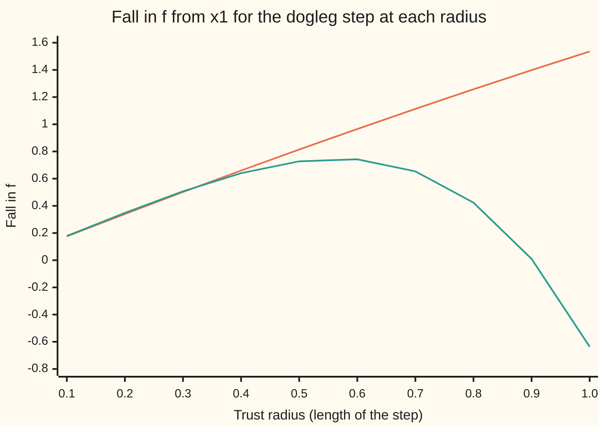
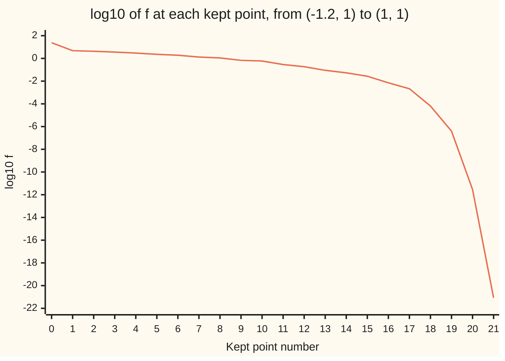

# Trust regions: trust the model only as far as it has earned

[Syllabus](../../../SYLLABUS.md) → [Optimization](../README.md) → [Unconstrained Methods](../README.md#s02) → Trust regions

---

## General Overview

Two settings, x and y, are chosen to **minimise** one number, f(x, y) = (1 − x)² + 100(y − x²)². The surface is Rosenbrock's banana: a narrow valley whose floor bends along the curve y = x², with its lowest point at (1, 1), where f = 0. Nothing limits the choice. The search starts at (−1.2, 1), where f = 24.2.

A fast method builds a quadratic stand-in for f at the current point, from the slope and the curvature there, and jumps to the stand-in's lowest point. One such jump takes the search to the point called $x_1$, (−1.175281, 1.380674), where f = 4.731884. From there the stand-in's lowest point lies 4.95 units away. It promises that f falls by 4.22. It actually rises by 1,407: the jump leaves the valley and climbs its far wall.

A trust region refuses to go that far. It draws a circle of radius 1 around the point and takes the stand-in's best step inside it. That step promises a fall of 1.54 and delivers a rise of 0.64. The ratio of delivered to promised fall is −0.41, so the step is refused and the radius is cut to a quarter, 0.25. The new step promises 0.42 and delivers 0.43: ratio 1.02. It is kept, and since the stand-in told the truth the radius is doubled for next time. After 24 tries, three of them refused, the search sits on (1, 1).

**A trust region takes the quadratic model's best step inside a circle, measures how much of the promised fall really happened, keeps the step only if enough did, and shrinks or grows the circle by that same measurement.**

**What kind of fact this is:** a method, with a theorem behind it. That each refusal ends after finitely many shrinks is proved on this card in Why it works; that the iterates' slopes go to zero is a theorem stated with its source. The final point is certified the global minimum by f being a sum of squares.

### The picture: one refused step and one kept step

<p align="center"></p>

Drawn to scale, x across and y up, from the numbers the checks print. The solid curve is every point where f equals 4.73, its value at x1, as far as the drawing's right edge; inside it f is lower. The dashed curve is the valley floor. The radius-1 step heads along the floor's tangent line and ends at R, outside the solid curve, because the real floor bends up and away. The radius-0.25 step ends at A, still inside.

---

## The formula

Notation first, in words. The iterate $x_k$ is the current point after k tries, counted from $x_0 = (-1.2, 1)$; $g_k$ is the slope of f there, $\nabla f(x_k)$; $B_k$ is a symmetric matrix standing for its curvature, here the Hessian $\nabla^2 f(x_k)$ itself. The **model** $m_k$ is the quadratic stand-in, $d$ is a trial step, and $\Delta_k$ ("delta") is the **trust radius**: how far from $x_k$ the model is believed.

$$m_k(d) = f(x_k) + g_k^{\mathsf T} d + \tfrac12\, d^{\mathsf T} B_k\, d, \qquad d_k \approx \operatorname{argmin}_{\lVert d\rVert \le \Delta_k} m_k(d)$$

**Read it aloud:** the model is the value here, plus the slope times the step, plus half the curvature times the step twice; the step is roughly the model's lowest point inside the circle.

The check after the step is one number, the ratio this wing writes $\rho_k$ ("rho"):

$$\rho_k = \frac{f(x_k) - f(x_k + d_k)}{m_k(0) - m_k(d_k)} = \frac{\text{delivered fall}}{\text{promised fall}}$$

**Read it aloud:** how much f really fell, divided by how much the model said it would.

Then the step is kept if $\rho_k > \eta$, where $\eta$ ("eta") is a small bar set in advance, 0.1 here, and the radius is resized:

$$\Delta_{k+1} = \begin{cases} \tfrac14\,\Delta_k & \text{if } \rho_k < \tfrac14 \\ \min(2\Delta_k,\ \Delta_{\max}) & \text{if } \rho_k > \tfrac34 \text{ and } \lVert d_k\rVert = \Delta_k \\ \Delta_k & \text{otherwise} \end{cases}$$

**Read it aloud:** a poor ratio cuts the circle to a quarter; a good ratio on a step that hit the edge doubles it, up to a cap; anything else leaves it alone.

The step inside the circle comes from the **dogleg**, a path with one bend. Its first leg runs straight downhill, along $-g_k$, to the model's lowest point in that direction, $d^{\mathrm C}$. Its second leg turns towards the model's own lowest point, the Newton point $d^{\mathrm N}$:

$$d^{\mathrm C} = -\frac{g_k^{\mathsf T} g_k}{g_k^{\mathsf T} B_k\, g_k}\, g_k, \qquad d^{\mathrm N} = -B_k^{-1} g_k$$

If $d^{\mathrm N}$ fits in the circle it is the step. Otherwise the step is where the bent path crosses the circle.

| Symbol | Plain meaning | In our example | Push it up and the answer… |
| --- | --- | --- | --- |
| $x_k$ | the current point after k tries | $x_1 = (-1.175281, 1.380674)$ | — |
| $f$ | the cost being minimised | 4.731884 at $x_1$ | — |
| $g_k$ | the slope of f at $x_k$, a pair of numbers | $(-4.637816, -0.122207)$ at $x_1$ | longer early steps |
| $B_k$ | the curvature matrix in the model, here the Hessian | entries 1107.2726, 470.1124, 200 at $x_1$ | shorter Newton steps |
| $d = (u, v)$ | a trial step, added to $x_k$: u across, v up | $(0.394320, -0.918973)$ at radius 1 | — |
| $m_k(d)$ | the quadratic model's value after step d | promises a fall of 1.535747 at radius 1 | — |
| $\Delta_k$, $\Delta_{\max}$ | trust radius: the longest step allowed; and its cap | 1, then 0.25; cap 10 | the model is trusted further, and overpromises more |
| $\rho_k$ | delivered fall over promised fall | −0.4143 at radius 1, then 1.0202 | — |
| $\eta$ | the bar a step's ratio must clear to be kept | 0.1 | more refusals; above $\tfrac14$ the method can stall |
| $d^{\mathrm N}$, $d^{\mathrm C}$ | the Newton point, the model's own lowest point; and the model's lowest point straight downhill | lengths 4.950945 and 0.004101 at $x_1$ | — |
| $\lVert d\rVert$ | the length of a step | 1 at the first refusal | — |
| $t$, $M$, $\lVert B\rVert$ | in the proof: how far along $-g$ a step goes; a bound on f's third derivatives; the most B stretches any vector | — | — |

### When it holds

- **f has continuous second derivatives near the iterates, and the model matches f's value and slope at $x_k$.** Then the model's error shrinks faster than the radius, so shrinking always ends in a kept step. If the model's slope is wrong, a tiny step can promise a fall that never comes, and the radius shrinks to nothing.
- **The step achieves at least a fixed fraction of the straight-downhill fall inside the circle.** The dogleg does, and that is what the convergence theorem needs. A step that only lowers the model a little can make the run crawl.
- **The bar $\eta$ sits below the shrink threshold $\tfrac14$.** With $\eta = 0.75$, a step with ratio 0.530 at $(-0.143951, 0.011739)$ is refused but does not trigger a shrink, so the identical step is proposed and refused for the rest of the run.
- **f is bounded below.** Rosenbrock's f is never negative. On a cost that falls without limit the method still never raises f, but there is nothing to converge to.
- **The answer is a point where the slope is zero, not automatically the lowest point.** On a cost with several valleys the trust region settles in one of them. Here f is a sum of squares, so f = 0 at (1, 1) proves that point is the global minimum.

---

## Why it works

### Step 0: a stand-in that is right nearby, measured after every use

The model is a second-order Taylor expansion of f: the value, the slope and the curvature at one point ([Hessian](../../06-Calculus%20and%20analysis/07-Several%20Variables/05-hessian-and-second-order-approximation.md)). Near that point it is very accurate. Far away it can be wildly wrong, and nothing inside the model says how far is too far. Line search ([Line search](04-line-search-armijo-and-wolfe.md)) handles this by fixing a direction first and then choosing a length. A trust region fixes a length first, the radius, and lets the model choose the direction inside it.

The ratio $\rho_k$ is the measurement that keeps the radius honest. Near 1, the model told the truth, so it can be trusted a bit further. Small or negative, it overpromised, so it is trusted less. The radius becomes a running record of how far the model has earned trust.

### Step 1: where the banana model fails, exactly

Rosenbrock's f is a polynomial of degree four, so the model's error can be written out in full. With the step $d = (u, v)$ from $(x, y)$, the gap between the model's value and the true value is

$$f(x + u,\, y + v) - m(d) = 100\,u^4 - 200\,u^2\,(v - 2xu).$$

At $x_1$, the radius-1 dogleg step is $u = 0.394320$, $v = -0.918973$. The bracket $v - 2xu$ is almost zero: $-0.918973 + 2 \times 1.175281 \times 0.394320 = 0.007901$. So the step runs along the tangent line of the valley floor, and the model sees that tangent line as the floor itself. The term $100u^4$ is the real floor bending away from it. The whole leftover comes to 2.171962. Promised fall 1.535747, minus that 2.171962, gives −0.636215: exactly the rise the checks measure.

The first chart in How the radius moves draws the same story at ten radii. Out to about 0.5, delivered and promised stay close. Past 0.6 the delivered fall turns down, and at radius 1 it is negative.

### Step 2: solve the circle problem well enough, cheaply

Finding the model's exact lowest point in the circle needs a search for a damping number that lengthens or shortens the step until it just touches the circle ([Nonlinear least squares](09-nonlinear-least-squares-gauss-newton-and-levenberg-marquardt.md) meets that damping as Levenberg-Marquardt). The dogleg replaces the search with one bend. It never does worse than the straight-downhill step, because its first leg is that step and the model keeps falling along the second leg when $B_k$ is a positive definite matrix (a bowl). At $x_1$:

- straight downhill, capped at the circle, that is $d^{\mathrm C}$ cut short if it would leave the circle (the code and its output call this the Cauchy step; $d^{\mathrm C}$ itself has no cap): promised fall 0.009512;
- dogleg: 1.535747 at radius 1, 0.421311 at radius 0.25;
- the exact lowest point in the circle: 1.535859 and 0.421477.

The dogleg's share of the exact fall is 0.9999 at radius 1 and 0.9996 at radius 0.25. The straight-downhill step stops at 0.009512 at both radii, because the model's lowest point in that direction is only 0.004101 away: the slope at $x_1$ points almost straight across the narrow valley.

<details>
<summary>Detailed proof: the straight-downhill guarantee, and why shrinking ends</summary>

**The guarantee.** Step straight downhill by t times the slope, $d = -t\,g$, with $t \ge 0$ and $\lVert d\rVert \le \Delta$. The promised fall is
$$m(0) - m(-t g) = t\,\lVert g\rVert^2 - \tfrac12\, t^2\, g^{\mathsf T} B g.$$
If $g^{\mathsf T}Bg \le 0$, walk to the edge, $t = \Delta/\lVert g\rVert$, and the fall is at least $\Delta\lVert g\rVert$. Otherwise the best t is $\min(\lVert g\rVert^2 / g^{\mathsf T}Bg,\ \Delta/\lVert g\rVert)$. In the first case the fall is $\tfrac12\lVert g\rVert^4 / g^{\mathsf T}Bg \ge \tfrac12 \lVert g\rVert^2/\lVert B\rVert$, where $\lVert B\rVert$ is the largest stretch B applies to a vector. In the second case $t\, g^{\mathsf T}Bg \le \lVert g\rVert^2$, so the fall is at least $\tfrac12 t\lVert g\rVert^2 = \tfrac12\Delta\lVert g\rVert$. Every case gives
$$m(0) - m(d) \ \ge\ \tfrac12\,\lVert g\rVert \min\!\left(\Delta,\ \frac{\lVert g\rVert}{\lVert B\rVert}\right).$$
The dogleg's first leg is this step and the model does not rise along its second leg, so the dogleg meets the same bound.

**Shrinking ends.** Take $B = \nabla^2 f(x)$ and suppose f's third derivatives are bounded by M near x. Taylor's theorem with remainder ([Taylor's theorem](../../06-Calculus%20and%20analysis/03-What%20Derivatives%20Tell%20You/05-taylors-theorem.md)) gives $|f(x + d) - m(d)| \le \tfrac{M}{6}\lVert d\rVert^3$. The delivered fall minus the promised fall is exactly $m(d) - f(x+d)$, so for $\Delta \le \lVert g\rVert/\lVert B\rVert$,
$$|\rho - 1| = \frac{|m(d) - f(x + d)|}{m(0) - m(d)} \ \le\ \frac{(M/6)\,\Delta^3}{\tfrac12\lVert g\rVert\,\Delta} = \frac{M\,\Delta^2}{3\,\lVert g\rVert}.$$
While the slope is not zero this goes to 0 with the radius. Each refusal divides the radius by 4, so after finitely many refusals $\rho > \tfrac34$, the step is kept, and the run moves on. At $x_1$ the checks print $\rho$ = 1.017905, 1.004347 and 1.000117 at radii 0.1, 0.01 and 0.001.

</details>

### Step 3: from one kept step to the whole run

The guarantee and the ratio test together give the standard theorem, stated here and proved in the source (Nocedal and Wright, Theorem 4.6): if f is bounded below, its slope changes at a bounded rate on the region below the starting value, the matrices $B_k$ stay bounded, $0 < \eta < \tfrac14$, and every step earns at least a fixed fraction of the straight-downhill guarantee, then the slope at the iterates tends to zero. Every kept step lowers f, so the run cannot climb out of the region it started in.

Near a minimum where the Hessian is a bowl, the Newton point becomes short enough to fit in the circle, the dogleg returns it unchanged, and the run becomes Newton's method ([Newton and BFGS](05-newton-and-quasi-newton-bfgs.md)), with its fast finish. The last four kept points have $\log_{10} f$ of −4.19, −6.40, −11.54 and −21.07: the digits roughly double each step.

---

## Worked numbers, by hand

The example's heart: the first refusal and the retry at $x_1$, radius starting at 1.

| Step | Arithmetic | Value |
| --- | --- | --- |
| f at $x_1$ | $(1 + 1.175281)^2 + 100\,(1.380674 - 1.175281^2)^2$ | 4.731884 |
| slope $g_1$ | $(-2(1 - x) - 400x(y - x^2),\ 200(y - x^2))$ | $(-4.637816, -0.122207)$ |
| Newton point | solve $B_1 d = -g_1$ | length 4.950945, longer than 1 |
| downhill turn $d^{\mathrm C}$ | $\lVert g\rVert^2 / g^{\mathsf T}B g$ times $\lVert g\rVert$ | length 0.004101, shorter than 1 |
| dogleg step, radius 1 | second leg cut at the circle | $(0.394320, -0.918973)$ |
| promised fall | $m(0) - m(d)$ | 1.535747 |
| trial point | $x_1 + d$ | $(-0.7810, 0.4617)$, f = 5.368099 |
| delivered fall | 4.731884 − 5.368099 | −0.636215 |
| ratio | −0.636215 / 1.535747 | −0.4143: refuse, radius to 0.25 |
| dogleg step, radius 0.25 | second leg cut at the smaller circle | $(0.101203, -0.228600)$ |
| promised fall | $m(0) - m(d)$ | 0.421311 |
| delivered fall | 4.731884 − 4.302044 | 0.429841 |
| ratio | 0.429841 / 0.421311 | 1.0202: keep, on the edge, radius to 0.5 |
| **new point** | $x_1 + d$ | **(−1.074078, 1.152074), f = 4.302044** |

The model overpromised at radius 1, so the method cut its trust to a quarter, and at that distance the model's promise was met in full: f fell from 4.731884 to 4.302044 instead of rising to 5.368099.

### What breaks if you drop a piece

| Mistake | Comes out at | What went wrong |
| --- | --- | --- |
| No trust region: pure Newton steps | f = 1411.845179 after step 2, up from 4.731884 | The model's lowest point was trusted 4.95 units away. On this start pure Newton then recovers and finishes in 6 steps, but nothing guaranteed that |
| Never shrink after a refusal | 49 of 50 tries refused, stuck at f = 4.731884 | The same overpromising step is proposed again every time |
| No ratio test: keep every step | f rises from 4.731884 to 5.368099 at k = 1 | The one promise each step makes, that f never rises, is gone |
| Radius fixed at 0.1, never resized | 74 iterations, against 24 | Safe steps everywhere, including the long straight stretches where the model was good |

---

## How the radius moves

The puzzle: the radius has to be small where the valley bends and large where the model is good, and nobody tells the method which is which. The ratio does. Here is the radius at every try of the run, from $x_0 = (-1.2, 1)$ with radius 1, $\eta = 0.1$ and cap $\Delta_{\max} = 10$.

```
k =  0  ########################  1.0000  rho  1.003  accept
k =  1  ########################  1.0000  rho -0.414  reject
k =  2  ######                    0.2500  rho  1.020  accept
k =  3  ############              0.5000  rho  0.850  accept
k =  4  ########################  1.0000  rho  1.250  accept
k =  5  ########################  1.0000  rho  1.359  accept
k =  6  ########################  1.0000  rho  0.860  accept
k =  7  ########################  1.0000  rho  1.208  accept
k =  8  ########################  1.0000  rho -4.250  reject
k =  9  ######                    0.2500  rho  0.530  accept
k = 10  ######                    0.2500  rho  1.163  accept
k = 11  ######                    0.2500  rho  0.374  accept
k = 12  ######                    0.2500  rho  1.109  accept
k = 13  ######                    0.2500  rho  0.771  accept
k = 14  ############              0.5000  rho  1.215  accept
k = 15  ############              0.5000  rho -0.097  reject
k = 16  ###                       0.1250  rho  1.023  accept
k = 17  ######                    0.2500  rho  0.994  accept
k = 18  ######                    0.2500  rho  1.165  accept
k = 19  ######                    0.2500  rho  0.877  accept
k = 20  ######                    0.2500  rho  1.037  accept
k = 21  ######                    0.2500  rho  1.011  accept
k = 22  ######                    0.2500  rho  1.001  accept
k = 23  ######                    0.2500  rho  1.000  accept
```

Three refusals, each followed by a quarter-size circle and a kept step. Two kinds of good step: at k = 2, 3, 13 and 16 the step hit the edge with a ratio above 0.75, so the circle doubled. At k = 0, 4 to 7, 10, 12 and 14, and from k = 17 on, the ratio was good but the Newton point fitted inside the circle, so the edge was not the limit and the circle stayed put. At k = 9 and 11 the ratios were 0.530 and 0.374: good enough to keep, not good enough to grow.

### The picture: the promise against the delivery, at $x_1$



The first, rising line is the fall the model promises. The second is the fall f delivers. They stay close out to a radius of about 0.5; the delivery peaks at 0.7425 near radius 0.6 and goes negative at radius 1, where the run's first refusal happens.

### The picture: the whole run, error against kept step



The one line is $\log_{10} f$, the error here since the minimum value is 0. It creeps down the long curved valley for most of the run, then plunges once Newton steps fit inside the circle.

---

## Code, from first principles, and it actually runs

The code writes out the model, the dogleg, the ratio test and the resizing rule, with two-by-two linear systems solved by elimination. It reaches the example's answers by three independent roads, and certifies the end point by a fourth. Road one checks the slope and curvature formulas against central differences (tiny steps either side). Road two solves the circle problem exactly, by bisection on the damping number, and again by scanning 100,000 points round the circle, and confirms the dogleg sits between the straight-downhill step and the exact answer. Road three predicts the delivered fall from the exact quartic leftover of Step 1 and matches the direct evaluation. The certificate: the slope at the end is below $10^{-8}$, the Hessian there is a bowl, and f, a sum of squares, is 0 at (1, 1). The stopping test is a slope length below $10^{-8}$.

### Python

```python
# Trust regions -- the check behind the card.  Standard library only.
# Rosenbrock's banana valley, f(x, y) = (1 - x)^2 + 100 (y - x^2)^2, is
# minimised from (-1.2, 1) by a trust region: a quadratic model, the dogleg
# step inside a radius, the ratio test, and the radius resized by the ratio.
from math import hypot, sqrt, log10, cos, sin, pi

def f(x, y): return (1 - x) ** 2 + 100 * (y - x * x) ** 2
def grad(x, y): return (-2 * (1 - x) - 400 * x * (y - x * x), 200 * (y - x * x))
def hess(x, y): return (2 - 400 * (y - x * x) + 800 * x * x, -400 * x, 200.0)  # [[a, b], [b, c]]

def promise(g, B, d):                  # m(0) - m(d): the fall the model promises
    a, b, c = B
    return -(g[0] * d[0] + g[1] * d[1] + 0.5 * (a * d[0] ** 2 + 2 * b * d[0] * d[1] + c * d[1] ** 2))

def solve(B, g, lam=0.0):              # (B + lam I) d = -g, two equations by elimination
    a, b, c = B[0] + lam, B[1], B[2] + lam
    det = a * c - b * b
    return (-(c * g[0] - b * g[1]) / det, -(a * g[1] - b * g[0]) / det)

def cauchy(g, B, R):                   # best point straight downhill, inside radius R
    a, b, c = B
    gn, gBg = hypot(*g), a * g[0] ** 2 + 2 * b * g[0] * g[1] + c * g[1] ** 2
    t = R / gn if gBg <= 0 else min(gn * gn / gBg, R / gn)
    return (-t * g[0], -t * g[1])

def dogleg(g, B, R):
    a, b, c = B
    if a <= 0 or a * c - b * b <= 0: return cauchy(g, B, R)   # no bowl: no Newton point
    dN = solve(B, g)
    if hypot(*dN) <= R: return dN                             # Newton point fits
    dU = cauchy(g, B, float("inf"))                           # downhill to the turn
    if hypot(*dU) >= R: return cauchy(g, B, R)
    e = (dN[0] - dU[0], dN[1] - dU[1])                        # leg two: turn to Newton
    A, Bq, C = e[0] ** 2 + e[1] ** 2, 2 * (dU[0] * e[0] + dU[1] * e[1]), dU[0] ** 2 + dU[1] ** 2 - R * R
    t = (-Bq + sqrt(Bq * Bq - 4 * A * C)) / (2 * A)           # where leg two leaves the circle
    return (dU[0] + t * e[0], dU[1] + t * e[1])

def try_step(x, y, R):
    g, B = grad(x, y), hess(x, y)
    d = dogleg(g, B, R)
    pred, act = promise(g, B, d), f(x, y) - f(x + d[0], y + d[1])
    return d, pred, act, act / pred

def run(x, y, R, eta=0.1, shrink=0.25, grow=2.0, cap=10.0, kmax=200):
    trace = []
    for k in range(kmax):
        if hypot(*grad(x, y)) < 1e-8: break                   # stopping test
        d, pred, act, rho = try_step(x, y, R)
        ok = rho > eta
        trace.append((k, x, y, f(x, y), R, hypot(*d), pred, act, rho, ok))
        if ok: x, y = x + d[0], y + d[1]
        if rho < 0.25: R = shrink * R
        elif rho > 0.75 and abs(hypot(*d) - R) < 1e-12: R = min(grow * R, cap)
    return x, y, trace

# ---- road 1: derivatives against central differences ----
x1, y1 = -1.2 + solve(hess(-1.2, 1.0), grad(-1.2, 1.0))[0], 1.0 + solve(hess(-1.2, 1.0), grad(-1.2, 1.0))[1]
h, g1, B1 = 1e-5, grad(x1, y1), hess(x1, y1)
fd = ((f(x1 + h, y1) - f(x1 - h, y1)) / (2 * h), (f(x1, y1 + h) - f(x1, y1 - h)) / (2 * h))
fdB = ((grad(x1 + h, y1)[0] - grad(x1 - h, y1)[0]) / (2 * h), (grad(x1, y1 + h)[0] - grad(x1, y1 - h)[0]) / (2 * h))
assert max(abs(fd[0] - g1[0]), abs(fd[1] - g1[1])) < 1e-6 and abs(fdB[0] - B1[0]) < 1e-4 and abs(fdB[1] - B1[1]) < 1e-4
print(f"start (-1.2, 1): f = {f(-1.2, 1.0):.4f}; step 0 is the Newton point, to ({x1:.6f}, {y1:.6f}), f = {f(x1, y1):.6f}")
print(f"at x1: gradient ({g1[0]:.6f}, {g1[1]:.6f}), Hessian a, b, c = {B1[0]:.4f}, {B1[1]:.4f}, {B1[2]:.4f}")

# ---- the overpromise at x1, and the subproblem solved three ways ----
dN, dU = solve(B1, g1), cauchy(g1, B1, float("inf"))
print(f"Newton point ({dN[0]:.6f}, {dN[1]:.6f}), length {hypot(*dN):.6f}; downhill turn at length {hypot(*dU):.6f}")
print("radius    step x    step y   promised  delivered       rho")
for R in (hypot(*dN), 1.0, 0.5, 0.25, 0.125):
    d, pred, act, rho = try_step(x1, y1, R)
    print(f"{R:6.4f} {d[0]:9.6f} {d[1]:9.6f} {pred:10.6f} {act:10.6f} {rho:9.4f}")
radii = [0.1 * i for i in range(1, 11)]
falls = [try_step(x1, y1, R)[1:3] for R in radii]
print("chart, radius 0.1 to 1.0 by 0.1, promised: " + ", ".join(f"{p:.4f}" for p, a in falls))
print("chart, radius 0.1 to 1.0 by 0.1, delivered: " + ", ".join(f"{a:.4f}" for p, a in falls))
for R in (1.0, 0.25):
    lo, hi = 0.0, 1e6                                         # road 2: exact step, bisection on the damping
    for _ in range(200):
        mid = (lo + hi) / 2
        lo, hi = (mid, hi) if hypot(*solve(B1, g1, mid)) > R else (lo, mid)
    exact = promise(g1, B1, solve(B1, g1, hi))
    scan = max(promise(g1, B1, (R * cos(2 * pi * i / 100000), R * sin(2 * pi * i / 100000))) for i in range(100000))
    dog, cau = promise(g1, B1, dogleg(g1, B1, R)), promise(g1, B1, cauchy(g1, B1, R))
    print(f"radius {R:.2f}: promised fall, Cauchy {cau:.6f} <= dogleg {dog:.6f} <= exact {exact:.6f} (circle scan {scan:.6f}), dogleg/exact {dog / exact:.4f}")
    assert abs(exact - scan) < 1e-6 and cau <= dog <= exact + 1e-12 and dog >= 0.9 * exact
d, pred, act, rho = try_step(x1, y1, 1.0)                    # road 3: the exact leftover terms
u, v = d[0], d[1]                                            # f is quartic, so the model misses by
left = 100 * u ** 4 - 200 * u * u * (v - 2 * x1 * u)          # exactly this much
print(f"radius 1: v - 2xu = {v - 2 * x1 * u:.6f}, leftover quartic terms {left:.6f}; promised - leftover = {pred - left:.6f}, delivered {act:.6f}")
rhos = [try_step(x1, y1, r)[3] for r in (0.1, 0.01, 0.001)]
print("rho at radius 0.1, 0.01, 0.001: " + ", ".join(f"{q:.6f}" for q in rhos))
assert abs(pred - left - act) < 1e-9 and rho < 0 and abs(rhos[2] - 1) < abs(rhos[1] - 1) < abs(rhos[0] - 1) < 0.05

# ---- the full run ----
x, y, tr = run(-1.2, 1.0, 1.0)
print(" k         x         y          f  radius    step  promised delivered     rho  verdict")
for k, xa, ya, fa, R, n, pred, act, rho, ok in tr:
    print(f"{k:2d} {xa:9.6f} {ya:9.6f} {fa:10.6f} {R:7.4f} {n:7.4f} {pred:9.6f} {act:9.6f} {rho:7.3f}  {'accept' if ok else 'reject'}")
acc = [t for t in tr if t[9]]
logs = [log10(max(t[3], 1e-300)) for t in acc] + [log10(max(f(x, y), 1e-300))]
print("chart log10 f at each accepted point: " + ", ".join(f"{v:.2f}" for v in logs))
gx, gy = grad(x, y)
a, b, c = hess(x, y)
print(f"stopped after {len(tr)} iterations ({len(tr) - len(acc)} rejected) at ({x:.9f}, {y:.9f}), "
      f"log10 f = {logs[-1]:.2f}, |gradient| below 1e-8: {hypot(gx, gy) < 1e-8}")
print(f"certificate: Hessian there a = {a:.4f}, det = {a * c - b * b:.4f} > 0; f is a sum of squares, f(1, 1) = {f(1.0, 1.0):.1f}")
assert hypot(x - 1, y - 1) < 1e-8 and a > 0 and a * c - b * b > 0 and f(1.0, 1.0) == 0.0
assert all(acc[i + 1][3] < acc[i][3] for i in range(len(acc) - 1)) and f(x, y) < acc[-1][3]

# ---- what breaks ----
xn, yn, newton_f = -1.2, 1.0, []
for _ in range(20):
    if hypot(*grad(xn, yn)) < 1e-8: break
    d = solve(hess(xn, yn), grad(xn, yn))
    xn, yn = xn + d[0], yn + d[1]
    newton_f.append(f(xn, yn))
print(f"pure Newton: f after steps 1, 2, 3 = {newton_f[0]:.6f}, {newton_f[1]:.6f}, {newton_f[2]:.6f}; done in {len(newton_f)} steps")
_, _, t2 = run(-1.2, 1.0, 1.0, shrink=1.0, kmax=50)
print(f"never shrink: {sum(1 for t in t2 if not t[9])} of {len(t2)} tries rejected, stuck at f = {t2[-1][3]:.6f}")
_, _, t3 = run(-1.2, 1.0, 1.0, eta=-1e300)
print(f"no ratio test: f goes {t3[1][3]:.6f} -> {t3[2][3]:.6f} at k = 1; done in {len(t3)} iterations")
x4, y4, t4 = run(-1.2, 1.0, 0.1, shrink=1.0, grow=1.0)
print(f"radius fixed at 0.1: {len(t4)} iterations, against {len(tr)}")
assert newton_f[1] > 1000 and len(t2) == 50 and t2[-1][3] == f(x1, y1) and t3[2][3] > t3[1][3] and len(t4) > 2 * len(tr)
r1 = try_step(x1, y1, 1.0)[0]
print(f"figure, x1 = ({x1:.4f}, {y1:.4f}), circles 1 and 0.25, rejected ({x1 + r1[0]:.4f}, {y1 + r1[1]:.4f}), "
      f"accepted ({acc[2][1]:.4f}, {acc[2][2]:.4f}), level f = {f(x1, y1):.4f}")
print("ALL CHECKS PASS")
```

**Ran 2026-11-11 on macOS, Python 3.14.10, standard library only. All checks passed. Output, pasted from the run:**

```
start (-1.2, 1): f = 24.2000; step 0 is the Newton point, to (-1.175281, 1.380674), f = 4.731884
at x1: gradient (-4.637816, -0.122207), Hessian a, b, c = 1107.2726, 470.1124, 200.0000
Newton point (1.938396, -4.555708), length 4.950945; downhill turn at length 0.004101
radius    step x    step y   promised  delivered       rho
4.9509  1.938396 -4.555708   4.216593 -1407.113295 -333.7086
1.0000  0.394320 -0.918973   1.535747  -0.636215   -0.4143
0.5000  0.198912 -0.458731   0.814270   0.727547    0.8935
0.2500  0.101203 -0.228600   0.421311   0.429841    1.0202
0.1250  0.052341 -0.113514   0.216745   0.221208    1.0206
chart, radius 0.1 to 1.0 by 0.1, promised: 0.1752, 0.3401, 0.5016, 0.6597, 0.8143, 0.9654, 1.1132, 1.2575, 1.3983, 1.5357
chart, radius 0.1 to 1.0 by 0.1, delivered: 0.1783, 0.3482, 0.5072, 0.6404, 0.7275, 0.7425, 0.6536, 0.4237, 0.0099, -0.6362
radius 1.00: promised fall, Cauchy 0.009512 <= dogleg 1.535747 <= exact 1.535859 (circle scan 1.535858), dogleg/exact 0.9999
radius 0.25: promised fall, Cauchy 0.009512 <= dogleg 0.421311 <= exact 0.421477 (circle scan 0.421477), dogleg/exact 0.9996
radius 1: v - 2xu = 0.007901, leftover quartic terms 2.171962; promised - leftover = -0.636215, delivered -0.636215
rho at radius 0.1, 0.01, 0.001: 1.017905, 1.004347, 1.000117
 k         x         y          f  radius    step  promised delivered     rho  verdict
 0 -1.200000  1.000000  24.200000  1.0000  0.3815 19.414382 19.468116   1.003  accept
 1 -1.175281  1.380674   4.731884  1.0000  1.0000  1.535747 -0.636215  -0.414  reject
 2 -1.175281  1.380674   4.731884  0.2500  0.2500  0.421311  0.429841   1.020  accept
 3 -1.074078  1.152074   4.302044  0.5000  0.5000  0.823763  0.700368   0.850  accept
 4 -0.859372  0.700520   3.601675  1.0000  0.3975  0.546405  0.683175   1.250  accept
 5 -0.643173  0.366929   2.918501  1.0000  0.2237  0.479394  0.651525   1.359  accept
 6 -0.484388  0.209420   2.266976  1.0000  0.3250  0.428219  0.368336   0.860  accept
 7 -0.238730 -0.003356   1.898640  1.0000  0.0960  0.481593  0.581947   1.208  accept
 8 -0.143951  0.011739   1.316693  1.0000  0.4233  0.475997 -2.022922  -4.250  reject
 9 -0.143951  0.011739   1.316693  0.2500  0.2500  0.396972  0.210559   0.530  accept
10  0.099658 -0.044430   1.106133  0.2500  0.1028  0.363795  0.423015   1.163  accept
11  0.175493  0.025047   0.683119  0.2500  0.2500  0.266980  0.099975   0.374  accept
12  0.407592  0.117945   0.583143  0.2500  0.1089  0.265188  0.294117   1.109  accept
13  0.463284  0.211530   0.289026  0.2500  0.2500  0.134477  0.103624   0.771  accept
14  0.641119  0.387242   0.185402  0.5000  0.1210  0.078973  0.095947   1.215  accept
15  0.703442  0.490946   0.089455  0.5000  0.2913  0.051005 -0.004955  -0.097  reject
16  0.703442  0.490946   0.089455  0.1250  0.1250  0.034578  0.035379   1.023  accept
17  0.774290  0.593929   0.054076  0.2500  0.2011  0.027171  0.026999   0.994  accept
18  0.880799  0.764462   0.027078  0.2500  0.0839  0.017216  0.020056   1.165  accept
19  0.917265  0.840045   0.007022  0.2500  0.1377  0.005584  0.004896   0.877  accept
20  0.982619  0.961269   0.002126  0.2500  0.0246  0.001987  0.002061   1.037  accept
21  0.991993  0.983961   0.000065  0.2500  0.0176  0.000064  0.000064   1.011  accept
22  0.999862  0.999662   0.000000  0.2500  0.0004  0.000000  0.000000   1.001  accept
23  0.999998  0.999997   0.000000  0.2500  0.0000  0.000000  0.000000   1.000  accept
chart log10 f at each accepted point: 1.38, 0.68, 0.63, 0.56, 0.47, 0.36, 0.28, 0.12, 0.04, -0.17, -0.23, -0.54, -0.73, -1.05, -1.27, -1.57, -2.15, -2.67, -4.19, -6.40, -11.54, -21.07
stopped after 24 iterations (3 rejected) at (1.000000000, 1.000000000), log10 f = -21.07, |gradient| below 1e-8: True
certificate: Hessian there a = 802.0000, det = 400.0000 > 0; f is a sum of squares, f(1, 1) = 0.0
pure Newton: f after steps 1, 2, 3 = 4.731884, 1411.845179, 0.055966; done in 6 steps
never shrink: 49 of 50 tries rejected, stuck at f = 4.731884
no ratio test: f goes 4.731884 -> 5.368099 at k = 1; done in 21 iterations
radius fixed at 0.1: 74 iterations, against 24
figure, x1 = (-1.1753, 1.3807), circles 1 and 0.25, rejected (-0.7810, 0.4617), accepted (-1.0741, 1.1521), level f = 4.7319
ALL CHECKS PASS
```

### Rust

Same numbers, same labels, built with `rustc --edition 2021 -O`.

```rust
// Trust regions -- the same check as the Python, in Rust.  No crates.
// Rosenbrock's banana valley, f(x, y) = (1 - x)^2 + 100 (y - x^2)^2, is
// minimised from (-1.2, 1) by a trust region: a quadratic model, the dogleg
// step inside a radius, the ratio test, and the radius resized by the ratio.
type V = (f64, f64);
type M = (f64, f64, f64); // [[a, b], [b, c]]
fn f(x: f64, y: f64) -> f64 { (1.0 - x).powi(2) + 100.0 * (y - x * x).powi(2) }
fn grad(x: f64, y: f64) -> V { (-2.0 * (1.0 - x) - 400.0 * x * (y - x * x), 200.0 * (y - x * x)) }
fn hess(x: f64, y: f64) -> M { (2.0 - 400.0 * (y - x * x) + 800.0 * x * x, -400.0 * x, 200.0) }
fn len(d: V) -> f64 { d.0.hypot(d.1) }
fn promise(g: V, b: M, d: V) -> f64 { // m(0) - m(d): the fall the model promises
    -(g.0 * d.0 + g.1 * d.1 + 0.5 * (b.0 * d.0 * d.0 + 2.0 * b.1 * d.0 * d.1 + b.2 * d.1 * d.1))
}
fn solve(b: M, g: V, lam: f64) -> V { // (B + lam I) d = -g, two equations by elimination
    let (a, bb, c) = (b.0 + lam, b.1, b.2 + lam);
    let det = a * c - bb * bb;
    (-(c * g.0 - bb * g.1) / det, -(a * g.1 - bb * g.0) / det)
}
fn cauchy(g: V, b: M, r: f64) -> V { // best point straight downhill, inside radius r
    let (gn, gbg) = (len(g), b.0 * g.0 * g.0 + 2.0 * b.1 * g.0 * g.1 + b.2 * g.1 * g.1);
    let t = if gbg <= 0.0 { r / gn } else { (gn * gn / gbg).min(r / gn) };
    (-t * g.0, -t * g.1)
}
fn dogleg(g: V, b: M, r: f64) -> V {
    if b.0 <= 0.0 || b.0 * b.2 - b.1 * b.1 <= 0.0 { return cauchy(g, b, r); } // no bowl
    let dn = solve(b, g, 0.0);
    if len(dn) <= r { return dn; }                         // Newton point fits
    let du = cauchy(g, b, f64::INFINITY);                  // downhill to the turn
    if len(du) >= r { return cauchy(g, b, r); }
    let e = (dn.0 - du.0, dn.1 - du.1);                    // leg two: turn to Newton
    let (qa, qb, qc) = (e.0 * e.0 + e.1 * e.1, 2.0 * (du.0 * e.0 + du.1 * e.1), du.0 * du.0 + du.1 * du.1 - r * r);
    let t = (-qb + (qb * qb - 4.0 * qa * qc).sqrt()) / (2.0 * qa); // where leg two leaves the circle
    (du.0 + t * e.0, du.1 + t * e.1)
}
fn try_step(x: f64, y: f64, r: f64) -> (V, f64, f64, f64) {
    let (g, b) = (grad(x, y), hess(x, y));
    let d = dogleg(g, b, r);
    let (pred, act) = (promise(g, b, d), f(x, y) - f(x + d.0, y + d.1));
    (d, pred, act, act / pred)
}
// one row per try: k, x, y, f, radius, step length, promised, delivered, rho, accepted
type Row = (usize, f64, f64, f64, f64, f64, f64, f64, f64, bool);
fn run(mut x: f64, mut y: f64, mut r: f64, eta: f64, shrink: f64, grow: f64, kmax: usize) -> (f64, f64, Vec<Row>) {
    let mut tr = Vec::new();
    for k in 0..kmax {
        if len(grad(x, y)) < 1e-8 { break; }               // stopping test
        let (d, pred, act, rho) = try_step(x, y, r);
        let ok = rho > eta;
        tr.push((k, x, y, f(x, y), r, len(d), pred, act, rho, ok));
        if ok { x += d.0; y += d.1; }
        if rho < 0.25 { r *= shrink; } else if rho > 0.75 && (len(d) - r).abs() < 1e-12 { r = (grow * r).min(10.0); }
    }
    (x, y, tr)
}
fn join(v: &[f64], p: usize) -> String { v.iter().map(|q| format!("{:.*}", p, q)).collect::<Vec<_>>().join(", ") }
fn main() {
    // ---- road 1: derivatives against central differences ----
    let s0 = solve(hess(-1.2, 1.0), grad(-1.2, 1.0), 0.0);
    let (x1, y1) = (-1.2 + s0.0, 1.0 + s0.1);
    let (h, g1, b1) = (1e-5, grad(x1, y1), hess(x1, y1));
    let fd = ((f(x1 + h, y1) - f(x1 - h, y1)) / (2.0 * h), (f(x1, y1 + h) - f(x1, y1 - h)) / (2.0 * h));
    let fdb = ((grad(x1 + h, y1).0 - grad(x1 - h, y1).0) / (2.0 * h), (grad(x1, y1 + h).0 - grad(x1, y1 - h).0) / (2.0 * h));
    assert!((fd.0 - g1.0).abs().max((fd.1 - g1.1).abs()) < 1e-6 && (fdb.0 - b1.0).abs() < 1e-4 && (fdb.1 - b1.1).abs() < 1e-4);
    println!("start (-1.2, 1): f = {:.4}; step 0 is the Newton point, to ({:.6}, {:.6}), f = {:.6}", f(-1.2, 1.0), x1, y1, f(x1, y1));
    println!("at x1: gradient ({:.6}, {:.6}), Hessian a, b, c = {:.4}, {:.4}, {:.4}", g1.0, g1.1, b1.0, b1.1, b1.2);
    // ---- the overpromise at x1, and the subproblem solved three ways ----
    let (dn, du) = (solve(b1, g1, 0.0), cauchy(g1, b1, f64::INFINITY));
    println!("Newton point ({:.6}, {:.6}), length {:.6}; downhill turn at length {:.6}", dn.0, dn.1, len(dn), len(du));
    println!("radius    step x    step y   promised  delivered       rho");
    for r in [len(dn), 1.0, 0.5, 0.25, 0.125] {
        let (d, pred, act, rho) = try_step(x1, y1, r);
        println!("{:6.4} {:9.6} {:9.6} {:10.6} {:10.6} {:9.4}", r, d.0, d.1, pred, act, rho);
    }
    let falls: Vec<(f64, f64)> = (1..=10).map(|i| { let t = try_step(x1, y1, 0.1 * i as f64); (t.1, t.2) }).collect();
    println!("chart, radius 0.1 to 1.0 by 0.1, promised: {}", join(&falls.iter().map(|p| p.0).collect::<Vec<_>>(), 4));
    println!("chart, radius 0.1 to 1.0 by 0.1, delivered: {}", join(&falls.iter().map(|p| p.1).collect::<Vec<_>>(), 4));
    for r in [1.0, 0.25] {
        let (mut lo, mut hi) = (0.0, 1e6);                 // road 2: exact step, bisection on the damping
        for _ in 0..200 {
            let mid = (lo + hi) / 2.0;
            if len(solve(b1, g1, mid)) > r { lo = mid; } else { hi = mid; }
        }
        let exact = promise(g1, b1, solve(b1, g1, hi));
        let mut scan = f64::NEG_INFINITY;
        for i in 0..100000 {
            let th = 2.0 * std::f64::consts::PI * i as f64 / 100000.0;
            scan = scan.max(promise(g1, b1, (r * th.cos(), r * th.sin())));
        }
        let (dog, cau) = (promise(g1, b1, dogleg(g1, b1, r)), promise(g1, b1, cauchy(g1, b1, r)));
        println!("radius {:.2}: promised fall, Cauchy {:.6} <= dogleg {:.6} <= exact {:.6} (circle scan {:.6}), dogleg/exact {:.4}", r, cau, dog, exact, scan, dog / exact);
        assert!((exact - scan).abs() < 1e-6 && cau <= dog && dog <= exact + 1e-12 && dog >= 0.9 * exact);
    }
    let (d, pred, act, rho) = try_step(x1, y1, 1.0);       // road 3: the exact leftover terms
    let (u, v) = (d.0, d.1);                               // f is quartic, so the model misses by
    let left = 100.0 * u.powi(4) - 200.0 * u * u * (v - 2.0 * x1 * u); // exactly this much
    println!("radius 1: v - 2xu = {:.6}, leftover quartic terms {:.6}; promised - leftover = {:.6}, delivered {:.6}", v - 2.0 * x1 * u, left, pred - left, act);
    let rhos: Vec<f64> = [0.1, 0.01, 0.001].iter().map(|&r| try_step(x1, y1, r).3).collect();
    println!("rho at radius 0.1, 0.01, 0.001: {}", join(&rhos, 6));
    assert!((pred - left - act).abs() < 1e-9 && rho < 0.0);
    assert!((rhos[2] - 1.0).abs() < (rhos[1] - 1.0).abs() && (rhos[1] - 1.0).abs() < (rhos[0] - 1.0).abs() && (rhos[0] - 1.0).abs() < 0.05);
    // ---- the full run ----
    let (x, y, tr) = run(-1.2, 1.0, 1.0, 0.1, 0.25, 2.0, 200);
    println!(" k         x         y          f  radius    step  promised delivered     rho  verdict");
    for t in &tr {
        println!("{:2} {:9.6} {:9.6} {:10.6} {:7.4} {:7.4} {:9.6} {:9.6} {:7.3}  {}", t.0, t.1, t.2, t.3, t.4, t.5, t.6, t.7, t.8,
                 if t.9 { "accept" } else { "reject" });
    }
    let acc: Vec<&Row> = tr.iter().filter(|t| t.9).collect();
    let mut logs: Vec<f64> = acc.iter().map(|t| t.3.max(1e-300).log10()).collect();
    logs.push(f(x, y).max(1e-300).log10());
    println!("chart log10 f at each accepted point: {}", join(&logs, 2));
    let (gx, gy) = grad(x, y);
    let (a, b, c) = hess(x, y);
    println!("stopped after {} iterations ({} rejected) at ({:.9}, {:.9}), log10 f = {:.2}, |gradient| below 1e-8: {}",
             tr.len(), tr.len() - acc.len(), x, y, logs[logs.len() - 1], if gx.hypot(gy) < 1e-8 { "True" } else { "False" });
    println!("certificate: Hessian there a = {:.4}, det = {:.4} > 0; f is a sum of squares, f(1, 1) = {:.1}", a, a * c - b * b, f(1.0, 1.0));
    assert!((x - 1.0).hypot(y - 1.0) < 1e-8 && a > 0.0 && a * c - b * b > 0.0 && f(1.0, 1.0) == 0.0);
    assert!(acc.windows(2).all(|w| w[1].3 < w[0].3) && f(x, y) < acc[acc.len() - 1].3);
    // ---- what breaks ----
    let (mut xn, mut yn, mut newton_f) = (-1.2, 1.0, Vec::new());
    for _ in 0..20 {
        if len(grad(xn, yn)) < 1e-8 { break; }
        let d = solve(hess(xn, yn), grad(xn, yn), 0.0);
        xn += d.0; yn += d.1;
        newton_f.push(f(xn, yn));
    }
    println!("pure Newton: f after steps 1, 2, 3 = {:.6}, {:.6}, {:.6}; done in {} steps", newton_f[0], newton_f[1], newton_f[2], newton_f.len());
    let (_, _, t2) = run(-1.2, 1.0, 1.0, 0.1, 1.0, 2.0, 50);
    println!("never shrink: {} of {} tries rejected, stuck at f = {:.6}", t2.iter().filter(|t| !t.9).count(), t2.len(), t2[t2.len() - 1].3);
    let (_, _, t3) = run(-1.2, 1.0, 1.0, -1e300, 0.25, 2.0, 200);
    println!("no ratio test: f goes {:.6} -> {:.6} at k = 1; done in {} iterations", t3[1].3, t3[2].3, t3.len());
    let (_, _, t4) = run(-1.2, 1.0, 0.1, 0.1, 1.0, 1.0, 200);
    println!("radius fixed at 0.1: {} iterations, against {}", t4.len(), tr.len());
    assert!(newton_f[1] > 1000.0 && t2.len() == 50 && t2[t2.len() - 1].3 == f(x1, y1) && t3[2].3 > t3[1].3 && t4.len() > 2 * tr.len());
    let r1 = try_step(x1, y1, 1.0).0;
    println!("figure, x1 = ({:.4}, {:.4}), circles 1 and 0.25, rejected ({:.4}, {:.4}), accepted ({:.4}, {:.4}), level f = {:.4}",
             x1, y1, x1 + r1.0, y1 + r1.1, acc[2].1, acc[2].2, f(x1, y1));
    println!("ALL CHECKS PASS");
}
```

**Ran 2026-11-11 on macOS, rustc 1.98.1, no crates. All checks passed. Output, pasted from the run:**

```
start (-1.2, 1): f = 24.2000; step 0 is the Newton point, to (-1.175281, 1.380674), f = 4.731884
at x1: gradient (-4.637816, -0.122207), Hessian a, b, c = 1107.2726, 470.1124, 200.0000
Newton point (1.938396, -4.555708), length 4.950945; downhill turn at length 0.004101
radius    step x    step y   promised  delivered       rho
4.9509  1.938396 -4.555708   4.216593 -1407.113295 -333.7086
1.0000  0.394320 -0.918973   1.535747  -0.636215   -0.4143
0.5000  0.198912 -0.458731   0.814270   0.727547    0.8935
0.2500  0.101203 -0.228600   0.421311   0.429841    1.0202
0.1250  0.052341 -0.113514   0.216745   0.221208    1.0206
chart, radius 0.1 to 1.0 by 0.1, promised: 0.1752, 0.3401, 0.5016, 0.6597, 0.8143, 0.9654, 1.1132, 1.2575, 1.3983, 1.5357
chart, radius 0.1 to 1.0 by 0.1, delivered: 0.1783, 0.3482, 0.5072, 0.6404, 0.7275, 0.7425, 0.6536, 0.4237, 0.0099, -0.6362
radius 1.00: promised fall, Cauchy 0.009512 <= dogleg 1.535747 <= exact 1.535859 (circle scan 1.535858), dogleg/exact 0.9999
radius 0.25: promised fall, Cauchy 0.009512 <= dogleg 0.421311 <= exact 0.421477 (circle scan 0.421477), dogleg/exact 0.9996
radius 1: v - 2xu = 0.007901, leftover quartic terms 2.171962; promised - leftover = -0.636215, delivered -0.636215
rho at radius 0.1, 0.01, 0.001: 1.017905, 1.004347, 1.000117
 k         x         y          f  radius    step  promised delivered     rho  verdict
 0 -1.200000  1.000000  24.200000  1.0000  0.3815 19.414382 19.468116   1.003  accept
 1 -1.175281  1.380674   4.731884  1.0000  1.0000  1.535747 -0.636215  -0.414  reject
 2 -1.175281  1.380674   4.731884  0.2500  0.2500  0.421311  0.429841   1.020  accept
 3 -1.074078  1.152074   4.302044  0.5000  0.5000  0.823763  0.700368   0.850  accept
 4 -0.859372  0.700520   3.601675  1.0000  0.3975  0.546405  0.683175   1.250  accept
 5 -0.643173  0.366929   2.918501  1.0000  0.2237  0.479394  0.651525   1.359  accept
 6 -0.484388  0.209420   2.266976  1.0000  0.3250  0.428219  0.368336   0.860  accept
 7 -0.238730 -0.003356   1.898640  1.0000  0.0960  0.481593  0.581947   1.208  accept
 8 -0.143951  0.011739   1.316693  1.0000  0.4233  0.475997 -2.022922  -4.250  reject
 9 -0.143951  0.011739   1.316693  0.2500  0.2500  0.396972  0.210559   0.530  accept
10  0.099658 -0.044430   1.106133  0.2500  0.1028  0.363795  0.423015   1.163  accept
11  0.175493  0.025047   0.683119  0.2500  0.2500  0.266980  0.099975   0.374  accept
12  0.407592  0.117945   0.583143  0.2500  0.1089  0.265188  0.294117   1.109  accept
13  0.463284  0.211530   0.289026  0.2500  0.2500  0.134477  0.103624   0.771  accept
14  0.641119  0.387242   0.185402  0.5000  0.1210  0.078973  0.095947   1.215  accept
15  0.703442  0.490946   0.089455  0.5000  0.2913  0.051005 -0.004955  -0.097  reject
16  0.703442  0.490946   0.089455  0.1250  0.1250  0.034578  0.035379   1.023  accept
17  0.774290  0.593929   0.054076  0.2500  0.2011  0.027171  0.026999   0.994  accept
18  0.880799  0.764462   0.027078  0.2500  0.0839  0.017216  0.020056   1.165  accept
19  0.917265  0.840045   0.007022  0.2500  0.1377  0.005584  0.004896   0.877  accept
20  0.982619  0.961269   0.002126  0.2500  0.0246  0.001987  0.002061   1.037  accept
21  0.991993  0.983961   0.000065  0.2500  0.0176  0.000064  0.000064   1.011  accept
22  0.999862  0.999662   0.000000  0.2500  0.0004  0.000000  0.000000   1.001  accept
23  0.999998  0.999997   0.000000  0.2500  0.0000  0.000000  0.000000   1.000  accept
chart log10 f at each accepted point: 1.38, 0.68, 0.63, 0.56, 0.47, 0.36, 0.28, 0.12, 0.04, -0.17, -0.23, -0.54, -0.73, -1.05, -1.27, -1.57, -2.15, -2.67, -4.19, -6.40, -11.54, -21.07
stopped after 24 iterations (3 rejected) at (1.000000000, 1.000000000), log10 f = -21.07, |gradient| below 1e-8: True
certificate: Hessian there a = 802.0000, det = 400.0000 > 0; f is a sum of squares, f(1, 1) = 0.0
pure Newton: f after steps 1, 2, 3 = 4.731884, 1411.845179, 0.055966; done in 6 steps
never shrink: 49 of 50 tries rejected, stuck at f = 4.731884
no ratio test: f goes 4.731884 -> 5.368099 at k = 1; done in 21 iterations
radius fixed at 0.1: 74 iterations, against 24
figure, x1 = (-1.1753, 1.3807), circles 1 and 0.25, rejected (-0.7810, 0.4617), accepted (-1.0741, 1.1521), level f = 4.7319
ALL CHECKS PASS
```

The two outputs match line for line.

> [!TIP]
> **Try changing**
> Guess first, then run it. An assert is a line that stops the program when a number comes out wrong.
> - **Start with a small circle.** In `x, y, tr = run(-1.2, 1.0, 1.0)`, set the last number to `0.1`. Guess first: slower or faster? It takes 27 tries, 3 refused, and lands exactly on (1, 1), so the log line prints −300.00, the floor the code puts under log10 of zero. The checks still pass.
> - **Start with a huge circle.** Set the same number to `5.0`. Guess first: how many extra refusals? One: 25 tries, 4 refused. A bad first radius costs a step or two, because the ratio corrects it at once.
> - **Raise the bar above the shrink threshold.** In the same call add `eta=0.75`. Guess first: more careful, or stuck? Stuck: at $(-0.143951, 0.011739)$ a step with ratio 0.530 is refused without shrinking, 193 of 200 tries are refused, and an assert stops the program.
> - **Shrink by half instead of a quarter.** In `def run`, set `shrink=0.5`. Guess first: more refusals or fewer? More: 24 tries, 4 refused, since a half-size circle is sometimes still too big.

---

## The usual mistake

> [!warning]
> **Reading a refused step as a wasted iteration, and "fixing" it by trusting the model more.** The refusal at k = 1 is the method working: f stayed at 4.731884 instead of rising to 5.368099, and the radius learned something. Removing the refusals (no ratio test) or the radius (pure Newton) can look faster on this start, 21 and 6 steps against 24. But pure Newton climbed to f = 1411.845179 on its way, and without the ratio test the guarantee that f never rises is gone. A trust region buys that guarantee, not speed.
>
> - **Shrinking when the ratio is above 1.** A ratio of 1.250 (k = 4) means f fell more than promised. That is a good step, not a suspicious one.
> - **Setting the bar $\eta$ above $\tfrac14$.** With 0.75, the step with ratio 0.530 is refused forever: 193 of 200 tries.
> - **Growing the circle after every good ratio.** Only a step that hit the edge says the circle was the limit. From k = 17 the Newton step fitted inside, and the radius rightly stayed 0.25.
> - **Calling (1, 1) optimal because the slope is zero there.** Zero slope and a bowl-shaped Hessian, a = 802 and determinant 400, certify a local minimum. The global claim comes from f being a sum of squares, with f(1, 1) = 0.

---

## Where you meet it in real life

- **Curve fitting and model calibration.** Fitting software minimises sums of squared misses with trust-region steps; Levenberg-Marquardt is the same idea with the radius written as a damping number. The finance wing's calibration fits five option quotes this way ([Calibration](../../12-Financial%20mathematics/07-Greeks%20by%20Numbers%20and%20Calibration/06-calibration-as-least-squares.md)).
- **Camera and map reconstruction.** Building a 3D model from photographs adjusts thousands of camera positions and points at once, and the standard solvers use dogleg or damped trust-region steps.
- **Engineering design with costly simulations.** When each evaluation of f is a crash or airflow simulation, a cheap stand-in is fitted from a few runs and trusted only inside a radius, resized by the same ratio of delivered to promised improvement.
- **Training control policies.** Some reinforcement-learning methods limit how far each update may move the policy, a trust region measured in changed behaviour rather than in distance.

> **Say it back**
> A quadratic model of the cost is accurate near the current point and can be badly wrong further away. A trust region takes the model's best step inside a circle, found cheaply by the dogleg. It then compares the fall it got with the fall the model promised. A poor ratio means the step is refused and the circle cut to a quarter; a good ratio on a step that hit the edge doubles it. On Rosenbrock's valley the radius-1 step promised 1.54 and delivered −0.64, the radius-0.25 retry promised 0.42 and delivered 0.43, and the run reached the certified minimum (1, 1) in 24 tries.

---

## What this builds on

- [Newton and BFGS](05-newton-and-quasi-newton-bfgs.md): the quadratic model, the Newton point that the dogleg aims at, and the curvature matrix $B_k$, which may be the Hessian or a BFGS estimate.
- [Calibration](../../12-Financial%20mathematics/07-Greeks%20by%20Numbers%20and%20Calibration/06-calibration-as-least-squares.md): already trusts a straight-line stand-in only nearby, keeps a damped step only when the real loss falls, and tightens or loosens the leash by tripling or dividing the damping. This card makes the leash an explicit radius, solves the problem inside it approximately, and resizes it by the ratio of delivered to promised fall.

## Where this goes next

- [Nonlinear least squares](09-nonlinear-least-squares-gauss-newton-and-levenberg-marquardt.md): the next card. Gauss-Newton's model of a sum of squares, and Levenberg-Marquardt as a trust region whose radius is set through a damping number.
- [Gradient descent](02-gradient-descent-and-its-rate.md): the same model, step and ratio test when the choices live on a curved surface rather than in flat space.
- [Conjugate gradient](07-conjugate-gradient-method.md): with a million variables, the circle problem is solved by running conjugate gradient on the model and stopping where it leaves the circle. That stopped version, truncated conjugate gradient, is not worked through on either card.

The open question is what to do when the Hessian is not a bowl: the dogleg then falls back on the straight-downhill step, and better steps follow the curvature's downhill directions.

---

## Sources

Verified 2026-11-11: every link below resolves to the publisher's page.

- Nocedal, Jorge, and Stephen J. Wright. *Numerical Optimization*, 2nd ed. Springer, 2006. [doi:10.1007/978-0-387-40065-5](https://doi.org/10.1007/978-0-387-40065-5). Chapter 4: the ratio test and radius rule used here, the dogleg, the straight-downhill guarantee and the convergence theorems 4.5 and 4.6.
- Conn, Andrew R., Nicholas I. M. Gould, and Philippe L. Toint. *Trust Region Methods*. SIAM, 2000. [doi:10.1137/1.9780898719857](https://doi.org/10.1137/1.9780898719857). The full theory of trust regions, including the conditions on the model and the step.
- Powell, M. J. D. "A New Algorithm for Unconstrained Optimization." In *Nonlinear Programming*, 31–65. Academic Press, 1970. [doi:10.1016/B978-0-12-597050-1.50006-3](https://doi.org/10.1016/B978-0-12-597050-1.50006-3). The dogleg step and an early trust-region method.
- Moré, Jorge J., and D. C. Sorensen. "Computing a Trust Region Step." *SIAM Journal on Scientific and Statistical Computing* 4, no. 3 (1983): 553–572. [doi:10.1137/0904038](https://doi.org/10.1137/0904038). Solving the circle problem exactly by a damping number: road two of the checks.
- Rosenbrock, H. H. "An Automatic Method for Finding the Greatest or Least Value of a Function." *The Computer Journal* 3, no. 3 (1960): 175–184. [doi:10.1093/comjnl/3.3.175](https://doi.org/10.1093/comjnl/3.3.175). The banana valley and the start (−1.2, 1).
