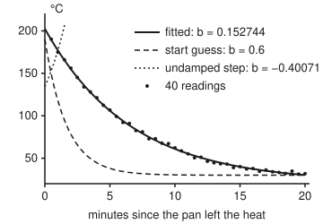

# Nonlinear least squares: Gauss-Newton, and the damping that rescues it

[Syllabus](../../../SYLLABUS.md) → [Optimization](../README.md) → [Unconstrained Methods](../README.md#s02) → Nonlinear least squares

---

## General Overview

A cast-iron pan comes off the heat at about 200 °C. A probe reads its temperature every 30 seconds for 20 minutes: 40 readings, from 190.18 °C at the first half-minute down to 31.78 °C at the last. Each reading carries probe noise of about 1.5 °C.

A cooling pan loses the same fraction of its heat above room temperature every minute. So the readings should sit on a curve with three numbers to choose: the room temperature, the starting excess over room, and the cooling rate. The task is to **minimise** the sum of squared misses between curve and readings. The rate sits inside an exponential, so the misses are curved in it, and the one-shot straight-line fit of [Least squares](../../09-Probability%20and%20statistics/09-Regression/01-least-squares-regression.md) cannot solve it.

Gauss-Newton repeats a straight-line fit instead. At the current guess, treat each miss as a straight line in the three numbers, solve that problem exactly, move there, repeat. Near the answer this is very fast.

From a poor guess it can be ruinous. Started at a cooling rate of 0.6 per minute, far too fast, one undamped step sends the rate to −0.40071, a pan that heats itself up. Half the sum of squared misses jumps from 38332.6665 to 1.0414e+11.

Damping the step (keeping it short until the straight-line picture earns trust) rescues the same start in 9 steps. The fit: room 21.661398 °C, 202.5733 °C at minute 0, rate 0.152744 per minute, so the heat above room halves every 4.5380 minutes.

**Gauss-Newton replaces each miss by its straight line and solves the resulting ordinary least-squares problem; that is nearly Newton's method when the misses are small, and Levenberg-Marquardt damping keeps each step inside the region where the straight lines can be trusted.**

**What kind of fact this is:** a method, with two theorems proved on this card in Why it works. First, the damped step is the best step inside a ball whose size the damping sets. Second, near the answer Gauss-Newton's error shrinks each step by a factor set by the curvature it leaves out. That curvature is weighted by the misses, and the runs show the factor growing with them. The fit it returns is a local minimum, certified by a flat gradient and positive curvature, and the best found over the rates scanned.

### The picture: the readings, the fit, the start and the step that went wrong

<p align="center"></p>

To scale, minutes across and °C up. The solid curve is the fit, through the dots. The dashed curve is the start guess, which cools far too fast: 117.81 °C at minute 1, 44.51 °C at minute 4, settling at 30 °C. The dotted curve is the model after one undamped Gauss-Newton step (room 47.6968 °C, excess 86.7134 °C, rate −0.40071): it climbs off the top of the chart almost at once.

---

## The formula

This card writes the three numbers as one triple, $\theta = (c, a, b)$, read "theta": room temperature $c$, starting excess $a$ and cooling rate $b$. Reading $i$ is taken at time $t_i$ minutes and shows $y_i$ °C. The miss on reading $i$ is the model's temperature minus the reading:

$$r_i(\theta) = c + a\,e^{-b t_i} - y_i, \qquad F(\theta) = \tfrac12 \sum_{i=1}^{40} r_i(\theta)^2$$

The slope table $J$ (the Jacobian) has one row per reading and one column per number, the rate of change of that miss in that number: the row for reading $i$ is $\left(1,\; e^{-b t_i},\; -a\,t_i\,e^{-b t_i}\right)$. One damped step $d$ solves

$$\left(J^{\mathsf T}J + \lambda D\right) d = -\,J^{\mathsf T} r, \qquad D = \operatorname{diag}\left(J^{\mathsf T}J\right)$$

**Read it aloud:** use the slopes to find the change in the three numbers that would make the squared misses smallest if every miss were a straight line, and shorten it as much as the damping insists.

At $\lambda = 0$ this is the Gauss-Newton step. [Calibration](../../12-Financial%20mathematics/07-Greeks%20by%20Numbers%20and%20Calibration/06-calibration-as-least-squares.md) derives it, adds the damping with the rule "triple $\lambda$ after a refused step, divide by three after an accepted one", and proves the damped step exists and goes downhill. This card adds what $J^{\mathsf T}J$ leaves out of the true curvature, and what the damping does geometrically.

| Symbol | Plain meaning | In our example | Push it up and the answer… |
| --- | --- | --- | --- |
| $t_i$, $y_i$ | time and temperature of reading $i$ (i runs 1 to 40) | 0.5 min and 190.18 °C for the first | — |
| $c$ | room temperature, where the pan settles, °C | 21.661398 fitted | the whole curve lifts |
| $a$ | starting excess over room, °C | 180.911890 fitted | the curve starts higher |
| $b$ | cooling rate, per minute | 0.152744 fitted; 0.6 at the start | the curve falls faster |
| $\theta$, $\theta_k$, $\theta^*$ | the triple $(c, a, b)$; its value after step $k$, from $\theta_0$ = (30, 160, 0.6); the fit, a minimiser of $F$ | $\theta^*$ = (21.661398, 180.911890, 0.152744) | — |
| $r_i$ | the miss: model minus reading, °C | root-mean-square (rms) 1.4789 °C at the fit | — |
| $F$, $\nabla F$, $\nabla^2 F$ | half the sum of squared misses, its gradient and its Hessian (the table of second derivatives) | $F$ = 43.742655 at the fit | the fit is worse |
| $J$ | the slope table (Jacobian), 40 rows by 3 columns | — | — |
| $S$ | the curvature Gauss-Newton leaves out: $\sum_i r_i \nabla^2 r_i$ | small when misses are small | Gauss-Newton slows |
| $d$ | the step added to $\theta$ | — | — |
| $\lambda$, $D$; $\lVert d\rVert_D$, $\langle u, v\rangle_D$ | the damping, and the diagonal of $J^{\mathsf T}J$ that scales it; a step's length, and the sum of entry-by-entry products of two steps, each entry weighted by that diagonal | λ from 0.001; accepted at 0.729 on the first step; undamped $\lVert d\rVert_D$ = 279.952 °C | shorter steps |
| $m(d)$, $\Delta$, $\rho_k$ | the straight-line model of $F$; the radius it is trusted to; actual over predicted drop | ρ = 1.15 on the first accepted step | — |

### When it holds

- **Misses that are smooth in the numbers.** Exponentials are. At a kink or a jump the slopes mislead, and the step chases them.
- **Columns of $J$ that point different ways.** Here they do: a constant, a decay, and a decay times time. If two numbers moved the curve the same way (a fourth "room offset" added to $c$), $J^{\mathsf T}J$ could not be inverted: the undamped step would not be unique, and the solve would break down.
- **Small misses at the answer, for speed.** With misses near 1.5 °C, the error shrinks by a factor 0.0102 per step. With misses near 30 °C it shrinks by only 0.1544. With zero misses the convergence is Newton's.
- **A start in the right valley.** Damping makes every accepted step go downhill; it does not choose the valley. The answer is a local minimum unless something more is shown.

---

## Why it works

### Step 0: curved misses, straightened one step at a time

A sum of squares of straight lines is a bowl, and a bowl's lowest point comes from one linear solve. The misses here are curved in $b$. Near any guess, though, each miss is almost a straight line, $r(\theta + d) \approx r + J d$. Gauss-Newton fits that straight-line version exactly, moves, rebuilds the lines at the new point, and repeats.

### Step 1: what $J^{\mathsf T}J$ leaves out of the Hessian

Differentiate $F = \tfrac12 \sum r_i^2$ once and twice:

$$\nabla F = J^{\mathsf T} r, \qquad \nabla^2 F = J^{\mathsf T}J + S, \qquad S = \sum_{i} r_i\, \nabla^2 r_i$$

$J^{\mathsf T}J$ needs only the slopes already in hand. $S$ needs every miss's own curvature, each multiplied by the miss itself. Newton's method ([Newton and BFGS](05-newton-and-quasi-newton-bfgs.md)) solves with the full $\nabla^2 F$; Gauss-Newton drops $S$ and solves with $J^{\mathsf T}J$.

So the stand-in is good exactly when the misses are small. Here only $b$ sits inside the exponential, so $S$ has entries only in the $a$ and $b$ rows: $-\sum r_i t_i e^{-b t_i}$ off the diagonal and $\sum r_i a t_i^2 e^{-b t_i}$ in the corner. With 1.5 °C misses of mixed sign they nearly cancel.

### Step 2: small misses mean fast, large misses mean slow

Near the answer $\theta^*$, the error after a Gauss-Newton step is, to first order, the error before it multiplied by one fixed matrix:

$$\theta_{k+1} - \theta^* \approx -\left(J^{\mathsf T}J\right)^{-1} S\,\left(\theta_k - \theta^*\right)$$

That matrix's largest eigenvalue, in magnitude, is the factor the error shrinks by each step. An eigenvalue is a factor by which the matrix stretches a direction it does not turn. The checks compute it by power iteration (multiplying a vector by the matrix again and again until its direction settles), then measure it by starting 0.001 off in $b$ and taking two steps:

| Probe noise | rms miss at the fit | predicted factor | measured factor |
| --- | ---: | ---: | ---: |
| 1.5 °C | 1.479 °C | 0.0102 | 0.0102 |
| 15 °C | 14.807 °C | 0.0895 | 0.0894 |
| 30 °C | 29.645 °C | 0.1544 | 0.1542 |

The factor grows with the misses. At every noise level the convergence is linear, the error shrinking by a fixed factor per step, and the factor sets the speed. If the factor passes 1, Gauss-Newton fails to converge even from starts next to the answer.

With zero misses at the answer, $S$ vanishes there and the step is Newton's own, with Newton's quadratic rate: the number of correct digits roughly doubles each step. The shelf's banana valley is such a problem. Write Rosenbrock's function as two misses, $10(y - x^2)$ and $1 - x$; half their squared sum is half the function. From $(-1.2, 1)$, Gauss-Newton lands at $(1, -3.84)$, then at the minimum $(1, 1)$: two steps, because the second miss is a straight line and the first becomes one once $x$ is fixed.

<details>
<summary>Detailed proof: the error map near the answer</summary>

Write one Gauss-Newton step as a map, $G(\theta) = \theta - (J^{\mathsf T}J)^{-1} J^{\mathsf T} r$, with $J$ and $r$ taken at $\theta$. At a minimum $\theta^*$ the gradient $J^{\mathsf T} r$ is zero, so $G(\theta^*) = \theta^*$.

Differentiate $G$ at $\theta^*$. The product rule on $(J^{\mathsf T}J)^{-1} \cdot J^{\mathsf T} r$ gives two terms. The one that differentiates $(J^{\mathsf T}J)^{-1}$ is multiplied by $J^{\mathsf T}r = 0$ and vanishes. The other differentiates $J^{\mathsf T} r = \nabla F$, giving $\nabla^2 F = J^{\mathsf T}J + S$. So

$$G'(\theta^*) = I - (J^{\mathsf T}J)^{-1}\left(J^{\mathsf T}J + S\right) = -(J^{\mathsf T}J)^{-1} S.$$

Taylor's theorem then gives $\theta_{k+1} - \theta^* = G'(\theta^*)(\theta_k - \theta^*) + O(\lVert \theta_k - \theta^* \rVert^2)$, when the misses are three times continuously differentiable, as exponentials are.

The matrix $(J^{\mathsf T}J)^{-1}S$ has real eigenvalues: with $P = J^{\mathsf T}J$ positive definite, it equals $P^{-1/2}\left(P^{-1/2} S P^{-1/2}\right)P^{1/2}$, a symmetric matrix in disguise. If its largest eigenvalue magnitude is below 1, errors near $\theta^*$ shrink by that factor per step in the long run. If it is above 1, a start a hair from $\theta^*$ along that eigenvector is pushed away. If $S = 0$ at $\theta^*$, the linear term vanishes and only the quadratic remainder is left: Newton's rate.

</details>

### Step 3: far from the answer the straight lines lie

From the start $\theta_0$ = (30, 160, 0.6), the undamped step trusts the straight lines across a huge distance. Measure each number's move by how far it alone shifts the 40 predicted temperatures, then combine the three as a root-sum-square. That **scaled length** is 279.952 °C:

$$\lVert d \rVert_D = \sqrt{\textstyle\sum_j D_{jj}\, d_j^2}$$

The straight-line model $m(d) = \tfrac12 \lVert r + J d\rVert^2$ promised a drop of 3.5285e+04 in $F$; the real $F$ rose to 1.0414e+11. The ratio of actual to predicted drop, $\rho_k$ from [Trust regions](08-trust-region-methods.md), is −2951383.096.

### Step 4: the damping is a trust region in disguise

Raise $\lambda$ and the step shrinks. From the same start:

| $\lambda$ | scaled length (°C) | new rate $b$ | $\rho$ |
| ---: | ---: | ---: | ---: |
| 0 | 279.952 | −0.40071 | −2951383.096 |
| 0.01 | 270.480 | −0.36415 | −860922.379 |
| 0.1 | 218.139 | −0.15304 | −811.426 |
| 1 | 120.732 | 0.24176 | 1.287 |
| 10 | 29.991 | 0.51699 | 1.097 |

The theorem behind the table: **the damped step is the best step of its own length.** Of every step $d'$ with $\lVert d' \rVert_D \le \lVert d \rVert_D$, none gives the straight-line model a lower value than $d$ does.

So choosing $\lambda$ is choosing a trust radius $\Delta = \lVert d \rVert_D$, and the triple-or-divide-by-three rule is a trust-region update: grow the region after a success, shrink it after a failure. Here a success means only that $F$ fell, $\rho > 0$; the size of $\rho$ is printed but not used, unlike the quarter and three-quarter thresholds of [Trust regions](08-trust-region-methods.md).

The checks test the claim at $\lambda = 1$: the model is 9567.5777 at the damped step, and the best of 29280 points spread through the same ball is 9572.1061.

Marquardt's $D$ makes "length" mean something: it measures each number's move by how much it shifts the predicted temperatures, so a change in the rate (per minute) is not weighed like a change in the room (°C).

<details>
<summary>Detailed proof: the damped step is best inside its ball</summary>

Let $d$ solve $(J^{\mathsf T}J + \lambda D)\,d = -J^{\mathsf T} r$ with $\lambda \ge 0$, and let $d'$ be any step with $\lVert d' \rVert_D \le \lVert d \rVert_D$. Write $\langle u, v \rangle_D = \sum_j D_{jj} u_j v_j$. Expanding the square, for $e = d' - d$:

$$m(d') - m(d) = \tfrac12 \lVert J e \rVert^2 + e^{\mathsf T}\left(J^{\mathsf T}J\,d + J^{\mathsf T} r\right) = \tfrac12 \lVert J e \rVert^2 - \lambda \langle e, d \rangle_D.$$

The last step used the step equation, $J^{\mathsf T}J\,d + J^{\mathsf T} r = -\lambda D d$. Now

$$-\langle e, d\rangle_D = \lVert d \rVert_D^2 - \langle d', d \rangle_D \ge \lVert d \rVert_D^2 - \lVert d' \rVert_D \lVert d \rVert_D \ge 0,$$

by Cauchy-Schwarz and then $\lVert d' \rVert_D \le \lVert d \rVert_D$. Both terms are non-negative, so $m(d') \ge m(d)$.

The step equation is also the Lagrange condition for "minimise $m$ subject to $\lVert d \rVert_D \le \Delta$", with $\lambda$ as the multiplier, so the two problems are one problem.

</details>

### Step 5: two roads to the same fit, and a certificate

The room $c$ and excess $a$ enter the model as straight lines. Fix the rate $b$, and the best $c$ and $a$ come from one straight-line fit. That leaves a search over $b$ alone, done by golden-section search (a bracket on $b$ that shrinks by the same ratio, 0.618, each round), which never touches the slope table. It lands on room 21.661398 °C, excess 180.911890 °C, rate 0.152744, $F$ = 43.742655: the Levenberg-Marquardt fit to six decimals. Of the 100 rates 0.01, 0.02, … 1.00, the lowest profile value is at 0.15.

At the fit the gradient is −7.2e−10, −5.4e−10 and 5.5e−06, flat to rounding and the stopping tolerance. The full Hessian, $J^{\mathsf T}J + S$, has leading minors (the determinants of its top-left 1×1, 2×2 and 3×3 blocks) 40, 97.694 and 3.5582e+07, all positive, so it is positive definite ([Optimality conditions](01-optimality-conditions.md)). Together these certify a **local minimum**. The scan over rates makes it the best found on 0.01 to 1.00, not a proved global minimum.

---

## Worked numbers, by hand

The three-by-three solves come from the run. The arithmetic between them is by hand.

| Step | Arithmetic | Value |
| --- | --- | --- |
| start | $\theta_0$ = (30, 160, 0.6) | $F$ = 38332.6665 |
| undamped step | solve $J^{\mathsf T}J\,d = -J^{\mathsf T}r$ | $b$ = −0.40071, $F$ = 1.0414e+11 |
| its ratio | (38332.6665 − 1.0414e+11) ÷ 3.5285e+04 | ρ = −2951383.096: refuse |
| damping ladder | 0.001 tripled six times | λ = 0.729000 |
| first accepted step | damped solve at λ = 0.729 | $b$ = 0.19175, $F$ = 3407.959303 |
| eight more steps | λ divided by 3 after each | $F$ = 43.742655 |
| fit | stop when the scaled step is below 1e−7 °C | $c$ = 21.661398, $a$ = 180.911890, $b$ = 0.152744 |
| typical miss | √(2 × 43.742655 ÷ 40) | 1.4789 °C |
| half-life of the heat above room | ln 2 ÷ 0.152744 | **4.5380 minutes** |

The pan settles towards 21.661398 °C and loses half its remaining excess heat every 4.5380 minutes; the curve misses a typical reading by 1.4789 °C, the probe's own noise.

### What breaks if you drop a piece

| Mistake | Comes out at | What went wrong |
| --- | --- | --- |
| No damping from the poor start | rate −0.40071, $F$ = 1.0414e+11 | straight lines trusted 279.952 °C away |
| Slope in $b$ written without the factor $a$ | one step from 0.001 off the fit: rate −0.02923, $F$ = 889322.1 | the slope is too small by the factor $a$, so the step in $b$ is that many times too big |
| Logs and a straight line, room guessed 30 °C | rate 0.22600, excess 239.5648 °C | the wrong room temperature bends the log plot, and the line through it is not the fit |
| Gauss-Newton on 30 °C misses | error factor 0.1544 per step | $S$ is no longer small, so $J^{\mathsf T}J$ is a poor Hessian |

---

## Code, from first principles, and it actually runs

The script makes the 40 readings from a written-out random generator, then runs pure Gauss-Newton and Levenberg-Marquardt from the poor start. Three roads reach the fit: the damped iteration; the profile road (fix the rate, fit room and excess as a straight line, search the rate by golden section); and a certificate, the gradient and Hessian minors at the answer. It also samples 29280 points to test the trust-region theorem, and measures Gauss-Newton's factor against the prediction at three noise levels.

### Python

```python
# Nonlinear least squares -- the check behind the card.  Standard library only:
# math gives exp, log and sqrt; every step, solve and search is written out.
# A pan cools from about 200 C; 40 probe readings, one every 30 s.  Fit the
# decay T(t) = c + a exp(-b t) by Gauss-Newton and Levenberg-Marquardt.
import math
MASK = (1 << 64) - 1
def readings(sd, seed=2026):                   # SplitMix64; 12 uniforms - 6 ~ bell curve
    s, ys = seed, []
    for i in range(1, 41):
        u = 0.0
        for _ in range(12):
            s = (s + 0x9E3779B97F4A7C15) & MASK
            z = ((s ^ (s >> 30)) * 0xBF58476D1CE4E5B9) & MASK
            z = ((z ^ (z >> 27)) * 0x94D049BB133111EB) & MASK
            u += ((z ^ (z >> 31)) >> 11) / 2.0 ** 53
        ys.append(21.0 + 180.0 * math.exp(-0.15 * 0.5 * i) + sd * (u - 6.0))
    return ys
TS = [0.5 * i for i in range(1, 41)]
def misses(th, ys, wrong=False):               # misses r_i and slope table J, a row per reading
    c, a, b = th
    r = [c + a * math.exp(-b * t) - y for t, y in zip(TS, ys)]
    J = [[1.0, math.exp(-b * t), -(1.0 if wrong else a) * t * math.exp(-b * t)] for t in TS]
    return r, J
def loss(th, ys): return 0.5 * sum(x * x for x in misses(th, ys)[0])
def solve(A, b):                               # Gaussian elimination with row swaps
    n = len(b); M = [A[i][:] + [b[i]] for i in range(n)]
    for col in range(n):
        p = max(range(col, n), key=lambda q: abs(M[q][col])); M[col], M[p] = M[p], M[col]
        for q in range(col + 1, n):
            f = M[q][col] / M[col][col]
            for j in range(col, n + 1): M[q][j] -= f * M[col][j]
    x = [0.0] * n
    for i in range(n - 1, -1, -1):
        x[i] = (M[i][n] - sum(M[i][j] * x[j] for j in range(i + 1, n))) / M[i][i]
    return x
def dot(p, q): return sum(x * y for x, y in zip(p, q))
def normal(J, r):                              # J^T J, and the gradient g = J^T r
    n = len(J[0])
    cols = [[w[i] for w in J] for i in range(n)]
    return [[dot(cols[i], cols[j]) for j in range(n)] for i in range(n)], [dot(cols[i], r) for i in range(n)]
def model(r, J, d): return 0.5 * sum(e * e for e in (x + dot(w, d) for x, w in zip(r, J)))
def step(th, ys, lam, wrong=False):            # damped step; lam = 0 is plain Gauss-Newton
    r, J = misses(th, ys, wrong); A, g = normal(J, r)
    d = solve([[A[i][j] + (lam * A[i][i] if i == j else 0.0) for j in range(3)] for i in range(3)], [-x for x in g])
    pred = -dot(g, d) - 0.5 * sum(dot(w, d) * dot(w, d) for w in J)
    size = math.sqrt(sum(A[i][i] * d[i] * d[i] for i in range(3)))
    return [p + q for p, q in zip(th, d)], pred, size, r, J, A, d
def lm(th, ys, show=False, lam=1e-3):          # accept if F falls: lam / 3; refuse: lam x 3
    steps = 0
    while steps < 200:
        refused = 0
        while True:
            new, pred, size = step(th, ys, lam)[:3]
            if size < 1e-7: return th, steps
            drop = loss(th, ys) - loss(new, ys); rho = drop / pred if pred > 0 else 0.0
            if drop > 0: break
            lam *= 3.0; refused += 1
        if show: print(f"LM step {steps + 1} lambda {lam:8.6f} refused {refused}  c {new[0]:8.4f}  a {new[1]:8.4f}  b {new[2]:7.5f}  F {loss(new, ys):13.6f}  rho {rho:4.2f}")
        th, lam, steps = new, lam / 3.0, steps + 1
    return th, steps
def profile(b, ys):                            # road 2: fix b; then c, a are a straight-line fit
    A, g = normal([[1.0, math.exp(-b * t)] for t in TS], ys)
    c, a = solve(A, g)
    return c, a, loss([c, a, b], ys)
def dropped(th, ys):                           # S = sum r_i (Hessian of r_i): what Gauss-Newton leaves out
    r, J = misses(th, ys); A = normal(J, r)[0]; c, a, b = th
    S = [[0.0] * 3 for _ in range(3)]
    for t, x in zip(TS, r):
        e = math.exp(-b * t); S[1][2] -= x * t * e; S[2][1] -= x * t * e; S[2][2] += x * a * t * t * e
    v = [1.0, 1.0, 1.0]
    for _ in range(300):                       # power iteration: biggest stretch of (J^T J)^-1 S
        w = solve(A, [sum(S[i][j] * v[j] for j in range(3)) for i in range(3)])
        big = max(abs(x) for x in w); v = [x / big for x in w]
    return big, [[A[i][j] + S[i][j] for j in range(3)] for i in range(3)]
ys = readings(1.5)
for row in range(4):
    print(f"readings {10 * row + 1:2d}-{10 * row + 10:2d} (C)" + "".join(f"{y:7.2f}" for y in ys[10 * row:10 * row + 10]))
start = [30.0, 160.0, 0.6]; F0 = loss(start, ys)
print(f"start c {start[0]}  a {start[1]}  b {start[2]}  F {F0:.4f}")
gn1 = step(start, ys, 0.0)[0]; gn2 = step(gn1, ys, 0.0)[0]
for n, th in ((1, gn1), (2, gn2)):
    print(f"pure Gauss-Newton step {n}: c {th[0]:.4f}  a {th[1]:.4f}  b {th[2]:.5f}  F {loss(th, ys):.4e}")
for lam in (0.0, 0.01, 0.1, 1.0, 10.0):
    new, pred, size = step(start, ys, lam)[:3]
    print(f"first step, lambda {lam:5.2f}: scaled length {size:7.3f}  b {new[2]:8.5f}  F {loss(new, ys):.4e}  predicted drop {pred:.4e}  rho {(F0 - loss(new, ys)) / pred:.3f}")
new, pred, size, r, J, A, d = step(start, ys, 1.0)
best = min(model(r, J, [z * f * size / math.sqrt(A[j][j]) for j, z in enumerate((
    math.sin(p * math.pi / 60) * math.cos(q * math.pi / 60), math.sin(p * math.pi / 60) * math.sin(q * math.pi / 60), math.cos(p * math.pi / 60)))])
    for p in range(61) for q in range(120) for f in (0.25, 0.5, 0.75, 1.0))
print(f"trust region, lambda 1: model at the step {model(r, J, d):.4f}; best of 29280 points in the same ball {best:.4f}")
fit, nsteps = lm(start, ys, show=True)
F = loss(fit, ys)
print(f"fit: c {fit[0]:.6f} C  a {fit[1]:.6f} C  b {fit[2]:.6f} per min  F {F:.6f}  rms miss {math.sqrt(2 * F / 40):.4f} C")
print(f"half-life of the heat above room: ln 2 / b = {math.log(2.0) / fit[2]:.4f} min; T(0) = c + a = {fit[0] + fit[1]:.4f} C")
lo, hi, phi = 0.05, 0.5, (math.sqrt(5.0) - 1.0) / 2.0
for _ in range(80):                            # golden-section search on the profile
    m1, m2 = hi - phi * (hi - lo), lo + phi * (hi - lo)
    if profile(m1, ys)[2] < profile(m2, ys)[2]: hi = m2
    else: lo = m1
bp = 0.5 * (lo + hi); cp, ap, Fp = profile(bp, ys)
grid = 0.01 * min(range(1, 101), key=lambda j: profile(0.01 * j, ys)[2])
print(f"road 2, profile in b: c {cp:.6f}  a {ap:.6f}  b {bp:.6f}  F {Fp:.6f}; best b on the grid 0.01..1.00: {grid:.2f}")
rf, Jf = misses(fit, ys); g = normal(Jf, rf)[1]; H = dropped(fit, ys)[1]
minors = [H[0][0], H[0][0] * H[1][1] - H[0][1] * H[0][1], sum(H[0][j] * (H[1][(j + 1) % 3] * H[2][(j + 2) % 3] - H[1][(j + 2) % 3] * H[2][(j + 1) % 3]) for j in range(3))]
print("road 3, gradient at the fit: " + "  ".join(f"{x:.1e}" for x in g) + "; Hessian minors " + "  ".join(f"{x:.4e}" for x in minors))
rates = []
for sd in (1.5, 15.0, 30.0):
    y2 = readings(sd); f2 = lm([30.0, 160.0, 0.1], y2)[0]
    th1 = step([f2[0], f2[1], f2[2] + 0.001], y2, 0.0)[0]; th2 = step(th1, y2, 0.0)[0]
    rates.append((dropped(f2, y2)[0], abs(th2[2] - f2[2]) / abs(th1[2] - f2[2])))
    print(f"probe sd {sd:4.1f} C: rms miss {math.sqrt(2 * loss(f2, y2) / 40):6.3f} C  Gauss-Newton rate, predicted {rates[-1][0]:.4f}  measured {rates[-1][1]:.4f}")
w = step([fit[0], fit[1], fit[2] + 0.001], ys, 0.0, wrong=True)[0]
print(f"wrong slope column (a left out), one step from b = fit + 0.001: b {w[2]:.5f}  F {loss(w, ys):.1f}")
lx = [math.log(y - 30.0) for y in ys]; mt, ml = sum(TS) / 40, sum(lx) / 40
bl = -sum((t - mt) * (x - ml) for t, x in zip(TS, lx)) / sum((t - mt) * (t - mt) for t in TS)
print(f"log-line shortcut, room guessed 30 C: b {bl:.5f}  a {math.exp(ml + bl * mt):.4f}")
rb, path = [-1.2, 1.0], []                     # Rosenbrock: misses 10(y - x^2) and 1 - x
d0 = solve([[-20.0 * rb[0], 10.0], [-1.0, 0.0]], [-10.0 * (rb[1] - rb[0] * rb[0]), -(1.0 - rb[0])])   # J d = -r by elimination
for n in (1, 2):                               # closed form: dx = 1 - x, then dy from the first row
    x, y = rb; dx = 1.0 - x; rb = [x + dx, y + (-10.0 * (y - x * x) + 20.0 * x * dx) / 10.0]; path.append(rb)
    print(f"Rosenbrock as two misses, Gauss-Newton step {n}: ({rb[0]:.4f}, {rb[1]:.4f})")
print("figure, fit at t = 0, 5, 10, 15, 20 min: " + "  ".join(f"{fit[0] + fit[1] * math.exp(-fit[2] * t):.2f}" for t in (0, 5, 10, 15, 20)))
print("figure, start at t = 0, 1, 2, 4, 20 min: " + "  ".join(f"{30 + 160 * math.exp(-0.6 * t):.2f}" for t in (0, 1, 2, 4, 20)))
assert loss(gn1, ys) > 1e6 * F0 and gn1[2] < 0          # undamped step from the poor start overshoots
assert abs(bp - fit[2]) < 1e-6 and abs(cp - fit[0]) < 1e-4 and abs(grid - fit[2]) < 0.01   # two roads meet
assert max(abs(x) for x in g) < 1e-4 and min(minors) > 0  # flat and curving up: a local minimum
assert model(r, J, d) <= best + 1e-9 and best - model(r, J, d) < 1e-2 * model(r, J, d) and abs(F0 - model(r, J, d) - pred) < 1e-9 * F0   # ball's best; predicted drop
assert all(abs(p - m) < 0.02 * p for p, m in rates) and rates[0][0] < rates[1][0] < rates[2][0]
assert abs(path[0][0] - (-1.2 + d0[0])) < 1e-12 and abs(path[0][1] - (1.0 + d0[1])) < 1e-12   # step 1 by two roads
assert abs(rb[0] - 1.0) < 1e-9 and abs(rb[1] - 1.0) < 1e-9 and w[2] < 0 and bl > fit[2] + 0.05
print("ALL CHECKS PASS")
```

**Ran 2026-11-11 on macOS, Python 3.14.10, standard library only. All checks passed. Output, pasted from the run:**

```
readings  1-10 (C) 190.18 174.83 165.95 156.03 145.09 134.01 128.10 121.23 112.37 106.82
readings 11-20 (C)  99.22  92.10  90.92  82.58  80.99  72.93  73.01  67.75  67.24  62.20
readings 21-30 (C)  58.68  55.11  50.48  51.12  46.40  44.55  43.48  43.08  39.00  40.10
readings 31-40 (C)  37.35  37.88  34.56  36.20  33.99  33.16  32.07  34.73  31.27  31.78
start c 30.0  a 160.0  b 0.6  F 38332.6665
pure Gauss-Newton step 1: c 47.6968  a 86.7134  b -0.40071  F 1.0414e+11
pure Gauss-Newton step 2: c 109.4483  a -0.5979  b -0.40105  F 4.3346e+06
first step, lambda  0.00: scaled length 279.952  b -0.40071  F 1.0414e+11  predicted drop 3.5285e+04  rho -2951383.096
first step, lambda  0.01: scaled length 270.480  b -0.36415  F 3.0367e+10  predicted drop 3.5273e+04  rho -860922.379
first step, lambda  0.10: scaled length 218.139  b -0.15304  F 2.8171e+07  predicted drop 3.4670e+04  rho -811.426
first step, lambda  1.00: scaled length 120.732  b  0.24176  F 1.3212e+03  predicted drop 2.8765e+04  rho 1.287
first step, lambda 10.00: scaled length  29.991  b  0.51699  F 2.7419e+04  predicted drop 9.9525e+03  rho 1.097
trust region, lambda 1: model at the step 9567.5777; best of 29280 points in the same ball 9572.1061
LM step 1 lambda 0.729000 refused 6  c  43.7849  a 183.6876  b 0.19175  F   3407.959303  rho 1.15
LM step 2 lambda 0.243000 refused 0  c  35.6071  a 178.2754  b 0.19617  F    470.598105  rho 1.00
LM step 3 lambda 0.081000 refused 0  c  29.4393  a 178.7950  b 0.17468  F    156.635540  rho 0.97
LM step 4 lambda 0.027000 refused 0  c  24.4294  a 179.8802  b 0.15936  F     57.260057  rho 0.96
LM step 5 lambda 0.009000 refused 0  c  22.1233  a 180.7323  b 0.15381  F     44.100506  rho 0.99
LM step 6 lambda 0.003000 refused 0  c  21.6885  a 180.9024  b 0.15281  F     43.743795  rho 0.99
LM step 7 lambda 0.001000 refused 0  c  21.6618  a 180.9117  b 0.15275  F     43.742655  rho 0.99
LM step 8 lambda 0.000333 refused 0  c  21.6614  a 180.9119  b 0.15274  F     43.742655  rho 0.99
LM step 9 lambda 0.000111 refused 0  c  21.6614  a 180.9119  b 0.15274  F     43.742655  rho 1.00
fit: c 21.661398 C  a 180.911890 C  b 0.152744 per min  F 43.742655  rms miss 1.4789 C
half-life of the heat above room: ln 2 / b = 4.5380 min; T(0) = c + a = 202.5733 C
road 2, profile in b: c 21.661398  a 180.911890  b 0.152744  F 43.742655; best b on the grid 0.01..1.00: 0.15
road 3, gradient at the fit: -7.2e-10  -5.4e-10  5.5e-06; Hessian minors 4.0000e+01  9.7694e+01  3.5582e+07
probe sd  1.5 C: rms miss  1.479 C  Gauss-Newton rate, predicted 0.0102  measured 0.0102
probe sd 15.0 C: rms miss 14.807 C  Gauss-Newton rate, predicted 0.0895  measured 0.0894
probe sd 30.0 C: rms miss 29.645 C  Gauss-Newton rate, predicted 0.1544  measured 0.1542
wrong slope column (a left out), one step from b = fit + 0.001: b -0.02923  F 889322.1
log-line shortcut, room guessed 30 C: b 0.22600  a 239.5648
Rosenbrock as two misses, Gauss-Newton step 1: (1.0000, -3.8400)
Rosenbrock as two misses, Gauss-Newton step 2: (1.0000, 1.0000)
figure, fit at t = 0, 5, 10, 15, 20 min: 202.57  105.95  60.94  39.96  30.19
figure, start at t = 0, 1, 2, 4, 20 min: 190.00  117.81  78.19  44.51  30.00
ALL CHECKS PASS
```

### Rust

Same numbers, same labels, built with `rustc --edition 2021 -O`. Its `sum` adds with the same compensation Python's built-in `sum` uses, so the last digits agree.

```rust
// Nonlinear least squares -- the same check as the Python, in Rust.  No crates.
// A pan cools from about 200 C; 40 probe readings, one every 30 s.  Fit the
// decay T(t) = c + a exp(-b t) by Gauss-Newton and Levenberg-Marquardt.
// Sums use the same compensated adding as Python's sum, so the digits agree.
type M = Vec<Vec<f64>>;
fn sum(xs: impl Iterator<Item = f64>) -> f64 {
    let (mut s, mut c) = (0.0f64, 0.0f64);
    for x in xs { let t = s + x; c += if s.abs() >= x.abs() { (s - t) + x } else { (x - t) + s }; s = t; }
    if c != 0.0 && c.is_finite() { s + c } else { s }
}
fn sci(x: f64, p: usize) -> String {                // Python's e-format: two-digit exponent with sign
    let s = format!("{:.*e}", p, x);
    let (m, e) = s.split_once('e').unwrap(); let e: i32 = e.parse().unwrap();
    format!("{}e{}{:02}", m, if e < 0 { '-' } else { '+' }, e.abs())
}
fn readings(sd: f64) -> Vec<f64> {                  // SplitMix64; 12 uniforms - 6 ~ bell curve
    let mut s: u64 = 2026;
    (1..=40).map(|i| {
        let mut u = 0.0;
        for _ in 0..12 {
            s = s.wrapping_add(0x9E3779B97F4A7C15);
            let mut z = (s ^ (s >> 30)).wrapping_mul(0xBF58476D1CE4E5B9);
            z = (z ^ (z >> 27)).wrapping_mul(0x94D049BB133111EB);
            u += ((z ^ (z >> 31)) >> 11) as f64 / 9007199254740992.0;
        }
        21.0 + 180.0 * (-0.15 * 0.5 * i as f64).exp() + sd * (u - 6.0)
    }).collect()
}
fn ts() -> Vec<f64> { (1..=40).map(|i| 0.5 * i as f64).collect() }
fn misses(th: &[f64], ys: &[f64], wrong: bool) -> (Vec<f64>, M) {   // misses r_i and slope table J
    let (c, a, b) = (th[0], th[1], th[2]);
    let r = ts().iter().zip(ys).map(|(t, y)| c + a * (-b * t).exp() - y).collect();
    let j = ts().iter().map(|t| vec![1.0, (-b * t).exp(), -(if wrong { 1.0 } else { a }) * t * (-b * t).exp()]).collect();
    (r, j)
}
fn loss(th: &[f64], ys: &[f64]) -> f64 { 0.5 * sum(misses(th, ys, false).0.iter().map(|x| x * x)) }
fn solve(a: &M, b: &[f64]) -> Vec<f64> {            // Gaussian elimination with row swaps
    let n = b.len();
    let mut m: M = (0..n).map(|i| { let mut row = a[i].clone(); row.push(b[i]); row }).collect();
    for col in 0..n {
        let mut p = col;
        for q in col + 1..n { if m[q][col].abs() > m[p][col].abs() { p = q } }; m.swap(col, p);
        for q in col + 1..n { let f = m[q][col] / m[col][col]; for j in col..=n { m[q][j] -= f * m[col][j] } }
    }
    let mut x = vec![0.0; n];
    for i in (0..n).rev() { x[i] = (m[i][n] - sum((i + 1..n).map(|j| m[i][j] * x[j]))) / m[i][i] }
    x
}
fn dot(p: &[f64], q: &[f64]) -> f64 { sum(p.iter().zip(q).map(|(x, y)| x * y)) }
fn normal(j: &M, r: &[f64]) -> (M, Vec<f64>) {      // J^T J, and the gradient g = J^T r
    let n = j[0].len();
    let cols: M = (0..n).map(|i| j.iter().map(|w| w[i]).collect()).collect();
    ((0..n).map(|i| (0..n).map(|q| dot(&cols[i], &cols[q])).collect()).collect(), (0..n).map(|i| dot(&cols[i], r)).collect())
}
fn model(r: &[f64], j: &M, d: &[f64]) -> f64 { 0.5 * sum(r.iter().zip(j).map(|(x, w)| { let e = x + dot(w, d); e * e })) }
struct Step { new: Vec<f64>, pred: f64, size: f64, r: Vec<f64>, j: M, a: M, d: Vec<f64> }
fn step(th: &[f64], ys: &[f64], lam: f64, wrong: bool) -> Step {   // damped; lam = 0 is plain Gauss-Newton
    let (r, j) = misses(th, ys, wrong); let (a, g) = normal(&j, &r);
    let damped: M = (0..3).map(|i| (0..3).map(|q| a[i][q] + if i == q { lam * a[i][i] } else { 0.0 }).collect()).collect();
    let d = solve(&damped, &g.iter().map(|x| -x).collect::<Vec<_>>());
    let pred = -dot(&g, &d) - 0.5 * sum(j.iter().map(|w| dot(w, &d) * dot(w, &d)));
    let size = sum((0..3).map(|i| a[i][i] * d[i] * d[i])).sqrt();
    Step { new: th.iter().zip(&d).map(|(p, q)| p + q).collect(), pred, size, r, j, a, d }
}
fn lm(th0: &[f64], ys: &[f64], show: bool) -> Vec<f64> {   // accept if F falls: lam / 3; refuse: lam x 3
    let (mut th, mut lam, mut steps) = (th0.to_vec(), 1e-3, 0);
    while steps < 200 {
        let mut refused = 0;
        let (new, rho) = loop {
            let s = step(&th, ys, lam, false);
            if s.size < 1e-7 { return th }
            let drop = loss(&th, ys) - loss(&s.new, ys);
            if drop > 0.0 { break (s.new, if s.pred > 0.0 { drop / s.pred } else { 0.0 }) }
            lam *= 3.0; refused += 1;
        };
        if show { println!("LM step {} lambda {:8.6} refused {}  c {:8.4}  a {:8.4}  b {:7.5}  F {:13.6}  rho {:4.2}", steps + 1, lam, refused, new[0], new[1], new[2], loss(&new, ys), rho) }
        th = new; lam /= 3.0; steps += 1;
    }
    th
}
fn profile(b: f64, ys: &[f64]) -> (f64, f64, f64) {        // road 2: fix b; c, a are a straight-line fit
    let (a, g) = normal(&ts().iter().map(|t| vec![1.0, (-b * t).exp()]).collect(), ys);
    let x = solve(&a, &g); (x[0], x[1], loss(&[x[0], x[1], b], ys))
}
fn dropped(th: &[f64], ys: &[f64]) -> (f64, M) {   // S = sum r_i (Hessian of r_i): what Gauss-Newton leaves out
    let (r, j) = misses(th, ys, false); let a = normal(&j, &r).0;
    let mut s = vec![vec![0.0; 3]; 3];
    for (t, x) in ts().iter().zip(&r) {
        let e = (-th[2] * t).exp(); s[1][2] -= x * t * e; s[2][1] -= x * t * e; s[2][2] += x * th[1] * t * t * e;
    }
    let (mut v, mut big) = (vec![1.0; 3], 0.0);
    for _ in 0..300 {                                // power iteration: biggest stretch of (J^T J)^-1 S
        let w = solve(&a, &(0..3).map(|i| sum((0..3).map(|q| s[i][q] * v[q]))).collect::<Vec<_>>());
        big = w.iter().fold(0.0f64, |m, x| m.max(x.abs())); v = w.iter().map(|x| x / big).collect();
    }
    (big, (0..3).map(|i| (0..3).map(|q| a[i][q] + s[i][q]).collect()).collect())
}
fn main() {
    let ys = readings(1.5);
    for row in 0..4 {
        println!("readings {:2}-{:2} (C){}", 10 * row + 1, 10 * row + 10, ys[10 * row..10 * row + 10].iter().map(|y| format!("{:7.2}", y)).collect::<String>());
    }
    let start = vec![30.0, 160.0, 0.6]; let f0 = loss(&start, &ys);
    println!("start c {:.1}  a {:.1}  b {:.1}  F {:.4}", start[0], start[1], start[2], f0);
    let gn1 = step(&start, &ys, 0.0, false).new; let gn2 = step(&gn1, &ys, 0.0, false).new;
    for (n, th) in [(1, &gn1), (2, &gn2)] {
        println!("pure Gauss-Newton step {}: c {:.4}  a {:.4}  b {:.5}  F {}", n, th[0], th[1], th[2], sci(loss(th, &ys), 4));
    }
    for lam in [0.0, 0.01, 0.1, 1.0, 10.0] {
        let s = step(&start, &ys, lam, false);
        println!("first step, lambda {:5.2}: scaled length {:7.3}  b {:8.5}  F {}  predicted drop {}  rho {:.3}", lam, s.size, s.new[2],
                 sci(loss(&s.new, &ys), 4), sci(s.pred, 4), (f0 - loss(&s.new, &ys)) / s.pred);
    }
    let (s1, mut best) = (step(&start, &ys, 1.0, false), f64::INFINITY);
    for p in 0..61 { for q in 0..120 { for f in [0.25, 0.5, 0.75, 1.0] {
        let (pa, qa) = (p as f64 * std::f64::consts::PI / 60.0, q as f64 * std::f64::consts::PI / 60.0);
        let z = [pa.sin() * qa.cos(), pa.sin() * qa.sin(), pa.cos()];
        let dd: Vec<f64> = (0..3).map(|j| z[j] * f * s1.size / s1.a[j][j].sqrt()).collect();
        best = best.min(model(&s1.r, &s1.j, &dd));
    }}}
    let m1 = model(&s1.r, &s1.j, &s1.d);
    println!("trust region, lambda 1: model at the step {:.4}; best of 29280 points in the same ball {:.4}", m1, best);
    let fit = lm(&start, &ys, true); let f = loss(&fit, &ys);
    println!("fit: c {:.6} C  a {:.6} C  b {:.6} per min  F {:.6}  rms miss {:.4} C", fit[0], fit[1], fit[2], f, (2.0 * f / 40.0).sqrt());
    println!("half-life of the heat above room: ln 2 / b = {:.4} min; T(0) = c + a = {:.4} C", 2.0f64.ln() / fit[2], fit[0] + fit[1]);
    let (mut lo, mut hi, phi) = (0.05f64, 0.5f64, (5.0f64.sqrt() - 1.0) / 2.0);
    for _ in 0..80 {                                 // golden-section search on the profile
        let (m1, m2) = (hi - phi * (hi - lo), lo + phi * (hi - lo));
        if profile(m1, &ys).2 < profile(m2, &ys).2 { hi = m2 } else { lo = m1 }
    }
    let bp = 0.5 * (lo + hi); let (cp, ap, fp) = profile(bp, &ys); let mut gj = 1;
    for j in 2..=100 { if profile(0.01 * j as f64, &ys).2 < profile(0.01 * gj as f64, &ys).2 { gj = j } }
    let grid = 0.01 * gj as f64;
    println!("road 2, profile in b: c {:.6}  a {:.6}  b {:.6}  F {:.6}; best b on the grid 0.01..1.00: {:.2}", cp, ap, bp, fp, grid);
    let (rf, jf) = misses(&fit, &ys, false); let (g, h) = (normal(&jf, &rf).1, dropped(&fit, &ys).1);
    let minors = [h[0][0], h[0][0] * h[1][1] - h[0][1] * h[0][1],
        sum((0..3).map(|j| h[0][j] * (h[1][(j + 1) % 3] * h[2][(j + 2) % 3] - h[1][(j + 2) % 3] * h[2][(j + 1) % 3])))];
    println!("road 3, gradient at the fit: {}; Hessian minors {}", g.iter().map(|x| sci(*x, 1)).collect::<Vec<_>>().join("  "), minors.iter().map(|x| sci(*x, 4)).collect::<Vec<_>>().join("  "));
    let mut rates = vec![];
    for sd in [1.5, 15.0, 30.0] {
        let y2 = readings(sd); let f2 = lm(&[30.0, 160.0, 0.1], &y2, false);
        let th1 = step(&[f2[0], f2[1], f2[2] + 0.001], &y2, 0.0, false).new;
        let th2 = step(&th1, &y2, 0.0, false).new; rates.push((dropped(&f2, &y2).0, (th2[2] - f2[2]).abs() / (th1[2] - f2[2]).abs()));
        let (p, m) = rates[rates.len() - 1];
        println!("probe sd {:4.1} C: rms miss {:6.3} C  Gauss-Newton rate, predicted {:.4}  measured {:.4}", sd, (2.0 * loss(&f2, &y2) / 40.0).sqrt(), p, m);
    }
    let w = step(&[fit[0], fit[1], fit[2] + 0.001], &ys, 0.0, true).new;
    println!("wrong slope column (a left out), one step from b = fit + 0.001: b {:.5}  F {:.1}", w[2], loss(&w, &ys));
    let t = ts(); let lx: Vec<f64> = ys.iter().map(|y| (y - 30.0).ln()).collect();
    let (mt, ml) = (sum(t.iter().copied()) / 40.0, sum(lx.iter().copied()) / 40.0);
    let bl = -sum(t.iter().zip(&lx).map(|(t, x)| (t - mt) * (x - ml))) / sum(t.iter().map(|t| (t - mt) * (t - mt)));
    println!("log-line shortcut, room guessed 30 C: b {:.5}  a {:.4}", bl, (ml + bl * mt).exp());
    let (mut rb, mut path) = ([-1.2f64, 1.0], vec![]);   // Rosenbrock: misses 10(y - x^2) and 1 - x
    let d0 = solve(&vec![vec![-20.0 * rb[0], 10.0], vec![-1.0, 0.0]], &[-10.0 * (rb[1] - rb[0] * rb[0]), -(1.0 - rb[0])]);   // J d = -r by elimination
    for n in 1..=2 {                                 // closed form: dx = 1 - x, then dy from the first row
        let (x, y, dx) = (rb[0], rb[1], 1.0 - rb[0]);
        rb = [x + dx, y + (-10.0 * (y - x * x) + 20.0 * x * dx) / 10.0]; path.push(rb);
        println!("Rosenbrock as two misses, Gauss-Newton step {}: ({:.4}, {:.4})", n, rb[0], rb[1]);
    }
    println!("figure, fit at t = 0, 5, 10, 15, 20 min: {}", [0.0, 5.0, 10.0, 15.0, 20.0].iter().map(|t| format!("{:.2}", fit[0] + fit[1] * (-fit[2] * t).exp())).collect::<Vec<_>>().join("  "));
    println!("figure, start at t = 0, 1, 2, 4, 20 min: {}", [0.0, 1.0, 2.0, 4.0, 20.0].iter().map(|t| format!("{:.2}", 30.0 + 160.0 * (-0.6f64 * t).exp())).collect::<Vec<_>>().join("  "));
    assert!(loss(&gn1, &ys) > 1e6 * f0 && gn1[2] < 0.0);   // undamped step from the poor start overshoots
    assert!((bp - fit[2]).abs() < 1e-6 && (cp - fit[0]).abs() < 1e-4 && (grid - fit[2]).abs() < 0.01);
    assert!(g.iter().all(|x| x.abs() < 1e-4) && minors.iter().all(|&x| x > 0.0));   // a local minimum
    assert!(m1 <= best + 1e-9 && best - m1 < 1e-2 * m1 && (f0 - m1 - s1.pred).abs() < 1e-9 * f0);  // ball's best; predicted drop
    assert!(rates.iter().all(|(p, m)| (p - m).abs() < 0.02 * p) && rates[0].0 < rates[1].0 && rates[1].0 < rates[2].0);
    assert!((path[0][0] - (-1.2 + d0[0])).abs() < 1e-12 && (path[0][1] - (1.0 + d0[1])).abs() < 1e-12 && (rb[0] - 1.0).abs() < 1e-9 && (rb[1] - 1.0).abs() < 1e-9 && w[2] < 0.0 && bl > fit[2] + 0.05);
    println!("ALL CHECKS PASS");
}
```

**Ran 2026-11-11 on macOS, rustc 1.98.1, no crates. All checks passed. Output, pasted from the run:**

```
readings  1-10 (C) 190.18 174.83 165.95 156.03 145.09 134.01 128.10 121.23 112.37 106.82
readings 11-20 (C)  99.22  92.10  90.92  82.58  80.99  72.93  73.01  67.75  67.24  62.20
readings 21-30 (C)  58.68  55.11  50.48  51.12  46.40  44.55  43.48  43.08  39.00  40.10
readings 31-40 (C)  37.35  37.88  34.56  36.20  33.99  33.16  32.07  34.73  31.27  31.78
start c 30.0  a 160.0  b 0.6  F 38332.6665
pure Gauss-Newton step 1: c 47.6968  a 86.7134  b -0.40071  F 1.0414e+11
pure Gauss-Newton step 2: c 109.4483  a -0.5979  b -0.40105  F 4.3346e+06
first step, lambda  0.00: scaled length 279.952  b -0.40071  F 1.0414e+11  predicted drop 3.5285e+04  rho -2951383.096
first step, lambda  0.01: scaled length 270.480  b -0.36415  F 3.0367e+10  predicted drop 3.5273e+04  rho -860922.379
first step, lambda  0.10: scaled length 218.139  b -0.15304  F 2.8171e+07  predicted drop 3.4670e+04  rho -811.426
first step, lambda  1.00: scaled length 120.732  b  0.24176  F 1.3212e+03  predicted drop 2.8765e+04  rho 1.287
first step, lambda 10.00: scaled length  29.991  b  0.51699  F 2.7419e+04  predicted drop 9.9525e+03  rho 1.097
trust region, lambda 1: model at the step 9567.5777; best of 29280 points in the same ball 9572.1061
LM step 1 lambda 0.729000 refused 6  c  43.7849  a 183.6876  b 0.19175  F   3407.959303  rho 1.15
LM step 2 lambda 0.243000 refused 0  c  35.6071  a 178.2754  b 0.19617  F    470.598105  rho 1.00
LM step 3 lambda 0.081000 refused 0  c  29.4393  a 178.7950  b 0.17468  F    156.635540  rho 0.97
LM step 4 lambda 0.027000 refused 0  c  24.4294  a 179.8802  b 0.15936  F     57.260057  rho 0.96
LM step 5 lambda 0.009000 refused 0  c  22.1233  a 180.7323  b 0.15381  F     44.100506  rho 0.99
LM step 6 lambda 0.003000 refused 0  c  21.6885  a 180.9024  b 0.15281  F     43.743795  rho 0.99
LM step 7 lambda 0.001000 refused 0  c  21.6618  a 180.9117  b 0.15275  F     43.742655  rho 0.99
LM step 8 lambda 0.000333 refused 0  c  21.6614  a 180.9119  b 0.15274  F     43.742655  rho 0.99
LM step 9 lambda 0.000111 refused 0  c  21.6614  a 180.9119  b 0.15274  F     43.742655  rho 1.00
fit: c 21.661398 C  a 180.911890 C  b 0.152744 per min  F 43.742655  rms miss 1.4789 C
half-life of the heat above room: ln 2 / b = 4.5380 min; T(0) = c + a = 202.5733 C
road 2, profile in b: c 21.661398  a 180.911890  b 0.152744  F 43.742655; best b on the grid 0.01..1.00: 0.15
road 3, gradient at the fit: -7.2e-10  -5.4e-10  5.5e-06; Hessian minors 4.0000e+01  9.7694e+01  3.5582e+07
probe sd  1.5 C: rms miss  1.479 C  Gauss-Newton rate, predicted 0.0102  measured 0.0102
probe sd 15.0 C: rms miss 14.807 C  Gauss-Newton rate, predicted 0.0895  measured 0.0894
probe sd 30.0 C: rms miss 29.645 C  Gauss-Newton rate, predicted 0.1544  measured 0.1542
wrong slope column (a left out), one step from b = fit + 0.001: b -0.02923  F 889322.1
log-line shortcut, room guessed 30 C: b 0.22600  a 239.5648
Rosenbrock as two misses, Gauss-Newton step 1: (1.0000, -3.8400)
Rosenbrock as two misses, Gauss-Newton step 2: (1.0000, 1.0000)
figure, fit at t = 0, 5, 10, 15, 20 min: 202.57  105.95  60.94  39.96  30.19
figure, start at t = 0, 1, 2, 4, 20 min: 190.00  117.81  78.19  44.51  30.00
ALL CHECKS PASS
```

The two outputs match line for line.

### Lean

Lean proves the damped-step theorem and the gradient and Hessian formulas for any set of misses, and checks the Rosenbrock and damping arithmetic.

- Take any slope table $J$, misses $r$ and damping $\lambda \ge 0$, and let $d$ solve the damped step equation with Marquardt's $D$.
- Then no step $d'$ with $\lVert d' \rVert_D \le \lVert d \rVert_D$ gives the straight-line model a lower value than $d$ does.
- For misses that are smooth (twice continuously differentiable), the gradient of $F$ is $J^{\mathsf T} r$.
- For the same misses, the Hessian of $F$ is $J^{\mathsf T}J + S$, with $S = \sum_i r_i \nabla^2 r_i$.
- Rosenbrock's function as two misses, $10(y - x^2)$ and $1 - x$: half their squared sum is half the function.
- Gauss-Newton from $(-1.2, 1)$ lands at $(1, -3.84)$, then at the minimum $(1, 1)$, where both misses are zero.
- The damping ladder: 0.001 tripled six times is 0.729, and 0.729 divided by 3 eight times is 1/9000, or 0.000111.

The pan fit, the $\lambda$ table, the error factors and the certificate at the fit are left to the Python and Rust checks.

```lean
-- Nonlinear least squares: the Levenberg-Marquardt damped step is the best step of its own scaled length for the straight-line model, and the Hessian of half the sum of squared misses is J-transpose-J plus the misses times their own curvatures.
import Mathlib.Data.Matrix.Mul
import Mathlib.LinearAlgebra.Matrix.Notation
import Mathlib.Analysis.Calculus.FDeriv.Mul
import Mathlib.Analysis.Calculus.ContDiff.Basic
import Mathlib.Analysis.Calculus.ContDiff.Comp
import Mathlib.Data.Real.Basic

open Matrix

/-- The straight-line model of `F`: half the sum of squared misses when each miss is replaced
by its straight line, `m(d) = ½ ‖r + J d‖²`. -/
noncomputable def lineModel {m n : ℕ} (J : Matrix (Fin m) (Fin n) ℝ) (r : Fin m → ℝ)
    (d : Fin n → ℝ) : ℝ :=
  (1 / 2) * ∑ i, (r i + (J *ᵥ d) i) ^ 2

/-- Marquardt's scaling `D = diag(JᵀJ)`: entry `j` is the sum of squares of column `j` of `J`. -/
def marquardtDiag {m n : ℕ} (J : Matrix (Fin m) (Fin n) ℝ) (j : Fin n) : ℝ :=
  ∑ i, J i j ^ 2

/-- The squared scaled length `‖d‖_D² = Σ_j D_jj d_j²`. -/
def scaledLengthSq {m n : ℕ} (J : Matrix (Fin m) (Fin n) ℝ) (d : Fin n → ℝ) : ℝ :=
  ∑ j, marquardtDiag J j * d j ^ 2

/-- The damped step is the best step of its own length: if `d` solves
`(JᵀJ + λ D) d = -Jᵀ r` with `λ ≥ 0` and `D = diag(JᵀJ)`, then no step `d'` with
`‖d'‖_D ≤ ‖d‖_D` gives the straight-line model a lower value than `d` does. -/
theorem damped_step_is_best_in_its_ball {m n : ℕ} (J : Matrix (Fin m) (Fin n) ℝ)
    (r : Fin m → ℝ) (lam : ℝ) (hlam : 0 ≤ lam) (d : Fin n → ℝ)
    (hstep : (Jᵀ * J + lam • diagonal (marquardtDiag J)) *ᵥ d = -(Jᵀ *ᵥ r))
    (d' : Fin n → ℝ) (hd' : scaledLengthSq J d' ≤ scaledLengthSq J d) :
    lineModel J r d ≤ lineModel J r d' := by
  have hD : ∀ j, 0 ≤ marquardtDiag J j := fun j => Finset.sum_nonneg (fun i _ => sq_nonneg _)
  have key : ∀ j, ∑ i, J i j * (r i + (J *ᵥ d) i) = -(lam * (marquardtDiag J j * d j)) := by
    intro j
    have h := congrFun hstep j
    rw [add_mulVec, ← mulVec_mulVec, smul_mulVec] at h
    simp only [Pi.add_apply, Pi.smul_apply, Pi.neg_apply, smul_eq_mul, mulVec_diagonal] at h
    simp only [mulVec, dotProduct, transpose_apply] at h ⊢
    simp only [mul_add, Finset.sum_add_distrib]
    linarith
  -- cross term
  have cross : ∑ i, (r i + (J *ᵥ d) i) * (J *ᵥ (d' - d)) i
      = ∑ j, (d' j - d j) * -(lam * (marquardtDiag J j * d j)) := by
    simp_rw [← key]
    simp only [mulVec, dotProduct, Pi.sub_apply, Finset.mul_sum]
    rw [Finset.sum_comm]
    refine Finset.sum_congr rfl fun j _ => Finset.sum_congr rfl fun i _ => ?_
    ring
  have hlin : ∀ i, (J *ᵥ d') i = (J *ᵥ d) i + (J *ᵥ (d' - d)) i := by
    intro i
    rw [mulVec_sub]; simp
  have expand : lineModel J r d' = lineModel J r d
      + ∑ i, (r i + (J *ᵥ d) i) * (J *ᵥ (d' - d)) i + (1 / 2) * ∑ i, ((J *ᵥ (d' - d)) i) ^ 2 := by
    unfold lineModel
    simp_rw [hlin]
    rw [Finset.mul_sum, Finset.mul_sum, Finset.mul_sum, ← Finset.sum_add_distrib,
      ← Finset.sum_add_distrib]
    refine Finset.sum_congr rfl fun i _ => ?_
    ring
  have hball : 0 ≤ ∑ j, (d' j - d j) * -(lam * (marquardtDiag J j * d j)) := by
    have : ∑ j, (d' j - d j) * -(lam * (marquardtDiag J j * d j))
        = lam * (∑ j, (marquardtDiag J j / 2) * (d' j - d j) ^ 2
          + (1 / 2) * (scaledLengthSq J d - scaledLengthSq J d')) := by
      unfold scaledLengthSq
      rw [mul_sub, Finset.mul_sum, Finset.mul_sum, ← Finset.sum_sub_distrib,
        ← Finset.sum_add_distrib, Finset.mul_sum]
      refine Finset.sum_congr rfl fun j _ => ?_
      ring
    rw [this]
    apply mul_nonneg hlam
    apply add_nonneg
    · exact Finset.sum_nonneg fun j _ => mul_nonneg (div_nonneg (hD j) (by norm_num)) (sq_nonneg _)
    · linarith
  have hsq : 0 ≤ (1 / 2 : ℝ) * ∑ i, ((J *ᵥ (d' - d)) i) ^ 2 :=
    mul_nonneg (by norm_num) (Finset.sum_nonneg fun i _ => sq_nonneg _)
  rw [expand, cross]
  linarith

/-- Gradient and Hessian of `F = ½ Σ rᵢ²` for smooth misses: `∇F = Jᵀ r` and
`∇²F = JᵀJ + S` with `S = Σᵢ rᵢ ∇²rᵢ`, the curvature Gauss-Newton leaves out. Here the
`JᵀJ` term is `Σᵢ (∇rᵢ)(∇rᵢ)ᵀ`, written `(fderiv rᵢ).smulRight (fderiv rᵢ)`. -/
theorem gradient_and_hessian_of_half_sum_of_squares {m n : ℕ}
    (r : Fin m → (Fin n → ℝ) → ℝ) (hr : ∀ i, ContDiff ℝ 2 (r i)) (θ : Fin n → ℝ) :
    fderiv ℝ (fun x => (1 / 2 : ℝ) * ∑ i, r i x ^ 2) θ
        = ∑ i, r i θ • fderiv ℝ (r i) θ ∧
    fderiv ℝ (fderiv ℝ (fun x => (1 / 2 : ℝ) * ∑ i, r i x ^ 2)) θ
        = ∑ i, ((fderiv ℝ (r i) θ).smulRight (fderiv ℝ (r i) θ)
                + r i θ • fderiv ℝ (fderiv ℝ (r i)) θ) := by
  have hd : ∀ i, Differentiable ℝ (r i) := fun i => (hr i).differentiable (by norm_num)
  have hd2 : ∀ i, Differentiable ℝ (fderiv ℝ (r i)) := fun i =>
    ((hr i).fderiv_right (m := 1) (by norm_num)).differentiable (by norm_num)
  have grad : ∀ x, fderiv ℝ (fun x => (1 / 2 : ℝ) * ∑ i, r i x ^ 2) x
      = ∑ i, r i x • fderiv ℝ (r i) x := by
    intro x
    have h : HasFDerivAt (fun x => (1 / 2 : ℝ) * ∑ i, r i x * r i x)
        ((1 / 2 : ℝ) • ∑ i, (r i x • fderiv ℝ (r i) x + r i x • fderiv ℝ (r i) x)) x := by
      apply HasFDerivAt.const_mul
      exact HasFDerivAt.fun_sum fun i _ => ((hd i x).hasFDerivAt).mul ((hd i x).hasFDerivAt)
    simp_rw [sq]
    rw [h.fderiv, Finset.smul_sum]
    refine Finset.sum_congr rfl fun i _ => ?_
    rw [← two_smul ℝ, smul_smul]
    norm_num
  have gfun : fderiv ℝ (fun x => (1 / 2 : ℝ) * ∑ i, r i x ^ 2)
      = fun x => ∑ i, r i x • fderiv ℝ (r i) x := funext grad
  refine ⟨grad θ, ?_⟩
  rw [gfun]
  have h : HasFDerivAt (fun x => ∑ i, r i x • fderiv ℝ (r i) x)
      (∑ i, (r i θ • fderiv ℝ (fderiv ℝ (r i)) θ
        + (fderiv ℝ (r i) θ).smulRight (fderiv ℝ (r i) θ))) θ :=
    HasFDerivAt.fun_sum fun i _ => ((hd i θ).hasFDerivAt).fun_smul ((hd2 i θ).hasFDerivAt)
  rw [h.fderiv]
  exact Finset.sum_congr rfl fun i _ => add_comm _ _

-- Rosenbrock as two misses, `10 (y - x²)` and `1 - x`: half their squared sum is half the function.
example (x y : ℚ) : (1 / 2) * ((10 * (y - x ^ 2)) ^ 2 + (1 - x) ^ 2)
    = (1 / 2) * (100 * (y - x ^ 2) ^ 2 + (1 - x) ^ 2) := by ring

-- Gauss-Newton step 1 from (-1.2, 1) lands at (1, -3.84): the move (2.2, -4.84) solves
-- `J d = -r`, with slope rows (-20x, 10) and (-1, 0).
example : let x : ℚ := -6 / 5; let y : ℚ := 1; let x' : ℚ := 1; let y' : ℚ := -96 / 25
    (-20 * x) * (x' - x) + 10 * (y' - y) = -(10 * (y - x ^ 2)) ∧
    (-1) * (x' - x) + 0 * (y' - y) = -(1 - x) := by norm_num

-- Gauss-Newton step 2 from (1, -3.84) lands at the minimum (1, 1), where both misses are zero.
example : let x : ℚ := 1; let y : ℚ := -96 / 25; let x' : ℚ := 1; let y' : ℚ := 1
    ((-20 * x) * (x' - x) + 10 * (y' - y) = -(10 * (y - x ^ 2)) ∧
      (-1) * (x' - x) + 0 * (y' - y) = -(1 - x)) ∧
    10 * (y' - x' ^ 2) = 0 ∧ 1 - x' = 0 := by norm_num

-- The damping ladder: 0.001 tripled six times is 0.729, and after eight accepted steps
-- (each dividing by 3) the ninth step's damping is 0.000111..., that is 1/9000.
example : (1 / 1000 : ℚ) * 3 ^ 6 = 729 / 1000 := by norm_num
example : (729 / 1000 : ℚ) / 3 ^ 8 = 1 / 9000 := by norm_num

#print axioms damped_step_is_best_in_its_ball
#print axioms gradient_and_hessian_of_half_sum_of_squares
```

**Checked 2026-11-12 on macOS, Lean 4.36.0-rc2, Mathlib v4.36.0-rc2. Every proof is complete and uses only Lean's standard axioms. Output, pasted from the run:**

```
'damped_step_is_best_in_its_ball' depends on axioms: [propext, Classical.choice, Quot.sound]
'gradient_and_hessian_of_half_sum_of_squares' depends on axioms: [propext, Classical.choice, Quot.sound]
```

> [!TIP]
> **Try changing**
> - **Guess first: does plain damping work?** In `step`, replace `lam * A[i][i]` by `lam`. The same fit arrives, but only after many refusals and more steps. The trust-region assert then fails: the step is now best in a round ball, which mixes °C with "per minute", not in the scaled ball the check samples.
> - **Guess first: how bad can the probe get?** Change `ys = readings(1.5)` to `ys = readings(30.0)`. The fit converges, to the 29.645 °C rms miss already printed in the rate lines. Then the log-line shortcut crashes: some readings now fall below the guessed 30 °C room, and the log of a negative number does not exist.
> - **Guess first: what if the slope has the wrong sign?** Delete the minus sign in front of `(1.0 if wrong else a)`. Each step still lowers $F$ a little, with ρ near 0, while the rate drifts ever higher; the 200-step cap ends the run, and the first assert stops it.
> - **Guess first: does the start matter?** Change `0.6` to `0.1` in `start`. Pure Gauss-Newton now settles within two steps, close to the fit. The first assert stops the run, since it expects the explosion.

---

## The usual mistake

> [!warning]
> **Trusting the undamped step because Gauss-Newton is "fast".** It is fast near the answer, where its error factor here is 0.0102. Far away the straight lines it trusts are wrong: from a rate of 0.6 one step lands at −0.40071 and raises $F$ from 38332.6665 to 1.0414e+11. Damp it, and keep a step only when $F$ really falls, $\rho > 0$.
>
> - **Taking logs with a guessed room temperature.** Guessing 30 °C gives a rate of 0.22600, not 0.152744.
> - **Expecting Newton's speed on large misses.** At 30 °C misses the factor is 0.1544, against 0.0102 at 1.5 °C.
> - **Calling the fit the global minimum.** The gradient and minors certify a local one; the scan over rates covers 0.01 to 1.00 only.

---

## Where you meet it in real life

- **Lab curve fitting.** Decay rates, drug half-lives and growth curves are fitted by Levenberg-Marquardt in most scientific fitting software.
- **Satellite positioning.** A receiver finds its position and clock error from ranges to four or more satellites by Gauss-Newton; the misses at the answer are small, so a handful of steps suffice.
- **Photogrammetry and 3D reconstruction.** Bundle adjustment refines camera positions and thousands of 3D points at once by damped Gauss-Newton.
- **Option desks.** [Calibration](../../12-Financial%20mathematics/07-Greeks%20by%20Numbers%20and%20Calibration/06-calibration-as-least-squares.md) fits model parameters to market quotes with this method.

> **Say it back**
> Nonlinear least squares chooses the numbers in a curved model so the squared misses are smallest. Gauss-Newton straightens each miss at the current guess and solves the resulting straight-line fit. Its curvature, $J^{\mathsf T}J$, drops a term weighted by the misses, so it is nearly Newton when the misses are small and slower when they are large. Far from the answer the straightening lies, and the undamped step can explode. Damping limits the step to a trust region, grown after every step that lowers $F$ and shrunk after every step that does not.

---

## What this builds on

- [Newton and BFGS](05-newton-and-quasi-newton-bfgs.md): the full-Hessian step that Gauss-Newton approximates, and its quadratic rate.
- [Trust regions](08-trust-region-methods.md): the ratio $\rho_k$ and the grow-or-shrink rule that the damping turns out to be.
- [Least squares](../../09-Probability%20and%20statistics/09-Regression/01-least-squares-regression.md): the straight-line fit that each Gauss-Newton step solves, and that the profile road solves for room and excess.
- [Calibration](../../12-Financial%20mathematics/07-Greeks%20by%20Numbers%20and%20Calibration/06-calibration-as-least-squares.md): the derivation of the damped step, Marquardt's scaling, and the proof that the damped step exists and goes downhill.

## Where this goes next

- [Automatic differentiation](10-automatic-differentiation-and-backpropagation.md): the slope table $J$ computed exactly from the model's code, the next card on this shelf.

The question left open: when the misses at the answer are large and the factor nears 1, the dropped term $S$ has to come back, and how to add it cheaply without paying for full Newton is not settled here.

---

## Sources

Verified 2026-11-11: every link below resolves to the publisher's page.

- Levenberg, Kenneth. "A method for the solution of certain non-linear problems in least squares." *Quarterly of Applied Mathematics* 2 (1944): 164–168. [doi:10.1090/qam/10666](https://doi.org/10.1090/qam/10666). The damped step.
- Marquardt, Donald W. "An Algorithm for Least-Squares Estimation of Nonlinear Parameters." *Journal of the Society for Industrial and Applied Mathematics* 11 (1963): 431–441. [doi:10.1137/0111030](https://doi.org/10.1137/0111030). Damping scaled by the diagonal of $J^{\mathsf T}J$.
- Moré, Jorge J. "The Levenberg-Marquardt algorithm: Implementation and theory." In *Numerical Analysis*, Lecture Notes in Mathematics 630, Springer, 1978. [doi:10.1007/BFb0067700](https://doi.org/10.1007/BFb0067700). The damping read as a trust region, and the implementation behind MINPACK.
- Nocedal, Jorge, and Stephen J. Wright. *Numerical Optimization*, 2nd ed. Springer, 2006. [doi:10.1007/978-0-387-40065-5](https://doi.org/10.1007/978-0-387-40065-5). Chapter 10: Gauss-Newton, the $J^{\mathsf T}J$ approximation and its rate.
- Dennis, J. E., and Robert B. Schnabel. *Numerical Methods for Unconstrained Optimization and Nonlinear Equations*. SIAM Classics, 1996. [doi:10.1137/1.9781611971200](https://doi.org/10.1137/1.9781611971200). Small-residual and large-residual convergence of Gauss-Newton.
