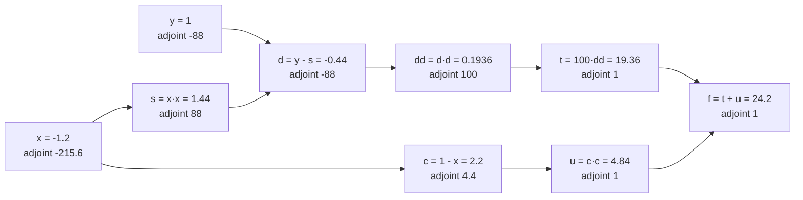
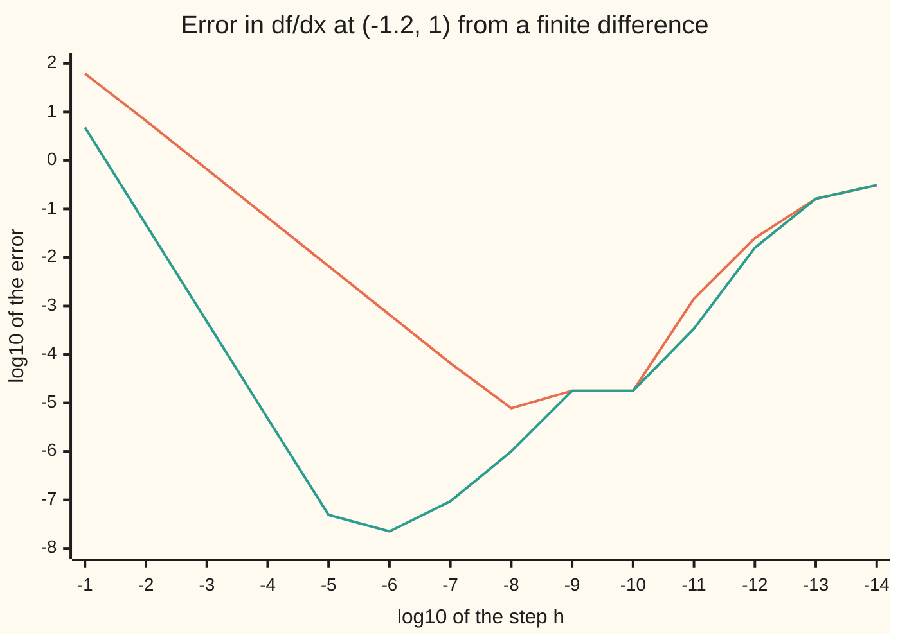

# Automatic differentiation: exact derivatives from the code, not from small steps

[Syllabus](../../../SYLLABUS.md) → [Optimization](../README.md) → [Unconstrained Methods](../README.md#s02) → Automatic differentiation

---

## General Overview

The shelf's house example is the Rosenbrock banana: a long, narrow, curved valley whose lowest point sits at (1, 1), height 0. Stretch it to 50 variables by chaining 49 copies of the banana end to end, and start a descent at the textbook point (−1.2, 1, −1.2, 1, …). The height there is 12,221. Every method on this shelf, from [Gradient descent](02-gradient-descent-and-its-rate.md) to [L-BFGS](06-l-bfgs-and-limited-memory-updates.md), now asks the same question at every step: which way is downhill? The answer is the gradient, all 50 partial derivatives (the slope of the height against one variable, the other 49 held still).

The obvious way to get them is to nudge. Move one variable by a small step, recompute the height, divide the change by the step. Fifty variables need 100 evaluations for the careful two-sided version, and the step has no right size: too big and the curve bends inside it, too small and rounding swamps the change. The best one-sided step on this valley keeps only about half of the sixteen digits a computer carries.

Automatic differentiation (AD) does something else. It reads the program that computes the height, one multiplication or subtraction at a time, and applies the chain rule to each line exactly. Run backwards, in **reverse mode**, it delivers all 50 partials, correct to rounding, for 1,955 arithmetic operations. One evaluation of the height costs 391. Nudging costs 39,100.

**Automatic differentiation applies the chain rule to every line of a program; carried forwards it gives one directional slope per run, and swept backwards it gives every partial derivative of one output for at most five evaluations' worth of work, however many inputs there are.**

**What kind of fact this is:** a method, exact up to rounding, resting on the chain rule; and a theorem about its cost, the five-evaluation bound, proved on this card in Why it works for programs built from addition, subtraction and multiplication.

### The picture: the 2-D valley as a computational graph



Each box is one line of the program for the 2-D banana, f(x, y) = 100(y − x²)² + (1 − x)², at the start (−1.2, 1). Values flow left to right. The adjoints (how much the final height moves per unit change in that box) flow right to left, and the two on the far left are the gradient.

---

## The formula

A reminder: the gradient ∇f lists every partial derivative of f, and a minimum of a smooth function has ∇f = 0 ([Optimality conditions](01-optimality-conditions.md)).

Write the program as numbered lines. Line k computes a value $v_k = \varphi_k(\text{its inputs})$, where $\varphi_k$ ("phi k") is one elementary operation: an addition, a subtraction or a multiplication. Write $j \to k$ when line j feeds line k.

Two new notations, in words first. The **tangent** $\dot v_k$ ("v dot") is how fast line k changes when the inputs move in one chosen direction. The **adjoint** $\bar v_k$ ("v bar") is how fast the final output changes per unit change in line k. They are not a time derivative and not a mean. Later cards in this wing use them freely.

$$\text{forward:}\quad \dot v_k = \sum_{j \to k} \frac{\partial \varphi_k}{\partial v_j}\,\dot v_j \qquad\qquad \text{reverse:}\quad \bar v_j = \sum_{k:\, j \to k} \bar v_k\,\frac{\partial \varphi_k}{\partial v_j}, \quad \bar f = 1$$

$$\text{reverse mode} \;\le\; 5L \text{ operations}, \qquad \text{forward mode} \;\approx\; 3nL, \qquad \text{central differences} \;\approx\; 2nL$$

**Read it aloud:** going forwards, a line's tangent is the sum of its inputs' tangents, each scaled by the local slope joining them; going backwards, a line's adjoint is the sum of the adjoints of the lines it feeds, each scaled by the same local slope; and the backward sweep that fills every adjoint costs at most five runs of the program, while the other two roads pay once per input.

| Symbol | Plain meaning | In our example | Push it up and the answer… |
| --- | --- | --- | --- |
| $x$, $y$; $x_1, \dots, x_{50}$ | the valley's coordinates; in the 50-variable version, all of them | (−1.2, 1); (−1.2, 1, −1.2, …) | moves the point where every slope is read |
| $f$ | the valley's height, the Rosenbrock function, to be minimised | 24.2 in 2-D; 12,221 in 50-D | — |
| $v_k$, $\varphi_k$; $s, d, c, dd, t, u$ | the value on line k of the program; the one operation that makes it; the six inner lines of the 2-D program, named in the picture | $s = x \cdot x = 1.44$ | — |
| $j \to k$; $\sum_{j \to k}$; $\partial\varphi_k/\partial v_j$ | line j feeds line k; add over every such line; the local slope of that one operation against that one input | for $s = x \cdot x$ each copy of x has slope −1.2 | a bigger local slope passes more change along the edge |
| $\dot x$, $\dot v_k$ | tangent: rate of change along the seeded direction | $\dot x = 1$, $\dot s = -2.4$ | the tangents scale in proportion |
| $\bar x$, $\bar v_k$ | adjoint: rate of change of $f$ per unit change of that line | $\bar s = 88$, $\bar x = -215.6$ | — |
| $\nabla f$ | the gradient, every partial derivative of $f$ | (−215.6, −88) in 2-D | — |
| $\varepsilon$; $p + \dot p\,\varepsilon$ | the dual unit, a symbol with $\varepsilon \cdot \varepsilon = 0$; a dual number, a value p carrying its tangent $\dot p$ | $f(-1.2 + \varepsilon, 1) = 24.2 - 215.6\,\varepsilon$ | — |
| $h$ | the step in a finite difference | $10^{-6}$ | too big bends, too small rounds |
| $n$; $m$ | the number of inputs; the number of outputs | 2 and 50; 1 | differences and forward mode grow with n; reverse mode grows with m |
| $L$ | arithmetic operations in one run of the program | 7 in 2-D; 391 in 50-D | every cost scales with it |

### When it holds

- **Every operation has a slope where it is used.** Addition, subtraction and multiplication always do. A square root or an absolute value at 0 does not, and AD returns whatever that operation's rule says, which may be infinite or arbitrary.
- **The code computes the function the same way near the point.** AD differentiates the path the program took. A shortcut `if x == 1: return 1` in a squaring routine gives slope 0 at x = 1, where the true slope is 2. The checks print exactly this case.
- **One output per sweep.** One reverse sweep gives the gradient of one number. A program with m outputs and n inputs needs m sweeps for its full Jacobian (the table of every output's partials), or n forward runs. With many outputs and few inputs, forward mode wins.
- **The tape fits in memory.** Reverse mode stores every line's value and local slopes, so memory grows with the length of the run. Long loops store checkpoints and recompute the rest.
- **Exact means exact up to rounding.** No step size enters, so there is no truncation error. The derivative is typically about as accurate as the evaluation of $f$ itself.

---

## Why it works

### Step 0: a program is a chain of tiny steps, each with a known slope

The Rosenbrock height is not computed in one stroke. The program squares, subtracts, squares again, scales and adds: seven lines in 2-D. Each line is a single operation whose slope is known exactly. The slope of $a \cdot b$ against $a$ is $b$. The slope of $a - b$ against $b$ is −1.

So the derivative of the whole program is a product of these known slopes, by the chain rule. Where one value feeds two lines, the slopes along the two routes add ([Chain rule in several variables](../../06-Calculus%20and%20analysis/07-Several%20Variables/04-multivariable-chain-rule-and-jacobians.md)). Nothing is approximated. The only question is the order of multiplying, and that order decides the cost.

The chain-rule card makes exactly this point: grouping a long product from the input end is forward mode, from the output end is reverse mode. The rest of this card is those two groupings, done on real code.

### Step 1: forward mode carries a tangent beside every value

Pick a direction, say "move x by 1, leave y alone": $\dot x = 1$, $\dot y = 0$. Then run the program, and on every line compute the tangent from the forward formula next to the value.

For $s = x \cdot x$ the rule is $\dot s = x\dot x + x \dot x = -2.4$. For $d = y - s$ it is $\dot d = \dot y - \dot s = 2.4$. Line by line, the tangent reaches $\dot f = -215.6$. That is $\partial f/\partial x$.

**Dual numbers** do this without writing a single rule by hand. Replace every number $p$ by a pair $p + \dot p\,\varepsilon$, its value and its tangent, where $\varepsilon$ is a new symbol with $\varepsilon \cdot \varepsilon = 0$. Multiply two pairs:

$$(p + \dot p\,\varepsilon)(q + \dot q\,\varepsilon) = pq + (p\dot q + \dot p q)\,\varepsilon + \dot p \dot q\,\varepsilon^2 = pq + (p\dot q + \dot p q)\,\varepsilon.$$

The ε part is the product rule. So feed the program $x = -1.2 + 1\varepsilon$ and $y = 1 + 0\varepsilon$, and out comes $24.2 - 215.6\,\varepsilon$: the height and its slope together.

Why exact? A finite difference evaluates at $x + h$ and keeps every power of $h$ in the Taylor expansion (f(x + h) written as a sum of powers of h), then divides by $h$; the leftover $h$ and $h^2$ terms are its error. With $\varepsilon$ in place of $h$, every power beyond the first is zero by definition. Nothing is left over to divide away.

The catch: one forward run gives one direction. The slope against y needs a second run seeded $\dot y = 1$. Fifty inputs need fifty runs.

### Step 2: reverse mode sweeps adjoints from the output back

Reverse mode asks the opposite question on every line: if this value moved by 1, how far would $f$ move? Start at the end, $\bar f = 1$, and work back up the program.

The rule is the reverse formula. A line's adjoint collects one contribution from each line it feeds: that line's adjoint times the local slope joining them. A line's adjoint is ready only when every line it feeds has been swept, so the sweep runs strictly last line first.

For the 2-D valley: $\bar t = \bar u = 1$, because $f = t + u$. Then $\bar{dd} = 100$ and $\bar c = 2c \cdot \bar u = 4.4$. Then $\bar d = 2d \cdot 100 = -88$, so $\bar y = -88$ and $\bar s = 88$. Finally x feeds three edges: two into $s = x \cdot x$ and one into $c = 1 - x$. Its adjoint adds all three: $88 \cdot (-1.2) \cdot 2 + 4.4 \cdot (-1) = -215.6$.

Both partials came out of one sweep. The same sweep on the 50-variable valley gives all 50.

[Backpropagation](../../14-Applied%20and%20computational/06-Machine%20Learning%20Mathematics/04-backpropagation.md) is this sweep on a neural network, where the lines come in layers and the sweep is done a layer at a time. Reverse mode is the general version: any program, any shape of graph.

### Step 3: the sweep costs at most four operations per line

Count arithmetic operations. Recording costs one per line: the value itself. For $+$, $-$ and $\times$ the local slopes are free, because they are constants (1 and −1) or copies of an input.

Each line has at most two inputs, so at most two edges. The sweep visits each edge once and does one multiplication and one addition there. That is at most 4 operations per line, so at most 4L for the sweep and 5L in all. The count does not mention n. Counts that leave out the recording, or weigh the operations differently, quote four instead of five, as [Adjoint differentiation](../../12-Financial%20mathematics/07-Greeks%20by%20Numbers%20and%20Calibration/03-adjoint-differentiation-in-outline.md) does; none of them mentions n either.

<details>
<summary>Detailed proof: reverse mode costs at most 5L, and gives the exact gradient</summary>

Let the program have inputs $v_1, \dots, v_n$ and lines $v_{n+1}, \dots, v_{n+L}$, each line an addition, subtraction or multiplication of two earlier values or constants, the last line being $f$.

*Correctness.* Define $\bar v_j$ as the partial derivative of $f$ with respect to $v_j$, when $v_j$ is treated as a free variable and every later line is recomputed from it. Line j influences $f$ only through the lines k with $j \to k$. By the chain rule in several variables, $\bar v_j = \sum_{k:\,j\to k} \bar v_k\,\partial\varphi_k/\partial v_j$. Every such k is later than j, so if the sweep visits lines in decreasing order, each $\bar v_k$ on the right is final before it is used. Induction from $\bar f = 1$ downwards gives every $\bar v_j$ exactly; for an input line it is $\partial f/\partial x_j$.

*Cost.* Recording performs each operation once: L operations, with local slopes 1, −1 or a stored input, at no further cost. The sweep handles each edge once, with one multiplication and one addition, and each line has at most two edges: at most $4L$. The total is at most $5L$, independent of n. With sine, division and the like, the local slopes cost a few operations each and the constant grows to another small fixed number; the general result is Baur and Strassen's (1983), in the operation-count model of Griewank and Walther.

</details>

On the 50-variable valley every line is binary, so the bound is met exactly: 1,955 = 5 × 391. Forward mode, by contrast, pays about 3L per run (a dual multiplication is four operations) and needs n runs: 58,700 operations, or 150.1 evaluations' worth. Central differences need 2n runs: 39,100.

### Step 4: when reverse mode is not cheaper

The 5 in 5L is fixed; the 2n in the differences' 2nL grows with the number of inputs. At n = 2 the order flips: reverse mode costs 35 operations against 28 for central differences. Reverse mode pays off when a single output depends on many inputs. That is exactly the shape of an optimisation problem, one cost and many variables, and why every large-scale optimiser and every neural-network trainer runs on it.

---

## Worked numbers, by hand

The 2-D valley at (−1.2, 1). Forward mode seeded $\dot x = 1$, then the reverse sweep.

| Step | Arithmetic | Value |
| --- | --- | --- |
| $s$, $\dot s$ | $(-1.2)^2$; $\;2 \cdot (-1.2) \cdot 1$ | 1.44; −2.4 |
| $d$, $\dot d$ | $1 - 1.44$; $\;0 - (-2.4)$ | −0.44; 2.4 |
| $c$, $\dot c$ | $1 - (-1.2)$; $\;0 - 1$ | 2.2; −1 |
| $dd$, $\dot{dd}$ | $(-0.44)^2$; $\;2 \cdot (-0.44) \cdot 2.4$ | 0.1936; −2.112 |
| $t$, $\dot t$ | $100 \cdot 0.1936$; $\;100 \cdot (-2.112)$ | 19.36; −211.2 |
| $u$, $\dot u$ | $2.2^2$; $\;2 \cdot 2.2 \cdot (-1)$ | 4.84; −4.4 |
| $f$, $\dot f$ | $19.36 + 4.84$; $\;-211.2 + (-4.4)$ | 24.2; **−215.6** |
| sweep: $\bar t$, $\bar u$, $\bar{dd}$ | $\bar f \cdot 1$; $\;\bar f \cdot 1$; $\;100 \cdot \bar t$ | 1; 1; 100 |
| sweep: $\bar c$, $\bar d$ | $2 \cdot 2.2 \cdot 1$; $\;2 \cdot (-0.44) \cdot 100$ | 4.4; −88 |
| sweep: $\bar y$, $\bar s$ | $\bar d \cdot 1$; $\;\bar d \cdot (-1)$ | −88; 88 |
| sweep: $\bar x$ | $88 \cdot (-1.2) \cdot 2 + 4.4 \cdot (-1)$ | **−215.6** |
| the gradient | $(\bar x, \bar y)$ | **(−215.6, −88)** |

Both partials are negative, so the valley falls as x and y rise from the start, and it falls far faster along x.

The hand formula agrees. Differentiating $100(y - x^2)^2 + (1 - x)^2$ gives $\partial f/\partial x = -400x(y - x^2) - 2(1 - x) = -215.6$ and $\partial f/\partial y = 200(y - x^2) = -88$.

On the 50-variable valley the same sweep returns the partials −215.6, 792, −655.6, …, −655.6, −88. Forward mode, reverse mode and the hand formula agree to every printed digit (largest gap 0.000000000000). A central difference with $h = 10^{-6}$ agrees to within 0.000001.

### The picture: the nudge's error against its size



The upper line is the one-sided forward difference, the lower the two-sided central difference. Read left to right: shrinking the step first helps, because the curve bends less inside it. Past a point it hurts, because the height is known only to about sixteen digits and a tiny step divides that rounding noise by a tiny number. The best forward step, $h = 10^{-8}$, still errs by $10^{-5.11}$; the best central one, $h = 10^{-6}$, by $10^{-7.65}$. AD has no step and sits off the bottom of this chart.

### What breaks if you drop a piece

The correct answer is $\partial f/\partial x = -215.6$, $\partial f/\partial y = -88$.

| Mistake | Comes out at | What went wrong |
| --- | --- | --- |
| Adjoints overwritten (`=`) instead of added (`+=`) in the sweep | −52.8 and −44 | x feeds three edges and d feeds two; only the last contribution survived |
| Both tangents seeded at once, $\dot x = \dot y = 1$ | −303.6 | a forward run gives one directional slope, here $\partial f/\partial x + \partial f/\partial y$, not a gradient |
| Forward difference with $h = 0.1$ | −153.8 | the valley curves a lot within a step that long |
| Forward difference with $h = 10^{-12}$ | −215.624851 | rounding noise in $f$, divided by a tiny step |
| A shortcut branch `if x == 1: return 1` in a squaring routine, at x = 1 | 0 (true slope 2; a central difference through the same routine gives 2) | AD differentiates the code path taken, and that path is a constant |

The last row is the hypothesis "the code computes the function the same way near the point" failing. Every number in the table is printed by both checks.

---

## Code, from first principles, and it actually runs

The scripts build both modes from nothing: a dual-number type for forward mode, and a tape (a list recording every operation's inputs and local slopes) swept backwards for reverse mode. One generic Rosenbrock program runs on plain numbers, dual numbers and tape nodes alike, so the same code is differentiated every way. Every arithmetic operation is counted. There are **four independent roads** to the gradient: forward mode, reverse mode, the hand-derived formula, and central differences; on the 50-variable valley all four agree.

### Python

```python
# Automatic differentiation on the Rosenbrock valley: the check behind the card.
# Standard library only.  Four roads to the gradient: forward mode (dual numbers),
# reverse mode (a tape swept backwards), the hand formula, and finite differences.
# Every arithmetic operation on a number is counted, so the costs are measured.
from math import log10

OPS = [0]                          # operations counted so far
TAPE = []                          # reverse mode: one entry per operation

class Dual:                        # a + b*eps with eps*eps = 0: a value and its tangent
    def __init__(s, a, b=0.0): s.a, s.b = a, b
    def __add__(s, o): OPS[0] += 2; return Dual(s.a + o.a, s.b + o.b)
    def __sub__(s, o): OPS[0] += 2; return Dual(s.a - o.a, s.b - o.b)
    def __mul__(s, o): OPS[0] += 4; return Dual(s.a * o.a, s.a * o.b + s.b * o.a)

class Node:                        # a value, plus its parents and local slopes on the tape
    def __init__(s, v, parents=()): s.v, s.i = v, len(TAPE); TAPE.append(parents)
    def __add__(s, o): OPS[0] += 1; return Node(s.v + o.v, ((s.i, 1.0), (o.i, 1.0)))
    def __sub__(s, o): OPS[0] += 1; return Node(s.v - o.v, ((s.i, 1.0), (o.i, -1.0)))
    def __mul__(s, o): OPS[0] += 1; return Node(s.v * o.v, ((s.i, o.v), (o.i, s.v)))

def backward(out, overwrite=False):  # the reverse sweep: adjoints, last operation first
    adj = [0.0] * len(TAPE)
    adj[out.i] = 1.0
    for k in range(len(TAPE) - 1, -1, -1):
        for p, slope in TAPE[k]:
            OPS[0] += 2
            adj[p] = adj[k] * slope if overwrite else adj[p] + adj[k] * slope
    return adj

def rosen(x, K):                   # chained Rosenbrock; K turns a constant into the number type
    f = None
    for i in range(len(x) - 1):
        s = x[i] * x[i]; d = x[i + 1] - s; c = K(1.0) - x[i]
        dd = d * d; t = K(100.0) * dd; u = c * c; term = t + u
        f = term if f is None else f + term
        if i == 0: first = (s, d, c, dd, t, u, term)
    return f, first

def hand(x):                       # the gradient written out by hand
    n = len(x); g = [0.0] * n
    for j in range(n):
        if j < n - 1: g[j] += -400.0 * x[j] * (x[j + 1] - x[j] * x[j]) - 2.0 * (1.0 - x[j])
        if j > 0: g[j] += 200.0 * (x[j] - x[j - 1] * x[j - 1])
    return g

def forward_mode(x):               # one pass per input, seeding that input's tangent with 1
    return [rosen([Dual(v, 1.0 if i == j else 0.0) for i, v in enumerate(x)], Dual)[0].b
            for j in range(len(x))]

def reverse_mode(x, overwrite=False):  # one recorded pass, one backward sweep
    TAPE.clear()
    xs = [Node(v) for v in x]
    f, first = rosen(xs, Node)
    adj = backward(f, overwrite)
    return [adj[n.i] for n in xs], first, adj

def plain(x): return rosen(x, float)[0]

# ---- the 2-D valley at the classic start (-1.2, 1), traced line by line ----
x2 = [-1.2, 1.0]
_, fx = rosen([Dual(-1.2, 1.0), Dual(1.0)], Dual)
_, fy = rosen([Dual(-1.2), Dual(1.0, 1.0)], Dual)
g_rev, first, adj = reverse_mode(x2)
print("2-D valley at (x, y) = (-1.2, 1); tangents seeded x-dot = 1")
print(f"{'line':<12}{'value':>12}{'tangent':>13}{'adjoint':>13}")
names = ["s = x*x", "d = y - s", "c = 1 - x", "dd = d*d", "t = 100*dd", "u = c*c", "f = t + u"]
for name, dv, nd in zip(names, fx, first):
    print(f"{name:<12}{dv.a:12.6f}{dv.b:13.6f}{adj[nd.i]:13.6f}")
g_hand = hand(x2)
print(f"df/dx: forward {fx[6].b:.6f}  reverse {g_rev[0]:.6f}  hand {g_hand[0]:.6f}")
print(f"df/dy: forward {fy[6].b:.6f}  reverse {g_rev[1]:.6f}  hand {g_hand[1]:.6f}")
assert abs(fx[6].b - (-215.6)) < 1e-12 and abs(fy[6].b - (-88.0)) < 1e-12
assert abs(g_rev[0] - g_hand[0]) < 1e-12 and abs(g_rev[1] - g_hand[1]) < 1e-12

# ---- finite differences: the step size has no right answer ----
def fd(h, central):
    up = plain([-1.2 + h, 1.0])
    down = plain([-1.2 - h, 1.0]) if central else plain(x2)
    return (up - down) / (2.0 * h if central else h)

hs, p = [], 1.0
for k in range(1, 15):
    p *= 10.0; hs.append(1.0 / p)
fwd_err = [log10(abs(fd(h, False) - (-215.6))) for h in hs]
cen_err = [log10(abs(fd(h, True) - (-215.6))) for h in hs]
print("chart, log10 h            " + " ".join(f"{-k:6d}" for k in range(1, 15)))
print("chart, forward, log10 err " + " ".join(f"{e:6.2f}" for e in fwd_err))
print("chart, central, log10 err " + " ".join(f"{e:6.2f}" for e in cen_err))
best_f, best_c = min(fwd_err), min(cen_err)
print(f"best forward difference error 10^{best_f:.2f} at h = 1e-{fwd_err.index(best_f) + 1}; "
      f"best central 10^{best_c:.2f} at h = 1e-{cen_err.index(best_c) + 1}")
assert fwd_err[0] > 1.0 and fwd_err[13] > -1.0 and best_f < -5.0   # too big, too small, middle

# ---- what breaks ----
bad, _, _ = reverse_mode(x2, overwrite=True)
both = rosen([Dual(-1.2, 1.0), Dual(1.0, 1.0)], Dual)[0].b
print(f"mistake, = instead of +=: df/dx {bad[0]:.6f}  df/dy {bad[1]:.6f}")
print(f"mistake, both tangents seeded at once: {both:.6f}")
print(f"mistake, forward difference h = 0.1: {fd(0.1, False):.6f}")
print(f"mistake, forward difference h = 1e-12: {fd(hs[11], False):.6f}")
assert abs(both - (g_hand[0] + g_hand[1])) < 1e-12 and abs(bad[0] - g_hand[0]) > 100.0

def sq(x): return Dual(1.0) if x.a == 1.0 else x * x    # same function, one shortcut branch
ad_kink, true_kink = sq(Dual(1.0, 1.0)).b, (Dual(1.0, 1.0) * Dual(1.0, 1.0)).b   # branch; plain x * x
fd_kink = (sq(Dual(1.0 + 1e-6)).a - sq(Dual(1.0 - 1e-6)).a) / 2e-6          # through the routine itself
print(f"branch x == 1: AD says {ad_kink:.6f}, true {true_kink:.6f}, central difference {fd_kink:.6f}")
assert ad_kink == 0.0 and abs(true_kink - 2.0) < 1e-12 and abs(fd_kink - true_kink) < 1e-6

# ---- 50 inputs: every partial, and what each road costs ----
def cost(x):                       # operations: one evaluation, forward mode, reverse mode
    TAPE.clear(); OPS[0] = 0; rosen([Node(v) for v in x], Node); L = OPS[0]
    OPS[0] = 0; g_f = forward_mode(x); c_f = OPS[0]
    OPS[0] = 0; g_r = reverse_mode(x)[0]; c_r = OPS[0]
    print(f"operations at n = {len(x)}: evaluation {L}, forward mode {c_f}, "
          f"central differences {2 * len(x) * L}, reverse mode {c_r}")
    assert L == 8 * (len(x) - 1) - 1 and c_r == 5 * L   # 7 a link, plus the joining additions
    return L, c_f, c_r, g_f, g_r

n = 50
x = [-1.2 if i % 2 == 0 else 1.0 for i in range(n)]
f50 = plain(x); g_h = hand(x); h = 1e-6
g_cd = [(plain(x[:j] + [x[j] + h] + x[j + 1:]) - plain(x[:j] + [x[j] - h] + x[j + 1:])) / (2 * h)
        for j in range(n)]
print(f"50-D valley, start (-1.2, 1, -1.2, 1, ...): f = {f50:.6f}")
cost(x2)
L, c_fwd, c_rev, g_fwd, g_r = cost(x)
print(f"at n = 50, in evaluations: forward {c_fwd / L:.1f}, central {2 * n:.1f}, reverse {c_rev / L:.1f}")
gap_fr = max(abs(a - b) for a, b in zip(g_fwd, g_r))
gap_rh = max(abs(a - b) for a, b in zip(g_r, g_h))
gap_ch = max(abs(a - b) for a, b in zip(g_cd, g_h))
print("partials 1, 2, 3, 49, 50: " + ", ".join(f"{g_r[j]:.6f}" for j in (0, 1, 2, 48, 49)))
print(f"largest gap: forward vs reverse {gap_fr:.12f}, reverse vs hand {gap_rh:.12f}")
print(f"largest gap: central difference (h = 1e-6) vs hand {gap_ch:.6f}")
assert gap_fr < 1e-9 and gap_rh < 1e-9 and gap_ch < 1e-3
assert abs(f50 - 12221.0) < 1e-9 and abs(g_r[1] - 792.0) < 1e-9 and abs(g_r[2] + 655.6) < 1e-9
print("ALL CHECKS PASS")
```

**Ran 2026-11-11 on macOS, Python 3.14.10, standard library only. All checks passed. Output, pasted from the run:**

```
2-D valley at (x, y) = (-1.2, 1); tangents seeded x-dot = 1
line               value      tangent      adjoint
s = x*x         1.440000    -2.400000    88.000000
d = y - s      -0.440000     2.400000   -88.000000
c = 1 - x       2.200000    -1.000000     4.400000
dd = d*d        0.193600    -2.112000   100.000000
t = 100*dd     19.360000  -211.200000     1.000000
u = c*c         4.840000    -4.400000     1.000000
f = t + u      24.200000  -215.600000     1.000000
df/dx: forward -215.600000  reverse -215.600000  hand -215.600000
df/dy: forward -88.000000  reverse -88.000000  hand -88.000000
chart, log10 h                -1     -2     -3     -4     -5     -6     -7     -8     -9    -10    -11    -12    -13    -14
chart, forward, log10 err   1.79   0.82  -0.18  -1.18  -2.18  -3.18  -4.18  -5.11  -4.75  -4.75  -2.85  -1.60  -0.79  -0.51
chart, central, log10 err   0.68  -1.32  -3.32  -5.32  -7.31  -7.65  -7.03  -6.00  -4.75  -4.75  -3.47  -1.80  -0.79  -0.51
best forward difference error 10^-5.11 at h = 1e-8; best central 10^-7.65 at h = 1e-6
mistake, = instead of +=: df/dx -52.800000  df/dy -44.000000
mistake, both tangents seeded at once: -303.600000
mistake, forward difference h = 0.1: -153.800000
mistake, forward difference h = 1e-12: -215.624851
branch x == 1: AD says 0.000000, true 2.000000, central difference 2.000000
50-D valley, start (-1.2, 1, -1.2, 1, ...): f = 12221.000000
operations at n = 2: evaluation 7, forward mode 44, central differences 28, reverse mode 35
operations at n = 50: evaluation 391, forward mode 58700, central differences 39100, reverse mode 1955
at n = 50, in evaluations: forward 150.1, central 100.0, reverse 5.0
partials 1, 2, 3, 49, 50: -215.600000, 792.000000, -655.600000, -655.600000, -88.000000
largest gap: forward vs reverse 0.000000000000, reverse vs hand 0.000000000000
largest gap: central difference (h = 1e-6) vs hand 0.000001
ALL CHECKS PASS
```

### Rust

The same program, std only. Operator overloading through the `Add`, `Sub` and `Mul` traits lets one generic `rosen` run on all three number types, as in Python.

```rust
// Automatic differentiation on the Rosenbrock valley: the check behind the card.
// std only.  Four roads to the gradient: forward mode (dual numbers), reverse
// mode (a tape swept backwards), the hand formula, and finite differences.
// Every arithmetic operation on a number is counted, so the costs are measured.
use std::cell::{Cell, RefCell};
use std::ops::{Add, Mul, Sub};

thread_local! {
    static OPS: Cell<usize> = Cell::new(0);                          // operations counted so far
    static TAPE: RefCell<Vec<Vec<(usize, f64)>>> = RefCell::new(Vec::new()); // one entry per operation
}
fn count(k: usize) { OPS.with(|o| o.set(o.get() + k)); }
fn ops() -> usize { OPS.with(|o| o.get()) }
fn reset() { OPS.with(|o| o.set(0)); }

#[derive(Clone, Copy)]
struct Dual { a: f64, b: f64 }                    // a + b*eps with eps*eps = 0
impl Add for Dual { type Output = Dual; fn add(self, o: Dual) -> Dual { count(2); Dual { a: self.a + o.a, b: self.b + o.b } } }
impl Sub for Dual { type Output = Dual; fn sub(self, o: Dual) -> Dual { count(2); Dual { a: self.a - o.a, b: self.b - o.b } } }
impl Mul for Dual { type Output = Dual; fn mul(self, o: Dual) -> Dual { count(4); Dual { a: self.a * o.a, b: self.a * o.b + self.b * o.a } } }
fn dual(a: f64, b: f64) -> Dual { Dual { a, b } }

#[derive(Clone, Copy)]
struct Node { v: f64, i: usize }                  // a value and its place on the tape
fn node(v: f64, parents: Vec<(usize, f64)>) -> Node {
    TAPE.with(|t| { let mut t = t.borrow_mut(); t.push(parents); Node { v, i: t.len() - 1 } })
}
impl Add for Node { type Output = Node; fn add(self, o: Node) -> Node { count(1); node(self.v + o.v, vec![(self.i, 1.0), (o.i, 1.0)]) } }
impl Sub for Node { type Output = Node; fn sub(self, o: Node) -> Node { count(1); node(self.v - o.v, vec![(self.i, 1.0), (o.i, -1.0)]) } }
impl Mul for Node { type Output = Node; fn mul(self, o: Node) -> Node { count(1); node(self.v * o.v, vec![(self.i, o.v), (o.i, self.v)]) } }
fn leaf(v: f64) -> Node { node(v, vec![]) }

fn backward(out: Node, overwrite: bool) -> Vec<f64> {   // the reverse sweep, last operation first
    TAPE.with(|t| {
        let (t, mut adj) = (t.borrow(), vec![0.0; t.borrow().len()]);
        adj[out.i] = 1.0;
        for k in (0..t.len()).rev() {
            for &(p, slope) in &t[k] {
                count(2);
                adj[p] = if overwrite { adj[k] * slope } else { adj[p] + adj[k] * slope };
            }
        }
        adj
    })
}

fn rosen<T: Copy + Add<Output = T> + Sub<Output = T> + Mul<Output = T>>(x: &[T], k: impl Fn(f64) -> T) -> (T, Vec<T>) {
    let mut f: Option<T> = None;
    let mut first = vec![];
    for i in 0..x.len() - 1 {
        let s = x[i] * x[i]; let d = x[i + 1] - s; let c = k(1.0) - x[i];
        let dd = d * d; let t = k(100.0) * dd; let u = c * c; let term = t + u;
        f = Some(match f { None => term, Some(g) => g + term });
        if i == 0 { first = vec![s, d, c, dd, t, u, term]; }
    }
    (f.unwrap(), first)
}
fn plain(x: &[f64]) -> f64 { rosen(x, |c| c).0 }

fn hand(x: &[f64]) -> Vec<f64> {
    let (n, mut g) = (x.len(), vec![0.0; x.len()]);
    for j in 0..n {
        if j < n - 1 { g[j] += -400.0 * x[j] * (x[j + 1] - x[j] * x[j]) - 2.0 * (1.0 - x[j]); }
        if j > 0 { g[j] += 200.0 * (x[j] - x[j - 1] * x[j - 1]); }
    }
    g
}

fn forward_mode(x: &[f64]) -> Vec<f64> {
    (0..x.len()).map(|j| {
        let xs: Vec<Dual> = x.iter().enumerate().map(|(i, &v)| dual(v, if i == j { 1.0 } else { 0.0 })).collect();
        rosen(&xs, |c| dual(c, 0.0)).0.b
    }).collect()
}

fn reverse_mode(x: &[f64], overwrite: bool) -> (Vec<f64>, Vec<Node>, Vec<f64>) {
    TAPE.with(|t| t.borrow_mut().clear());
    let xs: Vec<Node> = x.iter().map(|&v| leaf(v)).collect();
    let (f, first) = rosen(&xs, leaf);
    let adj = backward(f, overwrite);
    (xs.iter().map(|n| adj[n.i]).collect(), first, adj)
}

fn fd(h: f64, central: bool) -> f64 {
    let up = plain(&[-1.2 + h, 1.0]);
    let down = if central { plain(&[-1.2 - h, 1.0]) } else { plain(&[-1.2, 1.0]) };
    (up - down) / if central { 2.0 * h } else { h }
}

fn cost(x: &[f64]) -> (usize, usize, usize, Vec<f64>, Vec<f64>) {   // one evaluation, forward, reverse
    TAPE.with(|t| t.borrow_mut().clear()); reset();
    rosen(&x.iter().map(|&v| leaf(v)).collect::<Vec<_>>(), leaf);
    let l = ops();
    reset(); let g_f = forward_mode(x); let c_f = ops();
    reset(); let g_r = reverse_mode(x, false).0; let c_r = ops();
    println!("operations at n = {}: evaluation {}, forward mode {}, central differences {}, reverse mode {}",
             x.len(), l, c_f, 2 * x.len() * l, c_r);
    assert!(l == 8 * (x.len() - 1) - 1 && c_r == 5 * l);           // 7 a link, plus the joining additions
    (l, c_f, c_r, g_f, g_r)
}

fn main() {
    // ---- the 2-D valley at the classic start (-1.2, 1), traced line by line ----
    let x2 = [-1.2, 1.0];
    let (_, fx) = rosen(&[dual(-1.2, 1.0), dual(1.0, 0.0)], |c| dual(c, 0.0));
    let (_, fy) = rosen(&[dual(-1.2, 0.0), dual(1.0, 1.0)], |c| dual(c, 0.0));
    let (g_rev, first, adj) = reverse_mode(&x2, false);
    println!("2-D valley at (x, y) = (-1.2, 1); tangents seeded x-dot = 1");
    println!("{:<12}{:>12}{:>13}{:>13}", "line", "value", "tangent", "adjoint");
    let names = ["s = x*x", "d = y - s", "c = 1 - x", "dd = d*d", "t = 100*dd", "u = c*c", "f = t + u"];
    for k in 0..7 { println!("{:<12}{:12.6}{:13.6}{:13.6}", names[k], fx[k].a, fx[k].b, adj[first[k].i]); }
    let g_hand = hand(&x2);
    println!("df/dx: forward {:.6}  reverse {:.6}  hand {:.6}", fx[6].b, g_rev[0], g_hand[0]);
    println!("df/dy: forward {:.6}  reverse {:.6}  hand {:.6}", fy[6].b, g_rev[1], g_hand[1]);
    assert!((fx[6].b - (-215.6)).abs() < 1e-12 && (fy[6].b - (-88.0)).abs() < 1e-12);
    assert!((g_rev[0] - g_hand[0]).abs() < 1e-12 && (g_rev[1] - g_hand[1]).abs() < 1e-12);

    // ---- finite differences: the step size has no right answer ----
    let (mut hs, mut p) = (vec![], 1.0);
    for _ in 1..15 { p *= 10.0; hs.push(1.0 / p); }
    let fwd_err: Vec<f64> = hs.iter().map(|&h| (fd(h, false) - (-215.6)).abs().log10()).collect();
    let cen_err: Vec<f64> = hs.iter().map(|&h| (fd(h, true) - (-215.6)).abs().log10()).collect();
    println!("chart, log10 h            {}", (1..15).map(|k: i32| format!("{:6}", -k)).collect::<Vec<_>>().join(" "));
    println!("chart, forward, log10 err {}", fwd_err.iter().map(|e| format!("{:6.2}", e)).collect::<Vec<_>>().join(" "));
    println!("chart, central, log10 err {}", cen_err.iter().map(|e| format!("{:6.2}", e)).collect::<Vec<_>>().join(" "));
    let argmin = |v: &Vec<f64>| (0..v.len()).fold(0, |b, i| if v[i] < v[b] { i } else { b });
    let (bf, bc) = (argmin(&fwd_err), argmin(&cen_err));
    println!("best forward difference error 10^{:.2} at h = 1e-{}; best central 10^{:.2} at h = 1e-{}",
             fwd_err[bf], bf + 1, cen_err[bc], bc + 1);
    assert!(fwd_err[0] > 1.0 && fwd_err[13] > -1.0 && fwd_err[bf] < -5.0);

    // ---- what breaks ----
    let (bad, _, _) = reverse_mode(&x2, true);
    let both = rosen(&[dual(-1.2, 1.0), dual(1.0, 1.0)], |c| dual(c, 0.0)).0.b;
    println!("mistake, = instead of +=: df/dx {:.6}  df/dy {:.6}", bad[0], bad[1]);
    println!("mistake, both tangents seeded at once: {:.6}", both);
    println!("mistake, forward difference h = 0.1: {:.6}", fd(0.1, false));
    println!("mistake, forward difference h = 1e-12: {:.6}", fd(hs[11], false));
    assert!((both - (g_hand[0] + g_hand[1])).abs() < 1e-12 && (bad[0] - g_hand[0]).abs() > 100.0);
    let sq = |x: Dual| if x.a == 1.0 { dual(1.0, 0.0) } else { x * x };   // one shortcut branch
    let (ad_kink, true_kink) = (sq(dual(1.0, 1.0)).b, (dual(1.0, 1.0) * dual(1.0, 1.0)).b);   // branch; plain x * x
    let fd_kink = (sq(dual(1.0 + 1e-6, 0.0)).a - sq(dual(1.0 - 1e-6, 0.0)).a) / 2e-6;     // through the routine itself
    println!("branch x == 1: AD says {:.6}, true {:.6}, central difference {:.6}", ad_kink, true_kink, fd_kink);
    assert!(ad_kink == 0.0 && (true_kink - 2.0f64).abs() < 1e-12 && (fd_kink - true_kink).abs() < 1e-6);

    // ---- 50 inputs: every partial, and what each road costs ----
    let n = 50;
    let x: Vec<f64> = (0..n).map(|i| if i % 2 == 0 { -1.2 } else { 1.0 }).collect();
    let (f50, g_h, h) = (plain(&x), hand(&x), 1e-6);
    let g_cd: Vec<f64> = (0..n).map(|j| {
        let (mut a, mut b) = (x.clone(), x.clone());
        a[j] += h; b[j] -= h;
        (plain(&a) - plain(&b)) / (2.0 * h)
    }).collect();
    println!("50-D valley, start (-1.2, 1, -1.2, 1, ...): f = {:.6}", f50);
    cost(&x2);
    let (l, c_fwd, c_rev, g_fwd, g_r) = cost(&x);
    println!("at n = 50, in evaluations: forward {:.1}, central {:.1}, reverse {:.1}",
             c_fwd as f64 / l as f64, (2 * n) as f64, c_rev as f64 / l as f64);
    let gap = |u: &Vec<f64>, v: &Vec<f64>| u.iter().zip(v).fold(0.0f64, |m, (a, b)| m.max((a - b).abs()));
    let (gap_fr, gap_rh, gap_ch) = (gap(&g_fwd, &g_r), gap(&g_r, &g_h), gap(&g_cd, &g_h));
    println!("partials 1, 2, 3, 49, 50: {}", [0, 1, 2, 48, 49].iter().map(|&j| format!("{:.6}", g_r[j])).collect::<Vec<_>>().join(", "));
    println!("largest gap: forward vs reverse {:.12}, reverse vs hand {:.12}", gap_fr, gap_rh);
    println!("largest gap: central difference (h = 1e-6) vs hand {:.6}", gap_ch);
    assert!(gap_fr < 1e-9 && gap_rh < 1e-9 && gap_ch < 1e-3);
    assert!((f50 - 12221.0).abs() < 1e-9 && (g_r[1] - 792.0).abs() < 1e-9 && (g_r[2] + 655.6).abs() < 1e-9);
    println!("ALL CHECKS PASS");
}
```

**Ran 2026-11-11 on macOS, rustc 1.98.1, no crates. All checks passed. Output, pasted from the run:**

```
2-D valley at (x, y) = (-1.2, 1); tangents seeded x-dot = 1
line               value      tangent      adjoint
s = x*x         1.440000    -2.400000    88.000000
d = y - s      -0.440000     2.400000   -88.000000
c = 1 - x       2.200000    -1.000000     4.400000
dd = d*d        0.193600    -2.112000   100.000000
t = 100*dd     19.360000  -211.200000     1.000000
u = c*c         4.840000    -4.400000     1.000000
f = t + u      24.200000  -215.600000     1.000000
df/dx: forward -215.600000  reverse -215.600000  hand -215.600000
df/dy: forward -88.000000  reverse -88.000000  hand -88.000000
chart, log10 h                -1     -2     -3     -4     -5     -6     -7     -8     -9    -10    -11    -12    -13    -14
chart, forward, log10 err   1.79   0.82  -0.18  -1.18  -2.18  -3.18  -4.18  -5.11  -4.75  -4.75  -2.85  -1.60  -0.79  -0.51
chart, central, log10 err   0.68  -1.32  -3.32  -5.32  -7.31  -7.65  -7.03  -6.00  -4.75  -4.75  -3.47  -1.80  -0.79  -0.51
best forward difference error 10^-5.11 at h = 1e-8; best central 10^-7.65 at h = 1e-6
mistake, = instead of +=: df/dx -52.800000  df/dy -44.000000
mistake, both tangents seeded at once: -303.600000
mistake, forward difference h = 0.1: -153.800000
mistake, forward difference h = 1e-12: -215.624851
branch x == 1: AD says 0.000000, true 2.000000, central difference 2.000000
50-D valley, start (-1.2, 1, -1.2, 1, ...): f = 12221.000000
operations at n = 2: evaluation 7, forward mode 44, central differences 28, reverse mode 35
operations at n = 50: evaluation 391, forward mode 58700, central differences 39100, reverse mode 1955
at n = 50, in evaluations: forward 150.1, central 100.0, reverse 5.0
partials 1, 2, 3, 49, 50: -215.600000, 792.000000, -655.600000, -655.600000, -88.000000
largest gap: forward vs reverse 0.000000000000, reverse vs hand 0.000000000000
largest gap: central difference (h = 1e-6) vs hand 0.000001
ALL CHECKS PASS
```

The two outputs are identical line for line.

### Lean

Lean proves both modes exact for every program built from addition, subtraction and multiplication, with any number of inputs and lines.

- Forward mode: feed the program dual numbers $x + v\,\varepsilon$, and the ε part of the output is exactly the slope along the direction $v$.
- Reverse mode: one sweep, last line first, gives each input an adjoint. That adjoint is exactly the partial derivative of the output against that input.
- The whole reverse computation takes at most 5L operations: one per line recorded, two per edge swept. The bound never mentions n.
- On the 2-D valley at (−1.2, 1), the program's height is 24.2 and the sweep's gradient is (−215.6, −88), matching the hand formula.
- The hand arithmetic holds exactly: the double-seeded −303.6, the 50-variable height 12,221, the partials 792 and −655.6, and every operation count quoted.

The 50-variable sweep itself, the finite-difference errors and chart, the mistakes table and the branch shortcut are left to the Python and Rust checks.

```lean
-- Automatic differentiation: for every program built from addition, subtraction and multiplication, a forward run on dual numbers gives the exact directional slope, and one reverse sweep gives every exact partial derivative of the output for at most 5L operations, where L is the program's number of lines.
import Mathlib.Algebra.DualNumber
import Mathlib.Analysis.Calculus.Deriv.Basic
import Mathlib.Algebra.BigOperators.Intervals
import Mathlib.Tactic.NormNum
import Mathlib.Analysis.Calculus.Deriv.Mul
import Mathlib.Analysis.Calculus.Deriv.Shift

namespace AutoDiff

/-- The three elementary operations a line may perform. -/
inductive Op
  | add
  | sub
  | mul

/-- An input to a line: an earlier value, by its index (inputs first, then lines),
or a real constant. -/
inductive Arg
  | var (i : ℕ)
  | const (c : ℝ)

/-- One line of a program: `v = a op b`. -/
structure Line where
  op : Op
  a : Arg
  b : Arg

/-- Apply an operation in any commutative real algebra (the reals, or the dual numbers). -/
def Op.apply {R : Type*} [CommRing R] : Op → R → R → R
  | .add, p, q => p + q
  | .sub, p, q => p - q
  | .mul, p, q => p * q

/-- The value an argument reads from the list of values computed so far. -/
def Arg.val {R : Type*} [CommRing R] [Algebra ℝ R] (vs : List R) : Arg → R
  | .var i => vs.getD i 0
  | .const c => algebraMap ℝ R c

/-- Run the program: start from the inputs and append each line's value in order. -/
def run {R : Type*} [CommRing R] [Algebra ℝ R] (P : List Line) (vs : List R) : List R :=
  P.foldl (fun vs l => vs ++ [l.op.apply (l.a.val vs) (l.b.val vs)]) vs

/-- The program's output: the value of its last line (with no lines, the last input). -/
def eval {R : Type*} [CommRing R] [Algebra ℝ R] {n : ℕ} (P : List Line) (x : Fin n → R) : R :=
  (run P (List.ofFn x)).getLastD 0

/-- `Arg.Below m a`: the argument is a constant or reads one of the first `m` values. -/
def Arg.Below (m : ℕ) : Arg → Prop
  | .var i => i < m
  | .const _ => True

/-- The card's programs: line `k` (counting from 0) reads only constants, the `n` inputs,
and the lines before it, so it reads values with index below `n + k`. -/
def WellFormed (n : ℕ) (P : List Line) : Prop :=
  ∀ k (hk : k < P.length), (P[k]'hk).a.Below (n + k) ∧ (P[k]'hk).b.Below (n + k)

/-- Forward mode: run the program on dual numbers `x + v ε` (with `ε² = 0`) and read the
`ε` part (the tangent) of the output. One run, one direction `v`. -/
def forwardMode {n : ℕ} (P : List Line) (x v : Fin n → ℝ) : ℝ :=
  TrivSqZeroExt.snd (eval (R := DualNumber ℝ) P
    (fun i => TrivSqZeroExt.inl (x i) + TrivSqZeroExt.inr (v i)))

/-- The local slopes of `p op q` against `p` and against `q`: no arithmetic needed. -/
def Op.slopes : Op → ℝ → ℝ → ℝ × ℝ
  | .add, _, _ => (1, 1)
  | .sub, _, _ => (1, -1)
  | .mul, p, q => (q, p)

/-- One edge of the sweep: if the argument is a value, add `adjoint × slope` to that value's
adjoint. This performs one multiplication and one addition, so the counter goes up by 2. -/
def sweepEdge (st : (ℕ → ℝ) × ℕ) (arg : Arg) (adj slope : ℝ) : (ℕ → ℝ) × ℕ :=
  match arg with
  | .var i => (Function.update st.1 i (st.1 i + adj * slope), st.2 + 2)
  | .const _ => st

/-- Sweep one line, number `k` in the value list: pass its adjoint back along its two edges. -/
def sweepLine (vs : List ℝ) (k : ℕ) (l : Line) (st : (ℕ → ℝ) × ℕ) : (ℕ → ℝ) × ℕ :=
  let s := l.op.slopes (l.a.val vs) (l.b.val vs)
  sweepEdge (sweepEdge st l.a (st.1 k) s.1) l.b (st.1 k) s.2

/-- The reverse sweep over lines numbered `k, k+1, …`: the later lines are swept first,
so lines are visited last line first. -/
def sweep (vs : List ℝ) : ℕ → List Line → (ℕ → ℝ) × ℕ → (ℕ → ℝ) × ℕ
  | _, [], st => st
  | k, l :: ls, st => sweepLine vs k l (sweep vs (k + 1) ls st)

/-- Reverse mode: record the values (one operation per line, so the counter starts at `L`),
seed the output's adjoint with 1, sweep, and read off the adjoints of the inputs.
Returns the claimed gradient and the number of arithmetic operations performed. -/
def reverseMode {n : ℕ} (P : List Line) (x : Fin n → ℝ) : (Fin n → ℝ) × ℕ :=
  let vs := run P (List.ofFn x)
  let seed : ℕ → ℝ := fun i => if i = vs.length - 1 then 1 else 0
  let st := sweep vs n P (seed, P.length)
  (fun j => st.1 j, st.2)

end AutoDiff

open AutoDiff

namespace AutoDiff

theorem getD_append_single {α : Type*} (l : List α) (a d : α) (i : ℕ) :
    (l ++ [a]).getD i d = if i < l.length then l.getD i d else if i = l.length then a else d := by
  simp only [List.getD_eq_getElem?_getD]
  split_ifs with h1 h2
  · rw [List.getElem?_append_left h1]
  · subst h2; simp
  · rw [List.getElem?_append_right (by omega)]
    have : i - l.length ≠ 0 := by omega
    simp [this]

theorem run_cons {R : Type*} [CommRing R] [Algebra ℝ R] (l : Line) (P : List Line) (vs : List R) :
    run (l :: P) vs = run P (vs ++ [l.op.apply (l.a.val vs) (l.b.val vs)]) := rfl

theorem run_nil {R : Type*} [CommRing R] [Algebra ℝ R] (vs : List R) : run [] vs = vs := rfl

theorem run_prefix {R : Type*} [CommRing R] [Algebra ℝ R] (P : List Line) (vs : List R) :
    ∃ rest, run P vs = vs ++ rest := by
  induction P generalizing vs with
  | nil => exact ⟨[], by simp [run_nil]⟩
  | cons l P ih =>
    obtain ⟨rest, h⟩ := ih (vs ++ [l.op.apply (l.a.val vs) (l.b.val vs)])
    exact ⟨l.op.apply (l.a.val vs) (l.b.val vs) :: rest, by rw [run_cons, h]; simp⟩

theorem length_run {R : Type*} [CommRing R] [Algebra ℝ R] (P : List Line) (vs : List R) :
    (run P vs).length = vs.length + P.length := by
  induction P generalizing vs with
  | nil => simp [run_nil]
  | cons l P ih => rw [run_cons, ih]; simp; omega

theorem getD_run_of_lt {R : Type*} [CommRing R] [Algebra ℝ R] (P : List Line) (vs : List R)
    (i : ℕ) (hi : i < vs.length) : (run P vs).getD i 0 = vs.getD i 0 := by
  obtain ⟨rest, h⟩ := run_prefix P vs
  rw [h]
  simp only [List.getD_eq_getElem?_getD, List.getElem?_append_left hi]

theorem val_run_of_below {R : Type*} [CommRing R] [Algebra ℝ R] (P : List Line) (vs : List R)
    (a : Arg) (ha : a.Below vs.length) : a.val (run P vs) = a.val vs := by
  cases a with
  | var i => exact getD_run_of_lt P vs i ha
  | const c => rfl

theorem getLastD_eq_getD {α : Type*} (l : List α) (d : α) :
    l.getLastD d = l.getD (l.length - 1) d := by
  rw [List.getLastD_eq_getLast?, List.getLast?_eq_getElem?, List.getD_eq_getElem?_getD]

/-- The tangent of an argument read from a dual-number list. -/
theorem fwd_arg (vs : ℝ → List ℝ) (D : List (DualNumber ℝ))
    (hfst : ∀ i, (D.getD i 0).fst = (vs 0).getD i 0)
    (hder : ∀ i, HasDerivAt (fun t => (vs t).getD i 0) (D.getD i 0).snd 0) (a : Arg) :
    (a.val D).fst = a.val (vs 0) ∧ HasDerivAt (fun t => a.val (vs t)) (a.val D).snd 0 := by
  cases a with
  | var i => exact ⟨hfst i, hder i⟩
  | const c =>
    simp only [Arg.val, TrivSqZeroExt.algebraMap_eq_inl, TrivSqZeroExt.fst_inl,
      TrivSqZeroExt.snd_inl, Algebra.algebraMap_self, RingHom.id_apply]
    exact ⟨trivial, hasDerivAt_const _ _⟩

theorem fwd_op (o : Op) (p q : DualNumber ℝ) (fp fq : ℝ → ℝ)
    (hp : p.fst = fp 0) (hq : q.fst = fq 0)
    (hdp : HasDerivAt fp p.snd 0) (hdq : HasDerivAt fq q.snd 0) :
    (o.apply p q).fst = o.apply (fp 0) (fq 0) ∧
      HasDerivAt (fun t => o.apply (fp t) (fq t)) (o.apply p q).snd 0 := by
  cases o with
  | add =>
    refine ⟨by simp [Op.apply, hp, hq], ?_⟩
    simp only [Op.apply, TrivSqZeroExt.snd_add]
    exact HasDerivAt.add hdp hdq
  | sub =>
    refine ⟨by simp [Op.apply, hp, hq], ?_⟩
    simp only [Op.apply, TrivSqZeroExt.snd_sub]
    exact HasDerivAt.sub hdp hdq
  | mul =>
    refine ⟨by simp [Op.apply, hp, hq], ?_⟩
    have := HasDerivAt.mul hdp hdq
    simp only [Op.apply, DualNumber.snd_mul, hp, hq]
    convert this using 1
    ring

theorem fwd_aux (P : List Line) (vs : ℝ → List ℝ) (D : List (DualNumber ℝ))
    (hlen : ∀ t, (vs t).length = D.length)
    (hfst : ∀ i, (D.getD i 0).fst = (vs 0).getD i 0)
    (hder : ∀ i, HasDerivAt (fun t => (vs t).getD i 0) (D.getD i 0).snd 0) :
    (∀ i, ((run P D).getD i 0).fst = (run P (vs 0)).getD i 0) ∧
      ∀ i, HasDerivAt (fun t => (run P (vs t)).getD i 0) ((run P D).getD i 0).snd 0 := by
  induction P generalizing vs D with
  | nil => exact ⟨hfst, hder⟩
  | cons l P ih =>
    simp only [run_cons]
    obtain ⟨ha1, ha2⟩ := fwd_arg vs D hfst hder l.a
    obtain ⟨hb1, hb2⟩ := fwd_arg vs D hfst hder l.b
    obtain ⟨ho1, ho2⟩ := fwd_op l.op _ _ _ _ ha1 hb1 ha2 hb2
    refine ih (fun t => vs t ++ [l.op.apply (l.a.val (vs t)) (l.b.val (vs t))]) _ ?_ ?_ ?_
    · intro t; simp [hlen t]
    · intro i
      rw [getD_append_single, getD_append_single, hlen 0]
      split_ifs
      · exact hfst i
      · exact ho1
      · simp
    · intro i
      have hfun : (fun t => ((vs t) ++ [l.op.apply (l.a.val (vs t)) (l.b.val (vs t))]).getD i 0)
          = fun t => if i < D.length then (vs t).getD i 0 else if i = D.length then
              l.op.apply (l.a.val (vs t)) (l.b.val (vs t)) else 0 := by
        funext t; rw [getD_append_single, hlen t]
      rw [hfun, getD_append_single]
      split_ifs
      · exact hder i
      · exact ho2
      · simpa using hasDerivAt_const (0 : ℝ) (0 : ℝ)


theorem fwd_core (n : ℕ) (P : List Line) (x v : Fin n → ℝ) :
    (∀ i, ((run P (List.ofFn (fun i => TrivSqZeroExt.inl (x i) + TrivSqZeroExt.inr (v i) :
        Fin n → DualNumber ℝ))).getD i 0).fst = (run P (List.ofFn x)).getD i 0) ∧
    ∀ i, HasDerivAt (fun t : ℝ => (run P (List.ofFn (x + t • v))).getD i 0)
      ((run P (List.ofFn (fun i => TrivSqZeroExt.inl (x i) + TrivSqZeroExt.inr (v i) :
        Fin n → DualNumber ℝ))).getD i 0).snd 0 := by
  have h2 : ∀ i, ((List.ofFn (fun i => TrivSqZeroExt.inl (x i) + TrivSqZeroExt.inr (v i) :
      Fin n → DualNumber ℝ)).getD i 0).fst = (List.ofFn (x + (0 : ℝ) • v)).getD i 0 := by
    intro i
    by_cases h : i < n
    · simp [List.getD_eq_getElem?_getD, h]
    · simp [List.getD_eq_getElem?_getD, h]
  have h3 : ∀ i, HasDerivAt (fun t : ℝ => (List.ofFn (x + t • v)).getD i 0)
      ((List.ofFn (fun i => TrivSqZeroExt.inl (x i) + TrivSqZeroExt.inr (v i) :
        Fin n → DualNumber ℝ)).getD i 0).snd 0 := by
    intro i
    by_cases h : i < n
    · simp only [List.getD_eq_getElem?_getD, List.getElem?_ofFn, h, dite_true, Option.getD_some,
        Pi.add_apply, Pi.smul_apply, smul_eq_mul, TrivSqZeroExt.snd_add, TrivSqZeroExt.snd_inl,
        TrivSqZeroExt.snd_inr, zero_add]
      simpa using ((hasDerivAt_id (0 : ℝ)).mul_const (v ⟨i, h⟩)).const_add (x ⟨i, h⟩)
    · simp only [List.getD_eq_getElem?_getD, List.getElem?_ofFn, h, dite_false, Option.getD_none]
      simpa using hasDerivAt_const (0 : ℝ) (0 : ℝ)
  obtain ⟨a, b⟩ := fwd_aux P (fun t => List.ofFn (x + t • v))
    (List.ofFn (fun i => TrivSqZeroExt.inl (x i) + TrivSqZeroExt.inr (v i) : Fin n → DualNumber ℝ))
    (by intro t; simp) h2 h3
  refine ⟨fun i => ?_, b⟩
  have := a i
  simp only [zero_smul, add_zero] at this
  exact this

theorem forward_eq (n : ℕ) (P : List Line) (x v : Fin n → ℝ) :
    HasDerivAt (fun t : ℝ => eval P (x + t • v)) (forwardMode P x v) 0 := by
  have h := (fwd_core n P x v).2 (n + P.length - 1)
  have e1 : (fun t : ℝ => eval P (x + t • v)) =
      fun t : ℝ => (run P (List.ofFn (x + t • v))).getD (n + P.length - 1) 0 := by
    funext t
    rw [eval, getLastD_eq_getD, length_run, List.length_ofFn]
  rw [e1]
  convert h using 1
  rw [forwardMode, eval, getLastD_eq_getD, length_run, List.length_ofFn]

/-- One edge of the sweep, measured against the tangents `T i = snd (Dd.getD i 0)`. -/
theorem sweepEdge_sum (Dd : List (DualNumber ℝ)) (st : (ℕ → ℝ) × ℕ) (a : Arg) (adj s : ℝ)
    (k : ℕ) (ha : a.Below k) :
    ∑ i ∈ Finset.range k, (sweepEdge st a adj s).1 i * (Dd.getD i 0).snd =
      ∑ i ∈ Finset.range k, st.1 i * (Dd.getD i 0).snd + adj * s * (a.val Dd).snd := by
  cases a with
  | const c =>
    simp [sweepEdge, Arg.val, TrivSqZeroExt.algebraMap_eq_inl]
  | var j =>
    have hj : j < k := ha
    simp only [sweepEdge, Arg.val]
    have hterm : ∀ r, Function.update st.1 j (st.1 j + adj * s) r * (Dd.getD r 0).snd =
        st.1 r * (Dd.getD r 0).snd + if r = j then adj * s * (Dd.getD j 0).snd else 0 := by
      intro r
      by_cases h : r = j
      · subst h; simp; ring
      · simp [h]
    simp only [hterm, Finset.sum_add_distrib, Finset.sum_ite_eq', Finset.mem_range, hj, ite_true]

theorem sweepEdge_count (st : (ℕ → ℝ) × ℕ) (a : Arg) (adj s : ℝ) :
    (sweepEdge st a adj s).2 ≤ st.2 + 2 := by
  cases a <;> simp [sweepEdge]

theorem fst_val (Dd : List (DualNumber ℝ)) (Vr : List ℝ)
    (hfst : ∀ i, (Dd.getD i 0).fst = Vr.getD i 0) (a : Arg) : (a.val Dd).fst = a.val Vr := by
  cases a with
  | var i => exact hfst i
  | const c => simp [Arg.val, TrivSqZeroExt.algebraMap_eq_inl]

theorem slopes_snd (o : Op) (p q : DualNumber ℝ) :
    (o.slopes p.fst q.fst).1 * p.snd + (o.slopes p.fst q.fst).2 * q.snd = (o.apply p q).snd := by
  cases o <;> simp [Op.slopes, Op.apply] <;> ring

theorem sweepLine_sum (Dd : List (DualNumber ℝ)) (Vr : List ℝ)
    (hfst : ∀ i, (Dd.getD i 0).fst = Vr.getD i 0) (k : ℕ) (l : Line) (st : (ℕ → ℝ) × ℕ)
    (ha : l.a.Below k) (hb : l.b.Below k)
    (hk : (Dd.getD k 0).snd = (l.op.apply (l.a.val Dd) (l.b.val Dd)).snd) :
    ∑ i ∈ Finset.range k, (sweepLine Vr k l st).1 i * (Dd.getD i 0).snd =
      ∑ i ∈ Finset.range (k + 1), st.1 i * (Dd.getD i 0).snd := by
  simp only [sweepLine]
  rw [sweepEdge_sum Dd _ l.b _ _ k hb, sweepEdge_sum Dd _ l.a _ _ k ha, Finset.sum_range_succ, hk,
    ← slopes_snd, fst_val Dd Vr hfst, fst_val Dd Vr hfst]
  ring

theorem sweep_sum (Dd : List (DualNumber ℝ)) (Vr : List ℝ)
    (hfst : ∀ i, (Dd.getD i 0).fst = Vr.getD i 0) (ls : List Line) (W : List (DualNumber ℝ))
    (st : (ℕ → ℝ) × ℕ) (hrun : run ls W = Dd)
    (hwf : ∀ q (hq : q < ls.length),
      (ls[q]'hq).a.Below (W.length + q) ∧ (ls[q]'hq).b.Below (W.length + q)) :
    ∑ i ∈ Finset.range W.length, (sweep Vr W.length ls st).1 i * (Dd.getD i 0).snd =
      ∑ i ∈ Finset.range (W.length + ls.length), st.1 i * (Dd.getD i 0).snd := by
  induction ls generalizing W with
  | nil => rfl
  | cons l ls ih =>
    have h0 := hwf 0 (by simp)
    simp only [List.getElem_cons_zero, add_zero] at h0
    set W' := W ++ [l.op.apply (l.a.val W) (l.b.val W)] with hW'
    have hlen : W'.length = W.length + 1 := by simp [hW']
    have hrun' : run ls W' = Dd := by rw [← hrun, run_cons]
    have hwf' : ∀ q (hq : q < ls.length),
        (ls[q]'hq).a.Below (W'.length + q) ∧ (ls[q]'hq).b.Below (W'.length + q) := by
      intro q hq
      have := hwf (q + 1) (by simp; omega)
      simp only [List.getElem_cons_succ] at this
      rw [hlen]
      simpa [Nat.add_assoc, Nat.add_comm 1 q] using this
    have ih' := ih W' hrun' hwf'
    rw [hlen] at ih'
    show ∑ i ∈ Finset.range W.length,
        (sweepLine Vr W.length l (sweep Vr (W.length + 1) ls st)).1 i * (Dd.getD i 0).snd = _
    rw [sweepLine_sum Dd Vr hfst W.length l _ h0.1 h0.2, ih']
    · simp only [List.length_cons]; ring_nf
    · have hval : ∀ a : Arg, a.Below W.length → a.val Dd = a.val W := by
        intro a ha
        rw [← hrun]
        exact val_run_of_below (l :: ls) W a ha
      rw [hval _ h0.1, hval _ h0.2, ← hrun', getD_run_of_lt ls W' W.length (by simp [hW']),
        hW', getD_append_single]
      simp

theorem sweep_count (Vr : List ℝ) (k : ℕ) (ls : List Line) (st : (ℕ → ℝ) × ℕ) :
    (sweep Vr k ls st).2 ≤ st.2 + 4 * ls.length := by
  induction ls generalizing k with
  | nil => simp [sweep]
  | cons l ls ih =>
    simp only [sweep, sweepLine]
    have h1 := sweepEdge_count (sweep Vr (k + 1) ls st) l.a
      ((sweep Vr (k + 1) ls st).1 k) (l.op.slopes (l.a.val Vr) (l.b.val Vr)).1
    have h2 := sweepEdge_count (sweepEdge (sweep Vr (k + 1) ls st) l.a
      ((sweep Vr (k + 1) ls st).1 k) (l.op.slopes (l.a.val Vr) (l.b.val Vr)).1) l.b
      ((sweep Vr (k + 1) ls st).1 k) (l.op.slopes (l.a.val Vr) (l.b.val Vr)).2
    have h3 := ih (k + 1)
    simp only [List.length_cons]
    omega

theorem reverse_eq_forward (n : ℕ) (P : List Line) (hP : WellFormed n P) (x : Fin n → ℝ)
    (j : Fin n) : (reverseMode P x).1 j = forwardMode P x (Pi.single j 1) := by
  set v : Fin n → ℝ := Pi.single j 1 with hv
  set D0 : List (DualNumber ℝ) := List.ofFn
    (fun i => TrivSqZeroExt.inl (x i) + TrivSqZeroExt.inr (v i) : Fin n → DualNumber ℝ) with hD0
  have hfst := (fwd_core n P x v).1
  have hlenD : D0.length = n := by simp [hD0]
  have hlenV : (run P (List.ofFn x)).length = n + P.length := by simp [length_run]
  have hS := sweep_sum (run P D0) (run P (List.ofFn x)) hfst P D0
    ((fun i => if i = (run P (List.ofFn x)).length - 1 then 1 else 0), P.length) rfl
    (by rw [hlenD]; exact hP)
  rw [hlenD] at hS
  have hin : ∀ i, i < n → ((run P D0).getD i 0).snd = if i = (j : ℕ) then 1 else 0 := by
    intro i hi
    rw [getD_run_of_lt P D0 i (by rw [hlenD]; exact hi), hD0]
    simp only [List.getD_eq_getElem?_getD, List.getElem?_ofFn, hi, dite_true, Option.getD_some,
      TrivSqZeroExt.snd_add, TrivSqZeroExt.snd_inl, TrivSqZeroExt.snd_inr, zero_add, hv]
    by_cases h : i = (j : ℕ)
    · subst h; simp
    · have : (⟨i, hi⟩ : Fin n) ≠ j := fun e => h (by rw [← e])
      simp [h, this]
  have hnL : 1 ≤ n + P.length := by have := j.2; omega
  calc (reverseMode P x).1 j
      = (sweep (run P (List.ofFn x)) n P
          ((fun i => if i = (run P (List.ofFn x)).length - 1 then 1 else 0), P.length)).1 j := rfl
    _ = ∑ i ∈ Finset.range n, (sweep (run P (List.ofFn x)) n P
          ((fun i => if i = (run P (List.ofFn x)).length - 1 then 1 else 0), P.length)).1 i *
            ((run P D0).getD i 0).snd := by
        rw [Finset.sum_eq_single_of_mem (j : ℕ) (by simp)]
        · rw [hin j j.2]; simp
        · intro i hi hij
          rw [hin i (Finset.mem_range.1 hi)]; simp [hij]
    _ = ∑ i ∈ Finset.range (n + P.length),
          (if i = (run P (List.ofFn x)).length - 1 then (1 : ℝ) else 0) *
            ((run P D0).getD i 0).snd := hS
    _ = ((run P D0).getD (n + P.length - 1) 0).snd := by
        rw [hlenV, Finset.sum_eq_single_of_mem (n + P.length - 1) (by simp; omega)]
        · simp
        · intro i _ hi
          simp [hi]
    _ = forwardMode P x v := by
        rw [forwardMode, eval, getLastD_eq_getD, length_run, hD0, List.length_ofFn]

end AutoDiff

#print axioms getD_append_single
#print axioms run_cons
#print axioms run_nil
#print axioms run_prefix
#print axioms length_run
#print axioms getD_run_of_lt
#print axioms val_run_of_below
#print axioms getLastD_eq_getD
#print axioms fwd_arg
#print axioms fwd_op
#print axioms fwd_aux
#print axioms fwd_core
#print axioms forward_eq
#print axioms sweepEdge_sum
#print axioms sweepEdge_count
#print axioms fst_val
#print axioms slopes_snd
#print axioms sweepLine_sum
#print axioms sweep_sum
#print axioms sweep_count
#print axioms reverse_eq_forward

/-- **Reverse mode: every partial derivative for at most five evaluations.** For every program
with `n` inputs and `L` lines, each line an addition, subtraction or multiplication of earlier
values or constants, and every input point `x`: the reverse sweep's adjoint of each input `j`
is exactly the partial derivative of the output against `x_j` (the other inputs held still),
and the whole computation (recording plus sweep) takes at most `5L` operations, a bound that
does not depend on `n`. -/
theorem reverse_mode_gives_every_partial_within_five_evaluations
    (n : ℕ) (P : List Line) (hP : WellFormed n P) (x : Fin n → ℝ) :
    (∀ j : Fin n, HasDerivAt (fun t : ℝ => eval P (Function.update x j t))
        ((reverseMode P x).1 j) (x j)) ∧
      (reverseMode P x).2 ≤ 5 * P.length := by
  refine ⟨fun j => ?_, ?_⟩
  · rw [AutoDiff.reverse_eq_forward n P hP x j]
    have h := AutoDiff.forward_eq n P x (Pi.single j 1)
    have hfun : (fun t : ℝ => eval P (Function.update x j t)) =
        fun t : ℝ => (fun s : ℝ => eval P (x + s • Pi.single j (1 : ℝ))) (t - x j) := by
      funext t
      congr 1
      funext i
      by_cases hi : i = j
      · subst hi; simp
      · simp [hi]
    rw [hfun]
    exact HasDerivAt.comp_sub_const (f := fun s : ℝ => eval P (x + s • Pi.single j (1 : ℝ)))
      (x j) (x j) (by rw [sub_self]; exact h)
  · simp only [reverseMode]
    refine le_trans (AutoDiff.sweep_count _ _ _ _) ?_
    simp only
    omega

/-- **Forward mode: one directional slope per run.** For every program built from addition,
subtraction and multiplication, every point `x` and every direction `v`, running the program
on dual numbers `x + v ε` gives in its `ε` part exactly the slope of the output along `v`:
the derivative of `t ↦ f(x + t v)` at `t = 0`. -/
theorem forward_mode_gives_directional_slope
    (n : ℕ) (P : List Line) (hP : WellFormed n P) (x v : Fin n → ℝ) :
    HasDerivAt (fun t : ℝ => eval P (x + t • v)) (forwardMode P x v) 0 := by
  exact AutoDiff.forward_eq n P x v

/-- The card's 2-D valley as a program: inputs `x` (index 0) and `y` (index 1), then the seven
lines `s = x·x`, `d = y − s`, `c = 1 − x`, `dd = d·d`, `t = 100·dd`, `u = c·c`, `f = t + u`. -/
def rosen2 : List Line :=
  [⟨.mul, .var 0, .var 0⟩, ⟨.sub, .var 1, .var 2⟩, ⟨.sub, .const 1, .var 0⟩,
   ⟨.mul, .var 3, .var 3⟩, ⟨.mul, .const 100, .var 5⟩, ⟨.mul, .var 4, .var 4⟩,
   ⟨.add, .var 6, .var 7⟩]

-- At the start (x, y) = (−1.2, 1) = (−6/5, 1) the program's height is 24.2 = 121/5.
example : eval rosen2 ![(-6/5 : ℝ), 1] = 121 / 5 := by
  simp [eval, run, rosen2, Op.apply, Arg.val, List.ofFn_succ]
  norm_num

-- The reverse sweep's gradient there is (−215.6, −88) = (−1078/5, −88).
example : (reverseMode rosen2 ![(-6/5 : ℝ), 1]).1 = ![-1078 / 5, -88] := by
  ext j
  fin_cases j <;>
  simp [reverseMode, run, rosen2, Op.apply, Arg.val, List.ofFn_succ, sweep, sweepLine, sweepEdge,
    Op.slopes, Function.update] <;>
  norm_num

-- The hand formula agrees: −400x(y − x²) − 2(1 − x) = −215.6 and 200(y − x²) = −88.
example : -400 * (-6/5 : ℚ) * (1 - (-6/5) ^ 2) - 2 * (1 - (-6/5)) = -1078 / 5 ∧
    200 * (1 - (-6/5 : ℚ) ^ 2) = -88 := by
  norm_num

-- Seeding both tangents at once gives ∂f/∂x + ∂f/∂y = −215.6 − 88 = −303.6, not a gradient.
example : (-1078 / 5 : ℚ) + (-88) = -1518 / 5 := by norm_num

-- The 50-variable valley at (−1.2, 1, −1.2, 1, …): 49 linked bananas, height exactly 12,221.
example : (∑ i ∈ Finset.range 49,
    (100 * ((if (i + 1) % 2 = 0 then (-6/5 : ℚ) else 1) -
      (if i % 2 = 0 then (-6/5 : ℚ) else 1) ^ 2) ^ 2 +
     (1 - (if i % 2 = 0 then (-6/5 : ℚ) else 1)) ^ 2)) = 12221 := by
  norm_num [Finset.sum_range_succ]

-- Partials 2 and 3 of the 50-variable valley, by the hand formula
-- 200(x_i − x_{i−1}²) − 400 x_i (x_{i+1} − x_i²) − 2(1 − x_i): 792 and −655.6 = −3278/5.
example : 200 * (1 - (-6/5 : ℚ) ^ 2) - 400 * 1 * (-6/5 - 1 ^ 2) - 2 * (1 - 1) = 792 ∧
    200 * (-6/5 - (1 : ℚ) ^ 2) - 400 * (-6/5) * (1 - (-6/5) ^ 2) - 2 * (1 - (-6/5)) = -3278 / 5 := by
  norm_num

-- Operation counts: one evaluation at n = 50 is 8·49 − 1 = 391 operations; reverse mode is
-- 5 × 391 = 1,955; central differences 2 × 50 × 391 = 39,100. At n = 2: 7 operations,
-- reverse 35, central 28, so reverse mode is not cheaper there.
example : 8 * (50 - 1) - 1 = 391 ∧ 5 * 391 = 1955 ∧ 2 * 50 * 391 = 39100 ∧
    8 * (2 - 1) - 1 = 7 ∧ 5 * 7 = 35 ∧ 2 * 2 * 7 = 28 ∧ 28 < 35 := by
  decide

#print axioms reverse_mode_gives_every_partial_within_five_evaluations
#print axioms forward_mode_gives_directional_slope
```

**Checked 2026-11-12 on macOS, Lean 4.36.0-rc2, Mathlib v4.36.0-rc2. Every proof is complete and uses only Lean's standard axioms. Output, pasted from the run:**

```
'AutoDiff.getD_append_single' depends on axioms: [propext, Classical.choice, Quot.sound]
'AutoDiff.run_cons' depends on axioms: [propext, Classical.choice, Quot.sound]
'AutoDiff.run_nil' depends on axioms: [propext, Classical.choice, Quot.sound]
'AutoDiff.run_prefix' depends on axioms: [propext, Classical.choice, Quot.sound]
'AutoDiff.length_run' depends on axioms: [propext, Classical.choice, Quot.sound]
'AutoDiff.getD_run_of_lt' depends on axioms: [propext, Classical.choice, Quot.sound]
'AutoDiff.val_run_of_below' depends on axioms: [propext, Classical.choice, Quot.sound]
'AutoDiff.getLastD_eq_getD' depends on axioms: [propext]
'AutoDiff.fwd_arg' depends on axioms: [propext, Classical.choice, Quot.sound]
'AutoDiff.fwd_op' depends on axioms: [propext, Classical.choice, Quot.sound]
'AutoDiff.fwd_aux' depends on axioms: [propext, Classical.choice, Quot.sound]
'AutoDiff.fwd_core' depends on axioms: [propext, Classical.choice, Quot.sound]
'AutoDiff.forward_eq' depends on axioms: [propext, Classical.choice, Quot.sound]
'AutoDiff.sweepEdge_sum' depends on axioms: [propext, Classical.choice, Quot.sound]
'AutoDiff.sweepEdge_count' depends on axioms: [propext, Classical.choice, Quot.sound]
'AutoDiff.fst_val' depends on axioms: [propext, Classical.choice, Quot.sound]
'AutoDiff.slopes_snd' depends on axioms: [propext, Classical.choice, Quot.sound]
'AutoDiff.sweepLine_sum' depends on axioms: [propext, Classical.choice, Quot.sound]
'AutoDiff.sweep_sum' depends on axioms: [propext, Classical.choice, Quot.sound]
'AutoDiff.sweep_count' depends on axioms: [propext, Classical.choice, Quot.sound]
'AutoDiff.reverse_eq_forward' depends on axioms: [propext, Classical.choice, Quot.sound]
'reverse_mode_gives_every_partial_within_five_evaluations' depends on axioms: [propext, Classical.choice, Quot.sound]
'forward_mode_gives_directional_slope' depends on axioms: [propext, Classical.choice, Quot.sound]
```

> [!TIP]
> **Try changing**
> - Guess first: at how many inputs does reverse mode start to beat central differences? Change `cost(x2)` to `cost(x[:3])`. Already at three: 75 operations against 90, because 5L is below 2nL once n passes 2.5. At two inputs it loses, 35 against 28.
> - Guess first: change `g_rev, first, adj = reverse_mode(x2)` to `reverse_mode(x2, overwrite=True)`, so the sweep overwrites adjoints. The slopes come out at −52.8 and −44, and an assert stops the run.
> - Guess first: what does one forward run give when the seed points on a slant? In `_, fx = rosen([Dual(-1.2, 1.0), Dual(1.0)], Dual)`, seed `Dual(-1.2, 0.6), Dual(1.0, 0.8)`. The tangent column ends at −199.76, which is 0.6 × (−215.6) + 0.8 × (−88): the slope in that one direction, not the gradient. An assert stops the run.
> - Guess first: in `Node.__mul__`, give each input its own value as its slope, `((s.i, s.v), (o.i, o.v))`, instead of the other input's. Does the gradient change? Not through the squares, whose two inputs are equal. Only $t = 100 \cdot dd$ exposes it: $\bar{dd}$ becomes 0.1936 instead of 100, reverse mode reports −4.808883 and −0.170368, and an assert stops the run.

---

## The usual mistake

> [!warning]
> **Thinking AD is a finite difference done carefully, or symbolic algebra done by computer.** It is neither. A finite difference re-runs the program at nearby points and keeps an error that depends on the step: on this valley at best $10^{-5.11}$ one-sided. Symbolic differentiation builds a formula for the derivative, which can grow far longer than the program. AD runs the program and applies the exact chain rule to the numbers actually computed; it never forms a formula and never takes a step.
>
> Smaller traps, each with the wrong number it gives here:
> - **Overwriting adjoints instead of adding them:** $\bar x$ comes out at −52.8, not −215.6.
> - **Expecting a gradient from one forward run:** seeding every input with 1 gives −303.6, one directional slope.
> - **Trusting AD across a branch:** slope 0 where the true slope is 2.
> - **Checking AD with a careless finite difference:** a forward difference with $h = 0.1$ gives −153.8 and makes correct AD look broken. A central difference near $h = 10^{-6}$ agrees to within 0.000001.

---

## Where you meet it in real life

- **Every optimiser on this shelf.** [Gradient descent](02-gradient-descent-and-its-rate.md), [Newton and BFGS](05-newton-and-quasi-newton-bfgs.md) and [L-BFGS](06-l-bfgs-and-limited-memory-updates.md) need the gradient at every step. In practice it comes from reverse mode, so the gradient costs a small fixed multiple of the cost of the function.
- **Fitting curves to data.** [Nonlinear least squares](09-nonlinear-least-squares-gauss-newton-and-levenberg-marquardt.md) needs the Jacobian of many residuals against a few parameters. That shape, many outputs and few inputs, is where forward mode wins.
- **Training neural networks.** Libraries record the forward pass of a network as a tape and sweep it backwards. That sweep is [Backpropagation](../../14-Applied%20and%20computational/06-Machine%20Learning%20Mathematics/04-backpropagation.md).
- **Banks' risk systems.** A pricing program with hundreds of market inputs and one price output gets every sensitivity from one reverse sweep: [Adjoint differentiation](../../12-Financial%20mathematics/07-Greeks%20by%20Numbers%20and%20Calibration/03-adjoint-differentiation-in-outline.md).
- **Weather forecasting and wing design.** Fitting a forecast's starting state to observations, or shaping a wing to cut drag, runs the same adjoint sweep through a simulation with millions of inputs and one score.

> **Say it back**
> A program computes its output through a chain of simple operations, each with an exactly known slope. Automatic differentiation applies the chain rule to that chain, so its derivatives are exact up to rounding, with no step size to choose. Forward mode carries a tangent beside each value, conveniently as a dual number, and gives one directional slope per run. Reverse mode records the run and sweeps adjoints from the output back, adding contributions where a value is used twice, and gives every partial of one output at once. On the 50-variable Rosenbrock valley that is 1,955 operations, five evaluations' worth, against 39,100 for central differences.

---

## What this builds on

- [Optimality conditions](01-optimality-conditions.md): why a minimiser needs the gradient at all; the flat-slope test ∇f = 0 is what this card's gradient is checked against.
- [Chain rule in several variables](../../06-Calculus%20and%20analysis/07-Several%20Variables/04-multivariable-chain-rule-and-jacobians.md): the theorem underneath. Slopes multiply along a route and add across routes; forward and reverse mode are two orders of doing that multiplication.
- [Backpropagation](../../14-Applied%20and%20computational/06-Machine%20Learning%20Mathematics/04-backpropagation.md): reverse mode on a layered network, with its cost counted. This card runs the same sweep on any program.

## Where this goes next

- [Forward-mode automatic differentiation](../../16-Numerical%20analysis/08-Derivatives%20by%20Machine/06-forward-mode-automatic-differentiation.md): dual numbers through real code, with division, logarithm, exponential and a loop, compared with symbolic differentiation.
- [Reverse mode](../../16-Numerical%20analysis/08-Derivatives%20by%20Machine/07-reverse-mode-automatic-differentiation.md): building the tape automatically through a loop and a branch, the sweep read as one row of the Jacobian at a time, and checkpointing long loops to save memory.
- [Complex steps and dual numbers](../../16-Numerical%20analysis/08-Derivatives%20by%20Machine/05-complex-step-and-dual-numbers.md): a finite difference that steps in the imaginary direction and so avoids the rounding wall in the chart above.

The question this card leaves open: reverse mode makes the gradient cheap, but can second derivatives, the curvature that Newton's method wants, be had nearly as cheaply?

---

## Sources

Verified 2026-11-11: every link below resolves to the publisher's page.

- Wengert, R. E. "A Simple Automatic Derivative Evaluation Program." *Communications of the ACM* 7, no. 8 (1964): 463–464. [doi:10.1145/355586.364791](https://doi.org/10.1145/355586.364791). Forward mode: a program differentiated line by line as it runs.
- Linnainmaa, Seppo. "Taylor Expansion of the Accumulated Rounding Error." *BIT* 16, no. 2 (1976): 146–160. [doi:10.1007/BF01931367](https://doi.org/10.1007/BF01931367). An early statement of the reverse sweep through a computation's graph.
- Baur, Walter, and Volker Strassen. "The Complexity of Partial Derivatives." *Theoretical Computer Science* 22, no. 3 (1983): 317–330. [doi:10.1016/0304-3975(83)90110-X](https://doi.org/10.1016/0304-3975(83)90110-X). The theorem that all partials cost a constant multiple of the function, the cost result on this card.
- Griewank, Andreas, and Andrea Walther. *Evaluating Derivatives: Principles and Techniques of Algorithmic Differentiation*, 2nd ed. SIAM, 2008. [doi:10.1137/1.9780898717761](https://doi.org/10.1137/1.9780898717761). The standard text: both modes, the tape, the operation-count bounds and checkpointing.
- Baydin, Atılım Güneş, Barak A. Pearlmutter, Alexey Andreyevich Radul, and Jeffrey Mark Siskind. "Automatic Differentiation in Machine Learning: a Survey." *Journal of Machine Learning Research* 18, no. 153 (2018): 1–43. [Journal page](https://www.jmlr.org/papers/v18/17-468.html). Dual numbers, reverse mode and backpropagation set side by side.
