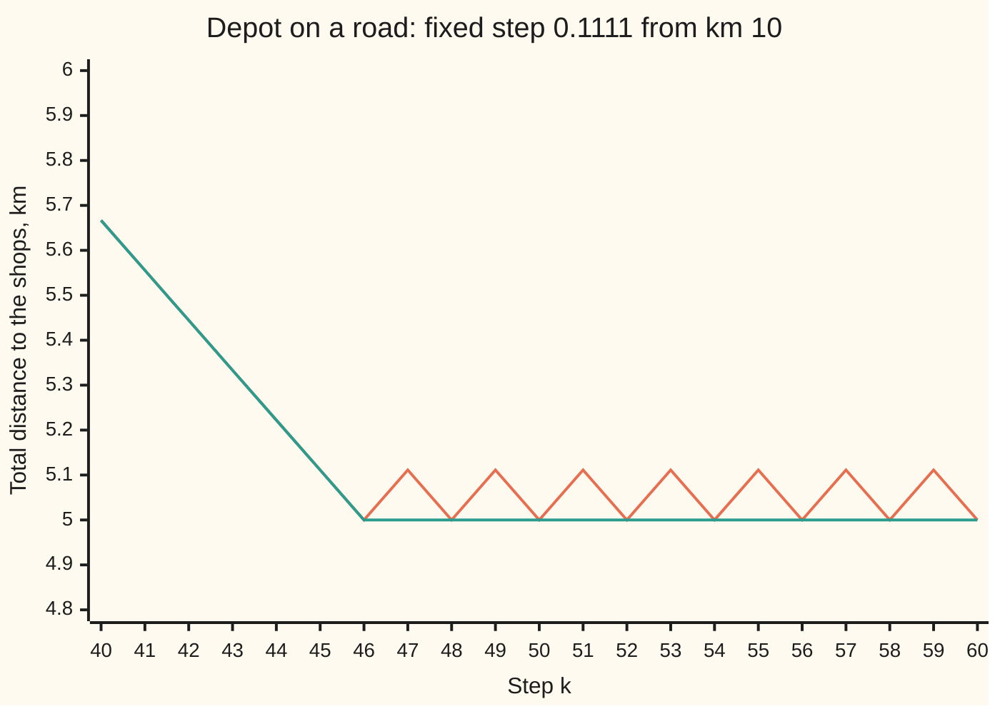

# The subgradient method: steps that need not go downhill, and the 1/sqrt(k) guarantee

[Syllabus](../../../SYLLABUS.md) → [Optimization](../README.md) → [Unconstrained Methods](../README.md#s02) → The subgradient method

---

## General Overview

A delivery firm will put one depot on a straight road. Its three shops stand at km 1, km 2 and km 6. The firm chooses the depot's position $`x`$, in km, and **minimises** the total distance from the depot to the three shops:

```math
f(x) = |x - 1| + |x - 2| + |x - 6|.
```

The old depot was at km 10, where the total is 21 km. Every shop is behind it, so each kilometre moved back towards the shops saves 3 km.

The graph of $`f`$ is straight pieces with a corner at each shop. Its slope is never zero: just left of the best spot it is −1, just right of it +1. So "set the slope to zero" fails. A fixed step never settles either: near a smooth minimum the slope shrinks and the steps with it, but here the slope does not shrink, so the point bounces across the bottom for ever.

The **subgradient method** keeps gradient descent's move, a step against a slope, and adds two rules. The step sizes are set in advance: one size fitted to a budget of steps, small enough that the bounce at the bottom stays within the target, or sizes that shrink on a schedule. And the method keeps the best point it has seen, because a single step may make things worse. From km 10, with the step 0.1111 that the theory below picks for 576 steps, the depot reaches km 2 at step 46. After that it steps across km 2 and back, and the total rises on 265 of the 576 steps.

The payoff is a guarantee that needs only two numbers. $`R`$ = 8 km is how far the start is from the best spot. $`G`$ = 3 is the steepest slope anywhere, in km saved per km moved. After $`K`$ steps the best total found is within $`RG/\sqrt{K}`$ = $`24/\sqrt{K}`$ km of the true minimum, so 576 steps guarantee 1 km. If the minimum total, 5 km, is known in advance, **Polyak's step** uses it to size each step and lands on km 2 in two steps: 10 → 4.6667 → 2.0000.

**The subgradient method steps against any subgradient, with step sizes fixed in advance, and keeps the best point seen; each step need not lower the cost, and it moves closer to the minimiser only when it is short compared with the gap; adding up the distance changes proves the best cost is within RG/√K after K budgeted steps, and Polyak's step reaches the same guarantee without a schedule when the optimal value is known.**

**What kind of fact this is:** a method, with three theorems proved on this card in Why it works: the one-step inequality, the $`RG/\sqrt{K}`$ bound, and the same bound for Polyak's step. A fourth theorem, that no method of this kind does better than about half of $`RG/\sqrt{K}`$ when there are many variables, is stated with its source. The answer km 2 is certified: 0 is a subgradient there.

### The picture: the total distance near the bottom, steps 40 to 60



The orange line is the total $`f(x_k)`$ at step $`k`$. It falls to 5 km at step 46, then saw-tooths between 5.1111 and 5 km: every other step goes uphill. The teal line is the best total so far. It never rises, and it is what the method reports.

---

## The formula

Notation first, in words. A **subgradient** $`g`$ of $`f`$ at $`x`$ is the slope of a line through $`(x, f(x))`$ that stays on or below the graph; the set of them is the subdifferential $`\partial f(x)`$ ([Subgradients](../01-Convexity/07-subgradients.md)). On the road the method takes the slope just to the right of $`x`$: the number of shops at or to the left of $`x`$ minus the number to the right. At a shop this is one valid pick from the subdifferential. It is never 0, because three terms of ±1 cannot cancel, so the method never stops by itself, even at km 2. This card reuses $`x_k`$ for the point after $`k`$ steps and $`\alpha_k`$ for the step size ([Gradient descent](02-gradient-descent-and-its-rate.md)), and writes $`f(x^*)`$ for the lowest value. The length $`\|g\|`$ of a subgradient is its size, $`|g|`$ on a road.

The method:

```math
x_{k+1} = x_k - \alpha_k\, g_k, \qquad g_k \in \partial f(x_k)
```

**Read it aloud:** the next point is this point, moved against any one subgradient by the step size.

The guarantee, for any positive step sizes, if every subgradient used has length at most $`G`$ and some minimiser $`x^*`$ is within $`R`$ of the start:

```math
\min_{0 \le k < K} f(x_k) - f(x^*) \;\le\; \frac{R^2 + G^2 \sum_{k=0}^{K-1} \alpha_k^2}{2 \sum_{k=0}^{K-1} \alpha_k}
```

**Read it aloud:** the best of the first $`K`$ points is above the minimum by at most the squared start distance plus the squared step lengths, over twice the total step size.

With the **fixed-horizon step**, one step size chosen for a budget of $`K`$ steps, the right side becomes:

```math
\alpha_k = \frac{R}{G\sqrt{K}} \quad\Longrightarrow\quad \min_{0 \le k < K} f(x_k) - f(x^*) \;\le\; \frac{R\,G}{\sqrt{K}}
```

**Read it aloud:** spend $`K`$ steps of equal size $`R/(G\sqrt{K})`$ and the best gap is at most $`RG`$ over the square root of $`K`$.

**Polyak's step**, when $`f(x^*)`$ is known:

```math
\alpha_k = \frac{f(x_k) - f(x^*)}{\|g_k\|^2}
```

**Read it aloud:** the step is the height still to lose divided by the slope squared; it gives the same $`RG/\sqrt{K}`$ guarantee with no budget fixed in advance.

| Symbol | Plain meaning | In our example | Push it up and the answer… |
| --- | --- | --- | --- |
| $`x`$ | the depot's position, km along the road | km 10 at the start | — |
| $`f(x)`$ | total distance from the depot to the three shops, km | 21 at km 10 | — |
| $`x^*`$, $`f(x^*)`$ | a best position; the lowest total | km 2; 5 km | — |
| $`x_k`$, $`k`$, $`K`$ | the point after $`k`$ steps; the step count from 0; the steps budgeted | $`x_1 = 9.6667`$; $`K = 576`$ | larger $`K`$, smaller guaranteed gap |
| $`g_k`$, $`\partial f(x_k)`$ | the subgradient used at step $`k`$; the set it is taken from | 3 at km 10; 1 at km 2, from $`\partial f(2) = [-1, 1]`$ | — |
| $`\Vert g_k\Vert`$ | the length of the subgradient, $`\lvert g_k\rvert`$ on a road | 3 at km 10, 1 between km 2 and km 6 | — |
| $`\alpha_k`$ | the step size | 0.1111 fixed; 1.7778 for Polyak's first step | faster travel, a wider bounce at the bottom |
| $`R`$ | a bound on the distance from the start to a minimiser | 8 km | larger guaranteed gap; too small and the promise is void |
| $`G`$ | a bound on the length of every subgradient used | 3 | larger guaranteed gap |
| gap | the best total so far minus $`f(x^*)`$ | 0.0000 after 576 steps, guaranteed at most 1 | — |
| $`y`$, $`D_k`$, $`e_k`$, $`h`$, $`\varepsilon`$, $`N`$, $`\lambda_k`$, $`\lambda^*`$, $`z`$ | in the proofs only: any other point; the squared distance $`\Vert x_k - x^*\Vert^2`$; the gap at step $`k`$; the bound as a function of one fixed step; a small number; a step count after which every step is below it; a price kept at or above 0, the best such price, and a price step before its cut-back (Step 3) | $`D_0 = 64`$, $`e_0 = 16`$ | — |

### When it holds

- **$`f`$ is convex.** Step 1 needs the subgradient line to stay under the graph everywhere. For a bill with a discount tier there is no such line at the corner ([Subgradients](../01-Convexity/07-subgradients.md)), and minus a "slope" can point away from the minimum.
- **Every subgradient has length at most $`G`$.** Each shop adds at most 1, so $`G`$ = 3 holds on the whole road. A cost like $`x^2`$ has slopes that grow without limit far out, and no single $`G`$ covers the whole run.
- **$`R`$ really bounds the start distance.** Guess $`R`$ = 0.5 instead of 8 and the steps are too short to arrive: gap 1.3264 after 576 steps, against a "promise" of 0.0625.
- **The steps shrink, or are set by the budget.** A fixed step 0.7 used for ever leaves a best gap of 0.3000, after 50 steps or 5,000.
- **For Polyak's step, $`f(x^*)`$ is exact.** Too high a guess never takes the total below the guess (each step follows a line under the graph down to it), so the gap is at least the guess minus 5. Too low a guess keeps overshooting, with a gap that depends on the guess. The guarantee covers neither (What breaks, below).

---

## Why it works

### Step 0: measure progress by distance, not by height

Minus a subgradient need not point downhill. In one variable a step can overshoot a corner, as at step 47 above. In two variables, [Subgradients](../01-Convexity/07-subgradients.md) shows a step along minus a subgradient that leaves the height unchanged although the point is not a minimum.

What minus a subgradient always does is point towards the minimiser. Put $`y = x^*`$ into the subgradient inequality $`f(y) \ge f(x_k) + g_k\cdot(y - x_k)`$ and rearrange:

```math
g_k \cdot (x_k - x^*) \;\ge\; f(x_k) - f(x^*) \;\ge\; 0
```

So the step $`-\alpha_k g_k`$ makes an angle under 90° with the direction to $`x^*`$, whenever $`x_k`$ is not already a minimiser. A short enough step brings the point closer to $`x^*`$, even when the height goes up. The whole proof tracks the squared distance $`\|x_k - x^*\|^2`$ instead of the height.

### Step 1: one step, one inequality

Expand the squared distance after one step:

```math
\|x_{k+1} - x^*\|^2 = \|x_k - x^*\|^2 - 2\alpha_k\, g_k\cdot(x_k - x^*) + \alpha_k^2 \|g_k\|^2
```

The middle term is at least $`2\alpha_k (f(x_k) - f(x^*))`$ by Step 0, and the last is at most $`\alpha_k^2 G^2`$. So

```math
\|x_{k+1} - x^*\|^2 \;\le\; \|x_k - x^*\|^2 - 2\alpha_k\bigl(f(x_k) - f(x^*)\bigr) + \alpha_k^2 G^2.
```

**Read it aloud:** each step cuts the squared distance by twice the step times the gap, and adds back the step squared times $`G^2`$.

The gap term is the gain and the $`G^2`$ term is the price. When the gap is large the gain wins. At the bottom the gap is 0 and only the price is left: that is the overshoot at step 47.

On the road at step 0: $`64 - 2 \times 0.1111 \times 16 + 0.1111^2 \times 9 = 60.5556`$, and the true squared distance after the step is 58.7778. The check tests the inequality at all 576 steps, and it holds 576 times.

### Step 2: add the steps up, and choose the step for the budget

Add the inequality for $`k = 0, \dots, K-1`$. The distances telescope: each one cancels against the next, leaving the first and the last. The last is at least 0 and the first is at most $`R^2`$, so

```math
2\sum_{k<K} \alpha_k\bigl(f(x_k) - f(x^*)\bigr) \;\le\; R^2 + G^2 \sum_{k<K} \alpha_k^2.
```

The smallest gap is at most the step-weighted average of the gaps. Dividing by $`2\sum \alpha_k`$ gives the guarantee in The formula.

With one step size $`\alpha`$ for all $`K`$ steps the right side is $`R^2/(2K\alpha) + G^2\alpha/2`$. The first part wants a long step and the second a short one. They balance at $`\alpha = R/(G\sqrt{K})`$, where the bound is $`RG/\sqrt{K}`$. The second part does not shrink as $`K`$ grows: a fixed step run for ever is promised only a gap of $`G^2\alpha/2`$, so the step is sized for the budget.

On the road, $`RG`$ = 24. A gap of 1 km needs $`\sqrt{K} \ge 24`$, so $`K`$ = 576 and the step is 0.1111. The guarantees for budgets of 16, 36 and 144 steps are 6, 4 and 2 km.

The road is kinder than the guarantee. All four runs end with a best gap of 0.0000: the bound covers every convex function with these $`R`$ and $`G`$, and three shops on one road is an easy case.

### Step 3: steps that shrink without a budget

Often the number of steps is not known in advance. Then use step sizes that shrink, such as $`\alpha_k = 1/\sqrt{k+1}`$. The guarantee goes to 0 when two things hold:

- **the total step size is unlimited**, $`\sum \alpha_k = \infty`$, so the point can travel any distance $`R`$;
- **the steps shrink to 0**, so the price term $`G^2\sum\alpha_k^2`$ grows more slowly than the total.

With $`\alpha_k = 1/\sqrt{k+1}`$ on the road, the proved bounds after 10, 100 and 576 steps are 8.9983, 2.9771 and 1.3575 km. The best gaps found are 0.1190, 0.0071 and 0.0000 km. The total rose on 284 of the 576 steps.

The bound falls a little more slowly than $`1/\sqrt{K}`$, by a factor that grows like $`\log K`$. That factor belongs to this schedule, not to the problem: restarting from $`x_0`$ with budgets of 1, 2, 4, … steps keeps $`RG/\sqrt{K}`$ up to a constant factor.

The schedule $`\alpha_k = 0.5/(k+1)`$ in [Lagrangian relaxation](../05-Integer%20and%20Combinatorial%20Optimisation/07-lagrangian-relaxation-and-decomposition.md) meets both conditions. There the crew price $`\lambda_k`$ must stay at or above 0, so a step that lands below 0 is cut back to 0. That only moves the price nearer the best price $`\lambda^* \ge 0`$, so Step 1's inequality still holds (fold below), and this is the proof of the rule that card states.

### Step 4: Polyak's step uses the known minimum

Step 1's inequality is a quadratic in the step size, $`-2\alpha(f(x_k) - f(x^*)) + \alpha^2\|g_k\|^2`$. Its lowest point is at $`\alpha = (f(x_k) - f(x^*))/\|g_k\|^2`$, which is Polyak's step. There it cuts the squared distance by at least $`(f(x_k) - f(x^*))^2/\|g_k\|^2`$ at every step.

So with Polyak's step the distance never grows. Adding the cuts, the squared gaps sum to at most $`G^2R^2`$, and the smallest of $`K`$ of them is at most $`G^2R^2/K`$. Taking the square root gives the same $`RG/\sqrt{K}`$, with no budget and no schedule.

In pictures: Polyak's step follows the line through the current point with slope $`g_k`$ down to the height $`f(x^*)`$. At km 10 that line falls 3 km per km from 21, and reaches 5 at km 4.6667. The true total there is 7.6667, because the line ignored the corner at km 6. The next line, with slope 1, reaches 5 exactly at km 2. On straight pieces that run to the bottom, Polyak's step is exact.

The squared distance after the first step is 7.1111. The promise was at most $`64 - 16^2/9 = 35.5556`$.

### Step 5: no method of this kind beats about half of RG over root K

The square root is the bad news. Halving the gap costs four times the steps, and one more correct digit a hundred times. Gradient descent on a smooth bowl gains each digit in a fixed number of steps ([Convergence rates](03-rates-of-convergence-and-conditioning.md)).

The rate is not a weakness of the proof. Consider any method that sees only $`f`$ and one subgradient at each point it visits, and puts each new point at the start plus a combination of the subgradients seen so far. For any $`K`$ up to the number of variables, there is a convex function, with subgradients no longer than $`G`$ on the ball of radius $`R`$ around the start, whose minimum over that ball beats the method's best of its first $`K`$ points by at least $`RG/(2(1 + \sqrt{K}))`$. The function is a maximum of $`K`$ planes plus a small bowl. This is stated here, not proved; it is Theorem 3.13 in Bubeck (Sources), and [The speed limit](../08-First-Order%20Methods%20at%20Scale/03-lower-bounds-for-first-order-methods.md) works the worst case through.

For $`K`$ = 576 the floor is 0.4800 km, against the guarantee of 1 km. With 576 variables or more, no such method does better than about half of what the subgradient method guarantees. The road has one variable, so the floor does not apply to it: in one variable, halving an interval around the minimiser is far faster.

<details>
<summary>Detailed proof: the one-step inequality, the RG/√K bound, the shrinking steps and Polyak's step</summary>

Let $`f`$ be convex on all of its space, $`x^*`$ a minimiser, $`\|x_0 - x^*\| \le R`$ and $`\|g_k\| \le G`$ for every $`k`$. Write $`D_k = \|x_k - x^*\|^2`$ and $`e_k = f(x_k) - f(x^*) \ge 0`$.

**One step.** The subgradient inequality at $`y = x^*`$ is $`f(x^*) \ge f(x_k) + g_k\cdot(x^* - x_k)`$, that is $`g_k\cdot(x_k - x^*) \ge e_k`$. Then

$`\displaystyle D_{k+1} = \|x_k - x^* - \alpha_k g_k\|^2 = D_k - 2\alpha_k\, g_k\cdot(x_k - x^*) + \alpha_k^2\|g_k\|^2 \le D_k - 2\alpha_k e_k + \alpha_k^2 G^2.`$

**The bound.** Sum over $`k = 0, \dots, K-1`$ and use $`D_K \ge 0`$, $`D_0 \le R^2`$:

$`\displaystyle 2\sum_{k<K}\alpha_k e_k \le R^2 + G^2\sum_{k<K}\alpha_k^2.`$

Since each $`e_k \ge \min_{j<K} e_j`$ and every $`\alpha_k > 0`$, the left side is at least $`2\,(\min_{j<K} e_j)\sum_{k<K}\alpha_k`$. Divide.

**Fixed horizon.** With $`\alpha_k = \alpha`$ the bound is $`h(\alpha) = R^2/(2K\alpha) + G^2\alpha/2`$. Its derivative $`-R^2/(2K\alpha^2) + G^2/2`$ is zero at $`\alpha = R/(G\sqrt{K})`$, and there $`h = RG/(2\sqrt{K}) + RG/(2\sqrt{K}) = RG/\sqrt{K}`$.

**Shrinking steps.** Let $`\alpha_k \to 0`$ and $`\sum\alpha_k = \infty`$. Given $`\varepsilon > 0`$, pick $`N`$ with $`\alpha_k < \varepsilon`$ for $`k \ge N`$. Then $`\sum_{k<K}\alpha_k^2 \le \sum_{k<N}\alpha_k^2 + \varepsilon\sum_{k<K}\alpha_k`$. Divided by $`\sum_{k<K}\alpha_k`$, which grows without limit, the ratio is eventually below $`2\varepsilon`$; so is $`R^2/\sum_{k<K}\alpha_k`$. The bound therefore tends to 0. For $`\alpha_k = 1/\sqrt{k+1}`$ the total grows like $`2\sqrt{K}`$ and the sum of squares like $`\log K`$, giving a bound of order $`(R^2 + G^2\log K)/(4\sqrt{K})`$.

**A price kept at or above 0.** Minimise $`f`$ over $`\lambda \ge 0`$, with best point $`\lambda^* \ge 0`$, by $`\lambda_{k+1} = \max(0, z)`$ where $`z = \lambda_k - \alpha_k g_k`$. Each $`\lambda_k \ge 0`$, so $`e_k \ge 0`$ still. If $`z < 0`$, then $`|0 - \lambda^*| = \lambda^* < \lambda^* - z`$; so always $`D_{k+1} \le (z - \lambda^*)^2`$, which the one-step line bounds, and the rest holds as written. Beck's chapter 8 (Sources) does the same for any convex set that contains $`x^*`$.

**Polyak's step.** Put $`\alpha_k = e_k/\|g_k\|^2`$ (when $`g_k = 0`$, $`x_k`$ is a minimiser and the method stops). The one-step line becomes $`D_{k+1} \le D_k - e_k^2/\|g_k\|^2 \le D_k - e_k^2/G^2`$. Summing, $`\sum_{k<K} e_k^2 \le G^2 D_0 \le G^2R^2`$. The smallest of $`K`$ terms is at most their mean, so $`\min_{k<K} e_k^2 \le G^2R^2/K`$, and $`\min_{k<K} e_k \le RG/\sqrt{K}`$.

</details>

---

## Worked numbers, by hand

The start, the fixed-horizon step, and Polyak's two steps.

| Step | Arithmetic | Value |
| --- | --- | --- |
| total at km 10 | $`9 + 8 + 4`$ | 21 km |
| subgradient at km 10 | 3 shops at or to the left, 0 to the right | 3 |
| $`R`$ and $`G`$ | $`\lvert 10 - 2\rvert`$; three shops | 8 km; 3 |
| budget for a 1 km gap | $`(8 \times 3 / 1)^2`$ | 576 steps |
| fixed-horizon step | $`8 / (3 \times \sqrt{576}) = 8/72`$ | 0.1111 |
| first move | $`10 - 0.1111 \times 3`$ | km 9.6667 |
| steps to reach km 2 | 12 moves of $`3 \times 0.1111`$ to km 6; 1 more from km 6, where the slope is still 3; then 33 of 0.1111 | step 46 |
| one-step bound at step 0 | $`64 - 2 \times 0.1111 \times 16 + 0.1111^2 \times 9`$ | 60.5556, against 58.7778 |
| Polyak's first step | $`(21 - 5)/3^2`$ | 1.7778 |
| Polyak's first move | $`10 - 1.7778 \times 3`$ | km 4.6667, total 7.6667 |
| Polyak's second step | $`(7.6667 - 5)/1^2`$ | 2.6667 |
| Polyak's second move | $`4.6667 - 2.6667 \times 1`$ | **km 2.0000, total 5 km** |

Put the depot at km 2, the middle shop, for a total of 5 km. The certificate is that the slopes either side of km 2 are −1 and +1, so 0 is a subgradient there; a scan of 12,001 points from km 0 to km 12 agrees.

### What breaks if you drop a piece

| Mistake | Comes out at | What went wrong |
| --- | --- | --- |
| A fixed step 0.7 for ever | best gap 0.3000 after 50 steps and after 5,000 | The slope stays ±1 at the bottom, so the step never shrinks: the point bounces between km 2.3000 and km 1.6000 |
| Report the last point, steps $`1/\sqrt{k+1}`$ | gap 0.0417 at step 576, while the best so far is 0.0000 | The total rose on 284 of 576 steps; the guarantee is about the best point |
| Guess $`R`$ = 0.5 when it is 8 | still at km 3.3194 after 576 steps; best gap of the points counted, $`x_0`$ to $`x_{575}`$, is 1.3264, against a "promise" of 0.0625 | The step 0.0069 is too short to travel 8 km: the hypothesis on $`R`$ failed |
| Polyak's step with $`f(x^*)`$ guessed as 0 | km 3 → −3 → 3 for ever, gap 1.0000 | The target is unreachable, so every step overshoots |
| Polyak's step with $`f(x^*)`$ guessed as 6 | stops at km 3, gap 1.0000 | At km 3 the total is 6, so the step is 0: the method stalls and looks finished |

---

## Code, from first principles, and it actually runs

The script runs the subgradient method on the road with three step rules: the fixed-horizon step for 576 steps, the shrinking steps $`1/\sqrt{k+1}`$, and Polyak's step. It reaches the answer by four independent roads: the method itself; the certificate, one-sided slopes −1 and +1 at km 2; a scan of 12,001 points along the road; and the proved inequalities, tested at every step and against every run's best gap. Then it runs each mistake in the table above. The slope rule counts a shop within $`10^{-9}`$ km as reached: twelve moves of 1/3 km land exactly on km 6, and rounding must not leave the point on the wrong side of that corner. Asserts pin the hand counts.

### Python

```python
# The subgradient method -- the check behind the card.  Standard library only.
# A depot goes on a straight road with shops at km 1, 2 and 6.  f(x) is the total
# distance in km from a depot at km x to the three shops; it is minimised from km 10.
# Roads: the method under three step rules; the zero-subgradient certificate; a scan
# of the whole road; the one-step inequality at every step; the proved bounds.
import math
SHOPS = [1.0, 2.0, 6.0]
X0, XSTAR, FSTAR = 10.0, 2.0, 5.0        # start; the median and its value, certified below
R, G = abs(X0 - XSTAR), float(len(SHOPS))  # distance to the optimum; largest |subgradient|

def sq(v): return v * v
def f(x): return sum(abs(x - s) for s in SHOPS)
# Slope just right of x.  A shop within 1e-9 km counts as reached: exact moves of 1/3 km
# land on km 6, and rounding must not leave the point a hair short, on the wrong side.
def sub(x): return float(sum(1 if x >= s - 1e-9 else -1 for s in SHOPS))

def run(step, K, x=X0, fstar=FSTAR):          # fstar: the value f(x*) the check uses
    """K steps of x <- x - a_k g_k.  Returns points x_0..x_K, step sizes, one-step checks kept."""
    xs, al, kept = [x], [], 0
    for k in range(K):
        g = sub(x)
        a = step(k, x, g)
        nx = x - a * g
        lhs = sq(nx - XSTAR)                                   # one-step inequality, Step 1
        rhs = sq(x - XSTAR) - 2 * a * (f(x) - fstar) + a * a * g * g
        kept += lhs <= rhs + 1e-9
        xs.append(nx); al.append(a); x = nx
    return xs, al, kept

def best_gap(xs, K): return min(f(x) for x in xs[:K]) - FSTAR     # best of x_0 .. x_{K-1}
def bound(al): return (R * R + G * G * sum(a * a for a in al)) / (2 * sum(al))
def rises(xs): return sum(f(b) > f(a) + 1e-9 for a, b in zip(xs, xs[1:]))
def fixed(a): return lambda k, x, g: a
def polyak(fs): return lambda k, x, g: (f(x) - fs) / (g * g) if g else 0.0
def row(label, vals, d=4): print(f"{label:<46}" + " ".join(f"{v:.{d}f}" for v in vals))

h = 1e-6
left, right = (f(XSTAR) - f(XSTAR - h)) / h, (f(XSTAR + h) - f(XSTAR)) / h
row("start km 10: f, subgradient", [f(X0), sub(X0)])
row("km 2: f, slope left, slope right", [f(XSTAR), left, right])
grid = [i / 1000 for i in range(0, 12001)]
xb = min(grid, key=f)
row("scan of 12001 points, 0 to 12 km: best x, f", [xb, f(xb)])
assert abs(left + 1) < 1e-6 and abs(right - 1) < 1e-6 and left <= 0 <= right   # 0 in [-1, 1]
assert abs(xb - XSTAR) < 1e-12 and abs(f(xb) - FSTAR) < 1e-12                 # scan meets certificate

K = math.ceil(sq(R * G / 1.0))                                  # steps for a gap of 1 km
A = R / (G * math.sqrt(K))
row("R, G, R*G", [R, G, R * G])
print(f"{'steps for a guaranteed gap of 1 km, step a':<46}{K} {A:.4f}")
xs, al, kept = run(fixed(A), K)
row("fixed step: x_0 .. x_3", xs[:4])
lhs0 = sq(xs[1] - XSTAR)
rhs0 = sq(X0 - XSTAR) - 2 * A * (f(X0) - FSTAR) + A * A * G * G
row("step 0: |x_1 - x*|^2, one-step bound", [lhs0, rhs0])
k6 = next(k for k, x in enumerate(xs) if abs(x - 6.0) < 1e-9)
first = next(k for k, x in enumerate(xs) if abs(x - XSTAR) < 1e-9)
print(f"{'one-step inequality kept, of 576 steps':<46}{kept}")
print(f"{'first step within 1e-9 km of km 6, of km 2':<46}{k6} {first}")
print(f"{'steps on which f rose, of 576':<46}{rises(xs)}")
row("f(x_k), k = 40 .. 60", [f(x) for x in xs[40:61]])
row("best f so far, k = 40 .. 60", [min(f(x) for x in xs[:k + 1]) for k in range(40, 61)])
row("576 steps: best gap, proved bound", [best_gap(xs, K), bound(al)])
assert kept == K and rises(xs) > 0 and best_gap(xs, K) <= bound(al) + 1e-12
assert abs(bound(al) - R * G / math.sqrt(K)) < 1e-9                # bound(al) is RG/sqrt(K)
assert k6 == 12 and first == 12 + 1 + 33     # by hand: 12 moves of 1/3 km, 1 at km 6, 33 of 1/9
assert rises(xs) == (K - first) // 2 and best_gap(xs, K) < 1e-9 < f(xs[K - 1]) - FSTAR

gaps, bnds = [], []
for k2 in (16, 36, 144):
    x2, a2, kp = run(fixed(R / (G * math.sqrt(k2))), k2)
    gaps.append(best_gap(x2, k2)); bnds.append(bound(a2))
    assert kp == k2 and gaps[-1] <= bnds[-1]
row("K = 16, 36, 144: guarantee RG/sqrt(K)", bnds)
row("K = 16, 36, 144: best gap found", gaps)

xd, ad, kd = run(lambda k, x, g: 1 / math.sqrt(k + 1), 576)
row("a_k = 1/sqrt(k+1): best gap at 10, 100, 576", [best_gap(xd, n) for n in (10, 100, 576)])
row("  proved bound at 10, 100, 576", [bound(ad[:n]) for n in (10, 100, 576)])
row("  last point's gap at 576", [f(xd[576]) - FSTAR])
print(f"{'  steps on which f rose, of 576':<46}{rises(xd)}")
assert kd == 576 and all(best_gap(xd, n) <= bound(ad[:n]) for n in (10, 100, 576))
assert f(xd[576]) - FSTAR > best_gap(xd, 576) + 0.04            # the last point is not the best

xp, ap, kp = run(polyak(FSTAR), 2)
row("Polyak: x_0, x_1, x_2", xp)
row("Polyak: f at those points", [f(x) for x in xp])
row("Polyak: step sizes a_0, a_1", ap)
row("Polyak: |x_1 - x*|^2, promised at most", [sq(xp[1] - XSTAR), R * R - sq(f(X0) - FSTAR) / (G * G)])
assert abs(xp[2] - XSTAR) < 1e-12 and kp == 2
assert sq(xp[1] - XSTAR) <= R * R - sq(f(X0) - FSTAR) / (G * G)
row("many-variable lower bound RG/(2(1 + sqrt K))", [R * G / (2 * (1 + math.sqrt(576)))])

print("what breaks:")
xc, _, _ = run(fixed(0.7), 5000)
row("  fixed step 0.7: best gap at 50, 5000", [best_gap(xc, 50), best_gap(xc, 5000)])
row("  fixed step 0.7: x_7 .. x_10", xc[7:11])
Rs = 0.5
xr, ar, _ = run(fixed(Rs / (G * math.sqrt(K))), K)
row("  R guessed 0.5: step, x_576, gap, promised", [ar[0], xr[K], best_gap(xr, K), Rs * G / math.sqrt(K)])
x0g, _, _ = run(polyak(0.0), 100, fstar=0.0)
row("  Polyak, guess f(x*) = 0: x_0 .. x_4", x0g[:5])
row("  Polyak, guess f(x*) = 0: best gap at 100", [best_gap(x0g, 100)])
x4g, _, _ = run(polyak(4.0), 4, fstar=4.0)
row("  Polyak, guess f(x*) = 4: x_0 .. x_4", x4g)
x6, _, _ = run(polyak(6.0), 100, fstar=6.0)
row("  Polyak, guess f(x*) = 6: x_0 .. x_3, gap", x6[:4] + [best_gap(x6, 100)])
assert best_gap(xc, 5000) > 0.29 and best_gap(xr, K) > Rs * G / math.sqrt(K)
assert abs(xr[K] - 239 / 72) < 1e-9  # by hand: 192 moves of 1/48 km, 1 at km 6, 383 of 1/144
assert best_gap(x0g, 100) > 0.99 and abs(x6[-1] - 3.0) < 1e-12 and abs(x4g[4] - 1.0) < 1e-9
print("ALL CHECKS PASS")
```

**Ran 2026-11-24 on macOS, Python 3.14.10, standard library only. All checks passed. Output, pasted from the run:**

```
start km 10: f, subgradient                   21.0000 3.0000
km 2: f, slope left, slope right              5.0000 -1.0000 1.0000
scan of 12001 points, 0 to 12 km: best x, f   2.0000 5.0000
R, G, R*G                                     8.0000 3.0000 24.0000
steps for a guaranteed gap of 1 km, step a    576 0.1111
fixed step: x_0 .. x_3                        10.0000 9.6667 9.3333 9.0000
step 0: |x_1 - x*|^2, one-step bound          58.7778 60.5556
one-step inequality kept, of 576 steps        576
first step within 1e-9 km of km 6, of km 2    12 46
steps on which f rose, of 576                 265
f(x_k), k = 40 .. 60                          5.6667 5.5556 5.4444 5.3333 5.2222 5.1111 5.0000 5.1111 5.0000 5.1111 5.0000 5.1111 5.0000 5.1111 5.0000 5.1111 5.0000 5.1111 5.0000 5.1111 5.0000
best f so far, k = 40 .. 60                   5.6667 5.5556 5.4444 5.3333 5.2222 5.1111 5.0000 5.0000 5.0000 5.0000 5.0000 5.0000 5.0000 5.0000 5.0000 5.0000 5.0000 5.0000 5.0000 5.0000 5.0000
576 steps: best gap, proved bound             0.0000 1.0000
K = 16, 36, 144: guarantee RG/sqrt(K)         6.0000 4.0000 2.0000
K = 16, 36, 144: best gap found               0.0000 0.0000 0.0000
a_k = 1/sqrt(k+1): best gap at 10, 100, 576   0.1190 0.0071 0.0000
  proved bound at 10, 100, 576                8.9983 2.9771 1.3575
  last point's gap at 576                     0.0417
  steps on which f rose, of 576               284
Polyak: x_0, x_1, x_2                         10.0000 4.6667 2.0000
Polyak: f at those points                     21.0000 7.6667 5.0000
Polyak: step sizes a_0, a_1                   1.7778 2.6667
Polyak: |x_1 - x*|^2, promised at most        7.1111 35.5556
many-variable lower bound RG/(2(1 + sqrt K))  0.4800
what breaks:
  fixed step 0.7: best gap at 50, 5000        0.3000 0.3000
  fixed step 0.7: x_7 .. x_10                 2.3000 1.6000 2.3000 1.6000
  R guessed 0.5: step, x_576, gap, promised   0.0069 3.3194 1.3264 0.0625
  Polyak, guess f(x*) = 0: x_0 .. x_4         10.0000 3.0000 -3.0000 3.0000 -3.0000
  Polyak, guess f(x*) = 0: best gap at 100    1.0000
  Polyak, guess f(x*) = 4: x_0 .. x_4         10.0000 4.3333 1.0000 3.0000 1.0000
  Polyak, guess f(x*) = 6: x_0 .. x_3, gap    10.0000 5.0000 3.0000 3.0000 1.0000
ALL CHECKS PASS
```

### Rust

```rust
// The subgradient method -- the check behind the card.  Rust std only, no crates.
// A depot goes on a straight road with shops at km 1, 2 and 6.  f(x) is the total
// distance in km from a depot at km x to the three shops; it is minimised from km 10.
// Roads: the method under three step rules; the zero-subgradient certificate; a scan
// of the whole road; the one-step inequality at every step; the proved bounds.
const SHOPS: [f64; 3] = [1.0, 2.0, 6.0];
const X0: f64 = 10.0; // start
const XSTAR: f64 = 2.0; // the median, certified below
const FSTAR: f64 = 5.0; // its value
const R: f64 = 8.0; // |X0 - XSTAR|, distance to the optimum
const G: f64 = 3.0; // number of shops: the largest |subgradient|

fn sq(v: f64) -> f64 { v * v }
fn f(x: f64) -> f64 { SHOPS.iter().map(|s| (x - s).abs()).sum() }
// Slope just right of x.  A shop within 1e-9 km counts as reached: exact moves of 1/3 km
// land on km 6, and rounding must not leave the point a hair short, on the wrong side.
fn sub(x: f64) -> f64 {
    SHOPS.iter().map(|&s| if x >= s - 1e-9 { 1.0 } else { -1.0 }).sum()
}

// K steps of x <- x - a_k g_k.  Returns points x_0..x_K, step sizes, one-step checks kept.
fn run(step: &dyn Fn(usize, f64, f64) -> f64, k_max: usize, fstar: f64) -> (Vec<f64>, Vec<f64>, usize) {
    let (mut x, mut xs, mut al, mut kept) = (X0, vec![X0], vec![], 0);
    for k in 0..k_max {
        let g = sub(x);
        let a = step(k, x, g);
        let nx = x - a * g;
        let lhs = sq(nx - XSTAR); // one-step inequality, Step 1
        let rhs = sq(x - XSTAR) - 2.0 * a * (f(x) - fstar) + a * a * g * g;
        if lhs <= rhs + 1e-9 { kept += 1; }
        xs.push(nx); al.push(a); x = nx;
    }
    (xs, al, kept)
}
fn best_gap(xs: &[f64], k: usize) -> f64 { xs[..k].iter().map(|&x| f(x)).fold(f64::INFINITY, f64::min) - FSTAR }
fn bound(al: &[f64]) -> f64 { (R * R + G * G * al.iter().map(|a| a * a).sum::<f64>()) / (2.0 * al.iter().sum::<f64>()) }
fn rises(xs: &[f64]) -> usize { xs.windows(2).filter(|w| f(w[1]) > f(w[0]) + 1e-9).count() }
fn polyak(fs: f64) -> impl Fn(usize, f64, f64) -> f64 { move |_, x, g| if g != 0.0 { (f(x) - fs) / (g * g) } else { 0.0 } }
fn row(label: &str, vals: &[f64]) {
    let v: Vec<String> = vals.iter().map(|x| format!("{:.4}", x)).collect();
    println!("{:<46}{}", label, v.join(" "));
}
fn line(label: &str, v: String) { println!("{:<46}{}", label, v); }

fn main() {
    let h = 1e-6;
    let (left, right) = ((f(XSTAR) - f(XSTAR - h)) / h, (f(XSTAR + h) - f(XSTAR)) / h);
    row("start km 10: f, subgradient", &[f(X0), sub(X0)]);
    row("km 2: f, slope left, slope right", &[f(XSTAR), left, right]);
    let mut xb = 0.0;
    for i in 0..12001 { let x = i as f64 / 1000.0; if f(x) < f(xb) { xb = x; } }
    row("scan of 12001 points, 0 to 12 km: best x, f", &[xb, f(xb)]);
    assert!((left + 1.0).abs() < 1e-6 && (right - 1.0).abs() < 1e-6 && left <= 0.0 && 0.0 <= right);
    assert!((xb - XSTAR).abs() < 1e-12 && (f(xb) - FSTAR).abs() < 1e-12); // scan meets certificate

    let k = sq(R * G / 1.0).ceil() as usize; // steps for a gap of 1 km
    let a = R / (G * (k as f64).sqrt());
    row("R, G, R*G", &[R, G, R * G]);
    line("steps for a guaranteed gap of 1 km, step a", format!("{} {:.4}", k, a));
    let (xs, al, kept) = run(&|_, _, _| a, k, FSTAR);
    row("fixed step: x_0 .. x_3", &xs[..4]);
    let lhs0 = sq(xs[1] - XSTAR);
    let rhs0 = sq(X0 - XSTAR) - 2.0 * a * (f(X0) - FSTAR) + a * a * G * G;
    row("step 0: |x_1 - x*|^2, one-step bound", &[lhs0, rhs0]);
    let k6 = xs.iter().position(|&x| (x - 6.0).abs() < 1e-9).unwrap();
    let first = xs.iter().position(|&x| (x - XSTAR).abs() < 1e-9).unwrap();
    line("one-step inequality kept, of 576 steps", format!("{}", kept));
    line("first step within 1e-9 km of km 6, of km 2", format!("{} {}", k6, first));
    line("steps on which f rose, of 576", format!("{}", rises(&xs)));
    let fk: Vec<f64> = xs[40..61].iter().map(|&x| f(x)).collect();
    row("f(x_k), k = 40 .. 60", &fk);
    let bk: Vec<f64> = (40..61).map(|j| best_gap(&xs, j + 1) + FSTAR).collect();
    row("best f so far, k = 40 .. 60", &bk);
    row("576 steps: best gap, proved bound", &[best_gap(&xs, k), bound(&al)]);
    assert!(kept == k && rises(&xs) > 0 && best_gap(&xs, k) <= bound(&al) + 1e-12);
    assert!((bound(&al) - R * G / (k as f64).sqrt()).abs() < 1e-9); // bound(al) is RG/sqrt(K)
    assert!(k6 == 12 && first == 12 + 1 + 33); // by hand: 12 moves of 1/3 km, 1 at km 6, 33 of 1/9
    assert!(rises(&xs) == (k - first) / 2 && best_gap(&xs, k) < 1e-9 && f(xs[k - 1]) - FSTAR > 1e-9);

    let (mut gaps, mut bnds) = (vec![], vec![]);
    for &k2 in &[16usize, 36, 144] {
        let a2 = R / (G * (k2 as f64).sqrt());
        let (x2, al2, kp) = run(&|_, _, _| a2, k2, FSTAR);
        gaps.push(best_gap(&x2, k2)); bnds.push(bound(&al2));
        assert!(kp == k2 && gaps[gaps.len() - 1] <= bnds[bnds.len() - 1]);
    }
    row("K = 16, 36, 144: guarantee RG/sqrt(K)", &bnds);
    row("K = 16, 36, 144: best gap found", &gaps);

    let (xd, ad, kd) = run(&|j, _, _| 1.0 / ((j + 1) as f64).sqrt(), 576, FSTAR);
    let ns = [10usize, 100, 576];
    let bg: Vec<f64> = ns.iter().map(|&n| best_gap(&xd, n)).collect();
    let bd: Vec<f64> = ns.iter().map(|&n| bound(&ad[..n])).collect();
    row("a_k = 1/sqrt(k+1): best gap at 10, 100, 576", &bg);
    row("  proved bound at 10, 100, 576", &bd);
    row("  last point's gap at 576", &[f(xd[576]) - FSTAR]);
    line("  steps on which f rose, of 576", format!("{}", rises(&xd)));
    assert!(kd == 576 && (0..3).all(|i| bg[i] <= bd[i]));
    assert!(f(xd[576]) - FSTAR > bg[2] + 0.04); // the last point is not the best

    let (xp, ap, kp) = run(&polyak(FSTAR), 2, FSTAR);
    row("Polyak: x_0, x_1, x_2", &xp);
    let fp: Vec<f64> = xp.iter().map(|&x| f(x)).collect();
    row("Polyak: f at those points", &fp);
    row("Polyak: step sizes a_0, a_1", &ap);
    let prom = R * R - sq(f(X0) - FSTAR) / (G * G);
    row("Polyak: |x_1 - x*|^2, promised at most", &[sq(xp[1] - XSTAR), prom]);
    assert!((xp[2] - XSTAR).abs() < 1e-12 && kp == 2);
    assert!(sq(xp[1] - XSTAR) <= prom);
    row("many-variable lower bound RG/(2(1 + sqrt K))", &[R * G / (2.0 * (1.0 + 576f64.sqrt()))]);

    println!("what breaks:");
    let (xc, _, _) = run(&|_, _, _| 0.7, 5000, FSTAR);
    row("  fixed step 0.7: best gap at 50, 5000", &[best_gap(&xc, 50), best_gap(&xc, 5000)]);
    row("  fixed step 0.7: x_7 .. x_10", &xc[7..11]);
    let rs = 0.5;
    let ars = rs / (G * (k as f64).sqrt());
    let (xr, ar, _) = run(&|_, _, _| ars, k, FSTAR);
    row("  R guessed 0.5: step, x_576, gap, promised", &[ar[0], xr[k], best_gap(&xr, k), rs * G / (k as f64).sqrt()]);
    let (x0g, _, _) = run(&polyak(0.0), 100, 0.0);
    row("  Polyak, guess f(x*) = 0: x_0 .. x_4", &x0g[..5]);
    row("  Polyak, guess f(x*) = 0: best gap at 100", &[best_gap(&x0g, 100)]);
    let (x4g, _, _) = run(&polyak(4.0), 4, 4.0);
    row("  Polyak, guess f(x*) = 4: x_0 .. x_4", &x4g);
    let (x6, _, _) = run(&polyak(6.0), 100, 6.0);
    let mut v6 = x6[..4].to_vec(); v6.push(best_gap(&x6, 100));
    row("  Polyak, guess f(x*) = 6: x_0 .. x_3, gap", &v6);
    assert!(best_gap(&xc, 5000) > 0.29 && best_gap(&xr, k) > rs * G / (k as f64).sqrt());
    assert!((xr[k] - 239.0 / 72.0).abs() < 1e-9); // by hand: 192 moves of 1/48 km, 1 at km 6, 383 of 1/144
    assert!(best_gap(&x0g, 100) > 0.99 && (x6[x6.len() - 1] - 3.0).abs() < 1e-12 && (x4g[4] - 1.0).abs() < 1e-9);
    println!("ALL CHECKS PASS");
}
```

**Ran 2026-11-24 on macOS, rustc 1.98.1, no crates. All checks passed. Output, pasted from the run:**

```
start km 10: f, subgradient                   21.0000 3.0000
km 2: f, slope left, slope right              5.0000 -1.0000 1.0000
scan of 12001 points, 0 to 12 km: best x, f   2.0000 5.0000
R, G, R*G                                     8.0000 3.0000 24.0000
steps for a guaranteed gap of 1 km, step a    576 0.1111
fixed step: x_0 .. x_3                        10.0000 9.6667 9.3333 9.0000
step 0: |x_1 - x*|^2, one-step bound          58.7778 60.5556
one-step inequality kept, of 576 steps        576
first step within 1e-9 km of km 6, of km 2    12 46
steps on which f rose, of 576                 265
f(x_k), k = 40 .. 60                          5.6667 5.5556 5.4444 5.3333 5.2222 5.1111 5.0000 5.1111 5.0000 5.1111 5.0000 5.1111 5.0000 5.1111 5.0000 5.1111 5.0000 5.1111 5.0000 5.1111 5.0000
best f so far, k = 40 .. 60                   5.6667 5.5556 5.4444 5.3333 5.2222 5.1111 5.0000 5.0000 5.0000 5.0000 5.0000 5.0000 5.0000 5.0000 5.0000 5.0000 5.0000 5.0000 5.0000 5.0000 5.0000
576 steps: best gap, proved bound             0.0000 1.0000
K = 16, 36, 144: guarantee RG/sqrt(K)         6.0000 4.0000 2.0000
K = 16, 36, 144: best gap found               0.0000 0.0000 0.0000
a_k = 1/sqrt(k+1): best gap at 10, 100, 576   0.1190 0.0071 0.0000
  proved bound at 10, 100, 576                8.9983 2.9771 1.3575
  last point's gap at 576                     0.0417
  steps on which f rose, of 576               284
Polyak: x_0, x_1, x_2                         10.0000 4.6667 2.0000
Polyak: f at those points                     21.0000 7.6667 5.0000
Polyak: step sizes a_0, a_1                   1.7778 2.6667
Polyak: |x_1 - x*|^2, promised at most        7.1111 35.5556
many-variable lower bound RG/(2(1 + sqrt K))  0.4800
what breaks:
  fixed step 0.7: best gap at 50, 5000        0.3000 0.3000
  fixed step 0.7: x_7 .. x_10                 2.3000 1.6000 2.3000 1.6000
  R guessed 0.5: step, x_576, gap, promised   0.0069 3.3194 1.3264 0.0625
  Polyak, guess f(x*) = 0: x_0 .. x_4         10.0000 3.0000 -3.0000 3.0000 -3.0000
  Polyak, guess f(x*) = 0: best gap at 100    1.0000
  Polyak, guess f(x*) = 4: x_0 .. x_4         10.0000 4.3333 1.0000 3.0000 1.0000
  Polyak, guess f(x*) = 6: x_0 .. x_3, gap    10.0000 5.0000 3.0000 3.0000 1.0000
ALL CHECKS PASS
```

The two outputs match line for line.

### Lean

Lean proves the one-step inequality and both $`RG/\sqrt{K}`$ guarantees for any convex function, plus the road's worked numbers.

- Suppose $`g`$ is a subgradient of $`f`$ at $`x`$ with $`\|g\| \le G`$, and $`\alpha > 0`$. Then the squared distance to $`x^*`$ after the step $`x - \alpha g`$ obeys Step 1's inequality.
- Suppose $`f`$ is convex with a minimiser $`x^*`$, $`\|x_0 - x^*\| \le R`$, and every subgradient used has $`\|g_k\| \le G`$. Then $`K \ge 1`$ steps of size $`R/(G\sqrt{K})`$ keep the gap at most $`RG/\sqrt{K}`$.
- Take the same $`f`$, $`x^*`$, $`R`$ and $`G`$, with Polyak's step $`\alpha_k = (f(x_k) - f(x^*))/\|g_k\|^2`$. Then for every $`K \ge 1`$ the gap is at most $`RG/\sqrt{K}`$.
- The road's numbers check exactly: $`f(10) = 21`$, $`f(2) = 5`$, the 576-step budget, the step 1/9 (0.1111) and arrival at step 46.
- Polyak's two steps land on km 4.6667 (exactly 14/3) and then on km 2.
- The failures of the fixed step 0.7 and of Polyak's guesses 6 and 0 check too.

The bound for any step sizes, shrinking steps, Step 5's lower bound and whole runs are left to the Python and Rust checks.

```lean
-- The subgradient method: for a convex function with subgradients no longer than G and a start within R of a minimiser, the best of the first K points of the subgradient method is within R G / sqrt K of the minimum, both with the fixed-horizon step and with Polyak's step, by way of the one-step distance inequality.
import Mathlib.Analysis.InnerProductSpace.Basic
import Mathlib.Analysis.Convex.Function
import Mathlib.Analysis.SpecialFunctions.Sqrt
import Mathlib.Order.Filter.Extr
import Mathlib.Data.Finset.Lattice.Fold

open scoped RealInnerProductSpace

/-! The card's notation.
* `E` is the space of choices, with inner product `⟪u, v⟫` (the card's `u · v`) and length `‖u‖`.
* `f` is the convex cost, minimised; `xstar` is a minimiser `x*`, so `f xstar` is `f(x*)`.
* `x k` is the point after `k` steps, `x 0` the start; `g k` is the subgradient used there.
* Mathlib has no subgradient, so `g k ∈ ∂f(x k)` is written out as the card defines it: the
  line with slope `g k` through `(x k, f (x k))` stays on or below the graph,
  `f (x k) + ⟪g k, y - x k⟫ ≤ f y` for every `y`.
* The best of the first `K` points, `min_{0 ≤ k < K} f(x_k)`, is
  `(Finset.range K).inf' _ (fun k => f (x k))`. -/

/-- Expanding the square of one subgradient step. -/
theorem subgradient_aux_step_expand
    {E : Type*} [NormedAddCommGroup E] [InnerProductSpace ℝ E]
    (x g xstar : E) (α : ℝ) :
    ‖(x - α • g) - xstar‖ ^ 2
      = ‖x - xstar‖ ^ 2 - 2 * α * ⟪g, x - xstar⟫ + α ^ 2 * ‖g‖ ^ 2 := by
  rw [sub_right_comm, norm_sub_sq_real, real_inner_smul_right, norm_smul, real_inner_comm,
    mul_pow, Real.norm_eq_abs, sq_abs]
  ring

/-- One step with a nonnegative size, before bounding `‖g‖`. -/
theorem subgradient_aux_step_le
    {E : Type*} [NormedAddCommGroup E] [InnerProductSpace ℝ E]
    (f : E → ℝ) (xstar x g : E) (α : ℝ) (hα : 0 ≤ α)
    (hsub : ∀ y, f x + ⟪g, y - x⟫ ≤ f y) :
    ‖(x - α • g) - xstar‖ ^ 2
      ≤ ‖x - xstar‖ ^ 2 - 2 * α * (f x - f xstar) + α ^ 2 * ‖g‖ ^ 2 := by
  rw [subgradient_aux_step_expand]
  have h1 := hsub xstar
  have h2 : ⟪g, xstar - x⟫ = -⟪g, x - xstar⟫ := by
    rw [← inner_neg_right, neg_sub]
  rw [h2] at h1
  nlinarith

/-- The minimum over the first `K` points is below each of them and at least `f xstar`. -/
theorem subgradient_aux_inf_bounds
    {E : Type*} (f : E → ℝ) (xstar : E) (hmin : IsMinOn f Set.univ xstar)
    (x : ℕ → E) (K : ℕ) (hK : 0 < K) :
    0 ≤ (Finset.range K).inf' ⟨0, Finset.mem_range.mpr hK⟩ (fun k => f (x k)) - f xstar ∧
    ∀ k < K, (Finset.range K).inf' ⟨0, Finset.mem_range.mpr hK⟩ (fun k => f (x k)) - f xstar
      ≤ f (x k) - f xstar := by
  refine ⟨?_, fun k hk => ?_⟩
  · have : f xstar ≤ (Finset.range K).inf' ⟨0, Finset.mem_range.mpr hK⟩ (fun k => f (x k)) :=
      Finset.le_inf' _ _ (fun k _ => isMinOn_iff.mp hmin (x k) (Set.mem_univ _))
    linarith
  · have := Finset.inf'_le (fun k => f (x k)) (Finset.mem_range.mpr hk)
    linarith

/-- Telescoping a one-step decrease. -/
theorem subgradient_aux_telescope (c d : ℕ → ℝ) (h : ∀ k, c k ≤ d k - d (k + 1)) (n : ℕ) :
    ∑ k ∈ Finset.range n, c k ≤ d 0 - d n := by
  induction n with
  | zero => simp
  | succ n ih =>
    rw [Finset.sum_range_succ]
    linarith [h n]

#print axioms subgradient_aux_step_expand
#print axioms subgradient_aux_step_le
#print axioms subgradient_aux_inf_bounds
#print axioms subgradient_aux_telescope

/-- The `RG/√K` guarantee with the fixed-horizon step: let `f` be convex, `x*` a minimiser,
the start within `R` of `x*`, and every subgradient used no longer than `G`. Run `K ≥ 1`
steps `x_{k+1} = x_k - α g_k` of the one size `α = R / (G √K)`. Then the best of the first
`K` points is above the minimum by at most `R G / √K`. -/
theorem subgradient_method_best_gap_le_RG_div_sqrt_K
    {E : Type*} [NormedAddCommGroup E] [InnerProductSpace ℝ E]
    (f : E → ℝ) (hf : ConvexOn ℝ Set.univ f) (xstar : E) (hmin : IsMinOn f Set.univ xstar)
    (x g : ℕ → E) (R G : ℝ) (K : ℕ) (hK : 0 < K)
    (hR : ‖x 0 - xstar‖ ≤ R)
    (hsub : ∀ k y, f (x k) + ⟪g k, y - x k⟫ ≤ f y)
    (hG : ∀ k, ‖g k‖ ≤ G)
    (hstep : ∀ k, x (k + 1) = x k - (R / (G * Real.sqrt K)) • g k) :
    (Finset.range K).inf' ⟨0, Finset.mem_range.mpr hK⟩ (fun k => f (x k)) - f xstar
      ≤ R * G / Real.sqrt K := by
  obtain ⟨hm0, hm⟩ := subgradient_aux_inf_bounds f xstar hmin x K hK
  set m := (Finset.range K).inf' ⟨0, Finset.mem_range.mpr hK⟩ (fun k => f (x k)) - f xstar
    with hmdef
  have hR0 : 0 ≤ R := le_trans (norm_nonneg _) hR
  have hG0 : 0 ≤ G := le_trans (norm_nonneg _) (hG 0)
  have hs : 0 < Real.sqrt K := Real.sqrt_pos.mpr (by exact_mod_cast hK)
  have hsK : Real.sqrt K ^ 2 = K := Real.sq_sqrt (by positivity)
  have hrhs : 0 ≤ R * G / Real.sqrt K := div_nonneg (mul_nonneg hR0 hG0) hs.le
  have hm00 := hm 0 hK
  rcases hR0.eq_or_lt with hR0' | hRpos
  · have hx0 : x 0 = xstar := by
      rw [← sub_eq_zero, ← norm_eq_zero]
      linarith [norm_nonneg (x 0 - xstar)]
    rw [hx0, sub_self] at hm00
    linarith
  rcases hG0.eq_or_lt with hG0' | hGpos
  · have hg0 : g 0 = 0 := by
      rw [← norm_eq_zero]
      linarith [norm_nonneg (g 0), hG 0]
    have h := hsub 0 xstar
    rw [hg0, inner_zero_left] at h
    linarith
  set α := R / (G * Real.sqrt K) with hαdef
  have hα : 0 < α := by positivity
  have hαGs : α * (G * Real.sqrt K) = R := by
    rw [hαdef]; field_simp
  have hstepk : ∀ k, 2 * α * (f (x k) - f xstar) - α ^ 2 * G ^ 2
      ≤ ‖x k - xstar‖ ^ 2 - ‖x (k + 1) - xstar‖ ^ 2 := by
    intro k
    have h := subgradient_aux_step_le f xstar (x k) (g k) α hα.le (hsub k)
    rw [← hstep k] at h
    have : ‖g k‖ ^ 2 ≤ G ^ 2 := pow_le_pow_left₀ (norm_nonneg _) (hG k) 2
    nlinarith
  have htel := subgradient_aux_telescope _ _ hstepk K
  have hlow : ∑ _k ∈ Finset.range K, (2 * α * m - α ^ 2 * G ^ 2)
      ≤ ∑ k ∈ Finset.range K, (2 * α * (f (x k) - f xstar) - α ^ 2 * G ^ 2) := by
    apply Finset.sum_le_sum
    intro k hk
    have := hm k (Finset.mem_range.mp hk)
    nlinarith
  rw [Finset.sum_const, Finset.card_range, nsmul_eq_mul] at hlow
  have hd0 : ‖x 0 - xstar‖ ^ 2 ≤ R ^ 2 := pow_le_pow_left₀ (norm_nonneg _) hR 2
  have hdK : 0 ≤ ‖x K - xstar‖ ^ 2 := by positivity
  rw [← hsK] at hlow
  -- s² (2 α m - α² G²) ≤ R², and α G s = R
  have key : R * (Real.sqrt K * m) ≤ R * (R * G) := by
    have h1 : Real.sqrt K ^ 2 * (2 * α * m - α ^ 2 * G ^ 2) ≤ R ^ 2 := by linarith
    have h2 : Real.sqrt K ^ 2 * α ^ 2 * G ^ 2 = R ^ 2 := by rw [← hαGs]; ring
    have h3 : Real.sqrt K ^ 2 * α * m ≤ R ^ 2 := by nlinarith
    have h4 : (α * (G * Real.sqrt K)) * (Real.sqrt K * m) ≤ R ^ 2 * G := by
      nlinarith
    rw [hαGs] at h4
    nlinarith
  have key2 : Real.sqrt K * m ≤ R * G := le_of_mul_le_mul_left key hRpos
  rw [le_div_iff₀ hs]
  linarith

/-- One step, one inequality: if `f` is convex, `x*` a minimiser, `g` a subgradient of `f`
at `x` no longer than `G`, and the step size `α` is positive, then the step
`x⁺ = x - α g` satisfies
`‖x⁺ - x*‖² ≤ ‖x - x*‖² - 2 α (f(x) - f(x*)) + α² G²`. -/
theorem subgradient_step_sq_dist_le
    {E : Type*} [NormedAddCommGroup E] [InnerProductSpace ℝ E]
    (f : E → ℝ) (hf : ConvexOn ℝ Set.univ f) (xstar : E) (hmin : IsMinOn f Set.univ xstar)
    (x g : E) (α G : ℝ) (hα : 0 < α)
    (hsub : ∀ y, f x + ⟪g, y - x⟫ ≤ f y)
    (hG : ‖g‖ ≤ G) :
    ‖(x - α • g) - xstar‖ ^ 2 ≤ ‖x - xstar‖ ^ 2 - 2 * α * (f x - f xstar) + α ^ 2 * G ^ 2 := by
  have h := subgradient_aux_step_le f xstar x g α hα.le hsub
  have : ‖g‖ ^ 2 ≤ G ^ 2 := pow_le_pow_left₀ (norm_nonneg _) hG 2
  nlinarith

/-- Polyak's step reaches the same guarantee with no budget fixed in advance: let `f` be
convex, `x*` a minimiser with `f(x*)` known exactly, the start within `R` of `x*`, and every
subgradient used no longer than `G`. Take steps `x_{k+1} = x_k - α_k g_k` with
`α_k = (f(x_k) - f(x*)) / ‖g_k‖²`. Then for every `K ≥ 1` the best of the first `K` points
is above the minimum by at most `R G / √K`. -/
theorem polyak_step_best_gap_le_RG_div_sqrt_K
    {E : Type*} [NormedAddCommGroup E] [InnerProductSpace ℝ E]
    (f : E → ℝ) (hf : ConvexOn ℝ Set.univ f) (xstar : E) (hmin : IsMinOn f Set.univ xstar)
    (x g : ℕ → E) (R G : ℝ)
    (hR : ‖x 0 - xstar‖ ≤ R)
    (hsub : ∀ k y, f (x k) + ⟪g k, y - x k⟫ ≤ f y)
    (hG : ∀ k, ‖g k‖ ≤ G)
    (hstep : ∀ k, x (k + 1) = x k - ((f (x k) - f xstar) / ‖g k‖ ^ 2) • g k)
    (K : ℕ) (hK : 0 < K) :
    (Finset.range K).inf' ⟨0, Finset.mem_range.mpr hK⟩ (fun k => f (x k)) - f xstar
      ≤ R * G / Real.sqrt K := by
  obtain ⟨hm0, hm⟩ := subgradient_aux_inf_bounds f xstar hmin x K hK
  set m := (Finset.range K).inf' ⟨0, Finset.mem_range.mpr hK⟩ (fun k => f (x k)) - f xstar
    with hmdef
  have hR0 : 0 ≤ R := le_trans (norm_nonneg _) hR
  have hG0 : 0 ≤ G := le_trans (norm_nonneg _) (hG 0)
  have hs : 0 < Real.sqrt K := Real.sqrt_pos.mpr (by exact_mod_cast hK)
  have hsK : Real.sqrt K ^ 2 = K := Real.sq_sqrt (by positivity)
  have hgap : ∀ k, 0 ≤ f (x k) - f xstar := fun k => by
    linarith [isMinOn_iff.mp hmin (x k) (Set.mem_univ _)]
  have hstepk : ∀ k, (f (x k) - f xstar) ^ 2
      ≤ G ^ 2 * ‖x k - xstar‖ ^ 2 - G ^ 2 * ‖x (k + 1) - xstar‖ ^ 2 := by
    intro k
    by_cases hg : g k = 0
    · have h := hsub k xstar
      rw [hg, inner_zero_left] at h
      have hk1 : x (k + 1) = x k := by rw [hstep k, hg, smul_zero, sub_zero]
      rw [hk1]
      have := hgap k
      have : f (x k) - f xstar = 0 := by linarith
      rw [this]; simp
    · have hn : 0 < ‖g k‖ := norm_pos_iff.mpr hg
      set n := ‖g k‖ with hndef
      set a := f (x k) - f xstar with hadef
      have ha := hgap k
      have h := subgradient_aux_step_le f xstar (x k) (g k) (a / n ^ 2) (by positivity) (hsub k)
      rw [← hstep k, ← hndef] at h
      have heq : 2 * (a / n ^ 2) * a - (a / n ^ 2) ^ 2 * n ^ 2 = a ^ 2 / n ^ 2 := by
        field_simp; ring
      have ht : a ^ 2 / n ^ 2 ≤ ‖x k - xstar‖ ^ 2 - ‖x (k + 1) - xstar‖ ^ 2 := by
        linarith
      have hnG : n ^ 2 ≤ G ^ 2 := pow_le_pow_left₀ hn.le (hG k) 2
      have ht0 : 0 ≤ a ^ 2 / n ^ 2 := by positivity
      have ha2 : a ^ 2 = a ^ 2 / n ^ 2 * n ^ 2 := by field_simp
      nlinarith
  have htel := subgradient_aux_telescope _ (fun k => G ^ 2 * ‖x k - xstar‖ ^ 2) hstepk K
  have hlow : ∑ _k ∈ Finset.range K, m ^ 2
      ≤ ∑ k ∈ Finset.range K, (f (x k) - f xstar) ^ 2 := by
    apply Finset.sum_le_sum
    intro k hk
    exact pow_le_pow_left₀ hm0 (hm k (Finset.mem_range.mp hk)) 2
  rw [Finset.sum_const, Finset.card_range, nsmul_eq_mul, ← hsK] at hlow
  have hd0 : ‖x 0 - xstar‖ ^ 2 ≤ R ^ 2 := pow_le_pow_left₀ (norm_nonneg _) hR 2
  have hdK : 0 ≤ G ^ 2 * ‖x K - xstar‖ ^ 2 := by positivity
  have hsq : (Real.sqrt K * m) ^ 2 ≤ (R * G) ^ 2 := by
    have : G ^ 2 * ‖x 0 - xstar‖ ^ 2 ≤ G ^ 2 * R ^ 2 :=
      mul_le_mul_of_nonneg_left hd0 (by positivity)
    nlinarith
  have key2 : Real.sqrt K * m ≤ R * G :=
    (pow_le_pow_iff_left₀ (by positivity) (mul_nonneg hR0 hG0) two_ne_zero).mp hsq
  rw [le_div_iff₀ hs]
  linarith

/-! The card's worked numbers, exactly. The depot's total distance to shops at km 1, 2, 6 is
`f(x) = |x - 1| + |x - 2| + |x - 6|`, started at km 10. -/

-- The start: f(10) = 9 + 8 + 4 = 21 km; the best spot: f(2) = 5 km.
example : |(10 : ℚ) - 1| + |10 - 2| + |10 - 6| = 21 := by norm_num
example : |(2 : ℚ) - 1| + |2 - 2| + |2 - 6| = 5 := by norm_num
-- R = |10 - 2| = 8 and G = 3, so RG = 24; a 1 km gap needs √K ≥ 24, K = 24² = 576 steps,
-- and the fixed-horizon step is 8 / (3 × 24) = 1/9 (the card's 0.1111).
example : |(10 : ℚ) - 2| = 8 ∧ (8 : ℚ) * 3 = 24 ∧ (24 : ℕ) ^ 2 = 576 ∧ (8 : ℚ) / (3 * 24) = 1 / 9 := by
  norm_num
-- Budgets of 16, 36 and 144 steps (√K = 4, 6, 12) guarantee 24/4, 24/6, 24/12 = 6, 4, 2 km.
example : (4 : ℕ) ^ 2 = 16 ∧ (6 : ℕ) ^ 2 = 36 ∧ (12 : ℕ) ^ 2 = 144 ∧
    (24 : ℚ) / 4 = 6 ∧ (24 : ℚ) / 6 = 4 ∧ (24 : ℚ) / 12 = 2 := by norm_num
-- First fixed step: 10 - (1/9) × 3 = 29/3 (km 9.6667).
example : (10 : ℚ) - 1 / 9 * 3 = 29 / 3 := by norm_num
-- One-step bound at step 0: 64 - 2 (1/9)(16) + (1/9)² 9 = 545/9 (60.5556), against the true
-- squared distance (29/3 - 2)² = 529/9 (58.7778).
example : (64 : ℚ) - 2 * (1 / 9) * 16 + (1 / 9) ^ 2 * 9 = 545 / 9 ∧
    ((29 : ℚ) / 3 - 2) ^ 2 = 529 / 9 ∧ (529 : ℚ) / 9 ≤ 545 / 9 := by norm_num
-- Reaching km 2: 12 moves of 3 × 1/9 to km 6, one more of 3 × 1/9, then 33 of 1/9: step 46.
example : (10 : ℚ) - 12 * (3 * (1 / 9)) = 6 ∧ (6 : ℚ) - 3 * (1 / 9) - 33 * (1 / 9) = 2 ∧
    12 + 1 + 33 = 46 := by norm_num
-- Polyak's first step: (21 - 5)/3² = 16/9 (1.7778), to 10 - (16/9) × 3 = 14/3 (km 4.6667),
-- where the total is 23/3 (7.6667).
example : ((21 : ℚ) - 5) / 3 ^ 2 = 16 / 9 ∧ (10 : ℚ) - 16 / 9 * 3 = 14 / 3 ∧
    |(14 : ℚ) / 3 - 1| + |14 / 3 - 2| + |14 / 3 - 6| = 23 / 3 := by norm_num
-- Polyak's second step: (23/3 - 5)/1² = 8/3 (2.6667), to 14/3 - 8/3 = 2, total 5: exact.
example : ((23 : ℚ) / 3 - 5) / 1 ^ 2 = 8 / 3 ∧ (14 : ℚ) / 3 - 8 / 3 * 1 = 2 ∧
    |(2 : ℚ) - 1| + |2 - 2| + |2 - 6| = 5 := by norm_num
-- Polyak's promise after one step: |14/3 - 2|² = 64/9 (7.1111), at most 64 - 16²/9 = 320/9
-- (35.5556).
example : ((14 : ℚ) / 3 - 2) ^ 2 = 64 / 9 ∧ (64 : ℚ) - 16 ^ 2 / 9 = 320 / 9 ∧
    (64 : ℚ) / 9 ≤ 320 / 9 := by norm_num
-- The many-variable floor at K = 576: RG / (2 (1 + √K)) = 24 / (2 × 25) = 12/25 (0.4800 km).
example : (24 : ℚ) / (2 * (1 + 24)) = 12 / 25 := by norm_num
-- What breaks, fixed step 0.7 for ever: the point bounces 23/10 → 16/10 → 23/10 (slopes +1, -1),
-- and the best total there is 53/10, a gap of 3/10.
example : (23 : ℚ) / 10 - 7 / 10 * 1 = 16 / 10 ∧ (16 : ℚ) / 10 - 7 / 10 * (-1) = 23 / 10 ∧
    |(23 : ℚ) / 10 - 1| + |23 / 10 - 2| + |23 / 10 - 6| = 53 / 10 ∧
    |(16 : ℚ) / 10 - 1| + |16 / 10 - 2| + |16 / 10 - 6| = 54 / 10 := by norm_num
-- What breaks, Polyak with f(x*) guessed as 6: at km 3 the total is 6, so the step is 0 and the
-- method stalls with gap 1.
example : |(3 : ℚ) - 1| + |3 - 2| + |3 - 6| = 6 ∧ ((6 : ℚ) - 6) / 1 ^ 2 = 0 := by norm_num
-- What breaks, Polyak with f(x*) guessed as 0: from km 3 (total 6, slope 1) to km -3
-- (total 18, slope -3) and back to km 3, for ever.
example : (3 : ℚ) - (6 - 0) / 1 ^ 2 * 1 = -3 ∧
    |(-3 : ℚ) - 1| + |-3 - 2| + |-3 - 6| = 18 ∧
    (-3 : ℚ) - (18 - 0) / (-3) ^ 2 * (-3) = 3 := by norm_num

#print axioms subgradient_method_best_gap_le_RG_div_sqrt_K
#print axioms subgradient_step_sq_dist_le
#print axioms polyak_step_best_gap_le_RG_div_sqrt_K
```

**Checked 2026-11-24 on macOS, Lean 4.36.0-rc2, Mathlib v4.36.0-rc2. Every proof is complete and uses only Lean's standard axioms. Output, pasted from the run:**

```
'subgradient_aux_step_expand' depends on axioms: [propext, Classical.choice, Quot.sound]
'subgradient_aux_step_le' depends on axioms: [propext, Classical.choice, Quot.sound]
'subgradient_aux_inf_bounds' depends on axioms: [propext, Classical.choice, Quot.sound]
'subgradient_aux_telescope' depends on axioms: [propext, Classical.choice, Quot.sound]
'subgradient_method_best_gap_le_RG_div_sqrt_K' depends on axioms: [propext, Classical.choice, Quot.sound]
'subgradient_step_sq_dist_le' depends on axioms: [propext, Classical.choice, Quot.sound]
'polyak_step_best_gap_le_RG_div_sqrt_K' depends on axioms: [propext, Classical.choice, Quot.sound]
```

> [!TIP]
> **Try changing**
> The asserts are pinned to the road, the start and the 1 km target, so a change may stop the program.
> - Guess first: how many steps does a gap of 0.5 km need? In Python change the `1.0` in the line that sets `K` to `0.5`. Four times as many: halving the gap squares into four times the work.
> - Guess first: does Polyak's step still finish in two steps from the other side? Change `X0` to `-5.0` (and `R` to `7.0` in Rust). The first line of slope −3 overshoots km 1, and the next line, of slope −1, lands on km 2.
> - Guess first: does a smaller fixed step cure the bounce? Change `0.7` to `0.07`. The bounce shrinks with the step, but it never stops, and travelling the 8 km takes about ten times as many steps.
> - Guess first: what if the target for Polyak's step is a little too low? The check runs the target 4 under what breaks: the depot goes 10 → 4.3333 → 1 → 3 → 1 and bounces between km 1 and km 3 for ever, gap 1. Here the wrong target spoils the exact landing. In the line that runs `polyak(4.0)`, change both `4.0`s to other targets below 5: the gap changes with the guess, and the guarantee covers none of them.

---

## The usual mistake

> [!warning]
> **Running the subgradient method with a fixed step, as if it were gradient descent.** Gradient descent can keep one step because its slope shrinks near a smooth minimum, so its moves shrink too. At a corner the subgradient does not shrink: on the road it is −1 or +1 right next to km 2. A fixed step 0.7 therefore bounces between km 2.3000 and km 1.6000 for ever, best gap 0.3000. The step must shrink on a schedule, be set by the budget ($`R/(G\sqrt{K})`$ = 0.1111 for 576 steps), or come from Polyak's rule.
>
> - **Reporting the last point.** With steps $`1/\sqrt{k+1}`$ the last point ends 0.0417 km above the minimum, the best so far 0.0000. Keep the best point.
> - **Using a line search.** A line search such as Armijo's ([Line search](04-line-search-armijo-and-wolfe.md)) waits for a step that lowers the cost. Minus a subgradient need not offer one, so the search can shrink the step to nothing.
> - **Trusting a guessed $`R`$ or $`f(x^*)`$.** $`R`$ = 0.5 instead of 8 "promises" 0.0625 and delivers 1.3264. Polyak's step with a target of 6 stalls at km 3 and looks finished.

---

## Where you meet it in real life

- **Price-setting in large plans.** [Lagrangian relaxation](../05-Integer%20and%20Combinatorial%20Optimisation/07-lagrangian-relaxation-and-decomposition.md) prices a shared resource and climbs a kinked dual function by subgradient steps. Practical codes use Polyak's step with the unknown optimal value replaced by an estimate, such as the value of the best feasible plan found so far, and keep the best bound.
- **Training a classifier on a hinge loss.** The hinge loss of [Support vector machines](../06-Conic%2C%20Quadratic%20and%20Stochastic%20Programs/03-support-vector-machines-as-a-quadratic-program.md) has a corner. Subgradient steps with shrinking sizes, one example at a time, train it without solving the quadratic program.
- **Fitting by absolute errors.** Least-absolute-deviation regression minimises a sum of absolute errors, like the depot's sum of distances, so a few wild data points pull it less than least squares. Its cost has a corner at every data point.
- **Very large problems.** A step costs one subgradient and one vector update, and $`RG/\sqrt{K}`$ does not mention the number of variables, so the method still runs, slowly, with millions of them.

> **Say it back**
> The subgradient method steps against any one subgradient, which is all a function with corners offers. A step can raise the cost, so the method keeps the best point seen. Each step still moves towards the minimiser when it is short enough compared with the gap, and adding up the distances proves that the best gap after K steps is at most RG/√K for the right step size. On the road, R = 8 km and G = 3 give 24/√K, so 576 steps guarantee 1 km. Polyak's step, the gap divided by the slope squared, earns the same guarantee without a budget when the optimal value is known, and here reaches km 2 in two steps.

---

## What this builds on

- [Subgradients](../01-Convexity/07-subgradients.md): the slope of a line under the graph, the subdifferential at a corner, and the zero-subgradient test that certifies km 2.
- [Gradient descent](02-gradient-descent-and-its-rate.md): the step against a slope, and why a fixed step works there when the slope shrinks near the bottom.
- [Convergence rates](03-rates-of-convergence-and-conditioning.md): linear rates and the steps each correct digit costs, which $`1/\sqrt{K}`$ is compared against.

## Where this goes next

- [Lagrangian relaxation](../05-Integer%20and%20Combinatorial%20Optimisation/07-lagrangian-relaxation-and-decomposition.md): subgradient steps on a dual price kept at or above 0, with the shrinking schedule whose rule Step 3 proves, cut-back included.
- [Proximal gradient](../06-Conic%2C%20Quadratic%20and%20Stochastic%20Programs/06-proximal-methods-ista-fista-and-the-lasso.md): when the corner comes from a simple term such as $`\lvert x\rvert`$, handle it exactly and recover the faster rates of smooth methods.
- [Stochastic gradient](../06-Conic%2C%20Quadratic%20and%20Stochastic%20Programs/08-stochastic-gradient-and-sample-average-approximation.md): the same distance argument with a noisy slope, and the same shrinking steps.
- [The speed limit](../08-First-Order%20Methods%20at%20Scale/03-lower-bounds-for-first-order-methods.md): the worst-case function behind Step 5, and the matching floors for smooth problems.
- [Mirror descent](../08-First-Order%20Methods%20at%20Scale/05-mirror-descent-and-bregman-divergences.md): the same step measured in a distance suited to the problem's shape, which improves the constant $`RG`$ on simplices and similar sets.
- [Online convex optimisation](../08-First-Order%20Methods%20at%20Scale/06-online-convex-optimisation-and-regret.md): the same distance argument when the cost changes after every step, with regret (the extra cost over the best fixed choice in hindsight) that grows only like the square root of the number of rounds.

The guarantee $`RG/\sqrt{K}`$ holds for any convex function with bounded slopes, and no method of this kind beats it by more than a constant factor; what extra structure in the function would let a method do better is the question this card leaves open.

---

## Sources

Verified 2026-11-24: every link below resolves to the publisher's page.

- Polyak, B. T. "Minimization of unsmooth functionals." *USSR Computational Mathematics and Mathematical Physics* 9, no. 3 (1969): 14–29. [doi:10.1016/0041-5553(69)90061-5](https://doi.org/10.1016/0041-5553%2869%2990061-5). The step size built from the known optimal value.
- Shor, N. Z. *Minimization Methods for Non-Differentiable Functions*. Springer, 1985. [doi:10.1007/978-3-642-82118-9](https://doi.org/10.1007/978-3-642-82118-9). The subgradient method, its step-size rules, and why its steps need not go downhill.
- Bubeck, S. "Convex Optimization: Algorithms and Complexity." *Foundations and Trends in Machine Learning* 8, no. 3–4 (2015): 231–357. [doi:10.1561/2200000050](https://doi.org/10.1561/2200000050). Theorem 3.2: the $`RG/\sqrt{K}`$ rate of the fixed-horizon step; Theorem 3.13: the lower bound $`RG/(2(1 + \sqrt{K}))`$ for $`K`$ up to the number of variables (the source writes $`t`$ for $`K`$ and $`L`$ for $`G`$). Also the remark that the method is not a descent method.
- Beck, A. *First-Order Methods in Optimization*. SIAM, 2017. [doi:10.1137/1.9781611974997](https://doi.org/10.1137/1.9781611974997). Chapter 8: the projected subgradient method with fixed, shrinking and Polyak step sizes, and their rates.
