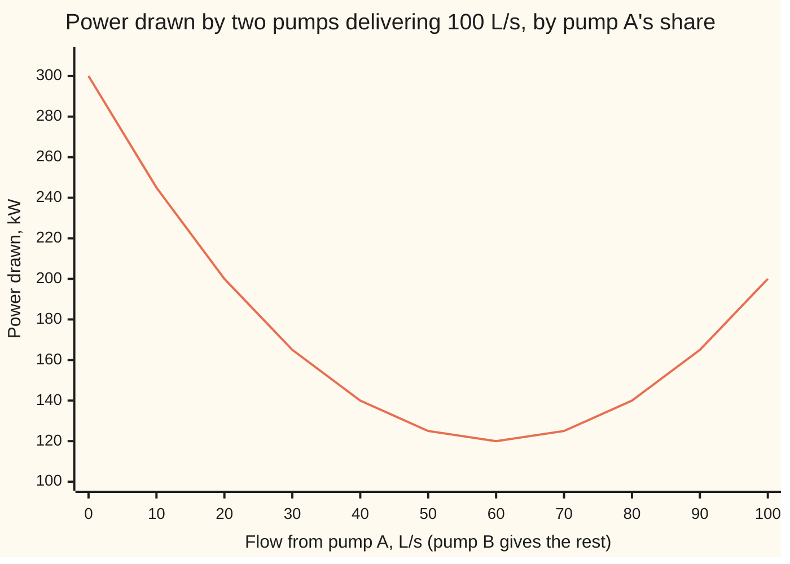

# Lagrange multipliers, proved: why the gradients must line up

[Syllabus](../../../SYLLABUS.md) → [Optimization](../README.md) → [Constrained Optimisation](../README.md#s03) → Lagrange multipliers, proved

---

## General Overview

A town needs 100 litres of water a second (L/s). Two pumps can supply it. Pump A draws 0.02 kW (kilowatts) times its flow squared; pump B, older, draws 0.03 kW times its flow squared. The job is to **minimise** the power drawn while the two flows add to exactly 100 L/s.

An even split, 50 and 50, draws 125 kW. The best split is 60 L/s from A and 40 from B, drawing 120 kW, which is £24 an hour at £0.20 per kWh. At that split each pump's **marginal cost** (the extra power for one more L/s) is the same: 2.4 kW per L/s. If one pump's marginal cost were lower, moving a litre a second onto it would save power. That common marginal cost, 2.4 kW per L/s, is the **multiplier**: the price of one more L/s of demand.

That is the one-rule case, proved on the calculus wing's [Lagrange multipliers](../../06-Calculus%20and%20analysis/07-Several%20Variables/08-lagrange-multipliers.md) card. A real network has more pumps and more rules. Add pump C, raise demand to 150 L/s, and add a second rule: the hill tank at the far end must be held at 35 m of **head** (pressure, measured as the height of water it would lift). This card proves that the gradients still line up, one multiplier per rule, under a condition that guarantees it and makes the multipliers unique: the rules' gradients are **linearly independent** (no rule's gradient is a combination of the others).

**At a best point where the rules' gradients are linearly independent, the gradient of the cost is a combination of the rules' gradients, and each rule's weight in that combination is the rate at which the best cost changes as that rule's amount changes.**

**What kind of fact this is:** a theorem, proved on this card in Why it works from the implicit function theorem; the price reading is proved there too, assuming the best plan moves smoothly with the amounts.

### The picture: two pumps, one fixed total



The line is the power of every split that meets the 100 L/s. It bottoms out at 120 kW with 60 L/s from pump A, where both pumps' marginal costs are 2.4 kW per L/s.

---

## The formula

Notation first, in words. The plan is a list of $n$ numbers $x = (x_1, \dots, x_n)$, here the pumps' flows. The cost $f(x)$ is minimised. There are $m$ rules, each written $g_j(x) = b_j$: a function of the plan must equal a fixed amount. Each rule gets a multiplier $\lambda_j$ ("lambda j"). The **Jacobian** $J$ is the grid whose row $j$ is the gradient $\nabla g_j$ at the plan ([Chain rule in several variables](../../06-Calculus%20and%20analysis/07-Several%20Variables/04-multivariable-chain-rule-and-jacobians.md)).

If $x^*$ is a local minimum of $f$ among plans obeying every rule, and the rows of $J$ at $x^*$ are linearly independent, then there are numbers $\lambda_1, \dots, \lambda_m$, exactly one list of them, with

$$\nabla f(x^*) = \lambda_1 \nabla g_1(x^*) + \dots + \lambda_m \nabla g_m(x^*), \qquad g_j(x^*) = b_j.$$

If also the best plan moves smoothly as the amounts change, each multiplier is a price. Write $p^*(b)$ for the least cost when the amounts are $b = (b_1, \dots, b_m)$; then

$$\lambda_j = \frac{\partial p^*}{\partial b_j}.$$

**Read it aloud:** at the best plan, the arrow of steepest cost rise is a weighted sum of the rules' arrows, the plan obeys every rule, and each weight is what one more unit of that rule's amount costs.

The independence condition has a name: **LICQ**, the linear independence constraint qualification (a "constraint qualification" is any condition on the rules that makes multipliers exist). The last equation, the price reading, is the **envelope theorem** for this problem.

For the three pumps, $f = 0.02x_1^2 + 0.03x_2^2 + 0.05x_3^2$ kW. Rule 1 is total flow, $x_1 + x_2 + x_3 = 150$ L/s. Rule 2 is head at the hill tank: near today's operating point, each L/s from pump A adds 0.1 m there, from B 0.2 m and from C 0.4 m, being nearer the hill. So $0.1x_1 + 0.2x_2 + 0.4x_3 = 35$ m. The formula becomes three equations, one per pump, plus the two rules:

$$2a_i x_i = \lambda_1 + \lambda_2 k_i \quad (i = 1, 2, 3).$$

Each pump's marginal cost equals the price of a litre plus the price of the head that litre adds.

| Symbol | Plain meaning | In our example | Push it up and the answer… |
| --- | --- | --- | --- |
| $x = (x_1, x_2, x_3)$, $x^*$ | the flows of pumps A, B, C; $x^*$ the best plan | (50, 50, 50) L/s | — |
| $f$ | the cost being minimised: power drawn | 250 kW, £50 an hour | — |
| $a_i$ | pump $i$'s power coefficient | 0.02, 0.03, 0.05 kW per (L/s)^2 | that pump is given less flow |
| $k_i$ | head at the hill tank per L/s from pump $i$ | 0.1, 0.2, 0.4 m per L/s | the best power falls, and so does the head price $\lambda_2$ |
| $g_j$, $b_j$ | rule $j$'s function and the amount it must equal | total flow = 150 L/s; head = 35 m | the best power rises by about $\lambda_j$ per unit |
| $n$, $m$ | how many choices; how many rules | 3, 2 | each rule removes one direction of free movement |
| $\nabla f$, $\nabla g_j$ | gradients: the arrows of partial rates | (2, 3, 5); (1, 1, 1) and (0.1, 0.2, 0.4) | — |
| $J$ | the rules' Jacobian, row $j$ = $\nabla g_j$ | `[[1, 1, 1], [0.1, 0.2, 0.4]]` | — |
| $\lambda_j$ | rule $j$'s multiplier, its price | 1 kW per L/s; 10 kW per m | — |
| $t$, $s$ | an allowed step (one with $Jt = 0$), and how far along it | $t = (2, -3, 1)$ | — |
| $p^*(b)$ | the least power, as a function of the amounts | 250 kW at (150 L/s, 35 m) | — |
| $u$, $w$, $W$, $\varphi$ | in the proof: free choices, solved choices, the function that solves them, and the cost as a function of the free choices | $u = x_1$, $w = (x_2, x_3)$ | — |

### When it holds

- **Smooth cost and rules.** $f$ and every $g_j$ need continuous partial rates near $x^*$. A kink, such as a pump that switches on at a threshold, has no gradient there.
- **LICQ: the rules' gradients are independent.** Write the demand rule twice, once as $2x_1 + 2x_2 + 2x_3 = 300$, and the multipliers stop being unique, so no single price exists. On a rule with a cusp, multipliers fail to exist at all (What breaks, below).
- **Equalities only.** A ceiling such as "head at most 40 m" adds sign conditions and a switch between binding and slack: [KKT conditions](02-kkt-conditions.md).
- **Necessary, not sufficient.** The equations list candidates. Here the cost is convex (it curves up in every direction) and the rules are straight, so the candidate is the global minimum ([Convexity pays off](../01-Convexity/04-local-minima-are-global-when-convex.md)). In general, curvature along the allowed directions decides: [Second-order conditions under constraints](03-second-order-conditions-for-constrained-problems.md).
- **The price needs a smoothly moving answer.** $\lambda_j = \partial p^*/\partial b_j$ assumes $x^*$ shifts smoothly as $b$ changes, and it is a first-order rate, not the exact cost of a whole unit.

---

## Why it works

### Step 0: no allowed step can lower the cost, and the allowed steps are exactly those the rules cannot see

Start from the best plan. A step $t$ changes rule $j$ at the rate $\nabla g_j \cdot t$, so a step that keeps every rule satisfied, to first order, has $Jt = 0$. At a minimum, no such step can lower the cost to first order, so $\nabla f \cdot t = 0$ for all of them. Linear algebra then says: an arrow at right angles to everything the rows of $J$ are at right angles to must be built from those rows. That is the formula.

The step that needs care is the middle one. $Jt = 0$ is a statement about straight lines, but the rules may bend. The implicit function theorem is what turns each straight step $t$ into a real path that obeys the rules, and it needs LICQ to do so.

### Step 1: the allowed steps form a flat space of $n - m$ directions

$J$ is $m$ rows by $n$ columns. If its rows are independent, the steps with $Jt = 0$ form a flat space of exactly $n - m$ directions. For the pumps, $n - m = 1$: one direction. It is at right angles to both $(1, 1, 1)$ and $(0.1, 0.2, 0.4)$, and the cross product gives $t = (2, -3, 1)$. In words: pump A up 2 L/s, B down 3, C up 1. Total flow changes by $2 - 3 + 1 = 0$. Head changes by $0.2 - 0.6 + 0.4 = 0$.

### Step 2: the implicit function theorem turns each allowed step into a real path

Pick $m$ of the choices whose columns of $J$ form an invertible square block. Independence of the rows guarantees such a block exists. For the pumps, take $w = (x_2, x_3)$: the block `[[1, 1], [0.2, 0.4]]` has determinant $0.4 - 0.2 = 0.2$, not zero. The remaining choices $u$, here $u = x_1$, are free.

The [Inverse and implicit function theorems](../../06-Calculus%20and%20analysis/07-Several%20Variables/07-inverse-and-implicit-function-theorems.md) card then gives a smooth function $W$ with $g(u, W(u)) = b$ near the best plan. Every nearby plan that obeys the rules is $(u, W(u))$ for some $u$. The rules have been solved for $w$, without writing the solution down.

### Step 3: the free choices face no rule, so their rates are zero

Put $W$ into the cost: $\varphi(u) = f(u, W(u))$. This is a function of the free choices alone, with no rules left, and it has a local minimum at $u^*$. So its gradient is zero there ([Extrema in several variables](../../06-Calculus%20and%20analysis/07-Several%20Variables/06-multivariable-extrema.md)). For the pumps, $\varphi$ is the power along the line through $(50, 50, 50)$ in direction $(2, -3, 1)$: $250 + 0.4s^2$ kW after a step of $s$. Its slope at $s = 0$ is $\nabla f \cdot t = 4 - 9 + 5 = 0$.

### Step 4: solve for the multipliers on the solved choices, and the free choices follow

Define $\lambda$ by the solved choices alone. Write $\nabla_w f$ for the cost's rates in those choices and $J_w$ for their columns of $J$ (the invertible block). Their rows of the formula, $\nabla_w f = J_w^{\mathsf T} \lambda$ ($^{\mathsf T}$ turns rows into columns), are $m$ equations in $m$ unknowns with an invertible matrix. For pumps B and C that is $\lambda_1 + 0.2\lambda_2 = 3$ and $\lambda_1 + 0.4\lambda_2 = 5$, so $\lambda_2 = 10$ and $\lambda_1 = 1$.

Step 3's zero rate then forces the free rows to agree. Pump A's row asks for $2 = \lambda_1 + 0.1\lambda_2 = 1 + 1$. It holds. Nothing was chosen to make it hold; the minimum did that.

The list $\lambda$ is unique: two lists giving the same combination of independent rows must be the same list.

<details>
<summary>Detailed proof: n choices, m independent rules</summary>

Let $f$ and $g = (g_1, \dots, g_m)$ have continuous partial rates near $x^*$, with $g(x^*) = b$ and $x^*$ a local minimum of $f$ on $\{x : g(x) = b\}$. Let $J$, the $m \times n$ Jacobian of $g$ at $x^*$, have independent rows, so rank $m$.

Rank $m$ means some $m$ columns are independent. Reorder the choices so these come last, $x = (u, w)$ with $u$ holding $n - m$ numbers and $w$ holding $m$, and split $J = [J_u \; J_w]$ with $J_w$ square and invertible.

By the implicit function theorem there is a neighbourhood of $u^*$ and a function $W$ with continuous partials, $W(u^*) = w^*$ and $g(u, W(u)) = b$, whose Jacobian is $DW(u^*) = -J_w^{-1} J_u$. Points $(u, W(u))$ obey the rules, so $\varphi(u) = f(u, W(u))$ has a local minimum at the inner point $u^*$, and its gradient is zero:

$$\nabla_u f + DW(u^*)^{\mathsf T} \nabla_w f = 0.$$

Set $\lambda = (J_w^{\mathsf T})^{-1} \nabla_w f$, so $\nabla_w f = J_w^{\mathsf T}\lambda$. Then

$$\nabla_u f = -DW^{\mathsf T} \nabla_w f = J_u^{\mathsf T} (J_w^{-1})^{\mathsf T} J_w^{\mathsf T} \lambda = J_u^{\mathsf T} \lambda.$$

Stacking the two pieces, $\nabla f(x^*) = J^{\mathsf T} \lambda = \sum_j \lambda_j \nabla g_j(x^*)$. If $J^{\mathsf T}\lambda = J^{\mathsf T}\lambda'$ then $J^{\mathsf T}(\lambda - \lambda') = 0$, and independent rows force $\lambda = \lambda'$.

</details>

### Step 5: each multiplier is the price of its rule

Let the amounts $b$ move, and suppose the best plan $x^*(b)$ moves smoothly with them. This holds when the full system of Lagrange equations has an invertible matrix, by the implicit function theorem again. That matrix is invertible when LICQ holds and the cost curves upward along the allowed steps, as it does for the pumps ($0.4s^2$ in Step 3); [Second-order conditions under constraints](03-second-order-conditions-for-constrained-problems.md) says which curvature to measure when the rules bend. The least cost is $p^*(b) = f(x^*(b))$.

By the chain rule, the rate of $p^*$ in $b_j$ is $\nabla f$ dotted with the plan's velocity $\partial x^*/\partial b_j$. Swap in $\nabla f = J^{\mathsf T}\lambda$: the rate becomes $\lambda^{\mathsf T}$ times $J\,\partial x^*/\partial b_j$. Now differentiate $g(x^*(b)) = b$ in $b_j$: $J\,\partial x^*/\partial b_j$ is the list with 1 in place $j$ and 0 elsewhere. So

$$\frac{\partial p^*}{\partial b_j} = \lambda_j.$$

For the pumps, one more L/s of demand costs about 1 kW (£0.20 an hour). One more metre of head at the hill tank costs about 10 kW (£2 an hour). Re-solving confirms it: 151 L/s needs 251.0377 kW, and 36 m needs 260.7750 kW. The extra 0.0377 and 0.7750 are the curvature of $p^*$, which a first-order price ignores.

---

## Worked numbers, by hand

Three pumps, 150 L/s in total, 35 m at the hill tank. Each pump's equation $2a_i x_i = \lambda_1 + \lambda_2 k_i$ gives its flow from the prices: $x_i = (\lambda_1 + \lambda_2 k_i)/(2a_i)$. Put those flows into the two rules and multiply by 6 to clear fractions.

| Step | Arithmetic | Value |
| --- | --- | --- |
| total-flow rule in prices | $25(\lambda_1 + 0.1\lambda_2) + \tfrac{50}{3}(\lambda_1 + 0.2\lambda_2) + 10(\lambda_1 + 0.4\lambda_2) = 150$, times 6 | $310\lambda_1 + 59\lambda_2 = 900$ |
| head rule in prices | the same flows weighted by 0.1, 0.2, 0.4, $= 35$, times 6 | $59\lambda_1 + 15.1\lambda_2 = 210$ |
| determinant | $310 \times 15.1 - 59 \times 59 = 4681 - 3481$ | 1200 |
| price of a litre | $(900 \times 15.1 - 59 \times 210)/1200 = 1200/1200$ | **$\lambda_1 = 1$ kW per L/s** |
| price of a metre | $(310 \times 210 - 59 \times 900)/1200 = 12000/1200$ | **$\lambda_2 = 10$ kW per m** |
| flows | $x_1 = 25 \times 2$, $x_2 = 3/0.06$, $x_3 = 10 \times 5$ | **50, 50, 50 L/s** |
| check the rules | $50 + 50 + 50$; $5 + 10 + 20$ | 150 L/s; 35 m |
| power | $0.02 \times 2500 + 0.03 \times 2500 + 0.05 \times 2500 = 50 + 75 + 125$ | **250 kW**, £50 an hour |
| along the allowed line | $f(50 + 2s, 50 - 3s, 50 + s)$ | $250 + 0.4s^2$ |

Run all three pumps at 50 L/s: 250 kW, the least any plan meeting both rules can draw, since every other plan on the line costs $0.4s^2$ more. One more L/s of demand would cost about £0.20 an hour, one more metre of head about £2.

### What breaks if you drop a piece

| Mistake | Comes out at | What went wrong |
| --- | --- | --- |
| Drop the head rule | 72.5806, 48.3871, 29.0323 L/s; 217.7419 kW; head 28.5484 m | Cheaper, but the hill tank is 6.4516 m short; the rule had a price of 10 kW per m for a reason |
| Write demand twice: add $2x_1 + 2x_2 + 2x_3 = 300$ | Lagrange system singular; (1, 0, 10) and (0, 0.5, 10) both fit exactly | LICQ fails: the rows of $J$ are dependent, so the demand price splits any way you like |
| A cusp: minimise $x_1$ on $x_2^2 = x_1^3$ | best plan (0, 0); $\nabla g = (0, 0)$; smallest residual over every $\lambda$ is 1 | LICQ fails: $\nabla f = (1, 0)$ is no multiple of the zero arrow, so no multiplier exists at a true minimum |
| Split two pumps evenly, matching flows not marginal costs | 125 kW against 120 | Pump B's marginal cost, 3 kW per L/s, beats A's 2; moving flow to A saves power |

The cusp is the curve $x_2^2 = x_1^3$, which has a sharp point at the origin. On it $x_1 = |x_2|^{2/3}$ is never below 0, so the origin is the minimum; the code confirms it by solving the rule for $x_1$ at 21 values of $x_2$, each by bisection (halving a bracket). The implicit function theorem fails there, Step 2 has no path to offer, and the formula fails with it.

---

## Code, from first principles, and it actually runs

The code reaches the answer by three independent roads. Road 1 builds the Lagrange equations as one linear system, 5 equations by 5 unknowns for the three pumps, and solves it by elimination with row swaps. Road 2 never uses a multiplier: it walks the line of allowed plans in direction $t$ and finds its lowest point by golden-section search (a bracket shrunk by the golden ratio each step). A cross-check solves for the multipliers from pumps B and C alone, as in the proof, and confirms pump A's row. Road 3 re-solves with each amount nudged up and down by one unit and compares the central difference (the change across the two nudges, halved) with $\lambda$. It ends with the three failures from the table.

### Python

```python
# Lagrange multipliers, proved -- the check behind the card.  Standard library only.
# Pumps feed one water main.  Choose the flows x_i (L/s) to MINIMISE the power drawn,
# f(x) = sum a_i x_i^2 (kW), subject to equality rules g_j(x) = b_j.
# Road 1 solves the Lagrange equations grad f = sum lam_j grad g_j, g = b, by elimination.
# Road 2 walks the allowed plans with no multiplier and searches them.
# Road 3 loosens each rule, re-solves, and reads the price off the change in cost.
A, K, KWH = [0.02, 0.03, 0.05], [0.1, 0.2, 0.4], 0.20   # kW per (L/s)^2; m per L/s; pounds per kWh

def gauss(M, r):                         # solve M z = r by elimination with row swaps
    n = len(r)
    M = [list(row) + [v] for row, v in zip(M, r)]
    for c in range(n):
        p = max(range(c, n), key=lambda i: abs(M[i][c]))
        if abs(M[p][c]) < 1e-12:
            return None                  # singular: no unique solution
        M[c], M[p] = M[p], M[c]
        for i in range(n):
            if i != c:
                m = M[i][c] / M[c][c]
                M[i] = [u - m * v for u, v in zip(M[i], M[c])]
    return [M[i][n] / M[i][i] for i in range(n)]

def lagrange(a, G, b):                   # unknowns x_1..x_n, then lam_1..lam_m
    n, m = len(a), len(G)
    M = [[2 * a[i] if j == i else 0 for j in range(n)] + [-G[j][i] for j in range(m)] for i in range(n)]
    M += [list(G[j]) + [0] * m for j in range(m)]
    return gauss(M, [0] * n + list(b))

cost = lambda a, x: sum(ai * xi * xi for ai, xi in zip(a, x))
dot = lambda u, v: sum(p * q for p, q in zip(u, v))
f4 = lambda v: ", ".join(f"{round(u, 9) + 0.0:.4f}" for u in v)   # + 0.0 turns -0 into 0
def resid(a, x, G, lam):                 # size of grad f - sum lam_j grad g_j
    r = [2 * a[i] * x[i] - sum(l * g[i] for l, g in zip(lam, G)) for i in range(len(x))]
    return dot(r, r) ** 0.5

# ---- two pumps, 100 L/s in total: the one-rule case ----
x1, x2, lam = lagrange(A[:2], [[1, 1]], [100])
scan = min(range(101), key=lambda q: cost(A[:2], [q, 100 - q]))
print(f"two pumps: flows {f4([x1, x2])} L/s, marginal costs {f4([2 * A[0] * x1, 2 * A[1] * x2])} kW per L/s")
print(f"two pumps: lambda {lam:.4f} kW per L/s, power {cost(A[:2], [x1, x2]):.4f} kW, {KWH * cost(A[:2], [x1, x2]):.4f} pounds per hour")
print(f"two pumps: integer scan finds {scan} L/s from pump A; even split costs {cost(A[:2], [50, 50]):.4f} kW, marginal costs {f4([2 * A[0] * 50, 2 * A[1] * 50])}")
print("chart, power (kW) at pump A = 0, 10, ..., 100 L/s:", " ".join(f"{cost(A[:2], [q, 100 - q]):g}" for q in range(0, 101, 10)))
assert scan == round(x1) and abs(cost(A[:2], [scan, 100 - scan]) - cost(A[:2], [x1, x2])) < 1e-9

# ---- three pumps, two rules: total flow 150 L/s and 35 m of head at the hill tank ----
G, b = [[1, 1, 1], K], [150, 35]
*x, l1, l2 = lagrange(A, G, b)
p0 = cost(A, x)
h = [6 * sum(K[i] ** e / (2 * A[i]) for i in range(3)) for e in (0, 1, 2)]   # x_i = (lam1 + lam2 k_i) / (2 a_i)
print(f"hand elimination, times 6: {h[0]:.1f} lam1 + {h[1]:.1f} lam2 = {6 * b[0]:.1f}; {h[1]:.1f} lam1 + {h[2]:.1f} lam2 = {6 * b[1]:.1f}; det {h[0] * h[2] - h[1] ** 2:.1f}")
print(f"three pumps: flows {f4(x)} L/s, lambda1 {l1:.4f} kW per L/s, lambda2 {l2:.4f} kW per m")
print(f"three pumps: power {p0:.4f} kW, {KWH * p0:.4f} pounds per hour; prices {KWH * l1:.4f} pounds/h per L/s, {KWH * l2:.4f} pounds/h per m")
print(f"grad f = ({f4([2 * A[i] * x[i] for i in range(3)])}); residual {"below" if resid(A, x, G, [l1, l2]) < 1e-12 else "ABOVE"} 1e-12")
t = [10 * (G[0][1] * K[2] - G[0][2] * K[1]), 10 * (G[0][2] * K[0] - G[0][0] * K[2]), 10 * (G[0][0] * K[1] - G[0][1] * K[0])]
print(f"allowed step t = ({f4(t)}); rule rates {f4([dot(G[0], t), dot(K, t)])}; grad f . t = {f4([dot([2 * A[i] * x[i] for i in range(3)], t)])}")
line = lambda s: cost(A, [x[i] + s * t[i] for i in range(3)])
lo, hi, r = -25.0, 50 / 3, (5 ** 0.5 - 1) / 2   # every pump flow stays at or above zero
for _ in range(200):
    p, q = hi - r * (hi - lo), lo + r * (hi - lo)
    if line(p) < line(q): hi = q
    else: lo = p
s = (lo + hi) / 2
print(f"road 2, golden-section search along the line: s = {f4([s])}, power {line(s):.4f} kW")
print("power along the line at s = -2, -1, 0, 1, 2:", f4([line(u) for u in (-2, -1, 0, 1, 2)]))
assert abs(s) < 1e-6 and resid(A, x, G, [l1, l2]) < 1e-12 and abs(line(s) - p0) < 1e-9 and abs(line(1) - p0 - 0.4) < 1e-9
w = gauss([[1, K[1]], [1, K[2]]], [2 * A[1] * x[1], 2 * A[2] * x[2]])   # solve for lam from pumps B, C
print(f"implicit-function road, pumps B and C solved for: lambda = ({f4(w)}); pump A row {2 * A[0] * x[0]:.4f} = {w[0] + w[1] * K[0]:.4f}")
assert abs(w[0] - l1) < 1e-9 and abs(w[1] - l2) < 1e-9 and abs(2 * A[0] * x[0] - w[0] - w[1] * K[0]) < 1e-9
pstar = lambda bb: cost(A, lagrange(A, G, bb)[:3])
d1 = (pstar([151, 35]) - pstar([149, 35])) / 2
d2 = (pstar([150, 36]) - pstar([150, 34])) / 2
print(f"road 3, re-solved: 151 L/s costs {pstar([151, 35]):.4f} kW (+{pstar([151, 35]) - p0:.4f}); 36 m costs {pstar([150, 36]):.4f} kW (+{pstar([150, 36]) - p0:.4f})")
print(f"road 3, central differences: {d1:.4f} kW per L/s, {d2:.4f} kW per m")
assert abs(d1 - l1) < 1e-9 and abs(d2 - l2) < 1e-9

# ---- what breaks ----
*y, mu = lagrange(A, [[1, 1, 1]], [150])
print(f"no head rule: flows {f4(y)} L/s, power {cost(A, y):.4f} kW, head {dot(K, y):.4f} m, {b[1] - dot(K, y):.4f} m short")
D = [[1, 1, 1], [2, 2, 2], K]
print("demand written twice: Lagrange system", "singular" if lagrange(A, D, [150, 300, 35]) is None else "solvable")
for lam3 in ([l1, 0, l2], [0, l1 / 2, l2]):
    print(f"  multipliers ({f4(lam3)}) leave residual {"below" if resid(A, x, D, lam3) < 1e-12 else "ABOVE"} 1e-12")
assert lagrange(A, D, [150, 300, 35]) is None and resid(A, x, D, [0, l1 / 2, l2]) < 1e-9
print(f"head rule written as -k.x = -35: lambda2 = {lagrange(A, [[1, 1, 1], [-k for k in K]], [150, -35])[4]:.4f}")
gc, e = lambda p: p[1] ** 2 - p[0] ** 3, 1e-6     # the rule g = x2^2 - x1^3; grad g by central difference
gf, gg = [1, 0], [(gc([e, 0]) - gc([-e, 0])) / (2 * e), (gc([0, e]) - gc([0, -e])) / (2 * e)]
best = min(((gf[0] - l * gg[0]) ** 2 + (gf[1] - l * gg[1]) ** 2) ** 0.5 for l in [u / 10 for u in range(-1000, 1001)])
def root(x2):                            # the x1 with g(x1, x2) = 0, by bisection: g falls as x1 rises
    lo, hi = -1.0, 2.0
    for _ in range(60):
        if gc([(lo + hi) / 2, x2]) > 0: lo = (lo + hi) / 2
        else: hi = (lo + hi) / 2
    return (lo + hi) / 2
cusp = min((root(u / 10), u / 10) for u in range(-10, 11))   # 21 points on the curve, lowest x1 first
print(f"cusp, minimise x1 on x2^2 = x1^3: grad g at (0, 0) = ({f4(gg)}); best residual over lambda {best:.4f}; lowest of 21 curve points ({f4(cusp)})")
assert best > 0.99 and abs(cusp[0]) < 1e-9 and abs(cusp[1]) < 1e-9
print("ALL CHECKS PASS")
```

**Ran 2026-11-11 on macOS, Python 3.14.10, standard library only. All checks passed. Output, pasted from the run:**

```
two pumps: flows 60.0000, 40.0000 L/s, marginal costs 2.4000, 2.4000 kW per L/s
two pumps: lambda 2.4000 kW per L/s, power 120.0000 kW, 24.0000 pounds per hour
two pumps: integer scan finds 60 L/s from pump A; even split costs 125.0000 kW, marginal costs 2.0000, 3.0000
chart, power (kW) at pump A = 0, 10, ..., 100 L/s: 300 245 200 165 140 125 120 125 140 165 200
hand elimination, times 6: 310.0 lam1 + 59.0 lam2 = 900.0; 59.0 lam1 + 15.1 lam2 = 210.0; det 1200.0
three pumps: flows 50.0000, 50.0000, 50.0000 L/s, lambda1 1.0000 kW per L/s, lambda2 10.0000 kW per m
three pumps: power 250.0000 kW, 50.0000 pounds per hour; prices 0.2000 pounds/h per L/s, 2.0000 pounds/h per m
grad f = (2.0000, 3.0000, 5.0000); residual below 1e-12
allowed step t = (2.0000, -3.0000, 1.0000); rule rates 0.0000, 0.0000; grad f . t = 0.0000
road 2, golden-section search along the line: s = 0.0000, power 250.0000 kW
power along the line at s = -2, -1, 0, 1, 2: 251.6000, 250.4000, 250.0000, 250.4000, 251.6000
implicit-function road, pumps B and C solved for: lambda = (1.0000, 10.0000); pump A row 2.0000 = 2.0000
road 3, re-solved: 151 L/s costs 251.0377 kW (+1.0377); 36 m costs 260.7750 kW (+10.7750)
road 3, central differences: 1.0000 kW per L/s, 10.0000 kW per m
no head rule: flows 72.5806, 48.3871, 29.0323 L/s, power 217.7419 kW, head 28.5484 m, 6.4516 m short
demand written twice: Lagrange system singular
  multipliers (1.0000, 0.0000, 10.0000) leave residual below 1e-12
  multipliers (0.0000, 0.5000, 10.0000) leave residual below 1e-12
head rule written as -k.x = -35: lambda2 = -10.0000
cusp, minimise x1 on x2^2 = x1^3: grad g at (0, 0) = (0.0000, 0.0000); best residual over lambda 1.0000; lowest of 21 curve points (0.0000, 0.0000)
ALL CHECKS PASS
```

### Rust

Same numbers, same labels, built with `rustc --edition 2021 -O`.

```rust
// Lagrange multipliers, proved -- the same check as the Python, in Rust.  No crates.
// Pumps feed one water main.  Choose the flows x_i (L/s) to MINIMISE the power drawn,
// f(x) = sum a_i x_i^2 (kW), subject to equality rules g_j(x) = b_j.
// Road 1 solves the Lagrange equations grad f = sum lam_j grad g_j, g = b, by elimination.
// Road 2 walks the allowed plans with no multiplier and searches them.
// Road 3 loosens each rule, re-solves, and reads the price off the change in cost.
const A: [f64; 3] = [0.02, 0.03, 0.05]; // kW per (L/s)^2
const K: [f64; 3] = [0.1, 0.2, 0.4]; // m of head per L/s
const KWH: f64 = 0.20; // pounds per kWh

fn gauss(m0: &[Vec<f64>], r: &[f64]) -> Option<Vec<f64>> { // solve M z = r with row swaps
    let n = r.len();
    let mut m: Vec<Vec<f64>> = m0.iter().zip(r).map(|(row, v)| { let mut w = row.clone(); w.push(*v); w }).collect();
    for c in 0..n {
        let mut p = c;
        for i in c..n { if m[i][c].abs() > m[p][c].abs() { p = i } }
        if m[p][c].abs() < 1e-12 { return None } // singular: no unique solution
        m.swap(c, p);
        for i in 0..n {
            if i != c {
                let k = m[i][c] / m[c][c];
                let pivot = m[c].clone();
                for (u, v) in m[i].iter_mut().zip(pivot.iter()) { *u -= k * v }
            }
        }
    }
    Some((0..n).map(|i| m[i][n] / m[i][i]).collect())
}

fn lagrange(a: &[f64], g: &[Vec<f64>], b: &[f64]) -> Option<Vec<f64>> { // x_1..x_n, then lam_1..lam_m
    let (n, mm) = (a.len(), g.len());
    let mut m: Vec<Vec<f64>> = (0..n).map(|i| {
        let mut row: Vec<f64> = (0..n).map(|j| if j == i { 2.0 * a[i] } else { 0.0 }).collect();
        row.extend((0..mm).map(|j| -g[j][i]));
        row
    }).collect();
    for j in 0..mm { let mut row = g[j].clone(); row.extend(vec![0.0; mm]); m.push(row) }
    let mut rhs = vec![0.0; n];
    rhs.extend_from_slice(b);
    gauss(&m, &rhs)
}

fn cost(a: &[f64], x: &[f64]) -> f64 { a.iter().zip(x).map(|(ai, xi)| ai * xi * xi).sum() }
fn dot(u: &[f64], v: &[f64]) -> f64 { u.iter().zip(v).map(|(p, q)| p * q).sum() }
fn f4(v: &[f64]) -> String { // + 0.0 turns -0 into 0
    v.iter().map(|u| format!("{:.4}", (u * 1e9).round() / 1e9 + 0.0)).collect::<Vec<_>>().join(", ")
}
fn resid(a: &[f64], x: &[f64], g: &[Vec<f64>], lam: &[f64]) -> f64 { // size of grad f - sum lam_j grad g_j
    let r: Vec<f64> = (0..x.len()).map(|i| 2.0 * a[i] * x[i] - lam.iter().zip(g).map(|(l, gj)| l * gj[i]).sum::<f64>()).collect();
    dot(&r, &r).sqrt()
}
fn below(v: f64) -> &'static str { if v < 1e-12 { "below" } else { "ABOVE" } }

fn main() {
    // ---- two pumps, 100 L/s in total: the one-rule case ----
    let a2 = &A[..2];
    let z = lagrange(a2, &[vec![1.0, 1.0]], &[100.0]).unwrap();
    let (x1, x2, lam) = (z[0], z[1], z[2]);
    let c2 = |q: f64| cost(a2, &[q, 100.0 - q]);
    let mut scan = 0;
    for q in 0..=100 { if c2(q as f64) < c2(scan as f64) { scan = q } }
    println!("two pumps: flows {} L/s, marginal costs {} kW per L/s", f4(&[x1, x2]), f4(&[2.0 * A[0] * x1, 2.0 * A[1] * x2]));
    println!("two pumps: lambda {:.4} kW per L/s, power {:.4} kW, {:.4} pounds per hour", lam, c2(x1), KWH * c2(x1));
    println!("two pumps: integer scan finds {} L/s from pump A; even split costs {:.4} kW, marginal costs {}", scan, c2(50.0), f4(&[2.0 * A[0] * 50.0, 2.0 * A[1] * 50.0]));
    let chart: Vec<String> = (0..=10).map(|k| format!("{}", (c2(10.0 * k as f64) * 1e6).round() / 1e6)).collect();
    println!("chart, power (kW) at pump A = 0, 10, ..., 100 L/s: {}", chart.join(" "));
    assert!(scan as f64 == x1.round() && (c2(scan as f64) - cost(a2, &[x1, x2])).abs() < 1e-9);

    // ---- three pumps, two rules: total flow 150 L/s and 35 m of head at the hill tank ----
    let g: Vec<Vec<f64>> = vec![vec![1.0, 1.0, 1.0], K.to_vec()];
    let z = lagrange(&A, &g, &[150.0, 35.0]).unwrap();
    let (x, l1, l2) = (z[..3].to_vec(), z[3], z[4]);
    let p0 = cost(&A, &x);
    let h: Vec<f64> = (0..3).map(|e| 6.0 * (0..3).map(|i| K[i].powi(e) / (2.0 * A[i])).sum::<f64>()).collect(); // x_i = (lam1 + lam2 k_i) / (2 a_i)
    println!("hand elimination, times 6: {:.1} lam1 + {:.1} lam2 = {:.1}; {:.1} lam1 + {:.1} lam2 = {:.1}; det {:.1}",
             h[0], h[1], 6.0 * 150.0, h[1], h[2], 6.0 * 35.0, h[0] * h[2] - h[1] * h[1]);
    let gf: Vec<f64> = (0..3).map(|i| 2.0 * A[i] * x[i]).collect();
    println!("three pumps: flows {} L/s, lambda1 {:.4} kW per L/s, lambda2 {:.4} kW per m", f4(&x), l1, l2);
    println!("three pumps: power {:.4} kW, {:.4} pounds per hour; prices {:.4} pounds/h per L/s, {:.4} pounds/h per m", p0, KWH * p0, KWH * l1, KWH * l2);
    println!("grad f = ({}); residual {} 1e-12", f4(&gf), below(resid(&A, &x, &g, &[l1, l2])));
    let o = &g[0];
    let t = [10.0 * (o[1] * K[2] - o[2] * K[1]), 10.0 * (o[2] * K[0] - o[0] * K[2]), 10.0 * (o[0] * K[1] - o[1] * K[0])];
    println!("allowed step t = ({}); rule rates {}; grad f . t = {}", f4(&t), f4(&[dot(o, &t), dot(&K, &t)]), f4(&[dot(&gf, &t)]));
    let line = |s: f64| cost(&A, &[x[0] + s * t[0], x[1] + s * t[1], x[2] + s * t[2]]);
    let (mut lo, mut hi, r) = (-25.0, 50.0 / 3.0, (5f64.sqrt() - 1.0) / 2.0); // every pump flow stays at or above zero
    for _ in 0..200 {
        let (p, q) = (hi - r * (hi - lo), lo + r * (hi - lo));
        if line(p) < line(q) { hi = q } else { lo = p }
    }
    let s = (lo + hi) / 2.0;
    println!("road 2, golden-section search along the line: s = {}, power {:.4} kW", f4(&[s]), line(s));
    println!("power along the line at s = -2, -1, 0, 1, 2: {}", f4(&[line(-2.0), line(-1.0), line(0.0), line(1.0), line(2.0)]));
    assert!(s.abs() < 1e-6 && resid(&A, &x, &g, &[l1, l2]) < 1e-12 && (line(s) - p0).abs() < 1e-9 && (line(1.0) - p0 - 0.4).abs() < 1e-9);
    let w = gauss(&[vec![1.0, K[1]], vec![1.0, K[2]]], &[gf[1], gf[2]]).unwrap(); // solve for lam from pumps B, C
    println!("implicit-function road, pumps B and C solved for: lambda = ({}); pump A row {:.4} = {:.4}", f4(&w), gf[0], w[0] + w[1] * K[0]);
    assert!((w[0] - l1).abs() < 1e-9 && (w[1] - l2).abs() < 1e-9 && (gf[0] - w[0] - w[1] * K[0]).abs() < 1e-9);
    let pstar = |b1: f64, b2: f64| cost(&A, &lagrange(&A, &g, &[b1, b2]).unwrap()[..3]);
    let d1 = (pstar(151.0, 35.0) - pstar(149.0, 35.0)) / 2.0;
    let d2 = (pstar(150.0, 36.0) - pstar(150.0, 34.0)) / 2.0;
    println!("road 3, re-solved: 151 L/s costs {:.4} kW (+{:.4}); 36 m costs {:.4} kW (+{:.4})",
             pstar(151.0, 35.0), pstar(151.0, 35.0) - p0, pstar(150.0, 36.0), pstar(150.0, 36.0) - p0);
    println!("road 3, central differences: {:.4} kW per L/s, {:.4} kW per m", d1, d2);
    assert!((d1 - l1).abs() < 1e-9 && (d2 - l2).abs() < 1e-9);

    // ---- what breaks ----
    let y = lagrange(&A, &[vec![1.0, 1.0, 1.0]], &[150.0]).unwrap()[..3].to_vec();
    println!("no head rule: flows {} L/s, power {:.4} kW, head {:.4} m, {:.4} m short", f4(&y), cost(&A, &y), dot(&K, &y), 35.0 - dot(&K, &y));
    let d: Vec<Vec<f64>> = vec![vec![1.0, 1.0, 1.0], vec![2.0, 2.0, 2.0], K.to_vec()];
    let sing = lagrange(&A, &d, &[150.0, 300.0, 35.0]).is_none();
    println!("demand written twice: Lagrange system {}", if sing { "singular" } else { "solvable" });
    for lam3 in [[l1, 0.0, l2], [0.0, l1 / 2.0, l2]] {
        println!("  multipliers ({}) leave residual {} 1e-12", f4(&lam3), below(resid(&A, &x, &d, &lam3)));
    }
    assert!(sing && resid(&A, &x, &d, &[0.0, l1 / 2.0, l2]) < 1e-12);
    let neg = lagrange(&A, &[vec![1.0, 1.0, 1.0], K.iter().map(|k| -k).collect()], &[150.0, -35.0]).unwrap();
    println!("head rule written as -k.x = -35: lambda2 = {:.4}", neg[4]);
    let (gc, e) = (|p: [f64; 2]| p[1] * p[1] - p[0].powi(3), 1e-6); // the rule g = x2^2 - x1^3; grad g by central difference
    let (gfc, ggc) = ([1.0, 0.0], [(gc([e, 0.0]) - gc([-e, 0.0])) / (2.0 * e), (gc([0.0, e]) - gc([0.0, -e])) / (2.0 * e)]);
    let best = (-1000..=1000).map(|u| u as f64 / 10.0)
        .map(|l| ((gfc[0] - l * ggc[0]).powi(2) + (gfc[1] - l * ggc[1]).powi(2)).sqrt()).fold(f64::INFINITY, f64::min);
    let root = |x2: f64| { // the x1 with g(x1, x2) = 0, by bisection: g falls as x1 rises
        let (mut lo, mut hi) = (-1.0f64, 2.0f64);
        for _ in 0..60 { if gc([(lo + hi) / 2.0, x2]) > 0.0 { lo = (lo + hi) / 2.0 } else { hi = (lo + hi) / 2.0 } }
        (lo + hi) / 2.0
    };
    let cusp = (-10..=10).map(|u| [root(u as f64 / 10.0), u as f64 / 10.0]) // 21 points on the curve, lowest x1 first
        .fold([f64::INFINITY, 0.0], |a, p| if p[0] < a[0] { p } else { a });
    println!("cusp, minimise x1 on x2^2 = x1^3: grad g at (0, 0) = ({}); best residual over lambda {:.4}; lowest of 21 curve points ({})", f4(&ggc), best, f4(&cusp));
    assert!(best > 0.99 && cusp[0].abs() < 1e-9 && cusp[1].abs() < 1e-9);
    println!("ALL CHECKS PASS");
}
```

**Ran 2026-11-11 on macOS, rustc 1.98.1, no crates. All checks passed. Output, pasted from the run:**

```
two pumps: flows 60.0000, 40.0000 L/s, marginal costs 2.4000, 2.4000 kW per L/s
two pumps: lambda 2.4000 kW per L/s, power 120.0000 kW, 24.0000 pounds per hour
two pumps: integer scan finds 60 L/s from pump A; even split costs 125.0000 kW, marginal costs 2.0000, 3.0000
chart, power (kW) at pump A = 0, 10, ..., 100 L/s: 300 245 200 165 140 125 120 125 140 165 200
hand elimination, times 6: 310.0 lam1 + 59.0 lam2 = 900.0; 59.0 lam1 + 15.1 lam2 = 210.0; det 1200.0
three pumps: flows 50.0000, 50.0000, 50.0000 L/s, lambda1 1.0000 kW per L/s, lambda2 10.0000 kW per m
three pumps: power 250.0000 kW, 50.0000 pounds per hour; prices 0.2000 pounds/h per L/s, 2.0000 pounds/h per m
grad f = (2.0000, 3.0000, 5.0000); residual below 1e-12
allowed step t = (2.0000, -3.0000, 1.0000); rule rates 0.0000, 0.0000; grad f . t = 0.0000
road 2, golden-section search along the line: s = 0.0000, power 250.0000 kW
power along the line at s = -2, -1, 0, 1, 2: 251.6000, 250.4000, 250.0000, 250.4000, 251.6000
implicit-function road, pumps B and C solved for: lambda = (1.0000, 10.0000); pump A row 2.0000 = 2.0000
road 3, re-solved: 151 L/s costs 251.0377 kW (+1.0377); 36 m costs 260.7750 kW (+10.7750)
road 3, central differences: 1.0000 kW per L/s, 10.0000 kW per m
no head rule: flows 72.5806, 48.3871, 29.0323 L/s, power 217.7419 kW, head 28.5484 m, 6.4516 m short
demand written twice: Lagrange system singular
  multipliers (1.0000, 0.0000, 10.0000) leave residual below 1e-12
  multipliers (0.0000, 0.5000, 10.0000) leave residual below 1e-12
head rule written as -k.x = -35: lambda2 = -10.0000
cusp, minimise x1 on x2^2 = x1^3: grad g at (0, 0) = (0.0000, 0.0000); best residual over lambda 1.0000; lowest of 21 curve points (0.0000, 0.0000)
ALL CHECKS PASS
```

The two outputs match line for line.

> [!TIP]
> **Try changing**
> Guess first, then run it. The asserts are pinned to this network, so expect some to stop it.
> - **Guess first: does a cheaper pump C take more flow?** Change `0.05` in `A` to `0.04`. Flows become 52.5641, 46.1538 and 51.2821 L/s, power 224.3590 kW, prices 1.4359 kW per L/s and 6.6667 kW per m. The line's curvature changes, so an assert stops it.
> - **Guess first: can more demand ever be cheaper?** Change `[150, 35]` to `[150, 40]`. Power rises to 319.3750 kW and $\lambda_1$ turns negative, −0.4750 kW per L/s: an extra L/s, sent through pump A, lets the plan lean less on pump C, the dearest. An equality rule's price can have either sign.
> - **Guess first: what if every pump lifts the hill tank equally?** Set `K` to `[0.2, 0.2, 0.2]`. Head becomes 0.2 times total flow, so 150 L/s fixes it at 0.2 × 150 = 30 m, and it can never reach 35 m: the two rules contradict each other. Their gradients are parallel, so the system is singular and the script stops at the three-pump solve.
> - **Guess first: what does dearer electricity change?** Set `KWH` to `0.30`. The flows and kilowatt prices stay put; the bill becomes £75 an hour, and the prices £0.30 and £3 an hour.

---

## The usual mistake

> [!warning]
> **Assuming every minimum satisfies the multiplier equations.** They are guaranteed only where the rules are regular (here, where LICQ holds); elsewhere they may fail. At the cusp $x_2^2 = x_1^3$ the minimum is the origin, the rule's gradient is $(0, 0)$, and no multiplier makes $\nabla f = (1, 0)$ balance: the smallest mismatch over all $\lambda$ is 1. A solver that only looks for Lagrange points will never find that minimum, so check the rule's gradients at the answer.
>
> - **Ignoring which way a rule is written.** Write the head rule as $-0.1x_1 - 0.2x_2 - 0.4x_3 = -35$ and the same plan comes back with $\lambda_2 = -10$. The price is per unit of $b_j$ as written.
> - **Reading a price off a duplicated rule.** With demand stated twice, (1, 0, 10) and (0, 0.5, 10) fit equally well. Only independent rules have prices.
> - **Taking the price as exact.** One more metre of head is priced at 10 kW but costs 10.7750; the price is a slope.
> - **Matching flows instead of marginal costs.** The even two-pump split draws 125 kW against 120.

---

## Where you meet it in real life

- **Water and power dispatch.** Operators split load between pumps or power stations so that marginal costs match; the common value, the multiplier on demand, is the system's marginal price. Electricity markets publish it as the price at each node.
- **Economics.** A household's best spending under a budget has a multiplier on the budget: the worth of one more pound.
- **Finance.** The efficient frontier minimises risk for a set return and a full budget: two rules, two multipliers. See [The efficient frontier](../../12-Financial%20mathematics/37-Portfolio%20Theory/02-efficient-frontier-and-minimum-variance.md).

> **Say it back**
> At the best plan, no step that keeps every rule can lower the cost, so the cost's gradient is at right angles to all such steps. When the rules' gradients are independent, the implicit function theorem makes every such step a real path, and linear algebra then makes the cost's gradient a combination of the rules' gradients. The weights are the multipliers, one per rule, and they are unique. Each multiplier is the rate at which the least cost changes as that rule's amount changes: for the pumps, 1 kW per L/s of demand and 10 kW per metre of head. When the rules' gradients are dependent, prices stop being unique, and at a cusp multipliers do not exist at all.

---

## What this builds on

- [Lagrange multipliers](../../06-Calculus%20and%20analysis/07-Several%20Variables/08-lagrange-multipliers.md): one rule in the plane, the gradients lining up, and the multiplier as a price. This card extends it to many choices and many rules.
- [Inverse and implicit function theorems](../../06-Calculus%20and%20analysis/07-Several%20Variables/07-inverse-and-implicit-function-theorems.md): when a set of equations can be solved for some unknowns near a known point. Step 2 runs on it.

## Where this goes next

- [KKT conditions](02-kkt-conditions.md): rules with a ceiling, such as "head at most 40 m", where a multiplier must be zero or of one sign.
- [Second-order conditions under constraints](03-second-order-conditions-for-constrained-problems.md): telling a minimum from other candidates using curvature on the allowed steps only.
- [Lagrangian duality](04-lagrangian-duality-weak-and-strong.md): treating the prices as the unknowns and solving for them first.

This card assumes a best plan exists and prices it; whether the prices themselves can certify that nothing does better is the question duality takes up.

---

## Sources

Verified 2026-11-11: every link below resolves to the publisher's page.

- Nocedal, Jorge, and Stephen J. Wright. *Numerical Optimization*, 2nd ed. Springer, 2006. [doi:10.1007/978-0-387-40065-5](https://doi.org/10.1007/978-0-387-40065-5). Chapter 12 states LICQ and proves the first-order conditions using the implicit function theorem.
- Rockafellar, R. Tyrrell. "Lagrange Multipliers and Optimality." *SIAM Review* 35, no. 2 (1993): 183–238. [doi:10.1137/1035044](https://doi.org/10.1137/1035044). Why multipliers exist, when they fail, and their reading as prices.
- Mangasarian, O. L., and S. Fromovitz. "The Fritz John Necessary Optimality Conditions in the Presence of Equality and Inequality Constraints." *Journal of Mathematical Analysis and Applications* 17, no. 1 (1967): 37–47. [doi:10.1016/0022-247X(67)90163-1](https://doi.org/10.1016/0022-247X(67)90163-1). A weaker regularity condition than LICQ, and what happens without one.
- Boyd, Stephen, and Lieven Vandenberghe. *Convex Optimization*. Cambridge University Press, 2004. [Publisher page](https://www.cambridge.org/core/books/convex-optimization/17D2FAA54F641A2F62C7CCD01DFA97C4). Section 5.6: multipliers as the sensitivity of the optimal value to the amounts.
