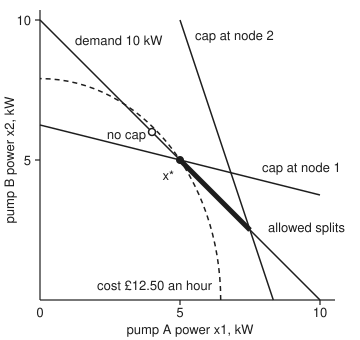
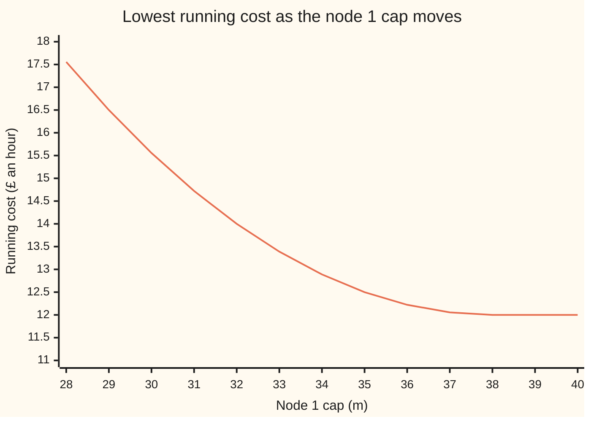

# KKT conditions: the checklist when inequalities can bind or slacken

[Syllabus](../../../SYLLABUS.md) → [Optimization](../README.md) → [Constrained Optimisation](../README.md#s03) → KKT conditions

---

## General Overview

A small water network has two pumps, A and B. Together they must deliver 10 kW of pumping power to meet the evening demand. The operator **chooses** how hard to run each pump, wants the **running cost made as small as possible**, and is **limited** by two pressure caps. Pressure is measured as head: the height, in metres, that a column of water would rise to. Neither of the two nodes in the network, node 1 and node 2, may go above 35 m, or old pipes start to leak.

Each pump's running cost grows faster than its power, because a pump pushed hard runs less efficiently and wears faster. Pump B is the cheaper one to push hard. Ignoring the caps, the cheapest split is 4 kW on A and 6 kW on B, at £12.00 an hour. But pump B sits close to node 1, and that split drives node 1 to 38 m, 3 m over its cap. So the operator shifts load back to pump A until node 1 sits exactly at 35 m: 5 kW each, at £12.50 an hour. Node 2 ends 5 m under its cap and plays no part.

At the answer, some "at most" limits **bind** (sit exactly at their edge) and some **slacken** (have room to spare). The KKT conditions, named after Karush, Kuhn and Tucker, are a four-point checklist for such an answer. Each binding limit gets a price, its **multiplier**: here £0.3333 an hour per metre of cap at node 1. Each slack limit gets a price of zero. In a convex problem, passing the checklist proves no other split is cheaper.

**At a best point, the cost's slope is balanced by non-negative prices on the binding limits and zero prices on the slack ones; in a convex problem that balance proves the point is best, and at any minimum it exists once a constraint qualification holds.**

**What kind of fact this is:** a theorem in two halves. Sufficiency: in a convex problem, a point that passes all four checks is a global minimum, proved in full on this card in Why it works. Necessity: at a local minimum where a constraint qualification holds, multipliers passing all four checks exist; this card proves it in outline in a fold, quoting one step (the tangent directions) from the textbook named there.

### The picture: the demand line, two caps and the cost

<p align="center"></p>

Every split that meets the demand lies on the long diagonal. The node 1 cap allows only points below its line, the node 2 cap only points left of its line, which leaves the bold stretch: pump A from 5 to 7.5 kW. The cheapest point on the whole diagonal is the hollow dot, "no cap", above the node 1 line and ruled out. The cheapest allowed split is the end of the bold stretch, x*, where the node 1 cap binds. The dashed curve is every split costing £12.50 an hour.

---

## The formula

This card introduces, in words first, the wing's names for the two kinds of price. Each "at most" limit $f_i(x) \le 0$ gets a multiplier $\lambda_i$ that must be zero or positive; each "exactly" limit $h_j(x) = 0$ gets a multiplier $\nu_j$ (say "nu") of any sign. The problem is the standard form of [The standard convex problem](../01-Convexity/10-the-convex-problem-in-standard-form.md): minimise $f_0(x)$ subject to $f_i(x) \le 0$ and $h_j(x) = 0$. A point $x^*$ with multipliers $\lambda$ and $\nu$ passes the KKT conditions when

$$
\begin{aligned}
&\text{1. primal feasibility:} && f_i(x^*) \le 0, \quad h_j(x^*) = 0\\
&\text{2. dual feasibility:} && \lambda_i \ge 0\\
&\text{3. complementary slackness:} && \lambda_i\, f_i(x^*) = 0 \ \text{ for every } i\\
&\text{4. stationarity:} && \nabla f_0(x^*) + \sum_i \lambda_i \nabla f_i(x^*) + \sum_j \nu_j \nabla h_j(x^*) = 0
\end{aligned}
$$

**Read it aloud:** the point obeys every limit; every price on an "at most" limit is zero or positive; a limit with room to spare carries no price; and at the point, the cost's slope plus the priced slopes of the limits adds to zero.

Condition 4 says the gradient of the **Lagrangian** $\mathcal{L}(x, \lambda, \nu) = f_0(x) + \sum_i \lambda_i f_i(x) + \sum_j \nu_j h_j(x)$, the cost with each limit added at its price, is zero at $x^*$.

The pumps in this shape, with $x_1$ and $x_2$ the powers of pumps A and B in kW. The pressure at node 1 is $10 + x_1 + 4x_2$ metres, at node 2 it is $10 + 3x_1 + x_2$, and each cap moves 35 m to the left-hand side:

| Piece | Formula | At $x^* = (5, 5)$ |
| --- | --- | --- |
| $f_0$, cost in £ an hour | $0.3x_1^2 + 0.2x_2^2$ | 12.50 |
| $f_1$, node 1 cap | $x_1 + 4x_2 - 25 \le 0$ | 0, binds |
| $f_2$, node 2 cap | $3x_1 + x_2 - 25 \le 0$ | −5, slack |
| $h$, demand | $x_1 + x_2 - 10 = 0$ | 0 |

| Symbol | Plain meaning | In our example | Push it up and the answer… |
| --- | --- | --- | --- |
| $x = (x_1, x_2)$ | the choice: power of pump A and pump B, kW | (5, 5) at the best | — |
| $f_0$ | the objective: running cost to minimise, £ an hour | $0.3x_1^2 + 0.2x_2^2$ | — |
| $f_i$ | an "at most" limit, kept at or below 0: pressure minus its cap, metres | $f_1 = 0$, $f_2 = -5$ at $x^*$ | raise a cap and the cost never rises |
| $h_j$ | an "exactly" limit, held at 0 | demand: $x_1 + x_2 - 10$ | more demand, higher cost |
| $\lambda_i$ | the price of cap $i$: cost saved per metre the cap is raised, never negative | $\lambda_1 = 0.3333$, $\lambda_2 = 0$ | a dearer cap; zero once it slackens |
| $\nu_j$ | the price of an "exactly" limit, either sign | $\nu = -3.3333$: each extra kW of demand costs £3.3333 an hour | — |
| $\nabla$ | the gradient: the vector of slopes, one per variable | $\nabla f_0(x^*) = (3, 2)$ | — |
| $x^*$ | a minimiser | (5, 5) | — |
| $p^\star$ | the optimal value, the lowest cost | £12.50 an hour | — |
| $\mathcal{L}$ | the Lagrangian: cost plus each limit at its price | $f_0 + \lambda_1 f_1 + \lambda_2 f_2 + \nu h$ | — |
| $d$ | a direction of a small move away from $x^*$ | shifting load from pump B to pump A | — |
| $q(\lambda, \nu)$ | the dual bound: the lowest Lagrangian over every $x$, allowed or not | 12.50 | — |

### When it holds

- **Every function is smooth** (has a gradient) at $x^*$. A tariff whose rate per kW steps up at a threshold has a corner (a kink) and no gradient there; [Subgradients](../01-Convexity/07-subgradients.md) replace it.
- **A constraint qualification holds at $x^*$** (a condition on the limits' shapes), for the "a minimum has multipliers" half. The one used here is **LICQ**, linear independence: the gradients of the binding limits and the equalities point in genuinely different directions. Write the node 1 cap as $(f_1)^2 \le 0$, which still has (5, 5) as its cheapest allowed split, and its gradient is zero at $x^*$: that true minimum then has no multipliers. Linear limits, like both caps here, never need the check; for convex problems [Slater's condition](05-slaters-condition-and-duality-gaps.md) is the usual substitute.
- **The problem is convex, for the "passing proves optimal" half**: $f_0$ and every $f_i$ convex, every $h_j$ affine (a weighted sum plus a constant). Otherwise a passing point may be a saddle or even a maximum; [Second-order conditions under constraints](03-second-order-conditions-for-constrained-problems.md) sorts them.
- **The problem minimises, with limits written "at most zero".** Maximise, or write a cap as "at least", and the sign rule on $\lambda_i$ flips.

---

## Why it works

### Step 0: at the bottom, every allowed move costs more

At a best point, no allowed small move lowers the cost. A limit with room to spare forbids no small move, so it cannot matter: its price is zero (condition 3). A binding cap is a wall that forbids moves one way only, toward higher pressure. The cost may fall through the wall but in no allowed direction, and the cap's price measures how hard the cost pushes on it (condition 4). A push on a wall is one-way, so that price can't be negative (condition 2). The demand forbids moves both ways, so its price may have either sign.

### Step 1: a limit with room to spare drops out

Node 2 sits 5 m under its cap ($f_2 = -5$). Any small enough move keeps it under, so near $x^*$ the problem behaves as if that cap were not there, and its price is zero. That is complementary slackness: each limit either binds ($f_i = 0$) or is free ($\lambda_i = 0$), so $\lambda_i f_i = 0$.

What remains is an equality problem, the job of [Lagrange multipliers, proved](01-lagrange-multipliers-revisited.md): the binding caps act as equalities and the cost's gradient lines up with theirs. KKT adds one new check, the sign, and the sign depends on which side the prices sit. That card writes the cost's gradient as the priced sum of the limits' gradients; this card moves every term to one side, so each multiplier here is minus the one there. Here $\lambda_i$ is the cost saved per unit a cap is raised, and $-\nu_j$ is the cost of one more unit of an equality's amount. In that card's form the node 1 cap's price would come out negative; the rule $\lambda_i \ge 0$ belongs to this card's form.

### Step 2: a binding cap is a one-way wall, so its price has a sign

At $x^* = (5, 5)$ the only moves that keep the demand at 10 kW shift load from one pump to the other. Shifting load from pump A to pump B raises node 1's pressure, by 4 − 1 metres per kW shifted, so that move is forbidden. Shifting load from B to A lowers node 1's pressure, so it is allowed, and it changes the cost by 3 − 2 pounds an hour per kW: a rise. No allowed move lowers the cost, so $x^*$ is a local minimum.

Stationarity is the same fact written as a balance. The vector $-\nabla f_0 = (-3, -2)$ points where cost falls fastest. Write it as a mix of the cap's gradient $(1, 4)$ and the demand's gradient $(1, 1)$:

$$(-3, -2) = \lambda_1 (1, 4) + \nu (1, 1).$$

Two equations, two unknowns: $\lambda_1 = 0.3333$ and $\nu = -3.3333$. The positive $\lambda_1$ says the cost pushes *into* the cap, toward higher pressure. A negative one would say the cost pulls *away* from the cap, so letting go of it would save money.

In general this step is **Farkas' lemma**: either some direction lowers the cost while obeying the linearised limits, or $-\nabla f_0$ is a non-negative mix of the binding caps' gradients plus any mix of the equality gradients, and never both ([Separating hyperplanes](../01-Convexity/06-separating-hyperplanes.md) proves it).

### Step 3: where the constraint qualification comes in

Step 2 tested moves against the *linearised* limits, the straight-line version of each limit at $x^*$. That proves something only if the straight-line picture matches the real allowed set near $x^*$, and LICQ guarantees the match. Here the binding gradients $(1, 4)$ and $(1, 1)$ have determinant −3, not zero, so they are independent.

When the match fails, a true minimum can have no multipliers. Write the node 1 cap as $(f_1)^2 \le 0$. With the demand it allows only the single point (5, 5), which is therefore the minimum. But the gradient of $(f_1)^2$ is $2 f_1 \nabla f_1 = (0, 0)$ there, so the linearised cap forbids nothing and wrongly offers the cheaper direction. Stationarity would need $(3, 2) + \nu(1, 1) = 0$, and no single $\nu$ fixes both entries: the best, $\nu = -2.5$, leaves a residual of length 0.7071. Kuhn and Tucker's own example is a cusp: maximise $x_1$ with $x_2 \le (1 - x_1)^3$ and $x_2 \ge 0$. The best point is (1, 0), its binding gradients are (0, 1) and (0, −1), and no mix of them makes $-\nabla f_0 = (1, 0)$: the best try leaves a residual of 1.

<details>
<summary>Detailed proof: why a minimum under LICQ has KKT multipliers</summary>

Let $x^*$ be a local minimum, and call the limits with $f_i(x^*) = 0$ the active set.

1. **No feasible path lowers the cost at first order.** Take any smooth path of allowed points leaving $x^*$ with starting direction $d$. Along it the cost changes at rate $\nabla f_0(x^*) \cdot d$, which can't be negative, or points just along the path would be cheaper.
2. **Under LICQ, the starting directions of allowed paths are exactly the linearised directions**: those $d$ with $\nabla f_i(x^*) \cdot d \le 0$ for active $i$ and $\nabla h_j(x^*) \cdot d = 0$ for every $j$. Building a path for each such $d$ uses the implicit function theorem; this is the step quoted from Nocedal and Wright (Lemma 12.2 in Sources).
3. **So no linearised direction has $\nabla f_0 \cdot d < 0$.** Farkas' lemma then gives $\lambda_i \ge 0$ for active $i$ and $\nu_j$ of any sign with $-\nabla f_0 = \sum_{\text{active}} \lambda_i \nabla f_i + \sum_j \nu_j \nabla h_j$. (An equality fits Farkas' form as the pair $h_j \le 0$, $-h_j \le 0$; the difference of their two non-negative prices is $\nu_j$, which is why it has no sign.)
4. **Set $\lambda_i = 0$ for every limit that is not active.** Stationarity is unchanged, and $\lambda_i f_i(x^*) = 0$ now holds for every $i$. All four conditions hold.

LICQ also makes the multipliers unique, because the active gradients are independent.

</details>

### Step 4: in a convex problem the checklist is a certificate

Passing the checklist proves optimality when $f_0$ and every $f_i$ are convex and every $h_j$ is affine. A convex function lies above each of its tangent planes ([Convex functions](../01-Convexity/03-convex-functions-and-their-tests.md)), so for any allowed $x$:

$$f_0(x) \ge f_0(x^*) + \nabla f_0(x^*)\cdot(x - x^*) = f_0(x^*) - \sum_i \lambda_i \nabla f_i(x^*)\cdot(x - x^*) - \sum_j \nu_j \nabla h_j(x^*)\cdot(x - x^*).$$

The equality is stationarity. The last sum is zero, because $h_j$ is affine and zero at both points. Each $f_i$ is convex, so $\nabla f_i(x^*)\cdot(x - x^*) \le f_i(x) - f_i(x^*)$, and with $\lambda_i \ge 0$:

$$f_0(x) \ge f_0(x^*) - \sum_i \lambda_i \big(f_i(x) - f_i(x^*)\big) = f_0(x^*) - \sum_i \lambda_i f_i(x) \ge f_0(x^*).$$

The middle step uses complementary slackness ($\lambda_i f_i(x^*) = 0$); the last uses $\lambda_i \ge 0$ and $f_i(x) \le 0$. Every condition is used once. For the pumps it reads $f_0(x) \ge 12.50 - 0.3333\, f_1(x) \ge 12.50$ for every allowed split.

The code checks this a second way: the Lagrangian $\mathcal{L}(x, 0.3333, 0, -3.3333)$, minimised over every $x$, allowed or not, gives the dual bound $q = 12.50$, equal to the cost at $x^*$ ([Lagrangian duality](04-lagrangian-duality-weak-and-strong.md) shows it is always a lower bound).

### Step 5: finding the point means guessing which limits bind

The checklist tests a point; it does not say which limits bind. With two caps there are four guesses of the **active set** (the binding limits): none, node 1, node 2, both. Each guess turns its caps into equalities, and for this quadratic cost the conditions become a linear system, solved by elimination. A guess survives only if its point obeys every cap and its prices are non-negative; exactly one survives here. Each extra cap doubles the guesses, so real solvers avoid listing them ([Interior point methods](08-interior-point-methods.md), [Sequential quadratic programming](09-sequential-quadratic-programming.md)).

---

## Worked numbers, by hand

Pumps A and B, demand 10 kW, both caps 35 m, cost $0.3x_1^2 + 0.2x_2^2$ £ an hour.

| Step | Arithmetic | Value |
| --- | --- | --- |
| guess no cap binds: equal slopes $0.6x_1 = 0.4x_2$ with $x_1 + x_2 = 10$ | $x_1 = 4$, $x_2 = 6$ | £12.00 an hour |
| node 1 pressure there | $10 + 4 + 4 \times 6$ | 38 m, over 35: guess fails |
| guess node 1 binds: $x_1 + 4x_2 = 25$ and $x_1 + x_2 = 10$ | subtract: $3x_2 = 15$ | $x = (5, 5)$ |
| cost slope $\nabla f_0 = (0.6x_1, 0.4x_2)$ | $(0.6 \times 5,\ 0.4 \times 5)$ | (3, 2) |
| stationarity, first entry | $3 + \lambda_1 + \nu = 0$ | |
| stationarity, second entry | $2 + 4\lambda_1 + \nu = 0$ | |
| subtract the two | $1 - 3\lambda_1 = 0$ | $\lambda_1 = 0.3333 \ge 0$ |
| back-substitute | $\nu = -3 - 0.3333$ | $\nu = -3.3333$ |
| node 2 cap, $f_2$ | $3 \times 5 + 5 - 25$ | −5: slack, so $\lambda_2 = 0$ |
| certificate | $f_0(x) \ge 12.50 - 0.3333\,f_1(x)$ | at least 12.50 for every allowed split |
| **cost at $x^*$, so $p^\star$** | $0.3 \times 25 + 0.2 \times 25$ | **£12.50 an hour** |

Run both pumps at 5 kW; nothing cheaper meets the demand within the caps. The multipliers are a price list. Re-solving with node 1's cap at 34.9 and 35.1 m gives £12.5339 and £12.4672 an hour: a saving of 0.3333 per metre, which is $\lambda_1$. Demand at 9.9 and 10.1 kW gives £12.1722 and £12.8389: 3.3333 per kW, which is $-\nu$.

### What breaks if you drop a piece

| Mistake | Comes out at | What went wrong |
| --- | --- | --- |
| Drop the caps: plain Lagrange with the demand only | (4, 6) at £12.00, node 1 at 38 m | Primal feasibility fails; the cheapest split breaks a cap |
| Drop the sign rule $\lambda_i \ge 0$ | guess "node 2 binds" accepted: (7.5, 2.5) at £18.125, $\lambda_2 = -1.75$ | The cost pulls away from that cap; holding it tight costs money |
| Drop complementary slackness | every split with $x_1$ from 5 to 7.5 passes (all 25,001 scanned splits); for example (6, 4) at £14.00 with $\lambda_1 = 0.6667$ on a cap 3 m slack | A price on a limit with room to spare; $\lambda_1 f_1 = -2$ |
| Treat both caps as equalities | no point: the caps cross at (6.8182, 4.5455), which delivers 11.3636 kW, not 10 | An "at most" is not an "exactly" |
| Write the node 1 cap as $(f_1)^2 \le 0$ | the true minimum (5, 5) has no multipliers; best residual 0.7071 at $\nu = -2.5$ | The constraint qualification fails: the cap's gradient is zero |

The code prints every row.

---

## Turning the node 1 cap up and down

The question: as the node 1 cap moves, when does it bind, and what is it worth? Start at 40 m and tighten it a metre at a time.

| Node 1 cap, m | Pump A, kW | $\lambda_1$, £ an hour per m | Cost, £ an hour |
| --- | --- | --- | --- |
| 40 | 4.000 | 0.000 | 12.000 |
| 38 | 4.000 | 0.000 | 12.000 |
| 37 | 4.333 | 0.111 | 12.056 |
| 35 | 5.000 | 0.333 | 12.500 |
| 32 | 6.000 | 0.667 | 14.000 |
| 28 | 7.333 | 1.111 | 17.556 |

Above 38 m the cap slackens: the cheapest split (4, 6) already obeys it, so its price is zero and the cost stays at £12.00. At 38 m it starts to bind. Below that, every metre of tightening pushes more load onto the dearer pump A, and the price climbs.

The price alone, one cap setting at a time:

```text
cap 28 m  ████████████████████  1.111
cap 30 m  ████████████████      0.889
cap 32 m  ████████████          0.667
cap 34 m  ████████              0.444
cap 35 m  ██████                0.333
cap 36 m  ████                  0.222
cap 37 m  ██                    0.111
cap 38 m                        0.000
cap 40 m                        0.000
```



The one line is the lowest cost at each cap, each point checked by a scan of the demand line. Its steepness at each cap is $\lambda_1$, with the sign flipped: steep where the cap bites hard, flat from 38 m on, where it slackens. Tighten it far enough and no split obeys both caps at once; the Try changing box below runs it at 27 m.

---

## Code, from first principles, and it actually runs

Nothing is imported. The code takes three roads to the answer. Road 1 tries all four active-set guesses, solves each linear KKT system by elimination, and keeps the one that passes all four conditions. Road 2 minimises the Lagrangian at those prices over every split, a lower bound on the cost. Road 3 scans 100,001 splits along the demand line, 0.0001 kW apart. The asserts check that the roads agree, that the multipliers match the savings from re-solving with nudged limits, that the cost slope matches a central difference, that the squared cap and the Kuhn–Tucker cusp leave no multipliers, and that without complementary slackness every allowed split passes. Each point of the cap sweep is checked against its own scan.

### Python

```python
# KKT conditions -- the check behind the card.  Nothing is imported.
# Two pumps feed a water network; x1, x2 are their powers in kW.  Minimise the
# running cost f0 = 0.3 x1^2 + 0.2 x2^2 pounds an hour, subject to
#   demand       h  = x1 + x2 - 10 = 0          (10 kW delivered in all)
#   node 1 cap   f1 = 10 + x1 + 4 x2 - 35 <= 0   (pressure head in metres)
#   node 2 cap   f2 = 10 + 3 x1 + x2 - 35 <= 0
# Road 1: every active set, its linear KKT system solved by elimination.
# Road 2: the dual bound, the Lagrangian minimised over every x, feasible or not.
# Road 3: a scan of the demand line in steps of 0.0001 kW.
C, D, BASE, CAPS = (0.3, 0.2), 10.0, 10.0, (35.0, 35.0)
A = ((1.0, 4.0), (3.0, 1.0))        # metres of head per kW of each pump, at nodes 1 and 2

def cost(x): return C[0] * x[0] ** 2 + C[1] * x[1] ** 2
def fi(i, x, caps=CAPS): return BASE + A[i][0] * x[0] + A[i][1] * x[1] - caps[i]
def v(x): return f"({x[0]:.4f}, {x[1]:.4f})"

def solve(M, b):                    # Gauss-Jordan elimination with partial pivoting
    n = len(b); M = [row[:] + [b[r]] for r, row in enumerate(M)]
    for c in range(n):
        p = max(range(c, n), key=lambda r: abs(M[r][c]))
        if abs(M[p][c]) < 1e-12: return None
        M[c], M[p] = M[p], M[c]
        for r in range(n):
            if r != c:
                f = M[r][c] / M[c][c]
                M[r] = [a - f * e for a, e in zip(M[r], M[c])]
    return [M[r][n] / M[r][r] for r in range(n)]

def kkt(active, caps=CAPS, d=D):    # unknowns x1, x2, a lam per active cap, nu
    n = 3 + len(active); M = [[0.0] * n for _ in range(n)]; b = [0.0] * n
    for j in range(2):              # stationarity: 2 C_j x_j + sum lam_i A_ij + nu = 0
        M[j][j] = 2 * C[j]; M[j][n - 1] = 1.0
        for t, i in enumerate(active): M[j][2 + t] = A[i][j]
    M[2][0] = M[2][1] = 1.0; b[2] = d                      # demand met exactly
    for t, i in enumerate(active):                         # active caps hold with equality
        M[3 + t][0], M[3 + t][1] = A[i]; b[3 + t] = caps[i] - BASE
    s = solve(M, b)
    if s is None: return None
    lam = [0.0, 0.0]
    for t, i in enumerate(active): lam[i] = s[2 + t]
    return (s[0], s[1]), lam, s[n - 1]

def best(caps=CAPS, d=D):           # road 1: the active set that passes all four conditions
    out = []
    for act in ((), (0,), (1,), (0, 1)):
        r = kkt(act, caps, d)
        if r and max(fi(0, r[0], caps), fi(1, r[0], caps)) <= 1e-9 and min(r[1]) >= -1e-9:
            out.append((act, r))
    return out

print("active caps   x1 kW   x2 kW     lam1     lam2       nu  cost £/h  verdict")
for act, name in (((), "none"), ((0,), "node 1"), ((1,), "node 2"), ((0, 1), "both")):
    r = kkt(act)
    if r is None:
        print(f"{name:<11} no point meets the demand and both caps"); continue
    x, lam, nu = r
    why = [f"node {i + 1} at {fi(i, x) + CAPS[i]:.1f} m, over {CAPS[i]:.0f}" for i in range(2) if fi(i, x) > 1e-9]
    why += [f"lam{i + 1} < 0" for i in range(2) if lam[i] < -1e-9]
    print(f"{name:<11}{x[0]:8.4f}{x[1]:8.4f}{lam[0]:9.4f}{lam[1]:9.4f}{nu:9.4f}{cost(x):10.4f}  "
          + ("; ".join(why) if why else "passes all four"))
sols = best(); assert len(sols) == 1, "exactly one active set passes"
(xs, lam, nu), fs = sols[0][1], cost(sols[0][1][0])
gf = (2 * C[0] * xs[0], 2 * C[1] * xs[1])
st = [gf[j] + lam[0] * A[0][j] + lam[1] * A[1][j] + nu for j in range(2)]
print(f"x* = {v(xs)} kW, cost {fs:.4f} £/h, lam = ({lam[0]:.4f}, {lam[1]:.4f}), nu = {nu:.4f}")
print(f"1 primal:      f1 = {fi(0, xs):.4f}, f2 = {fi(1, xs):.4f}, h = {xs[0] + xs[1] - D:.4f}")
print(f"2 dual:        lam1 = {lam[0]:.4f} >= 0, lam2 = {lam[1]:.4f} >= 0")
print(f"3 slackness:   lam1*f1 = {abs(lam[0] * fi(0, xs)):.4f}, lam2*f2 = {abs(lam[1] * fi(1, xs)):.4f}")
print(f"4 stationary:  grad f0 {v(gf)} + lam1 (1, 4) + nu (1, 1) = {v([abs(s) for s in st])}")
det = A[0][0] * 1.0 - A[0][1] * 1.0
print(f"LICQ: active gradients (1, 4) and (1, 1), determinant {det:.4f}, so independent")
e = 1e-5; fd = [(cost((xs[0] + e * (j == 0), xs[1] + e * (j == 1))) - cost((xs[0] - e * (j == 0), xs[1] - e * (j == 1)))) / (2 * e) for j in range(2)]
print(f"grad f0 by central difference {v(fd)}")
# road 2: q(lam, nu) = min over all x of f0 + lam1 f1 + lam2 f2 + nu h, separable in x1, x2
bj = [lam[0] * A[0][j] + lam[1] * A[1][j] + nu for j in range(2)]
q = sum(-bj[j] ** 2 / (4 * C[j]) for j in range(2)) + sum(lam[i] * (BASE - CAPS[i]) for i in range(2)) - nu * D
print(f"dual bound q(lam, nu) = {q:.4f} £/h, gap to the cost {abs(fs - q):.4f}")
# road 3: scan the demand line
feas = [(cost((k / 10000, D - k / 10000)), k / 10000) for k in range(100001)
        if max(fi(0, (k / 10000, D - k / 10000)), fi(1, (k / 10000, D - k / 10000))) <= 0]
sc = min(feas)
print(f"scan: {len(feas)} of 100001 points feasible, x1 from {feas[0][1]:.4f} to {feas[-1][1]:.4f}; best x1 = {sc[1]:.4f} at {sc[0]:.4f} £/h")
# what each multiplier is worth: re-solve with the limit nudged
up, dn = cost(best((CAPS[0] + 0.1, CAPS[1]))[0][1][0]), cost(best((CAPS[0] - 0.1, CAPS[1]))[0][1][0])
d_up, d_dn = cost(best(d=D + 0.1)[0][1][0]), cost(best(d=D - 0.1)[0][1][0])
print(f"cap 1 at {CAPS[0] - 0.1:.1f} / {CAPS[0] + 0.1:.1f} m: {dn:.4f} / {up:.4f} £/h, saving {(dn - up) / 0.2:.4f} per metre")
print(f"demand {D - 0.1:.1f} / {D + 0.1:.1f} kW: {d_dn:.4f} / {d_up:.4f} £/h, {(d_up - d_dn) / 0.2:.4f} per kW")
# how it moves: the node 1 cap swept from 28 to 40 m, each answer checked by a 0.001 kW scan
caps = list(range(28, 41)); row = []
for c in caps:
    x, lm, _ = best((float(c), 35.0))[0][1]
    grid = min(cost((k / 1000, D - k / 1000)) for k in range(10001)
               if max(fi(0, (k / 1000, D - k / 1000), (c, 35.0)), fi(1, (k / 1000, D - k / 1000), (c, 35.0))) <= 0)
    assert 0 <= grid - cost(x) < 0.004, "sweep: KKT answer vs scan"
    row.append((x[0], lm[0], cost(x)))
print(f"sweep, {'cap m':<9}" + " ".join(f"{c:6d}" for c in caps))
for k, name in ((0, "x1 kW"), (1, "lam1"), (2, "cost £/h")):
    print(f"sweep, {name:<9}" + " ".join(f"{r[k]:6.3f}" for r in row))
# what breaks
x0 = kkt(())[0]
print(f"mistake, no caps: x = {v(x0)}, cost {cost(x0):.4f}, node 1 at {fi(0, x0) + CAPS[0]:.4f} m")
x2, l2, _ = kkt((1,))
print(f"mistake, no sign rule: x = {v(x2)}, cost {cost(x2):.4f}, lam2 = {l2[1]:.4f}")
xc = (6.0, 4.0); sl = solve([[A[0][0], 1.0], [A[0][1], 1.0]], [-2 * C[0] * xc[0], -2 * C[1] * xc[1]])
print(f"mistake, no slackness: x = {v(xc)}, cost {cost(xc):.4f}, lam1 = {sl[0]:.4f}, f1 = {fi(0, xc):.4f}, lam1*f1 = {sl[0] * fi(0, xc):.4f}")
ns = [solve([[A[0][0], 1.0], [A[0][1], 1.0]], [-2 * C[0] * x1, -2 * C[1] * (D - x1)])[0] for _, x1 in feas]   # lam1 at every allowed split
print(f"mistake, no slackness: {sum(l >= 0 for l in ns)} of {len(feas)} allowed splits pass checks 1, 2 and 4, lam1 from {min(ns):.4f} to {max(ns):.4f}")
xx = solve([list(A[0]), list(A[1])], [CAPS[0] - BASE, CAPS[1] - BASE])
print(f"mistake, both caps as equalities: caps cross at {v(xx)}, total {xx[0] + xx[1]:.4f} kW, not 10")
# a constraint qualification fails: the node 1 cap written as (f1)^2 <= 0
nsq = sum(1 for k in range(100001) if fi(0, (k / 10000, D - k / 10000)) ** 2 <= 0)
xq = kkt((0,))[0]; gq = (2 * C[0] * xq[0], 2 * C[1] * xq[1])    # the one point with f1 = 0 and h = 0
nu_ls = -(gq[0] + gq[1]) / 2; res = ((gq[0] + nu_ls) ** 2 + (gq[1] + nu_ls) ** 2) ** 0.5
print(f"squared cap: {nsq} feasible point, x = {v(xq)}; grad (f1)^2 = {v([abs(2 * fi(0, xq) * a) for a in A[0]])}")
print(f"squared cap: best nu = {nu_ls:.4f} leaves stationarity residual {res:.4f}, so no multipliers")
cu = (lambda x: x[1] - (1 - x[0]) ** 3, lambda x: -x[1], lambda x: x[0])   # Kuhn-Tucker cusp: the two caps, and x1 = -f0
cg = [((u((1 + e, 0.0)) - u((1 - e, 0.0))) / (2 * e), (u((1.0, e)) - u((1.0, -e))) / (2 * e)) for u in cu]   # gradients at (1, 0)
kt = min(((cg[2][0] - a * cg[0][0] - b * cg[1][0]) ** 2 + (cg[2][1] - a * cg[0][1] - b * cg[1][1]) ** 2) ** 0.5
         for a in [k / 10 for k in range(101)] for b in [k / 10 for k in range(101)])
print(f"cusp, max x1 with x2 <= (1-x1)^3, x2 >= 0: at (1, 0) gradients {v(cg[0])}, {v(cg[1])}; -grad f = {v(cg[2])}; best residual over lam in [0, 10] {kt:.4f}")
s = 28.0
print(f"figure, x* ({40 + s * xs[0]:.1f} {300 - s * xs[1]:.1f}) no-cap ({40 + s * x0[0]:.1f} {300 - s * x0[1]:.1f}) "
      f"demand ({40:.1f} {300 - s * D:.1f}) ({40 + s * D:.1f} {300:.1f}) "
      f"cap1 ({40:.1f} {300 - s * 6.25:.1f}) ({40 + s * 10:.1f} {300 - s * 3.75:.1f}) cap2 ({40 + s * 5:.1f} {20:.1f}) "
      f"({40 + s * 25 / 3:.1f} {300:.1f}) end ({40 + s * 7.5:.1f} {300 - s * 2.5:.1f}) radii {s * (fs / C[0]) ** 0.5:.1f} {s * (fs / C[1]) ** 0.5:.1f}")
assert abs(sc[1] - xs[0]) < 1e-4 and abs(sc[0] - fs) < 1e-9, "road 1 vs road 3: KKT point vs scan"
assert abs(q - fs) < 1e-9 and all(c >= q - 1e-12 for c, _ in feas), "road 2: dual bound meets the cost"
assert abs((dn - up) / 0.2 - lam[0]) < 1e-6, "lam1 is the saving per metre of cap"
assert abs((d_up - d_dn) / 0.2 + nu) < 1e-6, "-nu is the cost per kW of demand"
assert all(abs(fd[j] - gf[j]) < 1e-6 for j in range(2)), "gradient vs central difference"
assert max(abs(s) for s in st) < 1e-9 and res > 1e-6, "stationarity holds; the squared cap breaks it"
assert min(ns) >= 0 and kt > 0.99, "without slackness every allowed split passes; the cusp has no multipliers"
print("ALL CHECKS PASS")
```

**Ran 2026-11-11 on macOS, Python 3.14.10, standard library only. All checks passed. Output, pasted from the run:**

```text
active caps   x1 kW   x2 kW     lam1     lam2       nu  cost £/h  verdict
none         4.0000  6.0000   0.0000   0.0000  -2.4000   12.0000  node 1 at 38.0 m, over 35
node 1       5.0000  5.0000   0.3333   0.0000  -3.3333   12.5000  passes all four
node 2       7.5000  2.5000   0.0000  -1.7500   0.7500   18.1250  lam2 < 0
both        no point meets the demand and both caps
x* = (5.0000, 5.0000) kW, cost 12.5000 £/h, lam = (0.3333, 0.0000), nu = -3.3333
1 primal:      f1 = 0.0000, f2 = -5.0000, h = 0.0000
2 dual:        lam1 = 0.3333 >= 0, lam2 = 0.0000 >= 0
3 slackness:   lam1*f1 = 0.0000, lam2*f2 = 0.0000
4 stationary:  grad f0 (3.0000, 2.0000) + lam1 (1, 4) + nu (1, 1) = (0.0000, 0.0000)
LICQ: active gradients (1, 4) and (1, 1), determinant -3.0000, so independent
grad f0 by central difference (3.0000, 2.0000)
dual bound q(lam, nu) = 12.5000 £/h, gap to the cost 0.0000
scan: 25001 of 100001 points feasible, x1 from 5.0000 to 7.5000; best x1 = 5.0000 at 12.5000 £/h
cap 1 at 34.9 / 35.1 m: 12.5339 / 12.4672 £/h, saving 0.3333 per metre
demand 9.9 / 10.1 kW: 12.1722 / 12.8389 £/h, 3.3333 per kW
sweep, cap m        28     29     30     31     32     33     34     35     36     37     38     39     40
sweep, x1 kW     7.333  7.000  6.667  6.333  6.000  5.667  5.333  5.000  4.667  4.333  4.000  4.000  4.000
sweep, lam1      1.111  1.000  0.889  0.778  0.667  0.556  0.444  0.333  0.222  0.111  0.000  0.000  0.000
sweep, cost £/h 17.556 16.500 15.556 14.722 14.000 13.389 12.889 12.500 12.222 12.056 12.000 12.000 12.000
mistake, no caps: x = (4.0000, 6.0000), cost 12.0000, node 1 at 38.0000 m
mistake, no sign rule: x = (7.5000, 2.5000), cost 18.1250, lam2 = -1.7500
mistake, no slackness: x = (6.0000, 4.0000), cost 14.0000, lam1 = 0.6667, f1 = -3.0000, lam1*f1 = -2.0000
mistake, no slackness: 25001 of 25001 allowed splits pass checks 1, 2 and 4, lam1 from 0.3333 to 1.1667
mistake, both caps as equalities: caps cross at (6.8182, 4.5455), total 11.3636 kW, not 10
squared cap: 1 feasible point, x = (5.0000, 5.0000); grad (f1)^2 = (0.0000, 0.0000)
squared cap: best nu = -2.5000 leaves stationarity residual 0.7071, so no multipliers
cusp, max x1 with x2 <= (1-x1)^3, x2 >= 0: at (1, 0) gradients (0.0000, 1.0000), (0.0000, -1.0000); -grad f = (1.0000, 0.0000); best residual over lam in [0, 10] 1.0000
figure, x* (180.0 160.0) no-cap (152.0 132.0) demand (40.0 20.0) (320.0 300.0) cap1 (40.0 125.0) (320.0 195.0) cap2 (180.0 20.0) (273.3 300.0) end (250.0 230.0) radii 180.7 221.4
ALL CHECKS PASS
```

The four guesses come first: only "node 1" passes. Then come the four conditions at $x^*$, with LICQ, and the three roads agreeing on £12.5000.

### Rust

Same numbers, same labels, built with `rustc --edition 2021 -O`.

```rust
// KKT conditions -- the check behind the card, in Rust with std only.
// Two pumps feed a water network; x1, x2 are their powers in kW.  Minimise the
// running cost f0 = 0.3 x1^2 + 0.2 x2^2 pounds an hour, subject to
//   demand       h  = x1 + x2 - 10 = 0          (10 kW delivered in all)
//   node 1 cap   f1 = 10 + x1 + 4 x2 - 35 <= 0   (pressure head in metres)
//   node 2 cap   f2 = 10 + 3 x1 + x2 - 35 <= 0
// Road 1: every active set, its linear KKT system solved by elimination.
// Road 2: the dual bound, the Lagrangian minimised over every x, feasible or not.
// Road 3: a scan of the demand line in steps of 0.0001 kW.
const C: [f64; 2] = [0.3, 0.2];
const D: f64 = 10.0;
const BASE: f64 = 10.0;
const CAPS: [f64; 2] = [35.0, 35.0];
const A: [[f64; 2]; 2] = [[1.0, 4.0], [3.0, 1.0]]; // metres of head per kW, nodes 1 and 2
type Sol = ([f64; 2], [f64; 2], f64);

fn cost(x: [f64; 2]) -> f64 { C[0] * x[0].powi(2) + C[1] * x[1].powi(2) }
fn fi(i: usize, x: [f64; 2], caps: [f64; 2]) -> f64 { BASE + A[i][0] * x[0] + A[i][1] * x[1] - caps[i] }
fn v(x: [f64; 2]) -> String { format!("({:.4}, {:.4})", x[0], x[1]) }

fn solve(m: Vec<Vec<f64>>, b: Vec<f64>) -> Option<Vec<f64>> { // Gauss-Jordan, partial pivoting
    let n = b.len();
    let mut m: Vec<Vec<f64>> = m.into_iter().zip(b).map(|(mut r, bi)| { r.push(bi); r }).collect();
    for c in 0..n {
        let mut p = c;
        for r in c..n { if m[r][c].abs() > m[p][c].abs() { p = r; } }
        if m[p][c].abs() < 1e-12 { return None; }
        m.swap(c, p);
        for r in 0..n {
            if r != c {
                let f = m[r][c] / m[c][c];
                let pivot = m[c].clone();
                for (a, e) in m[r].iter_mut().zip(pivot) { *a -= f * e; }
            }
        }
    }
    Some((0..n).map(|r| m[r][n] / m[r][r]).collect())
}

fn kkt(active: &[usize], caps: [f64; 2], d: f64) -> Option<Sol> {
    let n = 3 + active.len();
    let (mut m, mut b) = (vec![vec![0.0; n]; n], vec![0.0; n]);
    for j in 0..2 { // stationarity: 2 C_j x_j + sum lam_i A_ij + nu = 0
        m[j][j] = 2.0 * C[j]; m[j][n - 1] = 1.0;
        for (t, &i) in active.iter().enumerate() { m[j][2 + t] = A[i][j]; }
    }
    m[2][0] = 1.0; m[2][1] = 1.0; b[2] = d; // demand met exactly
    for (t, &i) in active.iter().enumerate() { // active caps hold with equality
        m[3 + t][0] = A[i][0]; m[3 + t][1] = A[i][1]; b[3 + t] = caps[i] - BASE;
    }
    let s = solve(m, b)?;
    let mut lam = [0.0, 0.0];
    for (t, &i) in active.iter().enumerate() { lam[i] = s[2 + t]; }
    Some(([s[0], s[1]], lam, s[n - 1]))
}

const SETS: [&[usize]; 4] = [&[], &[0], &[1], &[0, 1]];
fn best(caps: [f64; 2], d: f64) -> Vec<Sol> { // road 1: active sets passing all four conditions
    SETS.iter().filter_map(|act| kkt(act, caps, d))
        .filter(|r| fi(0, r.0, caps).max(fi(1, r.0, caps)) <= 1e-9 && r.1[0].min(r.1[1]) >= -1e-9).collect()
}

fn main() {
    println!("active caps   x1 kW   x2 kW     lam1     lam2       nu  cost £/h  verdict");
    for (act, name) in SETS.iter().zip(["none", "node 1", "node 2", "both"]) {
        let Some((x, lam, nu)) = kkt(act, CAPS, D) else {
            println!("{:<11} no point meets the demand and both caps", name); continue;
        };
        let mut why: Vec<String> = (0..2).filter(|&i| fi(i, x, CAPS) > 1e-9)
            .map(|i| format!("node {} at {:.1} m, over {:.0}", i + 1, fi(i, x, CAPS) + CAPS[i], CAPS[i])).collect();
        why.extend((0..2).filter(|&i| lam[i] < -1e-9).map(|i| format!("lam{} < 0", i + 1)));
        println!("{:<11}{:8.4}{:8.4}{:9.4}{:9.4}{:9.4}{:10.4}  {}", name, x[0], x[1], lam[0], lam[1], nu, cost(x),
                 if why.is_empty() { "passes all four".to_string() } else { why.join("; ") });
    }
    let sols = best(CAPS, D);
    assert!(sols.len() == 1, "exactly one active set passes");
    let (xs, lam, nu) = sols[0];
    let fs = cost(xs);
    let gf = [2.0 * C[0] * xs[0], 2.0 * C[1] * xs[1]];
    let st: Vec<f64> = (0..2).map(|j| gf[j] + lam[0] * A[0][j] + lam[1] * A[1][j] + nu).collect();
    println!("x* = {} kW, cost {:.4} £/h, lam = ({:.4}, {:.4}), nu = {:.4}", v(xs), fs, lam[0], lam[1], nu);
    println!("1 primal:      f1 = {:.4}, f2 = {:.4}, h = {:.4}", fi(0, xs, CAPS), fi(1, xs, CAPS), xs[0] + xs[1] - D);
    println!("2 dual:        lam1 = {:.4} >= 0, lam2 = {:.4} >= 0", lam[0], lam[1]);
    println!("3 slackness:   lam1*f1 = {:.4}, lam2*f2 = {:.4}", (lam[0] * fi(0, xs, CAPS)).abs(), (lam[1] * fi(1, xs, CAPS)).abs());
    println!("4 stationary:  grad f0 {} + lam1 (1, 4) + nu (1, 1) = {}", v(gf), v([st[0].abs(), st[1].abs()]));
    let det = A[0][0] * 1.0 - A[0][1] * 1.0;
    println!("LICQ: active gradients (1, 4) and (1, 1), determinant {:.4}, so independent", det);
    let e = 1e-5;
    let fd: Vec<f64> = (0..2).map(|j| { let (a, b) = (if j == 0 { e } else { 0.0 }, if j == 1 { e } else { 0.0 });
        (cost([xs[0] + a, xs[1] + b]) - cost([xs[0] - a, xs[1] - b])) / (2.0 * e) }).collect();
    println!("grad f0 by central difference {}", v([fd[0], fd[1]]));
    // road 2: q(lam, nu) = min over all x of f0 + lam1 f1 + lam2 f2 + nu h, separable in x1, x2
    let bj: Vec<f64> = (0..2).map(|j| lam[0] * A[0][j] + lam[1] * A[1][j] + nu).collect();
    let q = (0..2).map(|j| -bj[j].powi(2) / (4.0 * C[j])).sum::<f64>()
        + (0..2).map(|i| lam[i] * (BASE - CAPS[i])).sum::<f64>() - nu * D;
    println!("dual bound q(lam, nu) = {:.4} £/h, gap to the cost {:.4}", q, (fs - q).abs());
    // road 3: scan the demand line
    let line = |k: usize, s: f64| [k as f64 / s, D - k as f64 / s];
    let feas: Vec<(f64, f64)> = (0..100001).map(|k| line(k, 10000.0))
        .filter(|x| fi(0, *x, CAPS).max(fi(1, *x, CAPS)) <= 0.0).map(|x| (cost(x), x[0])).collect();
    let sc = feas.iter().cloned().fold((f64::INFINITY, 0.0), |a, b| if b.0 < a.0 { b } else { a });
    println!("scan: {} of 100001 points feasible, x1 from {:.4} to {:.4}; best x1 = {:.4} at {:.4} £/h",
             feas.len(), feas[0].1, feas[feas.len() - 1].1, sc.1, sc.0);
    // what each multiplier is worth: re-solve with the limit nudged
    let (up, dn) = (cost(best([CAPS[0] + 0.1, CAPS[1]], D)[0].0), cost(best([CAPS[0] - 0.1, CAPS[1]], D)[0].0));
    let (d_up, d_dn) = (cost(best(CAPS, D + 0.1)[0].0), cost(best(CAPS, D - 0.1)[0].0));
    println!("cap 1 at {:.1} / {:.1} m: {:.4} / {:.4} £/h, saving {:.4} per metre", CAPS[0] - 0.1, CAPS[0] + 0.1, dn, up, (dn - up) / 0.2);
    println!("demand {:.1} / {:.1} kW: {:.4} / {:.4} £/h, {:.4} per kW", D - 0.1, D + 0.1, d_dn, d_up, (d_up - d_dn) / 0.2);
    // how it moves: the node 1 cap swept from 28 to 40 m, each answer checked by a 0.001 kW scan
    let caps: Vec<i32> = (28..41).collect();
    let mut row = vec![];
    for &c in &caps {
        let (x, lm, _) = best([c as f64, 35.0], D)[0];
        let grid = (0..10001).map(|k| line(k, 1000.0))
            .filter(|y| fi(0, *y, [c as f64, 35.0]).max(fi(1, *y, [c as f64, 35.0])) <= 0.0)
            .map(cost).fold(f64::INFINITY, f64::min);
        assert!(grid - cost(x) >= 0.0 && grid - cost(x) < 0.004, "sweep: KKT answer vs scan");
        row.push([x[0], lm[0], cost(x)]);
    }
    println!("sweep, {:<9}{}", "cap m", caps.iter().map(|c| format!("{:6}", c)).collect::<Vec<_>>().join(" "));
    for (k, name) in ["x1 kW", "lam1", "cost £/h"].iter().enumerate() {
        println!("sweep, {:<9}{}", name, row.iter().map(|r| format!("{:6.3}", r[k])).collect::<Vec<_>>().join(" "));
    }
    // what breaks
    let x0 = kkt(&[], CAPS, D).unwrap().0;
    println!("mistake, no caps: x = {}, cost {:.4}, node 1 at {:.4} m", v(x0), cost(x0), fi(0, x0, CAPS) + CAPS[0]);
    let (x2, l2, _) = kkt(&[1], CAPS, D).unwrap();
    println!("mistake, no sign rule: x = {}, cost {:.4}, lam2 = {:.4}", v(x2), cost(x2), l2[1]);
    let xc = [6.0, 4.0];
    let sl = solve(vec![vec![A[0][0], 1.0], vec![A[0][1], 1.0]], vec![-2.0 * C[0] * xc[0], -2.0 * C[1] * xc[1]]).unwrap();
    println!("mistake, no slackness: x = {}, cost {:.4}, lam1 = {:.4}, f1 = {:.4}, lam1*f1 = {:.4}",
             v(xc), cost(xc), sl[0], fi(0, xc, CAPS), sl[0] * fi(0, xc, CAPS));
    let ns: Vec<f64> = feas.iter().map(|f| solve(vec![vec![A[0][0], 1.0], vec![A[0][1], 1.0]], vec![-2.0 * C[0] * f.1, -2.0 * C[1] * (D - f.1)]).unwrap()[0]).collect(); // lam1 at every allowed split
    let (nlo, nhi) = (ns.iter().cloned().fold(f64::INFINITY, f64::min), ns.iter().cloned().fold(f64::NEG_INFINITY, f64::max));
    println!("mistake, no slackness: {} of {} allowed splits pass checks 1, 2 and 4, lam1 from {:.4} to {:.4}", ns.iter().filter(|&&l| l >= 0.0).count(), feas.len(), nlo, nhi);
    let xx = solve(vec![A[0].to_vec(), A[1].to_vec()], vec![CAPS[0] - BASE, CAPS[1] - BASE]).unwrap();
    println!("mistake, both caps as equalities: caps cross at {}, total {:.4} kW, not 10", v([xx[0], xx[1]]), xx[0] + xx[1]);
    // a constraint qualification fails: the node 1 cap written as (f1)^2 <= 0
    let nsq = (0..100001).filter(|&k| fi(0, line(k, 10000.0), CAPS).powi(2) <= 0.0).count();
    let xq = kkt(&[0], CAPS, D).unwrap().0; // the one point with f1 = 0 and h = 0
    let gq = [2.0 * C[0] * xq[0], 2.0 * C[1] * xq[1]];
    let nu_ls = -(gq[0] + gq[1]) / 2.0;
    let res = ((gq[0] + nu_ls).powi(2) + (gq[1] + nu_ls).powi(2)).sqrt();
    let gsq = [(2.0 * fi(0, xq, CAPS) * A[0][0]).abs(), (2.0 * fi(0, xq, CAPS) * A[0][1]).abs()];
    println!("squared cap: {} feasible point, x = {}; grad (f1)^2 = {}", nsq, v(xq), v(gsq));
    println!("squared cap: best nu = {:.4} leaves stationarity residual {:.4}, so no multipliers", nu_ls, res);
    let cu: [fn([f64; 2]) -> f64; 3] = [|x| x[1] - (1.0 - x[0]).powi(3), |x| -x[1], |x| x[0]]; // Kuhn-Tucker cusp: the two caps, and x1 = -f0
    let cg: Vec<[f64; 2]> = cu.iter().map(|u| [(u([1.0 + e, 0.0]) - u([1.0 - e, 0.0])) / (2.0 * e), (u([1.0, e]) - u([1.0, -e])) / (2.0 * e)]).collect(); // gradients at (1, 0)
    let kt = (0..=100).flat_map(|a| (0..=100).map(move |b| (a as f64 / 10.0, b as f64 / 10.0)))
        .map(|(a, b)| ((cg[2][0] - a * cg[0][0] - b * cg[1][0]).powi(2) + (cg[2][1] - a * cg[0][1] - b * cg[1][1]).powi(2)).sqrt()).fold(f64::INFINITY, f64::min);
    println!("cusp, max x1 with x2 <= (1-x1)^3, x2 >= 0: at (1, 0) gradients {}, {}; -grad f = {}; best residual over lam in [0, 10] {:.4}", v(cg[0]), v(cg[1]), v(cg[2]), kt);
    let s = 28.0;
    println!("figure, x* ({:.1} {:.1}) no-cap ({:.1} {:.1}) demand ({:.1} {:.1}) ({:.1} {:.1}) cap1 ({:.1} {:.1}) ({:.1} {:.1}) cap2 ({:.1} {:.1}) ({:.1} {:.1}) end ({:.1} {:.1}) radii {:.1} {:.1}",
             40.0 + s * xs[0], 300.0 - s * xs[1], 40.0 + s * x0[0], 300.0 - s * x0[1], 40.0, 300.0 - s * D, 40.0 + s * D, 300.0, 40.0, 300.0 - s * 6.25,
             40.0 + s * 10.0, 300.0 - s * 3.75, 40.0 + s * 5.0, 20.0, 40.0 + s * 25.0 / 3.0, 300.0,
             40.0 + s * 7.5, 300.0 - s * 2.5, s * (fs / C[0]).sqrt(), s * (fs / C[1]).sqrt());
    assert!((sc.1 - xs[0]).abs() < 1e-4 && (sc.0 - fs).abs() < 1e-9, "road 1 vs road 3: KKT point vs scan");
    assert!((q - fs).abs() < 1e-9 && feas.iter().all(|f| f.0 >= q - 1e-12), "road 2: dual bound meets the cost");
    assert!(((dn - up) / 0.2 - lam[0]).abs() < 1e-6, "lam1 is the saving per metre of cap");
    assert!(((d_up - d_dn) / 0.2 + nu).abs() < 1e-6, "-nu is the cost per kW of demand");
    assert!((0..2).all(|j| (fd[j] - gf[j]).abs() < 1e-6), "gradient vs central difference");
    assert!(st.iter().all(|s| s.abs() < 1e-9) && res > 1e-6, "stationarity holds; the squared cap breaks it");
    assert!(nlo >= 0.0 && kt > 0.99, "without slackness every allowed split passes; the cusp has no multipliers");
    println!("ALL CHECKS PASS");
}
```

**Ran 2026-11-11 on macOS, rustc 1.98.1, no crates. All checks passed. Output, pasted from the run:**

```text
active caps   x1 kW   x2 kW     lam1     lam2       nu  cost £/h  verdict
none         4.0000  6.0000   0.0000   0.0000  -2.4000   12.0000  node 1 at 38.0 m, over 35
node 1       5.0000  5.0000   0.3333   0.0000  -3.3333   12.5000  passes all four
node 2       7.5000  2.5000   0.0000  -1.7500   0.7500   18.1250  lam2 < 0
both        no point meets the demand and both caps
x* = (5.0000, 5.0000) kW, cost 12.5000 £/h, lam = (0.3333, 0.0000), nu = -3.3333
1 primal:      f1 = 0.0000, f2 = -5.0000, h = 0.0000
2 dual:        lam1 = 0.3333 >= 0, lam2 = 0.0000 >= 0
3 slackness:   lam1*f1 = 0.0000, lam2*f2 = 0.0000
4 stationary:  grad f0 (3.0000, 2.0000) + lam1 (1, 4) + nu (1, 1) = (0.0000, 0.0000)
LICQ: active gradients (1, 4) and (1, 1), determinant -3.0000, so independent
grad f0 by central difference (3.0000, 2.0000)
dual bound q(lam, nu) = 12.5000 £/h, gap to the cost 0.0000
scan: 25001 of 100001 points feasible, x1 from 5.0000 to 7.5000; best x1 = 5.0000 at 12.5000 £/h
cap 1 at 34.9 / 35.1 m: 12.5339 / 12.4672 £/h, saving 0.3333 per metre
demand 9.9 / 10.1 kW: 12.1722 / 12.8389 £/h, 3.3333 per kW
sweep, cap m        28     29     30     31     32     33     34     35     36     37     38     39     40
sweep, x1 kW     7.333  7.000  6.667  6.333  6.000  5.667  5.333  5.000  4.667  4.333  4.000  4.000  4.000
sweep, lam1      1.111  1.000  0.889  0.778  0.667  0.556  0.444  0.333  0.222  0.111  0.000  0.000  0.000
sweep, cost £/h 17.556 16.500 15.556 14.722 14.000 13.389 12.889 12.500 12.222 12.056 12.000 12.000 12.000
mistake, no caps: x = (4.0000, 6.0000), cost 12.0000, node 1 at 38.0000 m
mistake, no sign rule: x = (7.5000, 2.5000), cost 18.1250, lam2 = -1.7500
mistake, no slackness: x = (6.0000, 4.0000), cost 14.0000, lam1 = 0.6667, f1 = -3.0000, lam1*f1 = -2.0000
mistake, no slackness: 25001 of 25001 allowed splits pass checks 1, 2 and 4, lam1 from 0.3333 to 1.1667
mistake, both caps as equalities: caps cross at (6.8182, 4.5455), total 11.3636 kW, not 10
squared cap: 1 feasible point, x = (5.0000, 5.0000); grad (f1)^2 = (0.0000, 0.0000)
squared cap: best nu = -2.5000 leaves stationarity residual 0.7071, so no multipliers
cusp, max x1 with x2 <= (1-x1)^3, x2 >= 0: at (1, 0) gradients (0.0000, 1.0000), (0.0000, -1.0000); -grad f = (1.0000, 0.0000); best residual over lam in [0, 10] 1.0000
figure, x* (180.0 160.0) no-cap (152.0 132.0) demand (40.0 20.0) (320.0 300.0) cap1 (40.0 125.0) (320.0 195.0) cap2 (180.0 20.0) (273.3 300.0) end (250.0 230.0) radii 180.7 221.4
ALL CHECKS PASS
```

The two outputs match line for line.

> [!TIP]
> **Try changing**
> Guess first, then run it. Some experiments stop the program at an assert, and the message says why.
> - **Loosen node 1's cap.** Set the first entry of `CAPS` to `40.0`. Guess: the cap slackens and its price drops to zero. It does: x* = (4.0000, 6.0000) at £12.0000 an hour, $\lambda_1 = 0.0000$, and 41,667 of the scanned splits are allowed. Every check passes.
> - **Make pump B dearer.** Set the second entry of `C` to `0.4`. Guess: the load shifts to pump A and node 1 eases. Both caps go slack: x* = (5.7143, 4.2857) at £17.1429 an hour, both prices zero, and "node 1" now fails on $\lambda_1 = -0.3333$. Every check passes.
> - **Tighten node 1's cap to 27 m.** Guess: is there still an answer? No. Holding node 1 at 27 m pushes node 2 to 35.3 m, and no guess passes. The first assert stops the program: the problem is infeasible.

---

## The usual mistake

> [!warning]
> **Solving the guessed equations and stopping.** Guess that node 2's cap binds, solve, and you get a tidy split, (7.5, 2.5), that meets the demand and obeys both caps. It costs £18.125 an hour, against £12.50 for the answer. Its multiplier, $\lambda_2 = -1.75$, gives it away: the cost is pulling away from that cap, so the cap should be let go. The sign check is the step that turns "a point where the equations balance" into "a best point".
>
> - **Leaving out complementary slackness.** Without it, every allowed split from $x_1 = 5$ to 7.5 passes, for example (6, 4) at £14.00 an hour with a price of 0.6667 on a cap that has 3 m to spare.
> - **Expecting multipliers at every minimum.** Write the cap as $(f_1)^2 \le 0$ and the true minimum (5, 5) has none: the best try leaves a residual of 0.7071. Check a constraint qualification before reading "no multipliers" as "not a minimum".
> - **Calling a KKT point optimal in a non-convex problem.** The checklist then only says "candidate". It needs [Second-order conditions under constraints](03-second-order-conditions-for-constrained-problems.md) or a global argument.
> - **Forcing every multiplier to be non-negative.** The demand's price is $\nu = -3.3333$. Only "at most" limits carry the sign rule; an equality's price may have either sign, and writing the equality the other way round flips it.

---

## Where you meet it in real life

- **Pump scheduling in water networks.** Operators set pump speeds hour by hour to meet demand at least energy cost within pressure limits; the multipliers show which limits are costing money.
- **Electricity markets.** In an optimal power flow (the dispatch of generators across a grid at least cost), the price at each node of the grid is a multiplier on that node's power balance, and a congested line's multiplier is why prices differ between two ends of it.
- **Support vector machines.** The training points that end up with a positive multiplier are the support vectors; every other point has a slack limit and a zero price, so it does not affect the fitted boundary.
- **Portfolios without short selling.** Each "weight at least zero" limit either binds (the asset is left out) or slackens with a zero price, which is complementary slackness read as "hold it or price it".

> **Say it back**
> With "at most" limits, some bind at the answer and some have room to spare. The KKT checklist asks four things: the point obeys every limit, every "at most" price is zero or positive, a limit with room to spare has zero price, and the cost's slope is balanced by the priced slopes of the limits. For a convex problem, passing it proves the point is the best, and the proof uses each condition once. At a minimum, the prices are guaranteed to exist only when a constraint qualification holds; a cap written as a square can break it. For the pumps: 5 kW each, £12.50 an hour, node 1's cap worth £0.3333 an hour per metre and node 2's worth nothing.

---

## What this builds on

- [Lagrange multipliers, proved](01-lagrange-multipliers-revisited.md): the equality-only case, where the cost's gradient lines up with the limits' gradients. KKT treats the binding caps as equalities and adds the sign rule and complementary slackness.

## Where this goes next

- [Second-order conditions under constraints](03-second-order-conditions-for-constrained-problems.md): which KKT points are minima when the problem is not convex, by checking curvature along the allowed directions only.
- [Lagrangian duality](04-lagrangian-duality-weak-and-strong.md): the dual bound used on this card as a road, studied as its own problem; in a convex problem its best bound is reached and equals the cost exactly when KKT multipliers exist.
- [Penalties and augmented Lagrangians](07-penalty-and-augmented-lagrangian-methods.md): methods that replace caps with fines and recover the multipliers from them.
- [Interior point methods](08-interior-point-methods.md): methods that hold each product $\lambda_i f_i$ at a small negative number instead of zero, then shrink it, so they never guess the active set.
- [Quadratic programs](../06-Conic%2C%20Quadratic%20and%20Stochastic%20Programs/01-quadratic-programs-and-markowitz.md): the pump problem's class, a quadratic cost with linear limits, where the KKT conditions are a linear system for each active set.

This card checks a point and guesses the active set by listing all four options; how to find the right active set when there are thousands of limits is the question the algorithm cards answer.

---

## Sources

Verified 2026-11-11: every link below resolves to the publisher's page.

- Kuhn, H. W., and A. W. Tucker. "Nonlinear Programming." In *Proceedings of the Second Berkeley Symposium on Mathematical Statistics and Probability*, University of California Press, 1951, pp. 481–492. [doi:10.1525/9780520411586-036](https://doi.org/10.1525/9780520411586-036). The conditions with the sign rule, the constraint qualification, and the cusp example where it fails.
- Kjeldsen, Tinne Hoff. "A Contextualized Historical Analysis of the Kuhn–Tucker Theorem in Nonlinear Programming: The Impact of World War II." *Historia Mathematica* 27 (2000). [doi:10.1006/hmat.2000.2289](https://doi.org/10.1006/hmat.2000.2289). The history: Karush's 1939 master's thesis held the same conditions years before Kuhn and Tucker's paper.
- Nocedal, Jorge, and Stephen J. Wright. *Numerical Optimization*, 2nd edition. Springer, 2006. [doi:10.1007/978-0-387-40065-5](https://doi.org/10.1007/978-0-387-40065-5). Chapter 12: LICQ, the tangent-direction lemma quoted in the fold (Lemma 12.2) and the KKT theorem (Theorem 12.1).
- Boyd, Stephen, and Lieven Vandenberghe. *Convex Optimization*. Cambridge University Press, 2004. [Publisher page](https://www.cambridge.org/core/books/convex-optimization/17D2FAA54F641A2F62C7CCD01DFA97C4). Section 5.5.3: the KKT conditions as a certificate for convex problems, and their link to the dual bound.
- Mangasarian, O. L., and S. Fromovitz. "The Fritz John Necessary Optimality Conditions in the Presence of Equality and Inequality Constraints." *Journal of Mathematical Analysis and Applications* 17 (1967). [doi:10.1016/0022-247X(67)90163-1](https://doi.org/10.1016/0022-247X(67)90163-1). A weaker constraint qualification than LICQ that still guarantees multipliers exist.
