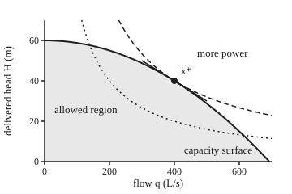

# Second-order conditions under constraints: curvature on the allowed directions only

[Syllabus](../../../SYLLABUS.md) → [Optimization](../README.md) → [Constrained Optimisation](../README.md#s03) → Second-order conditions under constraints

---

## General Overview

A pump pushes water down a long main to a town. Two numbers are chosen, neither below zero: the flow $q$, in litres a second (L/s), and the head $H$ delivered at the town end, in metres (m). Head is pressure measured as the height of water it could lift. The power delivered to the town is $P = 0.00981\,q\,H$ kilowatts (kW). The aim is to **maximise** that power.

One limit stops the power growing forever. Friction in the main eats $0.000125\,q^2$ metres of head, so 20 m at 400 L/s. The pump must supply the delivered head plus the friction, and the pipe is rated for 60 m at the pump end. So every allowed choice obeys $H + 0.000125\,q^2 \le 60$. The edge of that region, where the main runs at its rating, is the **pipe capacity surface**.

The best choice sits on that surface: 400 L/s at 40 m, delivering 156.96 kW, with one third of the rating lost to friction. The slope test of the [KKT conditions](02-kkt-conditions.md), named after Karush, Kuhn and Tucker, finds it. It also gives each constraint a multiplier: a price, here the power one more metre of rating would buy.

But the slope test also passes at saddles and at worst points, so a second test is needed. Here it has a trap. The power $qH$, taken alone, curves up in some directions and down in others: a saddle, with no best point at all. Test its curvature in every direction and the verdict is "no maximum". The right test looks only along the surface, in the directions the pipe allows and the slope test cannot decide. Along the surface, a step of 10 L/s more flow and 1 m less head bends the power down with curvature 0.2943 kW. That settles it.

**At a point that passes the KKT test, check the curvature of the Lagrangian, the cost plus each multiplier times its constraint, only on the critical cone: the allowed directions along which the cost does not change at first order; if that curvature is strictly positive there, the point is a strict local minimum.**

**What kind of fact this is:** a theorem. The sufficient condition is proved on this card in Why it works. The necessary condition is proved there when every active constraint has a positive price, quoting the implicit function theorem; the zero-price case is stated, with its source.

### The picture: the best point on the capacity surface

<p align="center"></p>

Drawn to scale. The solid curve is the capacity surface $H = 60 - 0.000125\,q^2$, ending at 692.8 L/s, and the shaded region below it is allowed. The dashed curve is every $(q, H)$ with $qH = 16000$, which is 156.96 kW. The dotted curve is half that power, $qH = 8000$. Power grows up and to the right. The dashed curve touches the surface at $x^*$ from outside, so no allowed point reaches it elsewhere. The short straight segment through $x^*$, from (300, 50) to (500, 30), is the tangent line: the only directions the second-order test checks.

---

## The formula

This card works in the wing's standard form ([The standard convex problem](../01-Convexity/10-the-convex-problem-in-standard-form.md)): minimise $f_0(x)$ subject to $f_i(x) \le 0$ and $h_j(x) = 0$. To maximise power, minimise $f_0 = -P$. The floors $q \ge 0$ and $H \ge 0$ are constraints too, but neither is tight at the answer, so their multipliers are zero and they drop out below.

The [KKT conditions](02-kkt-conditions.md) give multipliers $\lambda_i \ge 0$ and $\nu_j$ with a flat Lagrangian $\mathcal{L} = f_0 + \sum_i \lambda_i f_i + \sum_j \nu_j h_j$ at the point $x^*$. The new object is the **critical cone**:

$$\mathcal{C}(x^*) = \left\{ d \;:\; \begin{array}{ll} \nabla h_j(x^*)^{T} d = 0 & \text{for every } j \\ \nabla f_i(x^*)^{T} d = 0 & \text{for active } f_i \text{ with } \lambda_i > 0 \\ \nabla f_i(x^*)^{T} d \le 0 & \text{for active } f_i \text{ with } \lambda_i = 0 \end{array} \right\}$$

and the test on it:

$$d^{T}\,\nabla^2 \mathcal{L}(x^*)\,d \;>\; 0 \quad \text{for every } d \ne 0 \text{ in } \mathcal{C}(x^*) \;\;\Longrightarrow\;\; x^* \text{ is a strict local minimum.}$$

**Read it aloud:** keep only the directions that stay on the equality constraints, stay on every inequality that charges a positive price, and do not break an active one that charges none; if the Lagrangian curves upward along every one of them, the point is a strict local minimum.

An **active** constraint is one that holds with equality at $x^*$. A strict local minimum is a point lower than every other allowed point nearby.

$\nabla f$ is the gradient of $f$, the vector of its first derivatives. $\nabla f^{T} d$ is the slope of $f$ along the direction $d$: its change at first order.

| Symbol | Plain meaning | In our example | Push it up and the answer… |
| --- | --- | --- | --- |
| $q$, $H$; $x = (q, H)$ | the flow (L/s) and delivered head (m), the two choices | $x^* = (400, 40)$ | — |
| $P$ | power delivered to the town, $0.00981\,qH$ kW | 156.96 kW at $x^*$ | — |
| $r$ | friction head per (L/s)² | 0.000125 | twice as rough: $x^*$ = (282.8, 40.00), 110.99 kW |
| $f_0$ | the cost to minimise, here $-P$ | −156.96 kW | — |
| $f_i$, $\lambda_i$ | inequality constraints and their multipliers (prices) | $f_1 = H + r q^2 - 60$; $\lambda = 3.924$ kW per m | a rating of 80 m: $\lambda$ = 4.5310 |
| $h_j$, $\nu_j$ | equality constraints and their multipliers | none here | — |
| $\mathcal{L}$ | the Lagrangian, cost plus price times constraint | $-P + 3.924\,f_1$ | — |
| $\nabla^2 \mathcal{L}$ | its Hessian (matrix of second derivatives), $W$ in the code | rows (0.000981, −0.00981), (−0.00981, 0) | — |
| $x(t)$, $a$ | a curve of allowed points leaving $x^*$ at time $t$, and its acceleration | $a = (0, -0.025)$ m for $d = (10, -1)$ | — |
| $d$ | a direction to move from $x^*$ | $(10, -1)$: 10 L/s more, 1 m less | — |
| $\mathcal{C}(x^*)$ | the critical cone: allowed directions the slope test cannot decide | the tangent line, multiples of $(10, -1)$ | — |
| $d^{T}\nabla^2\mathcal{L}\,d$ | curvature of the Lagrangian along $d$, in kW | 0.2943 | bigger: a sharper, safer peak |

### When it holds

- **Twice-smooth functions, and a point that passes the KKT test first.** The cost and every constraint need continuous second derivatives near $x^*$; at a kink there is no Hessian to test. The curvature test only rules on directions where the slope is zero. At 300 L/s on the surface the curvature is positive, 0.2207, yet power still rises by 0.2575 kW per L/s: not a best point.
- **The test is strict.** Positive on the cone proves a strict local minimum. The necessary condition is only "at least zero", and a curvature of exactly zero on some cone direction gives no verdict: higher-order terms decide.
- **The necessary condition needs regular constraints.** The gradients of the active constraints must be linearly independent (LICQ, from the [KKT conditions](02-kkt-conditions.md)). Without it a cone direction may have no curve of allowed points behind it, and multipliers may not exist.
- **The cone depends on the multipliers.** An active inequality with price zero keeps its inward directions in the cone, which then becomes a half-space slice, not a line. Testing only the tangent there can miss a downhill direction.
- **The verdict is local.** It says nothing about points far away. Here a separate argument covers the whole region, and the code enumerates it.

---

## Why it works

### Step 0: on the surface, the cost and the Lagrangian are the same function

On the capacity surface $f_1 = 0$, so $\mathcal{L} = f_0 + \lambda f_1$ equals $f_0$ there. At $x^*$ the KKT test makes the gradient of $\mathcal{L}$ zero. So walking along the surface, the cost starts flat, and its curvature is the curvature of $\mathcal{L}$. The curvature of $f_0$ alone is the wrong number, because the surface bends. The bend has a cost, and the multiplier $\lambda$ is exactly the price of that bend.

### Step 1: the KKT point and its price

Along the surface $H = 60 - r q^2$, the power is $P(q) = 0.00981\,q\,(60 - r q^2)$. Its slope is $0.00981\,(60 - 3 r q^2)$, zero at $q^2 = 60 / (3r) = 160000$, so $q = 400$ L/s and $H = 40$ m. Friction takes 20 m, one third of the rating, whatever the rating or roughness.

The gradients there are $\nabla f_0 = (-0.3924, -3.9240)$ and $\nabla f_1 = (0.1, 1)$. The KKT condition $\nabla f_0 + \lambda \nabla f_1 = 0$ gives $\lambda = 3.924$ from the second entry, and the first entry checks: $-0.3924 + 3.924 \times 0.1 = 0$. The price is positive, as an inequality needs. It is also a real price: a 61 m pipe against a 59 m pipe gains 3.92395 kW per metre.

### Step 2: directions that leave the surface are settled at first order

Take any direction $d$ from $x^*$.

- **Outward**, $\nabla f_1^{T} d > 0$: the pump-end head rises past 60 m. Not allowed. The move $(10, 1)$ raises it by 2 m.
- **Inward**, $\nabla f_1^{T} d < 0$: allowed. The cost changes at first order by $\nabla f_0^{T} d = -\lambda\,\nabla f_1^{T} d > 0$, because $\lambda > 0$. The move $(-10, -1)$ lowers the pump-end head by 2 m and loses $3.924 \times 2 = 7.848$ kW at first order. A second-order term this close to $x^*$ cannot undo that.
- **Along**, $\nabla f_1^{T} d = 0$: the first-order change is zero. Only the curvature can decide.

So the critical cone is the tangent line $0.1\,d_q + d_H = 0$, the multiples of $d = (10, -1)$. Had $\lambda$ been zero, the inward moves would also cost nothing at first order, and they would stay in the cone: that is the third line of the cone's definition.

### Step 3: following the surface, the bend adds $\lambda$ times its curvature

Walk along a curve of allowed points $x(t) = x^* + t\,d + \tfrac12 t^2 a + \dots$, where $a$ is the curve's acceleration. Taylor's theorem to second order:

$$f_0(x(t)) = f_0(x^*) + t\,\nabla f_0^{T} d + \tfrac12 t^2 \left( d^{T} \nabla^2 f_0\, d + \nabla f_0^{T} a \right) + \dots$$

The first-order term is zero, since $d$ is in the cone. Staying on the surface means $f_1(x(t)) = 0$ for all $t$, so its second-order term vanishes too: $d^{T}\nabla^2 f_1\,d + \nabla f_1^{T} a = 0$. Combine that with $\nabla f_0 = -\lambda \nabla f_1$:

$$\nabla f_0^{T} a = -\lambda\,\nabla f_1^{T} a = \lambda\, d^{T}\nabla^2 f_1\, d.$$

So the second-order term is $d^{T}(\nabla^2 f_0 + \lambda \nabla^2 f_1)\,d = d^{T}\nabla^2\mathcal{L}\,d$.

In numbers, the surface $H = 60 - r q^2$ bends by $a = (0, -0.025)$ m for the step $d = (10, -1)$. The cost's gradient along that bend is $\nabla f_0^{T} a = 0.0981$, exactly $\lambda\, d^{T}\nabla^2 f_1\,d = 3.924 \times (2 \times 0.000125) \times 10^2$. Add the cost's own curvature, 0.1962, and the total is 0.2943 kW. Ignoring the bend loses a third of the answer.

### Step 4: the necessary condition

Suppose $x^*$ is a local minimum, the active gradients are linearly independent, and some $d$ in the cone has $d^{T}\nabla^2\mathcal{L}\,d < 0$. When every active constraint has a positive price, the cone is the tangent of the active constraints. The implicit function theorem then gives a curve that stays on them and leaves $x^*$ with velocity $d$. By Step 3, $f_0$ falls along that curve at second order. That contradicts a minimum. So at a regular local minimum, $d^{T}\nabla^2\mathcal{L}\,d \ge 0$ on the cone. Active constraints with zero price need a more careful curve; Nocedal and Wright, Chapter 12, give that case in full.

### Step 5: the sufficient condition

Strictly positive curvature on the cone is enough: no allowed point nearby is as low. The proof squeezes any rival point into the cone and then uses Step 0.

<details>
<summary>Detailed proof: positive curvature on the critical cone gives a strict local minimum</summary>

Suppose $x^*$ satisfies the KKT conditions with multipliers $\lambda_i \ge 0$, $\nu_j$, and $d^{T}\nabla^2\mathcal{L}(x^*)\,d > 0$ for every nonzero $d \in \mathcal{C}(x^*)$, but $x^*$ is not a strict local minimum.

Then there are allowed points $x_k \ne x^*$ with $x_k \to x^*$ and $f_0(x_k) \le f_0(x^*)$. Write $x_k = x^* + t_k d_k$ with $\|d_k\| = 1$ and $t_k \to 0$. The unit vectors $d_k$ have a convergent subsequence; call its limit $d$, with $\|d\| = 1$.

**$d$ lies in the cone.** Divide $h_j(x_k) - h_j(x^*) = 0$ by $t_k$ and let $k$ grow: $\nabla h_j^{T} d = 0$. For an active $f_i$, $f_i(x_k) \le 0 = f_i(x^*)$ gives $\nabla f_i^{T} d \le 0$. And $f_0(x_k) \le f_0(x^*)$ gives $\nabla f_0^{T} d \le 0$. But stationarity says $\nabla f_0^{T} d = -\sum_i \lambda_i \nabla f_i^{T} d - \sum_j \nu_j \nabla h_j^{T} d = -\sum_i \lambda_i \nabla f_i^{T} d \ge 0$, the sum running over active constraints (inactive ones have $\lambda_i = 0$). So $\nabla f_0^{T} d = 0$, and every term $\lambda_i \nabla f_i^{T} d$ is zero: $\nabla f_i^{T} d = 0$ wherever $\lambda_i > 0$. That is the definition of $\mathcal{C}(x^*)$.

**The Lagrangian cannot curve up along $d$.** At allowed points $\lambda_i f_i(x_k) \le 0$ and $h_j(x_k) = 0$, so $\mathcal{L}(x_k) \le f_0(x_k) \le f_0(x^*) = \mathcal{L}(x^*)$, the last step by complementary slackness. Expand $\mathcal{L}$ about $x^*$, where its gradient is zero:

$$\mathcal{L}(x_k) = \mathcal{L}(x^*) + \tfrac12 t_k^2\, d_k^{T}\nabla^2\mathcal{L}(x^*)\,d_k + o(t_k^2).$$

Here $o(t_k^2)$ stands for terms that shrink faster than $t_k^2$, which needs the second derivatives to be continuous. So $\tfrac12 d_k^{T}\nabla^2\mathcal{L}\,d_k + o(1) \le 0$, and in the limit $d^{T}\nabla^2\mathcal{L}\,d \le 0$, with $d \ne 0$ in the cone. That contradicts the hypothesis. ∎

</details>

### Two more roads to the same verdict

- **Walk the surface itself.** Put $H = 60 - r q^2$ into $f_0$ and take a second difference at 390, 400 and 410 L/s: 0.2943 kW, the same number, with no multiplier in sight.
- **The bordered Hessian.** Border $\nabla^2\mathcal{L}$ with the constraint's gradient: the $3 \times 3$ matrix with rows $(0, 0.1, 1)$, $(0.1, 0.000981, -0.00981)$, $(1, -0.00981, 0)$. With one constraint and two choices, its determinant is minus the cone curvature for the tangent $(1, -0.1)$: $-0.002943$. Negative means a strict minimum of $f_0$. Economists use this form for budget problems.

---

## Worked numbers, by hand

The main rated for 60 m, friction $0.000125\,q^2$, power $0.00981\,qH$, maximised.

| Step | Arithmetic | Value |
| --- | --- | --- |
| slope of power along the surface is zero | $60 = 3 \times 0.000125 \times q^2$ | $q = 400$ L/s |
| delivered head | $60 - 0.000125 \times 400^2 = 60 - 20$ | $H = 40$ m |
| power | $0.00981 \times 400 \times 40$ | 156.96 kW |
| gradient of the cost $f_0 = -P$ | $(-0.00981 \times 40,\ -0.00981 \times 400)$ | $(-0.3924, -3.924)$ |
| gradient of the constraint | $(2 \times 0.000125 \times 400,\ 1)$ | $(0.1, 1)$ |
| multiplier, from the $H$ entry | $3.924 / 1$ | $\lambda = 3.924$ kW per m |
| critical cone | $0.1\,d_q + d_H = 0$, with $\lambda > 0$ | $d = (10, -1)$ |
| the cost's own curvature | $2 \times (-0.00981) \times 10 \times (-1)$ | 0.1962 |
| the bend's share | $3.924 \times (2 \times 0.000125) \times 10^2$ | 0.0981 |
| curvature of $\mathcal{L}$ on the cone | $0.1962 + 0.0981$ | **0.2943 > 0** |

So $x^*$ is a strict local minimum of $f_0$: a strict local maximum of power. Run the main at 400 L/s with 40 m at the town end, for 156.96 kW. The price 3.924 kW per metre says what a higher pipe rating would buy.

It is also the global best. Below the surface, power at the same flow is smaller, because power grows with $H$. On the surface, power is a single-hump cubic in $q$ from 0 to 692.8 L/s. The code checks every allowed point on a 1 L/s by 0.1 m grid, 277751 of them, and none beats $x^*$. The floors matter: without them, $q = H = -1000$ meets the rating with 935 m to spare and gives 9810.00 kW, so there would be no best point at all.

The quadratic model is honest close in: a 10 L/s slide along the surface loses 0.1484 kW against the model's 0.1472. At 50 L/s the cubic term shows, 3.8320 against 3.6787.

### What breaks if you drop a piece

| Mistake | Comes out at | What went wrong |
| --- | --- | --- |
| Test the Hessian of $f_0$ alone, every direction | eigenvalues −0.009810 and 0.009810: "a saddle" | $qH$ is a saddle in the open plane; the constraint is what creates a best point |
| Test $\nabla^2\mathcal{L}$ on every direction | eigenvalues −0.009332 and 0.010313: "no minimum" | the negative direction crosses the surface, where the first-order term already rules |
| Use $\nabla^2 f_0$ on the tangent, dropping $\lambda \nabla^2 f_1$ | 0.1962, a model loss of 0.0981 kW for a 10 L/s slide (true 0.1484) | the surface bends; the bend's price is missing |
| Run the curvature test where KKT fails, at $q$ = 300, $H$ = 48.75 | curvature 0.2207 > 0, yet power rises 0.2575 kW per L/s | the hypothesis "first-order conditions hold" is false: the slope test comes first |

---

## Code, from first principles, and it actually runs

The code solves the KKT conditions, builds the critical cone from the active constraint's gradient, and tests the Lagrangian's Hessian on it. It reaches the verdict by three independent roads: the cone test (road 1), a second difference along the surface itself (road 2), and every allowed point on a grid (road 4). Two more checks are not independent of road 1. The bordered Hessian's determinant (road 3) is, by algebra, minus the cone curvature along the tangent $(1, -0.1)$. The multiplier recovered as the price of a higher rating (road 5) confirms the $\lambda$ that road 1 uses. It also checks both gradients against central differences, and prints the four wrong tests.

### Python

```python
# Second-order conditions on a pipe's capacity surface, checked five ways.
# Standard library only.  Maximise the power a water main delivers, P = C*q*H,
# written as minimising f0 = -P, subject to f1 = H + R*q^2 - RATING <= 0.
import math
C = 0.00981        # kW per (L/s * m): water weighs 9.81 kN per m^3, 1 L/s = 0.001 m^3/s
R = 0.000125       # m of friction head per (L/s)^2: 20 m lost at 400 L/s
RATING = 60.0      # m of head the main is rated for at the pump end

def power(q, H): return C * q * H
def f0(q, H): return -power(q, H)
def f1(q, H, r=R, rating=RATING): return H + r * q * q - rating
def grad_f0(q, H): return (-C * H, -C * q)
def grad_f1(q, H, r=R): return (2 * r * q, 1.0)
def hess_f0(): return ((0.0, -C), (-C, 0.0))
def hess_f1(r=R): return ((2 * r, 0.0), (0.0, 0.0))
def add(A, B, s): return tuple(tuple(A[i][j] + s * B[i][j] for j in range(2)) for i in range(2))
def quad(M, d): return sum(d[i] * M[i][j] * d[j] for i in range(2) for j in range(2))
def dot(u, v): return u[0] * v[0] + u[1] * v[1]
def eig2(M):       # eigenvalues of a symmetric 2x2 matrix, smallest first
    m = (M[0][0] + M[1][1]) / 2
    s = math.sqrt((M[0][0] - M[1][1]) * (M[0][0] - M[1][1]) / 4 + M[0][1] * M[0][1])
    return m - s, m + s
def on_surface(q, r=R, rating=RATING): return rating - r * q * q   # H on the surface
def best(r=R, rating=RATING):    # dP/dq along the surface = C*(rating - 3*r*q^2) = 0
    q = math.sqrt(rating / (3 * r))
    return q, on_surface(q, r, rating)
def tangent(q, r=R):             # a step of 10 L/s that keeps f1 = 0 to first order
    g = grad_f1(q, 0.0, r)
    return (10.0, -10.0 * g[0] / g[1])
def F(x, n=4): return f"{x:.{n}f}"

# ---- road 1: KKT, then the critical cone and the Lagrangian's curvature on it ----
q, H = best()
g0, g1 = grad_f0(q, H), grad_f1(q, H)
lam = -g0[1] / g1[1]                       # the H-row of grad f0 + lam * grad f1 = 0
res = (g0[0] + lam * g1[0], g0[1] + lam * g1[1])
W = add(hess_f0(), hess_f1(), lam)         # Hessian of the Lagrangian f0 + lam*f1
d = tangent(q)
part_f0, part_bend = quad(hess_f0(), d), lam * quad(hess_f1(), d)
along = quad(W, d)
print(f"maximise P = {C:.5f}*q*H kW subject to H + {R:.6f}*q^2 <= {RATING:.0f} m")
print(f"x* = ({F(q, 1)} L/s, {F(H)} m), friction {F(R * q * q)} m, P = {F(power(q, H))} kW")
print(f"grad f0 = ({F(g0[0])}, {F(g0[1])}), grad f1 = ({F(g1[0])}, {F(g1[1])})")
print(f"lambda = {F(lam)} kW per m of rating; KKT residual {F(abs(res[0]), 6)}, {F(abs(res[1]), 6)}")
h, worst = 1e-3, 0.0                       # derivatives against central differences
for fn, gr in ((f0, grad_f0), (f1, grad_f1)):
    nd = ((fn(q + h, H) - fn(q - h, H)) / (2 * h), (fn(q, H + h) - fn(q, H - h)) / (2 * h))
    worst = max(worst, abs(nd[0] - gr(q, H)[0]), abs(nd[1] - gr(q, H)[1]))
print(f"gradients against central differences: largest gap {worst:.1e}")
print(f"Hessian of the Lagrangian: {F(W[0][0], 6)}, {F(W[0][1], 6)} / {F(W[1][0], 6)}, {F(W[1][1], 6)}")
print(f"critical cone: lambda > 0, so 0.1*dq + dH = 0: d = ({F(d[0], 1)}, {F(d[1], 1)})")
print(f"along the surface d'Wd = {F(part_f0)} (cost) + {F(part_bend)} (bend) = {F(along)} kW")
out, inn = (10.0, 1.0), (-10.0, -1.0)
print(f"across, outward (10, 1): d'Wd = {F(quad(W, out))}, pump-end head +{F(dot(g1, out))} m: not allowed")
print(f"across, inward (-10, -1): d'Wd = {F(quad(W, inn))}, P falls {F(dot(g0, inn))} kW at first order")
# ---- road 2: walk along the surface itself and take a second difference ----
fs = [f0(x, on_surface(x)) for x in (q - 10, q, q + 10)]
second = fs[0] - 2 * fs[1] + fs[2]
print(f"road 2, second difference of f0 along the surface: {F(second)} kW")
acc = (0.0, -2 * R * d[0] * d[0])          # the path H = 60 - R*q^2 bends by this much
print(f"bend: path acceleration (0, {F(acc[1], 3)}) m; grad f0 . a = {F(dot(g0, acc))}"
      f" = lambda * d'(Hess f1)d = {F(part_bend)}")
for step in (10.0, 50.0):
    loss = power(q, H) - power(q + step, on_surface(q + step))
    print(f"slide {F(step, 0)} L/s along: true power loss {F(loss)} kW, quadratic model "
          f"{F(0.5 * along * (step / 10) * (step / 10))} kW")
# ---- road 3: the bordered Hessian, a determinant that needs no tangent ----
B = ((0.0, g1[0], g1[1]), (g1[0], W[0][0], W[0][1]), (g1[1], W[1][0], W[1][1]))
det = (B[0][0] * (B[1][1] * B[2][2] - B[1][2] * B[2][1]) - B[0][1] * (B[1][0] * B[2][2] - B[1][2] * B[2][0])
       + B[0][2] * (B[1][0] * B[2][1] - B[1][1] * B[2][0]))
print(f"road 3, bordered Hessian determinant {F(det, 6)} (negative: a strict minimum of f0)")
# ---- road 4: every feasible point on a 1 L/s by 0.1 m grid ----
top, arg, n = -1.0, None, 0
for i in range(701):
    for j in range(601):
        qq, HH = float(i), j / 10
        if f1(qq, HH) <= 1e-9:
            n += 1
            if power(qq, HH) > top:
                top, arg = power(qq, HH), (qq, HH)
print(f"road 4, {n} feasible grid points: best ({F(arg[0], 0)}, {F(arg[1], 1)}), P = {F(top)} kW")
print(f"drop q, H >= 0: q = H = -1000 gives f1 = {F(f1(-1000.0, -1000.0), 1)} m, P = {F(power(-1000.0, -1000.0), 2)} kW")
# ---- road 5: lambda read back as a price, by moving the rating ----
Pr = [power(*best(rating=RATING + s)) for s in (-1.0, 1.0)]
price = (Pr[1] - Pr[0]) / 2
print(f"road 5, (P*(61 m) - P*(59 m)) / 2 = {F(price, 5)} kW per m")
# ---- what breaks ----
e0, eW = eig2(hess_f0()), eig2(W)
print(f"mistake 1, Hessian of f0 alone, every direction: {F(e0[0], 6)}, {F(e0[1], 6)} -> 'saddle'")
print(f"mistake 2, Lagrangian Hessian, every direction: {F(eW[0], 6)}, {F(eW[1], 6)} -> 'no minimum'")
print(f"mistake 3, bend dropped: along-surface curvature {F(part_f0)}, model loss {F(part_f0 / 2)} kW;"
      f" lambda's sign flipped {F(part_f0 - part_bend)}")
q3 = 300.0
H3 = on_surface(q3)
lam3 = -grad_f0(q3, H3)[1]
curv3 = quad(add(hess_f0(), hess_f1(), lam3), tangent(q3))
slope3 = C * (RATING - 3 * R * q3 * q3)
print(f"mistake 4, at q = {F(q3, 0)}, H = {F(H3, 2)}: curvature {F(curv3)} > 0, yet P still rises"
      f" {F(slope3)} kW per L/s")
# ---- try changing ----
for label, r, rating in (("rating 80 m", R, 80.0), ("pipe twice as rough", 2 * R, RATING)):
    qa, Ha = best(r, rating)
    la = C * qa
    Wa = add(hess_f0(), hess_f1(r), la)
    print(f"try, {label}: x* = ({F(qa, 1)}, {F(Ha, 2)}), P = {F(power(qa, Ha), 2)} kW, lambda = {F(la)},"
          f" friction share {F(r * qa * qa / rating, 4)}, d'Wd = {F(quad(Wa, tangent(qa, r)))}")
print(f"figure, x*=({F(q, 1)},{F(H, 1)}), surface (0,60)-({F(math.sqrt(RATING / R), 1)},0),"
      f" contours qH={F(q * H, 0)} through x* and {F(q * H / 2, 0)}, tangent ({F(q - 100, 0)},{F(H + 10, 0)})-({F(q + 100, 0)},{F(H - 10, 0)})")

assert abs(q - 400) < 1e-9 and abs(H - 40) < 1e-9          # one-third rule: 20 m of 60 lost
assert lam > 0 and max(abs(res[0]), abs(res[1])) < 1e-12   # KKT, with the right sign
assert worst < 1e-6                                        # gradients agree with differences
assert along > 0 and abs(second - along) < 1e-9            # road 1 = road 2: positive curvature
assert abs(dot(g0, acc) - part_bend) < 1e-12               # the bend is lambda times f1's curvature
assert det < 0 and abs(det + along / 100) < 1e-12          # road 3 agrees with road 1
assert arg == (400.0, 40.0) and abs(top - power(q, H)) < 1e-9  # road 4: no grid point beats x*
assert f1(-1000.0, -1000.0) <= 0 and power(-1000.0, -1000.0) > top  # the floors q, H >= 0 matter
assert abs(price - lam) < 1e-4                             # road 5: lambda is the rating's price
assert eW[0] < 0 and quad(W, inn) < 0                      # the Lagrangian's full-space test misleads
assert slope3 > 0 and curv3 > 0                            # curvature alone proves nothing
print("ALL CHECKS PASS")
```

**Ran 2026-11-11 on macOS, Python 3.14.10, standard library only. All checks passed. Output, pasted from the run:**

```
maximise P = 0.00981*q*H kW subject to H + 0.000125*q^2 <= 60 m
x* = (400.0 L/s, 40.0000 m), friction 20.0000 m, P = 156.9600 kW
grad f0 = (-0.3924, -3.9240), grad f1 = (0.1000, 1.0000)
lambda = 3.9240 kW per m of rating; KKT residual 0.000000, 0.000000
gradients against central differences: largest gap 1.6e-11
Hessian of the Lagrangian: 0.000981, -0.009810 / -0.009810, 0.000000
critical cone: lambda > 0, so 0.1*dq + dH = 0: d = (10.0, -1.0)
along the surface d'Wd = 0.1962 (cost) + 0.0981 (bend) = 0.2943 kW
across, outward (10, 1): d'Wd = -0.0981, pump-end head +2.0000 m: not allowed
across, inward (-10, -1): d'Wd = -0.0981, P falls 7.8480 kW at first order
road 2, second difference of f0 along the surface: 0.2943 kW
bend: path acceleration (0, -0.025) m; grad f0 . a = 0.0981 = lambda * d'(Hess f1)d = 0.0981
slide 10 L/s along: true power loss 0.1484 kW, quadratic model 0.1472 kW
slide 50 L/s along: true power loss 3.8320 kW, quadratic model 3.6787 kW
road 3, bordered Hessian determinant -0.002943 (negative: a strict minimum of f0)
road 4, 277751 feasible grid points: best (400, 40.0), P = 156.9600 kW
drop q, H >= 0: q = H = -1000 gives f1 = -935.0 m, P = 9810.00 kW
road 5, (P*(61 m) - P*(59 m)) / 2 = 3.92395 kW per m
mistake 1, Hessian of f0 alone, every direction: -0.009810, 0.009810 -> 'saddle'
mistake 2, Lagrangian Hessian, every direction: -0.009332, 0.010313 -> 'no minimum'
mistake 3, bend dropped: along-surface curvature 0.1962, model loss 0.0981 kW; lambda's sign flipped 0.0981
mistake 4, at q = 300, H = 48.75: curvature 0.2207 > 0, yet P still rises 0.2575 kW per L/s
try, rating 80 m: x* = (461.9, 53.33), P = 241.66 kW, lambda = 4.5310, friction share 0.3333, d'Wd = 0.3398
try, pipe twice as rough: x* = (282.8, 40.00), P = 110.99 kW, lambda = 2.7747, friction share 0.3333, d'Wd = 0.4162
figure, x*=(400.0,40.0), surface (0,60)-(692.8,0), contours qH=16000 through x* and 8000, tangent (300,50)-(500,30)
ALL CHECKS PASS
```

### Rust

Same numbers, same labels, built with `rustc --edition 2021 -O`.

```rust
// Second-order conditions on a pipe's capacity surface, checked five ways.
// No crates.  Maximise the power a water main delivers, P = C*q*H, written
// as minimising f0 = -P, subject to f1 = H + R*q^2 - RATING <= 0.
const C: f64 = 0.00981; // kW per (L/s * m): water weighs 9.81 kN per m^3, 1 L/s = 0.001 m^3/s
const R: f64 = 0.000125; // m of friction head per (L/s)^2: 20 m lost at 400 L/s
const RATING: f64 = 60.0; // m of head the main is rated for at the pump end
type M2 = [[f64; 2]; 2];

fn power(q: f64, h: f64) -> f64 { C * q * h }
fn f0(q: f64, h: f64) -> f64 { -power(q, h) }
fn f1(q: f64, h: f64) -> f64 { h + R * q * q - RATING }
fn grad_f0(q: f64, h: f64) -> [f64; 2] { [-C * h, -C * q] }
fn grad_f1(q: f64, _h: f64, r: f64) -> [f64; 2] { [2.0 * r * q, 1.0] }
fn hess_f0() -> M2 { [[0.0, -C], [-C, 0.0]] }
fn hess_f1(r: f64) -> M2 { [[2.0 * r, 0.0], [0.0, 0.0]] }
fn add(a: M2, b: M2, s: f64) -> M2 {
    let mut m = [[0.0; 2]; 2];
    for i in 0..2 { for j in 0..2 { m[i][j] = a[i][j] + s * b[i][j] } }
    m
}
fn quad(m: M2, d: [f64; 2]) -> f64 {
    let mut s = 0.0;
    for i in 0..2 { for j in 0..2 { s += d[i] * m[i][j] * d[j] } }
    s
}
fn dot(u: [f64; 2], v: [f64; 2]) -> f64 { u[0] * v[0] + u[1] * v[1] }
fn eig2(m: M2) -> (f64, f64) { // eigenvalues of a symmetric 2x2 matrix, smallest first
    let c = (m[0][0] + m[1][1]) / 2.0;
    let s = ((m[0][0] - m[1][1]) * (m[0][0] - m[1][1]) / 4.0 + m[0][1] * m[0][1]).sqrt();
    (c - s, c + s)
}
fn on_surface(q: f64, r: f64, rating: f64) -> f64 { rating - r * q * q } // H on the surface
fn best(r: f64, rating: f64) -> (f64, f64) { // dP/dq along the surface = C*(rating - 3*r*q^2) = 0
    let q = (rating / (3.0 * r)).sqrt();
    (q, on_surface(q, r, rating))
}
fn tangent(q: f64, r: f64) -> [f64; 2] { // a step of 10 L/s that keeps f1 = 0 to first order
    let g = grad_f1(q, 0.0, r);
    [10.0, -10.0 * g[0] / g[1]]
}
fn f(x: f64, n: usize) -> String { format!("{:.*}", n, x) }

fn main() {
    // ---- road 1: KKT, then the critical cone and the Lagrangian's curvature on it ----
    let (q, h) = best(R, RATING);
    let (g0, g1) = (grad_f0(q, h), grad_f1(q, h, R));
    let lam = -g0[1] / g1[1]; // the H-row of grad f0 + lam * grad f1 = 0
    let res = [g0[0] + lam * g1[0], g0[1] + lam * g1[1]];
    let w = add(hess_f0(), hess_f1(R), lam); // Hessian of the Lagrangian f0 + lam*f1
    let d = tangent(q, R);
    let (part_f0, part_bend) = (quad(hess_f0(), d), lam * quad(hess_f1(R), d));
    let along = quad(w, d);
    println!("maximise P = {:.5}*q*H kW subject to H + {:.6}*q^2 <= {:.0} m", C, R, RATING);
    println!("x* = ({} L/s, {} m), friction {} m, P = {} kW", f(q, 1), f(h, 4), f(R * q * q, 4), f(power(q, h), 4));
    println!("grad f0 = ({}, {}), grad f1 = ({}, {})", f(g0[0], 4), f(g0[1], 4), f(g1[0], 4), f(g1[1], 4));
    println!("lambda = {} kW per m of rating; KKT residual {}, {}", f(lam, 4), f(res[0].abs(), 6), f(res[1].abs(), 6));
    let (hh, mut worst) = (1e-3, 0.0f64); // derivatives against central differences
    let fns: [(fn(f64, f64) -> f64, [f64; 2]); 2] = [(f0, g0), (f1, g1)];
    for (func, gr) in fns.iter() {
        let nd = [(func(q + hh, h) - func(q - hh, h)) / (2.0 * hh), (func(q, h + hh) - func(q, h - hh)) / (2.0 * hh)];
        worst = worst.max((nd[0] - gr[0]).abs()).max((nd[1] - gr[1]).abs());
    }
    println!("gradients against central differences: largest gap {:.1e}", worst);
    println!("Hessian of the Lagrangian: {}, {} / {}, {}", f(w[0][0], 6), f(w[0][1], 6), f(w[1][0], 6), f(w[1][1], 6));
    println!("critical cone: lambda > 0, so 0.1*dq + dH = 0: d = ({}, {})", f(d[0], 1), f(d[1], 1));
    println!("along the surface d'Wd = {} (cost) + {} (bend) = {} kW", f(part_f0, 4), f(part_bend, 4), f(along, 4));
    let (out, inn) = ([10.0, 1.0], [-10.0, -1.0]);
    println!("across, outward (10, 1): d'Wd = {}, pump-end head +{} m: not allowed", f(quad(w, out), 4), f(dot(g1, out), 4));
    println!("across, inward (-10, -1): d'Wd = {}, P falls {} kW at first order", f(quad(w, inn), 4), f(dot(g0, inn), 4));
    // ---- road 2: walk along the surface itself and take a second difference ----
    let fs: Vec<f64> = [q - 10.0, q, q + 10.0].iter().map(|&x| f0(x, on_surface(x, R, RATING))).collect();
    let second = fs[0] - 2.0 * fs[1] + fs[2];
    println!("road 2, second difference of f0 along the surface: {} kW", f(second, 4));
    let acc = [0.0, -2.0 * R * d[0] * d[0]]; // the path H = 60 - R*q^2 bends by this much
    println!("bend: path acceleration (0, {}) m; grad f0 . a = {} = lambda * d'(Hess f1)d = {}",
             f(acc[1], 3), f(dot(g0, acc), 4), f(part_bend, 4));
    for step in [10.0, 50.0] {
        let loss = power(q, h) - power(q + step, on_surface(q + step, R, RATING));
        println!("slide {} L/s along: true power loss {} kW, quadratic model {} kW",
                 f(step, 0), f(loss, 4), f(0.5 * along * (step / 10.0) * (step / 10.0), 4));
    }
    // ---- road 3: the bordered Hessian, a determinant that needs no tangent ----
    let b = [[0.0, g1[0], g1[1]], [g1[0], w[0][0], w[0][1]], [g1[1], w[1][0], w[1][1]]];
    let det = b[0][0] * (b[1][1] * b[2][2] - b[1][2] * b[2][1]) - b[0][1] * (b[1][0] * b[2][2] - b[1][2] * b[2][0])
        + b[0][2] * (b[1][0] * b[2][1] - b[1][1] * b[2][0]);
    println!("road 3, bordered Hessian determinant {} (negative: a strict minimum of f0)", f(det, 6));
    // ---- road 4: every feasible point on a 1 L/s by 0.1 m grid ----
    let (mut top, mut arg, mut n) = (-1.0, (0.0, 0.0), 0);
    for i in 0..701 {
        for j in 0..601 {
            let (qq, hq) = (i as f64, j as f64 / 10.0);
            if f1(qq, hq) <= 1e-9 {
                n += 1;
                if power(qq, hq) > top { top = power(qq, hq); arg = (qq, hq); }
            }
        }
    }
    println!("road 4, {} feasible grid points: best ({}, {}), P = {} kW", n, f(arg.0, 0), f(arg.1, 1), f(top, 4));
    println!("drop q, H >= 0: q = H = -1000 gives f1 = {} m, P = {} kW", f(f1(-1000.0, -1000.0), 1), f(power(-1000.0, -1000.0), 2));
    // ---- road 5: lambda read back as a price, by moving the rating ----
    let pr: Vec<f64> = [-1.0, 1.0].iter().map(|s| { let (a, c) = best(R, RATING + s); power(a, c) }).collect();
    let price = (pr[1] - pr[0]) / 2.0;
    println!("road 5, (P*(61 m) - P*(59 m)) / 2 = {} kW per m", f(price, 5));
    // ---- what breaks ----
    let (e0, ew) = (eig2(hess_f0()), eig2(w));
    println!("mistake 1, Hessian of f0 alone, every direction: {}, {} -> 'saddle'", f(e0.0, 6), f(e0.1, 6));
    println!("mistake 2, Lagrangian Hessian, every direction: {}, {} -> 'no minimum'", f(ew.0, 6), f(ew.1, 6));
    println!("mistake 3, bend dropped: along-surface curvature {}, model loss {} kW; lambda's sign flipped {}",
             f(part_f0, 4), f(part_f0 / 2.0, 4), f(part_f0 - part_bend, 4));
    let q3 = 300.0;
    let h3 = on_surface(q3, R, RATING);
    let lam3 = -grad_f0(q3, h3)[1];
    let curv3 = quad(add(hess_f0(), hess_f1(R), lam3), tangent(q3, R));
    let slope3 = C * (RATING - 3.0 * R * q3 * q3);
    println!("mistake 4, at q = {}, H = {}: curvature {} > 0, yet P still rises {} kW per L/s",
             f(q3, 0), f(h3, 2), f(curv3, 4), f(slope3, 4));
    // ---- try changing ----
    for (label, r, rating) in [("rating 80 m", R, 80.0), ("pipe twice as rough", 2.0 * R, RATING)] {
        let (qa, ha) = best(r, rating);
        let la = C * qa;
        let wa = add(hess_f0(), hess_f1(r), la);
        println!("try, {}: x* = ({}, {}), P = {} kW, lambda = {}, friction share {}, d'Wd = {}", label,
                 f(qa, 1), f(ha, 2), f(power(qa, ha), 2), f(la, 4), f(r * qa * qa / rating, 4), f(quad(wa, tangent(qa, r)), 4));
    }
    println!("figure, x*=({},{}), surface (0,60)-({},0), contours qH={} through x* and {}, tangent ({},{})-({},{})",
             f(q, 1), f(h, 1), f((RATING / R).sqrt(), 1), f(q * h, 0), f(q * h / 2.0, 0), f(q - 100.0, 0), f(h + 10.0, 0), f(q + 100.0, 0), f(h - 10.0, 0));

    assert!((q - 400.0).abs() < 1e-9 && (h - 40.0).abs() < 1e-9); // one-third rule: 20 m of 60 lost
    assert!(lam > 0.0 && res[0].abs().max(res[1].abs()) < 1e-12); // KKT, with the right sign
    assert!(worst < 1e-6); // gradients agree with differences
    assert!(along > 0.0 && (second - along).abs() < 1e-9); // road 1 = road 2: positive curvature
    assert!((dot(g0, acc) - part_bend).abs() < 1e-12); // the bend is lambda times f1's curvature
    assert!(det < 0.0 && (det + along / 100.0).abs() < 1e-12); // road 3 agrees with road 1
    assert!(arg == (400.0, 40.0) && (top - power(q, h)).abs() < 1e-9); // road 4: no grid point beats x*
    assert!(f1(-1000.0, -1000.0) <= 0.0 && power(-1000.0, -1000.0) > top); // the floors q, H >= 0 matter
    assert!((price - lam).abs() < 1e-4); // road 5: lambda is the rating's price
    assert!(ew.0 < 0.0 && quad(w, inn) < 0.0); // the Lagrangian's full-space test misleads
    assert!(slope3 > 0.0 && curv3 > 0.0); // curvature alone proves nothing
    println!("ALL CHECKS PASS");
}
```

**Ran 2026-11-11 on macOS, rustc 1.98.1, no crates. All checks passed. Output, pasted from the run:**

```
maximise P = 0.00981*q*H kW subject to H + 0.000125*q^2 <= 60 m
x* = (400.0 L/s, 40.0000 m), friction 20.0000 m, P = 156.9600 kW
grad f0 = (-0.3924, -3.9240), grad f1 = (0.1000, 1.0000)
lambda = 3.9240 kW per m of rating; KKT residual 0.000000, 0.000000
gradients against central differences: largest gap 1.6e-11
Hessian of the Lagrangian: 0.000981, -0.009810 / -0.009810, 0.000000
critical cone: lambda > 0, so 0.1*dq + dH = 0: d = (10.0, -1.0)
along the surface d'Wd = 0.1962 (cost) + 0.0981 (bend) = 0.2943 kW
across, outward (10, 1): d'Wd = -0.0981, pump-end head +2.0000 m: not allowed
across, inward (-10, -1): d'Wd = -0.0981, P falls 7.8480 kW at first order
road 2, second difference of f0 along the surface: 0.2943 kW
bend: path acceleration (0, -0.025) m; grad f0 . a = 0.0981 = lambda * d'(Hess f1)d = 0.0981
slide 10 L/s along: true power loss 0.1484 kW, quadratic model 0.1472 kW
slide 50 L/s along: true power loss 3.8320 kW, quadratic model 3.6787 kW
road 3, bordered Hessian determinant -0.002943 (negative: a strict minimum of f0)
road 4, 277751 feasible grid points: best (400, 40.0), P = 156.9600 kW
drop q, H >= 0: q = H = -1000 gives f1 = -935.0 m, P = 9810.00 kW
road 5, (P*(61 m) - P*(59 m)) / 2 = 3.92395 kW per m
mistake 1, Hessian of f0 alone, every direction: -0.009810, 0.009810 -> 'saddle'
mistake 2, Lagrangian Hessian, every direction: -0.009332, 0.010313 -> 'no minimum'
mistake 3, bend dropped: along-surface curvature 0.1962, model loss 0.0981 kW; lambda's sign flipped 0.0981
mistake 4, at q = 300, H = 48.75: curvature 0.2207 > 0, yet P still rises 0.2575 kW per L/s
try, rating 80 m: x* = (461.9, 53.33), P = 241.66 kW, lambda = 4.5310, friction share 0.3333, d'Wd = 0.3398
try, pipe twice as rough: x* = (282.8, 40.00), P = 110.99 kW, lambda = 2.7747, friction share 0.3333, d'Wd = 0.4162
figure, x*=(400.0,40.0), surface (0,60)-(692.8,0), contours qH=16000 through x* and 8000, tangent (300,50)-(500,30)
ALL CHECKS PASS
```

### Lean

Lean proves both second-order tests in general, the necessary one only when every active price is positive, and the pipe's best point.

- At a point passing the KKT test, with twice-smooth functions, positive Lagrangian curvature on every nonzero cone direction gives a strict local minimum.
- At a regular local minimum where every active inequality has a positive price, the Lagrangian's curvature on the critical cone is at least zero.
- The choice 400 L/s at 40 m is allowed and delivers 156.96 kW, and no allowed choice delivers more.
- The hand arithmetic holds exactly, from $\lambda = 3.924$ and the cone curvature 0.2943 to the bordered Hessian's determinant, $-0.002943$.

The grid search, the 61 m against 59 m price and the Try changing runs are left to the Python and Rust checks.

```lean
-- Second-order conditions under constraints: at a point that passes the KKT test, a Lagrangian that curves strictly upward on every nonzero direction of the critical cone gives a strict local minimum, a regular local minimum whose active constraints all have positive prices has curvature zero or above on that cone, and the pipe's 400 L/s at 40 m is the most power any allowed choice delivers.
import Mathlib.Analysis.Calculus.ContDiff.Defs
import Mathlib.Analysis.Calculus.LocalExtr.Basic
import Mathlib.Analysis.InnerProductSpace.PiL2
import Mathlib.LinearAlgebra.LinearIndependent.Defs
import Mathlib.Tactic
import Mathlib

open Finset

/-- The Lagrangian `L = f₀ + Σ λᵢ fᵢ + Σ νⱼ hⱼ` of the problem: minimise `f₀` subject to
`fᵢ ≤ 0` and `hⱼ = 0`, with prices `λ` on the inequalities and `ν` on the equalities. -/
noncomputable def lagrangian {n m p : ℕ} (f₀ : EuclideanSpace ℝ (Fin n) → ℝ)
    (f : Fin m → EuclideanSpace ℝ (Fin n) → ℝ) (h : Fin p → EuclideanSpace ℝ (Fin n) → ℝ)
    (lam : Fin m → ℝ) (nu : Fin p → ℝ) : EuclideanSpace ℝ (Fin n) → ℝ :=
  fun y => f₀ y + ∑ i, lam i * f i y + ∑ j, nu j * h j y

/-- The critical cone at `x`: the directions `d` with `∇hⱼ(x)ᵀd = 0` for every `j`,
`∇fᵢ(x)ᵀd = 0` for every active `fᵢ` with `λᵢ > 0`, and `∇fᵢ(x)ᵀd ≤ 0` for every active `fᵢ`
with `λᵢ = 0`. An active constraint is one with `fᵢ(x) = 0`. -/
def criticalCone {n m p : ℕ} (f : Fin m → EuclideanSpace ℝ (Fin n) → ℝ)
    (h : Fin p → EuclideanSpace ℝ (Fin n) → ℝ) (lam : Fin m → ℝ) (x : EuclideanSpace ℝ (Fin n)) :
    Set (EuclideanSpace ℝ (Fin n)) :=
  {d | (∀ j, fderiv ℝ (h j) x d = 0) ∧
    (∀ i, f i x = 0 → 0 < lam i → fderiv ℝ (f i) x d = 0) ∧
    (∀ i, f i x = 0 → lam i = 0 → fderiv ℝ (f i) x d ≤ 0)}

section Helpers

open Filter Topology Asymptotics

lemma taylor_two_littleO {E : Type*} [NormedAddCommGroup E] [NormedSpace ℝ E]
    (g : E → ℝ) (x : E) (hg : ContDiffAt ℝ 2 g x) :
    (fun y => g y - g x - fderiv ℝ g x (y - x) -
        (1 / 2) * fderiv ℝ (fderiv ℝ g) x (y - x) (y - x))
      =o[𝓝 x] (fun y => ‖y - x‖ ^ 2) := by
  set B := fderiv ℝ (fderiv ℝ g) x with hBdef
  have hsymm : ∀ v w, B v w = B w v := hg.isSymmSndFDerivAt (by simp)
  have hev : ∀ᶠ z in 𝓝 x, HasFDerivAt g (fderiv ℝ g z) z := by
    filter_upwards [hg.eventually (by simp)] with z hz
    exact (hz.differentiableAt (by simp)).hasFDerivAt
  have h2 : HasFDerivAt (fderiv ℝ g) B x :=
    ((hg.fderiv_right (m := 1) (by norm_num)).differentiableAt (by simp)).hasFDerivAt
  rw [Asymptotics.isLittleO_iff]
  intro c hc
  have hlo := (hasFDerivAt_iff_isLittleO.1 h2)
  rw [Asymptotics.isLittleO_iff] at hlo
  have hb := hlo hc
  obtain ⟨δ, hδ, hball⟩ := Metric.eventually_nhds_iff_ball.1 (hev.and hb)
  filter_upwards [Metric.ball_mem_nhds x hδ] with y hy
  set R : E → ℝ := fun y => g y - g x - fderiv ℝ g x (y - x) -
        (1 / 2) * B (y - x) (y - x) with hRdef
  have hsub : Metric.closedBall x ‖y - x‖ ⊆ Metric.ball x δ := by
    apply Metric.closedBall_subset_ball
    simpa [dist_eq_norm] using hy
  have hR : ∀ z ∈ Metric.closedBall x ‖y - x‖,
      HasFDerivWithinAt R (fderiv ℝ g z - fderiv ℝ g x - B (z - x))
        (Metric.closedBall x ‖y - x‖) z := by
    intro z hz
    have hgz := (hball z (hsub hz)).1
    have hlin : HasFDerivAt (fun y : E => y - x) (ContinuousLinearMap.id ℝ E) z :=
      (hasFDerivAt_id z).sub_const x
    have hq : HasFDerivAt (fun y => B (y - x) (y - x))
        ((B (z - x)).comp (ContinuousLinearMap.id ℝ E) + (B.comp (ContinuousLinearMap.id ℝ E)).flip (z - x)) z :=
      (B.hasFDerivAt.comp z hlin).clm_apply hlin
    have hl : HasFDerivAt (fun y => fderiv ℝ g x (y - x)) ((fderiv ℝ g x).comp (ContinuousLinearMap.id ℝ E)) z :=
      (fderiv ℝ g x).hasFDerivAt.comp z hlin
    have hall := ((hgz.sub_const (g x)).sub hl).sub (hq.const_mul (1 / 2))
    apply HasFDerivAt.hasFDerivWithinAt
    refine hall.congr_fderiv ?_
    ext w
    simp
    rw [hsymm w z, hsymm w x]
    ring
  have bound : ∀ z ∈ Metric.closedBall x ‖y - x‖,
      ‖fderiv ℝ g z - fderiv ℝ g x - B (z - x)‖ ≤ c * ‖y - x‖ := by
    intro z hz
    have := (hball z (hsub hz)).2
    calc _ ≤ c * ‖z - x‖ := this
      _ ≤ c * ‖y - x‖ := by
        apply mul_le_mul_of_nonneg_left _ hc.le
        simpa [dist_eq_norm] using hz
  have key := (convex_closedBall x ‖y - x‖).norm_image_sub_le_of_norm_hasFDerivWithin_le hR bound
    (Metric.mem_closedBall_self (norm_nonneg _))
    (show y ∈ Metric.closedBall x ‖y - x‖ by simp [dist_eq_norm])
  have hRx : R x = 0 := by simp [hRdef]
  rw [hRx, sub_zero] at key
  calc ‖R y‖ ≤ c * ‖y - x‖ * ‖y - x‖ := key
    _ = c * ‖‖y - x‖ ^ 2‖ := by rw [Real.norm_eq_abs, abs_of_nonneg (by positivity)]; ring

lemma sub_isBigO_of_tendsto {E : Type*} [NormedAddCommGroup E] [NormedSpace ℝ E] {α : Type*}
    {l : Filter α} (x : E) (y : α → E) (s : α → ℝ) (d : E) (hs : ∀ᶠ a in l, s a ≠ 0)
    (hd : Tendsto (fun a => (s a)⁻¹ • (y a - x)) l (𝓝 d)) :
    (fun a => y a - x) =O[l] s := by
  have h1 : (fun a => (s a)⁻¹ • (y a - x)) =O[l] (fun _ => (1 : ℝ)) := hd.isBigO_one ℝ
  have h2 := (isBigO_refl s l).smul h1
  refine h2.congr' ?_ ?_
  · filter_upwards [hs] with a ha
    simp [smul_smul, ha]
  · simp

lemma first_order_limit {E : Type*} [NormedAddCommGroup E] [NormedSpace ℝ E] {α : Type*}
    {l : Filter α} (g : E → ℝ) (x : E) (hg : DifferentiableAt ℝ g x) (y : α → E) (s : α → ℝ)
    (d : E) (hy : Tendsto y l (𝓝 x)) (hs : ∀ᶠ a in l, s a ≠ 0)
    (hd : Tendsto (fun a => (s a)⁻¹ • (y a - x)) l (𝓝 d)) :
    Tendsto (fun a => (g (y a) - g x) / s a) l (𝓝 (fderiv ℝ g x d)) := by
  have hO := sub_isBigO_of_tendsto x y s d hs hd
  have hlo := ((hasFDerivAt_iff_isLittleO.1 hg.hasFDerivAt).comp_tendsto hy).trans_isBigO hO
  have ht := hlo.tendsto_div_nhds_zero
  have hc : Tendsto (fun a => fderiv ℝ g x ((s a)⁻¹ • (y a - x))) l (𝓝 (fderiv ℝ g x d)) :=
    ((fderiv ℝ g x).continuous.tendsto d).comp hd
  have := ht.add hc
  rw [zero_add] at this
  refine this.congr' ?_
  filter_upwards [hs] with a ha
  simp only [Function.comp_apply, map_smul, smul_eq_mul]
  field_simp
  ring

lemma second_order_limit {E : Type*} [NormedAddCommGroup E] [NormedSpace ℝ E] {α : Type*}
    {l : Filter α} (g : E → ℝ) (x : E) (hg : ContDiffAt ℝ 2 g x) (hstat : fderiv ℝ g x = 0)
    (y : α → E) (s : α → ℝ)
    (d : E) (hy : Tendsto y l (𝓝 x)) (hs : ∀ᶠ a in l, s a ≠ 0)
    (hd : Tendsto (fun a => (s a)⁻¹ • (y a - x)) l (𝓝 d)) :
    Tendsto (fun a => (g (y a) - g x) / s a ^ 2) l
      (𝓝 ((1 / 2) * fderiv ℝ (fderiv ℝ g) x d d)) := by
  set B := fderiv ℝ (fderiv ℝ g) x with hB
  have hO : (fun a => ‖y a - x‖ ^ 2) =O[l] (fun a => s a ^ 2) :=
    (sub_isBigO_of_tendsto x y s d hs hd).norm_left.pow 2
  have hlo := ((taylor_two_littleO g x hg).comp_tendsto hy).trans_isBigO hO
  have ht := hlo.tendsto_div_nhds_zero
  have hBc : Continuous (fun v : E => B v v) := by fun_prop
  have hc : Tendsto (fun a => (1 / 2) * B ((s a)⁻¹ • (y a - x)) ((s a)⁻¹ • (y a - x))) l
      (𝓝 ((1 / 2) * B d d)) :=
    tendsto_const_nhds.mul ((hBc.tendsto d).comp hd)
  have := ht.add hc
  rw [zero_add] at this
  refine this.congr' ?_
  filter_upwards [hs] with a ha
  simp only [Function.comp_apply, map_smul, smul_eq_mul, hstat, ← hB,
    zero_apply, smul_apply]
  field_simp
  ring

end Helpers

lemma lagrangian_contDiffAt {n m p : ℕ} (f₀ : EuclideanSpace ℝ (Fin n) → ℝ)
    (f : Fin m → EuclideanSpace ℝ (Fin n) → ℝ) (h : Fin p → EuclideanSpace ℝ (Fin n) → ℝ)
    (lam : Fin m → ℝ) (nu : Fin p → ℝ) (x : EuclideanSpace ℝ (Fin n))
    (hf₀ : ContDiffAt ℝ 2 f₀ x) (hf : ∀ i, ContDiffAt ℝ 2 (f i) x)
    (hh : ∀ j, ContDiffAt ℝ 2 (h j) x) :
    ContDiffAt ℝ 2 (lagrangian f₀ f h lam nu) x := by
  unfold lagrangian
  have h1 : ContDiffAt ℝ 2 (fun y => ∑ i, lam i * f i y) x :=
    ContDiffAt.sum fun i _ => contDiffAt_const.mul (hf i)
  have h2 : ContDiffAt ℝ 2 (fun y => ∑ j, nu j * h j y) x :=
    ContDiffAt.sum fun j _ => contDiffAt_const.mul (hh j)
  exact (hf₀.add h1).add h2

#print axioms taylor_two_littleO
#print axioms sub_isBigO_of_tendsto
#print axioms first_order_limit
#print axioms second_order_limit
#print axioms lagrangian_contDiffAt

/-- The second-order sufficient condition. Minimise `f₀` over the points of `ℝⁿ` with
`fᵢ ≤ 0` for every `i` and `hⱼ = 0` for every `j`, where the cost and every constraint have
continuous second derivatives near `x`. Suppose `x` passes the KKT test: it is allowed, the
prices `λᵢ` are zero or above, each `λᵢ fᵢ(x)` is zero (complementary slackness), and the
Lagrangian `L = f₀ + Σ λᵢ fᵢ + Σ νⱼ hⱼ` is flat at `x`. If the curvature `dᵀ ∇²L(x) d` of the
Lagrangian is strictly positive for every nonzero `d` in the critical cone, then `x` is a strict
local minimum: every other allowed point close enough to `x` has a strictly larger cost. -/
theorem second_order_sufficient_condition {n m p : ℕ} (f₀ : EuclideanSpace ℝ (Fin n) → ℝ)
    (f : Fin m → EuclideanSpace ℝ (Fin n) → ℝ) (h : Fin p → EuclideanSpace ℝ (Fin n) → ℝ)
    (x : EuclideanSpace ℝ (Fin n)) (lam : Fin m → ℝ) (nu : Fin p → ℝ)
    (hf₀ : ContDiffAt ℝ 2 f₀ x) (hf : ∀ i, ContDiffAt ℝ 2 (f i) x)
    (hh : ∀ j, ContDiffAt ℝ 2 (h j) x)
    (hx_ineq : ∀ i, f i x ≤ 0) (hx_eq : ∀ j, h j x = 0)
    (hlam : ∀ i, 0 ≤ lam i) (hslack : ∀ i, lam i * f i x = 0)
    (hstat : fderiv ℝ (lagrangian f₀ f h lam nu) x = 0)
    (hcurv : ∀ d ∈ criticalCone f h lam x, d ≠ 0 →
      0 < fderiv ℝ (fderiv ℝ (lagrangian f₀ f h lam nu)) x d d) :
    ∃ ε > 0, ∀ y, (∀ i, f i y ≤ 0) → (∀ j, h j y = 0) → y ≠ x → dist y x < ε →
      f₀ x < f₀ y := by
  classical
  have hLc := lagrangian_contDiffAt f₀ f h lam nu x hf₀ hf hh
  set L := lagrangian f₀ f h lam nu with hL
  by_contra H
  push Not at H
  choose y hyf hyh hyne hyd hyle using fun k : ℕ => H (1 / ((k : ℝ) + 1)) (by positivity)
  have hytend : Filter.Tendsto y Filter.atTop (nhds x) := by
    rw [tendsto_iff_dist_tendsto_zero]
    exact squeeze_zero (fun k => dist_nonneg) (fun k => (hyd k).le)
      tendsto_one_div_add_atTop_nhds_zero_nat
  have hu : ∀ k, ‖y k - x‖⁻¹ • (y k - x) ∈ Metric.sphere (0 : EuclideanSpace ℝ (Fin n)) 1 := by
    intro k
    have : y k - x ≠ 0 := sub_ne_zero.2 (hyne k)
    simp [norm_smul, this]
  obtain ⟨d, hdS, φ, hφ, hdlim⟩ := (isCompact_sphere (0 : EuclideanSpace ℝ (Fin n)) 1).tendsto_subseq hu
  have hd0 : d ≠ 0 := by
    rintro rfl
    simp at hdS
  set z := y ∘ φ with hzdef
  have hz : Filter.Tendsto z Filter.atTop (nhds x) := hytend.comp hφ.tendsto_atTop
  set s : ℕ → ℝ := fun k => ‖z k - x‖ with hsdef
  have hs : ∀ᶠ k in Filter.atTop, s k ≠ 0 :=
    Filter.Eventually.of_forall fun k => by simp [s, z, sub_ne_zero.2 (hyne _)]
  have hd : Filter.Tendsto (fun k => (s k)⁻¹ • (z k - x)) Filter.atTop (nhds d) := hdlim
  have hdiff : ∀ g : EuclideanSpace ℝ (Fin n) → ℝ, ContDiffAt ℝ 2 g x → DifferentiableAt ℝ g x :=
    fun g hg => hg.differentiableAt (by simp)
  have lim1 : ∀ g : EuclideanSpace ℝ (Fin n) → ℝ, ContDiffAt ℝ 2 g x →
      Filter.Tendsto (fun k => (g (z k) - g x) / s k) Filter.atTop (nhds (fderiv ℝ g x d)) :=
    fun g hg => first_order_limit g x (hdiff g hg) z s d hz hs hd
  have hhd : ∀ j, fderiv ℝ (h j) x d = 0 := by
    intro j
    have := lim1 (h j) (hh j)
    have h0 : (fun k => (h j (z k) - h j x) / s k) = fun _ => 0 := by
      funext k
      simp [z, hyh, hx_eq]
    rw [h0] at this
    exact tendsto_nhds_unique this tendsto_const_nhds
  have hfd : ∀ i, f i x = 0 → fderiv ℝ (f i) x d ≤ 0 := by
    intro i hi
    refine le_of_tendsto (lim1 (f i) (hf i)) (Filter.Eventually.of_forall fun k => ?_)
    rw [hi, sub_zero]
    exact div_nonpos_of_nonpos_of_nonneg (hyf _ i) (norm_nonneg _)
  have hf0d : fderiv ℝ f₀ x d ≤ 0 := by
    refine le_of_tendsto (lim1 f₀ hf₀) (Filter.Eventually.of_forall fun k => ?_)
    exact div_nonpos_of_nonpos_of_nonneg (sub_nonpos.2 (hyle _)) (norm_nonneg _)
  have hsplit : ∀ k, (L (z k) - L x) / s k = (f₀ (z k) - f₀ x) / s k +
      ∑ i, lam i * ((f i (z k) - f i x) / s k) + ∑ j, nu j * ((h j (z k) - h j x) / s k) := by
    intro k
    simp only [hL, lagrangian, mul_div_assoc', ← Finset.sum_div, mul_sub, Finset.sum_sub_distrib]
    ring
  have hsumlim : Filter.Tendsto (fun k => (L (z k) - L x) / s k) Filter.atTop
      (nhds (fderiv ℝ f₀ x d + ∑ i, lam i * fderiv ℝ (f i) x d +
        ∑ j, nu j * fderiv ℝ (h j) x d)) := by
    have := ((lim1 f₀ hf₀).add (tendsto_finsetSum Finset.univ
      fun i _ => (lim1 (f i) (hf i)).const_mul (lam i))).add
      (tendsto_finsetSum Finset.univ fun j _ => (lim1 (h j) (hh j)).const_mul (nu j))
    exact this.congr fun k => (hsplit k).symm
  have hLlim := lim1 L hLc
  rw [hstat] at hLlim
  have htot := tendsto_nhds_unique hsumlim hLlim
  simp only [hhd, mul_zero, Finset.sum_const_zero, add_zero,
    zero_apply] at htot
  have hterm : ∀ i, lam i * fderiv ℝ (f i) x d ≤ 0 := by
    intro i
    by_cases hi : f i x = 0
    · exact mul_nonpos_of_nonneg_of_nonpos (hlam i) (hfd i hi)
    · have : lam i = 0 := (mul_eq_zero.1 (hslack i)).resolve_right hi
      simp [this]
  have hsum0 : ∑ i, lam i * fderiv ℝ (f i) x d = 0 := by
    have : ∑ i, lam i * fderiv ℝ (f i) x d ≤ 0 := Finset.sum_nonpos fun i _ => hterm i
    linarith
  have hterm0 := (Finset.sum_eq_zero_iff_of_nonpos fun i _ => hterm i).1 hsum0
  have hcone : d ∈ criticalCone f h lam x := by
    refine ⟨hhd, fun i hi hpos => ?_, fun i hi _ => hfd i hi⟩
    have := hterm0 i (Finset.mem_univ _)
    exact (mul_eq_zero.1 this).resolve_left hpos.ne'
  have hpos := hcurv d hcone hd0
  have h2 := second_order_limit L x hLc hstat z s d hz hs hd
  have hLx : L x = f₀ x := by
    simp [hL, lagrangian, hslack, hx_eq]
  have hle : ∀ k, (L (z k) - L x) / s k ^ 2 ≤ 0 := by
    intro k
    apply div_nonpos_of_nonpos_of_nonneg _ (sq_nonneg _)
    rw [hLx]
    have hs1 : ∑ i, lam i * f i (z k) ≤ 0 :=
      Finset.sum_nonpos fun i _ => mul_nonpos_of_nonneg_of_nonpos (hlam i) (hyf _ i)
    have hzk : L (z k) = f₀ (z k) + ∑ i, lam i * f i (z k) := by
      simp [hL, lagrangian, z, hyh]
    rw [hzk]
    have := hyle (φ k)
    simp only [z, Function.comp_apply] at hs1 ⊢
    linarith
  have := le_of_tendsto h2 (Filter.Eventually.of_forall hle)
  linarith

/-- The second-order necessary condition, in the case the card proves. Same problem and the same
smoothness. Suppose `x` is a local minimum of `f₀` among the allowed points, the gradients of the
active constraints (every `fᵢ` with `fᵢ(x) = 0`, and every `hⱼ`) are linearly independent (LICQ),
and `x` passes the KKT test with prices `λ`, `ν` in which every active inequality has a strictly
positive price. Then the curvature `dᵀ ∇²L(x) d` of the Lagrangian is zero or above for every `d`
in the critical cone. -/
theorem second_order_necessary_condition {n m p : ℕ} (f₀ : EuclideanSpace ℝ (Fin n) → ℝ)
    (f : Fin m → EuclideanSpace ℝ (Fin n) → ℝ) (h : Fin p → EuclideanSpace ℝ (Fin n) → ℝ)
    (x : EuclideanSpace ℝ (Fin n)) (lam : Fin m → ℝ) (nu : Fin p → ℝ)
    (hf₀ : ContDiffAt ℝ 2 f₀ x) (hf : ∀ i, ContDiffAt ℝ 2 (f i) x)
    (hh : ∀ j, ContDiffAt ℝ 2 (h j) x)
    (hmin : IsLocalMinOn f₀ {y | (∀ i, f i y ≤ 0) ∧ ∀ j, h j y = 0} x)
    (hx_ineq : ∀ i, f i x ≤ 0) (hx_eq : ∀ j, h j x = 0)
    (hlicq : LinearIndependent ℝ
      (Sum.elim (fun i : {i // f i x = 0} => fderiv ℝ (f i.1) x)
        (fun j : Fin p => fderiv ℝ (h j) x)))
    (hlam : ∀ i, 0 ≤ lam i) (hslack : ∀ i, lam i * f i x = 0)
    (hstat : fderiv ℝ (lagrangian f₀ f h lam nu) x = 0)
    (hpos : ∀ i, f i x = 0 → 0 < lam i) :
    ∀ d ∈ criticalCone f h lam x, 0 ≤ fderiv ℝ (fderiv ℝ (lagrangian f₀ f h lam nu)) x d d := by
  classical
  intro d hd
  obtain ⟨hdh, hdpos, -⟩ := hd
  have hLc := lagrangian_contDiffAt f₀ f h lam nu x hf₀ hf hh
  set L := lagrangian f₀ f h lam nu with hL
  let φ : ({i // f i x = 0} ⊕ Fin p) → EuclideanSpace ℝ (Fin n) → ℝ :=
    Sum.elim (fun i => f i.1) h
  let φ' : ({i // f i x = 0} ⊕ Fin p) → (EuclideanSpace ℝ (Fin n) →L[ℝ] ℝ) :=
    Sum.elim (fun i : {i // f i x = 0} => fderiv ℝ (f i.1) x) (fun j : Fin p => fderiv ℝ (h j) x)
  let c : EuclideanSpace ℝ (Fin n) → ({i // f i x = 0} ⊕ Fin p) → ℝ := fun y k => φ k y
  let c' : EuclideanSpace ℝ (Fin n) →L[ℝ] (({i // f i x = 0} ⊕ Fin p) → ℝ) :=
    ContinuousLinearMap.pi φ'
  have hcs : HasStrictFDerivAt c c' x := by
    apply hasStrictFDerivAt_pi.2
    intro k
    cases k with
    | inl i => exact (hf i.1).hasStrictFDerivAt (by simp)
    | inr j => exact (hh j).hasStrictFDerivAt (by simp)
  have hsurj : c'.range = ⊤ := by
    by_contra hne
    obtain ⟨ψ, hψ0, hψ⟩ :=
      Submodule.exists_dual_map_eq_bot_of_lt_top (lt_top_iff_ne_top.2 hne) inferInstance
    have hψv : ∀ v, ψ (c' v) = 0 := by
      intro v
      have hmem : ψ (c' v) ∈ Submodule.map ψ (c' : EuclideanSpace ℝ (Fin n) →ₗ[ℝ] _).range :=
        Submodule.mem_map_of_mem ⟨v, rfl⟩
      rw [hψ] at hmem
      simpa using hmem
    set μ : ({i // f i x = 0} ⊕ Fin p) → ℝ := fun k => ψ (fun j => if k = j then 1 else 0)
      with hμ
    have hcomb : ∑ k, μ k • φ' k = 0 := by
      ext v
      have := hψv v
      rw [LinearMap.pi_apply_eq_sum_univ] at this
      simpa [c', hμ, mul_comm] using this
    have hμ0 := (Fintype.linearIndependent_iff.1 hlicq) μ hcomb
    apply hψ0
    apply LinearMap.ext
    intro w
    rw [LinearMap.pi_apply_eq_sum_univ, LinearMap.zero_apply]
    refine Finset.sum_eq_zero fun k _ => ?_
    rw [show ψ (fun j => if k = j then 1 else 0) = μ k from rfl, hμ0 k, smul_zero]
  have hdker : d ∈ c'.ker := by
    rw [LinearMap.mem_ker]
    funext k
    cases k with
    | inl i => exact hdpos i.1 i.2 (hpos i.1 i.2)
    | inr j => exact hdh j
  set dk : c'.ker := ⟨d, hdker⟩ with hdk
  set γ : ℝ → EuclideanSpace ℝ (Fin n) := fun t => hcs.implicitFunction c c' hsurj (c x) (t • dk)
    with hγ
  have hγ0 : γ 0 = x := by simp [hγ]
  have hγd : HasDerivAt γ d 0 := by
    have h1 := (hcs.to_implicitFunction hsurj).hasFDerivAt
    have h2 : HasDerivAt (fun t : ℝ => t • dk) dk 0 := by
      simpa using (hasDerivAt_id (0 : ℝ)).smul_const dk
    exact h1.comp_hasDerivAt_of_eq (0 : ℝ) h2 (by simp)
  have hceq : ∀ᶠ t in nhds (0 : ℝ), c (γ t) = c x := by
    have hmap := hcs.map_implicitFunction_eq hsurj
    have ht : Filter.Tendsto (fun t : ℝ => (c x, t • dk)) (nhds 0) (nhds (c x, 0)) := by
      refine tendsto_const_nhds.prodMk_nhds ?_
      have : Filter.Tendsto (fun t : ℝ => t • dk) (nhds 0) (nhds ((0 : ℝ) • dk)) :=
        ((continuous_id.smul continuous_const).tendsto (0 : ℝ))
      simpa using this
    exact ht.eventually hmap
  have hγcont : Filter.Tendsto γ (nhds 0) (nhds x) := by
    have := hγd.continuousAt.tendsto
    rwa [hγ0] at this
  have hineq : ∀ᶠ t in nhds (0 : ℝ), ∀ i, f i (γ t) ≤ 0 ∧ lam i * f i (γ t) = 0 := by
    refine Filter.eventually_all.2 fun i => ?_
    by_cases hi : f i x = 0
    · filter_upwards [hceq] with t ht
      have := congrFun ht (Sum.inl ⟨i, hi⟩)
      simp only [c, φ, Sum.elim_inl] at this
      rw [this, hi]
      simp
    · have hlt : f i x < 0 := lt_of_le_of_ne (hx_ineq i) hi
      have hl0 : lam i = 0 := (mul_eq_zero.1 (hslack i)).resolve_right hi
      have hcont : ContinuousAt (f i) x := (hf i).continuousAt
      filter_upwards [(hcont.tendsto.comp hγcont).eventually (gt_mem_nhds hlt)] with t ht
      exact ⟨ht.le, by simp [hl0]⟩
  have heq : ∀ᶠ t in nhds (0 : ℝ), ∀ j, h j (γ t) = 0 := by
    filter_upwards [hceq] with t ht j
    have := congrFun ht (Sum.inr j)
    simp only [c, φ, Sum.elim_inr] at this
    rw [this, hx_eq]
  have hmin' : ∀ᶠ t in nhds (0 : ℝ), f₀ x ≤ f₀ (γ t) := by
    have hS : Filter.Tendsto γ (nhds 0) (nhdsWithin x {y | (∀ i, f i y ≤ 0) ∧ ∀ j, h j y = 0}) :=
      tendsto_nhdsWithin_iff.2 ⟨hγcont, by
        filter_upwards [hineq, heq] with t h1 h2
        exact ⟨fun i => (h1 i).1, h2⟩⟩
    exact hS.eventually hmin
  have hLx : L x = f₀ x := by
    simp [hL, lagrangian, hslack, hx_eq]
  have hLge : ∀ᶠ t in nhds (0 : ℝ), 0 ≤ (L (γ t) - L x) / id t ^ 2 := by
    filter_upwards [hineq, heq, hmin'] with t h1 h2 h3
    have : L (γ t) = f₀ (γ t) := by
      simp [hL, lagrangian, h2, fun i => (h1 i).2]
    rw [this, hLx]
    exact div_nonneg (sub_nonneg.2 h3) (sq_nonneg _)
  have hd' : Filter.Tendsto (fun t : ℝ => (id t)⁻¹ • (γ t - x)) (nhdsWithin (0 : ℝ) {(0 : ℝ)}ᶜ) (nhds d) := by
    refine (hasDerivAt_iff_tendsto_slope.1 hγd).congr fun t => ?_
    simp [slope_def_module, hγ0]
  have hlim := second_order_limit (l := nhdsWithin (0 : ℝ) {(0 : ℝ)}ᶜ) L x hLc hstat γ id d
    (hγcont.mono_left nhdsWithin_le_nhds) (show ∀ᶠ t in nhdsWithin (0 : ℝ) {(0 : ℝ)}ᶜ, id t ≠ 0 from
      self_mem_nhdsWithin) hd'
  have := ge_of_tendsto hlim (hLge.filter_mono nhdsWithin_le_nhds)
  linarith

/-- The pipe's best point. Flow `q` (L/s) and delivered head `H` (m), neither below zero, with
`H + 0.000125 q² ≤ 60`. The choice `q = 400`, `H = 40` is allowed and delivers
`0.00981 · 400 · 40 = 156.96` kW, and no allowed choice delivers more. -/
theorem pipe_best_point :
    (0 : ℝ) ≤ 400 ∧ (0 : ℝ) ≤ 40 ∧ (40 : ℝ) + 1 / 8000 * 400 ^ 2 ≤ 60 ∧
      981 / 100000 * (400 : ℝ) * 40 = 3924 / 25 ∧
      ∀ q H : ℝ, 0 ≤ q → 0 ≤ H → H + 1 / 8000 * q ^ 2 ≤ 60 → 981 / 100000 * q * H ≤ 3924 / 25 := by
  refine ⟨by norm_num, by norm_num, by norm_num, by norm_num, ?_⟩
  intro q H hq hH hc
  have h1 : q * H ≤ q * (60 - 1 / 8000 * q ^ 2) := mul_le_mul_of_nonneg_left (by linarith) hq
  have h2 : 0 ≤ (q - 400) ^ 2 * (q + 800) := mul_nonneg (sq_nonneg _) (by linarith)
  nlinarith [h1, h2]

-- Constants as fractions: C = 0.00981 = 981/100000 kW per (L/s · m), r = 0.000125 = 1/8000.
-- Slope of power along the surface, C(60 - 3rq²), is zero at q = 400: 3 · (1/8000) · 400² = 60.
example : (3 : ℚ) * (1 / 8000) * 400 ^ 2 = 60 := by norm_num
-- Delivered head 60 - 20 = 40 m; friction 20 m, one third of the 60 m rating.
example : (60 : ℚ) - 1 / 8000 * 400 ^ 2 = 40 ∧ (1 / 8000 : ℚ) * 400 ^ 2 / 60 = 1 / 3 := by norm_num
-- Power 0.00981 · 400 · 40 = 156.96 = 3924/25 kW.
example : (981 / 100000 : ℚ) * 400 * 40 = 3924 / 25 := by norm_num
-- Gradients: ∇f₀ = (-C·40, -C·400) = (-0.3924, -3.924), ∇f₁ = (2r·400, 1) = (0.1, 1).
example : -(981 / 100000 : ℚ) * 40 = -981 / 2500 ∧ -(981 / 100000 : ℚ) * 400 = -981 / 250 ∧
    2 * (1 / 8000 : ℚ) * 400 = 1 / 10 := by norm_num
-- Multiplier λ = 3.924 = 981/250 from the H entry; the q entry checks: -0.3924 + 3.924 · 0.1 = 0.
example : (-981 / 250 : ℚ) + 981 / 250 * 1 = 0 ∧ (-981 / 2500 : ℚ) + 981 / 250 * (1 / 10) = 0 := by
  norm_num
-- Critical cone: 0.1 dq + dH = 0 holds for d = (10, -1).
example : (1 / 10 : ℚ) * 10 + (-1) = 0 := by norm_num
-- Across the surface: outward (10, 1) raises the pump-end head by 2 m; inward (-10, -1) lowers it
-- by 2 m and raises the cost -P by 3.924 · 2 = 7.848 = 981/125 kW at first order.
example : (1 / 10 : ℚ) * 10 + 1 = 2 ∧ (1 / 10 : ℚ) * (-10) + (-1) = -2 ∧
    (-981 / 2500 : ℚ) * (-10) + (-981 / 250) * (-1) = 981 / 125 := by norm_num
-- The cost's own curvature 2 · (-C) · 10 · (-1) = 0.1962, the bend's share
-- λ · 2r · 10² = 0.0981, total 0.2943 = 2943/10000 kW.
example : 2 * (-(981 / 100000 : ℚ)) * 10 * (-1) = 981 / 5000 ∧
    (981 / 250 : ℚ) * (2 * (1 / 8000)) * 10 ^ 2 = 981 / 10000 ∧
    (981 / 5000 : ℚ) + 981 / 10000 = 2943 / 10000 := by norm_num
-- The same number as dᵀWd with W = [[2rλ, -C], [-C, 0]] and d = (10, -1).
example : (2 * (1 / 8000) * (981 / 250) : ℚ) * 10 * 10 + 2 * (-(981 / 100000)) * 10 * (-1) +
    0 * (-1) * (-1) = 2943 / 10000 := by norm_num
-- The bend: acceleration a = (0, -2r · 10²) = (0, -0.025), and ∇f₀ · a = 0.0981.
example : -2 * (1 / 8000 : ℚ) * 10 ^ 2 = -1 / 40 ∧
    (-981 / 2500 : ℚ) * 0 + (-981 / 250) * (-1 / 40) = 981 / 10000 := by norm_num
-- Road 2: the second difference of f₀(q) = -C q (60 - q²/8000) at 390, 400, 410 is 0.2943.
example : (-(981 / 100000) * 390 * (60 - 390 ^ 2 / 8000) : ℚ)
    - 2 * (-(981 / 100000) * 400 * (60 - 400 ^ 2 / 8000))
    + (-(981 / 100000) * 410 * (60 - 410 ^ 2 / 8000)) = 2943 / 10000 := by norm_num
-- Road 3: the bordered Hessian with rows (0, 0.1, 1), (0.1, 0.000981, -0.00981),
-- (1, -0.00981, 0) has determinant -0.002943.
example : let a : ℚ := 0; let b : ℚ := 1 / 10; let c : ℚ := 1
    let e : ℚ := 981 / 1000000; let g : ℚ := -981 / 100000; let k : ℚ := 0
    a * (e * k - g * g) - b * (b * k - g * c) + c * (b * g - e * c) = -2943 / 1000000 := by
  norm_num
-- Mistake 1: the Hessian of f₀ = -P alone, [[0, -C], [-C, 0]], has determinant -C² < 0: a saddle.
example : (0 : ℚ) * 0 - (-(981 / 100000)) * (-(981 / 100000)) < 0 := by norm_num
-- Mistake 4: at q = 300 the surface head is 48.75 = 195/4 m, power still rises
-- (60 - 3r · 300² = 105/4 > 0), yet the curvature is positive, 0.220725 = 8829/40000.
example : (60 : ℚ) - 1 / 8000 * 300 ^ 2 = 195 / 4 ∧ (60 : ℚ) - 3 * (1 / 8000) * 300 ^ 2 = 105 / 4 ∧
    (2 * (1 / 8000) * (981 / 100000 * 300) : ℚ) * 10 * 10 +
      2 * (-(981 / 100000)) * 10 * (-(10 * (2 * (1 / 8000) * 300))) = 8829 / 40000 := by norm_num
-- The floors matter: q = H = -1000 meets the rating with 935 m to spare and gives 9810 kW.
example : (-1000 : ℚ) + 1 / 8000 * (-1000) ^ 2 - 60 = -935 ∧
    (981 / 100000 : ℚ) * (-1000) * (-1000) = 9810 := by norm_num

#print axioms second_order_sufficient_condition
#print axioms second_order_necessary_condition
#print axioms pipe_best_point
```

**Checked 2026-11-12 on macOS, Lean 4.36.0-rc2, Mathlib v4.36.0-rc2. Every proof is complete and uses only Lean's standard axioms. Output, pasted from the run:**

```
'taylor_two_littleO' depends on axioms: [propext, Classical.choice, Quot.sound]
'sub_isBigO_of_tendsto' depends on axioms: [propext, Classical.choice, Quot.sound]
'first_order_limit' depends on axioms: [propext, Classical.choice, Quot.sound]
'second_order_limit' depends on axioms: [propext, Classical.choice, Quot.sound]
'lagrangian_contDiffAt' depends on axioms: [propext, Classical.choice, Quot.sound]
'second_order_sufficient_condition' depends on axioms: [propext, Classical.choice, Quot.sound]
'second_order_necessary_condition' depends on axioms: [propext, Classical.choice, Quot.sound]
'pipe_best_point' depends on axioms: [propext, Classical.choice, Quot.sound]
```

> [!TIP]
> **Try changing**
> The asserts are pinned to the 60 m main, so the first two experiments stop at the first assert; every new number prints before it.
> - Guess first: raise the rating from 60 m to 80 m. Does the friction share stay at one third? Set `RATING = 80.0`. The best point moves to 461.9 L/s and 53.33 m, 241.66 kW, $\lambda$ = 4.5310, and the friction share is still 0.3333. The cone curvature becomes 0.3398.
> - Guess first: a pipe twice as rough. Set `R` to twice 0.000125. The best flow falls to 282.8 L/s, the head stays at 40.00 m, power falls to 110.99 kW and $\lambda$ to 2.7747. The tangent tilts more steeply, and the cone curvature rises to 0.4162.
> - Guess first: how far does the quadratic model stay honest? Slide 50 L/s along the surface instead of 10. True loss 3.8320 kW, model 3.6787.
> - Guess first: test the curvature at 300 L/s instead of 400. It is positive, 0.2207, but the slope is 0.2575 kW per L/s, so the point fails the first test and the second means nothing.

---

## The usual mistake

> [!warning]
> **Testing the Hessian on every direction.** The unconstrained rule, "the Hessian must be positive definite", is the wrong test here. The power $qH$ has eigenvalues −0.009810 and 0.009810, a saddle, and even the Lagrangian's Hessian has a negative eigenvalue, −0.009332. Both would reject a point that is in fact the best in the whole region. The negative curvature points across the surface, and across-surface moves are settled at first order: outward is forbidden, inward costs 7.848 kW per 2 m. Only directions in the critical cone get a curvature test.
>
> - **Dropping the bend term.** Using $\nabla^2 f_0$ alone on the tangent gives 0.1962 instead of 0.2943. Here the verdict survives, but on a surface curving the other way the sign can flip.
> - **Getting the multiplier's sign wrong.** A maximisation written carelessly gives $\lambda = -3.924$, and the curvature comes out at $0.1962 - 0.0981 = 0.0981$. Turn the maximum into a minimum of $-P$ first, then use $\lambda \ge 0$.
> - **Using the tangent when a price is zero.** An active inequality with $\lambda_i = 0$ leaves its inward half in the cone. Testing only the line misses those directions.
> - **Skipping the slope test.** At 300 L/s the curvature is positive, 0.2207, but power still climbs 0.2575 kW per L/s.

---

## Where you meet it in real life

- **Hydraulic power mains.** Cities once piped high-pressure water to drive lifts and cranes. The one-third rule for friction above is the classic design result for the most power a pipe can transmit, and the curvature along the capacity surface is what makes it a maximum and not a saddle.
- **Constrained solvers.** [Sequential quadratic programming](09-sequential-quadratic-programming.md) builds its step from $\nabla^2\mathcal{L}$ restricted to the constraints' tangent, and [Interior point methods](08-interior-point-methods.md) check the same curvature before trusting a step. A solver that stops at a saddle has passed the KKT test and failed this one.
- **Economics.** A household spending a fixed budget, or a firm meeting an output target at least cost, is checked with the bordered Hessian from road 3. Textbooks in economics state it as a sign pattern of determinants.

> **Say it back**
> The KKT test makes the slope of the Lagrangian zero, but it passes at saddles and maxima too.
> Directions that leave an active constraint with a positive price are settled at first order, so the curvature test looks only at the critical cone.
> On that cone, the right curvature is the Lagrangian's Hessian, because walking along a curved constraint adds the multiplier times the constraint's curvature.
> Strictly positive there means a strict local minimum; at least zero is what every regular local minimum must satisfy.
> The pipe's 400 L/s at 40 m passes with 0.2943 kW, although the power $qH$ alone is a saddle.

---

## What this builds on

- [KKT conditions](02-kkt-conditions.md): the first-order test, the multipliers $\lambda_i \ge 0$ and $\nu_j$, complementary slackness and the regularity condition LICQ. This card starts from a point that passes it.
- [Optimality conditions](../02-Unconstrained%20Methods/01-optimality-conditions.md): the unconstrained version, a zero gradient and a positive definite Hessian, and the gap between the necessary and sufficient tests. This card restricts the Hessian test to the critical cone.

---

## Where this goes next

- [Penalties and augmented Lagrangians](07-penalty-and-augmented-lagrangian-methods.md): adding a penalty $\rho$ times the squared constraint adds curvature across the surface, which turns the indefinite $\nabla^2\mathcal{L}$ here into a positive definite one, so an unconstrained method can find $x^*$.
- [Sequential quadratic programming](09-sequential-quadratic-programming.md): each step minimises a quadratic model whose curvature is $\nabla^2\mathcal{L}$ on the tangent, the exact quantity tested here.
- [Saddle points](06-saddle-points-and-minimax.md): the Lagrangian as a function of choices and prices, where $x^*$ is a saddle in a different, useful sense.
- [Lagrangian duality](04-lagrangian-duality-weak-and-strong.md): a global certificate, where this card's test is only local.

The question left open is how to find such a point when the problem is too big to draw, and how a method keeps the curvature test true at every step.

---

## Sources

Verified 2026-11-11: every link below resolves to the publisher's page.

- McCormick, Garth P. "Second Order Conditions for Constrained Minima." *SIAM Journal on Applied Mathematics* 15, no. 3 (1967): 641–652. [doi:10.1137/0115056](https://doi.org/10.1137/0115056). The paper that stated the second-order necessary and sufficient conditions for constrained problems.
- Fiacco, Anthony V., and Garth P. McCormick. *Nonlinear Programming: Sequential Unconstrained Minimization Techniques.* SIAM, 1990 (first published 1968). [doi:10.1137/1.9781611971316](https://doi.org/10.1137/1.9781611971316). The second-order sufficient conditions in book form, and their use in penalty and barrier methods.
- Nocedal, Jorge, and Stephen J. Wright. *Numerical Optimization.* 2nd ed. Springer, 2006. [doi:10.1007/978-0-387-40065-5](https://doi.org/10.1007/978-0-387-40065-5). Chapter 12: the critical cone, both second-order theorems with proofs, and the reduced Hessian.
- Bertsekas, Dimitri P. *Nonlinear Programming.* 3rd ed. Athena Scientific, 2016. [Publisher's page](http://www.athenasc.com/nonlinbook.html). Second-order conditions for equality and inequality constraints, proved through penalty functions.
