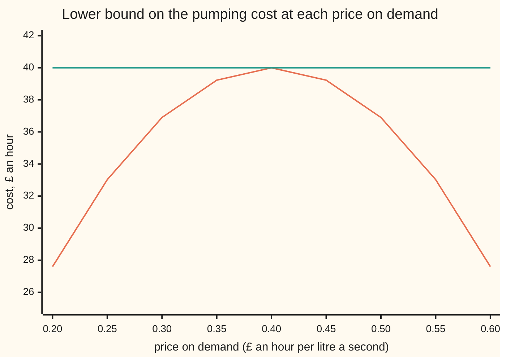

# Lagrangian duality: pricing the constraints gives a bound, sometimes exactly

[Syllabus](../../../SYLLABUS.md) → [Optimization](../README.md) → [Constrained Optimisation](../README.md#s03) → Lagrangian duality

---

## General Overview

A water company runs two pumps that feed a town's main. The town needs at least **140 litres a second** (L/s). Pump 1, the newer one, lifts 2.0 litres a second for each kilowatt (kW) of power; pump 2 lifts 1.5. Electricity costs £0.30 a kilowatt-hour, and each pump also wastes more as it is pushed harder, so its running cost grows faster than its power. The company **chooses** the two pump powers, wants the **hourly cost as small as possible** (this card minimises), and is **limited** by the demand.

The best plan turns out to be 40 kW on each pump, at **£40.00 an hour**. The question this card answers is different: how could anyone *prove* that no plan is cheaper, without trying them all?

The trick is to stop treating the demand as a rule and start treating it as a price. Say every litre a second the pumps fall short of 140 is charged at 35p an hour, and every litre a second over 140 earns 35p back.

Now each pump runs up to the point where one more kW costs as much as the extra water it lifts earns at 35p. That gives pump 1 at 32 kW and pump 2 at 30 kW, costing £28.375 an hour but delivering only 109 litres a second.

Add the charge for the 31 missing, at 35p each. The total, **£39.225**, is a floor. No plan that meets demand can cost less. It is within **1.94 percent** of the truth.

Raise the price to 40p and the floor rises to **£40.00**, exactly the cost of the best plan. The floor has met the ceiling, and the plan is proved best.

**Charging a price for breaking a constraint gives, at every non-negative price, a lower bound on the best cost; the bound as a function of the price is concave, so climbing it is easy, and for a convex problem with a strictly feasible point the best bound equals the best cost.**

**What kind of fact this is:** three theorems.

- **Weak duality** (every price gives a lower bound): proved on this card in Why it works.
- **The bound is concave in the price:** proved on this card in Why it works.
- **Strong duality under Slater's condition:** stated with its source. It is proved for one inequality on the [Slater's condition](05-slaters-condition-and-duality-gaps.md) card and in general in Boyd and Vandenberghe (section 5.3.2). The code certifies it for the pump plan.

### The picture: the bound at every price



Orange, the hill: the bound $q(\lambda)$ at each price. Green, flat: the cost of the best plan, £40.00 an hour. The hill never rises above the flat line, at any price. Its top touches the line at 40p. The trial price of 35p sits one step down the left slope, at £39.225; 45p, one step down the right slope, gives the same.

---

## The formula

The pieces of a constrained problem are named on the [KKT conditions](02-kkt-conditions.md) card: the objective $f_0$ to minimise, inequality functions $f_i(x) \le 0$, equality functions $h_j(x) = 0$, a multiplier $\lambda_i \ge 0$ for each inequality and $\nu_j$ (any sign) for each equality, and the best cost $p^\star$. This card adds two names, in words first: the **dual function** $q(\lambda, \nu)$ is the lowest priced cost at the prices $(\lambda, \nu)$, and the **dual optimal value** $d^\star$ is the highest that bound ever gets.

$$
\mathcal L(x, \lambda, \nu) = f_0(x) + \sum_{i=1}^{m} \lambda_i f_i(x) + \sum_{j=1}^{p} \nu_j h_j(x),
\qquad
q(\lambda, \nu) = \min_{x}\, \mathcal L(x, \lambda, \nu),
$$

$$
\text{weak duality: } q(\lambda, \nu) \le d^\star \le p^\star \text{ for every } \lambda \ge 0 \text{ and every } \nu,
\qquad d^\star = \max_{\lambda \ge 0,\ \nu} q(\lambda, \nu).
$$

**Read it aloud:** add each constraint to the cost with a price on it, let the plan be anything at all, and the cheapest priced cost is a floor under the true best, for every price that charges for breaking an "at most" rule.

The **Lagrangian** $\mathcal L$ is the priced cost. The minimum in $q$ is taken over every plan, legal or not, so the dual function is a single number for each price. (Where the minimum is not reached, it is the greatest lower bound, written inf; on this card it is always reached.)

For the pumps, write $x_1, x_2$ for the two pump powers in kW and keep $x \ge 0$ inside the minimum, since a pump cannot run backwards. Only the demand rule is priced:

$$
f_0(x) = 0.30x_1 + 0.00625x_1^2 + 0.30x_2 + 0.00375x_2^2, \qquad f_1(x) = 140 - 2.0x_1 - 1.5x_2 \le 0,
$$

$$
q(\lambda) = \min_{x \ge 0} \big[f_0(x) + \lambda f_1(x)\big] = 140\lambda - \frac{(2\lambda - 0.3)^2}{0.025} - \frac{(1.5\lambda - 0.3)^2}{0.015} \quad\text{for } \lambda \ge 0.20.
$$

The cost is in £ an hour, $f_1$ is the shortfall in litres a second, and $\lambda$ is in £ an hour per litre a second.

| Symbol | Plain meaning | In our example | Push it up and the answer… |
| --- | --- | --- | --- |
| $x = (x_1, x_2)$, $x(\lambda)$ | the choice: power of pump 1 and pump 2, kW; $x(\lambda)$ is the plan that minimises the priced cost at price $\lambda$ | (40, 40) at the best; $x(0.35) = (32, 30)$ | — |
| $f_0$ | the objective: cost to minimise, £ an hour | £40.00 at the best | — |
| $f_1$, $f_i$, $h_j$ | constraint functions: kept at most 0, or equal to 0 | $f_1$: shortfall below 140 L/s | — |
| $m$, $p$; $i$, $j$ | how many inequality and equality rules there are, and the counters that number them ($p$ alone is a count, not the best cost $p^\star$) | $m = 1$, $p = 0$ | — |
| $D$ | the demand, litres a second (`D` in the code) | 140 | $p^\star$ and $\lambda^\star$ rise: 160 gives £48.3226 and 0.4323 |
| $\lambda$, $\lambda_i$, $\lambda^\star$ | price on breaking an "at most" rule, at least 0; $\lambda^\star$ the best price | 0.35 on trial, $\lambda^\star = 0.40$ £/h per L/s | the bound rises, peaks at $\lambda^\star$, then falls |
| $\nu_j$ | price on an equality rule, any sign | none here | — |
| $\mathcal L$ | the Lagrangian: cost plus priced constraints | $f_0(x) + \lambda f_1(x)$ | — |
| $q(\lambda)$ | dual function: lowest priced cost at that price | £39.225 at 0.35 | — |
| $p^\star$, $d^\star$ | best cost; best bound | both £40.00 | — |
| $\theta$ | a mixing weight between 0 and 1, used in the concavity proof | — | — |
| $\alpha$, $k$, $\lambda_k$ | step size and step count of the price climb, and the price after $k$ steps | 0.001; $\lambda_0 = 0.35$ at $k = 0$ | faster up to $1/620$, slower beyond, and above 0.003226 it diverges |

### When it holds

- **The price on an "at most" rule is at least zero.** Weak duality needs $\lambda f_1(x) \le 0$ for every legal plan: a legal plan has $f_1 \le 0$, so a non-negative price can only lower its priced cost. A negative price would reward a legal plan for its surplus, and the floor argument breaks.
- **The minimum is over all plans, not just legal ones.** That is what makes $q$ easy to compute (each pump decides alone) and what makes it only a bound. Restrict the minimum to legal plans and $q$ is no easier than the problem itself.
- **Strong duality needs convexity.** A convex cost curves upward or not at all, and a convex set of plans has no dents: the straight line between two legal plans stays legal ([Convex functions](../01-Convexity/03-convex-functions-and-their-tests.md), [Convex sets](../01-Convexity/02-convex-sets.md)). Replace pump 2 with a fixed-speed unit, off or at 70 kW, and the best bound stops at £44.40 while the best plan costs £46.54: a 4.60 percent gap no price closes.
- **Strong duality also needs a strictly feasible point** (Slater's condition): a plan that meets every inequality with room to spare. Here 50 kW on each pump delivers 175 litres a second, well over 140. Without such a point a convex problem can lose its best price, the bound only creeping up towards $p^\star$ ([Slater's condition](05-slaters-condition-and-duality-gaps.md)), and some convex problems even keep a gap.
- **The model is a model.** Flow rising in a straight line with power, and cost as a square, are fitting assumptions for this card's numbers, not pump physics. The duality results hold for whatever $f_0$ and $f_1$ are; only the numbers depend on them.

---

## Why it works

### Step 0: a legal plan never pays the charge

Put a price $\lambda \ge 0$ on the shortfall. A legal plan has shortfall at most zero, so its charge $\lambda f_1(x)$ is zero or negative: pricing can only make a legal plan look cheaper than it is. The cheapest priced plan, searched over everything, is cheaper still. So it sits below every legal plan's true cost, including the best one. That is the whole of weak duality. Everything else on this card is about how good the floor is.

### Step 1: the dual function splits into easy pieces

With the demand priced, the pumps no longer need to coordinate. Each one minimises its own running cost minus what it earns:

$$\min_{x_1 \ge 0}\ \big(0.30x_1 + 0.00625x_1^2 - 2.0\lambda x_1\big), \qquad \min_{x_2 \ge 0}\ \big(0.30x_2 + 0.00375x_2^2 - 1.5\lambda x_2\big).$$

Each is a parabola. Setting its slope to zero gives

$$x_1(\lambda) = \frac{2.0\lambda - 0.30}{0.0125}, \qquad x_2(\lambda) = \frac{1.5\lambda - 0.30}{0.0075},$$

or zero if that comes out negative. Pump 1 switches on above a price of 0.15, pump 2 above 0.20. Put these back into $f_0 + \lambda f_1$ and the result is the formula for $q(\lambda)$ above. This splitting is the practical reason duality is used: a price turns one big coupled decision into many small independent ones (the [Saddle points](06-saddle-points-and-minimax.md) card reads the same pair as a game).

### Step 2: weak duality, as an inequality chain

For any legal $x$ and any $\lambda \ge 0$:

$$q(\lambda) \;\le\; \mathcal L(x, \lambda) \;=\; f_0(x) + \lambda f_1(x) \;\le\; f_0(x).$$

The first step holds because $q$ is the minimum of $\mathcal L$ over all plans. The second because $\lambda \ge 0$ and $f_1(x) \le 0$. Take the best legal plan and $q(\lambda) \le p^\star$. The code checks this on 846 legal plans on a 2 kW grid and 101 prices: the smallest margin is 0.0000, at the best plan and the best price.

<details>
<summary>Detailed proof: weak duality with many constraints</summary>

Let $x$ satisfy $f_i(x) \le 0$ for $i = 1, \dots, m$ and $h_j(x) = 0$ for $j = 1, \dots, p$. Let $\lambda \ge 0$ entry by entry and $\nu$ be any vector. Then each $\lambda_i f_i(x) \le 0$, since it is a non-negative number times a non-positive one, and each $\nu_j h_j(x) = 0$. So

$$\mathcal L(x, \lambda, \nu) = f_0(x) + \sum_i \lambda_i f_i(x) + \sum_j \nu_j h_j(x) \le f_0(x).$$

The dual function is the minimum of $\mathcal L$ over all $x$, so $q(\lambda, \nu) \le \mathcal L(x, \lambda, \nu) \le f_0(x)$. This holds for every legal $x$, so $q(\lambda, \nu) \le p^\star$; and it holds for every $\lambda \ge 0$ and $\nu$, so $d^\star \le p^\star$. Nothing here used convexity: weak duality holds for every problem, including integer ones. If no legal $x$ exists, $p^\star = +\infty$ and the statement is empty.

</details>

### Step 3: the dual function is always concave

Fix one plan $x$. Then $\mathcal L(x, \lambda) = f_0(x) + \lambda f_1(x)$ is a straight line in $\lambda$: height $f_0(x)$, slope $f_1(x)$. The dual function is the lowest of all these lines, one per plan. The lower edge of a bundle of straight lines bends downward or not at all: it is **concave**. So $q$ is a hill with no false tops: any top it reaches is the highest, whatever the original problem looked like.

<details>
<summary>Detailed proof: q is concave</summary>

Take prices $(\lambda, \nu)$ and $(\lambda', \nu')$ and a weight $\theta$ between 0 and 1. The Lagrangian is affine in the prices (a weighted sum plus a constant), so for any plan $x$,

$$\mathcal L\big(x, \theta\lambda + (1-\theta)\lambda', \theta\nu + (1-\theta)\nu'\big) = \theta\,\mathcal L(x, \lambda, \nu) + (1-\theta)\,\mathcal L(x, \lambda', \nu') \ge \theta\, q(\lambda, \nu) + (1-\theta)\, q(\lambda', \nu').$$

The right side does not depend on $x$, so it is also below the minimum of the left side over $x$, which is $q$ at the mixed price. That is the definition of concave. Again, no convexity of $f_0$ or $f_i$ was used.

</details>

The code tests this on every pair of 101 prices between 0 and 1: the bound at the midpoint is never below the average of the two ends, 10,201 out of 10,201 times.

### Step 4: the slope of the hill is the shortfall

At the trial price the pumps deliver 109 litres a second, 31 short. Raising the price a little makes both pumps run harder, and the bound rises at a rate equal to that shortfall: $q'(\lambda) = f_1\big(x(\lambda)\big)$.

For prices above 0.20, with both pumps on, pump 1 delivers $2.0\,x_1(\lambda) = 320\lambda - 48$ litres a second and pump 2 delivers $1.5\,x_2(\lambda) = 300\lambda - 60$. So the shortfall is $140 - (320\lambda - 48) - (300\lambda - 60) = 248 - 620\lambda$. It falls by 620 litres a second for each unit of price (£1 an hour per litre a second), and the hill's top is where it is zero, $\lambda^\star = 248/620 = 0.40$.

That gives the simplest way to climb, **dual ascent**: from a start $\lambda_0$, raise the price in proportion to the shortfall,

$$\lambda_{k+1} = \max\big(0,\ \lambda_k + \alpha\, f_1(x(\lambda_k))\big).$$

With $\alpha = 0.001$ the distance to the top is multiplied by $1 - 620 \times 0.001 = 0.38$ at every step. Above $\alpha = 2/620 = 0.003226$ that factor is below $-1$, and the price swings ever wider.

### Step 5: strong duality, certified for the pumps

At $\lambda^\star = 0.40$ each pump's own choice is 40 kW. Those two choices deliver $80 + 60 = 140$ litres a second: exactly the demand, so the plan is legal and its charge is zero. That gives a sandwich:

$$q(0.40) \;\le\; p^\star \;\le\; f_0(40, 40) \;=\; f_0(40, 40) + 0.40 \times 0 \;=\; q(0.40) \;=\; 40.00.$$

Floor and ceiling are both £40.00, so $p^\star = d^\star = 40.00$ and the plan is proved best. This is the certificate the code prints: a plan, a price, and a zero gap between them. The two conditions that made it work are the [KKT conditions](02-kkt-conditions.md): the plan minimises the priced cost (stationarity), and the price times the shortfall is zero (complementary slackness).

The general theorem says when such a price must exist.

> **Strong duality (Slater's theorem).** Over a convex set of allowed plans, suppose $f_0, f_1, \dots, f_m$ are convex on it, every $h_j$ is affine, and some plan inside that set has $f_i(x) < 0$ for every $i$ and $h_j(x) = 0$ for every $j$. Then $d^\star = p^\star$, and if $p^\star$ is finite, some $(\lambda^\star, \nu^\star)$ with $\lambda^\star \ge 0$ attains it: $q(\lambda^\star, \nu^\star) = p^\star$.

It is stated here, with its proof in Boyd and Vandenberghe (section 5.3.2); the [Slater's condition](05-slaters-condition-and-duality-gaps.md) card proves the case of one inequality. The pump plan meets every hypothesis: the cost is a sum of upward parabolas, the shortfall is a straight line, and 50 kW on each pump delivers 175 litres a second. The rule $x \ge 0$, kept inside the minimum, is the convex set of allowed plans, and the strictly feasible plan (50, 50) lies inside it.

### Step 6: the best price is also the marginal cost

The top of the hill has a second meaning. Raise the demand by one litre a second and the best cost rises by about $\lambda^\star$. The code moves the demand from 139 to 141 and the best cost moves at 0.4000 £ an hour per litre a second. So $\lambda^\star$ is the **shadow price** of demand: what one more litre a second costs the company, an hour. The [LP duality](../04-Linear%20Programming/04-lp-duality-and-complementary-slackness.md) card reads linear programs' prices the same way.

---

## Worked numbers, by hand

The trial price $\lambda_0 = 0.35$, then the best price.

| Step | Arithmetic | Value |
| --- | --- | --- |
| pump 1 at the trial price | $(2.0 \times 0.35 - 0.30) / 0.0125 = 0.40 / 0.0125$ | 32 kW |
| pump 2 at the trial price | $(1.5 \times 0.35 - 0.30) / 0.0075 = 0.225 / 0.0075$ | 30 kW |
| water delivered | $2.0 \times 32 + 1.5 \times 30 = 64 + 45$ | 109 L/s |
| shortfall | $140 - 109$ | 31 L/s |
| running cost | $f_0(32, 30)$ | £28.375 an hour |
| bound at the trial price | $28.375 + 0.35 \times 31$ | £39.225 an hour |
| best price | shortfall $140 - (320\lambda - 48) - (300\lambda - 60) = 248 - 620\lambda = 0$ | $\lambda^\star = 248/620 = 0.40$ |
| pumps at the best price | $0.50 / 0.0125$ and $0.30 / 0.0075$ | 40 and 40 kW |
| delivered | $80 + 60$ | 140 L/s, no shortfall |
| bound at the best price | $f_0(40, 40) + 0.40 \times 0$ | £40.00 an hour |
| gap at the trial price | $(40.00 - 39.225) / 40.00$ | **1.94 percent** |

At 35p the bound already says no plan costs less than £39.225 an hour; at 40p it says no plan costs less than £40.00, and the plan at 40 kW each costs exactly that, so it is the best.

The gap has a neat form. Near the top the hill is a parabola with curvature $-620$, so the gap at a price $0.05$ off is $310 \times 0.05^2 = 0.775$ pounds an hour. A price 5p too high costs the same: $q(0.45) = 39.225$.

### Climbing to the best price

Dual ascent from $\lambda_0 = 0.35$ with step $\alpha = 0.001$, stopping when the shortfall is under 0.01 litres a second:

| $k$ | price $\lambda_k$ | shortfall, L/s | bound $q$, £/h | gap, percent |
| ---: | ---: | ---: | ---: | ---: |
| 0 | 0.35000 | 31.0000 | 39.2250 | 1.9375 |
| 1 | 0.38100 | 11.7800 | 39.8881 | 0.2798 |
| 2 | 0.39278 | 4.4764 | 39.9838 | 0.0404 |
| 3 | 0.39726 | 1.7010 | 39.9977 | 0.0058 |
| 4 | 0.39896 | 0.6464 | 39.9997 | 0.0008 |
| 5 | 0.39960 | 0.2456 | 40.0000 | 0.0001 |
| 6 | 0.39985 | 0.0933 | 40.0000 | 0.0000 |

The shortfall shrinks by the factor 0.38 each step and the gap by the square of that factor. The stopping test is met after **9 steps**, at a price of 0.39999. Every bound in the table is a valid floor the moment it is computed; the climb only makes the floor higher.

### What breaks if you drop a piece

| Mistake | Comes out at | What went wrong |
| --- | --- | --- |
| Pump 2 is fixed-speed: off or 70 kW | best bound £44.40 against a best plan of £46.54, a 4.60 percent gap | The legal plans no longer form a convex set. At 0.375 the price makes pump 2 indifferent between off and on, and the bound behaves as if it could run part-on; no real plan does |
| Step $\alpha = 0.004$ in the climb | prices 0.350, 0.474, 0.290, 0.562, 0.160, 0.707, 0.000; gap 100.00 percent after 6 steps | The step is above $2/620 = 0.003226$, so each step overshoots the top by more than it started below it |
| Reading the trial-price plan as the answer | £28.375 an hour, delivering 109 of 140 L/s | The plan that minimises the priced cost need not be legal; only the bound is guaranteed |
| Leaving the $\lambda \times 140$ term out of $\mathcal L$ | a "bound" of −£9.775 | Still below the truth, so not false, but useless: the demand itself is what the price is charged against |

The code prints all four. In the fixed-speed case the best plan runs pump 2 at 70 kW (105 litres a second) and pump 1 at 17.50 kW; Slater's point still exists, so it is convexity that failed.

---

## Code, from first principles, and it actually runs

The code builds the dual function from its definition, each pump minimising its own priced cost, and reaches the best cost by **three independent roads**. Road 1 never sees a price: it puts the demand in exactly and searches the remaining one-dimensional cost by golden-section search (repeatedly cutting the interval at the golden ratio). Road 2 finds the price at which the pumps meet demand by bisection, and reads $d^\star = q(\lambda^\star)$. Road 3 solves the stationarity equation for $\lambda^\star$ directly. Then the road-1 plan and the road-2 price are fed to the KKT conditions, weak duality is checked on a grid of 846 legal plans and 101 prices, concavity by 10,201 midpoint tests, and the shadow price by moving the demand. Every number on the card is printed.

### Python

```python
# Lagrangian duality -- the check behind the card.  Standard library only.
# Two pumps must deliver 140 L/s at least cost.  The demand rule is priced at
# lam pounds an hour per L/s; each price gives a lower bound q(lam) on the cost.
A, E, B = 0.30, (2.0, 1.5), (0.00625, 0.00375)   # £/kWh; L/s per kW; £/h per kW^2
D, LAM0, STEP = 140.0, 0.35, 0.001                  # demand L/s, trial price, ascent step

def cost(p):                                      # f0: pounds an hour for powers p (kW)
    return sum(A * x + b * x * x for x, b in zip(p, B))

def flow(p):                                      # litres a second delivered
    return sum(e * x for e, x in zip(E, p))

def inner(lam):                                   # each pump minimises its own priced cost
    return [max(0.0, (lam * e - A) / (2 * b)) for e, b in zip(E, B)]

def q(lam, d=D):                                  # dual function: min over p of L(p, lam)
    p = inner(lam)
    return cost(p) + lam * (d - flow(p))

def golden(f, lo, hi, n=200):                     # minimise a 1-D convex f, no derivatives
    r = (5 ** 0.5 - 1) / 2
    for _ in range(n):
        m1, m2 = hi - r * (hi - lo), lo + r * (hi - lo)
        if f(m1) < f(m2): hi = m2
        else: lo = m1
    return (lo + hi) / 2

def primal(d=D):                                  # road 1: the plan itself, demand met exactly
    pa = golden(lambda x: cost([x, (d - E[0] * x) / E[1]]), 0.0, d / E[0])
    p = [pa, (d - E[0] * pa) / E[1]]
    return p, cost(p)

def bisect_price(d=D):                            # road 2: the price at which the pumps meet demand
    lo, hi = 0.0, 5.0
    for _ in range(200):
        mid = (lo + hi) / 2
        if flow(inner(mid)) < d: lo = mid
        else: hi = mid
    return (lo + hi) / 2

def ascent(lam, step, n):                         # dual ascent: raise the price by step * shortfall
    out = []
    for k in range(n + 1):
        short = D - flow(inner(lam))
        out.append((k, lam, short, q(lam)))
        lam = max(0.0, lam + step * short)
    return out

pstar_plan, pstar = primal()
p0 = inner(LAM0)
print(f"trial price {LAM0:.2f}: pumps at {p0[0]:.2f} and {p0[1]:.2f} kW, "
      f"deliver {flow(p0):.1f} L/s, short {D - flow(p0):.1f}")
print(f"trial plan costs {cost(p0):.3f} £/h; bound q = {cost(p0):.3f} + "
      f"{LAM0:.2f} x {D - flow(p0):.1f} = {q(LAM0):.3f}")
print(f"road 1, primal search: pumps at {pstar_plan[0]:.4f} and {pstar_plan[1]:.4f} kW, "
      f"p* = {pstar:.4f} £/h")
print(f"pumps switch on at prices {A / E[0]:.2f} and {A / E[1]:.2f}; strictly feasible plan "
      f"50 and 50 kW: {flow([50.0, 50.0]):.1f} L/s, {cost([50.0, 50.0]):.3f} £/h")
print(f"gap at the trial price: {pstar - q(LAM0):.4f} £/h = {100 * (pstar - q(LAM0)) / pstar:.2f}%")
slope_s = (flow(inner(0.41)) - flow(inner(0.39))) / 0.02          # how fast delivery rises with price
print(f"shortfall falls {slope_s:.1f} L/s per unit of price; error x {1 - STEP * slope_s:.2f} a step; "
      f"steps above {2 / slope_s:.6f} diverge")
print(" k   price   short L/s   bound q   gap %")
hist = ascent(LAM0, STEP, 6)
for k, lam, short, qq in hist:
    print(f"{k:2d}  {lam:.5f}  {short:9.4f}  {qq:8.4f}  {100 * (pstar - qq) / pstar:.4f}")
run, k = LAM0, 0
while abs(D - flow(inner(run))) >= 0.01:
    run, k = run + STEP * (D - flow(inner(run))), k + 1
print(f"ascent from {LAM0:.2f}, stop when |short| < 0.01 L/s: {k} steps, price {run:.5f}")
lstar = bisect_price()
dstar = q(lstar)
pl = inner(lstar)
print(f"road 2, price by bisection: lam* = {lstar:.6f}, plan {pl[0]:.4f} and {pl[1]:.4f} kW, "
      f"d* = {dstar:.4f}")
sl = [e * e / (2 * b) for e, b in zip(E, B)]     # a running pump delivers sl * lam - ic litres a second
ic = [e * A / (2 * b) for e, b in zip(E, B)]
lam_exact = (D + sum(ic)) / sum(sl)
print(f"road 3, shortfall {D:.0f} - ({sl[0]:.0f} lam - {ic[0]:.0f}) - ({sl[1]:.0f} lam - {ic[1]:.0f}) = "
      f"{D + sum(ic):.0f} - {sum(sl):.0f} lam = 0 at lam* = {lam_exact:.6f}")
stat = max(abs(A + 2 * b * x - lstar * e) for x, b, e in zip(pstar_plan, B, E))  # road-1 plan, road-2 price
print(f"KKT, road-1 plan with lam*: stationarity residual {stat:.6f}, lam* x shortfall {abs(lstar * (D - flow(pstar_plan))):.6f}")
curv = (q(0.41) - 2 * q(0.40) + q(0.39)) / 0.01 ** 2
print(f"curvature of q near lam*: {curv:.1f} (gap at 0.35 = {-curv / 2:.0f} x 0.05^2 = {-curv / 2 * 0.0025:.4f})")
lams = [i / 100 for i in range(0, 101)]
plans = [[i * 2.0, j * 2.0] for i in range(41) for j in range(41)]
feas = [p for p in plans if flow(p) >= D]
worst = min(cost(p) - q(l) for p in feas for l in lams)
print(f"weak duality: {len(feas)} feasible plans x {len(lams)} prices, smallest cost - q = {worst:.4f}")
mids = sum(q((x + y) / 2) >= (q(x) + q(y)) / 2 - 1e-9 for x in lams for y in lams)
print(f"concavity: midpoint test passed for {mids} of {len(lams) ** 2} price pairs")
slope = (primal(141.0)[1] - primal(139.0)[1]) / 2
print(f"shadow price: (p*(141) - p*(139)) / 2 = {slope:.4f} £/h per L/s")
print("chart, price " + " ".join(f"{0.20 + 0.05 * i:6.2f}" for i in range(9)))
print("chart, q     " + " ".join(f"{q(0.20 + 0.05 * i):.3f}" for i in range(9)))
# ---- what breaks ----
CB = A * 70 + B[1] * 70 * 70                      # fixed-speed pump B: off, or 70 kW
def q_fixed(lam):
    pa = max(0.0, (lam * E[0] - A) / (2 * B[0]))
    return lam * D + A * pa + B[0] * pa * pa - lam * E[0] * pa + min(0.0, CB - lam * E[1] * 70)
fix_p = min(cost([D / E[0], 0.0]), CB + cost([(D - E[1] * 70) / E[0], 0.0]))
fix_l = max((q_fixed(i / 10000), i / 10000) for i in range(10001))
print(f"break, fixed-speed pump: p* = {fix_p:.4f}, best bound d* = {fix_l[0]:.4f} at "
      f"{fix_l[1]:.4f}, gap {100 * (fix_p - fix_l[0]) / fix_p:.2f}%")
print(f"break, fixed-speed best plan: pump 1 at {(D - E[1] * 70) / E[0]:.2f} kW, pump 2 at 70 kW "
      f"({E[1] * 70:.1f} L/s), priced cost of pump 2 at {fix_l[1]:.4f}: {CB - fix_l[1] * E[1] * 70:.4f}")
big = ascent(LAM0, 0.004, 6)
print("break, step 0.004, prices: " + " ".join(f"{lam:.3f}" for _, lam, _, _ in big))
print(f"break, step 0.004, gap after 6 steps: {100 * (pstar - big[-1][3]) / pstar:.2f}%")
print(f"break, trial plan read as the answer: {cost(p0):.3f} £/h, {flow(p0):.1f} of {D:.0f} L/s")
print(f"break, demand term left out: q = {cost(p0) - LAM0 * flow(p0):.3f}")
# ---- try changing ----
p160 = primal(160.0)
print(f"try, demand 160: lam* = {bisect_price(160.0):.4f}, p* = {p160[1]:.4f}, "
      f"pumps {p160[0][0]:.2f} and {p160[0][1]:.2f}")
print(f"try, trial price 0.45: q = {q(0.45):.4f}; step 1/620 from 0.35: {ascent(LAM0, 1 / 620, 1)[1][1]:.6f}")
assert abs(pstar - 40.0) < 1e-6 and abs(dstar - pstar) < 1e-6        # strong duality, two roads
assert abs(lstar - lam_exact) < 1e-9 and abs(slope - lstar) < 1e-6   # price three ways
assert abs((pstar - q(LAM0)) / pstar - 0.019375) < 1e-9              # the 2 percent at the trial price
assert worst >= -1e-9 and mids == len(lams) ** 2                     # weak duality and concavity
assert fix_p - fix_l[0] > 1.0 and stat < 1e-6                       # nonconvex: the gap stays open
print("ALL CHECKS PASS")
```

**Ran 2026-11-11 on macOS, Python 3.14.10, standard library only. All checks passed. Output, pasted from the run:**

```
trial price 0.35: pumps at 32.00 and 30.00 kW, deliver 109.0 L/s, short 31.0
trial plan costs 28.375 £/h; bound q = 28.375 + 0.35 x 31.0 = 39.225
road 1, primal search: pumps at 40.0000 and 40.0000 kW, p* = 40.0000 £/h
pumps switch on at prices 0.15 and 0.20; strictly feasible plan 50 and 50 kW: 175.0 L/s, 55.000 £/h
gap at the trial price: 0.7750 £/h = 1.94%
shortfall falls 620.0 L/s per unit of price; error x 0.38 a step; steps above 0.003226 diverge
 k   price   short L/s   bound q   gap %
 0  0.35000    31.0000   39.2250  1.9375
 1  0.38100    11.7800   39.8881  0.2798
 2  0.39278     4.4764   39.9838  0.0404
 3  0.39726     1.7010   39.9977  0.0058
 4  0.39896     0.6464   39.9997  0.0008
 5  0.39960     0.2456   40.0000  0.0001
 6  0.39985     0.0933   40.0000  0.0000
ascent from 0.35, stop when |short| < 0.01 L/s: 9 steps, price 0.39999
road 2, price by bisection: lam* = 0.400000, plan 40.0000 and 40.0000 kW, d* = 40.0000
road 3, shortfall 140 - (320 lam - 48) - (300 lam - 60) = 248 - 620 lam = 0 at lam* = 0.400000
KKT, road-1 plan with lam*: stationarity residual 0.000000, lam* x shortfall 0.000000
curvature of q near lam*: -620.0 (gap at 0.35 = 310 x 0.05^2 = 0.7750)
weak duality: 846 feasible plans x 101 prices, smallest cost - q = 0.0000
concavity: midpoint test passed for 10201 of 10201 price pairs
shadow price: (p*(141) - p*(139)) / 2 = 0.4000 £/h per L/s
chart, price   0.20   0.25   0.30   0.35   0.40   0.45   0.50   0.55   0.60
chart, q     27.600 33.025 36.900 39.225 40.000 39.225 36.900 33.025 27.600
break, fixed-speed pump: p* = 46.5391, best bound d* = 44.4000 at 0.3750, gap 4.60%
break, fixed-speed best plan: pump 1 at 17.50 kW, pump 2 at 70 kW (105.0 L/s), priced cost of pump 2 at 0.3750: 0.0000
break, step 0.004, prices: 0.350 0.474 0.290 0.562 0.160 0.707 0.000
break, step 0.004, gap after 6 steps: 100.00%
break, trial plan read as the answer: 28.375 £/h, 109.0 of 140 L/s
break, demand term left out: q = -9.775
try, demand 160: lam* = 0.4323, p* = 48.3226, pumps 45.16 and 46.45
try, trial price 0.45: q = 39.2250; step 1/620 from 0.35: 0.400000
ALL CHECKS PASS
```

### Rust

Same numbers, same labels, built with `rustc --edition 2021 -O`.

```rust
// Lagrangian duality -- the same check as the Python, in Rust.  No crates.
// Two pumps must deliver 140 L/s at least cost.  The demand rule is priced at
// lam pounds an hour per L/s; each price gives a lower bound q(lam) on the cost.
const A: f64 = 0.30;                               // £ per kWh
const E: [f64; 2] = [2.0, 1.5];                    // L/s per kW
const B: [f64; 2] = [0.00625, 0.00375];            // £/h per kW^2
const D: f64 = 140.0;                              // demand, L/s
const LAM0: f64 = 0.35;                            // trial price
const STEP: f64 = 0.001;                           // ascent step

fn cost(p: &[f64]) -> f64 { (0..2).map(|i| A * p[i] + B[i] * p[i] * p[i]).sum() }
fn flow(p: &[f64]) -> f64 { (0..2).map(|i| E[i] * p[i]).sum() }
fn inner(lam: f64) -> Vec<f64> { (0..2).map(|i| f64::max(0.0, (lam * E[i] - A) / (2.0 * B[i]))).collect() }
fn q_at(lam: f64, d: f64) -> f64 { let p = inner(lam); cost(&p) + lam * (d - flow(&p)) }
fn q(lam: f64) -> f64 { q_at(lam, D) }

fn golden(f: &dyn Fn(f64) -> f64, mut lo: f64, mut hi: f64) -> f64 {
    let r = (5f64.sqrt() - 1.0) / 2.0;
    for _ in 0..200 {
        let (m1, m2) = (hi - r * (hi - lo), lo + r * (hi - lo));
        if f(m1) < f(m2) { hi = m2 } else { lo = m1 }
    }
    (lo + hi) / 2.0
}
fn primal(d: f64) -> (Vec<f64>, f64) {             // road 1: the plan itself, demand met exactly
    let pa = golden(&|x: f64| cost(&[x, (d - E[0] * x) / E[1]]), 0.0, d / E[0]);
    let p = vec![pa, (d - E[0] * pa) / E[1]];
    let c = cost(&p);
    (p, c)
}
fn bisect_price(d: f64) -> f64 {                   // road 2: the price at which the pumps meet demand
    let (mut lo, mut hi) = (0.0, 5.0);
    for _ in 0..200 {
        let mid = (lo + hi) / 2.0;
        if flow(&inner(mid)) < d { lo = mid } else { hi = mid }
    }
    (lo + hi) / 2.0
}
fn ascent(mut lam: f64, step: f64, n: usize) -> Vec<(usize, f64, f64, f64)> {
    let mut out = Vec::new();
    for k in 0..=n {
        let short = D - flow(&inner(lam));
        out.push((k, lam, short, q(lam)));
        lam = f64::max(0.0, lam + step * short);
    }
    out
}
const CB: f64 = A * 70.0 + 0.00375 * 70.0 * 70.0;  // fixed-speed pump B: off, or 70 kW
fn q_fixed(lam: f64) -> f64 {
    let pa = f64::max(0.0, (lam * E[0] - A) / (2.0 * B[0]));
    lam * D + A * pa + B[0] * pa * pa - lam * E[0] * pa + f64::min(0.0, CB - lam * E[1] * 70.0)
}

fn main() {
    let (pstar_plan, pstar) = primal(D);
    let p0 = inner(LAM0);
    println!("trial price {:.2}: pumps at {:.2} and {:.2} kW, deliver {:.1} L/s, short {:.1}",
             LAM0, p0[0], p0[1], flow(&p0), D - flow(&p0));
    println!("trial plan costs {:.3} £/h; bound q = {:.3} + {:.2} x {:.1} = {:.3}",
             cost(&p0), cost(&p0), LAM0, D - flow(&p0), q(LAM0));
    println!("road 1, primal search: pumps at {:.4} and {:.4} kW, p* = {:.4} £/h", pstar_plan[0], pstar_plan[1], pstar);
    println!("pumps switch on at prices {:.2} and {:.2}; strictly feasible plan 50 and 50 kW: {:.1} L/s, {:.3} £/h",
             A / E[0], A / E[1], flow(&[50.0, 50.0]), cost(&[50.0, 50.0]));
    println!("gap at the trial price: {:.4} £/h = {:.2}%", pstar - q(LAM0), 100.0 * (pstar - q(LAM0)) / pstar);
    let slope_s = (flow(&inner(0.41)) - flow(&inner(0.39))) / 0.02;  // how fast delivery rises with price
    println!("shortfall falls {:.1} L/s per unit of price; error x {:.2} a step; steps above {:.6} diverge",
             slope_s, 1.0 - STEP * slope_s, 2.0 / slope_s);
    println!(" k   price   short L/s   bound q   gap %");
    for (k, lam, short, qq) in ascent(LAM0, STEP, 6) {
        println!("{:2}  {:.5}  {:9.4}  {:8.4}  {:.4}", k, lam, short, qq, 100.0 * (pstar - qq) / pstar);
    }
    let (mut run, mut k) = (LAM0, 0);
    while (D - flow(&inner(run))).abs() >= 0.01 { run += STEP * (D - flow(&inner(run))); k += 1; }
    println!("ascent from {:.2}, stop when |short| < 0.01 L/s: {} steps, price {:.5}", LAM0, k, run);
    let lstar = bisect_price(D);
    let dstar = q(lstar);
    let pl = inner(lstar);
    println!("road 2, price by bisection: lam* = {:.6}, plan {:.4} and {:.4} kW, d* = {:.4}", lstar, pl[0], pl[1], dstar);
    let sl: Vec<f64> = (0..2).map(|i| E[i] * E[i] / (2.0 * B[i])).collect(); // a running pump delivers sl * lam - ic L/s
    let ic: Vec<f64> = (0..2).map(|i| E[i] * A / (2.0 * B[i])).collect();
    let (num, den) = (D + ic.iter().sum::<f64>(), sl.iter().sum::<f64>());
    let lam_exact = num / den;
    println!("road 3, shortfall {:.0} - ({:.0} lam - {:.0}) - ({:.0} lam - {:.0}) = {:.0} - {:.0} lam = 0 at lam* = {:.6}",
             D, sl[0], ic[0], sl[1], ic[1], num, den, lam_exact);
    let stat = (0..2).map(|i| (A + 2.0 * B[i] * pstar_plan[i] - lstar * E[i]).abs()).fold(0.0, f64::max);
    println!("KKT, road-1 plan with lam*: stationarity residual {:.6}, lam* x shortfall {:.6}",
             stat, (lstar * (D - flow(&pstar_plan))).abs());
    let curv = (q(0.41) - 2.0 * q(0.40) + q(0.39)) / (0.01f64 * 0.01);
    println!("curvature of q near lam*: {:.1} (gap at 0.35 = {:.0} x 0.05^2 = {:.4})", curv, -curv / 2.0, -curv / 2.0 * 0.0025);
    let lams: Vec<f64> = (0..=100).map(|i| i as f64 / 100.0).collect();
    let mut feas = Vec::new();
    for i in 0..41 { for j in 0..41 {
        let p = [i as f64 * 2.0, j as f64 * 2.0];
        if flow(&p) >= D { feas.push(p); }
    } }
    let mut worst = f64::INFINITY;
    for p in &feas { for &l in &lams { worst = worst.min(cost(p) - q(l)); } }
    println!("weak duality: {} feasible plans x {} prices, smallest cost - q = {:.4}", feas.len(), lams.len(), worst);
    let mut mids = 0;
    for &x in &lams { for &y in &lams { if q((x + y) / 2.0) >= (q(x) + q(y)) / 2.0 - 1e-9 { mids += 1; } } }
    println!("concavity: midpoint test passed for {} of {} price pairs", mids, lams.len() * lams.len());
    let slope = (primal(141.0).1 - primal(139.0).1) / 2.0;
    println!("shadow price: (p*(141) - p*(139)) / 2 = {:.4} £/h per L/s", slope);
    let pr: Vec<String> = (0..9).map(|i| format!("{:6.2}", 0.20 + 0.05 * i as f64)).collect();
    let qs: Vec<String> = (0..9).map(|i| format!("{:.3}", q(0.20 + 0.05 * i as f64))).collect();
    println!("chart, price {}", pr.join(" "));
    println!("chart, q     {}", qs.join(" "));
    // ---- what breaks ----
    let fix_p = f64::min(cost(&[D / E[0], 0.0]), CB + cost(&[(D - E[1] * 70.0) / E[0], 0.0]));
    let mut fix_l = (f64::NEG_INFINITY, 0.0);
    for i in 0..=10000 { let l = i as f64 / 10000.0; let v = q_fixed(l); if v >= fix_l.0 { fix_l = (v, l); } }
    println!("break, fixed-speed pump: p* = {:.4}, best bound d* = {:.4} at {:.4}, gap {:.2}%",
             fix_p, fix_l.0, fix_l.1, 100.0 * (fix_p - fix_l.0) / fix_p);
    println!("break, fixed-speed best plan: pump 1 at {:.2} kW, pump 2 at 70 kW ({:.1} L/s), priced cost of pump 2 at {:.4}: {:.4}",
             (D - E[1] * 70.0) / E[0], E[1] * 70.0, fix_l.1, CB - fix_l.1 * E[1] * 70.0);
    let big = ascent(LAM0, 0.004, 6);
    let bp: Vec<String> = big.iter().map(|t| format!("{:.3}", t.1)).collect();
    println!("break, step 0.004, prices: {}", bp.join(" "));
    println!("break, step 0.004, gap after 6 steps: {:.2}%", 100.0 * (pstar - big[6].3) / pstar);
    println!("break, trial plan read as the answer: {:.3} £/h, {:.1} of {:.0} L/s", cost(&p0), flow(&p0), D);
    println!("break, demand term left out: q = {:.3}", cost(&p0) - LAM0 * flow(&p0));
    // ---- try changing ----
    let p160 = primal(160.0);
    println!("try, demand 160: lam* = {:.4}, p* = {:.4}, pumps {:.2} and {:.2}", bisect_price(160.0), p160.1, p160.0[0], p160.0[1]);
    println!("try, trial price 0.45: q = {:.4}; step 1/620 from 0.35: {:.6}", q(0.45), ascent(LAM0, 1.0 / 620.0, 1)[1].1);
    assert!((pstar - 40.0).abs() < 1e-6 && (dstar - pstar).abs() < 1e-6);      // strong duality, two roads
    assert!((lstar - lam_exact).abs() < 1e-9 && (slope - lstar).abs() < 1e-6); // price three ways
    assert!(((pstar - q(LAM0)) / pstar - 0.019375).abs() < 1e-9);             // the 2 percent at the trial price
    assert!(worst >= -1e-9 && mids == lams.len() * lams.len());               // weak duality and concavity
    assert!(fix_p - fix_l.0 > 1.0 && stat < 1e-6);                            // nonconvex: the gap stays open
    println!("ALL CHECKS PASS");
}
```

**Ran 2026-11-11 on macOS, rustc 1.98.1, no crates. All checks passed. Output, pasted from the run:**

```
trial price 0.35: pumps at 32.00 and 30.00 kW, deliver 109.0 L/s, short 31.0
trial plan costs 28.375 £/h; bound q = 28.375 + 0.35 x 31.0 = 39.225
road 1, primal search: pumps at 40.0000 and 40.0000 kW, p* = 40.0000 £/h
pumps switch on at prices 0.15 and 0.20; strictly feasible plan 50 and 50 kW: 175.0 L/s, 55.000 £/h
gap at the trial price: 0.7750 £/h = 1.94%
shortfall falls 620.0 L/s per unit of price; error x 0.38 a step; steps above 0.003226 diverge
 k   price   short L/s   bound q   gap %
 0  0.35000    31.0000   39.2250  1.9375
 1  0.38100    11.7800   39.8881  0.2798
 2  0.39278     4.4764   39.9838  0.0404
 3  0.39726     1.7010   39.9977  0.0058
 4  0.39896     0.6464   39.9997  0.0008
 5  0.39960     0.2456   40.0000  0.0001
 6  0.39985     0.0933   40.0000  0.0000
ascent from 0.35, stop when |short| < 0.01 L/s: 9 steps, price 0.39999
road 2, price by bisection: lam* = 0.400000, plan 40.0000 and 40.0000 kW, d* = 40.0000
road 3, shortfall 140 - (320 lam - 48) - (300 lam - 60) = 248 - 620 lam = 0 at lam* = 0.400000
KKT, road-1 plan with lam*: stationarity residual 0.000000, lam* x shortfall 0.000000
curvature of q near lam*: -620.0 (gap at 0.35 = 310 x 0.05^2 = 0.7750)
weak duality: 846 feasible plans x 101 prices, smallest cost - q = 0.0000
concavity: midpoint test passed for 10201 of 10201 price pairs
shadow price: (p*(141) - p*(139)) / 2 = 0.4000 £/h per L/s
chart, price   0.20   0.25   0.30   0.35   0.40   0.45   0.50   0.55   0.60
chart, q     27.600 33.025 36.900 39.225 40.000 39.225 36.900 33.025 27.600
break, fixed-speed pump: p* = 46.5391, best bound d* = 44.4000 at 0.3750, gap 4.60%
break, fixed-speed best plan: pump 1 at 17.50 kW, pump 2 at 70 kW (105.0 L/s), priced cost of pump 2 at 0.3750: 0.0000
break, step 0.004, prices: 0.350 0.474 0.290 0.562 0.160 0.707 0.000
break, step 0.004, gap after 6 steps: 100.00%
break, trial plan read as the answer: 28.375 £/h, 109.0 of 140 L/s
break, demand term left out: q = -9.775
try, demand 160: lam* = 0.4323, p* = 48.3226, pumps 45.16 and 46.45
try, trial price 0.45: q = 39.2250; step 1/620 from 0.35: 0.400000
ALL CHECKS PASS
```

The two outputs match line for line.

### Lean

Lean proves weak duality and concavity for every problem, and strong duality for the two pumps.

- At every price of at least 0 on the "at most" rules, and any price on the equalities, $q(\lambda, \nu) \le p^\star$. So $d^\star \le p^\star$ too.
- This needs no convexity. It holds when the minimum is only a greatest lower bound, and when no legal plan exists.
- For any two prices and a weight $\theta$ between 0 and 1, the bound at the mixed price is at least the mixed bound. So $q$ is concave.
- For the two pumps, with $x \ge 0$ kept inside the minimum, $q(\lambda)$ equals the card's formula at every price of at least 0.20.
- At 40p the bound is £40.00, and both $p^\star$ and $d^\star$ are exactly £40.00.
- The hand arithmetic holds exactly: trial and best prices, the plan (50, 50), the gap, the chart, the step factor and fixed-speed numbers.

Slater's theorem in general stays with Boyd and Vandenberghe; the climb, shadow price and fixed-speed gap are left to the Python and Rust checks.

```lean
-- Lagrangian duality: every non-negative price on the constraints gives a lower bound on the best cost, the bound is concave in the prices, and for the card's two pumps the best bound meets the best cost at £40 an hour with the price 0.40.
import Mathlib.Data.EReal.Basic
import Mathlib.Data.EReal.Inv
import Mathlib.Tactic.Linarith
import Mathlib.Tactic.Positivity
import Mathlib.Algebra.BigOperators.Fin
import Mathlib.Algebra.Module.Pi
import Mathlib.Data.Fin.VecNotation
import Mathlib.Tactic.NormNum
import Mathlib.Tactic.Ring

open Finset

namespace LagrangianDuality

/-! ## The general problem

Plans have type `E`; `S` is the set of allowed plans (for the pumps, both powers at least 0).
`f0` is the cost to minimise, `f i x ≤ 0` (`i = 1, …, m`) are the "at most" rules and
`h j x = 0` (`j = 1, …, p`) the equality rules. Values that may be unbounded live in `EReal`,
the real line with `⊥ = -∞` and `⊤ = +∞`, so a minimum that is not reached is the greatest
lower bound, and an infeasible problem has best cost `+∞`, as on the card. -/

variable {E : Type*} {m p : ℕ}

/-- The Lagrangian `L(x, lam, nu) = f0 x + Σ lam i * f i x + Σ nu j * h j x`: the priced cost. -/
def lagrangian (f0 : E → ℝ) (f : Fin m → E → ℝ) (h : Fin p → E → ℝ)
    (lam : Fin m → ℝ) (nu : Fin p → ℝ) (x : E) : ℝ :=
  f0 x + ∑ i, lam i * f i x + ∑ j, nu j * h j x

/-- The dual function `q(lam, nu)`: the lowest priced cost over every allowed plan, legal or not
(the greatest lower bound in `EReal`). -/
noncomputable def dualFn (S : Set E) (f0 : E → ℝ) (f : Fin m → E → ℝ) (h : Fin p → E → ℝ)
    (lam : Fin m → ℝ) (nu : Fin p → ℝ) : EReal :=
  ⨅ x ∈ S, ((lagrangian f0 f h lam nu x : ℝ) : EReal)

/-- The legal plans: allowed, every "at most" rule `f i x ≤ 0` and every equality `h j x = 0`. -/
def feasible (S : Set E) (f : Fin m → E → ℝ) (h : Fin p → E → ℝ) : Set E :=
  {x | x ∈ S ∧ (∀ i, f i x ≤ 0) ∧ ∀ j, h j x = 0}

/-- The best cost `p⋆`: the greatest lower bound of the cost over the legal plans
(`+∞` when there are none). -/
noncomputable def pStar (S : Set E) (f0 : E → ℝ) (f : Fin m → E → ℝ) (h : Fin p → E → ℝ) :
    EReal :=
  ⨅ x ∈ feasible S f h, ((f0 x : ℝ) : EReal)

/-- The best bound `d⋆`: the highest the dual function gets over prices `lam ≥ 0` (entry by
entry) and `nu` of any sign. -/
noncomputable def dStar (S : Set E) (f0 : E → ℝ) (f : Fin m → E → ℝ) (h : Fin p → E → ℝ) :
    EReal :=
  ⨆ (lam : Fin m → ℝ) (_ : 0 ≤ lam) (nu : Fin p → ℝ), dualFn S f0 f h lam nu

/-- Weak duality at one price (helper). -/
theorem weak_aux (S : Set E) (f0 : E → ℝ) (f : Fin m → E → ℝ)
    (h : Fin p → E → ℝ) (lam : Fin m → ℝ) (hlam : 0 ≤ lam) (nu : Fin p → ℝ) :
    dualFn S f0 f h lam nu ≤ pStar S f0 f h := by
  refine le_iInf₂ fun x hx => ?_
  refine (iInf₂_le x hx.1).trans ?_
  refine EReal.coe_le_coe_iff.2 ?_
  obtain ⟨-, hf, hh⟩ := hx
  have h1 : ∑ i, lam i * f i x ≤ 0 :=
    Finset.sum_nonpos fun i _ => mul_nonpos_of_nonneg_of_nonpos (hlam i) (hf i)
  have h2 : ∑ j, nu j * h j x = 0 := Finset.sum_eq_zero fun j _ => by simp [hh j]
  simp only [lagrangian]
  linarith

/-- Weak duality (the card's main claim). For any problem at all, with no convexity: at every
price `lam ≥ 0` on the "at most" rules and every price `nu` on the equalities, the dual
function is a lower bound on the best cost, `q(lam, nu) ≤ p⋆`; so the best bound is too,
`d⋆ ≤ p⋆`. -/
theorem dual_function_le_best_cost (S : Set E) (f0 : E → ℝ) (f : Fin m → E → ℝ)
    (h : Fin p → E → ℝ) :
    (∀ (lam : Fin m → ℝ), 0 ≤ lam → ∀ nu : Fin p → ℝ, dualFn S f0 f h lam nu ≤ pStar S f0 f h) ∧
      dStar S f0 f h ≤ pStar S f0 f h := by
  exact ⟨fun lam hlam nu => weak_aux S f0 f h lam hlam nu,
    iSup_le fun lam => iSup_le fun hlam => iSup_le fun nu => weak_aux S f0 f h lam hlam nu⟩

/-- The dual function is always concave, again with no convexity of the problem: for any two
prices `(lam, nu)`, `(lam', nu')` and any weight `θ` between 0 and 1, the bound at the mixed
price is at least the mix of the two bounds,
`θ q(lam, nu) + (1 - θ) q(lam', nu') ≤ q(θ lam + (1 - θ) lam', θ nu + (1 - θ) nu')`. -/
theorem dual_function_concave (S : Set E) (f0 : E → ℝ) (f : Fin m → E → ℝ)
    (h : Fin p → E → ℝ) (lam lam' : Fin m → ℝ) (nu nu' : Fin p → ℝ) (θ : ℝ)
    (hθ0 : 0 ≤ θ) (hθ1 : θ ≤ 1) :
    ((θ : ℝ) : EReal) * dualFn S f0 f h lam nu + ((1 - θ : ℝ) : EReal) * dualFn S f0 f h lam' nu'
      ≤ dualFn S f0 f h (θ • lam + (1 - θ) • lam') (θ • nu + (1 - θ) • nu') := by
  refine le_iInf₂ fun x hx => ?_
  have e1 : dualFn S f0 f h lam nu ≤ ((lagrangian f0 f h lam nu x : ℝ) : EReal) := iInf₂_le x hx
  have e2 : dualFn S f0 f h lam' nu' ≤ ((lagrangian f0 f h lam' nu' x : ℝ) : EReal) :=
    iInf₂_le x hx
  have hθ' : (0 : EReal) ≤ ((1 - θ : ℝ) : EReal) := EReal.coe_nonneg.2 (by linarith)
  have hθ : (0 : EReal) ≤ ((θ : ℝ) : EReal) := EReal.coe_nonneg.2 hθ0
  calc ((θ : ℝ) : EReal) * dualFn S f0 f h lam nu + ((1 - θ : ℝ) : EReal) * dualFn S f0 f h lam' nu'
      ≤ ((θ : ℝ) : EReal) * ((lagrangian f0 f h lam nu x : ℝ) : EReal)
        + ((1 - θ : ℝ) : EReal) * ((lagrangian f0 f h lam' nu' x : ℝ) : EReal) :=
        add_le_add (mul_le_mul_of_nonneg_left e1 hθ) (mul_le_mul_of_nonneg_left e2 hθ')
    _ = ((θ * lagrangian f0 f h lam nu x + (1 - θ) * lagrangian f0 f h lam' nu' x : ℝ) : EReal) := by
        simp [EReal.coe_add, EReal.coe_mul]
    _ = ((lagrangian f0 f h (θ • lam + (1 - θ) • lam') (θ • nu + (1 - θ) • nu') x : ℝ) : EReal) := by
        congr 1
        simp only [lagrangian, Pi.add_apply, Pi.smul_apply, smul_eq_mul, add_mul,
          Finset.sum_add_distrib, mul_assoc, ← Finset.mul_sum]
        ring

/-! ## The pumps

A plan is `x = (x1, x2)`, the two pump powers in kW, allowed when both are at least 0.
Cost `f0(x) = 0.30 x1 + 0.00625 x1^2 + 0.30 x2 + 0.00375 x2^2` in £ an hour; the one rule is the
shortfall `f1(x) = 140 - 2 x1 - 1.5 x2 ≤ 0` in litres a second; there are no equalities. -/

/-- Allowed plans: both pump powers at least 0. -/
def pumpPlans : Set (ℝ × ℝ) := {x | 0 ≤ x.1 ∧ 0 ≤ x.2}

/-- The hourly running cost of the two pumps, £ an hour. -/
def pumpCost (x : ℝ × ℝ) : ℝ := 0.30 * x.1 + 0.00625 * x.1 ^ 2 + 0.30 * x.2 + 0.00375 * x.2 ^ 2

/-- The one "at most" rule: the shortfall below 140 litres a second. -/
def pumpShortfall : Fin 1 → ℝ × ℝ → ℝ := fun _ x => 140 - 2 * x.1 - 1.5 * x.2

/-- No equality rules. -/
def noEq : Fin 0 → ℝ × ℝ → ℝ := ![]

/-- Strong duality for the pumps (Step 5), with the card's formula for the bound. For every
price `lam ≥ 0.20`, `q(lam) = 140 lam - (2 lam - 0.3)^2 / 0.025 - (1.5 lam - 0.3)^2 / 0.015`;
at the price `0.40` the bound is £40; the best cost and the best bound are both £40. -/
theorem pump_strong_duality :
    (∀ lam : ℝ, 0.20 ≤ lam → dualFn pumpPlans pumpCost pumpShortfall noEq (fun _ => lam) ![] =
        ((140 * lam - (2 * lam - 0.3) ^ 2 / 0.025 - (1.5 * lam - 0.3) ^ 2 / 0.015 : ℝ) : EReal)) ∧
      dualFn pumpPlans pumpCost pumpShortfall noEq (fun _ => 0.40) ![] = 40 ∧
      pStar pumpPlans pumpCost pumpShortfall noEq = 40 ∧
      dStar pumpPlans pumpCost pumpShortfall noEq = 40 := by
  have hq : ∀ lam : ℝ, 0.20 ≤ lam → dualFn pumpPlans pumpCost pumpShortfall noEq (fun _ => lam) ![] =
        ((140 * lam - (2 * lam - 0.3) ^ 2 / 0.025 - (1.5 * lam - 0.3) ^ 2 / 0.015 : ℝ) : EReal) := by
    intro lam hlam
    have hL : ∀ x : ℝ × ℝ, lagrangian pumpCost pumpShortfall noEq (fun _ => lam) ![] x =
        pumpCost x + lam * (140 - 2 * x.1 - 1.5 * x.2) := by
      intro x
      simp [lagrangian, pumpShortfall]
    apply le_antisymm
    · refine (iInf₂_le ((2 * lam - 0.3) / 0.0125, (1.5 * lam - 0.3) / 0.0075) ?_).trans ?_
      · constructor
        · show (0:ℝ) ≤ (2 * lam - 0.3) / 0.0125
          apply div_nonneg <;> norm_num; linarith
        · show (0:ℝ) ≤ (1.5 * lam - 0.3) / 0.0075
          apply div_nonneg <;> norm_num; linarith
      · refine le_of_eq (EReal.coe_eq_coe_iff.2 ?_)
        rw [hL]
        simp only [pumpCost]
        ring
    · refine le_iInf₂ fun x _ => EReal.coe_le_coe_iff.2 ?_
      rw [hL]
      simp only [pumpCost]
      have key : 0.30 * x.1 + 0.00625 * x.1 ^ 2 + 0.30 * x.2 + 0.00375 * x.2 ^ 2
            + lam * (140 - 2 * x.1 - 1.5 * x.2)
          - (140 * lam - (2 * lam - 0.3) ^ 2 / 0.025 - (1.5 * lam - 0.3) ^ 2 / 0.015)
          = 0.00625 * (x.1 - (2 * lam - 0.3) / 0.0125) ^ 2
            + 0.00375 * (x.2 - (1.5 * lam - 0.3) / 0.0075) ^ 2 := by ring
      have hpos : 0 ≤ 0.00625 * (x.1 - (2 * lam - 0.3) / 0.0125) ^ 2
            + 0.00375 * (x.2 - (1.5 * lam - 0.3) / 0.0075) ^ 2 := by positivity
      linarith
  have h40 : dualFn pumpPlans pumpCost pumpShortfall noEq (fun _ => 0.40) ![] = 40 := by
    rw [hq 0.40 (by norm_num)]
    norm_num
    rfl
  have hp_le : pStar pumpPlans pumpCost pumpShortfall noEq ≤ 40 := by
    refine (iInf₂_le ((40 : ℝ), (40 : ℝ)) ?_).trans (le_of_eq ?_)
    · refine ⟨⟨by norm_num, by norm_num⟩, fun i => ?_, fun j => j.elim0⟩
      simp [pumpShortfall]
      norm_num
    · simp only [pumpCost]
      norm_num
      rfl
  have hp_ge : 40 ≤ pStar pumpPlans pumpCost pumpShortfall noEq := by
    rw [← h40]
    exact (dual_function_le_best_cost _ _ _ _).1 _ (fun _ => by norm_num) _
  have hp : pStar pumpPlans pumpCost pumpShortfall noEq = 40 := le_antisymm hp_le hp_ge
  refine ⟨hq, h40, hp, le_antisymm ?_ ?_⟩
  · rw [← hp]
    exact (dual_function_le_best_cost _ _ _ _).2
  · rw [← h40]
    exact le_iSup₂_of_le (fun _ => (0.40 : ℝ)) (fun _ => by norm_num)
      (le_iSup_of_le ![] le_rfl)

/-! ## Worked numbers, by hand (exact rationals) -/

-- Trial price 0.35: pump 1 at (2.0 x 0.35 - 0.30) / 0.0125 = 32 kW, pump 2 at
-- (1.5 x 0.35 - 0.30) / 0.0075 = 30 kW.
example : (2 * 0.35 - 0.30 : ℚ) / 0.0125 = 32 ∧ (1.5 * 0.35 - 0.30 : ℚ) / 0.0075 = 30 := by
  norm_num
-- They deliver 64 + 45 = 109 L/s, short 31.
example : (2 * 32 + 1.5 * 30 : ℚ) = 109 ∧ (140 - 109 : ℚ) = 31 := by norm_num
-- Running cost f0(32, 30) = £28.375; bound 28.375 + 0.35 x 31 = £39.225.
example : (0.30 * 32 + 0.00625 * 32 ^ 2 + 0.30 * 30 + 0.00375 * 30 ^ 2 : ℚ) = 28.375 ∧
    (28.375 + 0.35 * 31 : ℚ) = 39.225 := by norm_num
-- Pumps switch on above prices 0.30 / 2.0 = 0.15 and 0.30 / 1.5 = 0.20.
example : (0.30 / 2 : ℚ) = 0.15 ∧ (0.30 / 1.5 : ℚ) = 0.20 := by norm_num
-- Step 4: deliveries 2.0 x1(lam) = 320 lam - 48 and 1.5 x2(lam) = 300 lam - 60, so the
-- shortfall is 248 - 620 lam.
example (lam : ℚ) : 2 * ((2 * lam - 0.30) / 0.0125) = 320 * lam - 48 ∧
    1.5 * ((1.5 * lam - 0.30) / 0.0075) = 300 * lam - 60 ∧
    140 - (320 * lam - 48) - (300 * lam - 60) = 248 - 620 * lam := by
  norm_num
  refine ⟨by ring, by ring, by ring⟩
-- The best price: 248 / 620 = 0.40, where both pumps run at 0.50 / 0.0125 = 0.30 / 0.0075 = 40 kW.
example : (248 / 620 : ℚ) = 0.40 ∧ (0.50 / 0.0125 : ℚ) = 40 ∧ (0.30 / 0.0075 : ℚ) = 40 := by
  norm_num
-- At (40, 40): 80 + 60 = 140 L/s, exactly the demand, and the cost is £40.00.
example : (2 * 40 + 1.5 * 40 : ℚ) = 140 ∧
    (0.30 * 40 + 0.00625 * 40 ^ 2 + 0.30 * 40 + 0.00375 * 40 ^ 2 : ℚ) = 40 := by norm_num
-- The strictly feasible plan (50, 50): 175 L/s at £55.00 an hour.
example : (2 * 50 + 1.5 * 50 : ℚ) = 175 ∧
    (0.30 * 50 + 0.00625 * 50 ^ 2 + 0.30 * 50 + 0.00375 * 50 ^ 2 : ℚ) = 55 := by norm_num
-- Gap at the trial price: 40 - 39.225 = 0.775 = 310 x 0.05^2, which is 1.9375 percent of 40.
example : (40 - 39.225 : ℚ) = 0.775 ∧ (310 * 0.05 ^ 2 : ℚ) = 0.775 ∧
    (0.775 / 40 * 100 : ℚ) = 1.9375 := by norm_num
-- Dual ascent with step 0.001 shrinks the distance by 1 - 620 x 0.001 = 0.38; it diverges past
-- step 2 / 620 = 1 / 310.
example : (1 - 620 * 0.001 : ℚ) = 0.38 ∧ (2 / 620 : ℚ) = 1 / 310 := by norm_num
-- The chart: q(lam) = 140 lam - (2 lam - 0.3)^2 / 0.025 - (1.5 lam - 0.3)^2 / 0.015 at
-- 0.20, 0.25, ..., 0.60 gives 27.600 33.025 36.900 39.225 40.000 39.225 36.900 33.025 27.600.
example : ([0.20, 0.25, 0.30, 0.35, 0.40, 0.45, 0.50, 0.55, 0.60] : List ℚ).map
      (fun lam => 140 * lam - (2 * lam - 0.3) ^ 2 / 0.025 - (1.5 * lam - 0.3) ^ 2 / 0.015) =
    [27.600, 33.025, 36.900, 39.225, 40.000, 39.225, 36.900, 33.025, 27.600] := by
  norm_num
-- What breaks: pump 2 fixed at 70 kW costs 21 + 18.375 = £39.375 and lifts 105 L/s; pump 1 then
-- runs at 17.5 kW, and the best plan costs £46.5390625 (pump 1 alone would cost £51.625).
example : (0.30 * 70 + 0.00375 * 70 ^ 2 : ℚ) = 39.375 ∧ (1.5 * 70 : ℚ) = 105 ∧
    ((140 - 105) / 2 : ℚ) = 17.5 ∧
    (39.375 + 0.30 * 17.5 + 0.00625 * 17.5 ^ 2 : ℚ) = 46.5390625 ∧
    (0.30 * 70 + 0.00625 * 70 ^ 2 : ℚ) = 51.625 := by norm_num
-- Its best bound is £44.40 at the price 0.375: pump 1 at 36 kW, and pump 2's priced cost
-- 39.375 - 0.375 x 105 is 0.
example : ((2 * 0.375 - 0.30) / 0.0125 : ℚ) = 36 ∧ (39.375 - 0.375 * 105 : ℚ) = 0 ∧
    (0.375 * 140 + 0.30 * 36 + 0.00625 * 36 ^ 2 - 0.375 * 2 * 36 : ℚ) = 44.4 := by norm_num

#print axioms weak_aux
#print axioms dual_function_le_best_cost
#print axioms dual_function_concave
#print axioms pump_strong_duality

end LagrangianDuality
```

**Checked 2026-11-12 on macOS, Lean 4.36.0-rc2, Mathlib v4.36.0-rc2. Every proof is complete and uses only Lean's standard axioms. Output, pasted from the run:**

```
'LagrangianDuality.weak_aux' depends on axioms: [propext, Classical.choice, Quot.sound]
'LagrangianDuality.dual_function_le_best_cost' depends on axioms: [propext, Classical.choice, Quot.sound]
'LagrangianDuality.dual_function_concave' depends on axioms: [propext, Classical.choice, Quot.sound]
'LagrangianDuality.pump_strong_duality' depends on axioms: [propext, Classical.choice, Quot.sound]
```

> [!TIP]
> **Try changing**
> Guess first, then run it. Some asserts are pinned to this card's pumps, so a change may stop the program at an assert after everything is printed.
> - **Guess first: does a higher demand raise the price?** Set `D` to `160.0`. The best price rises to 0.4323 and the best cost to £48.3226 an hour, with the pumps at 45.16 and 46.45 kW: each extra litre a second costs more than the last.
> - **Guess first: is a price 5p too high better than 5p too low?** Set `LAM0` to `0.45`. The bound is £39.225 again: the hill is symmetric near its top, so both errors cost the same 1.94 percent.
> - **Guess first: how few steps can the climb take?** Set `STEP` to `1 / 620`. One step lands on 0.400000, because that step is exactly one over the hill's curvature: it is Newton's method on $q$.

---

## The usual mistake

> [!warning]
> **Taking the plan at a price for the answer.** At 35p the bound is £39.225, and the plan that produced it costs only £28.375 an hour. That plan delivers 109 litres a second, not 140. The dual function promises a floor on the cost, never a legal plan. A price yields the answer only when its plan is legal and pays no charge: shortfall zero, or price zero. Until then, report the floor, the best legal plan found so far, and the gap between them.
>
> - **Assuming the gap always closes.** With pump 2 fixed-speed the best bound is £44.40 and the best plan £46.54: 4.60 percent apart at every price. Strong duality needs convexity and a strictly feasible point.
> - **Thinking a higher price is a safer bound.** The bound is a hill, not a ramp. At 0.45 it is £39.225, exactly as low as at 0.35.
> - **Stepping too boldly.** With step 0.004 the price swings 0.350, 0.474, 0.290, 0.562 and reaches 0.000 by step 6, where the bound is worthless: a 100.00 percent gap.
> - **Pricing the delivery but not the demand.** Leave the $140\lambda$ term out and the "bound" at 35p is −£9.775.

---

## Where you meet it in real life

- **Water and power networks.** Pump and generator scheduling minimise cost against demand at every hour. The multiplier on demand is the marginal price of supply, and the dual bound tells the operator how far any schedule can be from the best; on/off units make the problem non-convex, and the gap in "What breaks" is the reason.
- **Electricity markets.** A market's clearing price is the multiplier on the demand balance in the dispatch problem, exactly as $\lambda^\star$ is here. Generators that must run at a fixed minimum or not at all leave a gap, which markets cover with side payments.
- **Interior point solvers.** They carry a plan and a price together and stop when the duality gap is below a tolerance; that gap is the certificate they print ([Interior point methods](08-interior-point-methods.md)).
- **Machine learning.** A support vector machine is trained by solving its dual, where the prices pick out the few points that hold up the margin.
- **Integer programs.** Weak duality needs no convexity, so pricing an awkward rule of an integer program still gives a bound for branch-and-bound to prune with, gap and all. Branch-and-bound splits the problem into cases and drops any case whose bound is already worse than a plan in hand ([Integer programs](../../14-Applied%20and%20computational/05-Operations%20Research/03-integer-programming-and-branch-and-bound.md)).

> **Say it back**
> Put a price on breaking each constraint and let the plan be anything: the cheapest priced cost is a floor under the true best, for every non-negative price on an "at most" rule. That floor, as a function of the price, is concave, so it can be climbed by raising the price in proportion to the shortfall. For a convex problem with a plan that meets every inequality with room to spare, the top of the climb equals the best cost. For the two pumps, 35p gives a floor of £39.225 an hour, within 1.94 percent, and 40p gives £40.00, the cost of running each pump at 40 kW. The best price, 40p, is also what one more litre a second of demand costs an hour.

---

## What this builds on

- [KKT conditions](02-kkt-conditions.md): the multipliers $\lambda_i \ge 0$ and $\nu_j$, and the conditions that hold at the best plan. On this card those same conditions are what close the gap: stationarity and complementary slackness are exactly the sandwich of Step 5.

## Where this goes next

- [Slater's condition](05-slaters-condition-and-duality-gaps.md): proves the strong duality theorem for one inequality, and shows a convex problem with no strictly feasible point where no best price exists.
- [Saddle points](06-saddle-points-and-minimax.md): reads the plan and the price as two players, and the closed gap as a saddle point of the Lagrangian.
- [Interior point methods](08-interior-point-methods.md): an algorithm that shrinks the duality gap on purpose, and stops on it.
- [LP duality](../04-Linear%20Programming/04-lp-duality-and-complementary-slackness.md): the same theory for linear programs, where the dual is another linear program and the gap closes whenever both sides are feasible.
- [Support vector machines](../06-Conic%2C%20Quadratic%20and%20Stochastic%20Programs/03-support-vector-machines-as-a-quadratic-program.md): a classifier trained by solving its dual.
- [Nash equilibrium](../../14-Applied%20and%20computational/05-Operations%20Research/09-game-theory-and-nash-equilibrium.md): zero-sum games, where one player's best guarantee meets the other's best hold. It is the game-theory form of the same max-min exchange.

The question this card leaves open: when the gap does not close, as with the fixed-speed pump, what is the best way to use the floor, and how much of the gap can a better formulation remove?

---

## Sources

Verified 2026-11-11: every link below resolves to the publisher's page.

- Boyd, S., and L. Vandenberghe. *Convex Optimization*. Cambridge University Press, 2004. [doi:10.1017/CBO9780511804441](https://doi.org/10.1017/CBO9780511804441). Chapter 5: the dual function, weak duality, concavity, and strong duality under Slater's condition with its proof (section 5.3.2).
- Nocedal, J., and S. J. Wright. *Numerical Optimization*, 2nd ed. Springer, 2006. [doi:10.1007/978-0-387-40065-5](https://doi.org/10.1007/978-0-387-40065-5). Section 12.9: the dual problem and weak duality from the algorithms side.
- Everett, H. "Generalized Lagrange Multiplier Method for Solving Problems of Optimum Allocation of Resources." *Operations Research* 11, no. 3 (1963). [doi:10.1287/opre.11.3.399](https://doi.org/10.1287/opre.11.3.399). Pricing a shared resource so each activity decides alone, and the theorem that a plan minimising the priced cost is best for the amount of resource it uses.
- Geoffrion, A. M. "Duality in Nonlinear Programming: A Simplified Applications-Oriented Development." *SIAM Review* 13, no. 1 (1971). [doi:10.1137/1013001](https://doi.org/10.1137/1013001). A short development of nonlinear programming duality aimed at applications: dual functions, bounds and when the gap closes.
