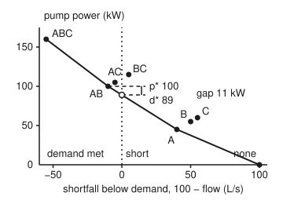
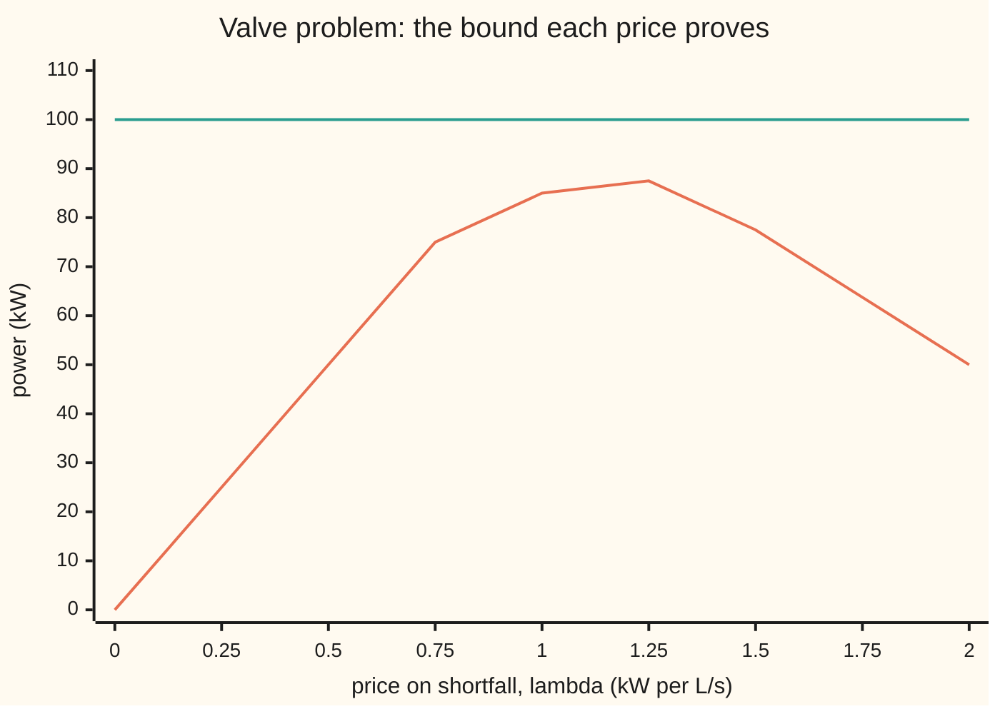

# Slater's condition: the strict feasibility that closes the gap

[Syllabus](../../../SYLLABUS.md) → [Optimization](../README.md) → [Constrained Optimisation](../README.md#s03) → Slater's condition

---

## General Overview

A small town needs at least **100 litres of water a second** (L/s) at the evening peak. Three mains can feed it, each behind a valve that is either open or shut. Main A delivers 60 L/s and its pump draws 45 kilowatts (kW). Main B delivers 50 L/s for 55 kW. Main C delivers 45 L/s for 60 kW. The operator chooses which valves to open, and wants the pump power as small as possible: this card **minimises**.

There are only eight open-or-shut patterns, so listing them settles it. Opening A and B gives 110 L/s for **100 kW**, and nothing cheaper meets demand. Lagrangian duality offers a second route: put a price on each litre a second of shortfall, and every price gives a lower bound on the power. The best price, 1.1 kW per L/s, proves only **89 kW**. The 11 kW between them, **11 percent** of the answer, is a **duality gap**: a hole between the best bound any price can give and the true best.

The gap is there because a valve cannot be half open. If each main could deliver any flow up to its full rate, the bound and the answer would meet. Slater's condition says when that is guaranteed: the problem must be convex (no holes or dents in what is allowed or in the cost), and some plan must meet every inequality with room to spare. Then the gap is zero, a best price exists, and a computer can stop the moment its plan's power and its price's bound agree.

**When a convex problem has a plan that meets its inequalities strictly, the best price bound equals the best plan's cost, so a zero gap between a plan and a price proves the plan best; without convexity the gap can stay open, as the valves' 11 kW does.**

**What kind of fact this is:** a theorem, Slater's, proved on this card for one inequality in a fold under Why it works; a stopping rule that follows from weak duality in one line; and a model, the pump power law used for variable-speed mains, which is an engineering approximation, not a law.

### The picture: eight valve patterns and the hole under them

<p align="center"></p>

Each dot is one valve pattern, placed by how far its flow falls short of 100 L/s (negative means a surplus) and the power it draws. The patterns left of the dotted line meet demand; the cheapest of them, AB, draws 100 kW. The solid line is the lower edge of the dots' hull (every blend of patterns). It crosses zero shortfall at 89 kW, a blend of all of A with 80 percent of B. No valve setting sits there, and that is the gap.

---

## The formula

The problem in standard form, with one inequality, over a set $X$ of allowed plans (the eight open/shut patterns, for the valves):

$$p^\star = \min_{x \in X}\; f_0(x) \quad\text{subject to}\quad f_1(x) = D - \text{flow}(x) \le 0.$$

Price the shortfall at $\lambda \ge 0$ and minimise the priced power with the rule removed. That is the dual function, a lower bound on $p^\star$ for every price ([Lagrangian duality](04-lagrangian-duality-weak-and-strong.md)):

$$q(\lambda) = \min_{x \in X} \big[f_0(x) + \lambda f_1(x)\big] \le p^\star, \qquad d^\star = \max_{\lambda \ge 0} q(\lambda), \qquad \text{gap} = p^\star - d^\star \ge 0.$$

**Slater's condition.** If the set of allowed plans $X$ is convex, $f_0$ and $f_1$ are convex on it, and some plan $\tilde x$ in $X$ has $f_1(\tilde x) < 0$, then

$$d^\star = p^\star, \quad\text{and some } \lambda^\star \ge 0 \text{ has } q(\lambda^\star) = p^\star \text{ (when } p^\star \text{ is finite).}$$

**The stopping certificate.** For any plan $x_k$ that meets demand and any price $\lambda_k \ge 0$,

$$f_0(x_k) - q(\lambda_k) \le \varepsilon \quad\Longrightarrow\quad f_0(x_k) - p^\star \le \varepsilon.$$

**Read it aloud:** if the allowed plans, the cost and the rule are convex and some plan beats demand with room to spare, then some price proves exactly the best cost; so once a plan's cost comes within $\varepsilon$ of a price's bound, the plan is within $\varepsilon$ of the best.

| Symbol | Plain meaning | In our example | Push it up and the answer… |
| --- | --- | --- | --- |
| $x$ | the decision: which valves open, or each variable-speed main's flow $w_i$ in L/s (and $w$ for one main's flow in the no-strict-point case) | AB open; flows 44.43, 30.57, 24.99 | — |
| $a_i$, $c_i$ | main $i$'s flow with its valve fully open (L/s), and its pump power at that flow (kW) | A: 60 L/s, 45 kW | more flow per kW makes the main cheaper to use |
| $D$ | the demand, L/s | 100 | more mains must open; $p^\star$ rises |
| $f_0(x)$ | the pump power, kW: the cost being minimised | 100 for AB | — |
| $f_1(x)$ | the shortfall, $D$ minus the flow delivered; at most 0 to meet demand | $-10$ for AB | — |
| $\tilde x$ | a Slater point: a plan with $f_1 < 0$, demand beaten with room to spare | all valves open, $-55$; flows 50, 40, 35, $-25$ | — |
| $\lambda$ | the price on one L/s of shortfall, kW per L/s; the Lagrange multiplier | best 1.1 (valves), 1.233907 (variable speed) | $q$ rises, then falls |
| $q(\lambda)$ | the dual function: the priced minimum, a lower bound on $p^\star$ | $q(1.1) = 89$ | — |
| $p^\star$, $d^\star$, $p^\star - d^\star$ | the best power; the best bound any price gives; the duality gap between them | 100, 89, gap 11 kW (valves); 41.130238 both, gap 0 (variable speed) | — |
| $X$, $u$, $t$, $\mathcal{A}$, $\mathcal{B}$, $\tilde\lambda$, $\mu$, $\gamma$, $\theta$, $s$ | the set of allowed plans; in the proof fold, a shortfall and a power level; the reachable (shortfall, power) pairs; the points below $p^\star$ at zero shortfall; the separating line's two coefficients and its level; plus $\theta$, a mixing weight from 0 to 1, and $s$, a power level below $p^\star$ | — | — |
| $\varepsilon$ | the stopping tolerance on the gap, kW | 0.01 | fewer steps before the stop |
| $k$, $\lambda_k$, $x_k$, $\alpha$ | step number from $k = 0$; the price and the feasible plan at step $k$; the step size | $\lambda_0 = 0.5$, $\alpha = 0.01$ | at 0.06 the price never settles |

### When it holds

- **The allowed plans, the cost and the inequality must be convex, and any equalities linear.** Valves that are open or shut make the allowed set a handful of corners with nothing between them, though power and shortfall are linear in the open/shut settings. All three valves open beats demand by 55 L/s, so a strictly feasible point exists, and the gap is still 11 kW.
- **Some plan must beat every nonlinear inequality strictly.** Take one main that draws 0.75 kW per L/s, so 40 L/s costs $p^\star = 30$ kW, and write "deliver exactly 40 L/s" as $(w - 40)^2 \le 0$, with $w$ the flow. The problem is convex, but only $w = 40$ is allowed and nothing beats the rule with room. The bound $q(\lambda)$ falls short of $p^\star$ by 0.140625 kW at price 1 and 0.000000141 kW at price $10^6$. So $d^\star = 30 = p^\star$ and the duality gap is zero, but no price reaches it: what Slater's condition adds here is a best price.
- **Linear inequalities need no room.** Slater's refined form asks for strictness only on the nonlinear inequalities. The part-open valve problem (each valve open for a share of the time, so flow and power are averages) is a linear program (LP), where plain feasibility is enough; it has strict points anyway ($x = 0.9$ each beats demand by 39.5 L/s).
- **The condition is enough, not necessary.** At a demand of 110 L/s the valve problem is still not convex, yet the gap is 0: AB delivers exactly 110 L/s, so the hull and the best pattern touch. A zero gap can happen by luck; Slater's condition is what guarantees it.
- **The stopping test needs a plan that meets demand.** The upper number must be the power of a real, feasible plan, not of the price's own flows (The usual mistake).

---

## Why it works

### Step 0: every plan is a dot, every price is a line under the dots

Put each plan on the picture as a dot: shortfall $f_1$ across, power $f_0$ up. A price $\lambda$ scores each plan $f_0 + \lambda f_1$, and the plans with the same score lie on a straight line of slope $-\lambda$. The dual function $q(\lambda)$ is the lowest score, so its line passes under every dot and touches the lowest. Where that line crosses zero shortfall, its height is $q(\lambda)$.

Turn the price and the line pivots. The highest crossing any such line can reach is $d^\star$. Every line stays under all the dots, so it stays under the hull of the dots too; the best it can do is lie along the hull's lower edge. So $d^\star$ is the height of that lower edge at zero shortfall, and a gap means the edge passes below the best real dot.

### Step 1: the valves' dual function, and its best price

For the valves, the priced minimum splits main by main. Opening main $i$ adds $c_i$ kW and removes $a_i$ L/s of shortfall, so at price $\lambda$ it is worth opening exactly when $c_i - \lambda a_i < 0$:

$$q(\lambda) = \lambda D + \sum_{i} \min\big(0,\; c_i - \lambda a_i\big).$$

Each term is a minimum of straight lines in $\lambda$, so $q$ is concave (bent downwards, no dents up), as every dual function is ([Lagrangian duality](04-lagrangian-duality-weak-and-strong.md)). Its corners sit where a main changes sides: $\lambda = c_i / a_i$, the main's kW per L/s. A is cheapest at 0.75, then B at 1.1, then C at 1.3333. The slope of $q$ is $D$ minus the flow of the mains open: 40 between A's corner and B's, and $-10$ between B's and C's. So the top is at B's corner: $q(1.1) = 89$ kW.



Orange: the bound $q(\lambda)$, rising to its top of 89 kW at a price of 1.1, between the grid points 1 and 1.25. Green, flat: the best real pattern, 100 kW. The 11 kW between the orange top and the green line is the gap.

### Step 2: why the valves keep a gap

At the best price, main B's net value is exactly zero, so the priced problem is indifferent to opening it. Blending "B shut" with "B open" in the ratio 1 to 4 meets demand exactly: all of A (60 L/s) and 80 percent of B (40 L/s), for $45 + 0.8 \times 55 = 89$ kW. That blend is the hull point in the picture, and it is the answer of the part-open LP, a time-share of open and shut.

A valve cannot sit at 0.8; at every moment it is open or shut. The nearest dots that meet demand are AC at 105 kW and AB at 100 kW, and both sit above 89 kW, the hull's height at zero shortfall. The dual cannot see the difference between the real problem and its convex hull. It answers for the hull, 89 kW, so on a nonconvex problem it can only bound, never certify. This is the general picture for integer choices, with a cleaner proof in [Lagrangian relaxation](../05-Integer%20and%20Combinatorial%20Optimisation/07-lagrangian-relaxation-and-decomposition.md).

### Step 3: convexity removes the hole, strict feasibility keeps the line from standing upright

Now let the allowed plans, the cost and the shortfall be convex. Then the set of reachable pairs (shortfall at most $u$, power at most $t$) is itself convex: it has no hole to hide under. The best real point at zero shortfall, $(0, p^\star)$, sits on its edge. A convex set has a supporting line at every edge point ([Separating hyperplanes](../01-Convexity/06-separating-hyperplanes.md)), so some line touches the set at $(0, p^\star)$ and keeps the whole set on one side.

One danger remains. That supporting line might be **vertical**, standing upright at zero shortfall. A vertical line has no slope, so it corresponds to no price, and the dual can only approach $p^\star$ as the price runs to infinity. That is the $(w - 40)^2 \le 0$ case: nothing allowed lies left of zero shortfall.

Slater's point stops that. It is a reachable pair strictly left of zero shortfall. A vertical line at zero would need the whole set on its right, and the Slater point is on its left. So the supporting line is not vertical, its slope is a price $-\lambda^\star$, and $q(\lambda^\star) = p^\star$.

<details>
<summary>Detailed proof: Slater's theorem with one inequality</summary>

Let $f_0$ and $f_1$ be convex on a convex set $X$, let $p^\star$ be finite, and let $\tilde x \in X$ have $f_1(\tilde x) < 0$.

Define $\mathcal{A} = \{(u, t) : f_1(x) \le u \text{ and } f_0(x) \le t \text{ for some } x \in X\}$. It is convex: if $x$ serves $(u, t)$ and $y$ serves $(u', t')$, then $\theta x + (1 - \theta) y$ serves the blend, because convex functions lie under their chords. Define $\mathcal{B} = \{(0, s) : s < p^\star\}$, also convex. They do not meet: a point of both would be a plan with $f_1 \le 0$ and power below $p^\star$.

By the separating hyperplane theorem there are numbers $(\tilde\lambda, \mu) \ne (0, 0)$ and a level $\gamma$ with
$$\tilde\lambda u + \mu t \ge \gamma \text{ on } \mathcal{A}, \qquad \tilde\lambda u + \mu t \le \gamma \text{ on } \mathcal{B}.$$
$\mathcal{A}$ runs off to the right and upwards, so a negative $\tilde\lambda$ or $\mu$ would let the left side fall below $\gamma$: hence $\tilde\lambda \ge 0$ and $\mu \ge 0$. On $\mathcal{B}$ the second inequality says $\mu s \le \gamma$ for every $s < p^\star$, so $\mu p^\star \le \gamma$. Putting the pair $(f_1(x), f_0(x))$ into the first:
$$\tilde\lambda f_1(x) + \mu f_0(x) \ge \mu p^\star \quad\text{for every } x \in X.$$
**If $\mu = 0$:** then $\tilde\lambda > 0$ and $\tilde\lambda f_1(x) \ge 0$ for every $x$. At the Slater point $f_1(\tilde x) < 0$, a contradiction. So $\mu > 0$.

Divide by $\mu$ and write $\lambda^\star = \tilde\lambda / \mu \ge 0$: $f_0(x) + \lambda^\star f_1(x) \ge p^\star$ for every $x \in X$. The minimum over $x$ is $q(\lambda^\star)$, so $q(\lambda^\star) \ge p^\star$. Weak duality gives $q(\lambda^\star) \le p^\star$. Hence $q(\lambda^\star) = d^\star = p^\star$, and the best price is attained.

The same argument with several inequalities and linear equalities is in Boyd and Vandenberghe (Sources), section 5.3.2.

</details>

### Step 4: a zero gap is a proof, so it is a stopping rule

Weak duality puts every price's bound below $p^\star$, and every feasible plan's power is at least $p^\star$:

$$q(\lambda_k) \;\le\; p^\star \;\le\; f_0(x_k).$$

So $f_0(x_k) - p^\star \le f_0(x_k) - q(\lambda_k)$. The right side is computed, not guessed; when it is below $\varepsilon$, the plan is within $\varepsilon$ of the best, whatever the method was. Slater's condition is what makes this test usable: it promises the gap can shrink to zero, so the test is sure to fire for any $\varepsilon > 0$ on a method that converges. The upper number comes from a plan, so nobody needs to know $p^\star$ in advance.

Here is the test at work on variable-speed mains. Each main's pump now runs at any speed, setting a flow $w_i$ between 0 and $a_i$, and its power follows the cube law of pump affinity, $c_i (w_i / a_i)^3$ kW, a model that holds well for mains whose pressure loss is mostly friction.

Unlike the time-share of Step 2, a slower pump draws far less power for each litre. The cost is convex, the shortfall $100 - \sum w_i$ is linear, and flows of 50, 40 and 35 L/s beat demand by 25 L/s inside every range. Slater holds.

Dual ascent climbs the dual function. At price $\lambda_k$, each main picks the flow that minimises its priced power, $3 c_i w_i^2 / a_i^3 = \lambda_k$, so $w_i = a_i \sqrt{\lambda_k a_i / (3 c_i)}$, capped at $a_i$. The price then moves up when the flows fall short and down when they overshoot: $\lambda_{k+1} = \max\big(0, \lambda_k + \alpha (D - \sum w_i)\big)$.

For the upper number, the flows are scaled to total exactly 100 L/s, a plan that meets demand. Start $\lambda_0 = 0.5$, step $\alpha = 0.01$, stop when the gap is at most $\varepsilon = 0.01$ kW:

| $k$ | price $\lambda_k$ | flow at that price (L/s) | lower $q(\lambda_k)$ (kW) | upper, scaled plan (kW) | gap (kW) | gap ratio |
| --- | --- | --- | --- | --- | --- | --- |
| 0 | 0.500000 | 63.6566 | 28.781118 | 41.130238 | 12.349121 | — |
| 1 | 0.863434 | 83.6514 | 38.191737 | 41.130238 | 2.938501 | 0.238 |
| 2 | 1.026920 | 91.2278 | 40.236247 | 41.130238 | 0.893991 | 0.304 |
| 3 | 1.114642 | 95.0444 | 40.837225 | 41.130238 | 0.293013 | 0.328 |
| 4 | 1.164198 | 97.1342 | 41.030837 | 41.130238 | 0.099402 | 0.339 |
| 5 | 1.192856 | 98.3225 | 41.095903 | 41.130238 | 0.034335 | 0.345 |
| 6 | 1.209631 | 99.0114 | 41.118259 | 41.130238 | 0.011979 | 0.349 |
| 7 | 1.219517 | 99.4152 | 41.126035 | 41.130238 | **0.004204** | 0.351 |

At $k = 7$ the gap is 0.004204 kW, under 0.01, and the run stops: the plan of 44.43, 30.57 and 24.99 L/s is certified within 0.01 kW of the best.

The upper column never moves. Every main's flow grows with $\sqrt{\lambda}$ in the same proportion, so scaling to 100 L/s gives the best plan at every step; the plan was right at $k = 0$, and the seven steps were spent proving it.

The rate: near the answer, each step multiplies the price's error by about $1 - \alpha D / (2\lambda^\star)$, because the dual's slope $D - \sum w_i$ changes by $D / (2\lambda^\star)$ per unit of price there. The lower bound's error grows with the square of the price's error, so the gap ratio tends to $(1 - \alpha D / (2\lambda^\star))^2 = 0.354$, and the printed ratios climb 0.238, 0.304, … , 0.351 towards it.

That is linear convergence (the gap shrinks by a steady factor each step). It holds provided $q$ is smooth and concave near $\lambda^\star$, as here, and $\alpha < 4\lambda^\star / D = 0.0494$, which keeps the factor above $-1$. At $\alpha = 0.06$ it is $-1.43$ and the price never settles.

---

## Worked numbers, by hand

The valves, at the best price, then the variable-speed mains' exact answer.

| Step | Arithmetic | Value |
| --- | --- | --- |
| best price: B's kW per L/s | $55 / 50$ | 1.1 |
| demand credit | $1.1 \times 100$ | 110 |
| main A's net, $c - \lambda a$ | $45 - 1.1 \times 60$ | $-21$: open |
| main B's net | $55 - 1.1 \times 50$ | 0: either |
| main C's net | $60 - 1.1 \times 45$ | 10.5: shut |
| $q(1.1)$ | $110 - 21 + 0 + 0$ | 89 kW |
| best pattern, AB | $45 + 55$ kW, $60 + 50$ L/s | 100 kW, 110 L/s |
| **valve gap** | $100 - 89$, as a share of 100 | **11 kW, 11.0%** |
| variable speed: flow per root-price, $a \sqrt{a / 3c}$ | $60\sqrt{60/135}$, $50\sqrt{50/165}$, $45\sqrt{45/180}$ | 40.0000, 27.5241, 22.5000; sum 90.0241 |
| best price $\lambda^\star$, from total flow 100 | $(100 / 90.0241)^2$ | 1.233907 |
| best flows | each root-price flow $\times \sqrt{1.233907}$ | 44.4325, 30.5741, 24.9933 L/s |
| **variable-speed best power** | $45 (44.4325/60)^3 + 55 (30.5741/50)^3 + 60 (24.9933/45)^3$ | **41.130238 kW, gap 0** |

The valve plan AB is the best, but the best price can only prove 89 kW; the 100 kW is certified by listing all eight patterns. At variable speed the same three mains need 41.13 kW, and a price proves it exactly, as Slater promises.

### What breaks if you drop a piece

| Mistake | Comes out at | What went wrong |
| --- | --- | --- |
| Read the dual's 89 kW as a plan | 89 kW, needing A open and B at 0.80 | That is the hull, not a valve setting; the best real plan draws 100 kW |
| Check strict feasibility but not convexity | all open beats demand by 55 L/s, gap still 11 kW (11.0%) | Slater's theorem needs both; open-or-shut valves are not convex |
| Convex, but no strict point: $(w - 40)^2 \le 0$ | bound below $p^\star = 30$ kW by 0.140625 at price 1, 0.010000 at 14.0625, 0.000000141 at $10^6$; reached at no price | The supporting line stands upright: $d^\star = p^\star$, but no best price exists |
| Stop the valve dual on gap $\le 0.01$ kW | after 200 subgradient steps (dual ascent using one of $q$'s slopes at its corners) from price 0, step $0.05/(k+1)$: bound 88.9989, gap 11.0011; never stops | The test can only fire when the gap can close |

---

## Code, from first principles, and it actually runs

The script settles the valve problem's best plan by listing all eight patterns ($p^\star = 100$ kW), then reaches its best bound $d^\star = 89$ kW by three independent roads: maximising the dual over its corners in exact fractions, solving the part-open LP by opening the cheapest kW per L/s first, and reading the lower hull of the picture's dots at zero shortfall.

Then it tests Slater's condition on three plan sets; only the valves fail, on convexity (the midpoint of two patterns is not a pattern). It runs dual ascent on the variable-speed mains with the gap as the stopping test, and confirms the answer by two more roads: the [KKT conditions](02-kkt-conditions.md) (Karush–Kuhn–Tucker: the checklist a best plan passes when inequalities can bind) in closed form and a direct search over the flows. Last come the broken cases and the "try changing" numbers.

### Python

```python
# Slater's condition and duality gaps -- the check behind the card.  Standard library only.
# Minimise pump power (kW) so three mains deliver at least D litres a second (L/s).
from fractions import Fraction as Fr
from itertools import product
from math import sqrt

MAINS = [("A", 60, 45), ("B", 50, 55), ("C", 45, 60)]   # name, flow when open (L/s), power (kW)

def valves():                            # every open/shut pattern: (name, flow, power)
    out = []
    for x in product((0, 1), repeat=3):
        name = "".join(m[0] for m, xi in zip(MAINS, x) if xi) or "none"
        out.append((name, sum(m[1] * xi for m, xi in zip(MAINS, x)), sum(m[2] * xi for m, xi in zip(MAINS, x))))
    return out

def q(lam, D):                           # dual function: price lam (kW per L/s) on the shortfall D - flow
    return lam * D + sum(min(0, c - lam * a) for _, a, c in MAINS)

def solve_valves(D):
    pats = valves()
    best = min((p for p in pats if p[1] >= D), key=lambda p: p[2])          # road 1: every pattern
    lam = max([Fr(0)] + [Fr(c, a) for _, a, c in MAINS], key=lambda l: q(l, D))   # road 2: q's corners
    left, lp, x = Fr(D), Fr(0), {}       # road 3: valves part-open, an LP: cheapest kW per L/s first
    for n, a, c in sorted(MAINS, key=lambda m: Fr(m[2], m[1])):
        x[n] = min(Fr(1), left / a); lp += x[n] * c; left -= x[n] * a
    pts = [(D - f, Fr(c)) for _, f, c in pats]                              # road 4: the picture's hull
    hull = min([c for u, c in pts if u <= 0] + [c1 + (c2 - c1) * u1 / (u1 - u2)
               for (u1, c1), (u2, c2) in product(pts, pts) if u1 < 0 < u2])
    return pats, best, lam, q(lam, D), lp, x, hull

D = 100
pats, best, lam, d, lp, x, hull = solve_valves(D)
for n, f, c in pats:
    print(f"valves {n:<4} flow {f:3d} L/s  shortfall {D - f:4d}  power {c:3d} kW  {'meets demand' if f >= D else '-'}")
print(f"road 1, every pattern: best {best[0]}, {best[1]} L/s, p* = {best[2]} kW")
print(f"road 2, corners of q: price {float(lam):.4f} kW per L/s, d* = {float(d):.4f} kW")
srt = sorted(MAINS, key=lambda m: Fr(m[2], m[1]))   # q's corners, cheapest kW per L/s first; q's slope is D - flow open
print("  corners c/a:", " ".join(f"{n} {float(Fr(c, a)):.4f}" for n, a, c in srt) + "; slope of q before, between, after:",
      " ".join(str(D - sum(m[1] for m in srt[:i])) for i in range(4)))
print(f"  by hand at that price: credit {float(lam * D):.1f}, c - price a:", " ".join(f"{n} {float(c - lam * a):.1f}" for n, a, c in MAINS))
print(f"road 3, part-open LP: {float(lp):.4f} kW with A {float(x['A']):.2f} B {float(x['B']):.2f} C {float(x['C']):.2f}")
print(f"road 4, lower hull at shortfall 0: {float(hull):.4f} kW")
print(f"duality gap {float(best[2] - d):.4f} kW = {100 * float((best[2] - d) / best[2]):.1f}% of p*")
allopen = [f for n, f, c in pats if n == "ABC"][0]   # Slater test on the valves: strict point, then convexity
P = list(product((0, 1), repeat=3))                 # a convex set holds the midpoint of any two of its points
conv = all((u + v) % 2 == 0 for s in P for t in P for u, v in zip(s, t))
print(f"Slater, valves: all open shortfall {D - allopen}; midpoint of every two patterns a pattern: {'yes' if conv else 'no'}")
xs = [Fr(9, 10)] * 3                     # Slater test on the part-open LP
print(f"Slater, part-open: x = 0.9 each, shortfall {float(D - sum(v * a for v, (_, a, _) in zip(xs, MAINS))):.1f}, inside 0 < x < 1")
print("chart, q at price 0 to 2 by 0.25:", " ".join(f"{float(q(Fr(i, 4), D)):.2f}" for i in range(9)))
print("figure, (shortfall, kW):", " ".join(f"{n} {D - f} {c}" for n, f, c in pats), f"hull at 0: {float(hull):.0f}")

# --- variable-speed pumps: convex.  Power c (f/a)^3 kW at flow f, 0 <= f <= a.  Dual ascent, gap as stop.
def flows(lam): return [min(a, a * sqrt(lam * a / (3 * c))) for _, a, c in MAINS]   # 3c f^2 / a^3 = lam
def power(f): return sum(c * (fi / a) ** 3 for (_, a, c), fi in zip(MAINS, f))
def qc(lam): f = flows(lam); return lam * D + power(f) - lam * sum(f)
def ascent(step, tol, lam=0.5, kmax=200):
    rows = []
    for k in range(kmax):
        f = flows(lam); s = sum(f)
        plan = [fi * D / s for fi in f]   # scaled to meet demand exactly: a feasible plan, an upper bound
        assert all(p <= a for p, (_, a, _) in zip(plan, MAINS))
        rows.append((k, lam, s, qc(lam), power(plan), power(plan) - qc(lam)))
        if rows[-1][5] <= tol: break
        lam = max(0.0, lam + step * (D - s))
    return rows
fs = [50, 40, 35]                        # Slater test on the variable-speed pumps
print(f"Slater, variable-speed: flows 50 40 35 give shortfall {D - sum(fs)}, strictly inside 0 < w < a: {'yes' if all(0 < f < a for f, (_, a, _) in zip(fs, MAINS)) else 'no'}")
rows = ascent(0.01, 0.01)
for k, l, s, lo, up, g in rows:
    ratio = f"{g / rows[k - 1][5]:.3f}" if k else "-"
    print(f"k={k} price {l:.6f} flow {s:7.4f} lower {lo:.6f} upper {up:.6f} gap {g:.6f} ratio {ratio}")
per = [a * sqrt(a / (3 * c)) for _, a, c in MAINS]                       # road 2: KKT in closed form
print("KKT: flow per root-price, a sqrt(a / 3c):", " ".join(f"{v:.4f}" for v in per), f"sum {sum(per):.4f}")
lam_star = (D / sum(per)) ** 2
f_star = flows(lam_star)
print(f"KKT: price {lam_star:.6f}, flows " + " ".join(f"{v:.4f}" for v in f_star), f"power {power(f_star):.6f} kW")
print(f"predicted gap ratio (1 - 0.01 D / (2 price))^2 = {(1 - 0.01 * D / (2 * lam_star)) ** 2:.3f}; steps below "
      f"4 price / D = {4 * lam_star / D:.4f} settle; factor at step 0.06: {1 - 0.06 * D / (2 * lam_star):.2f}")
def tern(g, lo, hi):
    for _ in range(100):
        m1, m2 = lo + (hi - lo) / 3, hi - (hi - lo) / 3
        lo, hi = (lo, m2) if g(m1) <= g(m2) else (m1, hi)
    return (lo + hi) / 2
inner = lambda fa: tern(lambda fb: power([fa, fb, D - fa - fb]), max(0, D - fa - 45), min(50, D - fa))
fa = tern(lambda fa: power([fa, inner(fa), D - fa - inner(fa)]), 10, 60)
brute = power([fa, inner(fa), D - fa - inner(fa)])
print(f"road 3, search over flows: {brute:.6f} kW")

# --- what breaks
def sq(lam):                             # dual of: minimise 0.75 w kW subject to (w - 40)^2 <= 0
    g = lambda w: 0.75 * w + lam * (w - 40) ** 2
    return g(tern(g, 0, 80))
print(f"no strict point, (w-40)^2 <= 0: p* = 30 kW; p* - q at price 1: {30 - sq(1.0):.6f}; at 14.0625: "
      f"{30 - sq(14.0625):.6f}; at 1e6: {30 - sq(1e6):.9f}")
lam_v, top = 0.0, -1000.0                # subgradient ascent on the valve dual, same stopping test
for k in range(200):
    top = max(top, q(lam_v, D))
    if best[2] - top <= 0.01: break
    lam_v = max(0.0, lam_v + 0.05 / (k + 1) * (D - sum(a for _, a, c in MAINS if c < lam_v * a)))
print(f"valve dual ascent, 200 steps: best bound {float(top):.4f}, gap {float(best[2] - top):.4f}: test never met")
for Dt in (110, 90):
    _, b2, _, d2, _, _, _ = solve_valves(Dt)
    print(f"try: demand {Dt}: p* {b2[2]} kW, d* {float(d2):.4f} kW, gap {100 * float((b2[2] - d2) / b2[2]):.1f}%")
print(f"try: tolerance 1e-6: {len(ascent(0.01, 1e-6))} rows; step 0.03: {len(ascent(0.03, 0.01))} rows; step 0.06: {len(ascent(0.06, 0.01))} rows, cap 200")

assert best[2] == 100 and d == 89 and lam == Fr(11, 10)         # enumeration and dual corners
assert lp == d and hull == d                                    # LP and hull meet the dual: d* = 89
assert all(q(Fr(i, 100), D) <= d for i in range(301))           # no price beats 89 on a fine grid
assert abs(rows[-1][3] - power(f_star)) < 0.01 and abs(brute - power(f_star)) < 1e-6
assert abs(rows[-1][1] - lam_star) < 0.02 and rows[-1][5] <= 0.01
assert abs((30 - sq(1.0)) - 0.140625) < 1e-6 and best[2] - top > 10
assert abs((30 - sq(1e6)) - 0.140625 / 1e6) < 1e-12              # d* = 30 = p*, approached but never reached
print("ALL CHECKS PASS")
```

**Ran 2026-11-11 on macOS, Python 3.14.10, standard library only. All checks passed. Output, pasted from the run:**

```
valves none flow   0 L/s  shortfall  100  power   0 kW  -
valves C    flow  45 L/s  shortfall   55  power  60 kW  -
valves B    flow  50 L/s  shortfall   50  power  55 kW  -
valves BC   flow  95 L/s  shortfall    5  power 115 kW  -
valves A    flow  60 L/s  shortfall   40  power  45 kW  -
valves AC   flow 105 L/s  shortfall   -5  power 105 kW  meets demand
valves AB   flow 110 L/s  shortfall  -10  power 100 kW  meets demand
valves ABC  flow 155 L/s  shortfall  -55  power 160 kW  meets demand
road 1, every pattern: best AB, 110 L/s, p* = 100 kW
road 2, corners of q: price 1.1000 kW per L/s, d* = 89.0000 kW
  corners c/a: A 0.7500 B 1.1000 C 1.3333; slope of q before, between, after: 100 40 -10 -55
  by hand at that price: credit 110.0, c - price a: A -21.0 B 0.0 C 10.5
road 3, part-open LP: 89.0000 kW with A 1.00 B 0.80 C 0.00
road 4, lower hull at shortfall 0: 89.0000 kW
duality gap 11.0000 kW = 11.0% of p*
Slater, valves: all open shortfall -55; midpoint of every two patterns a pattern: no
Slater, part-open: x = 0.9 each, shortfall -39.5, inside 0 < x < 1
chart, q at price 0 to 2 by 0.25: 0.00 25.00 50.00 75.00 85.00 87.50 77.50 63.75 50.00
figure, (shortfall, kW): none 100 0 C 55 60 B 50 55 BC 5 115 A 40 45 AC -5 105 AB -10 100 ABC -55 160 hull at 0: 89
Slater, variable-speed: flows 50 40 35 give shortfall -25, strictly inside 0 < w < a: yes
k=0 price 0.500000 flow 63.6566 lower 28.781118 upper 41.130238 gap 12.349121 ratio -
k=1 price 0.863434 flow 83.6514 lower 38.191737 upper 41.130238 gap 2.938501 ratio 0.238
k=2 price 1.026920 flow 91.2278 lower 40.236247 upper 41.130238 gap 0.893991 ratio 0.304
k=3 price 1.114642 flow 95.0444 lower 40.837225 upper 41.130238 gap 0.293013 ratio 0.328
k=4 price 1.164198 flow 97.1342 lower 41.030837 upper 41.130238 gap 0.099402 ratio 0.339
k=5 price 1.192856 flow 98.3225 lower 41.095903 upper 41.130238 gap 0.034335 ratio 0.345
k=6 price 1.209631 flow 99.0114 lower 41.118259 upper 41.130238 gap 0.011979 ratio 0.349
k=7 price 1.219517 flow 99.4152 lower 41.126035 upper 41.130238 gap 0.004204 ratio 0.351
KKT: flow per root-price, a sqrt(a / 3c): 40.0000 27.5241 22.5000 sum 90.0241
KKT: price 1.233907, flows 44.4325 30.5741 24.9933 power 41.130238 kW
predicted gap ratio (1 - 0.01 D / (2 price))^2 = 0.354; steps below 4 price / D = 0.0494 settle; factor at step 0.06: -1.43
road 3, search over flows: 41.130238 kW
no strict point, (w-40)^2 <= 0: p* = 30 kW; p* - q at price 1: 0.140625; at 14.0625: 0.010000; at 1e6: 0.000000141
valve dual ascent, 200 steps: best bound 88.9989, gap 11.0011: test never met
try: demand 110: p* 100 kW, d* 100.0000 kW, gap 0.0%
try: demand 90: p* 100 kW, d* 78.0000 kW, gap 22.0%
try: tolerance 1e-6: 17 rows; step 0.03: 4 rows; step 0.06: 200 rows, cap 200
ALL CHECKS PASS
```

### Rust

The same checks in Rust, with a small exact-fraction type for the valve problem.

```rust
// Slater's condition and duality gaps -- the same check as the Python, in Rust.  std only, no crates.
// Minimise pump power (kW) so three mains deliver at least D litres a second (L/s).
use std::cmp::Ordering;

#[derive(Clone, Copy, Debug)]
struct Rat { n: i64, d: i64 }            // an exact fraction n/d with d > 0
fn gcd(a: i64, b: i64) -> i64 { if b == 0 { a.abs() } else { gcd(b, a % b) } }
fn r(n: i64, d: i64) -> Rat { let g = gcd(n, d).max(1) * d.signum(); Rat { n: n / g, d: d / g } }
impl Rat {
    fn add(self, o: Rat) -> Rat { r(self.n * o.d + o.n * self.d, self.d * o.d) }
    fn sub(self, o: Rat) -> Rat { r(self.n * o.d - o.n * self.d, self.d * o.d) }
    fn mul(self, o: Rat) -> Rat { r(self.n * o.n, self.d * o.d) }
    fn div(self, o: Rat) -> Rat { r(self.n * o.d, self.d * o.n) }
    fn cmp(self, o: Rat) -> Ordering { (self.n * o.d).cmp(&(o.n * self.d)) }
    fn f(self) -> f64 { self.n as f64 / self.d as f64 }
}
fn rmin(a: Rat, b: Rat) -> Rat { if a.cmp(b) == Ordering::Greater { b } else { a } }

const MAINS: [(&str, i64, i64); 3] = [("A", 60, 45), ("B", 50, 55), ("C", 45, 60)];

fn valves() -> Vec<(String, i64, i64)> {  // every open/shut pattern: (name, flow, power)
    let mut out = vec![];
    for m in 0..8 {
        let on: Vec<usize> = (0..3).filter(|i| m >> (2 - i) & 1 == 1).collect();
        let name: String = on.iter().map(|&i| MAINS[i].0).collect();
        out.push((if name.is_empty() { "none".to_string() } else { name },
                  on.iter().map(|&i| MAINS[i].1).sum(), on.iter().map(|&i| MAINS[i].2).sum()));
    }
    out
}
fn q(lam: Rat, d: i64) -> Rat {          // dual function: price lam (kW per L/s) on the shortfall
    MAINS.iter().fold(lam.mul(r(d, 1)), |s, &(_, a, c)| s.add(rmin(r(0, 1), r(c, 1).sub(lam.mul(r(a, 1))))))
}
fn qf(lam: f64, d: i64) -> f64 { lam * d as f64 + MAINS.iter().map(|&(_, a, c)| (c as f64 - lam * a as f64).min(0.0)).sum::<f64>() }

fn solve_valves(d: i64) -> (Vec<(String, i64, i64)>, (String, i64, i64), Rat, Rat, Rat, Vec<Rat>, Rat) {
    let pats = valves();
    let best = pats.iter().filter(|p| p.1 >= d).min_by_key(|p| p.2).unwrap().clone();       // road 1
    let mut lam = r(0, 1);                                                                  // road 2
    for &(_, a, c) in MAINS.iter() { if q(r(c, a), d).cmp(q(lam, d)) == Ordering::Greater { lam = r(c, a); } }
    let mut order = [0usize, 1, 2];                                                         // road 3: LP
    order.sort_by(|&i, &j| r(MAINS[i].2, MAINS[i].1).cmp(r(MAINS[j].2, MAINS[j].1)));
    let (mut left, mut lp, mut x) = (r(d, 1), r(0, 1), vec![r(0, 1); 3]);
    for &i in order.iter() {
        x[i] = rmin(r(1, 1), left.div(r(MAINS[i].1, 1)));
        lp = lp.add(x[i].mul(r(MAINS[i].2, 1))); left = left.sub(x[i].mul(r(MAINS[i].1, 1)));
    }
    let pts: Vec<(i64, i64)> = pats.iter().map(|p| (d - p.1, p.2)).collect();               // road 4: hull
    let mut hull = r(1_000_000, 1);
    for &(u1, c1) in pts.iter() {
        if u1 <= 0 { hull = rmin(hull, r(c1, 1)); }
        for &(u2, c2) in pts.iter() {
            if u1 < 0 && 0 < u2 { hull = rmin(hull, r(c1, 1).add(r((c2 - c1) * u1, u1 - u2))); }
        }
    }
    (pats.clone(), best, lam, q(lam, d), lp, x, hull)
}

const D: i64 = 100;
fn flows(lam: f64) -> Vec<f64> {          // each pump's best flow at price lam: 3c f^2 / a^3 = lam
    MAINS.iter().map(|&(_, a, c)| { let (a, c) = (a as f64, c as f64); a.min(a * (lam * a / (3.0 * c)).sqrt()) }).collect()
}
fn power(f: &[f64]) -> f64 { MAINS.iter().zip(f).map(|(&(_, a, c), fi)| c as f64 * (fi / a as f64).powi(3)).sum() }
fn qc(lam: f64) -> f64 { let f = flows(lam); lam * D as f64 + power(&f) - lam * f.iter().sum::<f64>() }
fn ascent(step: f64, tol: f64) -> Vec<(usize, f64, f64, f64, f64, f64)> {
    let (mut lam, mut rows) = (0.5, vec![]);
    for k in 0..200 {
        let f = flows(lam); let s: f64 = f.iter().sum();
        let plan: Vec<f64> = f.iter().map(|fi| fi * D as f64 / s).collect();   // feasible: upper bound
        assert!(plan.iter().zip(MAINS.iter()).all(|(p, m)| *p <= m.1 as f64));
        let (lo, up) = (qc(lam), power(&plan));
        rows.push((k, lam, s, lo, up, up - lo));
        if up - lo <= tol { break; }
        lam = (lam + step * (D as f64 - s)).max(0.0);
    }
    rows
}
fn tern<G: Fn(f64) -> f64>(g: G, mut lo: f64, mut hi: f64) -> f64 {
    for _ in 0..100 {
        let (m1, m2) = (lo + (hi - lo) / 3.0, hi - (hi - lo) / 3.0);
        if g(m1) <= g(m2) { hi = m2; } else { lo = m1; }
    }
    (lo + hi) / 2.0
}
fn sq(lam: f64) -> f64 {                  // dual of: minimise 0.75 w kW subject to (w - 40)^2 <= 0
    let g = |w: f64| 0.75 * w + lam * (w - 40.0).powi(2);
    g(tern(g, 0.0, 80.0))
}

fn main() {
    let (pats, best, lam, d, lp, x, hull) = solve_valves(D);
    for (n, f, c) in pats.iter() {
        println!("valves {:<4} flow {:3} L/s  shortfall {:4}  power {:3} kW  {}", n, f, D - f, c, if *f >= D { "meets demand" } else { "-" });
    }
    println!("road 1, every pattern: best {}, {} L/s, p* = {} kW", best.0, best.1, best.2);
    println!("road 2, corners of q: price {:.4} kW per L/s, d* = {:.4} kW", lam.f(), d.f());
    let mut srt = MAINS;                 // q's corners, cheapest kW per L/s first; q's slope is D - flow open
    srt.sort_by(|m, n| r(m.2, m.1).cmp(r(n.2, n.1)));
    let cs: Vec<String> = srt.iter().map(|m| format!("{} {:.4}", m.0, r(m.2, m.1).f())).collect();
    let sl: Vec<String> = (0..4).map(|i| (D - srt[..i].iter().map(|m| m.1).sum::<i64>()).to_string()).collect();
    println!("  corners c/a: {}; slope of q before, between, after: {}", cs.join(" "), sl.join(" "));
    let net: Vec<String> = MAINS.iter().map(|&(n, a, c)| format!("{} {:.1}", n, r(c, 1).sub(lam.mul(r(a, 1))).f())).collect();
    println!("  by hand at that price: credit {:.1}, c - price a: {}", lam.mul(r(D, 1)).f(), net.join(" "));
    println!("road 3, part-open LP: {:.4} kW with A {:.2} B {:.2} C {:.2}", lp.f(), x[0].f(), x[1].f(), x[2].f());
    println!("road 4, lower hull at shortfall 0: {:.4} kW", hull.f());
    let gap = r(best.2, 1).sub(d);
    println!("duality gap {:.4} kW = {:.1}% of p*", gap.f(), 100.0 * gap.f() / best.2 as f64);
    let allopen = pats.iter().find(|p| p.0 == "ABC").unwrap().1;
    let conv = (0..8).all(|m: i64| (0..8).all(|n: i64| (0..3).all(|i| ((m >> i & 1) + (n >> i & 1)) % 2 == 0))); // midpoints
    println!("Slater, valves: all open shortfall {}; midpoint of every two patterns a pattern: {}", D - allopen, if conv { "yes" } else { "no" });
    let xs = r(9, 10);
    let sh = MAINS.iter().fold(r(D, 1), |s, m| s.sub(xs.mul(r(m.1, 1))));
    println!("Slater, part-open: x = 0.9 each, shortfall {:.1}, inside 0 < x < 1", sh.f());
    let ch: Vec<String> = (0..9).map(|i| format!("{:.2}", q(r(i, 4), D).f())).collect();
    println!("chart, q at price 0 to 2 by 0.25: {}", ch.join(" "));
    let fg: Vec<String> = pats.iter().map(|p| format!("{} {} {}", p.0, D - p.1, p.2)).collect();
    println!("figure, (shortfall, kW): {} hull at 0: {:.0}", fg.join(" "), hull.f());

    let fs = [50.0, 40.0, 35.0];
    let inside = fs.iter().zip(MAINS.iter()).all(|(f, m)| 0.0 < *f && *f < m.1 as f64);
    println!("Slater, variable-speed: flows 50 40 35 give shortfall {}, strictly inside 0 < w < a: {}", D as f64 - fs.iter().sum::<f64>(), if inside { "yes" } else { "no" });
    let rows = ascent(0.01, 0.01);
    for &(k, l, s, lo, up, g) in rows.iter() {
        let ratio = if k > 0 { format!("{:.3}", g / rows[k - 1].5) } else { "-".to_string() };
        println!("k={} price {:.6} flow {:7.4} lower {:.6} upper {:.6} gap {:.6} ratio {}", k, l, s, lo, up, g, ratio);
    }
    let per: Vec<f64> = MAINS.iter().map(|&(_, a, c)| a as f64 * (a as f64 / (3.0 * c as f64)).sqrt()).collect();
    let den: f64 = per.iter().sum();                                            // road 2: KKT closed form
    println!("KKT: flow per root-price, a sqrt(a / 3c): {:.4} {:.4} {:.4} sum {:.4}", per[0], per[1], per[2], den);
    let lam_star = (D as f64 / den).powi(2);
    let f_star = flows(lam_star);
    println!("KKT: price {:.6}, flows {:.4} {:.4} {:.4} power {:.6} kW", lam_star, f_star[0], f_star[1], f_star[2], power(&f_star));
    println!("predicted gap ratio (1 - 0.01 D / (2 price))^2 = {:.3}; steps below 4 price / D = {:.4} settle; factor at step 0.06: {:.2}",
             (1.0 - 0.01 * D as f64 / (2.0 * lam_star)).powi(2), 4.0 * lam_star / D as f64, 1.0 - 0.06 * D as f64 / (2.0 * lam_star));
    let dd = D as f64;
    let inner = |fa: f64| tern(|fb: f64| power(&[fa, fb, dd - fa - fb]), (dd - fa - 45.0).max(0.0), (dd - fa).min(50.0));
    let fa = tern(|fa: f64| power(&[fa, inner(fa), dd - fa - inner(fa)]), 10.0, 60.0);
    let brute = power(&[fa, inner(fa), dd - fa - inner(fa)]);
    println!("road 3, search over flows: {:.6} kW", brute);

    println!("no strict point, (w-40)^2 <= 0: p* = 30 kW; p* - q at price 1: {:.6}; at 14.0625: {:.6}; at 1e6: {:.9}",
             30.0 - sq(1.0), 30.0 - sq(14.0625), 30.0 - sq(1e6));
    let (mut lam_v, mut top) = (0.0_f64, -1000.0_f64);
    for k in 0..200 {
        top = top.max(qf(lam_v, D));
        if best.2 as f64 - top <= 0.01 { break; }
        let flow: i64 = MAINS.iter().filter(|m| (m.2 as f64) < lam_v * m.1 as f64).map(|m| m.1).sum();
        lam_v = (lam_v + 0.05 / (k + 1) as f64 * (D - flow) as f64).max(0.0);
    }
    println!("valve dual ascent, 200 steps: best bound {:.4}, gap {:.4}: test never met", top, best.2 as f64 - top);
    for dt in [110, 90] {
        let (_, b2, _, d2, _, _, _) = solve_valves(dt);
        println!("try: demand {}: p* {} kW, d* {:.4} kW, gap {:.1}%", dt, b2.2, d2.f(), 100.0 * (b2.2 as f64 - d2.f()) / b2.2 as f64);
    }
    println!("try: tolerance 1e-6: {} rows; step 0.03: {} rows; step 0.06: {} rows, cap 200",
             ascent(0.01, 1e-6).len(), ascent(0.03, 0.01).len(), ascent(0.06, 0.01).len());

    assert!(best.2 == 100 && d.cmp(r(89, 1)) == Ordering::Equal && lam.cmp(r(11, 10)) == Ordering::Equal);
    assert!(lp.cmp(d) == Ordering::Equal && hull.cmp(d) == Ordering::Equal);
    assert!((0..301).all(|i| q(r(i, 100), D).cmp(d) != Ordering::Greater));
    assert!((rows.last().unwrap().3 - power(&f_star)).abs() < 0.01 && (brute - power(&f_star)).abs() < 1e-6);
    assert!((rows.last().unwrap().1 - lam_star).abs() < 0.02 && rows.last().unwrap().5 <= 0.01);
    assert!(((30.0 - sq(1.0)) - 0.140625).abs() < 1e-6 && best.2 as f64 - top > 10.0);
    assert!(((30.0 - sq(1e6)) - 0.140625 / 1e6).abs() < 1e-12);    // d* = 30 = p*, approached but never reached
    println!("ALL CHECKS PASS");
}
```

**Ran 2026-11-11 on macOS, rustc 1.98.1, no crates. All checks passed. Output, pasted from the run:**

```
valves none flow   0 L/s  shortfall  100  power   0 kW  -
valves C    flow  45 L/s  shortfall   55  power  60 kW  -
valves B    flow  50 L/s  shortfall   50  power  55 kW  -
valves BC   flow  95 L/s  shortfall    5  power 115 kW  -
valves A    flow  60 L/s  shortfall   40  power  45 kW  -
valves AC   flow 105 L/s  shortfall   -5  power 105 kW  meets demand
valves AB   flow 110 L/s  shortfall  -10  power 100 kW  meets demand
valves ABC  flow 155 L/s  shortfall  -55  power 160 kW  meets demand
road 1, every pattern: best AB, 110 L/s, p* = 100 kW
road 2, corners of q: price 1.1000 kW per L/s, d* = 89.0000 kW
  corners c/a: A 0.7500 B 1.1000 C 1.3333; slope of q before, between, after: 100 40 -10 -55
  by hand at that price: credit 110.0, c - price a: A -21.0 B 0.0 C 10.5
road 3, part-open LP: 89.0000 kW with A 1.00 B 0.80 C 0.00
road 4, lower hull at shortfall 0: 89.0000 kW
duality gap 11.0000 kW = 11.0% of p*
Slater, valves: all open shortfall -55; midpoint of every two patterns a pattern: no
Slater, part-open: x = 0.9 each, shortfall -39.5, inside 0 < x < 1
chart, q at price 0 to 2 by 0.25: 0.00 25.00 50.00 75.00 85.00 87.50 77.50 63.75 50.00
figure, (shortfall, kW): none 100 0 C 55 60 B 50 55 BC 5 115 A 40 45 AC -5 105 AB -10 100 ABC -55 160 hull at 0: 89
Slater, variable-speed: flows 50 40 35 give shortfall -25, strictly inside 0 < w < a: yes
k=0 price 0.500000 flow 63.6566 lower 28.781118 upper 41.130238 gap 12.349121 ratio -
k=1 price 0.863434 flow 83.6514 lower 38.191737 upper 41.130238 gap 2.938501 ratio 0.238
k=2 price 1.026920 flow 91.2278 lower 40.236247 upper 41.130238 gap 0.893991 ratio 0.304
k=3 price 1.114642 flow 95.0444 lower 40.837225 upper 41.130238 gap 0.293013 ratio 0.328
k=4 price 1.164198 flow 97.1342 lower 41.030837 upper 41.130238 gap 0.099402 ratio 0.339
k=5 price 1.192856 flow 98.3225 lower 41.095903 upper 41.130238 gap 0.034335 ratio 0.345
k=6 price 1.209631 flow 99.0114 lower 41.118259 upper 41.130238 gap 0.011979 ratio 0.349
k=7 price 1.219517 flow 99.4152 lower 41.126035 upper 41.130238 gap 0.004204 ratio 0.351
KKT: flow per root-price, a sqrt(a / 3c): 40.0000 27.5241 22.5000 sum 90.0241
KKT: price 1.233907, flows 44.4325 30.5741 24.9933 power 41.130238 kW
predicted gap ratio (1 - 0.01 D / (2 price))^2 = 0.354; steps below 4 price / D = 0.0494 settle; factor at step 0.06: -1.43
road 3, search over flows: 41.130238 kW
no strict point, (w-40)^2 <= 0: p* = 30 kW; p* - q at price 1: 0.140625; at 14.0625: 0.010000; at 1e6: 0.000000141
valve dual ascent, 200 steps: best bound 88.9989, gap 11.0011: test never met
try: demand 110: p* 100 kW, d* 100.0000 kW, gap 0.0%
try: demand 90: p* 100 kW, d* 78.0000 kW, gap 22.0%
try: tolerance 1e-6: 17 rows; step 0.03: 4 rows; step 0.06: 200 rows, cap 200
ALL CHECKS PASS
```

The two outputs are identical, line for line.

### Lean

Lean proves Slater's theorem with one inequality for every convex problem, the stopping test for any problem, and the valves' gap.

- If the allowed plans, the cost and the rule are convex, some plan has $f_1 < 0$, and $p^\star$ is finite, then $d^\star = p^\star$.
- In that case some price $\lambda^\star \ge 0$ has $q(\lambda^\star) = p^\star$: the best price exists.
- The stopping test needs no convexity. Take a plan that meets the rule and a price $\lambda \ge 0$.
  If the plan's power is within $\varepsilon$ of $q(\lambda)$, it is within $\varepsilon$ of $p^\star$.
- For the valves, the cheapest pattern that delivers at least 100 L/s draws 100 kW.
- The valves' dual function $q(\lambda) = \lambda D + \sum_i \min(0, c_i - \lambda a_i)$ never goes above 89 kW, and reaches it at price 1.1.
- So the valve gap is $100 - 89 = 11$ kW, though all three valves open beat demand by 55 L/s.
- At the hull point, all of A and 80 percent of B deliver exactly 100 L/s for 89 kW.
- With no strict point, the bound at price 1 falls short of $p^\star = 30$ kW by 0.140625 kW.

Everything else, including the variable-speed mains, the dual ascent table and the "try changing" runs, is left to the Python and Rust checks.

```lean
-- Slater's condition: for a convex problem with one inequality and a strictly feasible plan, the best price bound equals the best cost and is reached by some price, a zero gap certifies a plan, and the card's open-or-shut valves keep a gap of 100 - 89 = 11 kW.
import Mathlib.Analysis.Convex.Function
import Mathlib.Algebra.Order.Archimedean.Real.Basic
import Mathlib.Order.Bounds.Basic
import Mathlib.Algebra.BigOperators.Group.Finset.Basic
import Mathlib.Data.Fintype.Powerset
import Mathlib.Data.Fin.VecNotation
import Mathlib.Tactic.NormNum

open Finset

namespace SlaterCondition

/-! ## The general problem

Plans live in a real vector space `E`; `X` is the set of allowed plans, `f0` the cost and
`f1` the one inequality (`f1 x ≤ 0` means the plan is feasible). -/

variable {E : Type*} [AddCommGroup E] [Module ℝ E]

/-- The best cost `p⋆`: the infimum of the cost over the allowed plans with `f1 x ≤ 0`. -/
noncomputable def pStar (X : Set E) (f0 f1 : E → ℝ) : ℝ :=
  sInf (f0 '' {x | x ∈ X ∧ f1 x ≤ 0})

/-- The priced costs at price `lam`: the values `f0 x + lam * f1 x` over all allowed plans.
The dual function `q(lam)` is their greatest lower bound. -/
def priced (X : Set E) (f0 f1 : E → ℝ) (lam : ℝ) : Set ℝ :=
  (fun x => f0 x + lam * f1 x) '' X

/-- The bounds that prices give: every value `q(lam)` with `lam ≥ 0` and `q(lam)` finite.
The best bound `d⋆` is the largest of them. -/
def dualValues (X : Set E) (f0 f1 : E → ℝ) : Set ℝ :=
  {v | ∃ lam : ℝ, 0 ≤ lam ∧ IsGLB (priced X f0 f1 lam) v}

omit [AddCommGroup E] [Module ℝ E] in
/-- Helper: a feasible plan's cost bounds the best cost `p⋆` from above. -/
theorem pStar_le_of_feasible (X : Set E) (f0 f1 : E → ℝ)
    (hfinite : BddBelow (f0 '' {x | x ∈ X ∧ f1 x ≤ 0})) (x : E) (hx : x ∈ X)
    (hfeas : f1 x ≤ 0) : pStar X f0 f1 ≤ f0 x :=
  csInf_le hfinite ⟨x, ⟨hx, hfeas⟩, rfl⟩

#print axioms pStar_le_of_feasible

/-- Helper: a lower bound on the priced costs at a price `lam ≥ 0`, when some plan is
feasible, is at most the best cost. -/
theorem le_pStar_of_lowerBound (X : Set E) (f0 f1 : E → ℝ) (lam b : ℝ) (hlam : 0 ≤ lam)
    (hb : b ∈ lowerBounds (priced X f0 f1 lam)) (x : E) (hx : x ∈ X) (hfeas : f1 x ≤ 0) :
    b ≤ pStar X f0 f1 := by
  have hne : (f0 '' {x | x ∈ X ∧ f1 x ≤ 0}).Nonempty := ⟨f0 x, x, ⟨hx, hfeas⟩, rfl⟩
  apply le_csInf hne
  rintro _ ⟨y, ⟨hy, hyf⟩, rfl⟩
  have h1 := hb ⟨y, hy, rfl⟩
  have h2 : lam * f1 y ≤ 0 := mul_nonpos_of_nonneg_of_nonpos hlam hyf
  simp only at h1
  linarith

#print axioms le_pStar_of_lowerBound

/-- Helper (the convexity step): mixing a plan that breaks the rule with one that meets it
with room to spare gives a plan exactly on the rule, so the two price ratios are ordered. -/
theorem slope_le (X : Set E) (f0 f1 : E → ℝ)
    (hf0 : ConvexOn ℝ X f0) (hf1 : ConvexOn ℝ X f1)
    (hfinite : BddBelow (f0 '' {x | x ∈ X ∧ f1 x ≤ 0}))
    (x y : E) (hx : x ∈ X) (hy : y ∈ X) (hfx : 0 < f1 x) (hfy : f1 y < 0) :
    (pStar X f0 f1 - f0 x) / f1 x ≤ (f0 y - pStar X f0 f1) / (-f1 y) := by
  set a := f1 x with ha
  set b := -f1 y with hb
  have hb0 : 0 < b := by linarith
  have hab : 0 < a + b := by linarith
  set t := b / (a + b) with ht
  set u := a / (a + b) with hu
  have ht0 : 0 ≤ t := div_nonneg hb0.le hab.le
  have hu0 : 0 ≤ u := div_nonneg (le_of_lt hfx) hab.le
  have htu : t + u = 1 := by rw [ht, hu, ← add_div]; field_simp; ring
  have hz : t • x + u • y ∈ X := hf0.1 hx hy ht0 hu0 htu
  have h1 := hf1.2 hx hy ht0 hu0 htu
  have h0 := hf0.2 hx hy ht0 hu0 htu
  simp only [smul_eq_mul] at h1 h0
  have hzero : t * f1 x + u * f1 y = 0 := by
    rw [ht, hu]; field_simp; rw [← ha]; linarith
  have hp := pStar_le_of_feasible X f0 f1 hfinite _ hz (by linarith)
  have key : pStar X f0 f1 ≤ t * f0 x + u * f0 y := le_trans hp h0
  rw [div_le_div_iff₀ hfx hb0]
  have : pStar X f0 f1 * (a + b) ≤ b * f0 x + a * f0 y := by
    have e1 : t * (a + b) = b := by rw [ht]; field_simp
    have e2 : u * (a + b) = a := by rw [hu]; field_simp
    have := mul_le_mul_of_nonneg_right key hab.le
    calc pStar X f0 f1 * (a + b) ≤ (t * f0 x + u * f0 y) * (a + b) := this
      _ = (t * (a + b)) * f0 x + (u * (a + b)) * f0 y := by ring
      _ = b * f0 x + a * f0 y := by rw [e1, e2]
  nlinarith

#print axioms slope_le

/-- Slater's theorem with one inequality (the card's main claim): if the allowed plans `X`
form a convex set, the cost `f0` and the inequality `f1` are convex on it, some allowed plan
has `f1 < 0` (meets the rule with room to spare), and the best cost `p⋆` is finite, then the
best price bound equals the best cost, `d⋆ = p⋆`, and some price `lam⋆ ≥ 0` reaches it,
`q(lam⋆) = p⋆`. -/
theorem slater_zero_duality_gap (X : Set E) (f0 f1 : E → ℝ) (hX : Convex ℝ X)
    (hf0 : ConvexOn ℝ X f0) (hf1 : ConvexOn ℝ X f1)
    (hslater : ∃ x ∈ X, f1 x < 0)
    (hfinite : BddBelow (f0 '' {x | x ∈ X ∧ f1 x ≤ 0})) :
    IsGreatest (dualValues X f0 f1) (pStar X f0 f1) := by
  obtain ⟨x0, hx0, hx0f⟩ := hslater
  set p := pStar X f0 f1 with hp
  set T : Set ℝ := (fun y => (f0 y - p) / (-f1 y)) '' {y | y ∈ X ∧ f1 y < 0} with hT
  have hTne : T.Nonempty := ⟨_, x0, ⟨hx0, hx0f⟩, rfl⟩
  have hTnn : ∀ v ∈ T, 0 ≤ v := by
    rintro _ ⟨y, ⟨hy, hyf⟩, rfl⟩
    have := pStar_le_of_feasible X f0 f1 hfinite y hy hyf.le
    exact div_nonneg (by linarith) (by linarith)
  have hTbdd : BddBelow T := ⟨0, hTnn⟩
  set lam := sInf T with hlam
  have hlam0 : 0 ≤ lam := le_csInf hTne hTnn
  have hlow : p ∈ lowerBounds (priced X f0 f1 lam) := by
    rintro _ ⟨x, hx, rfl⟩
    show p ≤ f0 x + lam * f1 x
    rcases lt_trichotomy (f1 x) 0 with h | h | h
    · have hle : lam ≤ (f0 x - p) / (-f1 x) := csInf_le hTbdd ⟨x, ⟨hx, h⟩, rfl⟩
      have hpos : 0 < -f1 x := by linarith
      rw [le_div_iff₀ hpos] at hle
      linarith
    · have := pStar_le_of_feasible X f0 f1 hfinite x hx h.le
      rw [h]; linarith
    · have hle : (p - f0 x) / f1 x ≤ lam := by
        apply le_csInf hTne
        rintro _ ⟨y, ⟨hy, hyf⟩, rfl⟩
        exact slope_le X f0 f1 hf0 hf1 hfinite x y hx hy h hyf
      rw [div_le_iff₀ h] at hle
      linarith
  refine ⟨⟨lam, hlam0, hlow, ?_⟩, ?_⟩
  · intro b hb
    exact le_pStar_of_lowerBound X f0 f1 lam b hlam0 hb x0 hx0 hx0f.le
  · rintro v ⟨l, hl, hv⟩
    exact le_pStar_of_lowerBound X f0 f1 l v hl hv.1 x0 hx0 hx0f.le

/-- The stopping certificate (weak duality, no convexity needed): if a plan `x` is allowed
and meets the rule, `q` is the bound `q(lam)` proved by a price `lam ≥ 0`, and the plan's
cost is within `ε` of that bound, then the plan's cost is within `ε` of the best cost. -/
theorem gap_certifies_plan (X : Set E) (f0 f1 : E → ℝ) (lam q ε : ℝ) (hlam : 0 ≤ lam)
    (hq : IsGLB (priced X f0 f1 lam) q) (x : E) (hx : x ∈ X) (hfeas : f1 x ≤ 0)
    (hgap : f0 x - q ≤ ε) :
    f0 x - pStar X f0 f1 ≤ ε := by
  have := le_pStar_of_lowerBound X f0 f1 lam q hlam hq.1 x hx hfeas
  linarith

/-! ## The valves

Main `i` delivers `flow i` L/s when open and its pump draws `power i` kW: A 60 L/s for
45 kW, B 50 L/s for 55 kW, C 45 L/s for 60 kW. Demand is 100 L/s. A valve pattern is the
set of mains left open. -/

/-- Flow of each main when open, L/s (A, B, C). -/
def flow : Fin 3 → ℕ := ![60, 50, 45]

/-- Pump power of each main when open, kW (A, B, C). -/
def power : Fin 3 → ℕ := ![45, 55, 60]

/-- The valves' dual function from the card: `q(lam) = lam * D + Σ min(0, c_i - lam * a_i)`
with `D = 100`. -/
noncomputable def valveQ (lam : ℝ) : ℝ :=
  lam * 100 + min 0 (45 - lam * 60) + min 0 (55 - lam * 50) + min 0 (60 - lam * 45)

/-- The valves keep a duality gap: the cheapest open-or-shut pattern that delivers at least
100 L/s draws 100 kW, while the best bound any price `lam ≥ 0` proves is 89 kW. -/
theorem valve_duality_gap :
    IsLeast {c | ∃ s : Finset (Fin 3), 100 ≤ ∑ i ∈ s, flow i ∧ c = ∑ i ∈ s, power i} 100 ∧
    IsGreatest {v | ∃ lam : ℝ, 0 ≤ lam ∧ v = valveQ lam} 89 := by
  refine ⟨⟨⟨{0, 1}, by decide, by decide⟩, ?_⟩, ⟨⟨11 / 10, by norm_num, by norm_num [valveQ]⟩, ?_⟩⟩
  · rintro c ⟨s, hs, rfl⟩
    revert s
    decide
  · rintro v ⟨lam, hl, rfl⟩
    unfold valveQ
    have hA1 := min_le_left (0 : ℝ) (45 - lam * 60)
    have hA2 := min_le_right (0 : ℝ) (45 - lam * 60)
    have hB1 := min_le_left (0 : ℝ) (55 - lam * 50)
    have hB2 := min_le_right (0 : ℝ) (55 - lam * 50)
    have hC1 := min_le_left (0 : ℝ) (60 - lam * 45)
    rcases le_total lam (11 / 10) with h | h <;> linarith

/-! ## The card's worked numbers -/

-- Opening A and B gives 110 L/s for 100 kW.
example : (∑ i ∈ ({0, 1} : Finset (Fin 3)), flow i) = 110 ∧
    (∑ i ∈ ({0, 1} : Finset (Fin 3)), power i) = 100 := by decide

-- Listing all eight patterns: every pattern that meets 100 L/s draws at least 100 kW.
example : ∀ s : Finset (Fin 3), 100 ≤ ∑ i ∈ s, flow i → 100 ≤ ∑ i ∈ s, power i := by decide

-- All three valves open beat demand by 55 L/s: the valves have a strictly feasible plan.
example : (100 : ℤ) - (60 + 50 + 45) = -55 := by norm_num

-- The best price is B's kW per L/s, 55 / 50 = 1.1, and the bound there is 89 kW.
example : valveQ (11 / 10) = 89 := by norm_num [valveQ]

-- By hand: credit 110, A's net -21, B's net 0, C's net 10.5.
example : (11 / 10 : ℚ) * 100 = 110 ∧ (45 : ℚ) - 11 / 10 * 60 = -21 ∧
    (55 : ℚ) - 11 / 10 * 50 = 0 ∧ (60 : ℚ) - 11 / 10 * 45 = 21 / 2 := by norm_num

-- The blend at the hull point: all of A and 80 percent of B meets demand exactly for 89 kW.
example : (60 : ℚ) + 4 / 5 * 50 = 100 ∧ (45 : ℚ) + 4 / 5 * 55 = 89 := by norm_num

-- The valve gap is 11 kW, 11 percent of 100 kW.
example : (100 : ℕ) - 89 = 11 := by decide

-- No strict point: one main at 3/4 kW per L/s, rule (w - 40)^2 ≤ 0. At price 1 the priced
-- minimum is at w = 317/8 and falls short of p⋆ = 30 by 9/64 kW (0.140625).
example : (30 : ℚ) - (3 / 4 * (317 / 8) + 1 * (317 / 8 - 40) ^ 2) = 9 / 64 := by norm_num

#print axioms slater_zero_duality_gap
#print axioms gap_certifies_plan
#print axioms valve_duality_gap

end SlaterCondition
```

**Checked 2026-11-12 on macOS, Lean 4.36.0-rc2, Mathlib v4.36.0-rc2. Every proof is complete and uses only Lean's standard axioms. Output, pasted from the run:**

```
'SlaterCondition.pStar_le_of_feasible' depends on axioms: [propext, Classical.choice, Quot.sound]
'SlaterCondition.le_pStar_of_lowerBound' depends on axioms: [propext, Classical.choice, Quot.sound]
'SlaterCondition.slope_le' depends on axioms: [propext, Classical.choice, Quot.sound]
'SlaterCondition.slater_zero_duality_gap' depends on axioms: [propext, Classical.choice, Quot.sound]
'SlaterCondition.gap_certifies_plan' depends on axioms: [propext, Classical.choice, Quot.sound]
'SlaterCondition.valve_duality_gap' depends on axioms: [propext, Classical.choice, Quot.sound]
```

> [!TIP]
> **Try changing**
> - Guess first: can a nonconvex problem have no gap? Call `solve_valves(110)`. Then $p^\star = d^\star = 100$ kW: a gap of 0.0%, by luck rather than by Slater (When it holds).
> - Guess first: does a lower demand shrink the gap? Call `solve_valves(90)`. AB is still best at 100 kW, but the bound falls to 78 kW: a gap of 22.0%.
> - Guess first: how many steps for a gap of a millionth of a kW? Set the tolerance to `1e-6`. The run takes 17 rows instead of 8: each row cuts the gap by a factor near 0.354, so a tolerance 10,000 times finer costs nine more rows.
> - Guess first: does a bigger step help? Step `0.03` stops after 4 rows. Step `0.06` overshoots the best price every time and never meets the test within the 200-row cap.

---

## The usual mistake

> [!warning]
> **Trusting the gap test on a problem that is not convex.** On the valves, the best price proves 89 kW and the best plan draws 100 kW. A solver that waits for these to meet waits for ever: after 200 dual steps the gap is still 11.0011 kW. And the gap does not mean the plan is poor: AB is the best there is. On a nonconvex problem the dual is a bound, and the plan must be certified another way, here by listing every pattern, in general by a search such as [Branch and bound](../05-Integer%20and%20Combinatorial%20Optimisation/03-branch-and-bound.md).
>
> - **Writing an equality as a squared inequality.** $(w - 40)^2 \le 0$ is convex but has no strict point, so the bound reaches $p^\star$ only as the price runs off to infinity and no multiplier exists (When it holds). Write it as the linear equality $w = 40$.
> - **Using the price's own flows as the upper number.** At $k = 0$ they total 63.6566 L/s, short of demand, so their power bounds nothing. Repair them into a feasible plan first.
> - **Reading a small gap as an accurate price.** At the stop the gap is 0.004204 kW, but the price is 1.219517 against the exact 1.233907. The certificate is on the cost.

---

## Where you meet it in real life

- **Water and power utilities.** Pump and generator schedules mix on-off choices with smooth flows. The on-off part leaves a duality gap like the valves' 11 percent; solvers report it as the distance between the best schedule found and the best bound.
- **Convex solvers' stopping rules.** Interior point and conic solvers stop when the gap between their primal plan and dual bound falls below a set tolerance, the test of Step 4, and their convergence theory leans on Slater's condition ([Interior point methods](08-interior-point-methods.md)).
- **Integer programming.** Every mixed-integer solver prints a "gap" column: the best plan's cost against the best bound. A gap that will not close by pricing alone is why the search branches.
- **Support vector machines.** The classifier is usually trained through its dual. The constraints are linear, so strong duality holds whenever any separating rule exists, and the dual's answer is the primal's ([Support vector machines](../06-Conic%2C%20Quadratic%20and%20Stochastic%20Programs/03-support-vector-machines-as-a-quadratic-program.md)).

> **Say it back**
> Every price on a rule gives a lower bound on the best cost, and the best such bound can fall short of it: that shortfall is the duality gap. On the valve choice it is 11 kW, 11 percent, because a valve cannot be part open and the dual only sees the hull of the real plans. Slater's condition, a convex problem with one plan that beats every inequality with room to spare, removes the gap and guarantees a best price. With the gap closed, a plan's cost minus a price's bound is a computable proof of how far the plan is from best. Variable-speed mains stop on that test after seven steps, certified within 0.01 kW of 41.13 kW.

---

## What this builds on

- [Lagrangian duality](04-lagrangian-duality-weak-and-strong.md): the dual function, its concavity and weak duality, $q(\lambda) \le p^\star$. This card asks when the bound is exact.

## Where this goes next

- [Saddle points](06-saddle-points-and-minimax.md): the next card. A zero gap with a best price is a saddle point of the Lagrangian, where neither the plan nor the price can improve.
- [Interior point methods](08-interior-point-methods.md): an algorithm that keeps its plan strictly feasible, a Slater point at every step, and stops on the duality gap.
- [Penalties and augmented Lagrangians](07-penalty-and-augmented-lagrangian-methods.md): a way to recover multipliers that does not need the plain dual to be exact.
- [Lagrangian relaxation](../05-Integer%20and%20Combinatorial%20Optimisation/07-lagrangian-relaxation-and-decomposition.md): duality gaps on integer problems, and how tight the bound can be made.

The question this card leaves open: when the gap is zero, how should a method move plan and price together so the gap shrinks fast and the plan stays feasible all the way?

---

## Sources

Verified 2026-11-11: every link below resolves to the publisher's page.

- Slater, M. (1950, published 2014), "Lagrange multipliers revisited", in *Traces and Emergence of Nonlinear Programming*, Birkhäuser. [doi:10.1007/978-3-0348-0439-4_14](https://doi.org/10.1007/978-3-0348-0439-4_14). The original condition: a strictly feasible point makes the multipliers exist.
- Boyd, S. and Vandenberghe, L. (2004), *Convex Optimization*, Cambridge University Press. [doi:10.1017/CBO9780511804441](https://doi.org/10.1017/CBO9780511804441). Chapter 5: the picture of Step 0, Slater's theorem and its proof by separating hyperplanes (section 5.3.2), and the gap as a stopping criterion.
- Nocedal, J. and Wright, S. J. (2006), *Numerical Optimization*, 2nd ed., Springer. [doi:10.1007/978-0-387-40065-5](https://doi.org/10.1007/978-0-387-40065-5). Constraint qualifications and duality from the algorithm designer's side.
- Geoffrion, A. M. (1974), "Lagrangean relaxation for integer programming", *Mathematical Programming Study* 2, 82–114. [doi:10.1007/BFb0120690](https://doi.org/10.1007/BFb0120690). Why the dual of an integer problem answers for its convex hull, the cause of the valves' gap.
