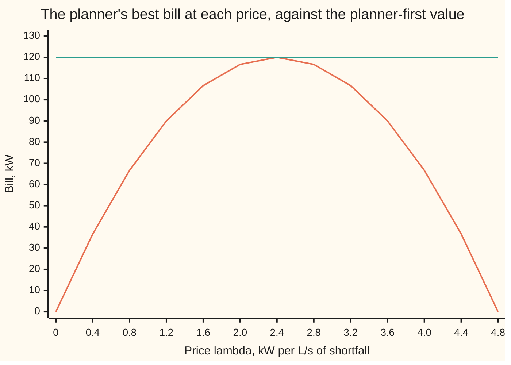
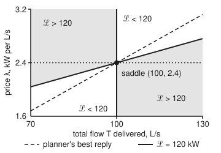

# Saddle points: the same problem read as a two-player minimax

[Syllabus](../../../SYLLABUS.md) → [Optimization](../README.md) → [Constrained Optimisation](../README.md#s03) → Saddle points

---

## General Overview

A town needs at least 100 litres of water a second (L/s). Two pumps can supply it. Pump A draws 0.02 kW (kilowatts) times its flow squared; pump B, older, draws 0.03 kW times its flow squared. These laws are a fitted model, not pump physics.

The job is to **minimise** the power drawn while delivering at least 100 L/s. The answer is 60 L/s from A and 40 from B: 120 kW, which is £24 an hour at £0.20 per kWh (kilowatt-hour).

Now play it as a game between two people. The **planner** sets the two flows. The **price setter** names a price, λ ("lambda"), in kW per L/s. The planner's bill is the power drawn plus λ for every L/s short of 100, and minus λ for every L/s over. The planner wants the bill low. The price setter wants it high.

Who moves first? If the planner moves first, any shortfall is fatal: the price setter answers with a huge price. So the planner must meet the demand, and the best it can do is the original problem: 120 kW. If the price setter moves first, it must pick a price the planner will then dodge as well as it can. The best price is 2.4 kW per L/s, and the planner's best answer to it is again 60 and 40 L/s, again a bill of 120 kW.

The two orders give the same value. The point where they meet, flows (60, 40) and price 2.4, is a **saddle point**: neither player gains by moving away from it alone, and neither gains by moving second.

**A constrained problem is a game in which a price setter charges for every broken rule; when the two orders of play give the same value, the meeting point is a saddle point, the plan there is optimal and the price there proves it.**

**What kind of fact this is:** two theorems. The saddle-point theorem (a saddle point exists exactly when both orders of play give the same value and both players' best choices exist) is proved on this card in Why it works. The minimax theorem (convex–concave games in which one player's choices are closed and bounded give the same value in either order) is stated, with its sources, and not proved here.

### The picture: the price setter's view



The curved line is the planner's best bill once the price is known: the price-setter-first game. The flat line is 120 kW, the planner-first value. The curve never rises above the flat line, and touches it only at a price of 2.4 kW per L/s.

---

## The formula

Notation first, in words. The plan is $x = (x_1, x_2)$, the two flows in L/s. The cost is $f_0(x) = 0.02x_1^2 + 0.03x_2^2$ kW. The rule is written in the wing's standard form, $f_1(x) \le 0$, with $f_1(x) = 100 - x_1 - x_2$: the shortfall, which must not be positive. The multiplier $\lambda \ge 0$ is the price on that rule. The **Lagrangian** ("la-GRAHN-jee-an") is the bill:

$$\mathcal{L}(x, \lambda) = f_0(x) + \lambda f_1(x).$$

A **saddle point** is a pair $(x^*, \lambda^*)$, with $\lambda^* \ge 0$, such that for every plan $x$ and every price $\lambda \ge 0$

$$\mathcal{L}(x^*, \lambda) \;\le\; \mathcal{L}(x^*, \lambda^*) \;\le\; \mathcal{L}(x, \lambda^*).$$

**Read it aloud:** with the planner holding $x^*$, no price raises the bill; with the price held at $\lambda^*$, no plan lowers it.

The two orders of play have their own names. Planner first gives $p^*$, the optimal value of the original problem. Price setter first gives $d^*$, the best value of the **dual function** $q(\lambda) = \min_x \mathcal{L}(x, \lambda)$, the planner's best bill at price $\lambda$ ([Lagrangian duality](04-lagrangian-duality-weak-and-strong.md)):

$$d^* \;=\; \max_{\lambda \ge 0}\, \min_{x}\, \mathcal{L}(x, \lambda) \;\;\le\;\; \min_{x}\, \max_{\lambda \ge 0}\, \mathcal{L}(x, \lambda) \;=\; p^*.$$

**Read it aloud:** whoever moves second can only gain, so the price-setter-first value is never above the planner-first value; a saddle point is exactly where they are equal.

The **minimax theorem**, the result that lets the order be swapped, is stated in Step 5 below.

| Symbol | Plain meaning | In our example | Push it up and the answer… |
| --- | --- | --- | --- |
| $x = (x_1, x_2)$, $x^*$, $\hat x$, $x(\lambda)$ | the flows of pumps A and B; $x^*$ the saddle plan; $\hat x$ any one plan; $x(\lambda)$ the planner's best reply to price $\lambda$ | (60, 40) L/s; $x(1) = (25, 16.6667)$ | — |
| $f_0$ | the cost being minimised: power drawn | 0.02x₁² + 0.03x₂², 120 kW at $x^*$ | a dearer pump gets less flow, and $\lambda^*$ rises |
| $f_1$ | the rule, written $f_1 \le 0$: litres short of demand | $100 - x_1 - x_2$, zero at $x^*$ | more demand: $\lambda^*$ and $p^*$ rise |
| $\lambda$, $\lambda^*$, $\hat\lambda$, $\mu$ | the price on the rule; its saddle value; $\hat\lambda$ and $\mu$ any one other price | 2.4 kW per L/s | — |
| $\mathcal{L}(x, \lambda)$, $P(x)$ | the bill: cost plus price times shortfall; $P(x)$ its worst case over prices | 120 kW at the saddle | — |
| $q(\lambda)$ | the planner's best bill once the price is known | $100\lambda - 20.8333\lambda^2$ kW | rises while there is a shortfall, falls after |
| $p^*$, $d^*$ | planner-first and price-setter-first values | both 120 kW | — |
| $T$ | total flow, $x_1 + x_2$, in the figure | 100 L/s at the saddle | — |
| $\alpha$, $k$ | price step and step count in the price adjustment | 0.01; $k = 0, 1, 2, \dots$ | a step above 0.0480 never settles |
| $X$, $Y$, $F$, $y$ | in the minimax theorem: the two players' choice sets, the payoff, and the maximiser's choice | plans, prices $\ge 0$, $\mathcal{L}$, $\lambda$ | — |

### When it holds

- **Convex cost and rules.** The planner's side must be convex: $f_0$ curves up and the shortfall is straight. With a nonconvex choice, such as a pump that is either off or at full power, the two orders can give different values, and then no saddle exists. The penalty kick below shows the same gap in a game played with plain choices.
- **Concave in the price.** The bill must be concave (curving down, or straight) in the price setter's choice. A Lagrangian is straight in $\lambda$, so this always holds; in a general game it can fail, and a game convex for both players can have a gap (What breaks).
- **One side's choices closed and bounded.** The minimax theorem needs one player's set to be closed (its edge values are allowed) and bounded (no choice is infinitely large). Real pumps have a top flow, so the planner's set qualifies.
- **The best price must exist.** Equal values are not enough for a saddle: the price setter's best price must be reached. Slater's condition (a plan that meets every inequality rule strictly) makes sure of it ([Slater's condition](05-slaters-condition-and-duality-gaps.md)). Without it, a problem can have equal values and no saddle (What breaks).
- **No caps on the price.** If the price setter may charge at most 2 kW per L/s, the planner rationally leaves 16.6667 L/s unmet. The game still has a saddle, but it is a saddle of a different problem.

---

## Why it works

### Step 0: second mover's advantage, and when it vanishes

When one side's gain is the other's loss, moving second is an advantage: you see the other's choice and reply to it. A saddle point is a pair of choices where that advantage is zero, because each choice is already the best reply to the other. That is a Nash equilibrium of a zero-sum game ([Nash equilibrium](../../14-Applied%20and%20computational/05-Operations%20Research/09-game-theory-and-nash-equilibrium.md)), played by a planner and a price.

### Step 1: planner first is the original problem

Fix a plan $x$ and let the price setter reply. If $x$ is short, $f_1(x) > 0$, and the bill $f_0(x) + \lambda f_1(x)$ grows without limit as $\lambda$ grows. If $x$ meets demand, $f_1(x) \le 0$, and the best reply is $\lambda = 0$, leaving the bill at $f_0(x)$. So

$$\max_{\lambda \ge 0} \mathcal{L}(x, \lambda) = \begin{cases} f_0(x) & \text{if } x \text{ meets demand,} \\ +\infty & \text{if not.} \end{cases}$$

The planner, moving first, minimises this. Any short plan scores $+\infty$, so the planner chooses among plans that meet demand: the original problem. Its value is $p^* = 120$ kW. The price setter has turned a hard rule into a bill that punishes any breach.

### Step 2: price setter first is the dual

Fix a price $\lambda$ and let the planner reply. The bill is $0.02x_1^2 + 0.03x_2^2 + \lambda(100 - x_1 - x_2)$, with no rule left. Set each partial rate to zero: $0.04x_1 = \lambda$ and $0.06x_2 = \lambda$. Each pump's marginal cost equals the price. So the planner runs $x_1 = 25\lambda$ and $x_2 = 16.6667\lambda$, a total of $41.6667\lambda$ L/s. Put these back and the planner's best bill is

$$q(\lambda) = 100\lambda - 20.8333\lambda^2.$$

The price setter, moving first, picks the $\lambda$ that maximises $q$. The slope $100 - 41.6667\lambda$ is zero at $\lambda^* = 2.4$, where $q = 240 - 120 = 120$ kW. So $d^* = 120 = p^*$, and the planner's reply to $\lambda^*$ is $(60, 40)$, the plan from Step 1.

### Step 3: whoever moves second can only gain

The inequality $d^* \le p^*$ holds in every game, convex or not. Take any plan $\hat x$ and any price $\hat\lambda$. A minimum is at most any particular value, and a maximum is at least any particular value:

$$\min_x \mathcal{L}(x, \hat\lambda) \;\le\; \mathcal{L}(\hat x, \hat\lambda) \;\le\; \max_{\lambda \ge 0} \mathcal{L}(\hat x, \lambda).$$

The left end does not depend on $\hat x$ and the right end does not depend on $\hat\lambda$. So the largest left end is at most the smallest right end: $d^* \le p^*$. This is weak duality, read as a game. The gap $p^* - d^*$ is exactly the second mover's advantage.

### Step 4: a saddle point and equal values are the same thing

Suppose $(x^*, \lambda^*)$ is a saddle point. The left half of its definition says $\max_\lambda \mathcal{L}(x^*, \lambda) = \mathcal{L}(x^*, \lambda^*)$, so $p^* \le \mathcal{L}(x^*, \lambda^*)$. The right half says $\min_x \mathcal{L}(x, \lambda^*) = \mathcal{L}(x^*, \lambda^*)$, so $d^* \ge \mathcal{L}(x^*, \lambda^*)$. With Step 3, $p^* \le \mathcal{L}(x^*, \lambda^*) \le d^* \le p^*$: all equal. The converse holds too, and it is what makes the price a certificate: an $x^*$ and a $\lambda^*$ whose values meet are a saddle, and $x^*$ is optimal, proved by $\lambda^*$ alone.

<details>
<summary>Detailed proof: saddle point if and only if equal values, both reached</summary>

Write $P(x) = \max_{\lambda \ge 0} \mathcal{L}(x, \lambda)$ and $q(\lambda) = \min_x \mathcal{L}(x, \lambda)$, allowing the values $+\infty$ and $-\infty$. Then $p^* = \min_x P(x)$ and $d^* = \max_\lambda q(\lambda)$, where "reached" means some $x^*$ has $P(x^*) = p^*$ and some $\lambda^*$ has $q(\lambda^*) = d^*$.

**Saddle gives equal values, both reached.** If $(x^*, \lambda^*)$ is a saddle point, then $P(x^*) = \mathcal{L}(x^*, \lambda^*) = q(\lambda^*)$ by the two halves of the definition. So $p^* \le P(x^*) = q(\lambda^*) \le d^*$. Step 3 gives $d^* \le p^*$, so every term is equal, $p^* = P(x^*)$ and $d^* = q(\lambda^*)$: both are reached.

**Equal values, both reached, give a saddle.** Suppose $P(x^*) = p^* = d^* = q(\lambda^*)$, a finite number. Then

$$q(\lambda^*) \le \mathcal{L}(x^*, \lambda^*) \le P(x^*)$$

by the definitions of a minimum and a maximum, and the two ends are equal, so $\mathcal{L}(x^*, \lambda^*)$ equals both. For any $\lambda$: $\mathcal{L}(x^*, \lambda) \le P(x^*) = \mathcal{L}(x^*, \lambda^*)$. For any $x$: $\mathcal{L}(x, \lambda^*) \ge q(\lambda^*) = \mathcal{L}(x^*, \lambda^*)$. That is the saddle inequality.

**Optimality.** By Step 1, $P(x^*)$ finite means $x^*$ meets the rule, and $f_0(x^*) = P(x^*) = p^*$: no plan meeting the rule costs less. The left half at $\lambda = 0$ gives $\lambda^* f_1(x^*) \ge 0$, and $\lambda^* \ge 0$ with $f_1(x^*) \le 0$ gives $\lambda^* f_1(x^*) \le 0$, so $\lambda^* f_1(x^*) = 0$: the price is zero unless the rule binds. Together with the right half, which says $x^*$ minimises $\mathcal{L}(\cdot, \lambda^*)$, these are the [KKT conditions](02-kkt-conditions.md) (Karush–Kuhn–Tucker); for a convex problem the two descriptions coincide.

</details>

### Step 5: the minimax theorem says when the order can be swapped

Step 3 holds always; equality needs conditions. The minimax theorem gives them. It is stated here and not proved. In it, "sup" ("supremum") is the least upper bound: the top value, whether or not some choice reaches it.

> **Minimax theorem.** Let $X$ be a closed, bounded, convex set of choices for the minimising player and $Y$ a convex set of choices for the maximising player. Let the payoff $F(x, y)$ be continuous, convex in $x$ for each fixed $y$, and concave in $y$ for each fixed $x$. Then
> $$\min_{x \in X}\, \sup_{y \in Y} F(x, y) \;=\; \sup_{y \in Y}\, \min_{x \in X} F(x, y).$$

Von Neumann proved it in 1928 for games with finite payoff tables, where $X$ and $Y$ are the players' mixing rates and $F$ is the expected payoff. The statement above is a special case of Sion's 1958 theorem, which allows general convex sets and asks for less than continuity and convexity; Komiya gives a three-page proof.

A Lagrangian of a convex problem fits: $f_0 + \lambda f_1$ is convex in $x$ when $f_0$ and $f_1$ are convex, and straight in $\lambda$, which is concave. The pumps have a top flow, say 150 L/s each, so the planner's set is closed and bounded; every best reply on this card stays below that cap, so no number changes. The theorem gives $p^* = d^*$. It does not promise that the best price is reached; that is Slater's job (When it holds).

Why convexity? Convexity means averages are allowed and never hurt. In the penalty kick on the [Nash equilibrium](../../14-Applied%20and%20computational/05-Operations%20Research/09-game-theory-and-nash-equilibrium.md) card, plain choices leave a gap between the two orders of play: 70% with the kicker choosing first, 93% with the keeper choosing first. Allowing mixes, which are averages of plain choices, makes both sets convex, and the gap closes at 79.5833%.

### Step 6: the price setter's slope is the shortfall

How should the price setter search for $\lambda^*$? Danskin's theorem (stated for a maximum in his paper; here for the planner's minimum) gives the slope of $q$: when the planner's best reply $x(\lambda)$ is unique and moves continuously,

$$q'(\lambda) = f_1(x(\lambda)),$$

the shortfall at the planner's reply. The planner's own adjustment adds nothing to first order, for this reason. For any two prices $\lambda$ and $\mu$, the plan $x(\mu)$ is one plan the planner could have used at $\lambda$, so $q(\lambda) \le \mathcal{L}(x(\mu), \lambda)$, with equality at $\lambda = \mu$. Hence $q(\lambda) - q(\mu) \le (\lambda - \mu) f_1(x(\mu))$ and, swapping roles, $q(\lambda) - q(\mu) \ge (\lambda - \mu) f_1(x(\lambda))$. Divide by $\lambda - \mu$ and let $\lambda \to \mu$: both bounds tend to $f_1(x(\mu))$.

At $\lambda = 1$ the planner delivers 41.6667 L/s, 58.3333 short, and $q'(1) = 100 - 41.6667 = 58.3333$. The rule for the price setter is then plain: **raise the price while demand is short, lower it while there is surplus.** That is the price adjustment in the code, and the starting point for the dual methods on the [Penalties and augmented Lagrangians](07-penalty-and-augmented-lagrangian-methods.md) card.

<p align="center"></p>

The figure is to scale. The planner always splits a total $T$ the cheap way, which costs $0.012T^2$ kW, so the bill becomes $0.012T^2 + \lambda(100 - T)$. Shaded regions have a bill above 120 kW.

Along the dotted horizontal line $\lambda = 2.4$ the bill rises on both sides of the saddle: the planner's minimum. Along the dashed best-reply line, from (70, 1.68) to (130, 3.12), it falls on both sides: the price setter's maximum. The bill is exactly 120 kW on the vertical line $T = 100$ and on the line from (70, 2.04) to (130, 2.76).

---

## Worked numbers, by hand

Two pumps, at least 100 L/s, the price setter moving first.

| Step | Arithmetic | Value |
| --- | --- | --- |
| planner's reply to price $\lambda$ | $0.04x_1 = \lambda$, $0.06x_2 = \lambda$ | $x_1 = 25\lambda$, $x_2 = 16.6667\lambda$ |
| total delivered | $25\lambda + 16.6667\lambda$ | $41.6667\lambda$ L/s |
| planner's best bill | $0.02(25\lambda)^2 + 0.03(16.6667\lambda)^2 + \lambda(100 - 41.6667\lambda)$ | $q(\lambda) = 100\lambda - 20.8333\lambda^2$ |
| price setter's slope | $q'(\lambda) = 100 - 41.6667\lambda$, the shortfall | zero at $\lambda^* = 100/41.6667$ |
| best price | | **$\lambda^* = 2.4$ kW per L/s** |
| plan at that price | $25 \times 2.4$, $16.6667 \times 2.4$ | **$x^* = (60, 40)$ L/s** |
| power | $0.02 \times 3600 + 0.03 \times 1600 = 72 + 48$ | $p^* = 120$ kW, £24 an hour |
| dual value | $100 \times 2.4 - 20.8333 \times 2.4^2 = 240 - 120$ | $d^* = 120$ kW |
| gap | $120 - 120$ | **0 kW** |

Run pump A at 60 L/s and pump B at 40: 120 kW. The price of 2.4 kW per L/s proves nothing does better, since at that price no plan, short or not, has a bill below 120 kW.

### What breaks if you drop a piece

| Mistake | Comes out at | What went wrong |
| --- | --- | --- |
| Plain choices only, in the penalty kick `[[58, 95], [93, 70]]` | kicker can guarantee 70%, keeper can hold the kicker to 93%; with mixing both are 79.5833% | No convexity: without mixes the choice sets are two points, and the order of play matters |
| Payoff $(x - y)^2$ on $[0, 1]$, with $y$ maximising | min over $x$ of max over $y$: 0.25; max over $y$ of min over $x$: 0 | The maximiser's payoff is convex, not concave, in $y$; the second mover always wins |
| Cap the price at 2 kW per L/s | plan (50, 33.3333) L/s, 83.3333 delivered, 16.6667 short; value 116.6667 kW | A capped price is a fine, not a rule; the planner pays it rather than pump the last 16.6667 L/s |
| Minimise $x$ on $[-1, 1]$ subject to $x^2 \le 0$ | $p^* = 0$; $q(\lambda) = -0.25, -0.025, -0.0025, -0.00025$ at $\lambda = 1, 10, 100, 1000$ | Slater fails: no $x$ has $x^2 < 0$; the values meet only in the limit, so no best price and no saddle |

The capped game still has a saddle: the planner's worst bill over capped prices, 116.6667 kW, equals $q(2)$. The theorem holds; the model changed.

---

## Code, from first principles, and it actually runs

The code reaches the saddle by three independent roads.

- Road 1 is the hand calculation.
- Road 2 uses no formula: it lays a grid over plans (each flow 0 to 100 L/s in half litres) and prices (0 to 5 kW per L/s in steps of 0.1), plays the game in both orders by brute force, and tests the saddle inequality at every grid point.
- Road 3 is the price adjustment from Step 6: start at $\lambda_0 = 0$, move the price by $\alpha = 0.01$ times the shortfall, and stop when the shortfall is below $10^{-9}$ L/s. It also checks Danskin's slope against a central difference (the change in $q$ across a small step either side, divided by the step).

The script ends with the four failures from the table, the spiral from The usual mistake, and the "try changing" numbers.

### Python

```python
# Saddle points and minimax -- the check behind the card.  Standard library only.
# Two pumps must deliver at least 100 L/s.  The PLANNER picks flows x = (x1, x2) in L/s to MINIMISE the
# power f0(x) = 0.02 x1^2 + 0.03 x2^2 kW.  The PRICE SETTER picks a price lam >= 0 (kW per L/s) to MAXIMISE
# the Lagrangian L(x, lam) = f0(x) + lam (100 - x1 - x2): the power, plus lam for every L/s short.
# Road 1: the saddle, where the two best replies meet.  Road 2: min-max and max-min by brute force on grids.
# Road 3: the price setter climbs q(lam) by Danskin's slope, the shortfall, until demand is met.
A, D, KWH = [0.02, 0.03], 100.0, 0.20     # kW per (L/s)^2; L/s demanded; pounds per kWh
f0 = lambda x: A[0] * x[0] ** 2 + A[1] * x[1] ** 2
L = lambda x, lam: f0(x) + lam * (D - x[0] - x[1])
reply = lambda lam: [lam / (2 * A[0]), lam / (2 * A[1])]   # planner: each pump's marginal cost = the price
q = lambda lam: L(reply(lam), lam)                           # the planner's best bill at price lam
short = lambda lam: D - sum(reply(lam))                      # L/s short when the planner replies to lam
f4 = lambda v: ", ".join(f"{u + 0.0:.4f}" for u in v)       # + 0.0 turns -0 into 0

# ---- road 1: the planner's reply, then the price that leaves no shortfall ----
print(f"problem: minimise {A[0]} x1^2 + {A[1]} x2^2 kW subject to x1 + x2 >= {D:g} L/s; tariff {KWH:.2f} pounds per kWh")
per = 1 / (2 * A[0]) + 1 / (2 * A[1])                        # L/s delivered per kW per L/s of price
lam_s = D / per
xs = reply(lam_s)
print(f"planner's reply: x1 = {1 / (2 * A[0]):.4f} lam, x2 = {1 / (2 * A[1]):.4f} lam, total {per:.4f} lam L/s")
print(f"q(lam) = {D:.4f} lam - {per / 2:.4f} lam^2; slope {D:.4f} - {per:.4f} lam = shortfall")
print(f"saddle: lam* = {D:.4f} / {per:.4f} = {lam_s:.4f} kW per L/s, x* = ({f4(xs)}) L/s")
print(f"power {A[0] * xs[0] ** 2:.4f} + {A[1] * xs[1] ** 2:.4f} = {f0(xs):.4f} kW, {KWH * f0(xs):.4f} pounds per hour")
print(f"q(lam*) = {D * lam_s:.4f} - {per / 2 * lam_s ** 2:.4f} = {q(lam_s):.4f} kW; gap {f0(xs) - q(lam_s):.4f} kW")

# ---- road 2: brute force, both orders, on grids ----
xg = [(i / 2, j / 2) for i in range(201) for j in range(201)]   # flows 0 to 100 L/s in half litres
lg = [k / 10 for k in range(51)]                                 # prices 0 to 5 kW per L/s
mm_val, mm_x = min((max(L(x, l) for l in lg), x) for x in xg)
lam_g = max(lg, key=lambda l: min(L(x, l) for x in xg))
xm_val = min(L(x, lam_g) for x in xg)
print(f"road 2, planner first (min over x of max over lam): {mm_val:.4f} kW at x = ({f4(mm_x)})")
print(f"road 2, price setter first (max over lam of min over x): {xm_val:.4f} kW at lam = {lam_g:.4f}")
up = max(L(xs, l) for l in lg) - L(xs, lam_s)
down = min(L(x, lam_s) for x in xg) - L(xs, lam_s)
print(f"saddle test on the grids: best price gain {up + 0.0:.4f} kW, best plan gain {down + 0.0:.4f} kW")
assert abs(mm_val - 120) < 1e-9 and abs(xm_val - 120) < 1e-9 and abs(lam_g - lam_s) < 1e-12
assert mm_x == (60.0, 40.0) and up < 1e-9 and down > -1e-9 and abs(f0(xs) - q(lam_s)) < 1e-9

# ---- road 3: price adjustment by Danskin's slope ----
h = 1e-4
print(f"Danskin at lam = 1: shortfall {short(1.0):.4f} L/s, central difference of q {(q(1 + h) - q(1 - h)) / (2 * h):.4f}")
assert abs((q(1 + h) - q(1 - h)) / (2 * h) - short(1.0)) < 1e-6
def adjust(alpha):                         # from lam = 0: the final price, the step count and the prices visited
    lam, k, trace = 0.0, 0, []
    while abs(short(lam)) >= 1e-9 and k < 1000:
        trace.append(lam)
        lam, k = max(0.0, lam + alpha * short(lam)), k + 1
    return lam, k, trace
alpha = 0.01
lam, k, trace = adjust(alpha)
print(f"price adjustment, step {alpha} from lam = 0, lam_k for k = 0..5:", f4(trace[:6]))
print("shortfall at those prices, L/s:", f4([short(l) for l in trace[:6]]))
print(f"error ratio {(trace[5] - lam_s) / (trace[4] - lam_s):.4f}, steps below 2 / {per:.4f} = {2 / per:.4f} converge; shortfall below 1e-9 L/s after {k} steps, lam = {lam:.4f}")
assert abs(lam - lam_s) < 1e-9 and abs((trace[5] - lam_s) / (trace[4] - lam_s) - (1 - alpha * per)) < 1e-9
print("chart, q(lam) kW at lam = 0, 0.4, ..., 4.8:", " ".join(f"{round(q(0.4 * i), 9) + 0.0:.4f}" for i in range(13)))
print(f"figure, power of T L/s split the cheap way {1 / (2 * per):.4f} T^2 kW; T 70..130 L/s, lam 1.6..3.2; saddle ({sum(xs):.4f}, {lam_s:.4f}); best reply (70, {70 / per:.4f})"
      f" to (130, {130 / per:.4f}); L = 120 on T = 100 and from (70, {lam_s - 30 / (2 * per):.4f}) to (130, {lam_s + 30 / (2 * per):.4f})")

# ---- what breaks ----
M = [[58, 95], [93, 70]]                   # penalty kick: kicker's scoring percent; rows shoot L, R; columns dive L, R
ps = [i / 600 for i in range(601)]
pure = (max(min(r) for r in M), min(max(M[0][c], M[1][c]) for c in (0, 1)))
mixed = (max(min(p * M[0][c] + (1 - p) * M[1][c] for c in (0, 1)) for p in ps),
         min(max(p * M[r][0] + (1 - p) * M[r][1] for r in (0, 1)) for p in ps))
(a, b), (c, d) = M
V = (b * c - a * d) / (b + c - a - d)
print(f"penalty {M}, plain choices only: kicker can guarantee {pure[0]:.4f}%, keeper can hold the kicker to {pure[1]:.4f}%")
print(f"penalty, mixing allowed: {mixed[0]:.4f}% and {mixed[1]:.4f}%; formula {V:.4f}%")
assert pure == (70, 93) and abs(mixed[0] - V) < 1e-9 and abs(mixed[1] - V) < 1e-9
g = [i / 100 for i in range(101)]
F = lambda x, y: (x - y) ** 2              # convex in y too: the y player is not concave
print(f"F = (x - y)^2 on [0, 1]: min over x of max over y {min(max(F(x, y) for y in g) for x in g):.4f};"
      f" max over y of min over x {max(min(F(x, y) for x in g) for y in g):.4f}")
assert min(max(F(x, y) for y in g) for x in g) == 0.25 and max(min(F(x, y) for x in g) for y in g) == 0
xc = reply(2.0)
print(f"price capped at 2: planner's reply ({f4(xc)}) L/s, {sum(xc):.4f} delivered, {short(2.0):.4f} short;"
      f" its worst bill {max(L(xc, l / 100) for l in range(201)):.4f} = q(2) {q(2.0):.4f} kW")
assert abs(max(L(xc, l / 100) for l in range(201)) - q(2.0)) < 1e-9 and short(2.0) > 16
xx = [i / 100000 - 1 for i in range(200001)]   # minimise x on [-1, 1] subject to x^2 <= 0
qq = [min(x + l * x * x for x in xx) for l in (1, 10, 100, 1000)]
print("min x subject to x^2 <= 0: p* = 0; q(lam) at lam = 1, 10, 100, 1000:", ", ".join(f"{v:.6f}" for v in qq))
assert all(abs(v + 1 / (4 * l)) < 1e-8 for v, l in zip(qq, (1, 10, 100, 1000)))
def spiral(eta):                           # F = x y: simultaneous descent in x, ascent in y, step eta, from (1, 1)
    x, y, dist = 1.0, 1.0, []
    for k in range(101):
        if k % 25 == 0: dist.append((x * x + y * y) ** 0.5)
        x, y = x - eta * y, y + eta * x
    return dist
eta = 0.1
dist = spiral(eta)
print(f"F = x y, simultaneous steps of {eta} from (1, 1): distance from the saddle at k = 0, 25, 50, 75, 100:", f4(dist))
assert abs(dist[4] / dist[0] - (1 + eta * eta) ** 50) < 1e-9

# ---- try changing ----
def saddle(a, d):                          # road 1 for other pumps or demand: price, plan, power, dual value
    pr = 1 / (2 * a[0]) + 1 / (2 * a[1])
    lt = d / pr
    xt = [lt / (2 * a[0]), lt / (2 * a[1])]
    return lt, xt, a[0] * xt[0] ** 2 + a[1] * xt[1] ** 2, d * lt - pr / 2 * lt ** 2
for at, dt in (([0.02, 0.02], D), (A, 120.0)):
    lt, xt, pt, qt = saddle(at, dt)
    print(f"try, A = {at}, D = {dt:g}: lam* = {lt:.4f}, x* = ({f4(xt)}) L/s, power {pt:.4f} kW, "
          f"{KWH * pt:.4f} pounds per hour, dual value {qt:.4f} kW")
la, ka, ta = adjust(0.04)
print(f"try, alpha = 0.04: lam_k for k = 0..3: {f4(ta[:4])}; error ratio {(ta[5] - lam_s) / (ta[4] - lam_s):.4f}; "
      f"shortfall below 1e-9 L/s after {ka} steps")
la, ka, ta = adjust(0.05)
print(f"try, alpha = 0.05: lam_k for k = 0..3: {f4(ta[:4])}; still short after {ka} steps, lam = {la:.4f}")
print(f"try, eta = 0.01: distance from the saddle at k = 0, 25, 50, 75, 100: {f4(spiral(0.01))}")
print("ALL CHECKS PASS")
```

**Ran 2026-11-11 on macOS, Python 3.14.10, standard library only. All checks passed. Output, pasted from the run:**

```
problem: minimise 0.02 x1^2 + 0.03 x2^2 kW subject to x1 + x2 >= 100 L/s; tariff 0.20 pounds per kWh
planner's reply: x1 = 25.0000 lam, x2 = 16.6667 lam, total 41.6667 lam L/s
q(lam) = 100.0000 lam - 20.8333 lam^2; slope 100.0000 - 41.6667 lam = shortfall
saddle: lam* = 100.0000 / 41.6667 = 2.4000 kW per L/s, x* = (60.0000, 40.0000) L/s
power 72.0000 + 48.0000 = 120.0000 kW, 24.0000 pounds per hour
q(lam*) = 240.0000 - 120.0000 = 120.0000 kW; gap 0.0000 kW
road 2, planner first (min over x of max over lam): 120.0000 kW at x = (60.0000, 40.0000)
road 2, price setter first (max over lam of min over x): 120.0000 kW at lam = 2.4000
saddle test on the grids: best price gain 0.0000 kW, best plan gain 0.0000 kW
Danskin at lam = 1: shortfall 58.3333 L/s, central difference of q 58.3333
price adjustment, step 0.01 from lam = 0, lam_k for k = 0..5: 0.0000, 1.0000, 1.5833, 1.9236, 2.1221, 2.2379
shortfall at those prices, L/s: 100.0000, 58.3333, 34.0278, 19.8495, 11.5789, 6.7544
error ratio 0.5833, steps below 2 / 41.6667 = 0.0480 converge; shortfall below 1e-9 L/s after 47 steps, lam = 2.4000
chart, q(lam) kW at lam = 0, 0.4, ..., 4.8: 0.0000 36.6667 66.6667 90.0000 106.6667 116.6667 120.0000 116.6667 106.6667 90.0000 66.6667 36.6667 0.0000
figure, power of T L/s split the cheap way 0.0120 T^2 kW; T 70..130 L/s, lam 1.6..3.2; saddle (100.0000, 2.4000); best reply (70, 1.6800) to (130, 3.1200); L = 120 on T = 100 and from (70, 2.0400) to (130, 2.7600)
penalty [[58, 95], [93, 70]], plain choices only: kicker can guarantee 70.0000%, keeper can hold the kicker to 93.0000%
penalty, mixing allowed: 79.5833% and 79.5833%; formula 79.5833%
F = (x - y)^2 on [0, 1]: min over x of max over y 0.2500; max over y of min over x 0.0000
price capped at 2: planner's reply (50.0000, 33.3333) L/s, 83.3333 delivered, 16.6667 short; its worst bill 116.6667 = q(2) 116.6667 kW
min x subject to x^2 <= 0: p* = 0; q(lam) at lam = 1, 10, 100, 1000: -0.250000, -0.025000, -0.002500, -0.000250
F = x y, simultaneous steps of 0.1 from (1, 1): distance from the saddle at k = 0, 25, 50, 75, 100: 1.4142, 1.6015, 1.8136, 2.0538, 2.3259
try, A = [0.02, 0.02], D = 100: lam* = 2.0000, x* = (50.0000, 50.0000) L/s, power 100.0000 kW, 20.0000 pounds per hour, dual value 100.0000 kW
try, A = [0.02, 0.03], D = 120: lam* = 2.8800, x* = (72.0000, 48.0000) L/s, power 172.8000 kW, 34.5600 pounds per hour, dual value 172.8000 kW
try, alpha = 0.04: lam_k for k = 0..3: 0.0000, 4.0000, 1.3333, 3.1111; error ratio -0.6667; shortfall below 1e-9 L/s after 63 steps
try, alpha = 0.05: lam_k for k = 0..3: 0.0000, 5.0000, 0.0000, 5.0000; still short after 1000 steps, lam = 0.0000
try, eta = 0.01: distance from the saddle at k = 0, 25, 50, 75, 100: 1.4142, 1.4160, 1.4178, 1.4195, 1.4213
ALL CHECKS PASS
```

### Rust

Same numbers, same labels, built with `rustc --edition 2021 -O`.

```rust
// Saddle points and minimax -- the same check as the Python, in Rust.  No crates.
// Two pumps must deliver at least 100 L/s.  The PLANNER picks flows x = (x1, x2) in L/s to MINIMISE the
// power f0(x) = 0.02 x1^2 + 0.03 x2^2 kW.  The PRICE SETTER picks a price lam >= 0 (kW per L/s) to MAXIMISE
// the Lagrangian L(x, lam) = f0(x) + lam (100 - x1 - x2): the power, plus lam for every L/s short.
// Road 1: the saddle, where the two best replies meet.  Road 2: min-max and max-min by brute force on grids.
// Road 3: the price setter climbs q(lam) by Danskin's slope, the shortfall, until demand is met.
const A: [f64; 2] = [0.02, 0.03]; // kW per (L/s)^2
const D: f64 = 100.0; // L/s demanded
const KWH: f64 = 0.20; // pounds per kWh

fn f0(x: [f64; 2]) -> f64 { A[0] * x[0] * x[0] + A[1] * x[1] * x[1] }
fn lag(x: [f64; 2], lam: f64) -> f64 { f0(x) + lam * (D - x[0] - x[1]) }
fn reply(lam: f64) -> [f64; 2] { [lam / (2.0 * A[0]), lam / (2.0 * A[1])] } // marginal cost = the price
fn q(lam: f64) -> f64 { lag(reply(lam), lam) } // the planner's best bill at price lam
fn short(lam: f64) -> f64 { let x = reply(lam); D - x[0] - x[1] } // L/s short at the planner's reply
fn f4(v: &[f64]) -> String { v.iter().map(|u| format!("{:.4}", u + 0.0)).collect::<Vec<_>>().join(", ") }
fn maxf(it: impl Iterator<Item = f64>) -> f64 { it.fold(f64::NEG_INFINITY, f64::max) }
fn minf(it: impl Iterator<Item = f64>) -> f64 { it.fold(f64::INFINITY, f64::min) }
fn adjust(alpha: f64) -> (f64, usize, Vec<f64>) { // from lam = 0: the final price, the step count and the prices visited
    let (mut lam, mut k, mut trace) = (0.0f64, 0, Vec::new());
    while short(lam).abs() >= 1e-9 && k < 1000 {
        trace.push(lam);
        lam = (lam + alpha * short(lam)).max(0.0);
        k += 1;
    }
    (lam, k, trace)
}
fn spiral(eta: f64) -> Vec<f64> { // F = x y: simultaneous descent in x, ascent in y, step eta, from (1, 1)
    let (mut x, mut y, mut dist) = (1.0f64, 1.0f64, Vec::new());
    for k in 0..101 {
        if k % 25 == 0 { dist.push((x * x + y * y).sqrt()) }
        let (nx, ny) = (x - eta * y, y + eta * x);
        x = nx;
        y = ny;
    }
    dist
}
fn saddle(a: [f64; 2], d: f64) -> (f64, [f64; 2], f64, f64) { // road 1 for other pumps or demand: price, plan, power, dual
    let pr = 1.0 / (2.0 * a[0]) + 1.0 / (2.0 * a[1]);
    let lt = d / pr;
    let xt = [lt / (2.0 * a[0]), lt / (2.0 * a[1])];
    (lt, xt, a[0] * xt[0].powi(2) + a[1] * xt[1].powi(2), d * lt - pr / 2.0 * lt.powi(2))
}

fn main() {
    // ---- road 1: the planner's reply, then the price that leaves no shortfall ----
    let per = 1.0 / (2.0 * A[0]) + 1.0 / (2.0 * A[1]); // L/s delivered per kW per L/s of price
    let lam_s = D / per;
    let xs = reply(lam_s);
    println!("problem: minimise {} x1^2 + {} x2^2 kW subject to x1 + x2 >= {} L/s; tariff {:.2} pounds per kWh", A[0], A[1], D, KWH);
    println!("planner's reply: x1 = {:.4} lam, x2 = {:.4} lam, total {:.4} lam L/s", 1.0 / (2.0 * A[0]), 1.0 / (2.0 * A[1]), per);
    println!("q(lam) = {:.4} lam - {:.4} lam^2; slope {:.4} - {:.4} lam = shortfall", D, per / 2.0, D, per);
    println!("saddle: lam* = {:.4} / {:.4} = {:.4} kW per L/s, x* = ({}) L/s", D, per, lam_s, f4(&xs));
    println!("power {:.4} + {:.4} = {:.4} kW, {:.4} pounds per hour", A[0] * xs[0] * xs[0], A[1] * xs[1] * xs[1], f0(xs), KWH * f0(xs));
    println!("q(lam*) = {:.4} - {:.4} = {:.4} kW; gap {:.4} kW", D * lam_s, per / 2.0 * lam_s * lam_s, q(lam_s), f0(xs) - q(lam_s) + 0.0);

    // ---- road 2: brute force, both orders, on grids ----
    let xg: Vec<[f64; 2]> = (0..201).flat_map(|i| (0..201).map(move |j| [i as f64 / 2.0, j as f64 / 2.0])).collect();
    let lg: Vec<f64> = (0..51).map(|k| k as f64 / 10.0).collect();
    let (mut mm_val, mut mm_x) = (f64::INFINITY, [0.0, 0.0]);
    for &x in &xg { let v = maxf(lg.iter().map(|&l| lag(x, l))); if v < mm_val { mm_val = v; mm_x = x } }
    let (mut xm_val, mut lam_g) = (f64::NEG_INFINITY, 0.0);
    for &l in &lg { let v = minf(xg.iter().map(|&x| lag(x, l))); if v > xm_val { xm_val = v; lam_g = l } }
    println!("road 2, planner first (min over x of max over lam): {:.4} kW at x = ({})", mm_val, f4(&mm_x));
    println!("road 2, price setter first (max over lam of min over x): {:.4} kW at lam = {:.4}", xm_val, lam_g);
    let up = maxf(lg.iter().map(|&l| lag(xs, l))) - lag(xs, lam_s);
    let down = minf(xg.iter().map(|&x| lag(x, lam_s))) - lag(xs, lam_s);
    println!("saddle test on the grids: best price gain {:.4} kW, best plan gain {:.4} kW", up + 0.0, down + 0.0);
    assert!((mm_val - 120.0).abs() < 1e-9 && (xm_val - 120.0).abs() < 1e-9 && (lam_g - lam_s).abs() < 1e-12);
    assert!(mm_x == [60.0, 40.0] && up < 1e-9 && down > -1e-9 && (f0(xs) - q(lam_s)).abs() < 1e-9);

    // ---- road 3: price adjustment by Danskin's slope ----
    let h = 1e-4;
    let cd = (q(1.0 + h) - q(1.0 - h)) / (2.0 * h);
    println!("Danskin at lam = 1: shortfall {:.4} L/s, central difference of q {:.4}", short(1.0), cd);
    assert!((cd - short(1.0)).abs() < 1e-6);
    let alpha = 0.01;
    let (lam, k, trace) = adjust(alpha);
    println!("price adjustment, step {} from lam = 0, lam_k for k = 0..5: {}", alpha, f4(&trace[..6]));
    let sh: Vec<f64> = trace[..6].iter().map(|&l| short(l)).collect();
    println!("shortfall at those prices, L/s: {}", f4(&sh));
    let ratio = (trace[5] - lam_s) / (trace[4] - lam_s);
    println!("error ratio {:.4}, steps below 2 / {:.4} = {:.4} converge; shortfall below 1e-9 L/s after {} steps, lam = {:.4}", ratio, per, 2.0 / per, k, lam);
    assert!((lam - lam_s).abs() < 1e-9 && (ratio - (1.0 - alpha * per)).abs() < 1e-9);
    let chart: Vec<String> = (0..13).map(|i| format!("{:.4}", (q(0.4 * i as f64) * 1e9).round() / 1e9 + 0.0)).collect();
    println!("chart, q(lam) kW at lam = 0, 0.4, ..., 4.8: {}", chart.join(" "));
    println!("figure, power of T L/s split the cheap way {:.4} T^2 kW; T 70..130 L/s, lam 1.6..3.2; saddle ({:.4}, {:.4}); best reply (70, {:.4}) to (130, {:.4}); L = 120 on T = 100 and from (70, {:.4}) to (130, {:.4})",
             1.0 / (2.0 * per), xs[0] + xs[1], lam_s, 70.0 / per, 130.0 / per, lam_s - 30.0 / (2.0 * per), lam_s + 30.0 / (2.0 * per));

    // ---- what breaks ----
    let m: [[f64; 2]; 2] = [[58.0, 95.0], [93.0, 70.0]]; // penalty kick: kicker's scoring percent; rows shoot L, R; columns dive L, R
    let ps: Vec<f64> = (0..601).map(|i| i as f64 / 600.0).collect();
    let pure = (m[0][0].min(m[0][1]).max(m[1][0].min(m[1][1])), m[0][0].max(m[1][0]).min(m[0][1].max(m[1][1])));
    let mixed = (maxf(ps.iter().map(|&p| (0..2).map(|c| p * m[0][c] + (1.0 - p) * m[1][c]).fold(f64::INFINITY, f64::min))),
                 minf(ps.iter().map(|&p| (0..2).map(|r| p * m[r][0] + (1.0 - p) * m[r][1]).fold(f64::NEG_INFINITY, f64::max))));
    let (a, b, c, d) = (m[0][0], m[0][1], m[1][0], m[1][1]);
    let v = (b * c - a * d) / (b + c - a - d);
    println!("penalty [[{}, {}], [{}, {}]], plain choices only: kicker can guarantee {:.4}%, keeper can hold the kicker to {:.4}%", m[0][0], m[0][1], m[1][0], m[1][1], pure.0, pure.1);
    println!("penalty, mixing allowed: {:.4}% and {:.4}%; formula {:.4}%", mixed.0, mixed.1, v);
    assert!(pure == (70.0, 93.0) && (mixed.0 - v).abs() < 1e-9 && (mixed.1 - v).abs() < 1e-9);
    let g: Vec<f64> = (0..101).map(|i| i as f64 / 100.0).collect();
    let ff = |x: f64, y: f64| (x - y) * (x - y); // convex in y too: the y player is not concave
    let mmf = minf(g.iter().map(|&x| maxf(g.iter().map(|&y| ff(x, y)))));
    let xmf = maxf(g.iter().map(|&y| minf(g.iter().map(|&x| ff(x, y)))));
    println!("F = (x - y)^2 on [0, 1]: min over x of max over y {:.4}; max over y of min over x {:.4}", mmf, xmf);
    assert!(mmf == 0.25 && xmf == 0.0);
    let xc = reply(2.0);
    let worst = maxf((0..201).map(|l| lag(xc, l as f64 / 100.0)));
    println!("price capped at 2: planner's reply ({}) L/s, {:.4} delivered, {:.4} short; its worst bill {:.4} = q(2) {:.4} kW",
             f4(&xc), xc[0] + xc[1], short(2.0), worst, q(2.0));
    assert!((worst - q(2.0)).abs() < 1e-9 && short(2.0) > 16.0);
    let ls = [1.0, 10.0, 100.0, 1000.0]; // minimise x on [-1, 1] subject to x^2 <= 0
    let qq: Vec<f64> = ls.iter().map(|&l| minf((0..200001).map(|i| { let x = i as f64 / 100000.0 - 1.0; x + l * x * x }))).collect();
    let qs: Vec<String> = qq.iter().map(|v| format!("{:.6}", v)).collect();
    println!("min x subject to x^2 <= 0: p* = 0; q(lam) at lam = 1, 10, 100, 1000: {}", qs.join(", "));
    assert!(qq.iter().zip(ls.iter()).all(|(v, l)| (v + 1.0 / (4.0 * l)).abs() < 1e-8));
    let eta = 0.1;
    let dist = spiral(eta);
    println!("F = x y, simultaneous steps of {} from (1, 1): distance from the saddle at k = 0, 25, 50, 75, 100: {}", eta, f4(&dist));
    assert!((dist[4] / dist[0] - (1.0 + eta * eta).powi(50)).abs() < 1e-9);

    // ---- try changing ----
    for (at, dt) in [([0.02, 0.02], D), (A, 120.0)] {
        let (lt, xt, pt, qt) = saddle(at, dt);
        println!("try, A = {:?}, D = {}: lam* = {:.4}, x* = ({}) L/s, power {:.4} kW, {:.4} pounds per hour, dual value {:.4} kW",
                 at, dt, lt, f4(&xt), pt, KWH * pt, qt);
    }
    let (_, ka, ta) = adjust(0.04);
    println!("try, alpha = 0.04: lam_k for k = 0..3: {}; error ratio {:.4}; shortfall below 1e-9 L/s after {} steps",
             f4(&ta[..4]), (ta[5] - lam_s) / (ta[4] - lam_s), ka);
    let (la, ka, ta) = adjust(0.05);
    println!("try, alpha = 0.05: lam_k for k = 0..3: {}; still short after {} steps, lam = {:.4}", f4(&ta[..4]), ka, la);
    println!("try, eta = 0.01: distance from the saddle at k = 0, 25, 50, 75, 100: {}", f4(&spiral(0.01)));
    println!("ALL CHECKS PASS");
}
```

**Ran 2026-11-11 on macOS, rustc 1.98.1, no crates. All checks passed. Output, pasted from the run:**

```
problem: minimise 0.02 x1^2 + 0.03 x2^2 kW subject to x1 + x2 >= 100 L/s; tariff 0.20 pounds per kWh
planner's reply: x1 = 25.0000 lam, x2 = 16.6667 lam, total 41.6667 lam L/s
q(lam) = 100.0000 lam - 20.8333 lam^2; slope 100.0000 - 41.6667 lam = shortfall
saddle: lam* = 100.0000 / 41.6667 = 2.4000 kW per L/s, x* = (60.0000, 40.0000) L/s
power 72.0000 + 48.0000 = 120.0000 kW, 24.0000 pounds per hour
q(lam*) = 240.0000 - 120.0000 = 120.0000 kW; gap 0.0000 kW
road 2, planner first (min over x of max over lam): 120.0000 kW at x = (60.0000, 40.0000)
road 2, price setter first (max over lam of min over x): 120.0000 kW at lam = 2.4000
saddle test on the grids: best price gain 0.0000 kW, best plan gain 0.0000 kW
Danskin at lam = 1: shortfall 58.3333 L/s, central difference of q 58.3333
price adjustment, step 0.01 from lam = 0, lam_k for k = 0..5: 0.0000, 1.0000, 1.5833, 1.9236, 2.1221, 2.2379
shortfall at those prices, L/s: 100.0000, 58.3333, 34.0278, 19.8495, 11.5789, 6.7544
error ratio 0.5833, steps below 2 / 41.6667 = 0.0480 converge; shortfall below 1e-9 L/s after 47 steps, lam = 2.4000
chart, q(lam) kW at lam = 0, 0.4, ..., 4.8: 0.0000 36.6667 66.6667 90.0000 106.6667 116.6667 120.0000 116.6667 106.6667 90.0000 66.6667 36.6667 0.0000
figure, power of T L/s split the cheap way 0.0120 T^2 kW; T 70..130 L/s, lam 1.6..3.2; saddle (100.0000, 2.4000); best reply (70, 1.6800) to (130, 3.1200); L = 120 on T = 100 and from (70, 2.0400) to (130, 2.7600)
penalty [[58, 95], [93, 70]], plain choices only: kicker can guarantee 70.0000%, keeper can hold the kicker to 93.0000%
penalty, mixing allowed: 79.5833% and 79.5833%; formula 79.5833%
F = (x - y)^2 on [0, 1]: min over x of max over y 0.2500; max over y of min over x 0.0000
price capped at 2: planner's reply (50.0000, 33.3333) L/s, 83.3333 delivered, 16.6667 short; its worst bill 116.6667 = q(2) 116.6667 kW
min x subject to x^2 <= 0: p* = 0; q(lam) at lam = 1, 10, 100, 1000: -0.250000, -0.025000, -0.002500, -0.000250
F = x y, simultaneous steps of 0.1 from (1, 1): distance from the saddle at k = 0, 25, 50, 75, 100: 1.4142, 1.6015, 1.8136, 2.0538, 2.3259
try, A = [0.02, 0.02], D = 100: lam* = 2.0000, x* = (50.0000, 50.0000) L/s, power 100.0000 kW, 20.0000 pounds per hour, dual value 100.0000 kW
try, A = [0.02, 0.03], D = 120: lam* = 2.8800, x* = (72.0000, 48.0000) L/s, power 172.8000 kW, 34.5600 pounds per hour, dual value 172.8000 kW
try, alpha = 0.04: lam_k for k = 0..3: 0.0000, 4.0000, 1.3333, 3.1111; error ratio -0.6667; shortfall below 1e-9 L/s after 63 steps
try, alpha = 0.05: lam_k for k = 0..3: 0.0000, 5.0000, 0.0000, 5.0000; still short after 1000 steps, lam = 0.0000
try, eta = 0.01: distance from the saddle at k = 0, 25, 50, 75, 100: 1.4142, 1.4160, 1.4178, 1.4195, 1.4213
ALL CHECKS PASS
```

The two outputs match line for line. The price adjustment shrinks the error by the factor $1 - 0.01 \times 41.6667 = 0.5833$ each step, as printed, and meets the stopping test after 47 steps. That rate needs a step below $2/41.6667 = 0.0480$, where 41.6667 is how fast the shortfall falls per unit of price.

### Lean

Lean proves the saddle-point theorem for any plans, cost and rule, and checks the card's worked numbers exactly.

- A plan and a price form a saddle point exactly when both orders of play give the same value and both players' best choices are reached.
- Whoever moves second can only gain: in every game, convex or not, the price-setter-first value is never above the planner-first value.
- At a saddle point the plan meets the rule, and no plan that meets the rule costs less.
- At a saddle point the price is zero unless the rule binds.
- The planner's reply to the price 2.4 kW per L/s is (60, 40) L/s, with no shortfall.
- That plan draws 72 + 48 = 120 kW, £24 an hour. The dual value is 240 − 120 = 120 kW, so the gap is 0.
- On the chart, q(λ) is 116.6667 kW at prices 2 and 2.8, and 0 at 4.8.
- With the price capped at 2, the planner delivers 83.3333 L/s and leaves 16.6667 L/s short.
- Two equal pumps give a price of 2 and 100 kW. A demand of 120 L/s gives 2.88, the plan (72, 48) and 172.8 kW, £34.56 an hour.
- In the penalty kick, plain choices give 70% and 93%, and mixing gives 79.5833% in both orders.
- A price step of 0.01 shrinks the error by 0.5833 each step. Steps below 0.0480 converge, and a step of 0.04 gives the ratio −0.6667.

The grids, Danskin's slope, the spiral and the two other breaks are left to the Python and Rust checks; the minimax theorem is only stated.

```lean
-- Saddle points: a plan and a price form a saddle point of the Lagrangian exactly when both orders of play give the same value and both players' best choices are reached, the price-setter-first value never exceeds the planner-first value, and at a saddle point the plan is optimal and the price is zero unless the rule binds.
import Mathlib.Data.EReal.Basic
import Mathlib.Data.NNReal.Basic
import Mathlib.Order.CompleteLattice.Basic
import Mathlib.Tactic.NormNum

open NNReal

/-! ### How the card's objects are written here

The plans form any type `α`. The cost is `f₀ : α → ℝ` and the rule is `f₁ x ≤ 0`, with
`f₁ : α → ℝ`. A price is a number `l ≥ 0`, written `l : ℝ≥0`. The Lagrangian (the bill) is
`f₀ x + l * f₁ x`.

The two orders of play may give the values `+∞` or `-∞`, so they are taken in `EReal`, the real
line with `⊥ = -∞` and `⊤ = +∞` added:
* `P x = ⨆ l, (f₀ x + l * f₁ x)`, the price setter's best reply to the plan `x`;
* `q l = ⨅ x, (f₀ x + l * f₁ x)`, the planner's best reply to the price `l` (the dual function);
* `p* = ⨅ x, P x`, planner first; `d* = ⨆ l, q l`, price setter first.

A saddle point is a pair `(xs, ls)` with `f₀ xs + l * f₁ xs ≤ f₀ xs + ls * f₁ xs ≤ f₀ x + ls * f₁ x`
for every price `l ≥ 0` and every plan `x`. -/

/-- The saddle-point theorem (Step 4 and its detailed proof). A plan `xs` and a price `ls ≥ 0`
form a saddle point of the Lagrangian `f₀ x + l * f₁ x` exactly when the two orders of play give
the same value and both players' best choices are reached: the price setter's best reply to `xs`
is the planner-first value `p*`, which equals the price-setter-first value `d*`, which is the
planner's best bill at the price `ls`. -/
theorem saddle_point_iff_equal_values_attained {α : Type*} (f₀ f₁ : α → ℝ) (xs : α) (ls : ℝ≥0) :
    ((∀ l : ℝ≥0, f₀ xs + l * f₁ xs ≤ f₀ xs + ls * f₁ xs) ∧
      (∀ x : α, f₀ xs + ls * f₁ xs ≤ f₀ x + ls * f₁ x)) ↔
    ((⨆ l : ℝ≥0, ((f₀ xs + l * f₁ xs : ℝ) : EReal)) =
        ⨅ x : α, ⨆ l : ℝ≥0, ((f₀ x + l * f₁ x : ℝ) : EReal) ∧
      (⨅ x : α, ⨆ l : ℝ≥0, ((f₀ x + l * f₁ x : ℝ) : EReal)) =
        ⨆ l : ℝ≥0, ⨅ x : α, ((f₀ x + l * f₁ x : ℝ) : EReal) ∧
      (⨆ l : ℝ≥0, ⨅ x : α, ((f₀ x + l * f₁ x : ℝ) : EReal)) =
        ⨅ x : α, ((f₀ x + ls * f₁ x : ℝ) : EReal)) := by
  constructor
  · rintro ⟨h_price, h_plan⟩
    have hA : (⨆ l : ℝ≥0, ((f₀ xs + l * f₁ xs : ℝ) : EReal)) = ((f₀ xs + ls * f₁ xs : ℝ) : EReal) :=
      le_antisymm (iSup_le fun l => EReal.coe_le_coe_iff.2 (h_price l))
        (le_iSup (fun l : ℝ≥0 => ((f₀ xs + l * f₁ xs : ℝ) : EReal)) ls)
    have hB : (⨅ x : α, ((f₀ x + ls * f₁ x : ℝ) : EReal)) = ((f₀ xs + ls * f₁ xs : ℝ) : EReal) :=
      le_antisymm (iInf_le (fun x : α => ((f₀ x + ls * f₁ x : ℝ) : EReal)) xs)
        (le_iInf fun x => EReal.coe_le_coe_iff.2 (h_plan x))
    have hwd := iSup_iInf_le_iInf_iSup
      (fun (l : ℝ≥0) (x : α) => ((f₀ x + l * f₁ x : ℝ) : EReal))
    have hp : (⨅ x : α, ⨆ l : ℝ≥0, ((f₀ x + l * f₁ x : ℝ) : EReal)) ≤
        ((f₀ xs + ls * f₁ xs : ℝ) : EReal) :=
      hA ▸ iInf_le (fun x : α => ⨆ l : ℝ≥0, ((f₀ x + l * f₁ x : ℝ) : EReal)) xs
    have hd : ((f₀ xs + ls * f₁ xs : ℝ) : EReal) ≤
        ⨆ l : ℝ≥0, ⨅ x : α, ((f₀ x + l * f₁ x : ℝ) : EReal) :=
      hB ▸ le_iSup (fun l : ℝ≥0 => ⨅ x : α, ((f₀ x + l * f₁ x : ℝ) : EReal)) ls
    refine ⟨?_, ?_, ?_⟩
    · rw [hA]; exact le_antisymm (hd.trans hwd) hp
    · exact le_antisymm (hp.trans hd) hwd
    · rw [hB]; exact le_antisymm (hwd.trans hp) hd
  · rintro ⟨h1, h2, h3⟩
    have hAB : (⨆ l : ℝ≥0, ((f₀ xs + l * f₁ xs : ℝ) : EReal)) =
        ⨅ x : α, ((f₀ x + ls * f₁ x : ℝ) : EReal) := h1.trans (h2.trans h3)
    have hle1 : ∀ l : ℝ≥0, ((f₀ xs + l * f₁ xs : ℝ) : EReal) ≤
        ⨅ x : α, ((f₀ x + ls * f₁ x : ℝ) : EReal) := fun l =>
      hAB ▸ le_iSup (fun l : ℝ≥0 => ((f₀ xs + l * f₁ xs : ℝ) : EReal)) l
    have hle2 : ∀ x : α, ((f₀ xs + ls * f₁ xs : ℝ) : EReal) ≤ ((f₀ x + ls * f₁ x : ℝ) : EReal) :=
      fun x => (hle1 ls).trans (iInf_le (fun x : α => ((f₀ x + ls * f₁ x : ℝ) : EReal)) x)
    refine ⟨fun l => ?_, fun x => EReal.coe_le_coe_iff.1 (hle2 x)⟩
    exact EReal.coe_le_coe_iff.1
      ((hle1 l).trans (iInf_le (fun x : α => ((f₀ x + ls * f₁ x : ℝ) : EReal)) xs))

/-- Whoever moves second can only gain (Step 3). In every two-player game, convex or not, with
any payoff `L x y` that the `x` player minimises and the `y` player maximises, the value when
the maximiser moves first, `max over y of min over x`, is at most the value when the minimiser
moves first, `min over x of max over y`. For a Lagrangian this is weak duality, `d* ≤ p*`. -/
theorem second_mover_can_only_gain {α β : Type*} (L : α → β → ℝ) :
    (⨆ y : β, ⨅ x : α, (L x y : EReal)) ≤ ⨅ x : α, ⨆ y : β, (L x y : EReal) := by
  exact iSup_iInf_le_iInf_iSup (fun (y : β) (x : α) => (L x y : EReal))

/-- The plan at a saddle point is optimal and the price proves it (Step 4, Optimality). If
`(xs, ls)` is a saddle point of the Lagrangian `f₀ x + l * f₁ x` over prices `l ≥ 0`, then `xs`
meets the rule, no plan meeting the rule costs less, and the price is zero unless the rule
binds: `ls * f₁ xs = 0`. -/
theorem saddle_point_plan_is_optimal {α : Type*} (f₀ f₁ : α → ℝ) (xs : α) (ls : ℝ≥0)
    (h_price : ∀ l : ℝ≥0, f₀ xs + l * f₁ xs ≤ f₀ xs + ls * f₁ xs)
    (h_plan : ∀ x : α, f₀ xs + ls * f₁ xs ≤ f₀ x + ls * f₁ x) :
    f₁ xs ≤ 0 ∧ (∀ x : α, f₁ x ≤ 0 → f₀ xs ≤ f₀ x) ∧ (ls : ℝ) * f₁ xs = 0 := by
  have hf : f₁ xs ≤ 0 := by
    have h := h_price (ls + 1)
    push_cast at h
    nlinarith
  have hl0 : (0 : ℝ) ≤ ls := ls.2
  have hz : (ls : ℝ) * f₁ xs = 0 := by
    have h := h_price 0
    push_cast at h
    nlinarith
  refine ⟨hf, fun x hx => ?_, hz⟩
  have h := h_plan x
  nlinarith

/-! ### The card's worked numbers, exactly

The card's decimals are exact fractions: 0.02 = 1/50, 0.03 = 3/100, 16.6667 = 50/3,
41.6667 = 125/3, 20.8333 = 125/6, 2.4 = 12/5, 79.5833 = 955/12. -/

-- The planner's reply to the price 2.4 = 12/5: x₁ = 25 λ = 60 and x₂ = (50/3) λ = 40 L/s.
example : (25 : ℚ) * (12 / 5) = 60 ∧ (50 / 3 : ℚ) * (12 / 5) = 40 := by norm_num

-- The best price: the shortfall 100 - (125/3) λ is zero at λ* = 12/5.
example : (100 : ℚ) - 125 / 3 * (12 / 5) = 0 := by norm_num

-- Power at the saddle plan: 0.02 × 3600 + 0.03 × 1600 = 72 + 48 = 120 kW, £24 an hour at £0.20.
example : (1 / 50 : ℚ) * 60 ^ 2 = 72 ∧ (3 / 100 : ℚ) * 40 ^ 2 = 48 ∧
    (1 / 50 : ℚ) * 60 ^ 2 + 3 / 100 * 40 ^ 2 = 120 ∧ (120 : ℚ) * (1 / 5) = 24 := by norm_num

-- Dual value: q(12/5) = 100 × 12/5 - (125/6) × (12/5)² = 240 - 120 = 120 kW, so the gap is 0.
example : (100 : ℚ) * (12 / 5) = 240 ∧ (125 / 6 : ℚ) * (12 / 5) ^ 2 = 120 ∧
    (100 : ℚ) * (12 / 5) - 125 / 6 * (12 / 5) ^ 2 = 120 := by norm_num

-- The chart: q(λ) = 100 λ - (125/6) λ² at λ = 2 and 2.8 is 350/3 = 116.6667 kW, and 0 at 4.8.
example : (100 : ℚ) * 2 - 125 / 6 * 2 ^ 2 = 350 / 3 ∧
    (100 : ℚ) * (14 / 5) - 125 / 6 * (14 / 5) ^ 2 = 350 / 3 ∧
    (100 : ℚ) * (24 / 5) - 125 / 6 * (24 / 5) ^ 2 = 0 := by norm_num

-- Price capped at 2: the reply is (50, 100/3) L/s, 250/3 = 83.3333 delivered, 50/3 = 16.6667 short.
example : (25 : ℚ) * 2 = 50 ∧ (50 / 3 : ℚ) * 2 = 100 / 3 ∧ (50 : ℚ) + 100 / 3 = 250 / 3 ∧
    (100 : ℚ) - 250 / 3 = 50 / 3 := by norm_num

-- Two equal pumps (try changing): λ* = 2, plan (50, 50), power 0.02 × 2500 × 2 = 100 kW.
example : (100 : ℚ) / 50 = 2 ∧ (1 / 50 : ℚ) * 50 ^ 2 + 1 / 50 * 50 ^ 2 = 100 := by norm_num

-- More demand (try changing): λ* = 120 / (125/3) = 2.88, plan (72, 48), power 172.8 kW, £34.56.
example : (120 : ℚ) / (125 / 3) = 72 / 25 ∧ (25 : ℚ) * (72 / 25) = 72 ∧
    (50 / 3 : ℚ) * (72 / 25) = 48 ∧ (1 / 50 : ℚ) * 72 ^ 2 + 3 / 100 * 48 ^ 2 = 864 / 5 ∧
    (864 / 5 : ℚ) * (1 / 5) = 864 / 25 := by norm_num

-- Penalty kick [[58, 95], [93, 70]] with plain choices: the kicker moving first can guarantee
-- max (min 58 95) (min 93 70) = 70; the keeper moving first holds the kicker to
-- min (max 58 93) (max 95 70) = 93.
example : max (min 58 95) (min 93 70) = (70 : ℕ) ∧ min (max 58 93) (max 95 70) = (93 : ℕ) := by
  decide

-- Penalty kick with mixing: both orders give (95 × 93 - 58 × 70) / (95 + 93 - 58 - 70) = 955/12.
example : ((95 : ℚ) * 93 - 58 * 70) / (95 + 93 - 58 - 70) = 955 / 12 := by norm_num

-- Price adjustment: the error shrinks by 1 - 0.01 × 125/3 = 7/12 = 0.5833 each step, and a step
-- converges only below 2 / (125/3) = 0.048; at 0.04 the ratio is 1 - 0.04 × 125/3 = -2/3.
example : (1 : ℚ) - 1 / 100 * (125 / 3) = 7 / 12 ∧ (2 : ℚ) / (125 / 3) = 6 / 125 ∧
    (1 : ℚ) - 4 / 100 * (125 / 3) = -2 / 3 := by norm_num

#print axioms saddle_point_iff_equal_values_attained
#print axioms second_mover_can_only_gain
#print axioms saddle_point_plan_is_optimal
```

**Checked 2026-11-12 on macOS, Lean 4.36.0-rc2, Mathlib v4.36.0-rc2. Every proof is complete and uses only Lean's standard axioms. Output, pasted from the run:**

```
'saddle_point_iff_equal_values_attained' depends on axioms: [propext, Classical.choice, Quot.sound]
'second_mover_can_only_gain' depends on axioms: [propext, Classical.choice, Quot.sound]
'saddle_point_plan_is_optimal' depends on axioms: [propext, Classical.choice, Quot.sound]
```

> [!TIP]
> **Try changing**
> Guess first, then run it. The asserts are pinned to this network, so expect some to stop it.
> - **Guess first: two equal pumps.** Change `[0.02, 0.03]` in `A` to `[0.02, 0.02]`. The price falls to 2.0 kW per L/s, the plan is (50, 50) and the power 100 kW, and the dual value is 100 kW too. The asserts pinned to 120 kW stop it.
> - **Guess first: what does more demand cost?** Change `D` to `120.0`. The price rises to 2.88 kW per L/s, the plan to (72, 48) and the power to 172.8 kW, £34.56 an hour. The dual value is again 172.8 kW.
> - **Guess first: a bolder price setter.** Change `alpha` to `0.04`. The price overshoots: 4.0, then 1.3333, then 3.1111, with error ratio −0.6667, and still settles after 63 steps. At `0.05`, above 0.0480, the price flips between 0 and 5 for ever and the assert stops it.
> - **Guess first: does a smaller step cure the spiral?** Change `eta` to `0.01`. The distance from the saddle grows more slowly, to 1.4213 after 100 steps, but it still grows.

---

## The usual mistake

> [!warning]
> **Assuming the order of min and max never matters.** The minimax theorem lets it be swapped only in a convex–concave game in which one side's choices are closed and bounded; outside that, the order can matter. In the penalty kick with plain choices, the kicker moving first can guarantee 70%, while the keeper moving first can hold the kicker to 93%. Swapping min and max without checking convexity can turn a lower bound into a claimed optimum, so check the hypotheses or print both values.
>
> - **Treating every point where the gradient of $\mathcal{L}$ is zero as a solution.** A flat point of the bill is sure to be a saddle when the planner's side is convex and the price side concave; without that, check the saddle inequality itself. For $(x - y)^2$ every point with $x = y$ is flat, but none is a saddle: the gap is 0.25.
> - **Taking equal values as proof of a saddle.** Minimising $x$ subject to $x^2 \le 0$ gives $p^* = 0$ and dual values creeping up to 0 (−0.00025 at a price of 1000), but no price reaches it.
> - **Letting both players step at once.** On the bill $F = xy$, which has a saddle at $(0, 0)$, the planner stepping down and the price setter stepping up at the same time, by 0.1 each, spiral outwards: the distance from the saddle grows from 1.4142 to 2.3259 in 100 steps. The price adjustment in the code converges because the planner replies fully to each price before the price moves.

---

## Where you meet it in real life

- **Electricity and water markets.** A market operator's dispatch is a planner-and-price game: the clearing price is the multiplier on demand, and at the saddle no generator wants to change its output at that price. Raising the price while demand is short and lowering it while there is surplus is the textbook model of how such a market finds its price.
- **Game theory and poker.** Zero-sum games with mixed strategies are minimax problems, and the value of the game is the saddle value. The penalty kick on the [Nash equilibrium](../../14-Applied%20and%20computational/05-Operations%20Research/09-game-theory-and-nash-equilibrium.md) card is one.
- **Robust design.** Choosing a pipe size to minimise the worst-case cost over an uncertain demand is a min over designs of a max over demands.
- **Machine learning.** Adversarial training and generative adversarial networks are minimax games between two networks. Their payoffs are not convex–concave, and the simultaneous-step spiral above is one reason training them is hard.

> **Say it back**
> Put a price on each rule and add price times breach to the cost: that bill is the Lagrangian, and the problem becomes a game between a planner who minimises it and a price setter who maximises it. Planner first gives the original problem; price setter first gives the dual. Whoever moves second can only gain, so the dual value is never above the primal. A saddle point is where they meet, and there the plan is optimal and the price proves it: for the pumps, 60 and 40 L/s at 2.4 kW per L/s, both orders worth 120 kW. The minimax theorem says convex–concave games in which one side's choices are closed and bounded have equal values in either order; without convexity, as in a penalty kick with plain choices, they can differ.

---

## What this builds on

- [Lagrangian duality](04-lagrangian-duality-weak-and-strong.md): the dual function $q(\lambda)$, weak duality and the conditions for strong duality. This card reads the same objects as two orders of play.
- [Nash equilibrium](../../14-Applied%20and%20computational/05-Operations%20Research/09-game-theory-and-nash-equilibrium.md): payoff tables, mixed strategies and the two-by-two mixed equilibrium. A saddle point is a Nash equilibrium of a zero-sum game.

## Where this goes next

- [Robust and chance constraints](../06-Conic%2C%20Quadratic%20and%20Stochastic%20Programs/10-robust-and-chance-constrained-optimisation.md): the minimax idea beyond Lagrangians, in games and decisions where one side chooses against the other.
- [Penalties and augmented Lagrangians](07-penalty-and-augmented-lagrangian-methods.md): algorithms that move the price toward the shortfall, as Step 6 does, while keeping the planner's problem well behaved.

This card finds the saddle when one exists; how fast a two-player method reaches it when neither player can reply fully, as in the spiral above, is the question it leaves open.

---

## Sources

Verified 2026-11-11: every link below resolves to the publisher's page.

- Boyd, Stephen, and Lieven Vandenberghe. *Convex Optimization*. Cambridge University Press, 2004. [Publisher page](https://www.cambridge.org/core/books/convex-optimization/17D2FAA54F641A2F62C7CCD01DFA97C4). Section 5.4: the max-min reading of weak and strong duality and the saddle-point interpretation.
- von Neumann, J. "Zur Theorie der Gesellschaftsspiele." *Mathematische Annalen* 100 (1928): 295–320. [doi:10.1007/BF01448847](https://doi.org/10.1007/BF01448847). The minimax theorem for games with finite payoff tables and mixed strategies.
- Sion, Maurice. "On General Minimax Theorems." *Pacific Journal of Mathematics* 8, no. 1 (1958): 171–176. [doi:10.2140/pjm.1958.8.171](https://doi.org/10.2140/pjm.1958.8.171). The convex–concave minimax theorem stated in Step 5, in its general form.
- Komiya, Hidetoshi. "Elementary Proof for Sion's Minimax Theorem." *Kodai Mathematical Journal* 11, no. 1 (1988): 5–7. [doi:10.2996/kmj/1138038812](https://doi.org/10.2996/kmj/1138038812). A short proof of Sion's theorem using only convexity and continuity.
- Danskin, John M. "The Theory of Max-Min, with Applications." *SIAM Journal on Applied Mathematics* 14, no. 4 (1966): 641–664. [doi:10.1137/0114053](https://doi.org/10.1137/0114053). The derivative of a max-min value, used in Step 6.
