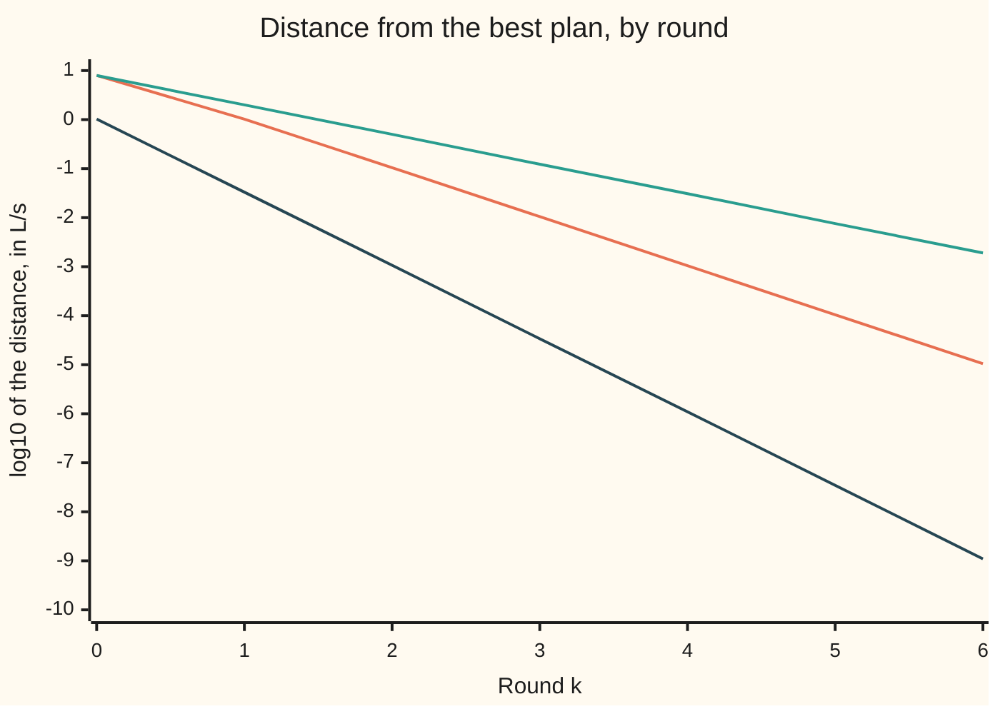

# Penalties and augmented Lagrangians: fines that need not grow to infinity

[Syllabus](../../../SYLLABUS.md) → [Optimization](../README.md) → [Constrained Optimisation](../README.md#s03) → Penalties and augmented Lagrangians

---

## General Overview

Three pumps feed a town that needs 150 litres of water a second (L/s). Pump A draws 0.02 kW (kilowatts) times its flow squared, pump B 0.03 and pump C 0.05. The job is to **minimise** the power drawn. Two rules limit the choice. The flows must add to 150 L/s. And pump A feeds a low-lying district whose pipes are rated for 25 m of **head** (pressure, measured as the height of water it would lift); that district sees 0.5 m of head for every L/s from pump A.

Ignore the pressure rule and the cheapest plan runs pump A at 72.5806 L/s. It draws 217.7419 kW, but the low district sees 36.2903 m: 11.2903 m over its rating. The true answer holds pump A at 50 L/s and draws 237.5 kW, £47.50 an hour at £0.20 per kWh. [Lagrange multipliers, proved](01-lagrange-multipliers-revisited.md), [Interior point methods](08-interior-point-methods.md) and [Sequential quadratic programming](09-sequential-quadratic-programming.md) give the same three pumps a different pressure rule, a minimum head at a hill tank instead of this cap, so their best plan is not this one.

A solver that only knows how to roll downhill cannot obey a rule. So turn each rule into a **fine** added to the bill: a charge that grows with the square of the breach. Too small a fine and the solver pays it and breaks the rule; with a fine weight of 1 (half a kilowatt per square metre of overpressure), the plan still runs 2.4751 m over the cap. Raise the fine and the breach shrinks, but only in inverse proportion: a tenfold fine leaves about a tenth of the breach. It never reaches zero at any finite fine, and the problem becomes so lopsided that a downhill solver slows to a crawl.

The cure is to charge a **price** as well as a fine: a flat rate per unit of breach, learned from the breach left over each round. Once the price is right, the plan obeys the rule exactly and the fine can stay small. Here the right prices are 3.75 kW per L/s of demand and 3.5 kW per metre of head, and eight rounds at a fixed fine of 1 bring the plan within 0.001 L/s of the answer.

**A quadratic penalty enforces a rule only as its fine weight grows without limit, which stretches the problem; an augmented Lagrangian adds a price that is corrected every round, so the plan converges with the fine held fixed.**

**What kind of fact this is:** two methods, with theorems proved on this card in Why it works: a penalty minimiser obeys the KKT conditions with stand-in prices equal to fine times breach, and, for a quadratic cost with straight-line rules, each price correction shrinks the error by a fixed factor $1/(1 + \rho\sigma)$. Convergence for general smooth problems is stated, with its source. The answer, 237.5 kW, is certified by zero KKT residuals on a convex problem and confirmed by a grid scan.

### The picture: three ways to close the gap



Orange is the penalty alone, with the fine weight multiplied by 10 each round, from 1 to a million. Green is the augmented Lagrangian with the weight held at 1; dark blue, held at 10. On this plot the orange line looks fine. Its cost is hidden: by round 6 the problem it solves is 38,601,095 times more stretched in one direction than another, against 40 for green and 387 for dark blue.

---

## The formula

Notation first, in words. The plan is $x = (x_1, x_2, x_3)$, the three flows in L/s; $x^*$ is the best plan. The **shortfall** $h(x) = 150 - x_1 - x_2 - x_3$ must equal 0. The **overpressure** $g(x) = 0.5x_1 - 25$, in metres, must be at most 0. The shelf's standard form, on the [KKT conditions](02-kkt-conditions.md) card, writes the cost as $f_0$ and this ceiling as $f_1 \le 0$; this card and its code call them $f$ and $g$. Their prices, the KKT multipliers of the [KKT conditions](02-kkt-conditions.md) card, are $\nu$ ("nu") for the equality and $\lambda \ge 0$ for the ceiling. The fine weight is $\rho$ ("rho"), the letter ADMM reuses.

The **quadratic penalty** fines the squared breach:

$$P_\rho(x) = f(x) + \frac{\rho}{2}\Big(h(x)^2 + \max\big(0, g(x)\big)^2\Big).$$

The **augmented Lagrangian** adds prices to the fine, and round $k$ minimises it, then corrects the prices from the breach left:

$$L_\rho(x; \nu, \lambda) = f(x) + \nu\, h(x) + \frac{\rho}{2}h(x)^2 + \frac{1}{2\rho}\Big(\max\big(0, \lambda + \rho\, g(x)\big)^2 - \lambda^2\Big),$$

$$\nu_{k+1} = \nu_k + \rho\, h(x_k), \qquad \lambda_{k+1} = \max\big(0, \lambda_k + \rho\, g(x_k)\big).$$

**Read it aloud:** charge the bill, plus a price on each unit of breach, plus a fine on its square; find the cheapest plan; then raise each price by the fine weight times the breach that plan left, never letting a ceiling's price fall below zero.

While the cap is breached, the last term is $\lambda g + \tfrac{\rho}{2}g^2$: a price and a fine, as for the demand rule. With $\nu = \lambda = 0$ the augmented Lagrangian is the penalty, so round 0 of each method is the same solve.

| Symbol | Plain meaning | In our example | Push it up and the answer… |
| --- | --- | --- | --- |
| $x = (x_1, x_2, x_3)$; $x^*$, $x_\rho$, $x_k$ | flows of pumps A, B, C; the best plan, the penalty's plan at weight $\rho$, round $k$'s plan | $x^* = (50, 62.5, 37.5)$ L/s | — |
| $f(x)$ | power drawn, minimised ($f_0$ in the standard form) | $0.02x_1^2 + 0.03x_2^2 + 0.05x_3^2$; 237.5 kW at $x^*$ | — |
| $h(x)$ | shortfall against demand, must be 0 | $150 - x_1 - x_2 - x_3$ L/s | — |
| $g(x)$ | overpressure at the low district, must be $\le 0$ ($f_1$ in the standard form) | $0.5x_1 - 25$ m | — |
| $\nu$, $\lambda$; $y = (\nu, \lambda)$, $y^*$ | prices of the demand rule and of the pressure cap ($\lambda$ never negative), as one list; the true prices | $\nu^*$ = 3.75 kW per L/s (£0.75 an hour), $\lambda^*$ = 3.5 kW per m (£0.70 an hour) | a larger guess pulls more flow; holds pump A lower |
| $\rho$ | fine weight, in kW per square unit of breach | 1 and 10 | breach shrinks, stretch $\kappa$ grows |
| $P_\rho$, $L_\rho$ | penalty function; augmented Lagrangian | — | — |
| $k$ | round: one minimisation, one price correction | $k = 0, 1, 2, \dots$ | — |
| $L$, $\mu$, $\kappa = L/\mu$ | steepest and gentlest curvature of the function being minimised, and their ratio, the stretch | $\kappa$ = 40 at $\rho = 1$, 387 at $\rho = 10$ | gradient descent needs steps in proportion to $\kappa$ |
| $J$, $S$, $\sigma$ | the rules' gradients as rows; $S = J(\nabla^2 f)^{-1}J^{\mathsf T}$; its smallest eigenvalue | `J = [[-1, -1, -1], [0.5, 0, 0]]`; $\sigma$ = 3.0369 | each round's shrink factor $1/(1+\rho\sigma)$ falls |
| $c$ | rate of an exact penalty, charged per unit (not squared) of breach | 4 and 3 kW per unit | exact once $c$ passes the largest price |
| $q$, $e$, $M$, $I$ | in the proof: the cost's straight-line part, the rules' constants, $\nabla^2 f + \rho J^{\mathsf T}J$, the identity matrix | $q = 0$; $e = (150, -25)$ | — |

### When it holds

- **The rules have prices at the answer.** The method converges to the KKT prices, so they must exist: the rules' gradients should be independent there (LICQ, from [KKT conditions](02-kkt-conditions.md)). Where no prices exist, the price updates have nothing to settle on.
- **Each round's minimisation is accurate enough.** The price correction reads the breach off the round's plan. A rough plan gives a rough price; general theory asks the round's error to shrink as the rounds go on.
- **The fine weight is large enough to make each round convex near the answer.** Here the cost curves up in every direction, so any $\rho > 0$ works. On a nonconvex problem a small $\rho$ can leave a round with no minimum near $x^*$; the stated theorem needs $\rho$ above a threshold, not growing without limit.
- **The rules are on comparable scales.** One $\rho$ fines a square L/s and a square metre alike. Measure head in millimetres and the cap's fine is a million times heavier than the demand's, and the stretch returns.
- **Ceilings get the clamp.** Drop $\max(0, \cdot)$ and a slack cap is treated as a target: What breaks, below.

---

## Why it works

### Step 0: a fine makes the solver pay a stand-in price, and the breach is that price over the weight

The slope of a fine $\tfrac{\rho}{2}h^2$ is $\rho h$ times the slope of $h$, so near the answer a fine acts like a price of $\rho h$ per unit. That stand-in must come close to the true price, 3.75, so the breach $h$ is about $3.75/\rho$: zero only at an infinite weight. Supplying the price directly removes the need for the weight to grow.

### Step 1: the penalty minimiser is a KKT point with stand-in prices

Set the gradient of $P_\rho$ to zero while the cap is breached:

$$\nabla f(x_\rho) + (\rho\, h(x_\rho))\,\nabla h + (\rho\, g(x_\rho))\,\nabla g = 0.$$

This is the KKT stationarity equation $\nabla f + \nu\nabla h + \lambda\nabla g = 0$ with $\nu = \rho h$ and $\lambda = \rho g$. At $\rho = 1000$ the plan is 0.00375 L/s short and 0.00350 m over, so the stand-in prices are 3.7496 and 3.4986: close to 3.75 and 3.5, and the breaches are those prices divided by 1000. Step 4 makes "close" exact.

### Step 2: a large weight stretches the problem, and stretch is slow

The curvature of $P_\rho$ is $\nabla^2 f + \rho\,(\nabla h\,\nabla h^{\mathsf T} + \nabla g\,\nabla g^{\mathsf T})$. Across the rules (directions that change $h$ or $g$) it grows like $\rho$. Along the one direction that changes neither, $(0, 1, -1)$ (move flow from pump C to pump B), the fine is silent and the curvature is that of the bill. So the stretch $\kappa$ grows in proportion to $\rho$: 40 at $\rho = 1$, then 387, 3,861 and 38,602.

Gradient descent needs a number of steps proportional to $\kappa$ ([Convergence rates](../02-Unconstrained%20Methods/03-rates-of-convergence-and-conditioning.md)). From $(50, 50, 50)$, with step $1/L$, reaching within 0.001 L/s of each penalty minimiser takes 381, 3,779, 37,756 and 377,525 steps. Each tenfold rise in $\rho$ costs ten times the work, and buys one more correct decimal.

### Step 3: price the breach, and the right price needs no fine at all

Set the gradient of $L_\rho$ to zero while $\lambda + \rho g \ge 0$:

$$\nabla f(x_k) + (\nu_k + \rho\, h(x_k))\,\nabla h + (\lambda_k + \rho\, g(x_k))\,\nabla g = 0.$$

The stand-in prices are now old price plus weight times breach. That is the update rule: it reads off the prices the round's plan already obeys. Now suppose the prices are already right, $\nu_k = 3.75$ and $\lambda_k = 3.5$. At $x^*$ both breaches are zero, the fine and its slope vanish, and the equation above is the KKT equation itself. So $x^*$ minimises $L_\rho$ for every $\rho > 0$, and the next breach is zero. The fine is only there to correct a wrong price, so it need not grow. With the true prices loaded at $\rho = 1$, gradient descent reaches within 0.001 L/s of $x^*$ itself in 387 steps.

### Step 4: each round shrinks the price error by $1/(1 + \rho\sigma)$

For a quadratic cost and straight-line rules, write the prices as one list $y = (\nu, \lambda)$ and its error as $y_k - y^*$. The proof below shows one round multiplies that error by the matrix $(I + \rho S)^{-1}$, where $S = J(\nabla^2 f)^{-1}J^{\mathsf T}$ measures how strongly the bill resists each rule. For the pumps,

$$S = \begin{pmatrix} 51.6667 & -12.5 \\ -12.5 & 6.25 \end{pmatrix}, \qquad \sigma = 3.0369,$$

so the slowest error shrinks by $1/(1 + \sigma) = 0.2477$ a round at $\rho = 1$, and by $0.0319$ at $\rho = 10$. The run shows 0.2477 from round 4 on. A fixed $\rho$ gives a fixed factor: linear convergence (a constant shrink per round), and a bigger $\rho$ buys a better factor at the price of stretch.

The penalty is this same round taken once from $y = 0$. Its price error is $(I + \rho S)^{-1}y^*$: about $S^{-1}y^*/\rho$ for large $\rho$, and at most $\lVert y^*\rVert/(1 + \rho\sigma)$ in size, so its plan error falls like $1/\rho$: 1.02 L/s at $\rho = 10$, 0.105 at 100, 0.0105 at 1000. The check confirms the stand-in prices against this formula at every $\rho$.

<details>
<summary>Detailed proof: one round multiplies the price error by (I + ρS)⁻¹</summary>

Let the cost be $f(x) = \tfrac12 x^{\mathsf T}(\nabla^2 f)\,x + q^{\mathsf T}x$ with $\nabla^2 f$ positive definite; here $\nabla^2 f = \operatorname{diag}(0.04, 0.06, 0.10)$ and $q = 0$. Let the active rules be $Jx + e = 0$, with prices $y$: the rows of $J$ are the gradients of $h$ and $g$, and $(h, g) = Jx + e$. The cap stays active in every round of the run, so this covers it.

KKT at the answer: $\nabla^2 f\,x^* + q + J^{\mathsf T}y^* = 0$ and $Jx^* + e = 0$.

The round minimises $f + y_k^{\mathsf T}(Jx + e) + \tfrac{\rho}{2}\lVert Jx + e\rVert^2$, so $\nabla^2 f\,x_k + q + J^{\mathsf T}\big(y_k + \rho (Jx_k + e)\big) = 0$. Subtract the KKT equation and use $Jx_k + e = J(x_k - x^*)$:

$$M(x_k - x^*) = -J^{\mathsf T}(y_k - y^*), \qquad M = \nabla^2 f + \rho J^{\mathsf T}J.$$

The update is $y_{k+1} = y_k + \rho J(x_k - x^*)$, so

$$y_{k+1} - y^* = \big(I - \rho J M^{-1}J^{\mathsf T}\big)(y_k - y^*).$$

Now $M(\nabla^2 f)^{-1}J^{\mathsf T} = J^{\mathsf T} + \rho J^{\mathsf T}S = J^{\mathsf T}(I + \rho S)$. Multiply on the left by $JM^{-1}$: $S = JM^{-1}J^{\mathsf T}(I + \rho S)$, so $JM^{-1}J^{\mathsf T} = S(I + \rho S)^{-1}$. Then

$$I - \rho S(I + \rho S)^{-1} = (I + \rho S)^{-1}.$$

$S$ is symmetric and positive definite when $J$ has independent rows, so its eigenvalues are positive and the largest eigenvalue of $(I + \rho S)^{-1}$ is $1/(1 + \rho\sigma) < 1$. The plan error follows from the price error through the first displayed equation. For general smooth problems a similar linear rate holds near the answer once $\rho$ passes a threshold, with the Hessian of the Lagrangian in place of $\nabla^2 f$; the first source below, chapter 17, states the convergence theorem as an error bound.

</details>

### Step 5: why a ceiling's price is clamped at zero

A ceiling only pushes one way: KKT asks $\lambda \ge 0$, and $\lambda = 0$ when the cap is slack. The term $\tfrac{1}{2\rho}(\max(0, \lambda + \rho g)^2 - \lambda^2)$ builds this in. When $\lambda + \rho g < 0$ the term is the constant $-\lambda^2/(2\rho)$: it exerts no force on the plan, and the update sets $\lambda$ to 0. Remove the clamp and a slack cap becomes an equality, pulling the plan up to it.

A different repair skips prices altogether. The **exact penalty** charges $c\,(|h| + \max(0, g))$, per unit of breach rather than its square. Its minimiser is $x^*$ itself once $c$ exceeds the largest price, 3.75 (the first source below, chapter 17, states the theorem). The check confirms it near $x^*$: at $c = 4$ nothing within 1 L/s beats 237.5 kW; at $c = 3$ a plan that breaks the rules scores 236.08 kW. The catch is the kink at the answer, which smooth methods such as gradient descent cannot handle; it serves as a yardstick inside [Sequential quadratic programming](09-sequential-quadratic-programming.md), which writes the rate $c$ as $\rho$.

---

## Worked numbers, by hand

The answer first, from the KKT conditions with the cap binding, then the first price correction.

| Step | Arithmetic | Value |
| --- | --- | --- |
| without the cap | flows in proportion to $1/0.02$, $1/0.03$, $1/0.05$, adding to 150 | 72.5806, 48.3871, 29.0323 L/s; 217.7419 kW |
| head at the low district | $0.5 \times 72.5806$ | 36.2903 m, 11.2903 m over |
| cap binds | $0.5x_1 = 25$ | $x_1 = 50$ L/s |
| B and C share the rest | 100 L/s in proportion $1/0.03 : 1/0.05 = 5 : 3$ | 62.5, 37.5 L/s |
| demand price | $0.06 \times 62.5 = 0.10 \times 37.5$ | $\nu^*$ = 3.75 kW per L/s |
| cap price | $0.04 \times 50 + 0.5\lambda = 3.75$ | $\lambda^*$ = 3.5 kW per m |
| power | $50 + 117.1875 + 70.3125$ | **237.5 kW**, £47.50 an hour |
| round 0, penalty at $\rho = 1$ | minimise $P_1$ (code) | 54.9501, 57.2590, 34.3554 L/s; 3.4355 L/s short, 2.4751 m over |
| first price correction | $\nu_1 = 0 + 1 \times 3.4355$, $\lambda_1 = \max(0, 0 + 1 \times 2.4751)$ | 3.4355, 2.4751 |
| shrink per round | $1/(1 + 3.0369)$ | 0.2477 |

Run pump A at 50 L/s, B at 62.5 and C at 37.5: 237.5 kW, the least any plan meeting demand within the cap can draw, which is 19.7581 kW more than ignoring the cap. One more L/s of demand would cost about £0.75 an hour; one more metre of rating at the low district would save about £0.70.

### What breaks if you drop a piece

| Mistake | Comes out at | What went wrong |
| --- | --- | --- |
| Stop the penalty at $\rho = 1$ | head 27.4751 m, 2.4751 m over; 3.4355 L/s short; 217.7626 kW | The fine is cheaper than obeying; the low "power" is a broken rule |
| Drop the clamp, with the cap at 40 m (slack) | $\lambda = -1.15$; head forced to 40 m; 219.8750 kW against 217.7419 | A negative price rewards pressure, so the ceiling becomes a target |
| Correct the price with the wrong sign, $\nu - \rho h$ | 975.5133 L/s from $x^*$ after 10 rounds | Each round pushes the price away from the plan's own stand-in price |
| Raise $\rho$ to 10, keep the step size tuned at $\rho = 1$ | step 0.3171, above $2/L$; error 1.442e+46 L/s after 50 steps | The fine's curvature grew, so the old step overshoots ([Gradient descent](../02-Unconstrained%20Methods/02-gradient-descent-and-its-rate.md)) |
| Exact penalty with rate $c = 3$, below the price 3.75 | 236.08 kW within 1 L/s of $x^*$, under 237.5 | Breaking demand costs 3 per L/s but saves 3.75; the fine is too cheap to be exact |

---

## Code, from first principles, and it actually runs

The script solves the pumps by three independent roads. Road 1 solves the KKT equations with the cap binding, five equations in five unknowns, by elimination, and prints the residuals. Road 2 scans every plan on a 0.5 L/s grid that meets demand and the cap, using no prices at all. Road 3 runs the penalty for $\rho$ from 1 to a million and the augmented Lagrangian at $\rho = 1$ and $\rho = 10$, each round solved exactly by elimination, and checks the stand-in prices and the shrink factor against the formulas of Step 4. Gradient descent with step $1/L$ counts the cost of stretch, and power iteration (multiplying by a matrix again and again) finds $L$ and $\mu$. The last block prints the failures in the table.

### Python

```python
# Penalties and augmented Lagrangians -- the check behind the card.  Standard library only.
# Three pumps feed one town.  Choose flows x = (x1, x2, x3) in L/s to MINIMISE the power drawn,
# f(x) = 0.02 x1^2 + 0.03 x2^2 + 0.05 x3^2 (kW), subject to two rules:
#   demand   h(x) = 150 - x1 - x2 - x3 = 0       (shortfall in L/s)
#   pressure g(x) = 0.5 x1 - 25 <= 0             (head over the low district's 25 m cap, in m)
# Road 1: the KKT equations, solved by elimination.  Road 2: a scan of every plan on a 0.5 L/s grid.
# Road 3: penalty and augmented-Lagrangian loops (sub-problems by elimination), rate checked against the proof.
import math
A, K, CAP, DEM, KWH = [0.02, 0.03, 0.05], 0.5, 25.0, 150.0, 0.20
f = lambda x: sum(a * v * v for a, v in zip(A, x))
h = lambda x: DEM - sum(x)
g = lambda x, cap=CAP: K * x[0] - cap
dist = lambda x, y: math.sqrt(sum((p - q) ** 2 for p, q in zip(x, y)))
f4 = lambda v: ", ".join(f"{u:.4f}" for u in v)
sci = lambda v, d: f"{v:.{d}e}"           # 1.23e-04 style, the same in both languages

def gauss(M, r):                          # solve M z = r by elimination with row swaps
    n = len(r)
    M = [list(row) + [v] for row, v in zip(M, r)]
    for c in range(n):
        p = max(range(c, n), key=lambda i: abs(M[i][c]))
        M[c], M[p] = M[p], M[c]
        for i in range(n):
            if i != c:
                m = M[i][c] / M[c][c]
                M[i] = [u - m * v for u, v in zip(M[i], M[c])]
    return [M[i][n] / M[i][i] for i in range(n)]

def hess(rho, act):                       # Hessian of the sub-problem: diag(2a) + rho J^T J
    return [[(2 * A[i] if i == j else 0) + rho + (rho * K * K if act and i == j == 0 else 0)
             for j in range(3)] for i in range(3)]

def sub(rho, lam, nu, cap=CAP, clamp=True):   # minimise the augmented Lagrangian exactly
    for act in (True, False):             # cap term switched on, then off; keep the consistent one
        b = [nu + rho * DEM - (K * (lam - rho * cap) if act and i == 0 else 0) for i in range(3)]
        x = gauss(hess(rho, act), b)
        if not clamp or act == (lam + rho * g(x, cap) >= 0):
            return x

def grad(x, rho, lam, nu):                # gradient of the augmented Lagrangian
    w = max(0.0, lam + rho * g(x))
    return [2 * A[i] * x[i] - nu - rho * h(x) + (K * w if i == 0 else 0) for i in range(3)]

def extremes(H):                          # largest and smallest eigenvalue, by power iteration
    v, w = [1.0, 0.3, 0.2], [1.0, 0.3, 0.2]
    for _ in range(300):
        u = [sum(H[i][j] * v[j] for j in range(3)) for i in range(3)]
        big = math.sqrt(sum(t * t for t in u)); v = [t / big for t in u]
        u = gauss(H, w)
        small = math.sqrt(sum(t * t for t in u)); w = [t / small for t in u]
    return big, 1 / small

def gd_steps(rho, lam, nu, x0, tol):      # gradient descent with step 1/L, counted to tol
    target, (L, _) = sub(rho, lam, nu), extremes(hess(rho, True))
    x, n = list(x0), 0
    while dist(x, target) > tol and n < 10 ** 6:
        x = [p - q / L for p, q in zip(x, grad(x, rho, lam, nu))]; n += 1
    return n, x

def aug_lag(rho, rounds, cap=CAP, clamp=True, sign=1):
    lam = nu = 0.0; path = []
    for _ in range(rounds):
        x = sub(rho, lam, nu, cap, clamp)
        nu += sign * rho * h(x)
        lam = max(0.0, lam + rho * g(x, cap)) if clamp else lam + rho * g(x, cap)
        path.append((x, lam, nu))
    return path

# ---- road 1: KKT with the cap binding.  Unknowns x1, x2, x3, nu, lam ----
M = [[2 * A[0], 0, 0, -1, K], [0, 2 * A[1], 0, -1, 0], [0, 0, 2 * A[2], -1, 0], [1, 1, 1, 0, 0], [K, 0, 0, 0, 0]]
*xs, nu_s, lam_s = gauss(M, [0, 0, 0, DEM, CAP])
free = [DEM / A[i] / sum(1 / a for a in A) for i in range(3)]   # demand only: x_i in proportion to 1/a_i
print(f"no cap: flows {f4(free)} L/s, power {f(free):.4f} kW, head {K * free[0]:.4f} m, {g(free):.4f} m over")
print(f"KKT: flows {f4(xs)} L/s, pump powers {f4([a * v * v for a, v in zip(A, xs)])} kW")
print(f"KKT: power {f(xs):.4f} kW, {KWH * f(xs):.4f} pounds an hour; the cap costs {f(xs) - f(free):.4f} kW")
print(f"KKT: nu {nu_s:.4f} kW per L/s ({KWH * nu_s:.4f} pounds an hour), lam {lam_s:.4f} kW per m ({KWH * lam_s:.4f})")
stat = max(abs(t) for t in grad(xs, 0.0, lam_s, nu_s))
print(f"KKT residuals: stationarity {sci(stat, 1)}, shortfall {sci(abs(h(xs)), 1)}, lam*g {sci(abs(lam_s * g(xs)), 1)}")
assert stat < 1e-12 and abs(h(xs)) < 1e-12 and lam_s > 0 and abs(g(xs)) < 1e-12

# ---- road 2: scan every plan on a 0.5 L/s grid that meets demand and the cap ----
best = min((f([p / 2, q / 2, DEM - p / 2 - q / 2]), p / 2, q / 2) for p in range(101) for q in range(301 - p))
print(f"grid scan: best flows {f4([best[1], best[2], DEM - best[1] - best[2]])} L/s, power {best[0]:.4f} kW")
assert dist([best[1], best[2], DEM - best[1] - best[2]], xs) < 1e-9

# ---- road 3a: quadratic penalty, rho = 1, 10, ..., 10^6 (no prices kept) ----
S = [[sum(1 / (2 * a) for a in A), -K / (2 * A[0])], [-K / (2 * A[0]), K * K / (2 * A[0])]]   # J (grad^2 f)^-1 J^T
print("penalty  rho    flows (L/s)                 power   short   over    rho*h   rho*g   error    kappa")
pen = []
for e in range(7):
    rho = 10.0 ** e; x = sub(rho, 0, 0); big, small = extremes(hess(rho, True)); pen.append(dist(x, xs))
    print(f"penalty 1e{e}  {f4(x):26s}  {f(x):8.4f} {h(x):7.5f} {g(x):7.5f} {rho * h(x):7.4f} "
          f"{rho * g(x):7.4f} {sci(pen[-1], 2)} {big / small:9.0f}")
    gap = gauss([[1 + rho * S[0][0], rho * S[0][1]], [rho * S[1][0], 1 + rho * S[1][1]]], [nu_s, lam_s])
    assert abs(nu_s - rho * h(x) - gap[0]) < 1e-8 * rho and abs(lam_s - rho * g(x) - gap[1]) < 1e-8 * rho
assert pen[3] * 1000 > 1 and pen[6] < 2e-5 and abs(pen[5] / pen[6] - 10) < 0.05
for e in range(4):
    n, _ = gd_steps(10.0 ** e, 0, 0, [50.0, 50.0, 50.0], 1e-3)
    print(f"gradient descent on the penalty at rho 1e{e}: {n} steps to 0.001 L/s")

# ---- road 3b: augmented Lagrangian, prices updated, rho held at 1 and at 10 ----
tr, det = S[0][0] + S[1][1], S[0][0] * S[1][1] - S[0][1] ** 2
sig = (tr - math.sqrt(tr * tr - 4 * det)) / 2
print(f"S = J (grad^2 f)^-1 J^T = [[{f4(S[0])}], [{f4(S[1])}]], smallest eigenvalue sigma {sig:.4f}")
print(f"predicted ratio 1/(1+rho sigma): rho 1 -> {1 / (1 + sig):.4f}, rho 10 -> {1 / (1 + 10 * sig):.4f}")
for rho in (1.0, 10.0):
    path, prev, errs = aug_lag(rho, 10), None, []
    for k, (x, lam, nu) in enumerate(path):
        errs.append(dist(x, xs)); ratio = f"{errs[-1] / prev:.4f}" if prev else "  -   "
        if rho == 1.0:
            print(f"AL rho 1, k={k}: flows {f4(x)}  error {sci(errs[-1], 2)}  ratio {ratio}  lam {lam:.4f}  nu {nu:.4f}")
        prev = errs[-1]
    big, small = extremes(hess(rho, True))
    print(f"AL rho {rho:g}: kappa {big / small:.1f}, chart log10 error k=0..6: " + " ".join(f"{math.log10(t):.2f}" for t in errs[:7]))
    assert abs(errs[4] / errs[3] - 1 / (1 + rho * sig)) < 1e-3
print("chart penalty log10 error k=0..6: " + " ".join(f"{math.log10(t):.2f}" for t in pen))
n, x = gd_steps(1.0, 3.5, 3.75, [50.0, 50.0, 50.0], 1e-3)
print(f"gradient descent on the AL at rho 1 with the true prices: {n} steps, lands {dist(x, xs):.4f} L/s from x*")

# ---- what breaks ----
x = sub(1.0, 0, 0)
print(f"stop at rho 1: head {K * x[0]:.4f} m, {g(x):.4f} m over; {h(x):.4f} L/s short; power {f(x):.4f} kW")
x, lam, nu = aug_lag(1.0, 60, cap=40.0, clamp=False)[-1]
y, lam2, _ = aug_lag(1.0, 60, cap=40.0)[-1]
print(f"cap 40 m, no clamp: lam {lam:.4f}, head {K * x[0]:.4f} m, power {f(x):.4f} kW; "
      f"with clamp: lam {lam2:.4f}, head {K * y[0]:.4f} m, power {f(y):.4f} kW")
assert lam < 0 and abs(K * x[0] - 40) < 1e-6 and abs(f(y) - f(free)) < 1e-9 and lam2 == 0
x = aug_lag(1.0, 10, sign=-1)[-1][0]; assert dist(x, xs) > 100; print(f"price update with the wrong sign, 10 rounds: error {dist(x, xs):.4f} L/s")
L1 = extremes(hess(1.0, True))[0]; x = [50.0, 50.0, 50.0]
for _ in range(50):
    x = [p - q / L1 for p, q in zip(x, grad(x, 10.0, 0, 0))]
assert dist(x, xs) > 1e6
print(f"rho 10 with the rho-1 step 1/L = {1 / L1:.4f}: error after 50 steps {sci(dist(x, xs), 3)} L/s")
for c in (4.0, 3.0):
    ex = lambda y: f(y) + c * (abs(h(y)) + max(0.0, g(y)))
    low = min(ex([xs[0] + i / 10, xs[1] + j / 10, xs[2] + l / 10])
              for i in range(-10, 11) for j in range(-10, 11) for l in range(-10, 11))
    print(f"exact penalty, rate {c:g}: value at x* {ex(xs):.4f} kW, lowest within 1 L/s {low:.4f} kW")
    assert (low > ex(xs) - 1e-9) if c > max(nu_s, lam_s) else (low < ex(xs) - 1)
print("ALL CHECKS PASS")
```

**Ran 2026-11-11 on macOS, Python 3.14.10, standard library only. All checks passed. Output, pasted from the run:**

```
no cap: flows 72.5806, 48.3871, 29.0323 L/s, power 217.7419 kW, head 36.2903 m, 11.2903 m over
KKT: flows 50.0000, 62.5000, 37.5000 L/s, pump powers 50.0000, 117.1875, 70.3125 kW
KKT: power 237.5000 kW, 47.5000 pounds an hour; the cap costs 19.7581 kW
KKT: nu 3.7500 kW per L/s (0.7500 pounds an hour), lam 3.5000 kW per m (0.7000)
KKT residuals: stationarity 0.0e+00, shortfall 0.0e+00, lam*g 0.0e+00
grid scan: best flows 50.0000, 62.5000, 37.5000 L/s, power 237.5000 kW
penalty  rho    flows (L/s)                 power   short   over    rho*h   rho*g   error    kappa
penalty 1e0  54.9501, 57.2590, 34.3554   217.7626 3.43554 2.47506  3.4355  2.4751 7.87e+00        40
penalty 1e1  50.6736, 61.8471, 37.1083   234.9593 0.37108 0.33678  3.7108  3.3678 1.02e+00       387
penalty 1e2  50.0697, 62.4330, 37.4598   237.2378 0.03746 0.03486  3.7460  3.4864 1.05e-01      3861
penalty 1e3  50.0070, 62.4933, 37.4960   237.4737 0.00375 0.00350  3.7496  3.4986 1.05e-02     38602
penalty 1e4  50.0007, 62.4993, 37.4996   237.4974 0.00037 0.00035  3.7500  3.4999 1.05e-03    386012
penalty 1e5  50.0001, 62.4999, 37.5000   237.4997 0.00004 0.00003  3.7500  3.5000 1.05e-04   3860111
penalty 1e6  50.0000, 62.5000, 37.5000   237.5000 0.00000 0.00000  3.7500  3.5000 1.05e-05  38601095
gradient descent on the penalty at rho 1e0: 381 steps to 0.001 L/s
gradient descent on the penalty at rho 1e1: 3779 steps to 0.001 L/s
gradient descent on the penalty at rho 1e2: 37756 steps to 0.001 L/s
gradient descent on the penalty at rho 1e3: 377525 steps to 0.001 L/s
S = J (grad^2 f)^-1 J^T = [[51.6667, -12.5000], [-12.5000, 6.2500]], smallest eigenvalue sigma 3.0369
predicted ratio 1/(1+rho sigma): rho 1 -> 0.2477, rho 10 -> 0.0319
AL rho 1, k=0: flows 54.9501, 57.2590, 34.3554  error 7.87e+00  ratio   -     lam 2.4751  nu 3.4355
AL rho 1, k=1: flows 51.5364, 61.3850, 36.8310  error 2.01e+00  ratio 0.2559  lam 3.2433  nu 3.6831
AL rho 1, k=2: flows 50.3861, 62.2271, 37.3362  error 5.00e-01  ratio 0.2486  lam 3.4364  nu 3.7336
AL rho 1, k=3: flows 50.0958, 62.4325, 37.4595  error 1.24e-01  ratio 0.2478  lam 3.4842  nu 3.7459
AL rho 1, k=4: flows 50.0237, 62.4833, 37.4900  error 3.07e-02  ratio 0.2477  lam 3.4961  nu 3.7490
AL rho 1, k=5: flows 50.0059, 62.4959, 37.4975  error 7.61e-03  ratio 0.2477  lam 3.4990  nu 3.7498
AL rho 1, k=6: flows 50.0015, 62.4990, 37.4994  error 1.88e-03  ratio 0.2477  lam 3.4998  nu 3.7499
AL rho 1, k=7: flows 50.0004, 62.4997, 37.4998  error 4.67e-04  ratio 0.2477  lam 3.4999  nu 3.7500
AL rho 1, k=8: flows 50.0001, 62.4999, 37.5000  error 1.16e-04  ratio 0.2477  lam 3.5000  nu 3.7500
AL rho 1, k=9: flows 50.0000, 62.5000, 37.5000  error 2.86e-05  ratio 0.2477  lam 3.5000  nu 3.7500
AL rho 1: kappa 40.0, chart log10 error k=0..6: 0.90 0.30 -0.30 -0.91 -1.51 -2.12 -2.72
AL rho 10: kappa 387.3, chart log10 error k=0..6: 0.01 -1.48 -2.97 -4.47 -5.96 -7.46 -8.96
chart penalty log10 error k=0..6: 0.90 0.01 -0.98 -1.98 -2.98 -3.98 -4.98
gradient descent on the AL at rho 1 with the true prices: 387 steps, lands 0.0010 L/s from x*
stop at rho 1: head 27.4751 m, 2.4751 m over; 3.4355 L/s short; power 217.7626 kW
cap 40 m, no clamp: lam -1.1500, head 40.0000 m, power 219.8750 kW; with clamp: lam 0.0000, head 36.2903 m, power 217.7419 kW
price update with the wrong sign, 10 rounds: error 975.5133 L/s
rho 10 with the rho-1 step 1/L = 0.3171: error after 50 steps 1.442e+46 L/s
exact penalty, rate 4: value at x* 237.5000 kW, lowest within 1 L/s 237.5000 kW
exact penalty, rate 3: value at x* 237.5000 kW, lowest within 1 L/s 236.0800 kW
ALL CHECKS PASS
```

### Rust

Same numbers, same labels, built with `rustc --edition 2021 -O`.

```rust
// Penalties and augmented Lagrangians -- the same check as the Python, in Rust.  No crates.
// Three pumps feed one town.  Choose flows x = (x1, x2, x3) in L/s to MINIMISE the power drawn,
// f(x) = 0.02 x1^2 + 0.03 x2^2 + 0.05 x3^2 (kW), subject to two rules:
//   demand   h(x) = 150 - x1 - x2 - x3 = 0       (shortfall in L/s)
//   pressure g(x) = 0.5 x1 - 25 <= 0             (head over the low district's 25 m cap, in m)
// Road 1: the KKT equations, solved by elimination.  Road 2: a scan of every plan on a 0.5 L/s grid.
// Road 3: penalty and augmented-Lagrangian loops (sub-problems by elimination), rate checked against the proof.
const A: [f64; 3] = [0.02, 0.03, 0.05]; const K: f64 = 0.5; const CAP: f64 = 25.0; const DEM: f64 = 150.0; const KWH: f64 = 0.20;
type V = Vec<f64>;

fn f(x: &[f64]) -> f64 { A.iter().zip(x).fold(0.0, |s, (a, v)| s + a * v * v) }
fn h(x: &[f64]) -> f64 { DEM - x.iter().fold(0.0, |s, v| s + v) }
fn g(x: &[f64], cap: f64) -> f64 { K * x[0] - cap }
fn dist(x: &[f64], y: &[f64]) -> f64 { x.iter().zip(y).fold(0.0, |s, (p, q)| s + (p - q) * (p - q)).sqrt() }
fn f4(v: &[f64]) -> String { v.iter().map(|u| format!("{:.4}", u)).collect::<Vec<_>>().join(", ") }
fn sci(v: f64, d: usize) -> String { // 1.23e-04 style, the same in both languages
    let s = format!("{:.*e}", d, v); let (m, e) = s.split_once('e').unwrap(); let e: i32 = e.parse().unwrap();
    format!("{}e{}{:02}", m, if e < 0 { '-' } else { '+' }, e.abs())
}

fn gauss(m0: &[V], r: &[f64]) -> V { // solve M z = r by elimination with row swaps
    let n = r.len();
    let mut m: Vec<V> = m0.iter().zip(r).map(|(row, v)| { let mut t = row.clone(); t.push(*v); t }).collect();
    for c in 0..n {
        let mut p = c; for i in c + 1..n { if m[i][c].abs() > m[p][c].abs() { p = i; } } m.swap(c, p);
        for i in 0..n {
            if i != c { let k = m[i][c] / m[c][c]; let rc = m[c].clone(); for (u, v) in m[i].iter_mut().zip(&rc) { *u -= k * v; } }
        }
    }
    (0..n).map(|i| m[i][n] / m[i][i]).collect()
}

fn hess(rho: f64, act: bool) -> Vec<V> { // Hessian of the sub-problem: diag(2a) + rho J^T J
    (0..3).map(|i| (0..3).map(|j| (if i == j { 2.0 * A[i] } else { 0.0 }) + rho
        + (if act && i == 0 && j == 0 { rho * K * K } else { 0.0 })).collect()).collect()
}

fn sub(rho: f64, lam: f64, nu: f64, cap: f64, clamp: bool) -> V { // minimise the augmented Lagrangian exactly
    for act in [true, false] { // cap term switched on, then off; keep the consistent one
        let b: V = (0..3).map(|i| nu + rho * DEM - (if act && i == 0 { K * (lam - rho * cap) } else { 0.0 })).collect();
        let x = gauss(&hess(rho, act), &b);
        if !clamp || act == (lam + rho * g(&x, cap) >= 0.0) { return x; }
    }
    panic!("no consistent piece")
}

fn grad(x: &[f64], rho: f64, lam: f64, nu: f64) -> V { // gradient of the augmented Lagrangian
    let w = (lam + rho * g(x, CAP)).max(0.0);
    (0..3).map(|i| 2.0 * A[i] * x[i] - nu - rho * h(x) + (if i == 0 { K * w } else { 0.0 })).collect()
}

fn extremes(hm: &[V]) -> (f64, f64) { // largest and smallest eigenvalue, by power iteration
    let (mut v, mut w) = (vec![1.0, 0.3, 0.2], vec![1.0, 0.3, 0.2]);
    let (mut big, mut small) = (0.0, 0.0);
    for _ in 0..300 {
        let u: V = (0..3).map(|i| (0..3).fold(0.0, |s, j| s + hm[i][j] * v[j])).collect();
        big = u.iter().fold(0.0, |s, t| s + t * t).sqrt(); v = u.iter().map(|t| t / big).collect();
        let u = gauss(hm, &w);
        small = u.iter().fold(0.0, |s, t| s + t * t).sqrt(); w = u.iter().map(|t| t / small).collect();
    }
    (big, 1.0 / small)
}

fn gd_steps(rho: f64, lam: f64, nu: f64, x0: &[f64], tol: f64) -> (usize, V) { // step 1/L, counted to tol
    let (target, (l, _)) = (sub(rho, lam, nu, CAP, true), extremes(&hess(rho, true)));
    let (mut x, mut n) = (x0.to_vec(), 0);
    while dist(&x, &target) > tol && n < 1_000_000 { let gr = grad(&x, rho, lam, nu); x = x.iter().zip(&gr).map(|(p, q)| p - q / l).collect(); n += 1; }
    (n, x)
}

fn aug_lag(rho: f64, rounds: usize, cap: f64, clamp: bool, sign: f64) -> Vec<(V, f64, f64)> {
    let (mut lam, mut nu, mut path) = (0.0f64, 0.0f64, vec![]);
    for _ in 0..rounds {
        let x = sub(rho, lam, nu, cap, clamp);
        nu += sign * rho * h(&x);
        lam = if clamp { (lam + rho * g(&x, cap)).max(0.0) } else { lam + rho * g(&x, cap) };
        path.push((x, lam, nu));
    }
    path
}

fn main() {
    // ---- road 1: KKT with the cap binding.  Unknowns x1, x2, x3, nu, lam ----
    let m: Vec<V> = vec![vec![2.0 * A[0], 0.0, 0.0, -1.0, K], vec![0.0, 2.0 * A[1], 0.0, -1.0, 0.0],
        vec![0.0, 0.0, 2.0 * A[2], -1.0, 0.0], vec![1.0, 1.0, 1.0, 0.0, 0.0], vec![K, 0.0, 0.0, 0.0, 0.0]];
    let z = gauss(&m, &[0.0, 0.0, 0.0, DEM, CAP]);
    let (xs, nu_s, lam_s) = (z[..3].to_vec(), z[3], z[4]);
    let inv = A.iter().fold(0.0, |s, a| s + 1.0 / a);
    let free: V = (0..3).map(|i| DEM / A[i] / inv).collect(); // demand only: x_i in proportion to 1/a_i
    println!("no cap: flows {} L/s, power {:.4} kW, head {:.4} m, {:.4} m over", f4(&free), f(&free), K * free[0], g(&free, CAP));
    println!("KKT: flows {} L/s, pump powers {} kW", f4(&xs), f4(&(0..3).map(|i| A[i] * xs[i] * xs[i]).collect::<V>()));
    println!("KKT: power {:.4} kW, {:.4} pounds an hour; the cap costs {:.4} kW", f(&xs), KWH * f(&xs), f(&xs) - f(&free));
    println!("KKT: nu {:.4} kW per L/s ({:.4} pounds an hour), lam {:.4} kW per m ({:.4})", nu_s, KWH * nu_s, lam_s, KWH * lam_s);
    let stat = grad(&xs, 0.0, lam_s, nu_s).iter().fold(0.0f64, |s, t| s.max(t.abs()));
    println!("KKT residuals: stationarity {}, shortfall {}, lam*g {}", sci(stat, 1), sci(h(&xs).abs(), 1), sci((lam_s * g(&xs, CAP)).abs(), 1));
    assert!(stat < 1e-12 && h(&xs).abs() < 1e-12 && lam_s > 0.0 && g(&xs, CAP).abs() < 1e-12);

    // ---- road 2: scan every plan on a 0.5 L/s grid that meets demand and the cap ----
    let mut best = (f64::INFINITY, 0.0, 0.0);
    for p in 0..101 { for q in 0..(301 - p) {
        let (a, b) = (p as f64 / 2.0, q as f64 / 2.0); let v = f(&[a, b, DEM - a - b]); if v < best.0 { best = (v, a, b); }
    } }
    println!("grid scan: best flows {} L/s, power {:.4} kW", f4(&[best.1, best.2, DEM - best.1 - best.2]), best.0);
    assert!(dist(&[best.1, best.2, DEM - best.1 - best.2], &xs) < 1e-9);

    // ---- road 3a: quadratic penalty, rho = 1, 10, ..., 10^6 (no prices kept) ----
    let s = [[A.iter().fold(0.0, |s, a| s + 1.0 / (2.0 * a)), -K / (2.0 * A[0])], [-K / (2.0 * A[0]), K * K / (2.0 * A[0])]]; // J (grad^2 f)^-1 J^T
    println!("penalty  rho    flows (L/s)                 power   short   over    rho*h   rho*g   error    kappa");
    let mut pen: V = vec![];
    for e in 0..7 {
        let rho = 10f64.powi(e); let x = sub(rho, 0.0, 0.0, CAP, true); let (big, small) = extremes(&hess(rho, true)); pen.push(dist(&x, &xs));
        println!("penalty 1e{}  {:26}  {:8.4} {:7.5} {:7.5} {:7.4} {:7.4} {} {:9.0}", e, f4(&x), f(&x), h(&x), g(&x, CAP),
            rho * h(&x), rho * g(&x, CAP), sci(pen[pen.len() - 1], 2), big / small);
        let gap = gauss(&[vec![1.0 + rho * s[0][0], rho * s[0][1]], vec![rho * s[1][0], 1.0 + rho * s[1][1]]], &[nu_s, lam_s]);
        assert!((nu_s - rho * h(&x) - gap[0]).abs() < 1e-8 * rho && (lam_s - rho * g(&x, CAP) - gap[1]).abs() < 1e-8 * rho);
    }
    assert!(pen[3] * 1000.0 > 1.0 && pen[6] < 2e-5 && (pen[5] / pen[6] - 10.0).abs() < 0.05);
    for e in 0..4 {
        let (n, _) = gd_steps(10f64.powi(e), 0.0, 0.0, &[50.0, 50.0, 50.0], 1e-3);
        println!("gradient descent on the penalty at rho 1e{}: {} steps to 0.001 L/s", e, n);
    }

    // ---- road 3b: augmented Lagrangian, prices updated, rho held at 1 and at 10 ----
    let (tr, det) = (s[0][0] + s[1][1], s[0][0] * s[1][1] - s[0][1] * s[0][1]);
    let sig = (tr - (tr * tr - 4.0 * det).sqrt()) / 2.0;
    println!("S = J (grad^2 f)^-1 J^T = [[{}], [{}]], smallest eigenvalue sigma {:.4}", f4(&s[0]), f4(&s[1]), sig);
    println!("predicted ratio 1/(1+rho sigma): rho 1 -> {:.4}, rho 10 -> {:.4}", 1.0 / (1.0 + sig), 1.0 / (1.0 + 10.0 * sig));
    for rho in [1.0f64, 10.0] {
        let (path, mut prev, mut errs) = (aug_lag(rho, 10, CAP, true, 1.0), None::<f64>, vec![]);
        for (k, (x, lam, nu)) in path.iter().enumerate() {
            errs.push(dist(x, &xs)); let e = errs[errs.len() - 1];
            let ratio = match prev { Some(p) => format!("{:.4}", e / p), None => "  -   ".to_string() };
            if rho == 1.0 { println!("AL rho 1, k={}: flows {}  error {}  ratio {}  lam {:.4}  nu {:.4}", k, f4(x), sci(e, 2), ratio, lam, nu); }
            prev = Some(e);
        }
        let (big, small) = extremes(&hess(rho, true));
        println!("AL rho {}: kappa {:.1}, chart log10 error k=0..6: {}", rho, big / small,
            errs[..7].iter().map(|t| format!("{:.2}", t.log10())).collect::<Vec<_>>().join(" "));
        assert!((errs[4] / errs[3] - 1.0 / (1.0 + rho * sig)).abs() < 1e-3);
    }
    println!("chart penalty log10 error k=0..6: {}", pen.iter().map(|t| format!("{:.2}", t.log10())).collect::<Vec<_>>().join(" "));
    let (n, x) = gd_steps(1.0, 3.5, 3.75, &[50.0, 50.0, 50.0], 1e-3);
    println!("gradient descent on the AL at rho 1 with the true prices: {} steps, lands {:.4} L/s from x*", n, dist(&x, &xs));

    // ---- what breaks ----
    let x = sub(1.0, 0.0, 0.0, CAP, true);
    println!("stop at rho 1: head {:.4} m, {:.4} m over; {:.4} L/s short; power {:.4} kW", K * x[0], g(&x, CAP), h(&x), f(&x));
    let (x, lam, _) = aug_lag(1.0, 60, 40.0, false, 1.0).pop().unwrap();
    let (y, lam2, _) = aug_lag(1.0, 60, 40.0, true, 1.0).pop().unwrap();
    println!("cap 40 m, no clamp: lam {:.4}, head {:.4} m, power {:.4} kW; with clamp: lam {:.4}, head {:.4} m, power {:.4} kW",
        lam, K * x[0], f(&x), lam2, K * y[0], f(&y));
    assert!(lam < 0.0 && (K * x[0] - 40.0).abs() < 1e-6 && (f(&y) - f(&free)).abs() < 1e-9 && lam2 == 0.0);
    let x = aug_lag(1.0, 10, CAP, true, -1.0).pop().unwrap().0; assert!(dist(&x, &xs) > 100.0);
    println!("price update with the wrong sign, 10 rounds: error {:.4} L/s", dist(&x, &xs));
    let l1 = extremes(&hess(1.0, true)).0; let mut x = vec![50.0, 50.0, 50.0];
    for _ in 0..50 { let gr = grad(&x, 10.0, 0.0, 0.0); x = x.iter().zip(&gr).map(|(p, q)| p - q / l1).collect(); }
    assert!(dist(&x, &xs) > 1e6);
    println!("rho 10 with the rho-1 step 1/L = {:.4}: error after 50 steps {} L/s", 1.0 / l1, sci(dist(&x, &xs), 3));
    for c in [4.0f64, 3.0] {
        let ex = |y: &[f64]| f(y) + c * (h(y).abs() + g(y, CAP).max(0.0));
        let mut low = f64::INFINITY; for i in -10..11 { for j in -10..11 { for l in -10..11 {
            low = low.min(ex(&[xs[0] + i as f64 / 10.0, xs[1] + j as f64 / 10.0, xs[2] + l as f64 / 10.0]));
        } } }
        println!("exact penalty, rate {}: value at x* {:.4} kW, lowest within 1 L/s {:.4} kW", c, ex(&xs), low);
        assert!(if c > nu_s.max(lam_s) { low > ex(&xs) - 1e-9 } else { low < ex(&xs) - 1.0 });
    }
    println!("ALL CHECKS PASS");
}
```

**Ran 2026-11-11 on macOS, rustc 1.98.1, no crates. All checks passed. Output, pasted from the run:**

```
no cap: flows 72.5806, 48.3871, 29.0323 L/s, power 217.7419 kW, head 36.2903 m, 11.2903 m over
KKT: flows 50.0000, 62.5000, 37.5000 L/s, pump powers 50.0000, 117.1875, 70.3125 kW
KKT: power 237.5000 kW, 47.5000 pounds an hour; the cap costs 19.7581 kW
KKT: nu 3.7500 kW per L/s (0.7500 pounds an hour), lam 3.5000 kW per m (0.7000)
KKT residuals: stationarity 0.0e+00, shortfall 0.0e+00, lam*g 0.0e+00
grid scan: best flows 50.0000, 62.5000, 37.5000 L/s, power 237.5000 kW
penalty  rho    flows (L/s)                 power   short   over    rho*h   rho*g   error    kappa
penalty 1e0  54.9501, 57.2590, 34.3554   217.7626 3.43554 2.47506  3.4355  2.4751 7.87e+00        40
penalty 1e1  50.6736, 61.8471, 37.1083   234.9593 0.37108 0.33678  3.7108  3.3678 1.02e+00       387
penalty 1e2  50.0697, 62.4330, 37.4598   237.2378 0.03746 0.03486  3.7460  3.4864 1.05e-01      3861
penalty 1e3  50.0070, 62.4933, 37.4960   237.4737 0.00375 0.00350  3.7496  3.4986 1.05e-02     38602
penalty 1e4  50.0007, 62.4993, 37.4996   237.4974 0.00037 0.00035  3.7500  3.4999 1.05e-03    386012
penalty 1e5  50.0001, 62.4999, 37.5000   237.4997 0.00004 0.00003  3.7500  3.5000 1.05e-04   3860111
penalty 1e6  50.0000, 62.5000, 37.5000   237.5000 0.00000 0.00000  3.7500  3.5000 1.05e-05  38601095
gradient descent on the penalty at rho 1e0: 381 steps to 0.001 L/s
gradient descent on the penalty at rho 1e1: 3779 steps to 0.001 L/s
gradient descent on the penalty at rho 1e2: 37756 steps to 0.001 L/s
gradient descent on the penalty at rho 1e3: 377525 steps to 0.001 L/s
S = J (grad^2 f)^-1 J^T = [[51.6667, -12.5000], [-12.5000, 6.2500]], smallest eigenvalue sigma 3.0369
predicted ratio 1/(1+rho sigma): rho 1 -> 0.2477, rho 10 -> 0.0319
AL rho 1, k=0: flows 54.9501, 57.2590, 34.3554  error 7.87e+00  ratio   -     lam 2.4751  nu 3.4355
AL rho 1, k=1: flows 51.5364, 61.3850, 36.8310  error 2.01e+00  ratio 0.2559  lam 3.2433  nu 3.6831
AL rho 1, k=2: flows 50.3861, 62.2271, 37.3362  error 5.00e-01  ratio 0.2486  lam 3.4364  nu 3.7336
AL rho 1, k=3: flows 50.0958, 62.4325, 37.4595  error 1.24e-01  ratio 0.2478  lam 3.4842  nu 3.7459
AL rho 1, k=4: flows 50.0237, 62.4833, 37.4900  error 3.07e-02  ratio 0.2477  lam 3.4961  nu 3.7490
AL rho 1, k=5: flows 50.0059, 62.4959, 37.4975  error 7.61e-03  ratio 0.2477  lam 3.4990  nu 3.7498
AL rho 1, k=6: flows 50.0015, 62.4990, 37.4994  error 1.88e-03  ratio 0.2477  lam 3.4998  nu 3.7499
AL rho 1, k=7: flows 50.0004, 62.4997, 37.4998  error 4.67e-04  ratio 0.2477  lam 3.4999  nu 3.7500
AL rho 1, k=8: flows 50.0001, 62.4999, 37.5000  error 1.16e-04  ratio 0.2477  lam 3.5000  nu 3.7500
AL rho 1, k=9: flows 50.0000, 62.5000, 37.5000  error 2.86e-05  ratio 0.2477  lam 3.5000  nu 3.7500
AL rho 1: kappa 40.0, chart log10 error k=0..6: 0.90 0.30 -0.30 -0.91 -1.51 -2.12 -2.72
AL rho 10: kappa 387.3, chart log10 error k=0..6: 0.01 -1.48 -2.97 -4.47 -5.96 -7.46 -8.96
chart penalty log10 error k=0..6: 0.90 0.01 -0.98 -1.98 -2.98 -3.98 -4.98
gradient descent on the AL at rho 1 with the true prices: 387 steps, lands 0.0010 L/s from x*
stop at rho 1: head 27.4751 m, 2.4751 m over; 3.4355 L/s short; power 217.7626 kW
cap 40 m, no clamp: lam -1.1500, head 40.0000 m, power 219.8750 kW; with clamp: lam 0.0000, head 36.2903 m, power 217.7419 kW
price update with the wrong sign, 10 rounds: error 975.5133 L/s
rho 10 with the rho-1 step 1/L = 0.3171: error after 50 steps 1.442e+46 L/s
exact penalty, rate 4: value at x* 237.5000 kW, lowest within 1 L/s 237.5000 kW
exact penalty, rate 3: value at x* 237.5000 kW, lowest within 1 L/s 236.0800 kW
ALL CHECKS PASS
```

The two outputs match line for line. The three roads agree on (50, 62.5, 37.5) L/s and 237.5 kW. The augmented Lagrangian reaches within 0.001 L/s at $k = 7$, its eighth round, with $\kappa = 40$; the penalty needs $\rho = 10^5$ and $\kappa$ = 3,860,111 for the same accuracy.

> [!TIP]
> **Try changing**
> Guess first, then run it. The asserts are pinned to this network, so expect some to stop it.
> - **Guess first: does a looser cap make the cap's price rise or fall?** Change `0.5, 25.0` to `0.5, 30.0`. Pump A rises to 60 L/s, the power falls to 223.8750 kW, and $\lambda$ falls to 1.95 kW per m: each extra metre is worth less as the cap loosens. The grid scan, which stops at 50 L/s, trips an assert.
> - **Guess first: how many rounds at $\rho = 100$?** Change `(1.0, 10.0)` to `(1.0, 100.0)`. The shrink factor is $1/(1 + 100\sigma)$, so the error drops to $10^{-8.42}$ L/s by round 3, with $\kappa$ = 3861.4. After that, rounding error sets the floor.
> - **Guess first: where is the exact penalty's threshold?** Change `(4.0, 3.0)` to `(3.8, 3.7)`. At 3.8 nothing near $x^*$ beats 237.5 kW; at 3.7 a plan scores 237.4667. The threshold is the demand price, 3.75. An assert stops it, since 3.7 misses by less than 1 kW.
> - **Guess first: does a cheaper pump C relieve the cap?** Change `[0.02, 0.03, 0.05]` to `[0.02, 0.03, 0.04]`. Pump A still sits at the cap's 50 L/s, B and C carry 57.1429 and 42.8571, the power is 221.4286 kW, and $\lambda$ falls to 2.8571 kW per m. The 0.5 L/s grid misses 57.1429, so an assert stops it.

---

## The usual mistake

> [!warning]
> **Raising the fine until the breach disappears.** The breach is the price divided by the weight, so it never disappears; it only shrinks one decimal per tenfold rise. To get within 0.001 L/s the penalty needs $\rho = 10^5$, where the stretch is 3,860,111; gradient descent, already at 377,525 steps for $\rho = 1000$, needs about ten times more for each tenfold rise. The augmented Lagrangian gets there with $\rho = 1$ and $\kappa = 40$. Correct the price instead of raising the fine.
>
> - **Reading a penalty answer as a plan.** At $\rho = 1$ the "plan" draws 217.7626 kW, less than the true 237.5, because it is 3.4355 L/s short and 2.4751 m over. Check the breaches before the bill.
> - **Dropping the clamp on a ceiling.** With a slack 40 m cap the price goes to $-1.15$ and the plan is pulled up to 40 m, drawing 219.8750 kW instead of 217.7419.
> - **Flipping the sign of the update.** $\nu - \rho h$ runs 975.5133 L/s away in 10 rounds.
> - **Keeping the step size when $\rho$ grows.** A step of 0.3171, safe at $\rho = 1$, blows up to 1.442e+46 L/s at $\rho = 10$.

---

## Where you meet it in real life

- **Water and power networks.** Pump scheduling and power-flow software enforce pressure and voltage limits by penalties and multiplier updates, and the settled multipliers are read as the marginal prices of each limit.
- **Structural and contact mechanics.** Finite-element codes keep two bodies from passing through each other with a penalty "spring", or with an augmented Lagrangian so that the spring can stay soft; the penalty idea first appeared in a 1943 paper on equilibrium problems of this kind.
- **Large nonlinear solvers.** General-purpose solvers for problems with thousands of rules, such as LANCELOT, are built on augmented Lagrangian rounds, because each round is an unconstrained problem that fast unconstrained methods can solve.
- **Machine learning with constraints.** Training a model under a fairness or budget rule often uses the same price-and-fine loop; ADMM, which splits the round into pieces, is the version used for very large problems.

> **Say it back**
> A quadratic penalty turns each rule into a fine on the squared breach, and its minimiser obeys the KKT equations with stand-in prices equal to weight times breach. So the breach is the price divided by the weight, and it vanishes only as the weight grows without limit, which stretches the problem and slows every downhill method. The augmented Lagrangian adds a price per unit of breach and corrects it each round by weight times breach left. Once the price is right the breach is zero at any weight, and for a quadratic bill with straight rules each round shrinks the price error by $1/(1 + \rho\sigma)$. For the pumps that settles on 50, 62.5 and 37.5 L/s, 237.5 kW, with prices 3.75 kW per L/s and 3.5 kW per m.

---

## What this builds on

- [KKT conditions](02-kkt-conditions.md): the equations every method here converges to, and the prices $\nu$ and $\lambda \ge 0$ that the augmented Lagrangian learns.
- [Convergence rates](../02-Unconstrained%20Methods/03-rates-of-convergence-and-conditioning.md): why gradient steps grow in proportion to the stretch $\kappa$, the reason big fines are slow.
- [Lagrangian duality](04-lagrangian-duality-weak-and-strong.md): the price update is a step uphill on the dual function, which is why the prices converge.

## Where this goes next

- [ADMM](../06-Conic%2C%20Quadratic%20and%20Stochastic%20Programs/07-admm.md): splits each augmented-Lagrangian round into easier pieces and reuses the fine weight $\rho$.
- [Interior point methods](08-interior-point-methods.md): the other way to grow a weight, a barrier that keeps the plan strictly inside the limits instead of fining it from outside.
- [Sequential quadratic programming](09-sequential-quadratic-programming.md): Newton's method on the KKT equations, with an exact penalty as its yardstick.

Every round here is solved exactly; how loosely a round may be solved while the prices still converge, and how to choose $\rho$ without knowing $\sigma$, are left open.

---

## Sources

Verified 2026-11-11: every link below resolves to the publisher's page.

- Nocedal, Jorge, and Stephen J. Wright. *Numerical Optimization*, 2nd ed. Springer, 2006. [doi:10.1007/978-0-387-40065-5](https://doi.org/10.1007/978-0-387-40065-5). Chapter 17: quadratic penalty, its ill-conditioning, the exact penalty threshold, and the augmented Lagrangian convergence theorem.
- Hestenes, Magnus R. "Multiplier and Gradient Methods." *Journal of Optimization Theory and Applications* 4, no. 5 (1969): 303–320. [doi:10.1007/BF00927673](https://doi.org/10.1007/BF00927673). The method of multipliers: adding a price to the quadratic penalty.
- Rockafellar, R. Tyrrell. "The Multiplier Method of Hestenes and Powell Applied to Convex Programming." *Journal of Optimization Theory and Applications* 12, no. 6 (1973): 555–562. [doi:10.1007/BF00934777](https://doi.org/10.1007/BF00934777). The extension to inequality rules, with the clamp at zero, and its reading as a step on the dual.
- Courant, Richard. "Variational Methods for the Solution of Problems of Equilibrium and Vibrations." *Bulletin of the American Mathematical Society* 49, no. 1 (1943): 1–23. [doi:10.1090/S0002-9904-1943-07818-4](https://doi.org/10.1090/S0002-9904-1943-07818-4). The quadratic penalty, first used to impose conditions in a physical problem.
