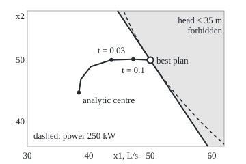
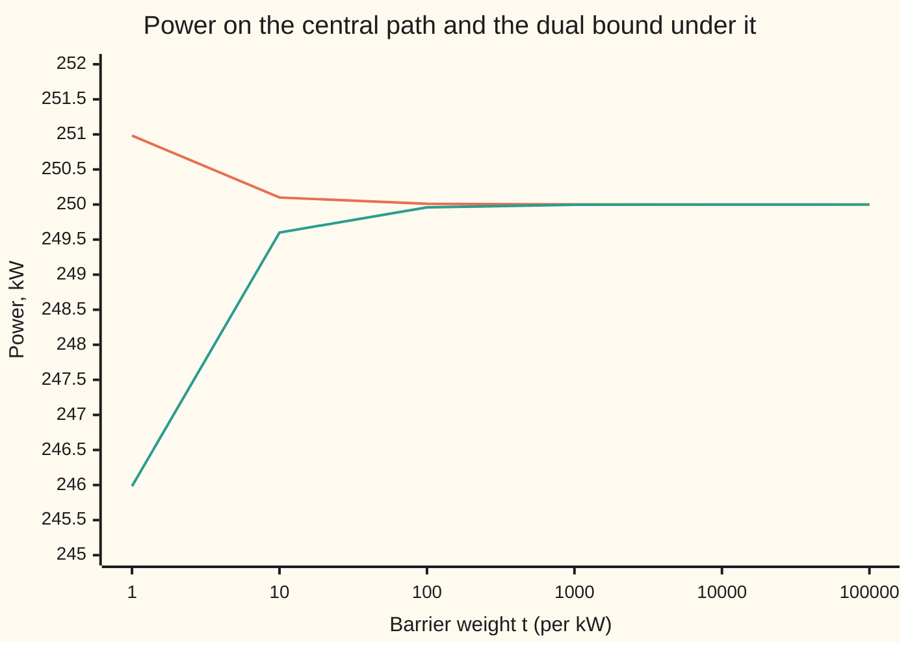

# Interior point methods: a barrier that keeps you strictly inside

[Syllabus](../../../SYLLABUS.md) → [Optimization](../README.md) → [Constrained Optimisation](../README.md#s03) → Interior point methods

---

## General Overview

Three pumps feed a town that needs 150 litres of water a second (L/s). Pump A draws 0.02 kW (kilowatts) times its flow squared, pump B 0.03 kW times its flow squared, and pump C 0.05 kW times its flow squared. The job is to **minimise** the power drawn, within pressure limits. The hill tank at the far end must hold between 35 m and 45 m of **head** (pressure, measured as the height of water it would lift): below 35 m the hill houses run dry, above 45 m old pipes burst. No pump can run backwards. The best plan, proved below, is 50 L/s from each pump, drawing 250 kW, £50 an hour at £0.20 per kWh, with the hill tank sitting exactly on its 35 m floor.

An interior point method finds that plan without ever touching a limit. It puts a fence of cost along every limit: a charge that is tiny far away and grows without bound near the limit. Inside the fence no limits are left, so Newton's method can minimise. Then the method weakens the fence tenfold and minimises again. The plan walks to the floor along a smooth curve, the **central path**, always strictly inside.

Each stop comes with proof of how good it is. At the first stop the pumps draw 250.9827 kW, and prices read off the fence prove no plan can draw less than 245.9827 kW. The gap is exactly 5 kW, one per limit. Each tenfold step shrinks it tenfold; after six stops it is 0.00005 kW.

**Replace each limit by a logarithmic fence that blows up at the limit, minimise the weighted cost plus the fence, and as the weight grows the minimisers trace the central path to the best plan, each point carrying prices that prove it is within m/t of the best, where m counts the limits and t is the weight.**

**What kind of fact this is:** a method, with a theorem inside it. The gap bound m/t is proved on this card in Why it works. The bound on the number of Newton steps is stated with its source, not proved, and the counts on this card are what the code prints.

### The picture: the walk to the floor

<p align="center"></p>

Pump C gives whatever A and B leave of the 150 L/s, so every plan is a point in this plane of A's flow (across) and B's flow (up). The window shows the plane near the answer; the 45 m ceiling and the zero-flow limits lie off its edges. The straight line is the 35 m floor, the forbidden side shaded. The dashed curve is every plan drawing 250 kW; it touches the floor at the best plan. The central path starts at the **analytic centre** (the plan that minimises the fence alone, head 39.5410 m) and ends at the best plan.

---

## The formula

Notation first, in words. The plan is $x = (x_1, x_2, x_3)$, the three flows. The cost $f_0(x)$ is minimised, and its least value over all allowed plans is $p^*$. Each limit is written $f_i(x) \le 0$, and its **slack** $s_i = -f_i(x)$ is how far the plan sits inside it. There are $m$ limits and one rule $h(x) = 0$. This card introduces the **barrier weight** $t$, a positive number that says how much the cost counts against the fence, and the **central path** $x^*(t)$, the best plan for each $t$.

$$x^*(t) = \underset{h(x) = 0}{\arg\min} \; \Big( t\, f_0(x) \;-\; \sum_{i=1}^{m} \log s_i(x) \Big), \qquad \lambda_i(t) = \frac{1}{t\, s_i(x^*(t))}, \qquad f_0(x^*(t)) - p^* \;\le\; \frac{m}{t}.$$

**Read it aloud:** the plan on the central path minimises $t$ times the cost minus the logarithms of all the slacks; one over ($t$ times the slack) is a price for that limit; and with those prices the plan is proved to be within $m/t$ of the best.

The fence $\varphi(x) = -\sum \log s_i(x)$ is the **log barrier**: finite while every slack is positive, infinite as any slack reaches zero. The barrier objective is $\Phi_t(x) = t f_0(x) + \varphi(x)$.

For the pumps, $f_0 = 0.02x_1^2 + 0.03x_2^2 + 0.05x_3^2$ kW and $h(x) = x_1 + x_2 + x_3 - 150$. The head at the hill tank is $0.1x_1 + 0.2x_2 + 0.4x_3$ m, pump C being nearest the hill. The five slacks are head minus 35, 45 minus head, and the three flows.

| Symbol | Plain meaning | In our example | Push it up and the answer… |
| --- | --- | --- | --- |
| $x$, $x^*(t)$ | flows of pumps A, B, C; the plan on the central path | start (40, 50, 60) L/s | — |
| $f_0$, $p^*$ | power drawn, minimised; its least value | 287 kW at the start; 250 kW | — |
| $a_i$, $k_i$ | pump $i$'s power coefficient; head at the hill tank per L/s from it | 0.02, 0.03, 0.05 kW per (L/s)²; 0.1, 0.2, 0.4 m per L/s | that pump gets less flow; that pump gets more |
| $f_i \le 0$, $s_i$ | limit $i$; its slack $s_i = -f_i$ | head ≥ 35 m, ≤ 45 m, flows ≥ 0; slacks 3, 7, 40, 50, 60 at the start | — |
| $m$ | number of limits | 5 | the gap at each $t$ grows |
| $h$, $\nu$ | the demand rule; its multiplier | $x_1 + x_2 + x_3 - 150 = 0$; $\nu = -1$ kW per L/s at the best plan: one more L/s of demand costs 1 kW, and the sign is minus because $h$ is total minus demand | — |
| $t$, $t_0$, $\varepsilon$ | barrier weight; its first value; the gap tolerance | $t_0 = 1$, then 10, …, 100,000; $\varepsilon = 10^{-4}$ kW | the plan nears the best; the gap shrinks as $m/t$ |
| $\varphi$, $\Phi_t$ | log barrier $-\sum \log s_i$; barrier objective $t f_0 + \varphi$ | finite only strictly inside | — |
| $\lambda_i(t)$ | price of limit $i$ on the path, $1/(t s_i)$ | floor: 10.2531 kW per m at $t = 1$ | — |
| $\mathcal{L}$, $q(\lambda, \nu)$ | the Lagrangian $f_0 + \sum \lambda_i f_i + \nu h$; its least value over $x$, a floor under $p^*$ | $q$ = 245.9827 kW at $t = 1$ | — |
| $d$, $\alpha$, $w$ | Newton direction; step length; the rule's Newton multiplier, $t\nu$ | $\alpha$ starts at 1, halves | — |

### When it holds

- **A strictly inside plan exists.** The barrier is defined only where every slack is positive. Set both head limits to 35 m and the two slacks always add to zero, so no plan has both positive and the method cannot start. That is Slater's condition failing ([Slater's condition](05-slaters-condition-and-duality-gaps.md)); a fixed head belongs in the equality rules.
- **The problem is convex.** The gap bound needs the plan on the path to minimise the Lagrangian, which needs a convex cost and convex limits. Without them the path can end at a local minimum, and the bound proves nothing.
- **Every step stays strictly inside.** A full Newton step after raising $t$ from 1 to 10 lands at head 34.3403 m, below the floor. The step length $\alpha$ must be cut until the plan is inside.
- **The centring is done well.** The bound $m/t$ is exact only at $x^*(t)$. The code centres until Newton's predicted drop in $\Phi_t$ is below $10^{-14}t$ (or $10^{-14}$ while $t < 1$); the gap then matches $m/t$ to $10^{-7}$ kW. The tolerance grows with $t$ because $\Phi_t$ does, and so does its rounding error: a fixed tolerance would sink below the rounding error once $t$ is large.
- **Smooth cost and limits.** Newton's method needs second derivatives of $f_0$ and every $f_i$.

---

## Why it works

### Step 0: the fence turns limits into prices

A plan that minimises cost plus fence is in balance: the cost pushes it towards the floor, and the fence pushes back with strength $1/s_i$ from limit $i$. Read each push, divided by $t$, as a price on that limit, and the balance becomes the KKT checklist, except that price times slack equals $1/t$ instead of zero. Because it is a KKT balance, the prices give a dual bound, which misses by $1/t$ per limit.

### Step 1: inside the fence there are no limits

$\Phi_t$ has only the rule $h(x) = 0$ left. It is smooth and convex wherever every slack is positive, since $-\log$ of a positive linear function curves upwards. So Newton's method with a line search finds its minimiser ([Newton and BFGS](../02-Unconstrained%20Methods/05-newton-and-quasi-newton-bfgs.md)). A step that would cross a limit makes $\Phi_t$ undefined, and the line search refuses it.

The Newton step solves one linear system, the same shape as the [KKT conditions](02-kkt-conditions.md) for a problem with one rule:

$$\begin{bmatrix} \nabla^2 \Phi_t(x) & \nabla h \\ \nabla h^{\mathsf T} & 0 \end{bmatrix} \begin{bmatrix} d \\ w \end{bmatrix} = \begin{bmatrix} -\nabla \Phi_t(x) \\ 0 \end{bmatrix}.$$

The second row keeps the total flow at 150 L/s. For the pumps it is a 4 by 4 system, solved by elimination.

### Step 2: the centring condition is the KKT checklist with $1/t$ in place of zero

At $x^*(t)$ the gradient of $\Phi_t$ balances the rule:

$$t \nabla f_0 + \sum_i \frac{1}{s_i} \nabla f_i + w \nabla h = 0.$$

The gradient of $-\log s_i = -\log(-f_i)$ is $\nabla f_i / s_i$. Divide by $t$ and name $\lambda_i = 1/(t s_i)$ and $\nu = w/t$:

$$\nabla f_0 + \sum_i \lambda_i \nabla f_i + \nu \nabla h = 0, \qquad \lambda_i > 0, \qquad \lambda_i s_i = \frac{1}{t}.$$

Against the KKT checklist: stationarity holds; every limit holds, strictly; every price is positive. Only complementary slackness, $\lambda_i s_i = 0$, is relaxed to $1/t$. So the central path is KKT relaxed by $1/t$, and the relaxation vanishes as $t$ grows.

For the pumps at $t = 1$, the head is 35.0975 m, so the floor's slack is 0.097532 m and its price is $1/0.097532 = 10.2531$ kW per m. Every one of the five products $\lambda_i s_i$ comes out at 1.

### Step 3: the prices prove the gap is $m/t$

The [Lagrangian duality](04-lagrangian-duality-weak-and-strong.md) card gives the dual function $q(\lambda, \nu)$, the least value of the Lagrangian $\mathcal{L}(x, \lambda, \nu) = f_0 + \sum \lambda_i f_i + \nu h$ over all $x$, and weak duality: $q(\lambda, \nu) \le p^*$ whenever every $\lambda_i \ge 0$. The reason is one line: at any allowed plan $\tilde x$, $q \le \mathcal{L}(\tilde x, \lambda, \nu) = f_0(\tilde x) + \sum \lambda_i f_i(\tilde x) \le f_0(\tilde x)$, because each $\lambda_i \ge 0$ and each $f_i(\tilde x) \le 0$.

With the path's prices, $\mathcal{L}$ is a sum of convex functions, so convex in $x$, and Step 2 makes its gradient zero at $x^*(t)$. A convex function with zero gradient is at its global minimum, so

$$q(\lambda(t), \nu(t)) = f_0(x^*(t)) + \sum_i \lambda_i f_i + \nu \cdot 0 = f_0(x^*(t)) - \sum_i \lambda_i s_i = f_0(x^*(t)) - \frac{m}{t}.$$

So $f_0(x^*(t)) - m/t \le p^* \le f_0(x^*(t))$: the plan is within $m/t$ of the best, with its proof attached.

### Step 4: raise $t$ tenfold, re-centre from where you are

The **barrier method** runs the path in rounds. Start strictly inside at $t = 1$. Centre: run Newton on $\Phi_t$ until its predicted drop is negligible. Stop if $m/t$ is below the tolerance $\varepsilon$. Otherwise multiply $t$ by 10 and centre again, starting from the last centre. The gap is $m/t$ after each round, so the number of rounds is fixed in advance:

$$\text{rounds} = 1 + \Big\lceil \frac{\log\big(m / (t_0\, \varepsilon)\big)}{\log 10} \Big\rceil.$$

For $m = 5$, $t_0 = 1$ and $\varepsilon = 10^{-4}$ kW, the formula gives 6 rounds, which is what the code runs.

Each centring is cheap because it starts near the new centre. The Newton step count is stated here, not proved. The log barrier of linear limits plus a convex quadratic cost is **self-concordant** (its third derivative is bounded by a power of its second), and for such functions Nesterov and Nemirovskii proved a bound on Newton steps per round that depends on $m$ and the growth factor, not on $t$ or the data. With a growth factor of $1 + 1/\sqrt{m}$ per round, the total is of order $\sqrt{m} \log(m/(t_0 \varepsilon))$ Newton steps (Boyd and Vandenberghe, §11.5). The pumps take 7 steps in each of the first two rounds and 6 in each of the other four, 38 in all.

### Step 5: the path ends at the KKT point

As $t$ grows, every product $\lambda_i s_i = 1/t$ shrinks. The floor's slack goes to zero and its price settles at 10 kW per m; the other four slacks stay large, so their prices go to zero. The limit is the KKT point: $(50, 50, 50)$ L/s, floor price 10 kW per m, $\nu = -1$. The method never had to guess which limits bind.

---

## Worked numbers, by hand

Check the certificate at the first stop, $t = 1$, from the plan the code prints: $x^*(1) = (49.6591, 50.0237, 50.3172)$ L/s.

| Step | Arithmetic | Value |
| --- | --- | --- |
| head at $x^*(1)$ | $0.1 \times 49.6591 + 0.2 \times 50.0237 + 0.4 \times 50.3172$ | 35.0975 m |
| five slacks | head − 35; 45 − head; the three flows | 0.097532, 9.902468, 49.659081, 50.023719, 50.317200 |
| five prices, $\lambda_i = 1/(1 \times s_i)$ | $1/0.097532$, $1/9.902468$, … | 10.2531, 0.1010, 0.0201, 0.0200, 0.0199 |
| each price times its slack | $10.2531 \times 0.097532$, … | 1 each, $= 1/t$ |
| $\nu$ from pump A's balance | $1.986363 - 1.025305 + 0.010098 - 0.020137 + \nu = 0$ | $\nu = -0.951019$ |
| power drawn | $0.02 \times 49.6591^2 + 0.03 \times 50.0237^2 + 0.05 \times 50.3172^2$ | 250.9827 kW |
| dual bound | $250.9827 - 5 \times 1$ | 245.9827 kW |
| **gap** | $m/t = 5/1$ | **5 kW** |

Pump A's row is $2a_1x_1 - k_1\lambda_1 + k_1\lambda_2 - \lambda_3 + \nu = 0$: marginal power, minus the floor's price for the head it adds, plus the ceiling's, minus its own zero-flow price. The code also minimises the Lagrangian with these prices in closed form, never using $m/t$, and gets the same 245.9827 kW. So the first stop, after 7 Newton steps, proves the best plan draws between 245.9827 and 250.9827 kW. The true 250 kW is 0.9827 kW below the stop.

### What breaks if you drop a piece

| Mistake | Comes out at | What went wrong |
| --- | --- | --- |
| Start outside: (70, 50, 30) L/s | head 29 m, floor slack −6; barrier undefined | The log of a negative slack does not exist. The method needs a strictly inside start, here (40, 50, 60) with head 38 m. |
| No strictly inside plan: head window 35 m to 35 m | the two head slacks add to 0 for every plan; at the best plan both are 0 | Slater's condition fails: there is no interior to walk through. Write the fixed head as an equality rule instead. |
| Take the full Newton step after raising $t$ from 1 to 10 | flows 52.3088, 49.8355, 47.8557; head 34.3403 m; barrier undefined | The step crosses the floor. The line search must halve $\alpha$ until the plan is strictly inside. |
| Read prices as $1/s_i$, forgetting the $1/t$, at $t = 10$ | floor price 100.2548; "bound" −20012.9858 kW | Ten times too big. The bound is still true, but useless: the prices are no longer the balance of Step 2. |

---

## How the plan moves as t grows

The puzzle: each round weakens the fence tenfold, yet Newton's method needs about the same work every time. The table follows one run from the start (40, 50, 60) L/s, drawing 287 kW.

| $t$ | flows, L/s | head, m | power, kW | dual bound, kW | gap $m/t$, kW | Newton steps |
| ---: | --- | ---: | ---: | ---: | ---: | ---: |
| 1 | 49.6591, 50.0237, 50.3172 | 35.0975 | 250.9827 | 245.9827 | 5.00000 | 7 |
| 10 | 49.9651, 50.0025, 50.0324 | 35.0100 | 250.0998 | 249.5998 | 0.50000 | 7 |
| 100 | 49.9965, 50.0002, 50.0032 | 35.0010 | 250.0100 | 249.9600 | 0.05000 | 6 |
| 1,000 | 49.9997, 50.0000, 50.0003 | 35.0001 | 250.0010 | 249.9960 | 0.00500 | 6 |
| 10,000 | 50.0000, 50.0000, 50.0000 | 35.0000 | 250.0001 | 249.9996 | 0.00050 | 6 |
| 100,000 | 50.0000, 50.0000, 50.0000 | 35.0000 | 250.0000 | 250.0000 | 0.00005 | 6 |

The head's distance from the floor shrinks tenfold each round: 0.0975, 0.0100, 0.0010 m. The true error, power minus 250 kW, runs 0.982692, 0.099823, 0.009998, 0.001000, 0.000100 kW, and the ratios of successive errors are 9.8443, 9.9841, 9.9984 and 9.9998: the error falls by the growth factor each round, as the gap does.

Newton steps per round, the work that buys each tenfold cut:

```
round 1, t = 1        ███████  7
round 2, t = 10       ███████  7
round 3, t = 100      ██████   6
round 4, t = 1,000    ██████   6
round 5, t = 10,000   ██████   6
round 6, t = 100,000  ██████   6
```

The work stays flat as the plan presses against the floor, as the self-concordance bound promises.



The upper line is the power drawn at each stop on the central path. The lower line is the dual bound proved at that stop. The best plan's 250 kW is trapped between them, and the gap closes as $5/t$.

---

## Code, from first principles, and it actually runs

The code solves the pump problem by the barrier method: Newton's method on $\Phi_t$, each step a 4 by 4 linear system solved by elimination, a halving line search that refuses any plan outside the limits, and $t$ raised tenfold until $m/t \le 10^{-4}$ kW. It reaches the answer by three independent roads. Road 1 is the central path itself. Road 2 computes the dual bound at every stop by minimising the Lagrangian in closed form, never using $m/t$, and asserts that the gap is $m/t$ and that $p^*$ lies between the bound and the power. Road 3 never uses a barrier: it tries all 32 ways of choosing which limits bind, solves the KKT equations for each, and keeps those with allowed flows and non-negative prices. Exactly one survives, the head floor alone, giving (50, 50, 50) L/s, and the barrier's last plan agrees with it to $10^{-4}$ L/s. Before the path starts, the script also checks the first Newton step's slope and curvature against central differences of $\Phi_t$, so a wrong gradient or Hessian stops it.

### Python

```python
# Interior point methods -- the check behind the card.  Standard library only.
# Three pumps feed a town.  MINIMISE the power f0(x) = sum a_i x_i^2 (kW) over the flows x (L/s),
# subject to total flow h(x) = x1 + x2 + x3 - 150 = 0, head at the hill tank between 35 and 45 m,
# and every flow at least 0.  The five limits are written f_i(x) <= 0; slack_i = -f_i(x).
# Road 1: the barrier method, Newton centring for t = 1, 10, 100, ... (the central path).
# Road 2: the dual bound q(lambda, nu), from the Lagrangian minimised in closed form.
# Road 3: the KKT conditions solved for every one of the 32 choices of binding limits.
from math import log, ceil, log10
A, K, D, LO, HI = [0.02, 0.03, 0.05], [0.1, 0.2, 0.4], 150, 35, 45   # kW/(L/s)^2, m per L/s, L/s, m, m
GS = [K, [-k for k in K], [1, 0, 0], [0, 1, 0], [0, 0, 1]]          # gradient of each slack
M, START, GROW = 5, [40, 50, 60], 10                                  # limits; strictly inside start; t factor
def tot(vals):                          # plain left-to-right sum, as Rust does it
    s = 0.0
    for v in vals:
        s += v
    return s
f0 = lambda x: tot(a * v * v for a, v in zip(A, x))
head = lambda x: tot(k * v for k, v in zip(K, x))
slacks = lambda x, lo=LO, hi=HI: [head(x) - lo, hi - head(x)] + list(x)
f4 = lambda v: ", ".join(f"{u:.4f}".replace("-0.0000", "0.0000") for u in v)

def gauss(Mx, r):                        # solve Mx z = r by elimination with row swaps
    n = len(r)
    Mx = [list(row) + [v] for row, v in zip(Mx, r)]
    for c in range(n):
        p = max(range(c, n), key=lambda i: abs(Mx[i][c]))
        if abs(Mx[p][c]) < 1e-12:
            return None
        Mx[c], Mx[p] = Mx[p], Mx[c]
        for i in range(n):
            if i != c:
                m = Mx[i][c] / Mx[c][c]
                Mx[i] = [u - m * v for u, v in zip(Mx[i], Mx[c])]
    return [Mx[i][n] / Mx[i][i] for i in range(n)]

def phi(x, t):                           # t f0 - sum log(slack); None outside the interior
    s = slacks(x)
    return None if min(s) <= 0 else t * f0(x) - tot(log(v) for v in s)

def newton(x, t):                        # the centring step: a KKT-shaped 4 x 4 linear system
    s = slacks(x)
    g = [t * 2 * A[i] * x[i] - tot(GS[j][i] / s[j] for j in range(M)) for i in range(3)]
    H = [[(t * 2 * A[i] if i == l else 0) + tot(GS[j][i] * GS[j][l] / s[j] ** 2 for j in range(M))
          for l in range(3)] + [1] for i in range(3)]
    z = gauss(H + [[1, 1, 1, 0]], [-v for v in g] + [0])
    return z[:3], z[3], -tot(a * b for a, b in zip(g, z[:3]))   # direction d, w = t nu, decrement squared

def centre(x, t):                        # Newton until the predicted drop dec2 / 2 <= 1e-14 max(t, 1)
    for steps in range(100):
        d, w, dec2 = newton(x, t)
        if dec2 / 2 <= 1e-14 * max(t, 1):   # phi's rounding error grows with t
            return x, w / t, steps
        al, p0 = 1.0, phi(x, t)
        while True:
            y = [x[i] + al * d[i] for i in range(3)]
            py = phi(y, t)
            if py is not None and py <= p0 - 0.25 * al * dec2:
                break
            al /= 2
        x = y

def dual(lam, nu):                       # q(lam, nu) = min over x of the Lagrangian, in closed form
    c = [-lam[0] * K[i] + lam[1] * K[i] - lam[2 + i] + nu for i in range(3)]
    return LO * lam[0] - HI * lam[1] - D * nu - tot(c[i] ** 2 / (4 * A[i]) for i in range(3))

print(f"start {f4(START)} L/s: head {head(START):.4f} m, power {f0(START):.4f} kW, slacks {f4(slacks(START))}")
# ---- road 3: KKT by enumeration of binding sets ----
kkt = []
for mask in range(32):
    act = [j for j in range(M) if mask >> j & 1]
    rows = [[2 * A[i] if c == i else 0 for c in range(3)] + [-GS[j][i] for j in act] + [1] for i in range(3)]
    rows += [GS[j][:3] + [0] * (len(act) + 1) for j in act] + [[1, 1, 1] + [0] * (len(act) + 1)]
    rhs = [0, 0, 0] + [[LO, -HI, 0, 0, 0][j] for j in act] + [D]
    z = gauss(rows, rhs)
    if z and min(slacks(z[:3])) > -1e-9 and all(v > -1e-9 for v in z[3:3 + len(act)]):
        kkt.append((act, z))
print(f"road 3, KKT by enumeration: {len(kkt)} of 32 binding sets pass")
act, z = kkt[0]
xs, lam_star, nu_star = z[:3], z[3], z[4]
pstar = f0(xs)
print(f"  binding: limit {act[0] + 1} (head floor); flows {f4(xs)} L/s, lambda {lam_star:.4f} kW per m, nu {nu_star:.4f}")
print(f"  p* = {pstar:.4f} kW, {0.2 * pstar:.4f} pounds per hour at 0.20 pounds per kWh")
assert len(kkt) == 1 and act == [0] and max(abs(v - 50) for v in xs) < 1e-9
d0, _, dr0 = newton(START, 1.0)       # the Newton step's slope and curvature against central differences of phi
pd = lambda e: phi([START[i] + e * d0[i] for i in range(3)], 1.0)
assert abs((pd(1e-3) - pd(-1e-3)) / 2e-3 + dr0) < 1e-5 * dr0 and abs((pd(1e-3) - 2 * pd(0) + pd(-1e-3)) / 1e-6 - dr0) < 1e-5 * dr0
# ---- road 1 and road 2: the central path, with a certificate at every point ----
x, t, eps, total, path = START, 1.0, 1e-4, 0, []
while True:
    x, nu, n = centre(x, t)
    lam = [1 / (t * s) for s in slacks(x)]
    q = dual(lam, nu)
    total += n
    path.append((t, x, nu, lam, q, n))
    print(f"t {t:9.0f}: flows {f4(x)}, head {head(x):.4f} m, power {f0(x):.4f}, bound {q:.4f}, gap {f0(x) - q:.5f} kW, {n} steps")
    assert abs((f0(x) - q) - M / t) < 1e-7 and q <= pstar + 1e-9 <= f0(x) + 2e-9
    if M / t <= eps:
        break
    t *= GROW
rounds = 1 + ceil(log10(M / eps) / log10(GROW))                     # t0 = 1
print(f"rounds {len(path)} (formula 1 + ceil(log(m / (t0 eps)) / log(factor)) = {rounds}), Newton steps {total}")
print("Newton steps per round:", " ".join(str(p[5]) for p in path))
print("power minus p*, kW:", " ".join(f"{f0(p[1]) - pstar:.6f}" for p in path[:5]))
print("ratio of successive errors:", " ".join(f"{(f0(a[1]) - pstar) / (f0(b[1]) - pstar):.4f}" for a, b in zip(path[:4], path[1:5])))
assert len(path) == rounds and max(abs(u - v) for u, v in zip(x, xs)) < 1e-4 and abs(nu - nu_star) < 1e-4
t1, x1, nu1, lam1, q1, _ = path[0]
print(f"at t = 1: slacks {', '.join(f'{v:.6f}' for v in slacks(x1))}")
print(f"at t = 1: lambda {f4(lam1)}; lambda_i * slack_i = {f4([l * s for l, s in zip(lam1, slacks(x1))])}")
print(f"at t = 1: pump A row {2 * A[0] * x1[0]:.6f} - {K[0] * lam1[0]:.6f} + {K[0] * lam1[1]:.6f} - {lam1[2]:.6f} + nu = 0, nu = {nu1:.6f}")
print(f"at t = {t:.0f}: lambda {f4(path[-1][3])}")
assert abs(path[-1][3][0] - lam_star) < 1e-3
# ---- the picture: the central path in the (x1, x2) plane, x3 = 150 - x1 - x2 ----
xa = centre(START, 1e-9)[0]
pts = [xa] + [centre(START, tt)[0] for tt in (0.003, 0.01, 0.03, 0.1, 0.3, 1)]
print("figure, path (x1, x2):", " ".join(f"({p[0]:.2f}, {p[1]:.2f})" for p in pts))
print(f"figure, analytic centre head {head(xa):.4f} m; head-floor line through (44.67, 58) and (59.33, 36); optimum (50, 50)")
# ---- what breaks ----
bad = [70, 50, 30]
print(f"start outside {f4(bad)}: head {head(bad):.4f} m, slack {slacks(bad)[0]:.4f}, barrier {"undefined" if phi(bad, 1) is None else "defined"}")
print(f"window 35 to 35 m: slacks at the best plan {f4(slacks(xs, 35, 35)[:2])}; their sum is 0 for every plan")
d, _, _ = newton(x1, 10.0)
y = [x1[i] + d[i] for i in range(3)]
print(f"full Newton step from x*(1) at t = 10: flows {f4(y)}, head {head(y):.4f} m, barrier {"undefined" if phi(y, 10) is None else "defined"}")
assert head(y) < LO and phi(bad, 1) is None
lam_bad = [1 / s for s in slacks(path[1][1])]
print(f"multipliers without the 1/t at t = 10: head floor {lam_bad[0]:.4f}, bound {dual(lam_bad, path[1][2] * 10):.4f} kW")
print(f"stop at t = 1 and call it best: {f0(x1):.4f} kW, {f0(x1) - pstar:.4f} kW too much")
print("ALL CHECKS PASS")
```

**Ran 2026-11-11 on macOS, Python 3.14.10, standard library only. All checks passed. Output, pasted from the run:**

```
start 40.0000, 50.0000, 60.0000 L/s: head 38.0000 m, power 287.0000 kW, slacks 3.0000, 7.0000, 40.0000, 50.0000, 60.0000
road 3, KKT by enumeration: 1 of 32 binding sets pass
  binding: limit 1 (head floor); flows 50.0000, 50.0000, 50.0000 L/s, lambda 10.0000 kW per m, nu -1.0000
  p* = 250.0000 kW, 50.0000 pounds per hour at 0.20 pounds per kWh
t         1: flows 49.6591, 50.0237, 50.3172, head 35.0975 m, power 250.9827, bound 245.9827, gap 5.00000 kW, 7 steps
t        10: flows 49.9651, 50.0025, 50.0324, head 35.0100 m, power 250.0998, bound 249.5998, gap 0.50000 kW, 7 steps
t       100: flows 49.9965, 50.0002, 50.0032, head 35.0010 m, power 250.0100, bound 249.9600, gap 0.05000 kW, 6 steps
t      1000: flows 49.9997, 50.0000, 50.0003, head 35.0001 m, power 250.0010, bound 249.9960, gap 0.00500 kW, 6 steps
t     10000: flows 50.0000, 50.0000, 50.0000, head 35.0000 m, power 250.0001, bound 249.9996, gap 0.00050 kW, 6 steps
t    100000: flows 50.0000, 50.0000, 50.0000, head 35.0000 m, power 250.0000, bound 250.0000, gap 0.00005 kW, 6 steps
rounds 6 (formula 1 + ceil(log(m / (t0 eps)) / log(factor)) = 6), Newton steps 38
Newton steps per round: 7 7 6 6 6 6
power minus p*, kW: 0.982692 0.099823 0.009998 0.001000 0.000100
ratio of successive errors: 9.8443 9.9841 9.9984 9.9998
at t = 1: slacks 0.097532, 9.902468, 49.659081, 50.023719, 50.317200
at t = 1: lambda 10.2531, 0.1010, 0.0201, 0.0200, 0.0199; lambda_i * slack_i = 1.0000, 1.0000, 1.0000, 1.0000, 1.0000
at t = 1: pump A row 1.986363 - 1.025305 + 0.010098 - 0.020137 + nu = 0, nu = -0.951019
at t = 100000: lambda 10.0000, 0.0000, 0.0000, 0.0000, 0.0000
figure, path (x1, x2): (38.38, 44.73) (38.71, 46.92) (40.32, 48.97) (43.68, 50.03) (47.22, 50.14) (48.93, 50.07) (49.66, 50.02)
figure, analytic centre head 39.5410 m; head-floor line through (44.67, 58) and (59.33, 36); optimum (50, 50)
start outside 70.0000, 50.0000, 30.0000: head 29.0000 m, slack -6.0000, barrier undefined
window 35 to 35 m: slacks at the best plan 0.0000, 0.0000; their sum is 0 for every plan
full Newton step from x*(1) at t = 10: flows 52.3088, 49.8355, 47.8557, head 34.3403 m, barrier undefined
multipliers without the 1/t at t = 10: head floor 100.2548, bound -20012.9858 kW
stop at t = 1 and call it best: 250.9827 kW, 0.9827 kW too much
ALL CHECKS PASS
```

### Rust

Same numbers, same labels, built with `rustc --edition 2021 -O`.

```rust
// Interior point methods -- the check behind the card.  Standard library only, no crates.
// Three pumps feed a town.  MINIMISE the power f0(x) = sum a_i x_i^2 (kW) over the flows x (L/s),
// subject to total flow h(x) = x1 + x2 + x3 - 150 = 0, head at the hill tank between 35 and 45 m,
// and every flow at least 0.  The five limits are written f_i(x) <= 0; slack_i = -f_i(x).
// Road 1: the barrier method, Newton centring for t = 1, 10, 100, ... (the central path).
// Road 2: the dual bound q(lambda, nu), from the Lagrangian minimised in closed form.
// Road 3: the KKT conditions solved for every one of the 32 choices of binding limits.
const A: [f64; 3] = [0.02, 0.03, 0.05]; // kW per (L/s)^2
const K: [f64; 3] = [0.1, 0.2, 0.4]; // m of head per L/s
const D: f64 = 150.0; // L/s
const LO: f64 = 35.0; // m
const HI: f64 = 45.0; // m
const M: usize = 5; // number of limits
const START: [f64; 3] = [40.0, 50.0, 60.0]; // strictly inside
const GROW: f64 = 10.0; // t factor

fn gs(j: usize, i: usize) -> f64 { // gradient of slack j, entry i
    match j { 0 => K[i], 1 => -K[i], _ => if j - 2 == i { 1.0 } else { 0.0 } }
}
fn f0(x: &[f64]) -> f64 { (0..3).fold(0.0, |s, i| s + A[i] * x[i] * x[i]) }
fn head(x: &[f64]) -> f64 { (0..3).fold(0.0, |s, i| s + K[i] * x[i]) }
fn slacks_w(x: &[f64], lo: f64, hi: f64) -> Vec<f64> { vec![head(x) - lo, hi - head(x), x[0], x[1], x[2]] }
fn slacks(x: &[f64]) -> Vec<f64> { slacks_w(x, LO, HI) }
fn z4(u: f64) -> String { let s = format!("{:.4}", u); if s == "-0.0000" { "0.0000".into() } else { s } }
fn f4(v: &[f64]) -> String { v.iter().map(|&u| z4(u)).collect::<Vec<_>>().join(", ") }

fn gauss(mx: &[Vec<f64>], r: &[f64]) -> Option<Vec<f64>> { // elimination with row swaps
    let n = r.len();
    let mut m: Vec<Vec<f64>> = mx.iter().zip(r).map(|(row, &v)| { let mut w = row.clone(); w.push(v); w }).collect();
    for c in 0..n {
        let mut p = c;
        for i in c + 1..n { if m[i][c].abs() > m[p][c].abs() { p = i; } }
        if m[p][c].abs() < 1e-12 { return None; }
        m.swap(c, p);
        for i in 0..n {
            if i != c {
                let f = m[i][c] / m[c][c];
                let pivot = m[c].clone();
                for (u, v) in m[i].iter_mut().zip(pivot.iter()) { *u = *u - f * v; }
            }
        }
    }
    Some((0..n).map(|i| m[i][n] / m[i][i]).collect())
}

fn phi(x: &[f64], t: f64) -> Option<f64> { // t f0 - sum log(slack); None outside the interior
    let s = slacks(x);
    if s.iter().cloned().fold(f64::INFINITY, f64::min) <= 0.0 { return None; }
    Some(t * f0(x) - s.iter().fold(0.0, |a, v| a + v.ln()))
}

fn newton(x: &[f64], t: f64) -> (Vec<f64>, f64, f64) { // the centring step: a KKT-shaped 4 x 4 system
    let s = slacks(x);
    let g: Vec<f64> = (0..3).map(|i| t * 2.0 * A[i] * x[i] - (0..M).fold(0.0, |a, j| a + gs(j, i) / s[j])).collect();
    let mut h: Vec<Vec<f64>> = (0..3).map(|i| {
        let mut row: Vec<f64> = (0..3).map(|l| (if i == l { t * 2.0 * A[i] } else { 0.0 })
            + (0..M).fold(0.0, |a, j| a + gs(j, i) * gs(j, l) / s[j].powi(2))).collect();
        row.push(1.0); row }).collect();
    h.push(vec![1.0, 1.0, 1.0, 0.0]);
    let mut rhs: Vec<f64> = g.iter().map(|v| -v).collect();
    rhs.push(0.0);
    let z = gauss(&h, &rhs).unwrap();
    let dec2 = -(0..3).fold(0.0, |a, i| a + g[i] * z[i]);
    (z[..3].to_vec(), z[3], dec2) // direction d, w = t nu, decrement squared
}

fn centre(mut x: Vec<f64>, t: f64) -> (Vec<f64>, f64, usize) { // until the predicted drop dec2 / 2 <= 1e-14 max(t, 1)
    for steps in 0..100 {
        let (d, w, dec2) = newton(&x, t);
        if dec2 / 2.0 <= 1e-14 * t.max(1.0) { return (x, w / t, steps); } // phi's rounding error grows with t
        let (mut al, p0) = (1.0, phi(&x, t).unwrap());
        loop {
            let y: Vec<f64> = (0..3).map(|i| x[i] + al * d[i]).collect();
            if let Some(py) = phi(&y, t) { if py <= p0 - 0.25 * al * dec2 { x = y; break; } }
            al /= 2.0;
        }
    }
    panic!("no convergence");
}

fn dual(lam: &[f64], nu: f64) -> f64 { // q(lam, nu) = min over x of the Lagrangian, in closed form
    let c: Vec<f64> = (0..3).map(|i| -lam[0] * K[i] + lam[1] * K[i] - lam[2 + i] + nu).collect();
    LO * lam[0] - HI * lam[1] - D * nu - (0..3).fold(0.0, |a, i| a + c[i].powi(2) / (4.0 * A[i]))
}
fn und(p: Option<f64>) -> &'static str { if p.is_none() { "undefined" } else { "defined" } }

fn main() {
    println!("start {} L/s: head {:.4} m, power {:.4} kW, slacks {}", f4(&START), head(&START), f0(&START), f4(&slacks(&START)));
    // ---- road 3: KKT by enumeration of binding sets ----
    let mut kkt: Vec<(Vec<usize>, Vec<f64>)> = vec![];
    for mask in 0..32 {
        let act: Vec<usize> = (0..M).filter(|j| mask >> j & 1 == 1).collect();
        let na = act.len();
        let mut rows: Vec<Vec<f64>> = (0..3).map(|i| {
            let mut r: Vec<f64> = (0..3).map(|c| if c == i { 2.0 * A[i] } else { 0.0 }).collect();
            r.extend(act.iter().map(|&j| -gs(j, i))); r.push(1.0); r }).collect();
        for &j in &act { let mut r: Vec<f64> = (0..3).map(|i| gs(j, i)).collect(); r.extend(vec![0.0; na + 1]); rows.push(r); }
        let mut r = vec![1.0, 1.0, 1.0]; r.extend(vec![0.0; na + 1]); rows.push(r);
        let mut rhs = vec![0.0; 3];
        rhs.extend(act.iter().map(|&j| [LO, -HI, 0.0, 0.0, 0.0][j])); rhs.push(D);
        if let Some(z) = gauss(&rows, &rhs) {
            let ok = slacks(&z[..3]).iter().cloned().fold(f64::INFINITY, f64::min) > -1e-9 && z[3..3 + na].iter().all(|&v| v > -1e-9);
            if ok { kkt.push((act, z)); }
        }
    }
    println!("road 3, KKT by enumeration: {} of 32 binding sets pass", kkt.len());
    let (act, z) = kkt[0].clone();
    let (xs, lam_star, nu_star) = (z[..3].to_vec(), z[3], z[4]);
    let pstar = f0(&xs);
    println!("  binding: limit {} (head floor); flows {} L/s, lambda {:.4} kW per m, nu {:.4}", act[0] + 1, f4(&xs), lam_star, nu_star);
    println!("  p* = {:.4} kW, {:.4} pounds per hour at 0.20 pounds per kWh", pstar, 0.2 * pstar);
    assert!(kkt.len() == 1 && act == vec![0] && xs.iter().all(|v| (v - 50.0).abs() < 1e-9));
    let (d0, _, dr0) = newton(&START, 1.0); // the Newton step's slope and curvature against central differences of phi
    let pd = |e: f64| phi(&(0..3).map(|i| START[i] + e * d0[i]).collect::<Vec<f64>>(), 1.0).unwrap();
    assert!(((pd(1e-3) - pd(-1e-3)) / 2e-3 + dr0).abs() < 1e-5 * dr0);
    assert!(((pd(1e-3) - 2.0 * pd(0.0) + pd(-1e-3)) / 1e-6 - dr0).abs() < 1e-5 * dr0);
    // ---- road 1 and road 2: the central path, with a certificate at every point ----
    let (mut x, mut t, eps, mut total) = (START.to_vec(), 1.0_f64, 1e-4, 0);
    let mut path: Vec<(f64, Vec<f64>, f64, Vec<f64>, f64, usize)> = vec![];
    let mut nu;
    loop {
        let (xn, nn, n) = centre(x, t);
        x = xn; nu = nn;
        let lam: Vec<f64> = slacks(&x).iter().map(|s| 1.0 / (t * s)).collect();
        let q = dual(&lam, nu);
        total += n;
        println!("t {:9.0}: flows {}, head {:.4} m, power {:.4}, bound {:.4}, gap {:.5} kW, {} steps", t, f4(&x), head(&x), f0(&x), q, f0(&x) - q, n);
        assert!(((f0(&x) - q) - M as f64 / t).abs() < 1e-7 && q <= pstar + 1e-9 && pstar + 1e-9 <= f0(&x) + 2e-9);
        path.push((t, x.clone(), nu, lam, q, n));
        if M as f64 / t <= eps { break; }
        t *= GROW;
    }
    let rounds = 1 + ((M as f64 / eps).log10() / GROW.log10()).ceil() as usize; // t0 = 1
    println!("rounds {} (formula 1 + ceil(log(m / (t0 eps)) / log(factor)) = {}), Newton steps {}", path.len(), rounds, total);
    println!("Newton steps per round: {}", path.iter().map(|p| p.5.to_string()).collect::<Vec<_>>().join(" "));
    println!("power minus p*, kW: {}", path[..5].iter().map(|p| format!("{:.6}", f0(&p.1) - pstar)).collect::<Vec<_>>().join(" "));
    println!("ratio of successive errors: {}", (0..4).map(|i| format!("{:.4}", (f0(&path[i].1) - pstar) / (f0(&path[i + 1].1) - pstar))).collect::<Vec<_>>().join(" "));
    assert!(path.len() == rounds && (0..3).all(|i| (x[i] - xs[i]).abs() < 1e-4) && (nu - nu_star).abs() < 1e-4);
    let (x1, nu1, lam1) = (path[0].1.clone(), path[0].2, path[0].3.clone());
    println!("at t = 1: slacks {}", slacks(&x1).iter().map(|v| format!("{:.6}", v)).collect::<Vec<_>>().join(", "));
    let prod: Vec<f64> = lam1.iter().zip(slacks(&x1)).map(|(l, s)| l * s).collect();
    println!("at t = 1: lambda {}; lambda_i * slack_i = {}", f4(&lam1), f4(&prod));
    println!("at t = 1: pump A row {:.6} - {:.6} + {:.6} - {:.6} + nu = 0, nu = {:.6}", 2.0 * A[0] * x1[0], K[0] * lam1[0], K[0] * lam1[1], lam1[2], nu1);
    println!("at t = {:.0}: lambda {}", t, f4(&path[path.len() - 1].3));
    assert!((path[path.len() - 1].3[0] - lam_star).abs() < 1e-3);
    // ---- the picture: the central path in the (x1, x2) plane, x3 = 150 - x1 - x2 ----
    let xa = centre(START.to_vec(), 1e-9).0;
    let mut pts = vec![xa.clone()];
    for tt in [0.003, 0.01, 0.03, 0.1, 0.3, 1.0] { pts.push(centre(START.to_vec(), tt).0); }
    println!("figure, path (x1, x2): {}", pts.iter().map(|p| format!("({:.2}, {:.2})", p[0], p[1])).collect::<Vec<_>>().join(" "));
    println!("figure, analytic centre head {:.4} m; head-floor line through (44.67, 58) and (59.33, 36); optimum (50, 50)", head(&xa));
    // ---- what breaks ----
    let bad = [70.0, 50.0, 30.0];
    println!("start outside {}: head {:.4} m, slack {:.4}, barrier {}", f4(&bad), head(&bad), slacks(&bad)[0], und(phi(&bad, 1.0)));
    println!("window 35 to 35 m: slacks at the best plan {}; their sum is 0 for every plan", f4(&slacks_w(&xs, 35.0, 35.0)[..2]));
    let (d, _, _) = newton(&x1, 10.0);
    let y: Vec<f64> = (0..3).map(|i| x1[i] + d[i]).collect();
    println!("full Newton step from x*(1) at t = 10: flows {}, head {:.4} m, barrier {}", f4(&y), head(&y), und(phi(&y, 10.0)));
    assert!(head(&y) < LO && phi(&bad, 1.0).is_none());
    let lam_bad: Vec<f64> = slacks(&path[1].1).iter().map(|s| 1.0 / s).collect();
    println!("multipliers without the 1/t at t = 10: head floor {:.4}, bound {:.4} kW", lam_bad[0], dual(&lam_bad, path[1].2 * 10.0));
    println!("stop at t = 1 and call it best: {:.4} kW, {:.4} kW too much", f0(&x1), f0(&x1) - pstar);
    println!("ALL CHECKS PASS");
}
```

**Ran 2026-11-11 on macOS, rustc 1.98.1, no crates. All checks passed. Output, pasted from the run:**

```
start 40.0000, 50.0000, 60.0000 L/s: head 38.0000 m, power 287.0000 kW, slacks 3.0000, 7.0000, 40.0000, 50.0000, 60.0000
road 3, KKT by enumeration: 1 of 32 binding sets pass
  binding: limit 1 (head floor); flows 50.0000, 50.0000, 50.0000 L/s, lambda 10.0000 kW per m, nu -1.0000
  p* = 250.0000 kW, 50.0000 pounds per hour at 0.20 pounds per kWh
t         1: flows 49.6591, 50.0237, 50.3172, head 35.0975 m, power 250.9827, bound 245.9827, gap 5.00000 kW, 7 steps
t        10: flows 49.9651, 50.0025, 50.0324, head 35.0100 m, power 250.0998, bound 249.5998, gap 0.50000 kW, 7 steps
t       100: flows 49.9965, 50.0002, 50.0032, head 35.0010 m, power 250.0100, bound 249.9600, gap 0.05000 kW, 6 steps
t      1000: flows 49.9997, 50.0000, 50.0003, head 35.0001 m, power 250.0010, bound 249.9960, gap 0.00500 kW, 6 steps
t     10000: flows 50.0000, 50.0000, 50.0000, head 35.0000 m, power 250.0001, bound 249.9996, gap 0.00050 kW, 6 steps
t    100000: flows 50.0000, 50.0000, 50.0000, head 35.0000 m, power 250.0000, bound 250.0000, gap 0.00005 kW, 6 steps
rounds 6 (formula 1 + ceil(log(m / (t0 eps)) / log(factor)) = 6), Newton steps 38
Newton steps per round: 7 7 6 6 6 6
power minus p*, kW: 0.982692 0.099823 0.009998 0.001000 0.000100
ratio of successive errors: 9.8443 9.9841 9.9984 9.9998
at t = 1: slacks 0.097532, 9.902468, 49.659081, 50.023719, 50.317200
at t = 1: lambda 10.2531, 0.1010, 0.0201, 0.0200, 0.0199; lambda_i * slack_i = 1.0000, 1.0000, 1.0000, 1.0000, 1.0000
at t = 1: pump A row 1.986363 - 1.025305 + 0.010098 - 0.020137 + nu = 0, nu = -0.951019
at t = 100000: lambda 10.0000, 0.0000, 0.0000, 0.0000, 0.0000
figure, path (x1, x2): (38.38, 44.73) (38.71, 46.92) (40.32, 48.97) (43.68, 50.03) (47.22, 50.14) (48.93, 50.07) (49.66, 50.02)
figure, analytic centre head 39.5410 m; head-floor line through (44.67, 58) and (59.33, 36); optimum (50, 50)
start outside 70.0000, 50.0000, 30.0000: head 29.0000 m, slack -6.0000, barrier undefined
window 35 to 35 m: slacks at the best plan 0.0000, 0.0000; their sum is 0 for every plan
full Newton step from x*(1) at t = 10: flows 52.3088, 49.8355, 47.8557, head 34.3403 m, barrier undefined
multipliers without the 1/t at t = 10: head floor 100.2548, bound -20012.9858 kW
stop at t = 1 and call it best: 250.9827 kW, 0.9827 kW too much
ALL CHECKS PASS
```

The two outputs match line for line.

> [!TIP]
> **Try changing**
> Guess first, then run it. The asserts are pinned to this network, so expect some to stop it.
> - **Guess first: does a bolder growth factor save work?** Change `GROW` from 10 to 100. Rounds fall from 6 to 4, and Newton steps from 38 to 28: every round takes 7 steps, about as many as a tenfold round, so fewer rounds means less work.
> - **Guess first: does a timid one?** Set `GROW` to 2. It takes 17 rounds, but only 41 Newton steps, since each re-centring needs just 1 to 4 steps. The total barely moves.
> - **Guess first: what does a higher floor cost?** Change the floor `35` to `37` in the first constant line. The enumeration finds flows 43, 50.5 and 56.5 L/s, power 273.1 kW and a floor price of 13.1 kW per m. The first-order guess from the old price, $250 + 2 \times 10 = 270$ kW, falls short because the price rises as the floor does. The next assert stops it, since it is pinned to 50 L/s.
> - **Guess first: can you start at the answer?** Set `START` to `[50, 50, 50]`. The floor's slack is 0, so the very first Newton step divides by zero and the script stops. An interior point method cannot start on a limit.

---

## The usual mistake

> [!warning]
> **Reading the last plan as the answer without its certificate.** A barrier method's plan is always strictly inside, so it is never exactly optimal: at $t = 1$ the pumps draw 250.9827 kW, 0.9827 kW above the best. What makes the answer trustworthy is the gap, $m/t$, backed by the prices $\lambda_i = 1/(t s_i)$. Report the plan with its dual bound, 245.9827 kW at $t = 1$, or the word "optimal" is not earned.
>
> - **Starting on or outside a limit.** At (70, 50, 30) the floor's slack is −6 m, and at (50, 50, 50) it is 0; the barrier is undefined at both. Find a strictly inside start first.
> - **Taking the full Newton step.** After raising $t$ to 10, the full step lands at head 34.3403 m, through the floor. Halve the step until every slack is positive.
> - **Forgetting the $1/t$ in the prices.** At $t = 10$, $1/s$ gives a floor price of 100.2548 kW per m and a useless bound of −20012.9858 kW.
> - **Confusing a barrier with a penalty.** A barrier charges for coming near a limit from inside and keeps every plan allowed; a penalty charges for crossing a limit and lets plans stray outside ([Penalties and augmented Lagrangians](07-penalty-and-augmented-lagrangian-methods.md)).

---

## Where you meet it in real life

- **Power and water networks.** Optimal power flow, the hourly dispatch of generators within line and voltage limits, is commonly solved by primal-dual interior point methods, the same central path with the KKT system solved directly. Pump scheduling with pressure limits is the same shape.
- **Linear programming at scale.** Karmarkar's 1984 algorithm revived the field; interior point solvers now compete with the simplex method on very large linear programs: [Interior point for linear programs](../04-Linear%20Programming/08-interior-point-for-lp-and-complexity.md).
- **Quadratic programs in control and finance.** Model predictive control solves a small quadratic program at every time step, and portfolio problems with budget and position limits are quadratic programs; interior point methods are a standard engine for both.
- **Semidefinite programs.** For limits on a matrix, minus the log of its determinant plays the part of $-\sum \log s_i$.

> **Say it back**
> An interior point method replaces each limit by a fence, minus the log of its slack, that blows up at the limit. It minimises $t$ times the cost plus the fence, with Newton's method, while always staying strictly inside. The minimisers for growing $t$ form the central path. On it, $1/(t s_i)$ is a price for each limit, the KKT conditions hold with each price times its slack equal to $1/t$, and those prices prove the plan is within $m/t$ of the best. For the pumps, six rounds and 38 Newton steps bring the gap to 0.00005 kW at 50 L/s from each pump, 250 kW.

---

## What this builds on

- [KKT conditions](02-kkt-conditions.md): the checklist of stationarity, allowed plan, non-negative prices and complementary slackness. The central path satisfies all four with complementary slackness relaxed to $1/t$.
- [Lagrangian duality](04-lagrangian-duality-weak-and-strong.md): the dual function and weak duality, which turn the path's prices into a proved floor under the best cost.

## Where this goes next

- [Sequential quadratic programming](09-sequential-quadratic-programming.md): the other way to handle curved limits, solving a quadratic model of the problem at each step and guessing which limits bind.
- [Interior point for linear programs](../04-Linear%20Programming/08-interior-point-for-lp-and-complexity.md): the central path for linear costs and limits, the primal-dual form that solves the perturbed KKT system directly, and the proof that it runs in polynomial time.

This card centres fully before each tenfold step, which leaves open how far a method can cut corners, taking a single Newton step per round and still staying close enough to the path.

---

## Sources

Verified 2026-11-11: every link below resolves to the publisher's page.

- Boyd, Stephen, and Lieven Vandenberghe. *Convex Optimization*. Cambridge University Press, 2004. [Publisher page](https://www.cambridge.org/core/books/convex-optimization/17D2FAA54F641A2F62C7CCD01DFA97C4). Chapter 11: the log barrier, the central path, the gap $m/t$ and the barrier method with its step-count bound.
- Nocedal, Jorge, and Stephen J. Wright. *Numerical Optimization*, 2nd ed. Springer, 2006. [doi:10.1007/978-0-387-40065-5](https://doi.org/10.1007/978-0-387-40065-5). Chapter 19: interior point methods for nonlinear programs and the perturbed KKT system.
- Fiacco, Anthony V., and Garth P. McCormick. *Nonlinear Programming: Sequential Unconstrained Minimization Techniques*. SIAM, 1990 (first published 1968). [doi:10.1137/1.9781611971316](https://doi.org/10.1137/1.9781611971316). The classic development and analysis of the barrier method (SUMT) and its central path.
- Nesterov, Yurii, and Arkadii Nemirovskii. *Interior-Point Polynomial Algorithms in Convex Programming*. SIAM, 1994. [doi:10.1137/1.9781611970791](https://doi.org/10.1137/1.9781611970791). Self-concordance and the bound on Newton steps stated in Step 4.
- Karmarkar, N. "A New Polynomial-Time Algorithm for Linear Programming." *Combinatorica* 4, no. 4 (1984): 373–395. [doi:10.1007/BF02579150](https://doi.org/10.1007/BF02579150). The paper that revived interior point methods.
