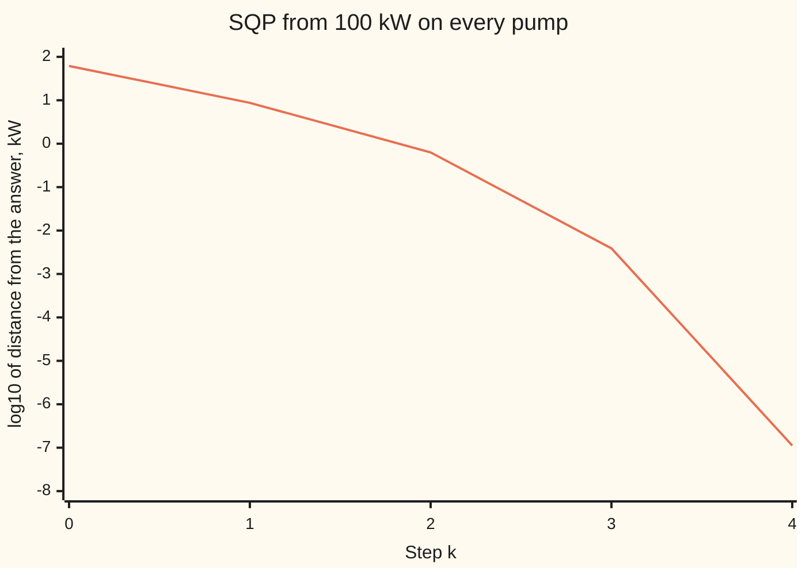
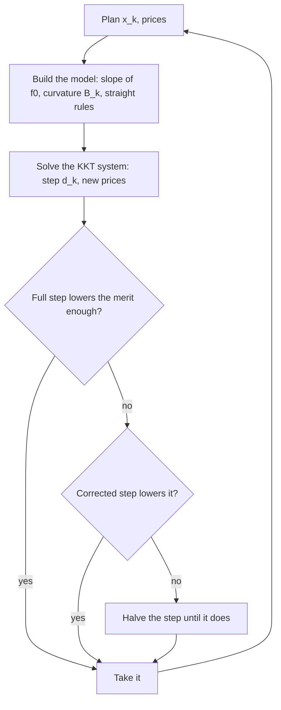

# Sequential quadratic programming: a quadratic model of the constrained problem each step

[Syllabus](../../../SYLLABUS.md) → [Optimization](../README.md) → [Constrained Optimisation](../README.md#s03) → Sequential quadratic programming

---

## General Overview

Three pumps feed a town's water main. Their powers are the choice: pump A, B and C each draw some number of kilowatts (kW). The job is to **minimise** the total power drawn. Two rules limit it. The pumps together must deliver 150 litres a second (L/s) of demand. And the hill tank at the far end must get at least 35 m of **head** (pressure, measured as the height of water it would lift).

The rules are curved. A pump's flow grows only with the square root of its power: pump A gives $\sqrt{x/0.02}$ L/s from $x$ kW, so doubling its power does not double its flow. The cost, total power, is a plain sum. So all the difficulty sits in the rules.

Today every pump runs at 100 kW: 300 kW in all. That sends 173.1671 L/s, 23.1671 L/s more than the town needs, and 36.5066 m of head. **Sequential quadratic programming** (SQP) fixes the schedule in steps. At each step it replaces the problem by a simpler one it can solve exactly: the rules become straight lines and the cost becomes a bowl (a quadratic, curving up). It solves that, moves, and repeats. From 100 kW each, three steps reach powers of 49.9974, 75.0025 and 124.9984 kW, meeting both rules to within 0.001 L/s and 0.001 m. A fourth lands on 50, 75 and 125 kW: 250 kW in all, the least any feasible schedule draws.

**SQP is Newton's method on the conditions an optimum must satisfy: each step solves a quadratic model whose bowl comes from the Lagrangian (the cost plus each rule times its price), whose rules are straight-line copies of the real ones, and a merit function (one score: power plus a fine on any miss) decides how much of the step to trust.**

**What kind of fact this is:** a method. Its local quadratic rate is a theorem, stated with its hypotheses and a source and shown in the printed error ratios. The descent property of its merit function is proved on this card. The answer, 250 kW, is certified as the global minimum by KKT residuals (how far the optimality conditions are from holding), a positive head price, and two independent roads that rewrite and scan the problem.

### The picture: error after each step



The line is the base-10 logarithm of the distance, in kW, from each step's powers to the answer (50, 75, 125). From step 2 on, each fall is about double the one before: the number of correct digits doubles every step. That is the mark of a quadratic rate.

---

## The formula

Notation first, in words. The plan is $x = (x_1, x_2, x_3)$, the three pump powers in kW; $x_k$ is the plan after $k$ steps, from $x_0 = (100, 100, 100)$. The cost is $f_0(x) = x_1 + x_2 + x_3$. Pump $i$'s flow is $q_i = \sqrt{x_i / a_i}$. The demand rule is $h_1(x) = 150 - \sum q_i = 0$. The head rule is $f_1(x) = 35 - \sum k_i q_i \le 0$, with multiplier $\nu$ ("nu") on demand and $\lambda \ge 0$ on head, as on the [KKT conditions](02-kkt-conditions.md) card. The **Lagrangian** is $\mathcal{L} = f_0 + \nu h_1 + \lambda f_1$: the cost plus each rule weighted by its price.

This card holds the head rule as an equality, because it binds at the answer. The check is that its price comes out positive. Stack the two rules as $c(x) = (h_1(x), f_1(x))$, with Jacobian $J$ (row $j$ is rule $j$'s gradient).

At plan $x_k$ with prices $(\nu_k, \lambda_k)$, SQP solves the **quadratic subproblem**

$$\min_{d}\; \nabla f_0(x_k)^{\mathsf T} d + \tfrac12\, d^{\mathsf T} B_k\, d \quad\text{subject to}\quad c(x_k) + J(x_k)\, d = 0, \qquad B_k = \nabla^2_{x}\mathcal{L}(x_k, \nu_k, \lambda_k),$$

through its KKT linear system,

$$\begin{bmatrix} B_k & J_k^{\mathsf T} \\ J_k & 0 \end{bmatrix}\begin{bmatrix} d_k \\ (\nu_{k+1}, \lambda_{k+1}) \end{bmatrix} = -\begin{bmatrix} \nabla f_0(x_k) \\ c(x_k) \end{bmatrix},$$

then moves to $x_{k+1} = x_k + \alpha_k d_k$. The step length $\alpha_k$ is the first of $1, \tfrac12, \tfrac14, \dots$ that lowers the **merit function**

$$\varphi_\rho(x) = f_0(x) + \rho\,\bigl(\lvert h_1(x)\rvert + \max(0, f_1(x))\bigr)$$

by at least $10^{-4}\alpha_k \lvert D_k\rvert$, where $D_k$ is its predicted slope, $D_k = \nabla f_0^{\mathsf T} d_k - \rho\,(\lvert h_1\rvert + \max(0, f_1))$.

**Read it aloud:** at each step, take the cost's slope, the Lagrangian's curvature and the rules' straight-line copies; solve that small quadratic problem for a step and new prices; and take as much of the step as makes power-plus-penalty fall.

| Symbol | Plain meaning | In our example | Push it up and the answer… |
| --- | --- | --- | --- |
| $x$, $x_k$, $x^*$ | pump powers; after $k$ steps; the minimiser | $x_0 = (100, 100, 100)$, $x^* = (50, 75, 125)$ kW | — |
| $f_0$, $g$ | total power, minimised; its gradient | 300 kW at $x_0$, 250 kW at $x^*$; $g = (1, 1, 1)$ | — |
| $a_i$, $k_i$, $q_i$ | pump $i$'s power coefficient; head per L/s (not the step count $k$); flow | 0.02, 0.03, 0.05 kW per (L/s)²; 0.1, 0.2, 0.4 m per L/s; $q_i = \sqrt{x_i/a_i}$ | a dearer pump runs at less flow |
| $h_1$, $f_1$, $c$ | demand miss, head miss (code: `miss`), stacked | −23.1671 L/s, −1.5066 m at $x_0$ | — |
| $J$ | the rules' Jacobian: how each miss moves with each power | demand row $-q_i/(2x_i)$, head row $k_i$ times that | — |
| $\nu$, $\lambda$; $\Delta\nu$, $\Delta\lambda$ | prices of demand and head (code: `mu`); their change in one step | 1 kW per L/s, 10 kW per m | — |
| $\mathcal{L}$, $B_k$ | Lagrangian; its curvature in $x$ | $B_k$ diagonal, $(\nu_k + \lambda_k k_i)\,q_i/(4x_i^2)$ | the model's bowl steepens and steps shorten |
| $d_k$, $\alpha_k$ | step direction; fraction taken | $d_0 = (-58.3265, -27.2582, 23.8062)$ kW, $\alpha_0 = 1$ | — |
| $\varphi_\rho$, $\rho$ | merit: power plus penalty; penalty weight | $\rho = 20$ kW per unit of miss | more steps cut short near curved rules |
| $D_k$ | the merit's predicted slope along $d_k$ | negative whenever $\rho$ beats the prices | — |
| $\hat d$, $z$ | second-order correction; an allowed step ($Jz = 0$) | used in the Maratos case | — |
| $e_k$, $C$ | distance from $x_k$ to $x^*$, the plan's part of the error; the constant in the rate for plan and prices together | 61.24, 8.709, 0.6289, 0.003918 kW | — |

### When it holds

- **Smooth rules and cost, with independent rule gradients (LICQ).** The KKT matrix then has full rank once the bowl is right. With demand written twice, $J$ loses rank and the system is singular, as on [Lagrange multipliers, proved](01-lagrange-multipliers-revisited.md).
- **A bowl on the allowed directions.** $B_k$ must curve up along every step $z$ with $J_k z = 0$. Here it does (curvature 0.006557 along the one allowed step at the answer). Use the cost's own curvature, zero for a sum of powers, and the system is singular: no step at all.
- **The right rules held as equalities.** SQP with a fixed list of active rules finds the best point *on* them. If a held rule's price comes out negative, it should be let go. A head limit of 25 m held as an equality gives a price of −5.5 kW per m. The choice of which rules to hold is the active-set pass on the [Quadratic programs](../06-Conic%2C%20Quadratic%20and%20Stochastic%20Programs/01-quadratic-programs-and-markowitz.md) card.
- **The quadratic rate is local.** It needs a start near a point satisfying the second-order conditions, with positive prices on held inequalities. Far away, the full step can land on negative powers; the line search refuses any step with a negative power, then asks the merit function whether the step helped.
- **The merit's weight must beat the prices.** Take $\rho = 5$, below the head price of 10, and the merit is lowest at a plan with only 31.7742 m of head.

---

## Why it works

### Step 0: the optimum solves a square system, and Newton's method solves square systems

At the best plan, two things hold: the Lagrangian's gradient is zero, and the rules are met. That is five equations, $\nabla f_0 + J^{\mathsf T}(\nu, \lambda) = 0$ (three, one per pump) and $c = 0$ (two), in five unknowns: three powers and two prices. Newton's method solves a square system by replacing it with its straight-line copy at the current point and solving that ([Newton and BFGS](../02-Unconstrained%20Methods/05-newton-and-quasi-newton-bfgs.md)). Doing so here gives exactly the KKT matrix in The formula. That same matrix is also the KKT system of a small quadratic problem. So each Newton step *is* "solve a quadratic model of the constrained problem", and Newton's fast local rate comes with it.

### Step 1: linearise the optimality conditions

Write $g(x) = \nabla f_0(x)$ and stack the conditions as one list, $\bigl(g + J^{\mathsf T}(\nu,\lambda),\ c\bigr)$. Its derivative in $x$ is the Lagrangian's curvature $B = \nabla^2 f_0 + \nu \nabla^2 h_1 + \lambda \nabla^2 f_1$; its derivative in the prices is $J^{\mathsf T}$. The rules' derivative in $x$ is $J$. A Newton step from $(x_k, \nu_k, \lambda_k)$ with changes $(d, \Delta\nu, \Delta\lambda)$ solves

$$B_k d + J_k^{\mathsf T}(\Delta\nu, \Delta\lambda) = -\bigl(g_k + J_k^{\mathsf T}(\nu_k, \lambda_k)\bigr), \qquad J_k d = -c_k.$$

Move $J_k^{\mathsf T}(\nu_k, \lambda_k)$ to the left and it joins the change: the unknowns become $d$ and the *new* prices $(\nu_{k+1}, \lambda_{k+1})$. That is the system in The formula.

### Step 2: the same system is a quadratic problem's KKT conditions

Take the subproblem: minimise $g_k^{\mathsf T} d + \tfrac12 d^{\mathsf T} B_k d$ with $c_k + J_k d = 0$. Its Lagrange conditions are: gradient of the model, $g_k + B_k d$, plus $J_k^{\mathsf T}$ times the prices, equals zero; and the straight-line rules hold. Those are the two rows of the KKT matrix, line for line. If $B_k$ curves up on the allowed steps, the subproblem is a bowl sliced by flat planes, so its stationary point is its unique minimum.

This is why $B_k$ is the Lagrangian's curvature, not the cost's. Straightening the rules throws away their bend. The prices put that bend back into the bowl. For the pumps, $\nabla^2 f_0 = 0$: every scrap of the model's curvature comes from the curved rules, weighted by their prices.

### Step 3: the hand-sized version

Here $B_k$ is diagonal, so the top row gives each pump's step from the new prices: $d_i = -(1 + \nu J_{1i} + \lambda J_{2i})/B_{ii}$. Put those into $J d = -c$ and two equations in the two prices remain. The worked numbers below solve them; the code checks the result against the full five-by-five elimination.

### Step 4: near the answer, the error squares each step

Newton's method on a square system with an invertible derivative at the solution has a quadratic rate: once the error in plan and prices together is small, the next step's error is at most a constant $C$ times its square. The KKT matrix is invertible at the answer when three things hold: LICQ, a bowl on the allowed directions (the second-order sufficient condition of [Second-order conditions under constraints](03-second-order-conditions-for-constrained-problems.md)), and a positive price on every held inequality. Here all three hold. The code prints the plan's part of the error, $e_k$, and its ratios $e_{k+1}/e_k^2$ are 0.0023, 0.0083, 0.0099 and 0.0072: bounded, because at steps 0 to 3 the printed prices are nearer to (1, 10) than the plan is to the answer, so the plan's error stands in for the pair's. The statement and proof are in chapter 18 of Nocedal and Wright (Sources).

### Step 5: far from the answer, a merit function decides how far to go

A model is only as good as its neighbourhood. From 300 kW on every pump, the full step lands at −52.2325, −5.1779 and 89.5265 kW. A negative power has no flow, and the script would stop. SQP therefore asks a second question each step: did the move help? Help is measured by one number, power plus a fine for each unit of miss, $\varphi_\rho$. The idea is the exact penalty of [Penalties and augmented Lagrangians](07-penalty-and-augmented-lagrangian-methods.md). When $\rho$ is larger than every price, the constrained minimum is also a local minimum of $\varphi_\rho$, with no need for $\rho$ to grow without limit. Halve the step until $\varphi_\rho$ falls enough, as in [Line search](../02-Unconstrained%20Methods/04-line-search-armijo-and-wolfe.md). From 300 kW each, the first step is halved once, and every later step is full.

The fold proves the key fact: the SQP step always points downhill for $\varphi_\rho$, so halving must eventually succeed.

<details>
<summary>Detailed proof: the SQP step is a descent direction for the merit function</summary>

Let $(d, \nu_+, \lambda_+)$ solve the KKT system at $x$, with $d \ne 0$, $d^{\mathsf T} B d > 0$, $\lambda_+ \ge 0$ and $\rho \ge \max(\lvert \nu_+\rvert, \lambda_+)$.

The first block row says $g = -Bd - J^{\mathsf T}(\nu_+, \lambda_+)$. Dot it with $d$, and use the second block row, $Jd = -c$:

$$g^{\mathsf T} d = -d^{\mathsf T} B d + \nu_+ h_1 + \lambda_+ f_1.$$

Bound the last two terms: $\nu_+ h_1 \le \lvert\nu_+\rvert\,\lvert h_1\rvert$, and $\lambda_+ f_1 \le \lambda_+ \max(0, f_1)$ because $\lambda_+ \ge 0$. So

$$D = g^{\mathsf T} d - \rho\bigl(\lvert h_1\rvert + \max(0, f_1)\bigr) \le -d^{\mathsf T} B d - (\rho - \lvert\nu_+\rvert)\lvert h_1\rvert - (\rho - \lambda_+)\max(0, f_1) < 0.$$

It remains to show $D$ bounds the true one-sided slope of $\varphi_\rho$ along $d$. Along $x + \alpha d$, each miss changes at first order by $\alpha$ times its row of $Jd = -c$. So $\lvert h_1\rvert$ falls at rate $\lvert h_1\rvert$. The term $\max(0, f_1)$ falls at rate $\max(0, f_1)$ if $f_1 > 0$; if $f_1 \le 0$ it moves towards $f_1(1 - \alpha) \le 0$ and stays at 0 to first order. So the slope of $\varphi_\rho$ at $\alpha = 0^+$ is at most $D$. A negative slope means $\varphi_\rho(x + \alpha d) \le \varphi_\rho(x) + 10^{-4}\alpha D$ for every small enough $\alpha$, so the halving loop stops after finitely many halvings.

</details>

### Step 6: the Maratos effect, where the merit function rejects a good step

The guard can misfire. Start on both rules at powers 58.32, 58.08 and 135.2 kW, 21.4371 kW from the answer, with the exact prices (1, 10). The full SQP step lands 2.2233 kW from the answer: a tenfold improvement. It also lowers the power from 251.6 to 248.6161 kW. But the rules are curved and the step follows their straight copies, so the new plan misses them by 0.5809 units in total. At $\rho = 20$ the fine outweighs the saving, and the merit rises from 251.6 to 260.2341. The line search rejects the step and settles for one-eighth of it. This is the **Maratos effect**.

It happens for a reason that does not go away near the answer. A step of length $\lVert d\rVert$ along the straight copy leaves a curved rule by about $\lVert d \rVert^2$. The cost falls by about the same order. So the fine can win however close the start is, and the fast rate is lost.

The repair used here is a **second-order correction**: after a rejected full step, take one more short move $\hat d = -J^{\mathsf T}(JJ^{\mathsf T})^{-1}c(x_k + d_k)$, the shortest move that cancels the new miss to first order. That pulls the plan back onto the curved rules, the merit falls, and the step is kept. With it, four steps reach the answer to below $10^{-6}$ kW; without it, four steps leave 8.6038 kW of error. On the main run from 100 kW each, every full step passed the merit test, so the correction never ran.



The loop the code runs. The correction is tried only on the full step.

---

## Worked numbers, by hand

Start at 100 kW on every pump, with the least-squares prices (the pair that comes closest to making the Lagrangian's gradient zero). Then step 1 from Step 3, and the later steps from the code.

| Step | Arithmetic | Value |
| --- | --- | --- |
| flows | $q_i = \sqrt{100/a_i}$ | 70.7107, 57.7350, 44.7214 L/s |
| misses | $150 - 173.1671$; $35 - 36.5066$ | −23.1671 L/s; −1.5066 m |
| rule gradients | demand row $-q_i/(2 \times 100)$; head row $k_i$ times that | (−0.3536, −0.2887, −0.2236); (−0.0354, −0.0577, −0.0894) |
| starting prices | least squares on $1 + \nu J_{1i} + \lambda J_{2i} = 0$ | $\nu_0 = 2.3047$, $\lambda_0 = 5.5010$ |
| curvature $B_0$ | $(\nu_0 + \lambda_0 k_i)\,q_i/(4 \times 100^2)$ | 0.0050, 0.0049, 0.0050 per kW |
| two equations in the new prices | $\sum_i J_{ji} J_{li}/B_{ii}$ against $c_j - \sum_i J_{ji}/B_{ii}$ | `[[51.6530, 9.8391], [9.8391, 2.5143]]` against (150.0257, 35.0050) |
| new prices | solve the 2 × 2 | $\nu_1 = 0.9917$, $\lambda_1 = 10.0416$ |
| step | $d_i = -(1 + \nu_1 J_{1i} + \lambda_1 J_{2i})/B_{ii}$ | −58.3265, −27.2582, 23.8062 kW |
| merit test, $\rho = 20$ | 763.3413 before, 358.8859 after | full step kept, $\alpha_0 = 1$ |
| step 1 lands | $100 + d_0$ | 41.6735, 72.7418, 123.8062 kW; misses 5.350518 L/s, 0.682703 m |
| step 2 | code | 49.4860, 75.3105, 124.8131 kW; misses 0.191637 L/s, 0.020041 m |
| step 3 | code | 49.9974, 75.0025, 124.9984 kW; misses 0.000779 L/s, 0.000093 m: **feasible to 0.001** |
| step 4 | code | **50, 75, 125 kW: 250 kW**; prices 1 kW per L/s and 10 kW per m |

Run pump A at 50 kW, pump B at 75 kW and pump C at 125 kW: 250 kW in all, each pump delivering 50 L/s. No feasible schedule draws less. The evidence is the KKT residual of $2.2 \times 10^{-9}$, the positive head price, and two other roads. Rewritten in flows, the problem is the convex one on [Lagrange multipliers, proved](01-lagrange-multipliers-revisited.md), solved in one linear system. A scan of all 522,084 feasible plans on a 0.1 L/s grid of flows, with the head rule kept as a floor so that no rule is assumed to bind, finds the same 250 kW at 50 L/s from each pump.

### What breaks if you drop a piece

| Mistake | Comes out at | What went wrong |
| --- | --- | --- |
| Model curvature from $f_0$ alone, $B = 0$ | KKT matrix singular: no step | The cost is a plain sum, so all the bend is in the rules; only the Lagrangian carries it |
| Full steps, no merit test, from 300 kW each | first step to −52.2325, −5.1779, 89.5265 kW | The model was trusted far from where it is accurate; guarded, the first step is halved and then all steps are full |
| Penalty weight $\rho = 5$, below the head price | merit lowest at 31.7742 m of head, 241.9355 against 250 | Paying the fine is cheaper than meeting the rule, so the merit pulls towards an infeasible plan |
| Hold a slack rule: head at least 25 m, as an equality | head price −5.5 kW per m, 227.5 kW | Dropping the rule gives 217.7419 kW at 28.5484 m; the negative price says let it go |
| Merit test without correction, near the answer | full step cuts error 21.4371 to 2.2233 kW but merit rises 251.6 to 260.2341; steps 0.125, 0.25, 0.25, 0.25 | The Maratos effect: the straight-rule step misses the curved rules by 0.5809 |

---

## Code, from first principles, and it actually runs

The code writes out every piece: elimination with row swaps, the rules' gradients and the Lagrangian's curvature, the least-squares starting prices, the merit test with halving, and the second-order correction. It reaches the answer by **three independent roads**: SQP itself; the problem rewritten in flows, where one linear system solves it; and a scan of every feasible plan on a 0.1 L/s grid of flows: all 522,084 that meet demand with at least 35 m of head, so the scan assumes nothing about which rule binds. It also checks the hand route against the five-by-five solve, the rules' gradients against central differences, the KKT residual, head price sign and curvature at the answer, and that the merit charges nothing for a slack head rule. It ends with the failures from the table.

### Python

```python
# Sequential quadratic programming -- the check behind the card.  Standard library only.
# Three pumps.  Choose their powers p_i (kW) to MINIMISE total power f(p) = p1 + p2 + p3,
# subject to: demand, flow Q(p) = sum sqrt(p_i / a_i) = 150 L/s, and head H(p) = sum k_i sqrt(p_i / a_i) >= 35 m,
# held as an equality.  Written c(p) = (150 - Q, 35 - H): c_1 = 0, c_2 <= 0, prices mu = (nu, lam).
# Road 1: SQP, each step a quadratic model solved through its KKT linear system, guarded by an l1 merit function.
# Road 2: the same problem in flows, where it is a convex quadratic with straight rules: one linear solve.
# Road 3: a scan of every feasible plan on a 0.1 L/s grid of flows: demand met, head at least 35 m.
import math
A, K, DEM, HEAD, RHO = [0.02, 0.03, 0.05], [0.1, 0.2, 0.4], 150.0, 35.0, 20.0

def gauss(M, r):                         # solve M z = r by elimination with row swaps
    n = len(r)
    M = [list(row) + [v] for row, v in zip(M, r)]
    for c in range(n):
        p = max(range(c, n), key=lambda i: abs(M[i][c]))
        if abs(M[p][c]) < 1e-12:
            return None                  # singular: no unique solution
        M[c], M[p] = M[p], M[c]
        for i in range(n):
            if i != c:
                m = M[i][c] / M[c][c]
                M[i] = [u - m * v for u, v in zip(M[i], M[c])]
    return [M[i][n] / M[i][i] for i in range(n)]

flows = lambda p: [math.sqrt(pi / ai) for pi, ai in zip(p, A)]
miss = lambda p: [DEM - sum(flows(p)), HEAD - sum(k * q for k, q in zip(K, flows(p)))]
jac = lambda p: [[-q / (2 * pi) for q, pi in zip(flows(p), p)], [-k * q / (2 * pi) for k, q, pi in zip(K, flows(p), p)]]
hdiag = lambda p, mu: [(mu[0] + mu[1] * k) * q / (4 * pi * pi) for k, q, pi in zip(K, flows(p), p)]  # Hessian of L
viol = lambda p: abs(miss(p)[0]) + max(0.0, miss(p)[1])
merit = lambda p, rho=RHO: sum(p) + rho * viol(p)
f4 = lambda v: ", ".join(f"{round(u, 9) + 0.0:.4f}" for u in v)   # + 0.0 turns -0 into 0
dist = lambda u, v: math.sqrt(sum((x - y) ** 2 for x, y in zip(u, v)))

def kkt(p, mu, h=None):        # [B J^T; J 0] [d; mu+] = [-grad f; -c], solved in one 5 x 5 system
    J, h = jac(p), hdiag(p, mu) if h is None else h
    M = [[h[i] if j == i else 0 for j in range(3)] + [J[0][i], J[1][i]] for i in range(3)] + [J[0] + [0, 0], J[1] + [0, 0]]
    z = gauss(M, [-1, -1, -1] + [-v for v in miss(p)])
    return None if z is None else (z[:3], z[3:])

def ls_prices(p):                        # least-squares prices: make grad f + J^T mu as small as possible
    J = jac(p)
    return gauss([[sum(J[i][t] * J[j][t] for t in range(3)) for j in range(2)] for i in range(2)], [-sum(J[i]) for i in range(2)])

def sqp(p, mu, steps, soc=True, rho=RHO):
    hist = [(p, mu, 1.0, "start")]
    for _ in range(steps):
        d, mu1 = kkt(p, mu)
        slope, a, tag = sum(d) - rho * viol(p), 1.0, "full"
        while True:
            x = [pi + a * di for pi, di in zip(p, d)]
            if min(x) > 0 and merit(x, rho) <= merit(p, rho) + 1e-4 * a * slope:
                break
            if a == 1.0 and soc and min(x) > 0:      # second-order correction: shortest move that re-meets the rules
                J, cx = jac(p), miss(x)
                w = gauss([[sum(J[i][t] * J[j][t] for t in range(3)) for j in range(2)] for i in range(2)], [-v for v in cx])
                y = [x[t] + J[0][t] * w[0] + J[1][t] * w[1] for t in range(3)]
                if min(y) > 0 and merit(y, rho) <= merit(p, rho) + 1e-4 * slope:
                    x, tag = y, "corrected"
                    break
            a /= 2
        p, mu = x, mu1
        hist.append((p, mu, a, tag))
    return hist

# ---- road 2: in flows the problem is Lagrange's: 2 a_i q_i = nu + lam k_i, sum q = 150, k.q = head ----
flowform = lambda hd: gauss([[2 * A[i] if j == i else 0 for j in range(3)] + [-1, -K[i]] for i in range(3)] + [[1, 1, 1, 0, 0], K + [0, 0]], [0, 0, 0, DEM, hd])
z = flowform(HEAD)
PS = [A[i] * z[i] ** 2 for i in range(3)]
print(f"road 2, flow form: flows {f4(z[:3])} L/s, powers {f4(PS)} kW, total {sum(PS):.4f} kW, nu {z[3]:.4f}, lam {z[4]:.4f}")

# ---- road 1: SQP from 100 kW on every pump ----
p0 = [100.0, 100.0, 100.0]
mu0 = ls_prices(p0)
J0, h0, c0 = jac(p0), hdiag(p0, mu0), miss(p0)
print(f"start: flows {f4(flows(p0))} L/s, total {sum(flows(p0)):.4f} L/s, head {HEAD - c0[1]:.4f} m, misses {f4(c0)}")
print(f"start: demand row {f4(J0[0])}; head row {f4(J0[1])}; prices mu0 {f4(mu0)}; curvature {f4(h0)}")
S = [[sum(J0[j][i] * J0[l][i] / h0[i] for i in range(3)) for l in range(2)] for j in range(2)]
R = [c0[j] - sum(J0[j][i] / h0[i] for i in range(3)) for j in range(2)]
mh = gauss(S, R)                         # by hand: eliminate d, leaving 2 equations in the 2 new prices
dh = [-(1 + J0[0][i] * mh[0] + J0[1][i] * mh[1]) / h0[i] for i in range(3)]
print(f"by hand: [{f4(S[0])}; {f4(S[1])}] mu = ({f4(R)}); mu1 {f4(mh)}; step d {f4(dh)} kW")
H = sqp(p0, mu0, 4)
assert dist(dh, [H[1][0][i] - p0[i] for i in range(3)]) < 1e-9 and dist(mh, H[1][1]) < 1e-9
err = [dist(p, PS) for p, *_ in H]
print("k | powers (kW) | total kW | demand miss L/s | head miss m | prices | step | merit | error kW")
for k, (p, mu, a, tag) in enumerate(H):
    print(f"{k} | {f4(p)} | {sum(p):.4f} | {miss(p)[0]:.6f} | {miss(p)[1]:.6f} | {f4(mu)} | {f'{a:g} {tag}' if k else tag} | {merit(p):.4f} | {err[k]:.3e}")
print("error ratios e(k+1)/e(k)^2:", " ".join(f"{err[k + 1] / err[k] ** 2:.4f}" for k in range(4)))
print("chart, log10 error at k = 0..4:", " ".join(f"{math.log10(e):.2f}" for e in err[:5]))
first = next(k for k, (p, *_) in enumerate(H) if max(abs(v) for v in miss(p)) < 1e-3)
p, mu = H[4][0], H[4][1]
gl = [1 + jac(p)[0][i] * mu[0] + jac(p)[1][i] * mu[1] for i in range(3)]
u = [K[2] - K[1], K[0] - K[2], K[1] - K[0]]                     # flow changes keeping both rules: (1,1,1) x k
z = [-u[i] / jac(p)[0][i] for i in range(3)]                     # the same move in powers: J z = 0
curv = sum(hdiag(p, mu)[i] * z[i] ** 2 for i in range(3)) / sum(v * v for v in z)
print(f"feasible to 0.001 after {first} steps; step 4: KKT residual {max(abs(v) for v in gl):.1e}, head price {mu[1]:.4f} > 0, curvature on allowed step {curv:.6f}")
assert first == 3 and max(abs(v) for v in gl) < 1e-6 and mu[1] > 0 and curv > 0 and dist(p, PS) < 1e-6
assert all(err[k + 1] < 0.02 * err[k] ** 2 for k in range(3)) and all(merit(H[k + 1][0]) < merit(H[k][0]) for k in range(3))
nd = max(abs((miss([p[t] + 1e-5 * (t == i) for t in range(3)])[j] - miss([p[t] - 1e-5 * (t == i) for t in range(3)])[j]) / 2e-5 - jac(p)[j][i]) for i in range(3) for j in range(2))
print(f"rule gradients against central differences: largest gap {nd:.1e}")
assert nd < 1e-6

# ---- road 3: every plan on a 0.1 L/s grid of flows that meets demand with at least 35 m of head ----
best, n = (1e9, 0, 0), 0
for n1 in range(1501):
    for n2 in range(1501 - n1):
        q = (n1 / 10, n2 / 10, DEM - n1 / 10 - n2 / 10)
        if sum(k * v for k, v in zip(K, q)) >= HEAD - 1e-9:   # the head rule as a floor: no binding assumed
            n, best = n + 1, min(best, (sum(a * v * v for a, v in zip(A, q)), n1, n2))
print(f"road 3, scan of {n} feasible plans: lowest {best[0]:.4f} kW at flows {f4([best[1] / 10, best[2] / 10, DEM - best[1] / 10 - best[2] / 10])} L/s; SQP total {sum(p):.4f} kW")
assert abs(best[0] - sum(p)) < 1e-6 and abs(sum(p) - sum(PS)) < 1e-6

# ---- what breaks ----
print("model with f's own Hessian (zero):", "singular" if kkt(p0, mu0, h=[0, 0, 0]) is None else "solvable")
assert kkt(p0, [0.0, 0.0]) is None and kkt(p0, mu0, h=[0, 0, 0]) is None
far = [300.0, 300.0, 300.0]
d, _ = kkt(far, ls_prices(far))
G = sqp(far, ls_prices(far), 6)
print(f"from 300 kW each, unguarded full step lands at {f4([far[i] + d[i] for i in range(3)])} kW; guarded steps {' '.join(f'{g[2]:g}' for g in G[1:])}, error {'below' if dist(G[-1][0], PS) < 1e-6 else 'ABOVE'} 1e-6")
assert min(far[i] + d[i] for i in range(3)) < 0 and dist(G[-1][0], PS) < 1e-6
assert miss(far)[1] < 0 and abs(merit(far) - sum(far) - RHO * abs(miss(far)[0])) < 1e-9   # head slack there: no fine for it
pen = lambda r: gauss([[2 * A[i] if j == i else 0 for j in range(3)] + [-1] for i in range(3)] + [[1, 1, 1, 0]], [r * k for k in K] + [DEM])
power = lambda q: sum(a * x * x for a, x in zip(A, q))   # in flows: head priced at r per m, demand held
w, w0, L = pen(5.0), pen(0.0), flowform(25.0)
pw = [A[i] * w[i] ** 2 for i in range(3)]
print(f"penalty weight 5 < head price 10: merit lowest at head {sum(k * q for k, q in zip(K, w)):.4f} m, merit {merit(pw, 5):.4f} < {merit(PS, 5):.4f} kW")
print(f"head limit 25 m held as equality: head price {L[4]:.4f} kW per m, total {power(L[:3]):.4f} kW; rule dropped {power(w0[:3]):.4f} kW at {sum(k * q for k, q in zip(K, w0)):.4f} m")
assert merit(pw, 5) < merit(PS, 5) - 1 and viol(pw) > 1 and L[4] < 0 and power(L[:3]) > power(w0[:3])
pf = [A[i] * q * q for i, q in enumerate((54.0, 44.0, 52.0))]   # a feasible plan near the answer
d, _ = kkt(pf, [1.0, 10.0])
pd = [pf[i] + d[i] for i in range(3)]
print(f"Maratos: start {f4(pf)} kW, misses {f4(miss(pf))}; full step total {sum(pf):.4f} -> {sum(pd):.4f} kW, violation 0 -> {viol(pd):.4f}")
print(f"Maratos: merit {merit(pf):.4f} -> {merit(pd):.4f} kW, rejected; error {dist(pf, PS):.4f} -> {dist(pd, PS):.4f}")
N, C = sqp(pf, [1.0, 10.0], 4, soc=False), sqp(pf, [1.0, 10.0], 4)
print(f"Maratos, no correction: steps {' '.join(f'{g[2]:g}' for g in N[1:])}, error after 4 {dist(N[-1][0], PS):.4f}")
print(f"Maratos, with correction: steps {' '.join(f'{g[2]:g} {g[3]}' for g in C[1:])}, error after 4 {'below' if dist(C[-1][0], PS) < 1e-6 else 'ABOVE'} 1e-6")
assert merit(pd) > merit(pf) and dist(pd, PS) < 0.15 * dist(pf, PS) and dist(N[-1][0], PS) > 1 and dist(C[-1][0], PS) < 1e-6
print("ALL CHECKS PASS")
```

**Ran 2026-11-11 on macOS, Python 3.14.10, standard library only. All checks passed. Output, pasted from the run:**

```
road 2, flow form: flows 50.0000, 50.0000, 50.0000 L/s, powers 50.0000, 75.0000, 125.0000 kW, total 250.0000 kW, nu 1.0000, lam 10.0000
start: flows 70.7107, 57.7350, 44.7214 L/s, total 173.1671 L/s, head 36.5066 m, misses -23.1671, -1.5066
start: demand row -0.3536, -0.2887, -0.2236; head row -0.0354, -0.0577, -0.0894; prices mu0 2.3047, 5.5010; curvature 0.0050, 0.0049, 0.0050
by hand: [51.6530, 9.8391; 9.8391, 2.5143] mu = (150.0257, 35.0050); mu1 0.9917, 10.0416; step d -58.3265, -27.2582, 23.8062 kW
k | powers (kW) | total kW | demand miss L/s | head miss m | prices | step | merit | error kW
0 | 100.0000, 100.0000, 100.0000 | 300.0000 | -23.167065 | -1.506617 | 2.3047, 5.5010 | start | 763.3413 | 6.124e+01
1 | 41.6735, 72.7418, 123.8062 | 238.2215 | 5.350518 | 0.682703 | 0.9917, 10.0416 | 1 full | 358.8859 | 8.709e+00
2 | 49.4860, 75.3105, 124.8131 | 249.6097 | 0.191637 | 0.020041 | 1.0185, 9.9449 | 1 full | 253.8432 | 6.289e-01
3 | 49.9974, 75.0025, 124.9984 | 249.9983 | 0.000779 | 0.000093 | 1.0001, 9.9996 | 1 full | 250.0157 | 3.918e-03
4 | 50.0000, 75.0000, 125.0000 | 250.0000 | 0.000000 | 0.000000 | 1.0000, 10.0000 | 1 full | 250.0000 | 1.112e-07
error ratios e(k+1)/e(k)^2: 0.0023 0.0083 0.0099 0.0072
chart, log10 error at k = 0..4: 1.79 0.94 -0.20 -2.41 -6.95
feasible to 0.001 after 3 steps; step 4: KKT residual 2.2e-09, head price 10.0000 > 0, curvature on allowed step 0.006557
rule gradients against central differences: largest gap 7.3e-10
road 3, scan of 522084 feasible plans: lowest 250.0000 kW at flows 50.0000, 50.0000, 50.0000 L/s; SQP total 250.0000 kW
model with f's own Hessian (zero): singular
from 300 kW each, unguarded full step lands at -52.2325, -5.1779, 89.5265 kW; guarded steps 0.5 1 1 1 1 1, error below 1e-6
penalty weight 5 < head price 10: merit lowest at head 31.7742 m, merit 241.9355 < 250.0000 kW
head limit 25 m held as equality: head price -5.5000 kW per m, total 227.5000 kW; rule dropped 217.7419 kW at 28.5484 m
Maratos: start 58.3200, 58.0800, 135.2000 kW, misses 0.0000, 0.0000; full step total 251.6000 -> 248.6161 kW, violation 0 -> 0.5809
Maratos: merit 251.6000 -> 260.2341 kW, rejected; error 21.4371 -> 2.2233
Maratos, no correction: steps 0.125 0.25 0.25 0.25, error after 4 8.6038
Maratos, with correction: steps 1 corrected 1 corrected 1 full 1 full, error after 4 below 1e-6
ALL CHECKS PASS
```

### Rust

Same numbers, same labels, built with `rustc --edition 2021 -O`. Rust has no built-in format for Python's `6.124e+01`, so a small function writes it.

```rust
// Sequential quadratic programming -- the same check as the Python, in Rust.  No crates.
// Three pumps.  Choose their powers p_i (kW) to MINIMISE total power f(p) = p1 + p2 + p3,
// subject to: demand, flow Q(p) = sum sqrt(p_i / a_i) = 150 L/s, and head H(p) = sum k_i sqrt(p_i / a_i) >= 35 m,
// held as an equality.  Written c(p) = (150 - Q, 35 - H): c_1 = 0, c_2 <= 0, prices mu = (nu, lam).
// Road 1: SQP, each step a quadratic model solved through its KKT linear system, guarded by an l1 merit function.
// Road 2: the same problem in flows, where it is a convex quadratic with straight rules: one linear solve.
// Road 3: a scan of every feasible plan on a 0.1 L/s grid of flows: demand met, head at least 35 m.
const A: [f64; 3] = [0.02, 0.03, 0.05]; // kW per (L/s)^2
const K: [f64; 3] = [0.1, 0.2, 0.4]; // m of head per L/s
const DEM: f64 = 150.0; const HEAD: f64 = 35.0; const RHO: f64 = 20.0;
type V = Vec<f64>;

fn gauss(m0: &[V], r: &[f64]) -> Option<V> { // solve M z = r by elimination with row swaps
    let n = r.len();
    let mut m: Vec<V> = m0.iter().zip(r).map(|(row, v)| { let mut x = row.clone(); x.push(*v); x }).collect();
    for c in 0..n {
        let mut p = c;
        for i in c..n { if m[i][c].abs() > m[p][c].abs() { p = i; } }
        if m[p][c].abs() < 1e-12 { return None; }
        m.swap(c, p);
        for i in 0..n {
            if i == c { continue; }
            let (f, rc) = (m[i][c] / m[c][c], m[c].clone());
            for (u, v) in m[i].iter_mut().zip(rc) { *u -= f * v; }
        }
    }
    Some((0..n).map(|i| m[i][n] / m[i][i]).collect())
}
fn flows(p: &[f64]) -> V { (0..3).map(|i| (p[i] / A[i]).sqrt()).collect() }
fn miss(p: &[f64]) -> V { let q = flows(p); vec![DEM - q.iter().sum::<f64>(), HEAD - (0..3).map(|i| K[i] * q[i]).sum::<f64>()] }
fn jac(p: &[f64]) -> Vec<V> { let q = flows(p); vec![(0..3).map(|i| -q[i] / (2.0 * p[i])).collect(), (0..3).map(|i| -K[i] * q[i] / (2.0 * p[i])).collect()] }
fn hdiag(p: &[f64], mu: &[f64]) -> V { let q = flows(p); (0..3).map(|i| (mu[0] + mu[1] * K[i]) * q[i] / (4.0 * p[i] * p[i])).collect() } // Hessian of L
fn viol(p: &[f64]) -> f64 { let c = miss(p); c[0].abs() + c[1].max(0.0) }
fn merit(p: &[f64], rho: f64) -> f64 { p.iter().sum::<f64>() + rho * viol(p) }
fn f4(v: &[f64]) -> String { v.iter().map(|u| format!("{:.4}", (u * 1e9).round() / 1e9 + 0.0)).collect::<Vec<_>>().join(", ") }
fn dist(u: &[f64], v: &[f64]) -> f64 { u.iter().zip(v).map(|(x, y)| (x - y) * (x - y)).sum::<f64>().sqrt() }
fn sci(x: f64, d: usize) -> String { // Python's e-format: 6.124e+01
    let s = format!("{:.*e}", d, x);
    let (m, e) = s.split_once('e').unwrap(); let e: i32 = e.parse().unwrap();
    format!("{}e{}{:02}", m, if e < 0 { '-' } else { '+' }, e.abs())
}
fn gram(j: &[V]) -> Vec<V> { (0..2).map(|i| (0..2).map(|k| (0..3).map(|t| j[i][t] * j[k][t]).sum()).collect()).collect() }

fn kkt(p: &[f64], mu: &[f64], h: Option<V>) -> Option<(V, V)> { // [B J^T; J 0] [d; mu+] = [-grad f; -c]
    let j = jac(p);
    let h = h.unwrap_or_else(|| hdiag(p, mu));
    let mut m: Vec<V> = (0..3).map(|i| { let mut r: V = (0..3).map(|c| if c == i { h[i] } else { 0.0 }).collect(); r.push(j[0][i]); r.push(j[1][i]); r }).collect();
    for row in &j { let mut r = row.clone(); r.push(0.0); r.push(0.0); m.push(r); }
    let c = miss(p); let z = gauss(&m, &[-1.0, -1.0, -1.0, -c[0], -c[1]])?;
    Some((z[..3].to_vec(), z[3..].to_vec()))
}
fn ls_prices(p: &[f64]) -> V { // least-squares prices: make grad f + J^T mu as small as possible
    let j = jac(p);
    gauss(&gram(&j), &[-j[0].iter().sum::<f64>(), -j[1].iter().sum::<f64>()]).unwrap()
}
fn sqp(p0: &[f64], mu0: &[f64], steps: usize, soc: bool, rho: f64) -> Vec<(V, V, f64, &'static str)> {
    let (mut p, mut mu) = (p0.to_vec(), mu0.to_vec());
    let mut hist = vec![(p.clone(), mu.clone(), 1.0, "start")];
    for _ in 0..steps {
        let (d, mu1) = kkt(&p, &mu, None).unwrap();
        let slope = d.iter().sum::<f64>() - rho * viol(&p);
        let (mut a, mut tag) = (1.0, "full");
        let x = loop {
            let x: V = (0..3).map(|i| p[i] + a * d[i]).collect();
            let pos = x.iter().all(|v| *v > 0.0);
            if pos && merit(&x, rho) <= merit(&p, rho) + 1e-4 * a * slope { break x; }
            if a == 1.0 && soc && pos { // second-order correction: shortest move that re-meets the rules
                let (j, cx) = (jac(&p), miss(&x));
                let w = gauss(&gram(&j), &[-cx[0], -cx[1]]).unwrap();
                let y: V = (0..3).map(|t| x[t] + j[0][t] * w[0] + j[1][t] * w[1]).collect();
                if y.iter().all(|v| *v > 0.0) && merit(&y, rho) <= merit(&p, rho) + 1e-4 * slope { tag = "corrected"; break y; }
            }
            a /= 2.0;
        };
        (p, mu) = (x, mu1);
        hist.push((p.clone(), mu.clone(), a, tag));
    }
    hist
}
fn flowform(hd: f64) -> V { // in flows: 2 a_i q_i = nu + lam k_i, sum q = 150, k.q = head
    let mut m: Vec<V> = (0..3).map(|i| { let mut r: V = (0..3).map(|c| if c == i { 2.0 * A[i] } else { 0.0 }).collect(); r.push(-1.0); r.push(-K[i]); r }).collect();
    m.extend([vec![1.0, 1.0, 1.0, 0.0, 0.0], vec![K[0], K[1], K[2], 0.0, 0.0]]);
    gauss(&m, &[0.0, 0.0, 0.0, DEM, hd]).unwrap()
}
fn pen(r: f64) -> V { // in flows: head priced at r per m, demand held
    let mut m: Vec<V> = (0..3).map(|i| { let mut row: V = (0..3).map(|c| if c == i { 2.0 * A[i] } else { 0.0 }).collect(); row.push(-1.0); row }).collect();
    m.push(vec![1.0, 1.0, 1.0, 0.0]);
    gauss(&m, &[r * K[0], r * K[1], r * K[2], DEM]).unwrap()
}
fn below(v: f64) -> &'static str { if v < 1e-6 { "below" } else { "ABOVE" } }
fn power(q: &[f64]) -> f64 { (0..3).map(|i| A[i] * q[i] * q[i]).sum() }
fn head(q: &[f64]) -> f64 { (0..3).map(|i| K[i] * q[i]).sum() }
fn steps(h: &[(V, V, f64, &str)], tag: bool) -> String { h[1..].iter().map(|g| if tag { format!("{} {}", g.2, g.3) } else { format!("{}", g.2) }).collect::<Vec<_>>().join(" ") }

fn main() {
    // ---- road 2 ----
    let z = flowform(HEAD); let ps: V = (0..3).map(|i| A[i] * z[i] * z[i]).collect();
    println!("road 2, flow form: flows {} L/s, powers {} kW, total {:.4} kW, nu {:.4}, lam {:.4}", f4(&z[..3]), f4(&ps), ps.iter().sum::<f64>(), z[3], z[4]);
    // ---- road 1: SQP from 100 kW on every pump ----
    let (p0, mu0) = (vec![100.0; 3], ls_prices(&vec![100.0; 3]));
    let (j0, h0, c0) = (jac(&p0), hdiag(&p0, &mu0), miss(&p0));
    println!("start: flows {} L/s, total {:.4} L/s, head {:.4} m, misses {}", f4(&flows(&p0)), flows(&p0).iter().sum::<f64>(), HEAD - c0[1], f4(&c0));
    println!("start: demand row {}; head row {}; prices mu0 {}; curvature {}", f4(&j0[0]), f4(&j0[1]), f4(&mu0), f4(&h0));
    let s: Vec<V> = (0..2).map(|j| (0..2).map(|l| (0..3).map(|i| j0[j][i] * j0[l][i] / h0[i]).sum()).collect()).collect();
    let r: V = (0..2).map(|j| c0[j] - (0..3).map(|i| j0[j][i] / h0[i]).sum::<f64>()).collect();
    let mh = gauss(&s, &r).unwrap(); // by hand: eliminate d, leaving 2 equations in the 2 new prices
    let dh: V = (0..3).map(|i| -(1.0 + j0[0][i] * mh[0] + j0[1][i] * mh[1]) / h0[i]).collect();
    println!("by hand: [{}; {}] mu = ({}); mu1 {}; step d {} kW", f4(&s[0]), f4(&s[1]), f4(&r), f4(&mh), f4(&dh));
    let h = sqp(&p0, &mu0, 4, true, RHO);
    let d1: V = (0..3).map(|i| h[1].0[i] - p0[i]).collect(); assert!(dist(&dh, &d1) < 1e-9 && dist(&mh, &h[1].1) < 1e-9);
    let err: V = h.iter().map(|g| dist(&g.0, &ps)).collect();
    println!("k | powers (kW) | total kW | demand miss L/s | head miss m | prices | step | merit | error kW");
    for (k, (p, mu, a, tag)) in h.iter().enumerate() {
        let (st, c) = (if k > 0 { format!("{} {}", a, tag) } else { tag.to_string() }, miss(p));
        println!("{} | {} | {:.4} | {:.6} | {:.6} | {} | {} | {:.4} | {}", k, f4(p), p.iter().sum::<f64>(), c[0], c[1], f4(mu), st, merit(p, RHO), sci(err[k], 3));
    }
    println!("error ratios e(k+1)/e(k)^2: {}", (0..4).map(|k| format!("{:.4}", err[k + 1] / (err[k] * err[k]))).collect::<Vec<_>>().join(" "));
    println!("chart, log10 error at k = 0..4: {}", err[..5].iter().map(|e| format!("{:.2}", e.log10())).collect::<Vec<_>>().join(" "));
    let first = h.iter().position(|g| miss(&g.0).iter().all(|v| v.abs() < 1e-3)).unwrap();
    let (p, mu) = (h[4].0.clone(), h[4].1.clone()); let jp = jac(&p);
    let gl = (0..3).map(|i| (1.0 + jp[0][i] * mu[0] + jp[1][i] * mu[1]).abs()).fold(0.0, f64::max);
    let u = [K[2] - K[1], K[0] - K[2], K[1] - K[0]]; // flow changes keeping both rules: (1,1,1) x k
    let z: V = (0..3).map(|i| -u[i] / jp[0][i]).collect(); // the same move in powers: J z = 0
    let hp = hdiag(&p, &mu); let curv = (0..3).map(|i| hp[i] * z[i] * z[i]).sum::<f64>() / z.iter().map(|v| v * v).sum::<f64>();
    println!("feasible to 0.001 after {} steps; step 4: KKT residual {}, head price {:.4} > 0, curvature on allowed step {:.6}", first, sci(gl, 1), mu[1], curv);
    assert!(first == 3 && gl < 1e-6 && mu[1] > 0.0 && curv > 0.0 && dist(&p, &ps) < 1e-6);
    assert!((0..3).all(|k| err[k + 1] < 0.02 * err[k] * err[k]) && (0..3).all(|k| merit(&h[k + 1].0, RHO) < merit(&h[k].0, RHO)));
    let mut nd: f64 = 0.0;
    for i in 0..3 {
        let (mut up, mut dn) = (p.clone(), p.clone()); up[i] += 1e-5; dn[i] -= 1e-5;
        for j in 0..2 { nd = nd.max(((miss(&up)[j] - miss(&dn)[j]) / 2e-5 - jp[j][i]).abs()); }
    }
    println!("rule gradients against central differences: largest gap {}", sci(nd, 1));
    assert!(nd < 1e-6);
    // ---- road 3: every plan on a 0.1 L/s grid of flows that meets demand with at least 35 m of head ----
    let (mut best, mut n) = ((1e9, 0.0, 0.0), 0);
    for n1 in 0..1501 { for n2 in 0..(1501 - n1) {
        let q = [n1 as f64 / 10.0, n2 as f64 / 10.0, DEM - n1 as f64 / 10.0 - n2 as f64 / 10.0];
        if head(&q) >= HEAD - 1e-9 { n += 1; let c = power(&q); if c < best.0 { best = (c, q[0], q[1]); } } // no binding assumed
    } }
    let tot: f64 = p.iter().sum();
    println!("road 3, scan of {} feasible plans: lowest {:.4} kW at flows {} L/s; SQP total {:.4} kW", n, best.0, f4(&[best.1, best.2, DEM - best.1 - best.2]), tot);
    assert!((best.0 - tot).abs() < 1e-6 && (tot - ps.iter().sum::<f64>()).abs() < 1e-6);
    // ---- what breaks ----
    println!("model with f's own Hessian (zero): {}", if kkt(&p0, &mu0, Some(vec![0.0; 3])).is_none() { "singular" } else { "solvable" });
    assert!(kkt(&p0, &[0.0, 0.0], None).is_none() && kkt(&p0, &mu0, Some(vec![0.0; 3])).is_none());
    let far = vec![300.0; 3];
    let (d, _) = kkt(&far, &ls_prices(&far), None).unwrap();
    assert!(miss(&far)[1] < 0.0 && (merit(&far, RHO) - far.iter().sum::<f64>() - RHO * miss(&far)[0].abs()).abs() < 1e-9); // head slack there: no fine for it
    let (land, g): (V, _) = ((0..3).map(|i| far[i] + d[i]).collect(), sqp(&far, &ls_prices(&far), 6, true, RHO));
    let eg = dist(&g[6].0, &ps);
    println!("from 300 kW each, unguarded full step lands at {} kW; guarded steps {}, error {} 1e-6", f4(&land), steps(&g, false), below(eg));
    assert!(land.iter().cloned().fold(f64::MAX, f64::min) < 0.0 && eg < 1e-6);
    let (w, w0, l) = (pen(5.0), pen(0.0), flowform(25.0));
    let pw: V = (0..3).map(|i| A[i] * w[i] * w[i]).collect();
    println!("penalty weight 5 < head price 10: merit lowest at head {:.4} m, merit {:.4} < {:.4} kW", head(&w), merit(&pw, 5.0), merit(&ps, 5.0));
    println!("head limit 25 m held as equality: head price {:.4} kW per m, total {:.4} kW; rule dropped {:.4} kW at {:.4} m", l[4], power(&l), power(&w0), head(&w0));
    assert!(merit(&pw, 5.0) < merit(&ps, 5.0) - 1.0 && viol(&pw) > 1.0 && l[4] < 0.0 && power(&l) > power(&w0));
    let pf: V = [54.0, 44.0, 52.0].iter().enumerate().map(|(i, q)| A[i] * q * q).collect(); // a feasible plan near the answer
    let (d, _) = kkt(&pf, &[1.0, 10.0], None).unwrap(); let pd: V = (0..3).map(|i| pf[i] + d[i]).collect(); // the full step
    println!("Maratos: start {} kW, misses {}; full step total {:.4} -> {:.4} kW, violation 0 -> {:.4}", f4(&pf), f4(&miss(&pf)), pf.iter().sum::<f64>(), pd.iter().sum::<f64>(), viol(&pd));
    println!("Maratos: merit {:.4} -> {:.4} kW, rejected; error {:.4} -> {:.4}", merit(&pf, RHO), merit(&pd, RHO), dist(&pf, &ps), dist(&pd, &ps));
    let (nn, cc) = (sqp(&pf, &[1.0, 10.0], 4, false, RHO), sqp(&pf, &[1.0, 10.0], 4, true, RHO));
    println!("Maratos, no correction: steps {}, error after 4 {:.4}", steps(&nn, false), dist(&nn[4].0, &ps));
    println!("Maratos, with correction: steps {}, error after 4 {} 1e-6", steps(&cc, true), below(dist(&cc[4].0, &ps)));
    assert!(merit(&pd, RHO) > merit(&pf, RHO) && dist(&pd, &ps) < 0.15 * dist(&pf, &ps) && dist(&nn[4].0, &ps) > 1.0 && dist(&cc[4].0, &ps) < 1e-6);
    println!("ALL CHECKS PASS");
}
```

**Ran 2026-11-11 on macOS, rustc 1.98.1, no crates. All checks passed. Output, pasted from the run:**

```
road 2, flow form: flows 50.0000, 50.0000, 50.0000 L/s, powers 50.0000, 75.0000, 125.0000 kW, total 250.0000 kW, nu 1.0000, lam 10.0000
start: flows 70.7107, 57.7350, 44.7214 L/s, total 173.1671 L/s, head 36.5066 m, misses -23.1671, -1.5066
start: demand row -0.3536, -0.2887, -0.2236; head row -0.0354, -0.0577, -0.0894; prices mu0 2.3047, 5.5010; curvature 0.0050, 0.0049, 0.0050
by hand: [51.6530, 9.8391; 9.8391, 2.5143] mu = (150.0257, 35.0050); mu1 0.9917, 10.0416; step d -58.3265, -27.2582, 23.8062 kW
k | powers (kW) | total kW | demand miss L/s | head miss m | prices | step | merit | error kW
0 | 100.0000, 100.0000, 100.0000 | 300.0000 | -23.167065 | -1.506617 | 2.3047, 5.5010 | start | 763.3413 | 6.124e+01
1 | 41.6735, 72.7418, 123.8062 | 238.2215 | 5.350518 | 0.682703 | 0.9917, 10.0416 | 1 full | 358.8859 | 8.709e+00
2 | 49.4860, 75.3105, 124.8131 | 249.6097 | 0.191637 | 0.020041 | 1.0185, 9.9449 | 1 full | 253.8432 | 6.289e-01
3 | 49.9974, 75.0025, 124.9984 | 249.9983 | 0.000779 | 0.000093 | 1.0001, 9.9996 | 1 full | 250.0157 | 3.918e-03
4 | 50.0000, 75.0000, 125.0000 | 250.0000 | 0.000000 | 0.000000 | 1.0000, 10.0000 | 1 full | 250.0000 | 1.112e-07
error ratios e(k+1)/e(k)^2: 0.0023 0.0083 0.0099 0.0072
chart, log10 error at k = 0..4: 1.79 0.94 -0.20 -2.41 -6.95
feasible to 0.001 after 3 steps; step 4: KKT residual 2.2e-09, head price 10.0000 > 0, curvature on allowed step 0.006557
rule gradients against central differences: largest gap 7.3e-10
road 3, scan of 522084 feasible plans: lowest 250.0000 kW at flows 50.0000, 50.0000, 50.0000 L/s; SQP total 250.0000 kW
model with f's own Hessian (zero): singular
from 300 kW each, unguarded full step lands at -52.2325, -5.1779, 89.5265 kW; guarded steps 0.5 1 1 1 1 1, error below 1e-6
penalty weight 5 < head price 10: merit lowest at head 31.7742 m, merit 241.9355 < 250.0000 kW
head limit 25 m held as equality: head price -5.5000 kW per m, total 227.5000 kW; rule dropped 217.7419 kW at 28.5484 m
Maratos: start 58.3200, 58.0800, 135.2000 kW, misses 0.0000, 0.0000; full step total 251.6000 -> 248.6161 kW, violation 0 -> 0.5809
Maratos: merit 251.6000 -> 260.2341 kW, rejected; error 21.4371 -> 2.2233
Maratos, no correction: steps 0.125 0.25 0.25 0.25, error after 4 8.6038
Maratos, with correction: steps 1 corrected 1 corrected 1 full 1 full, error after 4 below 1e-6
ALL CHECKS PASS
```

The two outputs match line for line.

> [!TIP]
> **Try changing**
> Guess first, then run it. The asserts are pinned to this network, so expect some to stop it.
> - **Guess first: does a smaller fine soften the Maratos effect?** Set `RHO` to `12.0`, still above both prices. The main run is unchanged except for the merit column. In the Maratos case the full step is still rejected (merit 251.6 to 255.5869), but without correction the steps grow, 0.25, 0.5, 1, 1, and the error after four is 0.0018 kW. An assert stops it.
> - **Guess first: does a worse start cost many more steps?** Set `p0` to `[10.0, 10.0, 10.0]`, 30 kW in all and 95.2398 L/s short. Every step is still full, and the rules are met to 0.001 after four steps instead of three. An assert stops it.
> - **Guess first: does the correction change the main run?** Pass `soc=False` to `H = sqp(p0, mu0, 4)`. Nothing changes: every full step already passed the merit test.
> - **Guess first: can SQP start with zero prices?** Set `mu0 = [0.0, 0.0]`. Then $B_0 = 0$: no bowl, and the script stops as soon as it divides by the zero curvature, in the by-hand elimination before the first step. Start prices matter because they shape the bowl.

---

## The usual mistake

> [!warning]
> **Building the model's bowl from the cost instead of the Lagrangian.** Straightening the rules throws away their bend, and only the prices put it back. Here the cost is a plain sum of powers, so its own curvature is zero, and a model built from it has no bowl: the KKT matrix is singular and there is no step. Where the cost does curve, the wrong bowl runs but loses the quadratic rate.
>
> - **Taking full steps from far away.** From 300 kW each, the first full step asks pump A for −52.2325 kW.
> - **A penalty weight below the prices.** At $\rho = 5$ the merit's lowest point has 31.7742 m of head, short of the 35 m rule.
> - **Holding a rule that should be slack.** A 25 m head limit held as an equality costs 227.5 kW against 217.7419; the price, −5.5 kW per m, is the warning.
> - **Reading a rejected step as a bad step.** Near the answer, the merit rejected a step that cut the error from 21.4371 to 2.2233 kW. Without a correction, four steps leave 8.6038 kW of error.

---

## Where you meet it in real life

- **Water networks.** Pump scheduling is solved with SQP and its relatives, because head losses grow with the square of flow and so every hydraulic rule is curved.
- **Power grids.** The optimal power flow problem picks generator outputs under the curved laws of alternating current. SQP and [Interior point methods](08-interior-point-methods.md) are the two standard families for it.
- **Trajectories and control.** A spacecraft or robot path is a long list of states and pushes tied by curved equations of motion; each SQP subproblem is a large, structured quadratic program. Model predictive control (wing 13) solves one at every control step.
- **Chemical plants.** Reactor and distillation design meet mass and energy balances that curve with temperature and pressure; SQP is a standard tool there.

> **Say it back**
> At the best plan, the Lagrangian's gradient is zero and the rules are met, which is a square system in plans and prices. SQP takes Newton steps on that system, and each step is the solution of a small quadratic problem: the cost's slope, the Lagrangian's curvature as the bowl, and straight-line copies of the rules. Near the answer the error squares each step: from 100 kW on every pump, three steps meet the rules to 0.001 and a fourth reaches 50, 75 and 125 kW, 250 kW in all. Far away, a merit function (power plus a fine on misses, with the fine above every price) decides how much of each step to take. Near curved rules that merit can reject a good step, the Maratos effect, and a second-order correction that steps back onto the rules restores the fast rate.

---

## What this builds on

- [Interior point methods](08-interior-point-methods.md): the other main family for curved rules. It keeps every inequality strictly slack behind a barrier, where SQP holds the binding ones as equalities and steps along them.
- [Newton and BFGS](../02-Unconstrained%20Methods/05-newton-and-quasi-newton-bfgs.md): Newton's step on a square system and its quadratic rate, which SQP inherits. When the Lagrangian's curvature is too costly to compute, practical SQP codes replace $B_k$ by a BFGS update built from the changes in plan and gradient.
- [Trust regions](../02-Unconstrained%20Methods/08-trust-region-methods.md): the other way to stop a model being trusted too far, by bounding the step's length instead of searching along it. Constrained versions of it replace the merit line search in many SQP codes.

## Where this goes next

- [Quadratic programs](../06-Conic%2C%20Quadratic%20and%20Stochastic%20Programs/01-quadratic-programs-and-markowitz.md): the active-set pass that decides which inequalities to hold, so that each SQP subproblem with inequalities is solved properly rather than with a fixed guess.

The method here needs the right list of binding rules handed to it; how to find that list cheaply when there are thousands of possible limits is the question the active-set and interior-point methods answer in different ways.

---

## Sources

Verified 2026-11-11: every link below resolves to the publisher's page.

- Nocedal, Jorge, and Stephen J. Wright. *Numerical Optimization*, 2nd ed. Springer, 2006. [doi:10.1007/978-0-387-40065-5](https://doi.org/10.1007/978-0-387-40065-5). Chapter 15: the ℓ1 merit function, the Maratos effect and second-order correction. Chapter 18: SQP as Newton's method on the KKT conditions and the local quadratic rate.
- Boggs, Paul T., and Jon W. Tolle. "Sequential Quadratic Programming." *Acta Numerica* 4 (1995): 1–51. [doi:10.1017/S0962492900002518](https://doi.org/10.1017/S0962492900002518). A survey of SQP: the subproblem, merit functions and their convergence theory.
- Han, S. P. "A Globally Convergent Method for Nonlinear Programming." *Journal of Optimization Theory and Applications* 22 (1977): 297–309. [doi:10.1007/BF00932858](https://doi.org/10.1007/BF00932858). The exact ℓ1 penalty as a merit function for SQP, and the descent result proved in the fold.
- Powell, M. J. D. "A Fast Algorithm for Nonlinearly Constrained Optimization Calculations." In *Numerical Analysis*, Lecture Notes in Mathematics 630, 144–157. Springer, 1978. [doi:10.1007/BFb0067703](https://doi.org/10.1007/BFb0067703). SQP with a quasi-Newton $B_k$ and a line search, the form most codes still follow.
- Chamberlain, R. M., M. J. D. Powell, C. Lemarechal, and H. C. Pedersen. "The Watchdog Technique for Forcing Convergence in Algorithms for Constrained Optimization." *Mathematical Programming Studies* 16 (1982): 1–17. [doi:10.1007/BFb0120945](https://doi.org/10.1007/BFb0120945). The Maratos effect analysed, and a non-monotone remedy beside the second-order correction.
