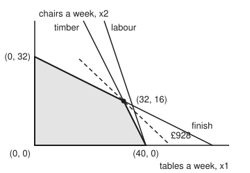

# Linear programs: straight-line costs over a shape cut by flat walls

[Syllabus](../../../SYLLABUS.md) → [Optimization](../README.md) → [Linear Programming](../README.md#s04) → Linear programs

---

## General Overview

A furniture workshop makes tables and chairs. A table earns £19 of profit and uses 4 metres of timber, 3 hours of labour and 1 litre of finish. A chair earns £20 and uses 2 metres of timber, 1 hour of labour and 2 litres of finish. Each week the workshop has 160 metres of timber, 120 hours of labour and 64 litres of finish.

The workshop **chooses** how many tables and chairs to make this week. It wants the **profit made as large as possible**. It is **limited** by the three stocks, and it cannot make a negative number of anything.

Draw every possible week as a point: tables across, chairs up. Each limit is a straight line, a flat wall, and the plans on one side of it are allowed. Five walls (timber, labour, finish, and the two "no negative" walls) cut out a shaded shape with four corners: (0, 0), (40, 0), (32, 16) and (0, 32). The labour wall only grazes the shape at one corner, so it shapes nothing. The best week is 32 tables and 16 chairs, £928, at a corner; prices of £3 a metre on timber and £7 a litre on finish prove that no plan earns more.

This card is about the shape. It rewrites the workshop in the form every solver reads, with a "slack" for each stock left over, and names the shape's pieces, its **faces**: corners, edges and the whole region. In that form a corner is a small system of equations, which makes corners computable.

**A linear program makes a straight-line cost as small as possible over a shape cut out by flat walls; adding one slack per wall turns every wall into "this number is zero", so each face of the shape is a choice of variables set to zero, and each corner is a basic feasible solution of the equations.**

**What kind of fact this is:** definitions (standard form, polyhedron, face, basic solution) plus two short theorems, proved on this card in Why it works: the slack form is the same shape as the picture, and the best plans for a straight-line profit always form a face. That the corners are exactly the basic feasible solutions, and that the best plan sits at a corner, is proved on [Corners are enough](02-corners-and-the-fundamental-theorem.md).

### The picture: the workshop's allowed weeks

<p align="center"></p>

Drawn to scale, tables a week across and chairs a week up. The steep line is timber, the steeper one labour, the shallow one finish. The shaded quadrilateral is every allowed week. The labour line meets it only at (40, 0). The dashed line holds every plan earning £928, and it touches the shape at one point, the corner (32, 16).

---

## The formula

[Linear programs](../../14-Applied%20and%20computational/05-Operations%20Research/01-modelling-with-linear-programs.md) in the computing wing builds such models and adds slacks in passing. This card makes the form exact and introduces the wing's notation for it, in words first. The **cost** is a weighted sum $c^{\mathsf T}x$: each variable times its cost, added (the small T, "transpose", lines the list of costs up against the list of variables). The limits are equations $Ax = b$: row $i$ of the table $A$ says how much of resource $i$ each variable uses, and $b_i$ is how much there is. Every variable is at least zero, $x \ge 0$, entry by entry.

$$
\text{minimise}\quad c^{\mathsf T}x \qquad \text{subject to}\quad Ax = b, \quad x \ge 0
$$

**Read it aloud:** choose non-negative amounts that use exactly the resources available, at the lowest total cost.

This is **standard form**. The word "programming" here means planning, as in a schedule, not computer code.

The workshop does not look like this yet. It maximises, and its limits are "at most". Two moves fix that.

1. **Maximise becomes minimise.** Making profit $19x_1 + 20x_2$ largest is the same as making $-19x_1 - 20x_2$ smallest. The best plan is the same; the value comes back with its sign flipped.
2. **Each "at most" gets a slack.** The slack is what is left over. Timber left is $s_1 = 160 - 4x_1 - 2x_2$, so the limit becomes an equation plus $s_1 \ge 0$.

With $x_1$ tables, $x_2$ chairs and slacks $s_1, s_2, s_3$ for timber, labour and finish:

$$
\begin{aligned}
\text{minimise}\quad & -19x_1 - 20x_2\\
\text{subject to}\quad & 4x_1 + 2x_2 + s_1 = 160 && \text{timber, metres}\\
& 3x_1 + x_2 + s_2 = 120 && \text{labour, hours}\\
& x_1 + 2x_2 + s_3 = 64 && \text{finish, litres}\\
& x_1, x_2, s_1, s_2, s_3 \ge 0
\end{aligned}
$$

So $x = (x_1, x_2, s_1, s_2, s_3)$, $c = (-19, -20, 0, 0, 0)$, $b = (160, 120, 64)$, and $A$ is `[[4, 2, 1, 0, 0], [3, 1, 0, 1, 0], [1, 2, 0, 0, 1]]`. There are $m = 3$ equations and $n = 5$ variables.

The allowed points form a **polyhedron**: a set cut out by finitely many flat walls, $P = \{x : Ax = b,\ x \ge 0\}$. In the picture it is the quadrilateral $\{(x_1, x_2) : 4x_1 + 2x_2 \le 160,\ 3x_1 + x_2 \le 120,\ x_1 + 2x_2 \le 64,\ x_1, x_2 \ge 0\}$, a set cut out by straight-line inequalities as on [Convex sets](../01-Convexity/02-convex-sets.md), so it has no dents.

A **face** of $P$ is the set of its points where some chosen walls are **tight** (met with no room to spare). A face that is one point is a **corner**, or vertex. A face that is a segment is an **edge**. A face one dimension below the whole shape is a **facet**; in two dimensions facets are edges.

A **basic solution** picks $m$ of the $n$ variables, called the **basis** $B$, sets the other $n - m$ to zero, and solves the $m$ equations for the rest. It is **feasible** when none of its entries is negative.

| Symbol | Plain meaning | In our example | Push it up and the answer… |
| --- | --- | --- | --- |
| $x_1$, $x_2$ | tables and chairs a week | 32 and 16 at the best plan | — (chosen) |
| $s_1$, $s_2$, $s_3$ | slacks: timber, labour and finish left over | 0 m, 8 h, 0 litres at the best plan | — (follow from $x_1$, $x_2$) |
| $x$ | all five variables in one list | (32, 16, 0, 8, 0) | — |
| $c$ | cost of one unit of each variable; profit carries a minus | (−19, −20, 0, 0, 0) | raise a chair's profit to £38 and a whole edge ties |
| $A$ | resources used: one row per resource, one column per variable | the 3 by 5 table above | hungrier products shrink the shape |
| $b$ | resources available | (160, 120, 64) | walls move outward, the shape grows |
| $m$, $n$ | number of equations, number of variables | 3 and 5 | more possible bases: $\binom{n}{m}$ = 10 here |
| $P$ | the polyhedron: every allowed $x$ | the shaded quadrilateral | — |
| $B$ | a basis: the $m$ variables solved for | $x_1$, $x_2$, $s_2$ at the best corner | — |
| $p^\star$ | the optimal value of the minimisation | −928, so £928 profit | — |
| $y$ | prices on the three resources, the certificate | (3, 0, 7) £ per metre, hour, litre | — |
| $w$, $u$, $\varepsilon$ | in Step 2's proof: a best plan with every variable above zero that any best plan has above zero, another point of $P$, a small step | with chairs at £38, $w$ is any plan inside the finish edge | — |

### When it holds

- **Costs and uses scale in straight lines.** Twice the tables use twice the timber and earn twice the profit. A bulk discount on timber bends a wall or the cost, and the best plan can then sit inside an edge, away from every corner.
- **Every variable is at least zero.** A variable allowed to go negative is written as one non-negative variable minus another. Leave it free and the shape can contain a whole straight line, and a shape with a line through it has no corner at all: timber alone, with $x_1$ and $x_2$ free, is a half-plane.
- **The rows of $A$ are independent.** If the same equation appeared twice in $Ax = b$, every basis would give a square system with a repeated row and no unique solution. Drop repeated rows first; slacks guarantee this, since their columns alone are independent.
- **Fractions are allowed.** Half a table is a legal plan here. If only whole tables count, the shape is the same but the allowed points are the whole-number dots inside it: [Integer programs](../05-Integer%20and%20Combinatorial%20Optimisation/01-integer-programs-and-relaxations.md).
- **One basis per corner needs nondegeneracy.** The shape is fine regardless, but at (40, 0) three walls meet where two would do, and three different bases name that one corner.

---

## Why it works

### Step 0: a slack turns a wall into a coordinate

The timber wall is "at most 160 metres". Standing on it means no timber is left: $s_1 = 0$. In standard form every wall is the same kind of statement, "this variable is zero", because the original "no negative tables" walls already say $x_1 = 0$ and $x_2 = 0$ on them.

That is the whole trick. Questions about walls become questions about which of the five numbers are zero. A face is "these variables are zero". A corner is "enough of them are zero to pin the point down", which is a system of equations to solve.

### Step 1: the slack form and the picture are the same shape

Take any allowed week $(x_1, x_2)$ in the picture. Compute the three slacks from the equations; each is at least zero, because the week fits each stock. So the five numbers are a point of $P$. Going back, drop the slacks. Each point of the picture matches exactly one point of $P$, and walking along a straight segment in one matches a straight segment in the other, since the slacks are straight-line functions of $x_1$ and $x_2$. Corners, edges and costs carry across unchanged.

An "at least" limit instead subtracts a **surplus**, the amount over the floor; an "exactly" limit needs nothing. Mix up slack and surplus and the wall faces the wrong way (see What breaks).

### Step 2: list the faces by making walls tight

Pick any set of the five walls and make them tight. The points of $P$ that meet them form a face. Five walls give 32 sets; most give nothing or repeat. The distinct non-empty faces are nine:

| Face | Dimension | Variables that are zero on it |
| --- | --- | --- |
| (0, 0) | 0, a corner | $x_1$, $x_2$ |
| (40, 0) | 0, a corner | $x_2$, $s_1$, $s_2$ |
| (32, 16) | 0, a corner | $s_1$, $s_3$ |
| (0, 32) | 0, a corner | $x_1$, $s_3$ |
| (0, 0) to (40, 0) | 1, the floor edge | $x_2$ |
| (40, 0) to (32, 16) | 1, the timber edge | $s_1$ |
| (32, 16) to (0, 32) | 1, the finish edge | $s_3$ |
| (0, 32) to (0, 0) | 1, the left edge | $x_1$ |
| the whole quadrilateral | 2 | none |

Four walls each give an edge, so the shape is a quadrilateral. Labour's face, "$s_2 = 0$", is only the point (40, 0). A wall whose face is smaller than an edge cuts nothing off, and here a one-line sum proves it: three quarters of the timber limit is $3x_1 + 1.5x_2 \le 120$, and adding half of "$-x_2 \le 0$" gives $3x_1 + x_2 \le 120$. The labour limit follows from the others, so it is **redundant**. The labour hours are not wasted: at the best plan 8 hours are spare.

A face is also the set of best plans for some straight-line profit. Raise a chair's profit to £38 and the profit lines run parallel to the finish wall: both (0, 32) and (32, 16) earn £1,216, and so does every plan on the finish edge between them. The set of best plans is always a face, never a scatter of points, and the proof is short. Averaging best plans gives a best plan, so some best plan $w$ keeps above zero every variable that any best plan keeps above zero. Take any point $u$ of $P$ that is zero wherever $w$ is. A small step $\varepsilon$ from $w$ directly away from $u$, to $w + \varepsilon(w - u)$, still meets every equation and keeps every variable at least zero: where $w$ is zero, so is $u$, and where $w$ is above zero a small step keeps it there. The step's profit is the best plus $\varepsilon$ times (the best minus $u$'s profit). Nothing beats the best, so $u$ earns the best too. So the best plans are exactly the points of $P$ where $w$'s zero variables are zero: a face.

### Step 3: corners in algebra, as basic feasible solutions

A point of $P$ is a corner exactly when it is a basic feasible solution. [Corners are enough](02-corners-and-the-fundamental-theorem.md) proves this for any standard-form program; here it is on the workshop. The basis $x_1$, $x_2$, $s_2$ sets $s_1 = s_3 = 0$: timber and finish are tight, the two walls cross at (32, 16), and $s_2 = 8$ hours of labour are left. That is the corner (32, 16) in the face table.

Five variables, three in each basis, give $\binom{5}{3} = 10$ bases, and all ten give a solvable system here. Six are feasible, and they name the four corners. The corner (40, 0) is named three times, by $\{x_1, x_2, s_3\}$, $\{x_1, s_1, s_3\}$ and $\{x_1, s_2, s_3\}$, because three walls meet there where two would pin it down: its row in the face table has three variables at zero. A corner like this is **degenerate**. It does no harm to the shape, but a method that walks from basis to basis can change basis there without moving, which is the degenerate pivot on [The simplex method](03-simplex-method.md). The picture gives the same four corners with no algebra: five walls cross in 10 pairs at 8 distinct points (three pairs meet at (40, 0)), and 4 of the 8 satisfy every wall.

### Step 4: why the corners are the right thing to compute

A straight-line profit is best at a corner of the shape, if it has a best value at all ([Corners are enough](02-corners-and-the-fundamental-theorem.md) proves it). The four corners earn £0, £760, £928 and £640, so the best is (32, 16), £928, and in standard form $p^\star = -928$. The later cards on this shelf keep the workshop as a maximum, with $c = (19, 20, 0, 0, 0)$ and $p^\star = 928$: the same plan, with the signs flipped back.

"Best among four corners" relies on that theorem. Separate evidence comes from prices. Charge £3 a metre for timber, nothing for labour and £7 a litre for finish. A table then "costs" $3 \times 4 + 7 \times 1 = 19$ and a chair $3 \times 2 + 7 \times 2 = 20$, exactly their profits. So any plan's profit is at most what its resources would fetch at those prices, which is at most $3 \times 160 + 7 \times 64 = 928$. Where such prices come from, and why they always exist, is [LP duality](04-lp-duality-and-complementary-slackness.md).

---

## Worked numbers, by hand

The best corner, from its basis $x_1$, $x_2$, $s_2$, with $s_1$ and $s_3$ set to zero.

| Step | Arithmetic | Value |
| --- | --- | --- |
| timber tight | $4x_1 + 2x_2 = 160$ | — |
| finish tight | $x_1 + 2x_2 = 64$ | — |
| subtract the two | $3x_1 = 160 - 64 = 96$ | $x_1 = 32$ |
| back into finish | $2x_2 = 64 - 32$ | $x_2 = 16$ |
| labour left over | $s_2 = 120 - 3 \times 32 - 16$ | 8 hours |
| all five, none negative | $x = (32, 16, 0, 8, 0)$ | feasible, a corner |
| profit | $19 \times 32 + 20 \times 16 = 608 + 320$ | 928 |
| other corners | (0, 0), (40, 0), (0, 32) | £0, £760, £640 |
| price check | $3 \times 160 + 0 \times 120 + 7 \times 64 = 480 + 448$ | 928 |
| **best plan** | the bound is met | **32 tables, 16 chairs: £928 a week** |

The workshop should use all its timber and finish, leave 8 labour hours spare, and make 32 tables and 16 chairs; no allowed week earns more.

### What breaks if you drop a piece

| Mistake | Comes out at | What went wrong |
| --- | --- | --- |
| Timber written with a surplus, $4x_1 + 2x_2 - s_1 = 160$ | (35.2, 14.4), "£956.80" | The wall faces the wrong way: the plan needs 169.6 metres of timber, and 160 exist |
| Every wall taken as an edge | 5 edges, "a pentagon" | Labour's wall is tight only at the corner (40, 0); only 4 walls are tight along an edge, so the shape is a quadrilateral |
| Every set of tight walls counted as a face | 32 faces | 19 of the 32 sets meet the shape nowhere, and the other 13 give only 9 distinct faces |
| Limits written as equations with no slacks | no plan at all | Timber and labour force (40, 0), which uses 40 litres of finish, not 64 |

The surplus row breaks a hypothesis: each slack needs the sign that keeps its wall facing inward. The code prints all four.

---

## Code, from first principles, and it actually runs

Both programs work in exact fractions, Python with its standard `Fraction` type and Rust with a small fraction type written out. They find the corners by two roads that share no code: crossing the five walls of the picture two at a time, and solving every choice of three basic columns of the standard form by elimination. They agree on four corners. The faces come from making every one of the 32 sets of walls tight. The best plan is then checked a third way: the prices (3, 0, 7) give a bound of 928, and a search of every whole-number week finds 928 too.

### Python

```python
# Linear programs and polyhedra -- the check behind the card.  Only Fraction is
# imported, so every number is exact.  A workshop makes x1 tables and x2 chairs a
# week and maximises profit 19 x1 + 20 x2 pounds, limited by timber, labour and
# finish.  The corners are found by two roads that share no code: crossing the
# picture's boundary lines two at a time, and choosing 3 basic columns of the
# standard form A x = b, x >= 0.  Faces are listed by which limits are tight.
from fractions import Fraction as F
NAME = ["x1", "x2", "s1", "s2", "s3"]                     # tables, chairs, 3 slacks
A = [[4, 2, 1, 0, 0], [3, 1, 0, 1, 0], [1, 2, 0, 0, 1]]   # metres, hours, litres
B, PROFIT = [160, 120, 64], [19, 20]
# picture limit k is g.x <= h, and it is tight exactly when variable k is zero
G = [([-1, 0], 0), ([0, -1], 0)] + [(row[:2], h) for row, h in zip(A, B)]

def fmt(v):                                       # exact: a short decimal, else a fraction
    v, k = F(v), 0
    while (v * 10 ** k).denominator != 1 and k < 4: k += 1
    if (v * 10 ** k).denominator != 1: return f"{v.numerator}/{v.denominator}"
    s = str(abs(v.numerator) * 10 ** k // v.denominator).rjust(k + 1, "0")
    return ("-" if v < 0 else "") + (s[:-k] + "." + s[-k:] if k else s)
def pt(p): return "(" + ", ".join(fmt(v) for v in p) + ")"
def value(p, w=PROFIT): return w[0] * p[0] + w[1] * p[1]
def lhs(g, p): return g[0] * p[0] + g[1] * p[1]
def inside(p, gs=G): return all(lhs(g, p) <= h for g, h in gs)
def crossings(gs):                                # road 1: two boundary lines at a time
    pts = []
    for i in range(5):
        for j in range(i + 1, 5):
            (a, h), (c, k) = gs[i], gs[j]
            det = a[0] * c[1] - a[1] * c[0]
            if det != 0: pts.append((F(h * c[1] - a[1] * k, det), F(a[0] * k - h * c[0], det)))
    return pts
def solve(M, r):                                  # Gaussian elimination, exact
    M, n = [[F(v) for v in row] + [F(x)] for row, x in zip(M, r)], len(M)
    for col in range(n):
        piv = next((i for i in range(col, n) if M[i][col] != 0), None)
        if piv is None: return None
        M[col], M[piv] = M[piv], M[col]
        for i in range(n):
            if i != col:
                f = M[i][col] / M[col][col]
                M[i] = [a - f * b for a, b in zip(M[i], M[col])]
    return [M[i][n] / M[i][i] for i in range(n)]
def basics(b):                                    # road 2: 3 basic columns at a time
    out = []
    for i in range(5):
        for j in range(i + 1, 5):
            for k in range(j + 1, 5):
                x = [F(0)] * 5
                for c, v in zip((i, j, k), solve([[row[c] for c in (i, j, k)] for row in A], b)): x[c] = v
                out.append(((i, j, k), x))
    return out

print(f"maximise {PROFIT[0]} x1 + {PROFIT[1]} x2 pounds; timber {B[0]} m, labour {B[1]} h, finish {B[2]} litres")
print(f"standard form: minimise c.x, c = ({-PROFIT[0]}, {-PROFIT[1]}, 0, 0, 0), x = (x1, x2, s1, s2, s3)")
pts = crossings(G)
corners = sorted({p for p in pts if inside(p)})
print(f"road 1: {len(pts)} line crossings, {len(set(pts))} distinct points, {len(corners)} feasible")
bases = []
for cols, x in basics(B):
    ok = min(x) >= 0
    if ok: bases.append((x[0], x[1]))
    print(f"basis {' '.join(NAME[c] for c in cols)}: x = {pt(x)}  {'corner' if ok else 'infeasible'}")
print(f"road 2: 10 bases, {len(bases)} feasible, {len(set(bases))} distinct corners")
print("corners, both roads:", " ".join(pt(p) for p in corners))
def tight(p): return {k for k, (g, h) in enumerate(G) if lhs(g, p) == h}
faces, hit = {}, 0
for mask in range(32):                            # every set of limits made tight
    vs = tuple(v for v in corners if all(k in tight(v) for k in range(5) if mask >> k & 1))
    hit += bool(vs)
    if vs: faces[vs] = sorted(set.intersection(*[tight(v) for v in vs]))
print(f"faces: 32 sets of walls made tight, {len(faces)} distinct non-empty faces")
for vs in sorted(faces, key=lambda f: (len(f), f)):
    zero = " ".join(NAME[k] for k in faces[vs]) or "none"
    print(f"face, dim {min(len(vs) - 1, 2)}: {' '.join(pt(v) for v in vs):<22} zero: {zero}")
lab = tuple(v for v in corners if 3 in tight(v))
red = [F(3, 4) * a + F(1, 2) * b for a, b in zip(G[2][0], G[1][0])]   # 3/4 timber + 1/2 chairs
print(f"labour tight only at {' '.join(pt(v) for v in lab)}; 3/4 timber + 1/2 (x2 >= 0): "
      f"{fmt(red[0])} x1 + {fmt(red[1])} x2 <= {fmt(F(3, 4) * B[0])}")
best = max(corners, key=value)
y = [3, 0, 7]                                     # prices on timber, labour, finish
yA = [sum(y[r] * A[r][c] for r in range(3)) for c in range(5)]
bound = sum(yr * br for yr, br in zip(y, B))
grid = max(value((a, b)) for a in range(65) for b in range(81) if inside((a, b)))
print("profit at corners:", ", ".join(f"{pt(v)} {fmt(value(v))}" for v in corners))
print(f"best: {pt(best)}, {fmt(value(best))} pounds; standard-form p* = {fmt(-value(best))}")
print(f"certificate y = (3, 0, 7): y.A = {pt(yA)}, y.b = {bound}; whole-number grid best {grid}")
tie = [v for v in corners if value(v, [19, 38]) == max(value(u, [19, 38]) for u in corners)]
print(f"chairs at 38: best set {' to '.join(pt(v) for v in tie)}, {fmt(value(tie[0], [19, 38]))} each: the finish edge")
flip = G[:2] + [([-4, -2], -160)] + G[3:]         # mistake 1: surplus on timber
fc = [p for p in crossings(flip) if inside(p, flip)]
fb = max(fc, key=value)
edges = [k for k in range(5) if sum(k in tight(v) for v in corners) > 1]   # mistake 2: walls as edges
eq = solve([r[:2] for r in A[:2]], B[:2])         # mistake 4: limits as equations
print(f"mistake, timber slack signed as surplus: {pt(fb)}, {fmt(value(fb))}, uses {fmt(lhs([4, 2], fb))} m")
print(f"mistake, one edge per wall: {len(G)} claimed, {len(edges)} walls tight along an edge, labour at {len(lab)} corner")
print(f"mistake, every set of walls counted as a face: 32, but {32 - hit} are empty and {hit} give {len(faces)} faces")
print(f"mistake, no slacks: timber and labour force {pt(eq)}, finish {fmt(lhs([1, 2], eq))} not 64")
ends = [f"{nm} {pt((F(h - g[1] * top, g[0]), top))}-{pt((F(h, g[0]), 0))}"   # where each line
        for nm, (g, h), top in zip(["timber", "labour", "finish"], G[2:], [45, 45, 32])]  # leaves the box
print(f"figure, corners {' '.join(pt(v) for v in corners)}; {'; '.join(ends)}; "
      f"928 line {pt((16, F(928 - 19 * 16, 20)))}-{pt((48, F(928 - 19 * 48, 20)))}")
for h in (130, 110):                              # Try changing: move the labour wall
    Gt = G[:3] + [(G[3][0], h)] + G[4:]
    ct = sorted({p for p in crossings(Gt) if inside(p, Gt)})
    on = lambda k: " ".join(pt(v) for v in ct if lhs(Gt[k][0], v) == Gt[k][1]) or "none"
    bt = max(ct, key=value)
    print(f"try labour {h} h: {sum(min(x) >= 0 for _, x in basics([160, h, 64]))} feasible bases, {len(ct)} corners; "
          f"labour tight at {on(3)}; timber at {on(2)}; best {pt(bt)}, {fmt(value(bt))}")
dear = max(corners, key=lambda v: value(v, [19, 40]))
print(f"try chairs at 40: best {pt(dear)}, {fmt(value(dear, [19, 40]))}; prices (3, 0, 7) value a chair at {yA[1]}")
assert corners == sorted(set(bases)) and len(corners) == 4      # two roads, one shape
assert yA[:2] == PROFIT and min(yA[2:]) >= 0 and bound == value(best) == grid == 928
assert red == G[3][0] and F(3, 4) * B[0] == B[1] and lab == ((40, 0),)   # labour is redundant
assert faces[tuple(tie)] == [4] and len(faces) == 9 and hit == 13 and len(edges) == 4 and fb == (F(176, 5), F(72, 5))
print("ALL CHECKS PASS")
```

**Ran 2026-11-11 on macOS, Python 3.14.10, standard library only. All checks passed. Output, pasted from the run:**

```
maximise 19 x1 + 20 x2 pounds; timber 160 m, labour 120 h, finish 64 litres
standard form: minimise c.x, c = (-19, -20, 0, 0, 0), x = (x1, x2, s1, s2, s3)
road 1: 10 line crossings, 8 distinct points, 4 feasible
basis x1 x2 s1: x = (35.2, 14.4, -9.6, 0, 0)  infeasible
basis x1 x2 s2: x = (32, 16, 0, 8, 0)  corner
basis x1 x2 s3: x = (40, 0, 0, 0, 24)  corner
basis x1 s1 s2: x = (64, 0, -96, -72, 0)  infeasible
basis x1 s1 s3: x = (40, 0, 0, 0, 24)  corner
basis x1 s2 s3: x = (40, 0, 0, 0, 24)  corner
basis x2 s1 s2: x = (0, 32, 96, 88, 0)  corner
basis x2 s1 s3: x = (0, 120, -80, 0, -176)  infeasible
basis x2 s2 s3: x = (0, 80, 0, 40, -96)  infeasible
basis s1 s2 s3: x = (0, 0, 160, 120, 64)  corner
road 2: 10 bases, 6 feasible, 4 distinct corners
corners, both roads: (0, 0) (0, 32) (32, 16) (40, 0)
faces: 32 sets of walls made tight, 9 distinct non-empty faces
face, dim 0: (0, 0)                 zero: x1 x2
face, dim 0: (0, 32)                zero: x1 s3
face, dim 0: (32, 16)               zero: s1 s3
face, dim 0: (40, 0)                zero: x2 s1 s2
face, dim 1: (0, 0) (0, 32)         zero: x1
face, dim 1: (0, 0) (40, 0)         zero: x2
face, dim 1: (0, 32) (32, 16)       zero: s3
face, dim 1: (32, 16) (40, 0)       zero: s1
face, dim 2: (0, 0) (0, 32) (32, 16) (40, 0) zero: none
labour tight only at (40, 0); 3/4 timber + 1/2 (x2 >= 0): 3 x1 + 1 x2 <= 120
profit at corners: (0, 0) 0, (0, 32) 640, (32, 16) 928, (40, 0) 760
best: (32, 16), 928 pounds; standard-form p* = -928
certificate y = (3, 0, 7): y.A = (19, 20, 3, 0, 7), y.b = 928; whole-number grid best 928
chairs at 38: best set (0, 32) to (32, 16), 1216 each: the finish edge
mistake, timber slack signed as surplus: (35.2, 14.4), 956.8, uses 169.6 m
mistake, one edge per wall: 5 claimed, 4 walls tight along an edge, labour at 1 corner
mistake, every set of walls counted as a face: 32, but 19 are empty and 13 give 9 faces
mistake, no slacks: timber and labour force (40, 0), finish 40 not 64
figure, corners (0, 0) (0, 32) (32, 16) (40, 0); timber (17.5, 45)-(40, 0); labour (25, 45)-(40, 0); finish (0, 32)-(64, 0); 928 line (16, 31.2)-(48, 0.8)
try labour 130 h: 4 feasible bases, 4 corners; labour tight at none; timber at (32, 16) (40, 0); best (32, 16), 928
try labour 110 h: 4 feasible bases, 4 corners; labour tight at (31.2, 16.4) (110/3, 0); timber at none; best (31.2, 16.4), 920.8
try chairs at 40: best (0, 32), 1280; prices (3, 0, 7) value a chair at 20
ALL CHECKS PASS
```

### Rust

Same numbers, same labels, built with `rustc --edition 2021 -O`.

```rust
// Linear programs and polyhedra -- the same check as the Python, in Rust.  No
// crates: a small exact fraction type is written out below.  A workshop makes x1
// tables and x2 chairs a week and maximises profit 19 x1 + 20 x2 pounds, limited
// by timber, labour and finish.  The corners are found by two roads that share
// no code: crossing the picture's boundary lines two at a time, and choosing 3
// basic columns of the standard form A x = b, x >= 0.  Faces follow from tightness.
use std::cmp::Ordering;
use std::ops::{Add, Div, Mul, Sub};
#[derive(Clone, Copy, PartialEq, Eq, Debug)]
struct Q { n: i64, d: i64 }                              // n / d, d > 0, lowest terms
fn gcd(a: i64, b: i64) -> i64 { if b == 0 { a.abs() } else { gcd(b, a % b) } }
fn q(n: i64, d: i64) -> Q { let g = gcd(n, d) * d.signum(); Q { n: n / g, d: d / g } }
fn z(n: i64) -> Q { q(n, 1) }
impl Add for Q { type Output = Q; fn add(self, o: Q) -> Q { q(self.n * o.d + o.n * self.d, self.d * o.d) } }
impl Sub for Q { type Output = Q; fn sub(self, o: Q) -> Q { q(self.n * o.d - o.n * self.d, self.d * o.d) } }
impl Mul for Q { type Output = Q; fn mul(self, o: Q) -> Q { q(self.n * o.n, self.d * o.d) } }
impl Div for Q { type Output = Q; fn div(self, o: Q) -> Q { q(self.n * o.d, self.d * o.n) } }
impl Ord for Q { fn cmp(&self, o: &Q) -> Ordering { (self.n * o.d).cmp(&(o.n * self.d)) } }
impl PartialOrd for Q { fn partial_cmp(&self, o: &Q) -> Option<Ordering> { Some(self.cmp(o)) } }
type P = (Q, Q);
const NAME: [&str; 5] = ["x1", "x2", "s1", "s2", "s3"];  // tables, chairs, 3 slacks
const A: [[i64; 5]; 3] = [[4, 2, 1, 0, 0], [3, 1, 0, 1, 0], [1, 2, 0, 0, 1]];
const B: [i64; 3] = [160, 120, 64];

fn fmt(v: Q) -> String {                                 // exact: a short decimal, else a fraction
    let mut k = 0u32;
    while (v.n.abs() * 10i64.pow(k)) % v.d != 0 && k < 4 { k += 1 }
    if (v.n.abs() * 10i64.pow(k)) % v.d != 0 { return format!("{}/{}", v.n, v.d) }
    let s = format!("{:0>w$}", v.n.abs() * 10i64.pow(k) / v.d, w = k as usize + 1);
    let body = if k > 0 { format!("{}.{}", &s[..s.len() - k as usize], &s[s.len() - k as usize..]) } else { s };
    format!("{}{}", if v.n < 0 { "-" } else { "" }, body)
}
fn pt(p: &[Q]) -> String { format!("({})", p.iter().map(|&v| fmt(v)).collect::<Vec<_>>().join(", ")) }
fn pp(p: P) -> String { pt(&[p.0, p.1]) }
fn value(p: P, w: [i64; 2]) -> Q { z(w[0]) * p.0 + z(w[1]) * p.1 }
fn lhs(g: [i64; 2], p: P) -> Q { z(g[0]) * p.0 + z(g[1]) * p.1 }
fn inside(p: P, gs: &[([i64; 2], i64)]) -> bool { gs.iter().all(|&(g, h)| lhs(g, p) <= z(h)) }
fn crossings(gs: &[([i64; 2], i64)]) -> Vec<P> {         // road 1: two boundary lines at a time
    let mut pts = Vec::new();
    for i in 0..5 { for j in i + 1..5 {
        let ((a, h), (c, k)) = (gs[i], gs[j]);
        let det = a[0] * c[1] - a[1] * c[0];
        if det != 0 { pts.push((q(h * c[1] - a[1] * k, det), q(a[0] * k - h * c[0], det))) }
    } }
    pts
}
fn solve(m: Vec<Vec<i64>>, r: &[i64]) -> Option<Vec<Q>> { // Gaussian elimination, exact
    let n = m.len();
    let mut m: Vec<Vec<Q>> = m.iter().zip(r).map(|(row, &x)| row.iter().map(|&v| z(v)).chain([z(x)]).collect()).collect();
    for col in 0..n {
        let piv = (col..n).find(|&i| m[i][col] != z(0))?;
        m.swap(col, piv);
        for i in 0..n { if i != col {
            let f = m[i][col] / m[col][col];
            let pivot_row = m[col].clone();
            for (a, b) in m[i].iter_mut().zip(pivot_row) { *a = *a - f * b }
        } }
    }
    Some((0..n).map(|i| m[i][n] / m[i][i]).collect())
}
fn basics(b: &[i64]) -> Vec<([usize; 3], [Q; 5])> {     // road 2: 3 basic columns at a time
    let mut out = Vec::new();
    for i in 0..5 { for j in i + 1..5 { for k in j + 1..5 {
        let mut x = [z(0); 5];
        for (c, v) in [i, j, k].iter().zip(solve(A.iter().map(|row| vec![row[i], row[j], row[k]]).collect(), b).unwrap()) { x[*c] = v }
        out.push(([i, j, k], x));
    } } }
    out
}
fn uniq(mut v: Vec<P>) -> Vec<P> { v.sort(); v.dedup(); v }
fn join(v: &[P], sep: &str) -> String { v.iter().map(|&p| pp(p)).collect::<Vec<_>>().join(sep) }

fn main() {
    let g: Vec<([i64; 2], i64)> = vec![([-1, 0], 0), ([0, -1], 0), ([4, 2], 160), ([3, 1], 120), ([1, 2], 64)];
    println!("maximise 19 x1 + 20 x2 pounds; timber {} m, labour {} h, finish {} litres", B[0], B[1], B[2]);
    println!("standard form: minimise c.x, c = (-19, -20, 0, 0, 0), x = (x1, x2, s1, s2, s3)");
    let pts = crossings(&g);
    let corners = uniq(pts.iter().copied().filter(|&p| inside(p, &g)).collect());
    println!("road 1: {} line crossings, {} distinct points, {} feasible", pts.len(), uniq(pts.clone()).len(), corners.len());
    let mut bases: Vec<P> = Vec::new();
    for (cols, x) in basics(&B) {
        let ok = x.iter().all(|&v| v >= z(0));
        if ok { bases.push((x[0], x[1])) }
        println!("basis {} {} {}: x = {}  {}", NAME[cols[0]], NAME[cols[1]], NAME[cols[2]], pt(&x), if ok { "corner" } else { "infeasible" });
    }
    println!("road 2: 10 bases, {} feasible, {} distinct corners", bases.len(), uniq(bases.clone()).len());
    println!("corners, both roads: {}", join(&corners, " "));
    let tight = |p: P| -> Vec<usize> { (0..5).filter(|&k| lhs(g[k].0, p) == z(g[k].1)).collect() };
    let (mut faces, mut hit): (Vec<(Vec<P>, Vec<usize>)>, usize) = (Vec::new(), 0);
    for mask in 0..32 {                                   // every set of limits made tight
        let vs: Vec<P> = corners.iter().copied().filter(|&v| (0..5).all(|k| mask >> k & 1 == 0 || tight(v).contains(&k))).collect();
        if !vs.is_empty() { hit += 1 }
        if vs.is_empty() || faces.iter().any(|f| f.0 == vs) { continue }
        let common = (0..5).filter(|k| vs.iter().all(|&v| tight(v).contains(k))).collect();
        faces.push((vs, common));
    }
    faces.sort_by(|a, b| (a.0.len(), &a.0).cmp(&(b.0.len(), &b.0)));
    println!("faces: 32 sets of walls made tight, {} distinct non-empty faces", faces.len());
    for (vs, zero) in &faces {
        let zs = if zero.is_empty() { "none".to_string() } else { zero.iter().map(|&k| NAME[k]).collect::<Vec<_>>().join(" ") };
        println!("face, dim {}: {:<22} zero: {}", (vs.len() - 1).min(2), join(vs, " "), zs);
    }
    let lab: Vec<P> = corners.iter().copied().filter(|&v| tight(v).contains(&3)).collect();
    let red: Vec<Q> = (0..2).map(|i| q(3, 4) * z(g[2].0[i]) + q(1, 2) * z(g[1].0[i])).collect();
    println!("labour tight only at {}; 3/4 timber + 1/2 (x2 >= 0): {} x1 + {} x2 <= {}", join(&lab, " "), fmt(red[0]), fmt(red[1]), fmt(q(3, 4) * z(B[0])));
    let best = *corners.iter().max_by_key(|&&p| value(p, [19, 20])).unwrap();
    let y = [3, 0, 7];                                    // prices on timber, labour, finish
    let ya: Vec<Q> = (0..5).map(|c| z((0..3).map(|r| y[r] * A[r][c]).sum())).collect();
    let bound: i64 = (0..3).map(|r| y[r] * B[r]).sum();
    let mut grid = z(0);
    for a in 0..65 { for b in 0..81 { let p = (z(a), z(b)); if inside(p, &g) && value(p, [19, 20]) > grid { grid = value(p, [19, 20]) } } }
    println!("profit at corners: {}", corners.iter().map(|&v| format!("{} {}", pp(v), fmt(value(v, [19, 20])))).collect::<Vec<_>>().join(", "));
    println!("best: {}, {} pounds; standard-form p* = {}", pp(best), fmt(value(best, [19, 20])), fmt(z(0) - value(best, [19, 20])));
    println!("certificate y = (3, 0, 7): y.A = {}, y.b = {}; whole-number grid best {}", pt(&ya), bound, fmt(grid));
    let top = corners.iter().map(|&u| value(u, [19, 38])).max().unwrap();
    let tie: Vec<P> = corners.iter().copied().filter(|&v| value(v, [19, 38]) == top).collect();
    println!("chairs at 38: best set {}, {} each: the finish edge", join(&tie, " to "), fmt(top));
    let mut flip = g.clone();                             // mistake 1: surplus on timber
    flip[2] = ([-4, -2], -160);
    let fc: Vec<P> = crossings(&flip).into_iter().filter(|&p| inside(p, &flip)).collect();
    let fb = *fc.iter().max_by_key(|&&p| value(p, [19, 20])).unwrap();
    let edges = (0..5).filter(|&k| corners.iter().filter(|&&v| tight(v).contains(&k)).count() > 1).count(); // mistake 2
    let eq = solve(vec![vec![4, 2], vec![3, 1]], &B[..2]).unwrap();         // mistake 4
    println!("mistake, timber slack signed as surplus: {}, {}, uses {} m", pp(fb), fmt(value(fb, [19, 20])), fmt(lhs([4, 2], fb)));
    println!("mistake, one edge per wall: {} claimed, {} walls tight along an edge, labour at {} corner", g.len(), edges, lab.len());
    println!("mistake, every set of walls counted as a face: 32, but {} are empty and {} give {} faces", 32 - hit, hit, faces.len());
    println!("mistake, no slacks: timber and labour force {}, finish {} not 64", pt(&eq), fmt(lhs([1, 2], (eq[0], eq[1]))));
    let ends: Vec<String> = ["timber", "labour", "finish"].iter().zip(&g[2..]).zip([45, 45, 32])   // where each
        .map(|((nm, &(a, h)), top)| format!("{} {}-{}", nm, pp((q(h - a[1] * top, a[0]), z(top))), pp((q(h, a[0]), z(0))))).collect();
    println!("figure, corners {}; {}; 928 line {}-{}", join(&corners, " "), ends.join("; "),   // line leaves the box
             pp((z(16), q(928 - 19 * 16, 20))), pp((z(48), q(928 - 19 * 48, 20))));
    for h in [130i64, 110] {                              // Try changing: move the labour wall
        let mut gt = g.clone(); gt[3].1 = h;
        let ct = uniq(crossings(&gt).into_iter().filter(|&p| inside(p, &gt)).collect());
        let on = |k: usize| { let v: Vec<P> = ct.iter().copied().filter(|&p| lhs(gt[k].0, p) == z(gt[k].1)).collect(); if v.is_empty() { "none".to_string() } else { join(&v, " ") } };
        let bt = *ct.iter().max_by_key(|&&p| value(p, [19, 20])).unwrap();
        let nb = basics(&[160, h, 64]).iter().filter(|(_, x)| x.iter().all(|&v| v >= z(0))).count();
        println!("try labour {} h: {} feasible bases, {} corners; labour tight at {}; timber at {}; best {}, {}", h, nb, ct.len(), on(3), on(2), pp(bt), fmt(value(bt, [19, 20])));
    }
    let dear = *corners.iter().max_by_key(|&&p| value(p, [19, 40])).unwrap();
    println!("try chairs at 40: best {}, {}; prices (3, 0, 7) value a chair at {}", pp(dear), fmt(value(dear, [19, 40])), fmt(ya[1]));
    assert!(corners == uniq(bases.clone()) && corners.len() == 4);               // two roads, one shape
    assert!(ya[..2] == [z(19), z(20)] && ya[2..].iter().all(|&v| v >= z(0)) && z(bound) == value(best, [19, 20]) && grid == z(928) && bound == 928);
    assert!(red == vec![z(3), z(1)] && q(3, 4) * z(B[0]) == z(B[1]) && lab == vec![(z(40), z(0))]);   // labour is redundant
    let fin = faces.iter().find(|f| f.0 == tie).unwrap();
    assert!(fin.1 == vec![4] && faces.len() == 9 && hit == 13 && edges == 4 && fb == (q(176, 5), q(72, 5)));
    println!("ALL CHECKS PASS");
}
```

**Ran 2026-11-11 on macOS, rustc 1.98.1, no crates. All checks passed. Output, pasted from the run:**

```
maximise 19 x1 + 20 x2 pounds; timber 160 m, labour 120 h, finish 64 litres
standard form: minimise c.x, c = (-19, -20, 0, 0, 0), x = (x1, x2, s1, s2, s3)
road 1: 10 line crossings, 8 distinct points, 4 feasible
basis x1 x2 s1: x = (35.2, 14.4, -9.6, 0, 0)  infeasible
basis x1 x2 s2: x = (32, 16, 0, 8, 0)  corner
basis x1 x2 s3: x = (40, 0, 0, 0, 24)  corner
basis x1 s1 s2: x = (64, 0, -96, -72, 0)  infeasible
basis x1 s1 s3: x = (40, 0, 0, 0, 24)  corner
basis x1 s2 s3: x = (40, 0, 0, 0, 24)  corner
basis x2 s1 s2: x = (0, 32, 96, 88, 0)  corner
basis x2 s1 s3: x = (0, 120, -80, 0, -176)  infeasible
basis x2 s2 s3: x = (0, 80, 0, 40, -96)  infeasible
basis s1 s2 s3: x = (0, 0, 160, 120, 64)  corner
road 2: 10 bases, 6 feasible, 4 distinct corners
corners, both roads: (0, 0) (0, 32) (32, 16) (40, 0)
faces: 32 sets of walls made tight, 9 distinct non-empty faces
face, dim 0: (0, 0)                 zero: x1 x2
face, dim 0: (0, 32)                zero: x1 s3
face, dim 0: (32, 16)               zero: s1 s3
face, dim 0: (40, 0)                zero: x2 s1 s2
face, dim 1: (0, 0) (0, 32)         zero: x1
face, dim 1: (0, 0) (40, 0)         zero: x2
face, dim 1: (0, 32) (32, 16)       zero: s3
face, dim 1: (32, 16) (40, 0)       zero: s1
face, dim 2: (0, 0) (0, 32) (32, 16) (40, 0) zero: none
labour tight only at (40, 0); 3/4 timber + 1/2 (x2 >= 0): 3 x1 + 1 x2 <= 120
profit at corners: (0, 0) 0, (0, 32) 640, (32, 16) 928, (40, 0) 760
best: (32, 16), 928 pounds; standard-form p* = -928
certificate y = (3, 0, 7): y.A = (19, 20, 3, 0, 7), y.b = 928; whole-number grid best 928
chairs at 38: best set (0, 32) to (32, 16), 1216 each: the finish edge
mistake, timber slack signed as surplus: (35.2, 14.4), 956.8, uses 169.6 m
mistake, one edge per wall: 5 claimed, 4 walls tight along an edge, labour at 1 corner
mistake, every set of walls counted as a face: 32, but 19 are empty and 13 give 9 faces
mistake, no slacks: timber and labour force (40, 0), finish 40 not 64
figure, corners (0, 0) (0, 32) (32, 16) (40, 0); timber (17.5, 45)-(40, 0); labour (25, 45)-(40, 0); finish (0, 32)-(64, 0); 928 line (16, 31.2)-(48, 0.8)
try labour 130 h: 4 feasible bases, 4 corners; labour tight at none; timber at (32, 16) (40, 0); best (32, 16), 928
try labour 110 h: 4 feasible bases, 4 corners; labour tight at (31.2, 16.4) (110/3, 0); timber at none; best (31.2, 16.4), 920.8
try chairs at 40: best (0, 32), 1280; prices (3, 0, 7) value a chair at 20
ALL CHECKS PASS
```

The two outputs match line for line.

> [!TIP]
> **Try changing**
> Guess first, then run the Python. The asserts are pinned to the workshop's numbers, so expect one to stop the program. The check's `try` lines print each answer.
> - **Guess first: how many feasible bases with more labour?** Set the labour hours in `B` to `130`. The labour wall moves clear of the shape, (40, 0) is no longer degenerate, and road 2 finds 4 feasible bases for 4 corners. The redundancy assert stops it, since labour is now tight nowhere.
> - **Guess first: does less labour change the shape?** Set labour to `110`. The labour wall now cuts a real edge, from (31.2, 16.4) to 36⅔ tables (printed 110/3), and timber now misses the shape entirely. The best week drops to £920.80; the run stops on the surplus mistake, whose region is now empty.
> - **Guess first: where does a dearer chair go?** Set `PROFIT` to `[19, 40]`. The best week jumps to the corner (0, 32), £1,280, and the price assert stops it: (3, 0, 7) no longer prices a chair at its profit.

---

## The usual mistake

> [!warning]
> **Taking every wall for an edge.** Five walls do not make a five-sided shape. A wall gives an edge only if it is tight along a whole segment of the shape. Labour's wall is tight only at (40, 0), so its face is a corner, only 4 walls give edges, and the shape is a quadrilateral, not a pentagon. The labour limit is redundant: three quarters of the timber limit plus half of "no negative chairs" already says it. Before drawing the shape, find each wall's face.
>
> - **Slack or surplus, wrong way round.** Writing timber as $4x_1 + 2x_2 - s_1 = 160$ turns "at most" into "at least", and the "best" plan claims £956.80 on 169.6 metres of timber.
> - **Counting sets of walls as faces.** Five walls give 32 sets to make tight, but 19 meet the shape nowhere and the other 13 give only 9 distinct faces.
> - **Dropping the slacks.** Three equations in two unknowns have no solution here: timber and labour force (40, 0), finish then says 40, not 64.

---

## Where you meet it in real life

- **Production planning.** Refineries, mills and food plants plan a week this way, with thousands of products. Kantorovich set out such plans for plywood trusts in 1939.
- **Solvers.** A solver first converts whatever is typed into standard form, adding slacks and surpluses, before any method runs.
- **Diet and blending.** The cheapest feed or fuel mix meeting nutrient or quality floors gets a surplus variable on every floor.
- **Shipping and networks.** A flow along each road, at least zero, with goods in equal to goods out at every depot, is $Ax = b$, $x \ge 0$ exactly: [Network flows](06-network-flows-as-linear-programs.md).

> **Say it back**
> A linear program makes a straight-line cost as small as possible over a shape cut out by flat walls, and standard form writes it as $Ax = b$ with every variable at least zero. A slack records what each limit leaves over, so standing on a wall means that slack is zero. A face is the set of allowed points where some walls are tight, which is some variables set to zero, and the best plans always form one. A corner is a basic feasible solution: choose three variables, set the rest to zero, solve, and check nothing is negative. The workshop's shape has four corners, six feasible bases because (40, 0) is degenerate, and its best corner is 32 tables and 16 chairs for £928.

---

## What this builds on

- [The standard convex problem](../01-Convexity/10-the-convex-problem-in-standard-form.md): the general shape, minimise a convex cost under convex limits; here every piece is a straight line.
- [Solving A x = b](../../03-Algebra/05-Solving%20Systems/01-matrix-equation-ax-b.md): solving a square system, which is what each basis asks for.
- [Linear programs](../../14-Applied%20and%20computational/05-Operations%20Research/01-modelling-with-linear-programs.md): turning a business question into variables, a target and limits, worked on a bakery.

## Where this goes next

- [Corners are enough](02-corners-and-the-fundamental-theorem.md): why the best plan, when there is one, sits at a corner, so a finite list of bases always contains it.
- [Modelling tricks](07-piecewise-linear-and-minimax-objectives-as-lps.md): absolute values, worst cases and kinked costs rewritten into this standard form.
- [Integer programs](../05-Integer%20and%20Combinatorial%20Optimisation/01-integer-programs-and-relaxations.md): the same walls, with only whole-number plans allowed.

The workshop has 10 bases to try; a factory with thousands of products has far too many to list, so how to reach the best corner without listing them is the question [The simplex method](03-simplex-method.md) answers.

---

## Sources

Verified 2026-11-11: every link below resolves to the publisher's page.

- Bertsimas, Dimitris, and John N. Tsitsiklis. *Introduction to Linear Optimization*. Athena Scientific, 1997. [Publisher page](http://www.athenasc.com/linoptbook.html). Chapters 1 and 2: standard form, slacks and surpluses, polyhedra, and the proof that extreme points are basic feasible solutions.
- Ziegler, Günter M. *Lectures on Polytopes*. Graduate Texts in Mathematics 152, Springer, 1995. [doi:10.1007/978-1-4613-8431-1](https://doi.org/10.1007/978-1-4613-8431-1). Faces, vertices, edges and facets of polyhedra, in general dimension.
- Kantorovich, L. V. "Mathematical Methods of Organizing and Planning Production." *Management Science* 6, no. 4 (1960). [doi:10.1287/mnsc.6.4.366](https://doi.org/10.1287/mnsc.6.4.366). The 1939 production-planning problems, translated.
- Dantzig, George B. "Linear Programming." *Operations Research* 50, no. 1 (2002). [doi:10.1287/opre.50.1.42.17798](https://doi.org/10.1287/opre.50.1.42.17798). The method's inventor on how standard form and the corner view arose.
