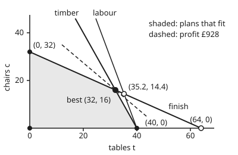

# Corners are enough: why a best linear answer sits at a vertex

[Syllabus](../../../SYLLABUS.md) → [Optimization](../README.md) → [Linear Programming](../README.md#s04) → Corners are enough

---

## General Overview

A furniture workshop makes tables and chairs. A table earns £19 of profit and a chair £20. Each week the workshop has 160 metres of timber, 120 hours of labour and 64 litres of finish. A table takes 4 m of timber, 3 hours and 1 litre of finish. A chair takes 2 m, 1 hour and 2 litres. The workshop chooses how many of each to make, it makes the week's profit as large as possible, and the three stocks limit it.

The allowed plans fill a four-sided region with corners at (0, 0), (40, 0), (32, 16) and (0, 32), counting (tables, chairs). Work out the profit at those four points: £0, £760, £928 and £640. The best is **32 tables and 16 chairs, £928 a week**, and no other plan, inside the region or on its edges, does better.

This card proves why. A linear profit along any straight line rises steadily, so it never peaks in the middle. A plan that is not a corner can always be slid in some direction without losing profit until it reaches a corner.

The card also says exactly what a corner is in algebra: a **basic feasible solution**, found by choosing which three amounts are allowed to be nonzero and solving three equations. That turns "look at the corners" into a finite list a computer can work through: here 10 choices, 6 of them allowed, giving the 4 corners.

**If a linear program has a best plan, one of its corners is a best plan, and the corners are exactly the solutions found by setting all but a few amounts to zero and solving the limits as equations.**

**What kind of fact this is:** a theorem, the fundamental theorem of linear programming, proved on this card in Why it works. That profit and stock use grow in straight lines with the number made is a model of the workshop, not a law.

### The picture: the workshop's plans, to scale

<p align="center"></p>

Drawn to scale: tables across, chairs up. The shaded region is every plan that fits all three stocks. The filled dots are its four corners. The open circles are places where two limit lines cross outside the region, so they are not plans the workshop can make. The dashed line holds every plan earning £928. It touches the region at one point, the corner (32, 16).

---

## The formula

[Linear programs](../../14-Applied%20and%20computational/05-Operations%20Research/01-modelling-with-linear-programs.md), in the computing wing, already showed by a picture that a best plan with two decisions sits at a corner. This card proves it for any number of decisions, and names the corners in algebra.

The shelf writes a linear program in **standard form** ([Linear programs](01-linear-programs-and-polyhedra.md)): every limit an equation, every amount at least zero. Each "at most" limit gets a **slack**: the stock left over. The workshop's amounts become a list of five, $x = (t, c, s_{\text{timber}}, s_{\text{labour}}, s_{\text{finish}})$. This card maximises:

$$\max_x\ c^T x \quad\text{subject to}\quad Ax = b,\quad x \ge 0$$

$$c = (19, 20, 0, 0, 0),\qquad A = \begin{pmatrix} 4 & 2 & 1 & 0 & 0\\ 3 & 1 & 0 & 1 & 0\\ 1 & 2 & 0 & 0 & 1\end{pmatrix},\qquad b = \begin{pmatrix}160\\120\\64\end{pmatrix}$$

The letter c does two jobs on this shelf. Alone, or in a plan (t, c), it counts chairs. In $c^T x$ it is the list of profits per unit, and $c^T x$ means $19t + 20c$ (the slacks earn nothing).

Two definitions carry the theorem.

- A **vertex** (a corner) is an allowed plan that is not the midpoint of two other allowed plans. Here the region has 4.
- A **basic solution** comes from picking $m$ columns of $A$ (here $m = 3$, one per limit) whose square matrix $B$ can be inverted. Set every other amount to zero and solve $B x_B = b$ for the picked amounts $x_B$. The pick is a **basis**. If every amount comes out at least zero, it is a **basic feasible solution**.

The theorem, for a standard-form program whose $m$ rows are independent:

$$x \text{ is a vertex} \iff x \text{ is a basic feasible solution}$$

$$\text{some plan allowed, profit bounded above on the allowed plans} \implies p^* = \max\{\,c^T x : x \text{ a basic feasible solution}\,\}$$

**Read it aloud:** a corner and a basic feasible solution are the same thing; and if some plan is allowed and profit cannot grow without limit, the best profit is reached, and it is reached at one of the finitely many basic feasible solutions.

| Symbol | Plain meaning | In our example | Push it up and the answer… |
| --- | --- | --- | --- |
| $t$, $c$ | tables and chairs made a week | 32 and 16 at the best plan | — (the method chooses them) |
| $s$ | slacks: timber, labour and finish left over | 0 m, 8 h, 0 litres at the best plan | — |
| $x$, $x_j$ | the plan as five amounts, $x \ge 0$ entry by entry; its $j$-th amount | (32, 16, 0, 8, 0) | — |
| $c$, $c^T x$ | profit per unit of each amount; the week's profit, £ | (19, 20, 0, 0, 0); £928 | raise the table's profit far enough and the best corner moves to (40, 0) |
| $A$ | stock used per unit: one row per limit, one column per amount | the 3 × 5 matrix above | hungrier products shrink the region |
| $b$ | stock available | 160 m, 120 h, 64 litres | more stock moves the corners outwards |
| $m$, $n$ | number of limits, number of amounts | 3 and 5 | up to $\binom{n}{m}$ bases, the number of ways to choose $m$ columns from $n$: 10 here |
| $B$, $x_B$ | a basis: $m$ chosen columns of $A$; their amounts | columns $t$, $c$, $s_{\text{labour}}$; (32, 16, 8) | — |
| $d$, $d_j$ | a direction: a change to the plan with $Ad = 0$; its $j$-th entry | (0.4, −0.2, −1.2, −1, 0) | — |
| $\theta$ | how far to move along $d$ (in Step 2, a small positive distance) | 50, then 10 | — |
| $y$ | prices on each stock, £ per unit | £3 a metre, £0 an hour, £7 a litre | — |
| $p^*$ | the optimal value: the best week's profit | £928 | — |

### When it holds

- **Profit is a straight-line sum.** If a chair's profit falls by 50p for every chair made, the best plan is (34.75, 10.5), partway along the timber edge, earning £815.125, while the best corner earns £800. Corner-checking misses it.
- **Profit cannot grow forever.** Remove all three stocks and the workshop could make any number of tables. There is then no best plan to find, and the theorem says nothing about corners being best.
- **The region holds no whole straight line.** A half-plane, such as "tables plus twice chairs at most 64" with negative amounts allowed, has no corners at all. Standard form's $x \ge 0$ rules that out.
- **The rows of $A$ are independent.** A limit that copies another (the timber row written twice) leaves no square matrix $B$ that can be inverted. Delete the copy first.
- **Fractions are allowed.** A corner can be fractional: cut labour to 64 hours and the best corner is (12.8, 25.6), as the first Try changing experiment shows. The workshop's own four corners happen to be whole. If only whole tables count, the best corner can be the wrong answer: that is the job of [Integer programs](../05-Integer%20and%20Combinatorial%20Optimisation/01-integer-programs-and-relaxations.md).

---

## Why it works

### Step 0: a plan with too much freedom can slide without losing profit

Think of a plan that is not a corner, such as 10 tables and 10 chairs. All five of its amounts are positive: tables, chairs and three leftover stocks. Three limits pin down only three amounts, so the plan has room to move while every limit still balances.

Along any such move, profit changes at a fixed rate, because profit is a straight-line sum. So one of the two ways along the move does not lose profit. Slide that way until some amount reaches zero. The plan now has one fewer positive amount. Repeat.

The process stops when the positive amounts are pinned down exactly by the limits: that is a basic feasible solution, and the coming steps show it is a corner.

So every plan has a corner at least as good as itself. With finitely many corners, the best corner is the best plan.

### Step 1: a basic feasible solution is a corner

Take the basis $t$, $c$, $s_{\text{labour}}$. Setting $s_{\text{timber}} = s_{\text{finish}} = 0$ means timber and finish are used up. Solving gives (32, 16) with 8 hours of labour spare: the plan $x = (32, 16, 0, 8, 0)$.

Suppose this plan were the midpoint of two allowed plans. Every amount of both is at least zero. Where the midpoint has a zero, both plans must have a zero too: a zero is the average of two numbers at least zero only if both are zero. So both plans are zero outside the basis, and both solve the same three equations $B x_B = b$. $B$ can be inverted, so those equations have one solution. So both plans equal $x$: it is not the midpoint of two *different* plans. It is a corner.

### Step 2: a corner is a basic feasible solution

Now go the other way. Take an allowed plan whose positive amounts have **dependent** columns: some combination of those columns adds to zero. That combination is a direction $d$ with $Ad = 0$ that touches only the positive amounts. Move a small distance $\theta$ both ways, to $x + \theta d$ and $x - \theta d$. Both still satisfy $Ax = b$, and both still have every amount at least zero, because only positive amounts moved, and only a little. So $x$ is the midpoint of two allowed plans and is not a corner.

So at a corner the positive amounts have independent columns. There are at most $m$ of them, since $A$ has $m$ rows. Add further columns until there are $m$ independent ones (possible, since the rows of $A$ are independent). That is a basis whose basic solution is $x$. Steps 1 and 2 together: **vertex if and only if basic feasible solution**.

### Step 3: the reduction, worked from 10 tables and 10 chairs

The proof of Step 0 is a procedure. The code runs it from $x = (10, 10, 100, 80, 34)$, profit £390.

1. The five positive amounts have dependent columns. One direction is $d = (0.4, −0.2, −1.2, −1, 0)$: give up 0.2 of a chair for 0.4 of a table. Finish use stays the same, and timber and labour slack shrink. Profit rises at 3.6 per unit of move. Chairs hit zero after a move of 50, at (30, 0, 40, 30, 34), profit £570.
2. Four positive amounts remain, still dependent. Now $d = (1, 0, −4, −3, −1)$: one more table, paid for out of the three slacks. Profit rises at 19 per unit. Timber and labour both run out after a move of 10, together. The plan is (40, 0, 0, 0, 24), profit £760.

Two positive amounts remain, with independent columns: a corner. The reduction promised a corner at least as good as £390, and it delivered £760. It did not promise the best corner. To get £928 the code compares all the corners; [The simplex method](03-simplex-method.md) instead walks from corner to better corner.

<details>
<summary>Detailed proof: a bounded linear program has a best basic feasible solution</summary>

Let $x$ be any allowed plan of $\max c^T x$ subject to $Ax = b$, $x \ge 0$, with profit bounded above on the allowed plans. Call the positions where $x$ is positive its **support**.

If the columns of $A$ on the support are independent, $x$ is already basic feasible (Step 2's last paragraph builds the basis). Otherwise pick a nonzero $d$ with $Ad = 0$ and $d_j = 0$ off the support. Replace $d$ by $-d$ if needed so that $c^T d \ge 0$; if $c^T d = 0$, pick the sign that gives $d$ at least one negative entry (possible because $d \ne 0$).

Now $d$ has a negative entry. If not, $d \ge 0$ and $c^T d > 0$; then $x + \theta d$ is allowed for every $\theta \ge 0$, with profit $c^T x + \theta\, c^T d$ growing without limit, which contradicts the bound.

Set $\theta = \min\{x_j / (-d_j) : d_j < 0\}$, which is positive, and move to $x + \theta d$. It satisfies $A(x + \theta d) = b$; every amount stays at least zero by the choice of $\theta$; at least one amount on the support becomes zero; and its profit is $c^T x + \theta\, c^T d \ge c^T x$.

The support shrinks at every move, so after at most $n$ moves its columns are independent and the plan is a basic feasible solution earning at least $c^T x$.

There are at most $\binom{n}{m}$ bases, so finitely many basic feasible solutions. Take the one with the largest profit. Every allowed plan earns at most what its own reduction reaches, which is at most that largest profit. So it is a best plan: the maximum exists and is attained at a basic feasible solution, which by Steps 1 and 2 is a vertex. If no plan is allowed at all, there are no basic feasible solutions either, and the program is infeasible.

The same proof with "minimise" and $c^T d \le 0$ gives the minimising version. No compactness argument is needed: the maximum exists because the list is finite.

</details>

### Step 4: list the bases, and keep the ones that fit

With $m = 3$ and $n = 5$ there are 10 ways to pick three columns. All 10 give an invertible $B$ here. Each gives a basic solution: two amounts set to zero means two limit lines crossing in the picture. Four of the ten have a negative amount, so they fall outside the region. For example, columns $t$, $c$, $s_{\text{timber}}$ give (35.2, 14.4) with $s_{\text{timber}} = −9.6$: 9.6 m more timber than exists. Six fit.

Six bases, but four corners. The corner (40, 0) comes from three different bases, because three limits are tight there at once: chairs at zero, timber used up, labour used up. Such a corner is **degenerate**: a basic feasible solution with fewer than $m$ positive amounts (here two: tables, and 24 litres of finish spare). Every corner has at least one basis; a corner with exactly $m$ positive amounts has exactly one. Degenerate corners matter to the simplex method, which can change basis without moving.

### Step 5: the certificate

Listing every basic feasible solution, as above, proves £928 is best, given the theorem. A second proof needs no list.

Put a price on each stock: £3 a metre of timber, £0 an hour of labour, £7 a litre of finish. A table's inputs are then worth $4 \times 3 + 3 \times 0 + 1 \times 7 = 19$, its full profit, and a chair's $2 \times 3 + 1 \times 0 + 2 \times 7 = 20$, its full profit too.

So any plan earns at most the value of the stock it uses, which is at most the value of all the stock: $480 + 0 + 448 = 928$. The corner (32, 16) earns exactly that. Where such prices come from, and why they always exist, is [LP duality](04-lp-duality-and-complementary-slackness.md).

---

## Worked numbers, by hand

The best basis keeps $t$, $c$ and $s_{\text{labour}}$, so timber and finish are used up.

| Step | Arithmetic | Value |
| --- | --- | --- |
| timber, used up | $4t + 2c = 160$ | — |
| finish, used up | $t + 2c = 64$ | — |
| subtract the two | $3t = 160 - 64 = 96$ | $t = 32$ |
| back into finish | $2c = 64 - 32 = 32$ | $c = 16$ |
| labour left over | $120 - 3 \times 32 - 16$ | 8 hours |
| profit | $19 \times 32 + 20 \times 16 = 608 + 320$ | £928 |
| the other corners | (0, 0), (40, 0), (0, 32) | £0, £760, £640 |
| the price cap | $3 \times 160 + 0 \times 120 + 7 \times 64 = 480 + 0 + 448$ | £928 |
| **best plan** | the best corner meets the cap | **32 tables, 16 chairs: £928 a week** |

The workshop should use all its timber and finish and leave 8 hours of labour idle; the stock prices prove no plan earns more.

### What breaks if you drop a piece

| Mistake | Comes out at | What went wrong |
| --- | --- | --- |
| Solve every basis but skip the "every amount at least zero" check | (0, 120): "£2,400" | That basic solution needs 240 m of timber, and 160 m exist |
| Count feasible bases as corners | 6 corners | (40, 0) is one corner reached by three bases |
| Chair profit falls 50p a chair, then check corners only | best corner (32, 16): £800 | Profit is no longer linear; the true best is (34.75, 10.5), £815.125, mid-edge |
| Read "a best plan is at a corner" as "only corners are best", with profit 10t + 20c | (0, 32) and (32, 16) both £640 | The profit line lies along the finish edge: the midpoint (16, 24) earns £640 too |

The third row is the theorem's hypothesis failing; the code confirms it with a grid of every plan in tenths, whose best, £815.12 at (34.7, 10.6) and again at (34.8, 10.4), beats every corner.

---

## Code, from first principles, and it actually runs

Both programs work in exact fractions. Three **independent roads** reach £928 at (32, 16), and a fourth runs the proof itself. The first lists all 10 bases, solves each by elimination, keeps the ones with no negative amount and reads off the corners. The second checks the stock prices: they must not be negative, must price each product at least at its profit, and must cap profit at the same £928. The third checks every plan on a grid of tenths of a unit, 83,681 allowed plans, in whole-number arithmetic. The fourth runs the proof's reduction from 10 tables and 10 chairs and confirms it lands on a corner from the list. A hand solve by subtraction checks the best corner once more, and the "breaks" lines compute each wrong answer above.

### Python

```python
# Corners are enough: the check behind the card. Standard library only.
# The workshop: t tables, c chairs; maximise profit 19 t + 20 c (pounds) with
# timber 4t + 2c <= 160 m, labour 3t + c <= 120 h, finish t + 2c <= 64 litres.
# Exact fractions throughout. Roads: (1) every choice of 3 basic columns,
# solved by elimination; (2) prices that cap the profit; (3) every plan on a
# grid of tenths; (4) the proof's reduction, run from a plan inside.
from fractions import Fraction as F
from itertools import combinations

A = [[4, 2, 1, 0, 0], [3, 1, 0, 1, 0], [1, 2, 0, 0, 1]]  # slack columns added
b, c = [160, 120, 64], [19, 20, 0, 0, 0]
COL = ["t", "c", "s_timber", "s_labour", "s_finish"]
LIM = ["t >= 0", "c >= 0", "timber", "labour", "finish"]  # zero entry = tight limit

def show(x):  # exact fraction -> decimal text, at most 3 places
    x = F(x); n = round(abs(x) * 1000)
    s = f"{n // 1000}.{n % 1000:03d}".rstrip("0").rstrip(".")
    return ("-" if x < 0 else "") + s
def pt(x): return f"({show(x[0])}, {show(x[1])})"
def vec(x): return "(" + ", ".join(show(v) for v in x) + ")"
def profit(x): return sum(F(ci) * xi for ci, xi in zip(c, x))

def rref(cols):  # row-reduce the chosen columns of A; return the rows and pivot columns
    M = [[F(A[r][j]) for j in cols] for r in range(3)]
    piv, r = [], 0
    for k in range(len(cols)):
        p = next((i for i in range(r, 3) if M[i][k] != 0), None)
        if p is None: continue
        M[r], M[p] = M[p], M[r]
        M[r] = [v / M[r][k] for v in M[r]]
        for i in range(3):
            if i != r and M[i][k] != 0:
                M[i] = [a - M[i][k] * bb for a, bb in zip(M[i], M[r])]
        piv.append(k); r += 1
    return M, piv

def basic(cols, b=b):  # solve B x_B = b by elimination, all other entries zero
    M = [[F(A[r][j]) for j in cols] + [F(b[r])] for r in range(3)]
    for k in range(3):
        p = next((i for i in range(k, 3) if M[i][k] != 0), None)
        if p is None: return None
        M[k], M[p] = M[p], M[k]
        M[k] = [v / M[k][k] for v in M[k]]
        for i in range(3):
            if i != k: M[i] = [a - M[i][k] * bb for a, bb in zip(M[i], M[k])]
    x = [F(0)] * 5
    for k, j in enumerate(cols): x[j] = M[k][3]
    return x

print("model, max 19 t + 20 c | timber 4 t + 2 c <= 160 m | labour 3 t + c <= 120 h | finish t + 2 c <= 64 litres")
print(f"standard form, m = 3 rows, n = 5 columns (t, c and 3 slacks), at most {5 * 4 * 3 // 6} bases")
corners, nfeas, bad, ntry = {}, 0, [], 0
for cols in combinations(range(5), 3):
    x = basic(cols); ntry += 1
    ok = x is not None and min(x) >= 0
    nfeas += ok
    names = " ".join(COL[j] for j in cols)
    if ok: corners.setdefault((x[0], x[1]), []).append(names)
    else: bad.append(x)
    neg = "" if ok else ", negative " + " ".join(COL[j] for j in range(5) if x[j] < 0)
    print(f"basis {names}: x = {vec(x)}, {'feasible' if ok else 'infeasible'}{neg}, profit {show(profit(x))}")
print(f"bases, {ntry} tried, {nfeas} feasible, {len(corners)} distinct corners")
for p, names in sorted(corners.items()):
    x = [p[0], p[1]] + [F(b[r]) - A[r][0] * p[0] - A[r][1] * p[1] for r in range(3)]
    tight = [j for j in range(5) if x[j] == 0]
    _, piv = rref([j for j in range(5) if x[j] != 0])
    assert len(piv) == 5 - len(tight)  # positive entries have independent columns
    print(f"corner {pt(p)}: bases giving it {len(names)}, tight {', '.join(LIM[j] for j in tight)}, profit {show(profit(x))}")
best = max(corners, key=lambda p: profit(list(p) + [0, 0, 0]))
zstar = profit(list(best) + [0, 0, 0])
print(f"best corner, {pt(best)}, profit {show(zstar)}")
th = (b[0] - b[2]) // (A[0][0] - A[2][0]); ch = (b[2] - th) // 2  # by hand: timber minus finish
print(f"hand, timber minus finish: 3 t = {b[0] - b[2]}, t = {th}; finish: 2 c = {b[2] - th}, c = {ch}; "
      f"labour slack {b[1] - 3 * th - ch}; profit {19 * th} + {20 * ch} = {19 * th + 20 * ch}")
assert (F(th), F(ch)) == best
y = [3, 0, 7]  # road 2: prices per metre, hour and litre
cover = [sum(y[r] * A[r][j] for r in range(3)) for j in range(2)]
bound = sum(yr * br for yr, br in zip(y, b))
print(f"certificate, prices timber {y[0]} labour {y[1]} finish {y[2]}; inputs priced: table {cover[0]} vs profit {c[0]}, chair {cover[1]} vs profit {c[1]}; cap {y[0] * b[0]} + {y[1] * b[1]} + {y[2] * b[2]} = {bound}, gap {show(bound - zstar)}")
gbest, garg, nfit = -1, None, 0  # road 3: plans in tenths, whole numbers so nothing rounds
for T in range(0, 401):
    for C_ in range(0, 321):
        if 4 * T + 2 * C_ <= 1600 and 3 * T + C_ <= 1200 and T + 2 * C_ <= 640:
            nfit += 1
            if 19 * T + 20 * C_ > gbest: gbest, garg = 19 * T + 20 * C_, (F(T, 10), F(C_, 10))
print(f"grid, {nfit} plans in tenths fit, best {show(F(gbest, 10))} at {pt(garg)}")
# road 4: the proof's reduction. While the columns of the positive entries are
# dependent, move along a direction d with A d = 0 that does not lower profit.
def reduce(t0, c0, say):
    x, step = [F(t0), F(c0)] + [F(b[r] - A[r][0] * t0 - A[r][1] * c0) for r in range(3)], 0
    if say: print(f"reduce, start {vec(x)}, {sum(v > 0 for v in x)} positive entries, profit {show(profit(x))}")
    while True:
        S = [j for j in range(5) if x[j] > 0]
        M, piv = rref(S)
        if len(piv) == len(S): break
        f = next(k for k in range(len(S)) if k not in piv)
        d = [F(0)] * 5; d[S[f]] = F(1)
        for r, k in enumerate(piv): d[S[k]] = -M[r][f]
        if profit(d) < 0 or (profit(d) == 0 and min(d) >= 0): d = [-v for v in d]
        assert all(sum(A[r][j] * d[j] for j in range(5)) == 0 for r in range(3))
        theta = min(x[j] / -d[j] for j in range(5) if d[j] < 0)
        old = profit(x); x = [xi + theta * di for xi, di in zip(x, d)]; step += 1
        assert profit(x) >= old and min(x) >= 0
        if say: print(f"reduce step {step}: d = {vec(d)}, move {show(theta)}, profit rate {show(profit(d))}, x = {vec(x)}, profit {show(profit(x))}")
    return x, step
x, step = reduce(10, 10, True)
print(f"reduce, ends at {pt(x)} after {step} moves: in the corner list, {'yes' if (x[0], x[1]) in corners else 'no'}")
inf = max(bad, key=profit)
print(f"breaks, feasibility skipped: best basic solution {pt(inf)}, profit {show(profit(inf))}, timber {show(4 * inf[0] + 2 * inf[1])} m > 160")
print(f"breaks, feasible bases counted as corners: {nfeas}, but {len(corners)} corners")
tie = [10 * p[0] + 20 * p[1] for p in sorted(corners)]  # profit line parallel to the finish edge
print(f"breaks, profit 10 t + 20 c: corners {' '.join(show(v) for v in tie)}; midpoint (16, 24) also {10 * 16 + 20 * 24}")
def bent(p): return 19 * p[0] + 20 * p[1] - p[1] * p[1] / 2  # chair profit falls 50p a chair
bc = max(corners, key=bent)
ce = F(21, 2); te = 40 - ce / 2  # on the timber edge t = 40 - c/2 the slope 10.5 - c is zero
gb, ga = -1, None
for T in range(0, 401):
    for C_ in range(0, 321):
        if 4 * T + 2 * C_ <= 1600 and 3 * T + C_ <= 1200 and T + 2 * C_ <= 640:
            v = 380 * T + 400 * C_ - C_ * C_  # profit x 200
            if v > gb: gb, ga = v, [(F(T, 10), F(C_, 10))]
            elif v == gb: ga.append((F(T, 10), F(C_, 10)))
print(f"breaks, chair profit falling 50p a chair: best corner {pt(bc)} {show(bent(bc))}; edge point {pt((te, ce))} {show(bent((te, ce)))}; grid best {show(F(gb, 200))} at {' and '.join(pt(g) for g in ga)}")
ends = [(F(t0), (zstar - 19 * t0) / 20) for t0 in (12, 44)]  # the profit-928 line, drawn dashed
print(f"figure, corners {' '.join(pt(p) for p in sorted(corners))}; infeasible crossings {pt(bad[0])} {pt(bad[1])}; profit line {show(zstar)} from {pt(ends[0])} to {pt(ends[1])}")
f64 = [v for v in (basic(cols, [160, 64, 64]) for cols in combinations(range(5), 3)) if min(v) >= 0]  # Try changing
b64 = max(f64, key=profit)
print(f"try, labour 64 h: {len(f64)} bases fit, {len({(v[0], v[1]) for v in f64})} corners, best {pt(b64)}, profit {show(profit(b64))}")
x5, s5 = reduce(5, 25, False)
print(f"try, start (5, 25): {s5} moves to {pt(x5)}, profit {show(profit(x5))}")
y6 = [3, 0, 6]; c6 = [sum(y6[r] * A[r][j] for r in range(3)) for j in range(2)]
print(f"try, finish price 6: inputs priced table {c6[0]} vs profit 19, chair {c6[1]} vs profit 20; cap {sum(v * w for v, w in zip(y6, b))}")
assert sorted(corners) == [(0, 0), (0, 32), (32, 16), (40, 0)] and len(corners[(40, 0)]) == 3
assert zstar == bound == F(gbest, 10) == 928 and best == garg == (32, 16)
assert min(cover[0] - 19, cover[1] - 20, *y) >= 0 and (x[0], x[1]) in corners
assert bent((te, ce)) > bent(bc) and bent((te, ce)) >= F(gb, 200) > bent(bc)
print("ALL CHECKS PASS")
```

**Ran 2026-11-11 on macOS, Python 3.14.10, standard library only. All checks passed. Output, pasted from the run:**

```
model, max 19 t + 20 c | timber 4 t + 2 c <= 160 m | labour 3 t + c <= 120 h | finish t + 2 c <= 64 litres
standard form, m = 3 rows, n = 5 columns (t, c and 3 slacks), at most 10 bases
basis t c s_timber: x = (35.2, 14.4, -9.6, 0, 0), infeasible, negative s_timber, profit 956.8
basis t c s_labour: x = (32, 16, 0, 8, 0), feasible, profit 928
basis t c s_finish: x = (40, 0, 0, 0, 24), feasible, profit 760
basis t s_timber s_labour: x = (64, 0, -96, -72, 0), infeasible, negative s_timber s_labour, profit 1216
basis t s_timber s_finish: x = (40, 0, 0, 0, 24), feasible, profit 760
basis t s_labour s_finish: x = (40, 0, 0, 0, 24), feasible, profit 760
basis c s_timber s_labour: x = (0, 32, 96, 88, 0), feasible, profit 640
basis c s_timber s_finish: x = (0, 120, -80, 0, -176), infeasible, negative s_timber s_finish, profit 2400
basis c s_labour s_finish: x = (0, 80, 0, 40, -96), infeasible, negative s_finish, profit 1600
basis s_timber s_labour s_finish: x = (0, 0, 160, 120, 64), feasible, profit 0
bases, 10 tried, 6 feasible, 4 distinct corners
corner (0, 0): bases giving it 1, tight t >= 0, c >= 0, profit 0
corner (0, 32): bases giving it 1, tight t >= 0, finish, profit 640
corner (32, 16): bases giving it 1, tight timber, finish, profit 928
corner (40, 0): bases giving it 3, tight c >= 0, timber, labour, profit 760
best corner, (32, 16), profit 928
hand, timber minus finish: 3 t = 96, t = 32; finish: 2 c = 32, c = 16; labour slack 8; profit 608 + 320 = 928
certificate, prices timber 3 labour 0 finish 7; inputs priced: table 19 vs profit 19, chair 20 vs profit 20; cap 480 + 0 + 448 = 928, gap 0
grid, 83681 plans in tenths fit, best 928 at (32, 16)
reduce, start (10, 10, 100, 80, 34), 5 positive entries, profit 390
reduce step 1: d = (0.4, -0.2, -1.2, -1, 0), move 50, profit rate 3.6, x = (30, 0, 40, 30, 34), profit 570
reduce step 2: d = (1, 0, -4, -3, -1), move 10, profit rate 19, x = (40, 0, 0, 0, 24), profit 760
reduce, ends at (40, 0) after 2 moves: in the corner list, yes
breaks, feasibility skipped: best basic solution (0, 120), profit 2400, timber 240 m > 160
breaks, feasible bases counted as corners: 6, but 4 corners
breaks, profit 10 t + 20 c: corners 0 640 640 400; midpoint (16, 24) also 640
breaks, chair profit falling 50p a chair: best corner (32, 16) 800; edge point (34.75, 10.5) 815.125; grid best 815.12 at (34.7, 10.6) and (34.8, 10.4)
figure, corners (0, 0) (0, 32) (32, 16) (40, 0); infeasible crossings (35.2, 14.4) (64, 0); profit line 928 from (12, 35) to (44, 4.6)
try, labour 64 h: 4 bases fit, 4 corners, best (12.8, 25.6), profit 755.2
try, start (5, 25): 2 moves to (32, 16), profit 928
try, finish price 6: inputs priced table 18 vs profit 19, chair 18 vs profit 20; cap 864
ALL CHECKS PASS
```

### Rust

Same numbers, same labels, built with `rustc --edition 2021 -O`.

```rust
// Corners are enough: the same check as the Python, in Rust. No crates.
// The workshop: t tables, c chairs; maximise profit 19 t + 20 c (pounds) with
// timber 4t + 2c <= 160 m, labour 3t + c <= 120 h, finish t + 2c <= 64 litres.
// Exact fractions throughout. Roads: (1) every choice of 3 basic columns,
// solved by elimination; (2) prices that cap the profit; (3) every plan on a
// grid of tenths; (4) the proof's reduction, run from a plan inside.
use std::cmp::Ordering;

#[derive(Clone, Copy, Debug, PartialEq, Eq)]
struct Q { n: i64, d: i64 } // a fraction n/d, d > 0, in lowest terms
fn gcd(a: i64, b: i64) -> i64 { if b == 0 { a.abs() } else { gcd(b, a % b) } }
fn q(n: i64, d: i64) -> Q { let g = gcd(n, d).max(1) * d.signum(); Q { n: n / g, d: d / g } }
fn z(n: i64) -> Q { q(n, 1) }
impl std::ops::Add for Q { type Output = Q; fn add(self, o: Q) -> Q { q(self.n * o.d + o.n * self.d, self.d * o.d) } }
impl std::ops::Sub for Q { type Output = Q; fn sub(self, o: Q) -> Q { q(self.n * o.d - o.n * self.d, self.d * o.d) } }
impl std::ops::Mul for Q { type Output = Q; fn mul(self, o: Q) -> Q { q(self.n * o.n, self.d * o.d) } }
impl std::ops::Div for Q { type Output = Q; fn div(self, o: Q) -> Q { q(self.n * o.d, self.d * o.n) } }
impl PartialOrd for Q { fn partial_cmp(&self, o: &Q) -> Option<Ordering> { Some(self.cmp(o)) } }
impl Ord for Q { fn cmp(&self, o: &Q) -> Ordering { (self.n * o.d).cmp(&(o.n * self.d)) } }

const A: [[i64; 5]; 3] = [[4, 2, 1, 0, 0], [3, 1, 0, 1, 0], [1, 2, 0, 0, 1]]; // slack columns added
const B: [i64; 3] = [160, 120, 64];
const C: [i64; 5] = [19, 20, 0, 0, 0];
const COL: [&str; 5] = ["t", "c", "s_timber", "s_labour", "s_finish"];
const LIM: [&str; 5] = ["t >= 0", "c >= 0", "timber", "labour", "finish"]; // zero entry = tight limit

fn show(x: Q) -> String { // exact fraction -> decimal text, at most 3 places
    let n = (x.n.abs() * 1000 * 2 + x.d) / (2 * x.d);
    let s = format!("{}.{:03}", n / 1000, n % 1000);
    let s = s.trim_end_matches('0').trim_end_matches('.');
    format!("{}{}", if x.n < 0 { "-" } else { "" }, s)
}
fn pt(x: (Q, Q)) -> String { format!("({}, {})", show(x.0), show(x.1)) }
fn vec(x: &[Q]) -> String { format!("({})", x.iter().map(|&v| show(v)).collect::<Vec<_>>().join(", ")) }
fn profit(x: &[Q]) -> Q { x.iter().zip(C.iter()).fold(z(0), |s, (&v, &ci)| s + z(ci) * v) }
fn bent(p: (Q, Q)) -> Q { z(19) * p.0 + z(20) * p.1 - p.1 * p.1 / z(2) } // chair profit falls 50p a chair

fn rref(cols: &[usize]) -> (Vec<Vec<Q>>, Vec<usize>) { // row-reduce chosen columns; rows and pivot columns
    let mut m: Vec<Vec<Q>> = (0..3).map(|r| cols.iter().map(|&j| z(A[r][j])).collect()).collect();
    let (mut piv, mut r) = (Vec::new(), 0);
    for k in 0..cols.len() {
        let p = match (r..3).find(|&i| m[i][k] != z(0)) { Some(p) => p, None => continue };
        m.swap(r, p);
        let h = m[r][k]; m[r] = m[r].iter().map(|&v| v / h).collect();
        for i in 0..3 {
            let f = m[i][k];
            if i != r && f != z(0) { m[i] = (0..cols.len()).map(|j| m[i][j] - f * m[r][j]).collect(); }
        }
        piv.push(k); r += 1;
    }
    (m, piv)
}
fn basic(cols: &[usize], b: &[i64]) -> Option<Vec<Q>> { // solve B x_B = b by elimination, other entries zero
    let mut m: Vec<Vec<Q>> = (0..3).map(|r| { let mut v: Vec<Q> = cols.iter().map(|&j| z(A[r][j])).collect(); v.push(z(b[r])); v }).collect();
    for k in 0..3 {
        let p = (k..3).find(|&i| m[i][k] != z(0))?;
        m.swap(k, p);
        let h = m[k][k]; m[k] = m[k].iter().map(|&v| v / h).collect();
        for i in 0..3 { let f = m[i][k]; if i != k { m[i] = (0..4).map(|j| m[i][j] - f * m[k][j]).collect(); } }
    }
    let mut x = vec![z(0); 5];
    for (k, &j) in cols.iter().enumerate() { x[j] = m[k][3]; }
    Some(x)
}

// road 4: the proof's reduction. While the columns of the positive entries are
// dependent, move along a direction d with A d = 0 that does not lower profit.
fn reduce(t0: i64, c0: i64, say: bool) -> (Vec<Q>, usize) {
    let (mut x, mut step) = (vec![z(t0), z(c0)], 0);
    for r in 0..3 { x.push(z(B[r] - A[r][0] * t0 - A[r][1] * c0)); }
    if say { println!("reduce, start {}, {} positive entries, profit {}", vec(&x), x.iter().filter(|&&v| v > z(0)).count(), show(profit(&x))); }
    loop {
        let s: Vec<usize> = (0..5).filter(|&j| x[j] > z(0)).collect();
        let (m, piv) = rref(&s);
        if piv.len() == s.len() { break; }
        let f = (0..s.len()).find(|k| !piv.contains(k)).unwrap();
        let mut d = vec![z(0); 5]; d[s[f]] = z(1);
        for (r, &k) in piv.iter().enumerate() { d[s[k]] = z(0) - m[r][f]; }
        if profit(&d) < z(0) || (profit(&d) == z(0) && d.iter().all(|&v| v >= z(0))) { d = d.iter().map(|&v| z(0) - v).collect(); }
        assert!((0..3).all(|r| (0..5).fold(z(0), |a, j| a + z(A[r][j]) * d[j]) == z(0)));
        let theta = (0..5).filter(|&j| d[j] < z(0)).map(|j| x[j] / (z(0) - d[j])).min().unwrap();
        let old = profit(&x);
        x = (0..5).map(|j| x[j] + theta * d[j]).collect(); step += 1;
        assert!(profit(&x) >= old && x.iter().all(|&v| v >= z(0)));
        if say { println!("reduce step {}: d = {}, move {}, profit rate {}, x = {}, profit {}", step, vec(&d), show(theta), show(profit(&d)), vec(&x), show(profit(&x))); }
    }
    (x, step)
}

fn main() {
    println!("model, max 19 t + 20 c | timber 4 t + 2 c <= 160 m | labour 3 t + c <= 120 h | finish t + 2 c <= 64 litres");
    println!("standard form, m = 3 rows, n = 5 columns (t, c and 3 slacks), at most {} bases", 5 * 4 * 3 / 6);
    let (mut corners, mut nfeas, mut bad, mut ntry): (Vec<((Q, Q), usize)>, usize, Vec<Vec<Q>>, usize) = (vec![], 0, vec![], 0);
    for i in 0..5 { for j in i + 1..5 { for k in j + 1..5 {
        let cols = [i, j, k];
        let x = basic(&cols, &B).expect("singular basis"); ntry += 1;
        let ok = x.iter().all(|&v| v >= z(0));
        let names = cols.iter().map(|&j| COL[j]).collect::<Vec<_>>().join(" ");
        if ok {
            nfeas += 1;
            match corners.iter_mut().find(|e| e.0 == (x[0], x[1])) { Some(e) => e.1 += 1, None => corners.push(((x[0], x[1]), 1)) }
        } else { bad.push(x.clone()); }
        let neg = if ok { String::new() } else {
            format!(", negative {}", (0..5).filter(|&j| x[j] < z(0)).map(|j| COL[j]).collect::<Vec<_>>().join(" ")) };
        println!("basis {}: x = {}, {}{}, profit {}", names, vec(&x), if ok { "feasible" } else { "infeasible" }, neg, show(profit(&x)));
    } } }
    println!("bases, {} tried, {} feasible, {} distinct corners", ntry, nfeas, corners.len());
    corners.sort();
    for &(p, nb) in &corners {
        let mut x = vec![p.0, p.1];
        for r in 0..3 { x.push(z(B[r]) - z(A[r][0]) * p.0 - z(A[r][1]) * p.1); }
        let tight: Vec<usize> = (0..5).filter(|&j| x[j] == z(0)).collect();
        let pos: Vec<usize> = (0..5).filter(|&j| x[j] != z(0)).collect();
        assert!(rref(&pos).1.len() == 5 - tight.len()); // positive entries have independent columns
        println!("corner {}: bases giving it {}, tight {}, profit {}", pt(p), nb,
                 tight.iter().map(|&j| LIM[j]).collect::<Vec<_>>().join(", "), show(profit(&x)));
    }
    let best = corners.iter().map(|e| e.0).max_by_key(|p| z(19) * p.0 + z(20) * p.1).unwrap();
    let zstar = z(19) * best.0 + z(20) * best.1;
    println!("best corner, {}, profit {}", pt(best), show(zstar));
    let th = (B[0] - B[2]) / (A[0][0] - A[2][0]); let ch = (B[2] - th) / 2; // by hand: timber minus finish
    println!("hand, timber minus finish: 3 t = {}, t = {}; finish: 2 c = {}, c = {}; labour slack {}; profit {} + {} = {}",
             B[0] - B[2], th, B[2] - th, ch, B[1] - 3 * th - ch, 19 * th, 20 * ch, 19 * th + 20 * ch);
    assert!((z(th), z(ch)) == best);
    let y = [3i64, 0, 7]; // road 2: prices per metre, hour and litre
    let cover: Vec<i64> = (0..2).map(|j| (0..3).map(|r| y[r] * A[r][j]).sum()).collect();
    let bound: i64 = (0..3).map(|r| y[r] * B[r]).sum();
    println!("certificate, prices timber {} labour {} finish {}; inputs priced: table {} vs profit {}, chair {} vs profit {}; cap {} + {} + {} = {}, gap {}",
             y[0], y[1], y[2], cover[0], C[0], cover[1], C[1], y[0] * B[0], y[1] * B[1], y[2] * B[2], bound, show(z(bound) - zstar));
    let (mut gbest, mut garg, mut nfit, mut gb, mut ga) = (-1i64, (0i64, 0i64), 0, -1i64, Vec::<(i64, i64)>::new());
    for t in 0..=400i64 { for c in 0..=320i64 { // road 3: plans in tenths, whole numbers so nothing rounds
        if 4 * t + 2 * c <= 1600 && 3 * t + c <= 1200 && t + 2 * c <= 640 {
            nfit += 1;
            if 19 * t + 20 * c > gbest { gbest = 19 * t + 20 * c; garg = (t, c); }
            let v = 380 * t + 400 * c - c * c; // falling chair profit, x 200
            if v > gb { gb = v; ga = vec![(t, c)]; } else if v == gb { ga.push((t, c)); }
        }
    } }
    println!("grid, {} plans in tenths fit, best {} at {}", nfit, show(q(gbest, 10)), pt((q(garg.0, 10), q(garg.1, 10))));
    let (x, step) = reduce(10, 10, true);
    let landed = corners.iter().any(|e| e.0 == (x[0], x[1]));
    println!("reduce, ends at {} after {} moves: in the corner list, {}", pt((x[0], x[1])), step, if landed { "yes" } else { "no" });
    let inf = bad.iter().max_by_key(|v| profit(v)).unwrap();
    println!("breaks, feasibility skipped: best basic solution {}, profit {}, timber {} m > 160",
             pt((inf[0], inf[1])), show(profit(inf)), show(z(4) * inf[0] + z(2) * inf[1]));
    println!("breaks, feasible bases counted as corners: {}, but {} corners", nfeas, corners.len());
    let tie: Vec<String> = corners.iter().map(|e| show(z(10) * e.0 .0 + z(20) * e.0 .1)).collect(); // parallel to the finish edge
    println!("breaks, profit 10 t + 20 c: corners {}; midpoint (16, 24) also {}", tie.join(" "), 10 * 16 + 20 * 24);
    let bc = corners.iter().map(|e| e.0).max_by_key(|&p| bent(p)).unwrap();
    let ce = q(21, 2); let te = z(40) - ce / z(2); // on the timber edge t = 40 - c/2 the slope 10.5 - c is zero
    println!("breaks, chair profit falling 50p a chair: best corner {} {}; edge point {} {}; grid best {} at {}",
             pt(bc), show(bent(bc)), pt((te, ce)), show(bent((te, ce))), show(q(gb, 200)), ga.iter().map(|&(t, c)| pt((q(t, 10), q(c, 10)))).collect::<Vec<_>>().join(" and "));
    let ends: Vec<(Q, Q)> = [12i64, 44].iter().map(|&t0| (z(t0), (zstar - z(19 * t0)) / z(20))).collect(); // the profit-928 line, drawn dashed
    println!("figure, corners {}; infeasible crossings {} {}; profit line {} from {} to {}",
             corners.iter().map(|e| pt(e.0)).collect::<Vec<_>>().join(" "), pt((bad[0][0], bad[0][1])), pt((bad[1][0], bad[1][1])),
             show(zstar), pt(ends[0]), pt(ends[1]));
    let mut f64v: Vec<Vec<Q>> = vec![]; // Try changing
    for i in 0..5 { for j in i + 1..5 { for k in j + 1..5 { let v = basic(&[i, j, k], &[160, 64, 64]).unwrap(); if v.iter().all(|&w| w >= z(0)) { f64v.push(v) } } } }
    let (b64, mut c64) = (f64v.iter().max_by_key(|v| profit(v)).unwrap(), f64v.iter().map(|v| (v[0], v[1])).collect::<Vec<_>>()); c64.sort(); c64.dedup();
    println!("try, labour 64 h: {} bases fit, {} corners, best {}, profit {}", f64v.len(), c64.len(), pt((b64[0], b64[1])), show(profit(b64)));
    let (x5, s5) = reduce(5, 25, false);
    println!("try, start (5, 25): {} moves to {}, profit {}", s5, pt((x5[0], x5[1])), show(profit(&x5)));
    let y6 = [3i64, 0, 6]; let c6: Vec<i64> = (0..2).map(|j| (0..3).map(|r| y6[r] * A[r][j]).sum()).collect();
    println!("try, finish price 6: inputs priced table {} vs profit 19, chair {} vs profit 20; cap {}", c6[0], c6[1], (0..3).map(|r| y6[r] * B[r]).sum::<i64>());
    assert!(corners.iter().map(|e| e.0).collect::<Vec<_>>() == vec![(z(0), z(0)), (z(0), z(32)), (z(32), z(16)), (z(40), z(0))] && corners[3].1 == 3);
    assert!(zstar == z(bound) && z(bound) == q(gbest, 10) && zstar == z(928) && best == (z(32), z(16)) && garg == (320, 160));
    assert!(cover[0] >= 19 && cover[1] >= 20 && y.iter().all(|&v| v >= 0) && landed);
    assert!(bent((te, ce)) > bent(bc) && bent((te, ce)) >= q(gb, 200) && q(gb, 200) > bent(bc));
    println!("ALL CHECKS PASS");
}
```

**Ran 2026-11-11 on macOS, rustc 1.98.1, no crates. All checks passed. Output, pasted from the run:**

```
model, max 19 t + 20 c | timber 4 t + 2 c <= 160 m | labour 3 t + c <= 120 h | finish t + 2 c <= 64 litres
standard form, m = 3 rows, n = 5 columns (t, c and 3 slacks), at most 10 bases
basis t c s_timber: x = (35.2, 14.4, -9.6, 0, 0), infeasible, negative s_timber, profit 956.8
basis t c s_labour: x = (32, 16, 0, 8, 0), feasible, profit 928
basis t c s_finish: x = (40, 0, 0, 0, 24), feasible, profit 760
basis t s_timber s_labour: x = (64, 0, -96, -72, 0), infeasible, negative s_timber s_labour, profit 1216
basis t s_timber s_finish: x = (40, 0, 0, 0, 24), feasible, profit 760
basis t s_labour s_finish: x = (40, 0, 0, 0, 24), feasible, profit 760
basis c s_timber s_labour: x = (0, 32, 96, 88, 0), feasible, profit 640
basis c s_timber s_finish: x = (0, 120, -80, 0, -176), infeasible, negative s_timber s_finish, profit 2400
basis c s_labour s_finish: x = (0, 80, 0, 40, -96), infeasible, negative s_finish, profit 1600
basis s_timber s_labour s_finish: x = (0, 0, 160, 120, 64), feasible, profit 0
bases, 10 tried, 6 feasible, 4 distinct corners
corner (0, 0): bases giving it 1, tight t >= 0, c >= 0, profit 0
corner (0, 32): bases giving it 1, tight t >= 0, finish, profit 640
corner (32, 16): bases giving it 1, tight timber, finish, profit 928
corner (40, 0): bases giving it 3, tight c >= 0, timber, labour, profit 760
best corner, (32, 16), profit 928
hand, timber minus finish: 3 t = 96, t = 32; finish: 2 c = 32, c = 16; labour slack 8; profit 608 + 320 = 928
certificate, prices timber 3 labour 0 finish 7; inputs priced: table 19 vs profit 19, chair 20 vs profit 20; cap 480 + 0 + 448 = 928, gap 0
grid, 83681 plans in tenths fit, best 928 at (32, 16)
reduce, start (10, 10, 100, 80, 34), 5 positive entries, profit 390
reduce step 1: d = (0.4, -0.2, -1.2, -1, 0), move 50, profit rate 3.6, x = (30, 0, 40, 30, 34), profit 570
reduce step 2: d = (1, 0, -4, -3, -1), move 10, profit rate 19, x = (40, 0, 0, 0, 24), profit 760
reduce, ends at (40, 0) after 2 moves: in the corner list, yes
breaks, feasibility skipped: best basic solution (0, 120), profit 2400, timber 240 m > 160
breaks, feasible bases counted as corners: 6, but 4 corners
breaks, profit 10 t + 20 c: corners 0 640 640 400; midpoint (16, 24) also 640
breaks, chair profit falling 50p a chair: best corner (32, 16) 800; edge point (34.75, 10.5) 815.125; grid best 815.12 at (34.7, 10.6) and (34.8, 10.4)
figure, corners (0, 0) (0, 32) (32, 16) (40, 0); infeasible crossings (35.2, 14.4) (64, 0); profit line 928 from (12, 35) to (44, 4.6)
try, labour 64 h: 4 bases fit, 4 corners, best (12.8, 25.6), profit 755.2
try, start (5, 25): 2 moves to (32, 16), profit 928
try, finish price 6: inputs priced table 18 vs profit 19, chair 18 vs profit 20; cap 864
ALL CHECKS PASS
```

The two outputs match line for line.

### Lean

Lean proves the theorem in general, for every standard-form program with fractions allowed, and checks the workshop's numbers.

- Take a standard-form program whose rows are independent. If some plan is allowed and profit is bounded above, a best plan exists.
- That best plan is a corner, and it is also a basic feasible solution.
- When the rows are independent, a plan is a corner exactly when it is a basic feasible solution.
- There are finitely many basic feasible solutions: at most $\binom{n}{m}$, the number of ways to choose $m$ columns from $n$.
- The workshop has four corners: (32, 16, 0, 8, 0), (40, 0, 0, 0, 24), (0, 32, 96, 88, 0) and (0, 0, 160, 120, 64). Each meets all three limits exactly.
- The best basis, columns $t$, $c$ and $s_{\text{labour}}$, gives a square matrix $B$ that can be inverted.
- The corners earn £0, £760, £928 and £640. The hand solve gives $t = 32$, $c = 16$ and 8 hours of labour spare.
- Prices of £3, £0 and £7 value a table's inputs at 19 and a chair's at 20, and cap profit at £928.
- Skipping the sign check: (0, 120, −80, 0, −176) solves the limits, but needs 240 m of timber and "earns" £2,400.
- With profit 10t + 20c, the corners (0, 32) and (32, 16) and the midpoint (16, 24) each earn £640.
- 3 limits and 5 amounts give 10 ways to choose the basis columns.

Listing all 10 bases, the grid of tenths, the reduction run and the curved profit are left to the Python and Rust checks.

```lean
-- Corners are enough: a standard-form linear program that has an allowed plan and bounded profit has a best plan at a corner, the corners are exactly the basic feasible solutions, and there are at most n choose m of them.
import Mathlib.LinearAlgebra.Matrix.Determinant.Basic
import Mathlib.LinearAlgebra.LinearIndependent.Defs
import Mathlib.LinearAlgebra.AffineSpace.Midpoint
import Mathlib.Data.Matrix.Mul
import Mathlib.Data.Set.Card
import Mathlib.Basic.Real.Basic
import Mathlib.Tactic

open Matrix

/-- A basic feasible solution of the standard-form limits `A *ᵥ x = b`, `x ≥ 0`: pick one
column `β i` of `A` per limit so that the square matrix `B` made of those columns can be
inverted, set every other amount to zero, and solve the limits; every amount comes out at
least zero. -/
def IsBasicFeasible {m n : ℕ} (A : Matrix (Fin m) (Fin n) ℝ) (b : Fin m → ℝ)
    (x : Fin n → ℝ) : Prop :=
  ∃ β : Fin m → Fin n, IsUnit (A.submatrix id β).det ∧
    (∀ k, k ∉ Set.range β → x k = 0) ∧ A *ᵥ x = b ∧ 0 ≤ x

/-- A corner (vertex) of the allowed plans `A *ᵥ x = b`, `x ≥ 0`: an allowed plan that is not
the midpoint of two different allowed plans. -/
def IsCorner {m n : ℕ} (A : Matrix (Fin m) (Fin n) ℝ) (b : Fin m → ℝ) (x : Fin n → ℝ) : Prop :=
  A *ᵥ x = b ∧ 0 ≤ x ∧
    ∀ y z : Fin n → ℝ, A *ᵥ y = b → 0 ≤ y → A *ᵥ z = b → 0 ≤ z → midpoint ℝ y z = x → y = z

lemma lp_midpoint_apply {n : ℕ} (y z : Fin n → ℝ) (k : Fin n) :
    (midpoint ℝ y z) k = (y k + z k) / 2 := by
  rw [midpoint_eq_smul_add]; simp; ring

#print axioms lp_midpoint_apply

lemma lp_injective_of_det {m n : ℕ} (A : Matrix (Fin m) (Fin n) ℝ) (β : Fin m → Fin n)
    (h : IsUnit (A.submatrix id β).det) : Function.Injective β := by
  intro j j' hjj
  by_contra hne
  have := Matrix.det_zero_of_column_eq (M := A.submatrix id β) hne (fun k => by simp [hjj])
  rw [this] at h
  exact not_isUnit_zero h

#print axioms lp_injective_of_det

lemma lp_mulVec_supported {m n : ℕ} (A : Matrix (Fin m) (Fin n) ℝ) (β : Fin m → Fin n)
    (hβ : Function.Injective β) (y : Fin n → ℝ) (hy : ∀ k, k ∉ Set.range β → y k = 0) :
    A *ᵥ y = (A.submatrix id β) *ᵥ (y ∘ β) := by
  funext i
  simp only [mulVec, dotProduct, submatrix_apply, id, Function.comp]
  symm
  exact Fintype.sum_of_injective β hβ _ _ (fun k hk => by simp [hy k hk]) (fun j => rfl)

#print axioms lp_mulVec_supported

lemma lp_eq_zero_of_basis {m n : ℕ} (A : Matrix (Fin m) (Fin n) ℝ) (β : Fin m → Fin n)
    (h : IsUnit (A.submatrix id β).det) (y : Fin n → ℝ) (hy : ∀ k, k ∉ Set.range β → y k = 0)
    (hA : A *ᵥ y = 0) : y = 0 := by
  have hβ := lp_injective_of_det A β h
  rw [lp_mulVec_supported A β hβ y hy] at hA
  set B := A.submatrix id β
  have hw : y ∘ β = 0 := by
    have : B⁻¹ *ᵥ (B *ᵥ (y ∘ β)) = y ∘ β := by
      rw [mulVec_mulVec, nonsing_inv_mul B h, one_mulVec]
    rw [← this, hA, mulVec_zero]
  funext k
  by_cases hk : k ∈ Set.range β
  · obtain ⟨j, rfl⟩ := hk
    exact congrFun hw j
  · exact hy k hk

#print axioms lp_eq_zero_of_basis

lemma lp_corner_of_bfs {m n : ℕ} (A : Matrix (Fin m) (Fin n) ℝ) (b : Fin m → ℝ)
    (x : Fin n → ℝ) (h : IsBasicFeasible A b x) : IsCorner A b x := by
  obtain ⟨β, hdet, hzero, hAx, hx0⟩ := h
  refine ⟨hAx, hx0, ?_⟩
  intro y z hAy hy hAz hz hmid
  have hk : ∀ k, x k = (y k + z k) / 2 := by
    intro k; rw [← hmid, lp_midpoint_apply]
  have hd := lp_eq_zero_of_basis A β hdet (y - z) ?_ ?_
  · exact sub_eq_zero.mp hd
  · intro k hkr
    have h1 := hzero k hkr
    have h2 := hk k
    have : 0 ≤ y k := hy k
    have : 0 ≤ z k := hz k
    simp only [Pi.sub_apply]
    linarith
  · rw [mulVec_sub, hAy, hAz, sub_self]

#print axioms lp_corner_of_bfs

lemma lp_dir_of_not_corner {m n : ℕ} (A : Matrix (Fin m) (Fin n) ℝ) (b : Fin m → ℝ)
    (x : Fin n → ℝ) (hAx : A *ᵥ x = b) (hx : 0 ≤ x) (h : ¬ IsCorner A b x) :
    ∃ d : Fin n → ℝ, d ≠ 0 ∧ A *ᵥ d = 0 ∧ ∀ k, x k = 0 → d k = 0 := by
  have h' : ¬ ∀ y z : Fin n → ℝ, A *ᵥ y = b → 0 ≤ y → A *ᵥ z = b → 0 ≤ z →
      midpoint ℝ y z = x → y = z := fun H => h ⟨hAx, hx, H⟩
  push Not at h'
  obtain ⟨y, z, hAy, hy, hAz, hz, hmid, hne⟩ := h'
  refine ⟨y - z, sub_ne_zero.mpr hne, by rw [mulVec_sub, hAy, hAz, sub_self], ?_⟩
  intro k hk
  have h2 : x k = (y k + z k) / 2 := by rw [← hmid, lp_midpoint_apply]
  have : 0 ≤ y k := hy k
  have : 0 ≤ z k := hz k
  simp only [Pi.sub_apply]
  linarith

#print axioms lp_dir_of_not_corner

lemma lp_not_corner_of_dir {m n : ℕ} (A : Matrix (Fin m) (Fin n) ℝ) (b : Fin m → ℝ)
    (x d : Fin n → ℝ) (hx : 0 ≤ x) (hd : d ≠ 0) (hAd : A *ᵥ d = 0)
    (hsupp : ∀ k, x k = 0 → d k = 0) : ¬ IsCorner A b x := by
  rintro ⟨hAx, -, hc⟩
  obtain ⟨ε, hε, hεk⟩ : ∃ ε : ℝ, 0 < ε ∧ ∀ k, ε * |d k| ≤ x k := by
    have hev : ∀ k, ∀ᶠ ε in nhdsWithin (0:ℝ) (Set.Ioi 0), ε * |d k| ≤ x k := by
      intro k
      by_cases hk : x k = 0
      · exact Filter.Eventually.of_forall (fun ε => by simp [hsupp k hk, hk])
      · have hpos : 0 < x k := lt_of_le_of_ne (hx k) (Ne.symm hk)
        have ht : Filter.Tendsto (fun ε : ℝ => ε * |d k|) (nhdsWithin 0 (Set.Ioi 0))
            (nhds 0) := by
          have : Filter.Tendsto (fun ε : ℝ => ε * |d k|) (nhds 0) (nhds (0 * |d k|)) :=
            (continuous_id.mul continuous_const).tendsto 0
          rw [zero_mul] at this
          exact this.mono_left nhdsWithin_le_nhds
        exact ht.eventually (Iic_mem_nhds hpos)
    have hall := Filter.eventually_all.mpr hev
    have hpos : ∀ᶠ ε in nhdsWithin (0:ℝ) (Set.Ioi 0), 0 < ε := self_mem_nhdsWithin
    obtain ⟨ε, h1, h2⟩ := (hpos.and hall).exists
    exact ⟨ε, h1, h2⟩
  have hy : 0 ≤ x + ε • d := fun k => by
    have := hεk k
    have := mul_le_mul_of_nonneg_left (neg_abs_le (d k)) hε.le
    simp only [Pi.add_apply, Pi.smul_apply, smul_eq_mul, Pi.zero_apply]
    nlinarith
  have hz : 0 ≤ x - ε • d := fun k => by
    have := hεk k
    have := mul_le_mul_of_nonneg_left (le_abs_self (d k)) hε.le
    simp only [Pi.sub_apply, Pi.smul_apply, smul_eq_mul, Pi.zero_apply]
    nlinarith
  have heq := hc (x + ε • d) (x - ε • d)
    (by rw [mulVec_add, mulVec_smul, hAx, hAd, smul_zero, add_zero]) hy
    (by rw [mulVec_sub, mulVec_smul, hAx, hAd, smul_zero, sub_zero]) hz
    (by funext k; rw [lp_midpoint_apply]; simp only [Pi.add_apply, Pi.sub_apply,
      Pi.smul_apply, smul_eq_mul]; ring)
  apply hd
  funext k
  have h := congrFun heq k
  simp only [Pi.add_apply, Pi.sub_apply, Pi.smul_apply, smul_eq_mul] at h
  have : ε * d k = 0 := by linarith
  simpa [hε.ne'] using this

#print axioms lp_not_corner_of_dir

lemma lp_indep_of_corner {m n : ℕ} (A : Matrix (Fin m) (Fin n) ℝ) (b : Fin m → ℝ)
    (x : Fin n → ℝ) (h : IsCorner A b x) : LinearIndepOn ℝ A.col {k | x k ≠ 0} := by
  rw [linearIndepOn_iff]
  intro l hl hsum
  by_contra hne
  apply lp_not_corner_of_dir A b x (⇑l) h.2.1 ?_ ?_ ?_ h
  · intro h0; apply hne; ext k; exact congrFun h0 k
  · funext i
    have := congrFun hsum i
    rw [Finsupp.linearCombination_apply, Finsupp.sum_fintype _ _ (by simp)] at this
    simpa [mulVec, dotProduct, Matrix.col, mul_comm] using this
  · intro k hk
    by_contra hlk
    exact hl (Finsupp.mem_support_iff.mpr hlk) hk

#print axioms lp_indep_of_corner

lemma lp_bfs_of_corner {m n : ℕ} (A : Matrix (Fin m) (Fin n) ℝ) (b : Fin m → ℝ)
    (hrows : LinearIndependent ℝ A) (x : Fin n → ℝ) (h : IsCorner A b x) :
    IsBasicFeasible A b x := by
  classical
  have hS := lp_indep_of_corner A b x h
  obtain ⟨T, -, hST, hspan, hT⟩ := exists_linearIndepOn_extension hS (Set.subset_univ _)
  have hcols : Submodule.span ℝ (Set.range A.col) = ⊤ := by
    apply Submodule.eq_top_of_finrank_eq
    rw [← rank_eq_finrank_span_cols, rank_eq_finrank_span_row]
    rw [Module.finrank_fin_fun]
    exact (finrank_span_eq_card hrows).trans (Fintype.card_fin m)
  have hspanT : Submodule.span ℝ (Set.range (fun k : T => A.col k)) = ⊤ := by
    rw [eq_top_iff, ← hcols, Submodule.span_le, ← Set.image_eq_range]
    rintro _ ⟨k, rfl⟩
    exact hspan ⟨k, Set.mem_univ _, rfl⟩
  have hcard : Fintype.card T = m := by
    have := finrank_span_eq_card (R := ℝ) hT
    rw [hspanT, finrank_top] at this
    simpa using this.symm
  let e : Fin m ≃ T := (Fintype.equivFinOfCardEq hcard).symm
  refine ⟨fun j => (e j : Fin n), ?_, ?_, h.1, h.2.1⟩
  · rw [← Matrix.isUnit_iff_isUnit_det]
    apply linearIndependent_col_iff_isUnit.mp
    exact (hT.comp e e.injective : _)
  · intro k hk
    by_contra hxk
    apply hk
    refine ⟨e.symm ⟨k, hST hxk⟩, ?_⟩
    simp

#print axioms lp_bfs_of_corner

lemma lp_bfs_finite {m n : ℕ} (A : Matrix (Fin m) (Fin n) ℝ) (b : Fin m → ℝ) :
    {x : Fin n → ℝ | IsBasicFeasible A b x}.Finite ∧
      {x : Fin n → ℝ | IsBasicFeasible A b x}.ncard ≤ n.choose m := by
  classical
  let g : Finset (Fin n) → (Fin n → ℝ) := fun S =>
    if h : ∃ y : Fin n → ℝ, (∀ k, k ∉ S → y k = 0) ∧ A *ᵥ y = b then h.choose else 0
  have hsub : {x | IsBasicFeasible A b x} ⊆
      ((Finset.univ.powersetCard m).image g : Set (Fin n → ℝ)) := by
    rintro x ⟨β, hdet, hzero, hAx, hx0⟩
    have hβ := lp_injective_of_det A β hdet
    rw [Finset.mem_coe, Finset.mem_image]
    refine ⟨Finset.univ.image β, ?_, ?_⟩
    · rw [Finset.mem_powersetCard]
      refine ⟨Finset.subset_univ _, ?_⟩
      rw [Finset.card_image_of_injective _ hβ]
      simp
    have hex : ∃ y : Fin n → ℝ, (∀ k, k ∉ Finset.univ.image β → y k = 0) ∧ A *ᵥ y = b :=
      ⟨x, fun k hk => hzero k (by simpa using hk), hAx⟩
    have hg : g (Finset.univ.image β) = hex.choose := dite_eq_left_of_eq_true (eq_true hex)
    rw [hg]
    have hspec := hex.choose_spec
    have := lp_eq_zero_of_basis A β hdet (hex.choose - x) ?_ ?_
    · exact sub_eq_zero.mp this
    · intro k hk
      have hk' : k ∉ Finset.univ.image β := by simpa using hk
      show hex.choose k - x k = 0
      rw [hspec.1 k hk', hzero k hk, sub_zero]
    · rw [mulVec_sub, hspec.2, hAx, sub_self]
  have hfin : ((Finset.univ.powersetCard m).image g : Set (Fin n → ℝ)).Finite :=
    Finset.finite_toSet _
  refine ⟨hfin.subset hsub, ?_⟩
  calc _ ≤ ((Finset.univ.powersetCard m).image g : Set (Fin n → ℝ)).ncard :=
        Set.ncard_le_ncard hsub hfin
    _ = ((Finset.univ.powersetCard m).image g).card := Set.ncard_coe_finset _
    _ ≤ (Finset.univ.powersetCard m).card := Finset.card_image_le
    _ = n.choose m := by simp [Finset.card_powersetCard]

#print axioms lp_bfs_finite

lemma lp_improve {m n : ℕ} (A : Matrix (Fin m) (Fin n) ℝ) (b : Fin m → ℝ) (c : Fin n → ℝ)
    (hbdd : BddAbove ((fun x => c ⬝ᵥ x) '' {x : Fin n → ℝ | A *ᵥ x = b ∧ 0 ≤ x}))
    (x : Fin n → ℝ) (hAx : A *ᵥ x = b) (hx : 0 ≤ x) (hnc : ¬ IsCorner A b x) :
    ∃ x' : Fin n → ℝ, A *ᵥ x' = b ∧ 0 ≤ x' ∧ c ⬝ᵥ x ≤ c ⬝ᵥ x' ∧
      (Finset.univ.filter (fun k => x' k ≠ 0)).card <
        (Finset.univ.filter (fun k => x k ≠ 0)).card := by
  classical
  obtain ⟨d, hd, hAd, hsupp⟩ := lp_dir_of_not_corner A b x hAx hx hnc
  have hunb : ∀ e : Fin n → ℝ, A *ᵥ e = 0 → 0 ≤ e → ¬ 0 < c ⬝ᵥ e := by
    intro e hAe he hce
    obtain ⟨M, hM⟩ := hbdd
    have hxM : c ⬝ᵥ x ≤ M := hM ⟨x, ⟨hAx, hx⟩, rfl⟩
    set t := (M - c ⬝ᵥ x + 1) / (c ⬝ᵥ e) with ht_def
    have ht : 0 ≤ t := div_nonneg (by linarith) hce.le
    have hmem : c ⬝ᵥ (x + t • e) ≤ M := by
      refine hM ⟨x + t • e, ⟨?_, fun k => ?_⟩, rfl⟩
      · rw [mulVec_add, mulVec_smul, hAe, smul_zero, add_zero, hAx]
      · have h1 : 0 ≤ x k := hx k
        have h2 : 0 ≤ e k := he k
        simp only [Pi.add_apply, Pi.smul_apply, smul_eq_mul, Pi.zero_apply]
        nlinarith [mul_nonneg ht h2]
    rw [dotProduct_add, dotProduct_smul, smul_eq_mul] at hmem
    have : t * (c ⬝ᵥ e) = M - c ⬝ᵥ x + 1 := div_mul_cancel₀ _ hce.ne'
    linarith
  have key : ∀ e : Fin n → ℝ, e ≠ 0 → A *ᵥ e = 0 → (∀ k, x k = 0 → e k = 0) →
      0 ≤ c ⬝ᵥ e → ∃ d' : Fin n → ℝ, A *ᵥ d' = 0 ∧ (∀ k, x k = 0 → d' k = 0) ∧
        (∃ k, d' k < 0) ∧ 0 ≤ c ⬝ᵥ d' := by
    intro e he hAe hse hce
    by_cases hneg : ∃ k, e k < 0
    · exact ⟨e, hAe, hse, hneg, hce⟩
    · push Not at hneg
      have he0 : 0 ≤ e := hneg
      have hce0 : c ⬝ᵥ e = 0 := le_antisymm (not_lt.mp (hunb e hAe he0)) hce
      obtain ⟨k, hk⟩ : ∃ k, e k ≠ 0 := by
        by_contra hh
        push Not at hh
        exact he (funext hh)
      refine ⟨-e, by rw [mulVec_neg, hAe, neg_zero], fun j hj => by simp [hse j hj],
        ⟨k, ?_⟩, by rw [dotProduct_neg, hce0, neg_zero]⟩
      have := hneg k
      simp only [Pi.neg_apply]
      exact neg_neg_of_pos (lt_of_le_of_ne this (Ne.symm hk))
  obtain ⟨d', hAd', hsupp', ⟨k0, hk0⟩, hcd'⟩ :
      ∃ d' : Fin n → ℝ, A *ᵥ d' = 0 ∧ (∀ k, x k = 0 → d' k = 0) ∧
        (∃ k, d' k < 0) ∧ 0 ≤ c ⬝ᵥ d' := by
    rcases le_total 0 (c ⬝ᵥ d) with h | h
    · exact key d hd hAd hsupp h
    · refine key (-d) (neg_ne_zero.mpr hd) (by rw [mulVec_neg, hAd, neg_zero])
        (fun j hj => by simp [hsupp j hj]) ?_
      rw [dotProduct_neg]
      linarith
  set N := Finset.univ.filter (fun k => d' k < 0) with hN_def
  have hN : N.Nonempty := ⟨k0, by simp [N, hk0]⟩
  obtain ⟨k1, hk1N, hk1min⟩ := Finset.exists_min_image N (fun k => x k / (-d' k)) hN
  have hk1 : d' k1 < 0 := by simpa [N] using hk1N
  set t := x k1 / (-d' k1) with ht_def
  have ht : 0 ≤ t := div_nonneg (hx k1) (by linarith)
  refine ⟨x + t • d', by rw [mulVec_add, mulVec_smul, hAd', smul_zero, add_zero, hAx], ?_, ?_, ?_⟩
  · intro k
    have hxk : 0 ≤ x k := hx k
    simp only [Pi.add_apply, Pi.smul_apply, smul_eq_mul, Pi.zero_apply]
    by_cases hk : d' k < 0
    · have h1 : t ≤ x k / (-d' k) := hk1min k (by simp [N, hk])
      have h2 := (le_div_iff₀ (by linarith : 0 < -d' k)).mp h1
      nlinarith
    · push Not at hk
      have := mul_nonneg ht hk
      linarith
  · rw [dotProduct_add, dotProduct_smul, smul_eq_mul]
    nlinarith [mul_nonneg ht hcd']
  · apply Finset.card_lt_card
    rw [Finset.ssubset_iff_of_subset]
    · refine ⟨k1, ?_, ?_⟩
      · rw [Finset.mem_filter]
        refine ⟨Finset.mem_univ _, fun h0 => ?_⟩
        have := hsupp' k1 h0
        linarith
      · rw [Finset.mem_filter, not_and, not_not]
        intro _
        simp only [Pi.add_apply, Pi.smul_apply, smul_eq_mul]
        rw [ht_def, div_neg, neg_mul, div_mul_cancel₀ (x k1) hk1.ne]
        ring
    · intro k
      simp only [Finset.mem_filter, Finset.mem_univ, true_and]
      intro hk h0
      apply hk
      simp [h0, hsupp' k h0]

#print axioms lp_improve

lemma lp_exists_corner_ge {m n : ℕ} (A : Matrix (Fin m) (Fin n) ℝ) (b : Fin m → ℝ)
    (c : Fin n → ℝ)
    (hbdd : BddAbove ((fun x => c ⬝ᵥ x) '' {x : Fin n → ℝ | A *ᵥ x = b ∧ 0 ≤ x})) :
    ∀ N : ℕ, ∀ x : Fin n → ℝ, A *ᵥ x = b → 0 ≤ x →
      (Finset.univ.filter (fun k => x k ≠ 0)).card = N →
        ∃ x', IsCorner A b x' ∧ c ⬝ᵥ x ≤ c ⬝ᵥ x' := by
  intro N
  induction N using Nat.strong_induction_on with
  | _ N ih =>
    intro x hAx hx hN
    by_cases hc : IsCorner A b x
    · exact ⟨x, hc, le_rfl⟩
    · obtain ⟨x', hAx', hx', hcx, hlt⟩ := lp_improve A b c hbdd x hAx hx hc
      obtain ⟨x'', h1, h2⟩ := ih _ (hN ▸ hlt) x' hAx' hx' rfl
      exact ⟨x'', h1, hcx.trans h2⟩

#print axioms lp_exists_corner_ge

/-- The fundamental theorem of linear programming. Maximise the straight-line profit `c ⬝ᵥ x`
subject to `A *ᵥ x = b` and `x ≥ 0`, with real (fractional) amounts and independent rows of
`A`. If some plan is allowed and profit is bounded above on the allowed plans, then the best
profit is reached, and it is reached at a corner, which is also a basic feasible solution. -/
theorem bounded_linear_program_has_best_corner {m n : ℕ}
    (A : Matrix (Fin m) (Fin n) ℝ) (b : Fin m → ℝ) (c : Fin n → ℝ)
    (hrows : LinearIndependent ℝ A)
    (hfeas : ∃ x : Fin n → ℝ, A *ᵥ x = b ∧ 0 ≤ x)
    (hbdd : BddAbove ((fun x => c ⬝ᵥ x) '' {x : Fin n → ℝ | A *ᵥ x = b ∧ 0 ≤ x})) :
    ∃ x : Fin n → ℝ, IsCorner A b x ∧ IsBasicFeasible A b x ∧
      ∀ y : Fin n → ℝ, A *ᵥ y = b → 0 ≤ y → c ⬝ᵥ y ≤ c ⬝ᵥ x := by
  obtain ⟨x0, hAx0, hx0⟩ := hfeas
  have hfinC : {x | IsCorner A b x}.Finite :=
    (lp_bfs_finite A b).1.subset (fun x hx => lp_bfs_of_corner A b hrows x hx)
  obtain ⟨x1, hx1C, -⟩ := lp_exists_corner_ge A b c hbdd _ x0 hAx0 hx0 rfl
  obtain ⟨xs, hxsC, hxsmax⟩ :=
    Set.exists_max_image {x | IsCorner A b x} (fun x => c ⬝ᵥ x) hfinC ⟨x1, hx1C⟩
  refine ⟨xs, hxsC, lp_bfs_of_corner A b hrows xs hxsC, fun y hAy hy => ?_⟩
  obtain ⟨y', hy'C, hyy'⟩ := lp_exists_corner_ge A b c hbdd _ y hAy hy rfl
  exact hyy'.trans (hxsmax y' hy'C)

/-- Corners in algebra. When the rows of `A` are independent, a plan is a corner of the
allowed region `A *ᵥ x = b`, `x ≥ 0` exactly when it is a basic feasible solution. -/
theorem corner_iff_basic_feasible {m n : ℕ}
    (A : Matrix (Fin m) (Fin n) ℝ) (b : Fin m → ℝ)
    (hrows : LinearIndependent ℝ A) (x : Fin n → ℝ) :
    IsCorner A b x ↔ IsBasicFeasible A b x := by
  exact ⟨lp_bfs_of_corner A b hrows x, lp_corner_of_bfs A b x⟩

/-- The corners are a finite list: there are finitely many basic feasible solutions, at most
the number of ways to choose `m` columns from `n`. -/
theorem basic_feasible_solutions_finite {m n : ℕ}
    (A : Matrix (Fin m) (Fin n) ℝ) (b : Fin m → ℝ) :
    {x : Fin n → ℝ | IsBasicFeasible A b x}.Finite ∧
      {x : Fin n → ℝ | IsBasicFeasible A b x}.ncard ≤ n.choose m := by
  exact lp_bfs_finite A b

-- The workshop in standard form: amounts (t, c, s_timber, s_labour, s_finish).
-- The best plan x = (32, 16, 0, 8, 0) solves the three limits exactly.
example : !![(4 : ℤ), 2, 1, 0, 0; 3, 1, 0, 1, 0; 1, 2, 0, 0, 1] *ᵥ ![32, 16, 0, 8, 0]
    = ![160, 120, 64] := by
  decide
-- Its profit is 19 × 32 + 20 × 16 = 608 + 320 = £928.
example : ![(19 : ℤ), 20, 0, 0, 0] ⬝ᵥ ![32, 16, 0, 8, 0] = 928 := by decide
-- Its basis, columns t, c, s_labour, gives a square matrix B that can be inverted (det -6).
example : (!![(4 : ℤ), 2, 0; 3, 1, 1; 1, 2, 0]).det = -6 := by
  norm_num [Matrix.det_fin_three]
-- The other three corners: (40, 0, 0, 0, 24), (0, 32, 96, 88, 0), (0, 0, 160, 120, 64).
example : !![(4 : ℤ), 2, 1, 0, 0; 3, 1, 0, 1, 0; 1, 2, 0, 0, 1] *ᵥ ![40, 0, 0, 0, 24]
    = ![160, 120, 64] := by
  decide
example : !![(4 : ℤ), 2, 1, 0, 0; 3, 1, 0, 1, 0; 1, 2, 0, 0, 1] *ᵥ ![0, 32, 96, 88, 0]
    = ![160, 120, 64] := by
  decide
example : !![(4 : ℤ), 2, 1, 0, 0; 3, 1, 0, 1, 0; 1, 2, 0, 0, 1] *ᵥ ![0, 0, 160, 120, 64]
    = ![160, 120, 64] := by
  decide
-- The corners' profits: £0, £760, £928 and £640.
example : 19 * 0 + 20 * 0 = 0 ∧ 19 * 40 + 20 * 0 = 760 ∧ 19 * 32 + 20 * 16 = 928 ∧
    19 * 0 + 20 * 32 = 640 := by
  decide
-- By hand: timber minus finish gives 3t = 96, so t = 32; then 2c = 32, c = 16; labour slack 8.
example : 160 - 64 = 3 * 32 ∧ 64 - 32 = 2 * 16 ∧ 120 - 3 * 32 - 16 = 8 := by decide
-- Prices £3, £0, £7 value a table's inputs at 19 and a chair's at 20, and the stock at £928.
example : 4 * 3 + 3 * 0 + 1 * 7 = 19 ∧ 2 * 3 + 1 * 0 + 2 * 7 = 20 := by decide
example : 3 * 160 + 0 * 120 + 7 * 64 = 928 := by norm_num
-- Skipping the feasibility check: basis c, s_timber, s_finish gives (0, 120, -80, 0, -176),
-- which needs 240 m of timber and "earns" £2,400.
example : !![(4 : ℤ), 2, 1, 0, 0; 3, 1, 0, 1, 0; 1, 2, 0, 0, 1] *ᵥ ![0, 120, -80, 0, -176]
    = ![160, 120, 64] := by
  decide
example : 2 * 120 = 240 ∧ 20 * 120 = 2400 := by decide
-- With profit 10t + 20c, the midpoint (16, 24) of the finish edge earns £640, like both ends.
example : 10 * 16 + 20 * 24 = 640 ∧ 10 * 0 + 20 * 32 = 640 ∧ 10 * 32 + 20 * 16 = 640 := by
  decide
-- 3 limits and 5 amounts: 10 ways to choose the basis columns.
example : Nat.choose 5 3 = 10 := by decide

#print axioms bounded_linear_program_has_best_corner
#print axioms corner_iff_basic_feasible
#print axioms basic_feasible_solutions_finite
```

**Checked 2026-11-12 on macOS, Lean 4.36.0-rc2, Mathlib v4.36.0-rc2. Every proof is complete and uses only Lean's standard axioms. Output, pasted from the run:**

```
'lp_midpoint_apply' depends on axioms: [propext, Classical.choice, Quot.sound]
'lp_injective_of_det' depends on axioms: [propext, Classical.choice, Quot.sound]
'lp_mulVec_supported' depends on axioms: [propext, Classical.choice, Quot.sound]
'lp_eq_zero_of_basis' depends on axioms: [propext, Classical.choice, Quot.sound]
'lp_corner_of_bfs' depends on axioms: [propext, Classical.choice, Quot.sound]
'lp_dir_of_not_corner' depends on axioms: [propext, Classical.choice, Quot.sound]
'lp_not_corner_of_dir' depends on axioms: [propext, Classical.choice, Quot.sound]
'lp_indep_of_corner' depends on axioms: [propext, Classical.choice, Quot.sound]
'lp_bfs_of_corner' depends on axioms: [propext, Classical.choice, Quot.sound]
'lp_bfs_finite' depends on axioms: [propext, Classical.choice, Quot.sound]
'lp_improve' depends on axioms: [propext, Classical.choice, Quot.sound]
'lp_exists_corner_ge' depends on axioms: [propext, Classical.choice, Quot.sound]
'bounded_linear_program_has_best_corner' depends on axioms: [propext, Classical.choice, Quot.sound]
'corner_iff_basic_feasible' depends on axioms: [propext, Classical.choice, Quot.sound]
'basic_feasible_solutions_finite' depends on axioms: [propext, Classical.choice, Quot.sound]
```

> [!TIP]
> **Try changing**
> The check's `try` lines print the first three answers.
> - Guess first: cut labour from 120 hours to 64 (the middle entry of `b` in Python, `B` in Rust). Does the degenerate corner survive? No: only 4 bases fit, giving 4 corners, and the best becomes (12.8, 25.6) at £755.20. The hand-solve assert stops the run, since timber is no longer used up.
> - Guess first: start the reduction at 5 tables and 25 chairs instead of 10 and 10 (the call `reduce(10, 10, True)`). Same corner as before? No: two moves reach (32, 16) and £928, the best corner, by luck of the directions found.
> - Guess first: set the finish price in `y` to 6. The cap drops to 864, below the £928 the workshop really earns, and both products now fall short: a table's inputs are priced at 18, under its £19 profit, and a chair's at 18, under its £20. An assert fails: wrong prices certify nothing.
> - Guess first: turn the sign rule round (`profit(d) < 0` to `profit(d) > 0`). The first move now lowers profit, and the assert inside the reduction stops it.

---

## The usual mistake

> [!warning]
> **Reading the theorem as "slide to a corner and you have the best plan".** The theorem says some best plan is a corner. It does not say the first corner reached is best. From 10 tables and 10 chairs, the proof's own reduction lands on (40, 0), £760, not on (32, 16), £928. A corner reached by sliding is a candidate; a best corner needs a comparison of all of them or a certificate, such as the £928 price cap.
>
> - **Skipping the sign check.** A basis solved as equations can have negative amounts. The largest-profit basic solution, (0, 120) at "£2,400", needs 240 m of timber that does not exist.
> - **Counting bases, not corners.** Six bases fit, but (40, 0) comes from three of them: the region has 4 corners, not 6.
> - **Forgetting ties.** With profit 10t + 20c the corners (0, 32) and (32, 16) both earn £640, and so does every plan between them, such as (16, 24). Some best plan is a corner; others need not be.
> - **Applying it to a curved profit.** With chair profit falling 50p a chair the best corner gives £800, but (34.75, 10.5) on the timber edge gives £815.125.

---

## Where you meet it in real life

- **Production and blending plans.** A plan from a corner has at most $m$ positive amounts, counting slacks. A feed mill blending dozens of ingredients under a handful of nutrient rules gets a corner blend that uses no more ingredients than there are rules. The workshop's best plan has three positive amounts: tables, chairs and spare labour.
- **Solver reports.** Linear programming software reports a **basis**: for every amount, whether it is basic or held at a bound. That status is the algebraic name of the corner this card defines, and it is what a solver saves to restart quickly after a small change to the data.
- **Pricing the stock.** The £3 and £7 that certify £928 are the prices [Shadow prices](05-sensitivity-and-shadow-prices.md) reads as the value of one more metre of timber or litre of finish, and the price on labour is £0 because labour is left over at the best corner.
- **Whole-number plans.** Integer solvers solve a linear program at each branch of a search, and each answer is a corner ([Integer programs](../05-Integer%20and%20Combinatorial%20Optimisation/01-integer-programs-and-relaxations.md)).

> **Say it back**
> A corner of the allowed plans is a plan that is not the midpoint of two others. In algebra it is a basic feasible solution: choose $m$ amounts, set the rest to zero, solve the limits as equations, and keep the answer if nothing is negative. Any plan that is not a corner can slide along a direction that keeps every limit balanced, without losing profit, until one more amount hits zero; so some corner is at least as good. With finitely many corners, a linear program whose profit is bounded has a best corner. For the workshop, 10 bases give 6 that fit and 4 corners, and the best is 32 tables and 16 chairs, £928, matched by a £928 price cap.

---

## What this builds on

- [Linear programs](01-linear-programs-and-polyhedra.md): standard form $c^T x$, $Ax = b$, $x \ge 0$, slack amounts, and the region as a polyhedron (a shape cut out by flat walls).
- [Linear programs](../../14-Applied%20and%20computational/05-Operations%20Research/01-modelling-with-linear-programs.md): the computing wing's picture argument that a best plan of two decisions sits at a corner, which this card proves for any number of decisions.

## Where this goes next

- [The simplex method](03-simplex-method.md): walks from one basic feasible solution to a neighbouring one with better profit, swapping one basic column at a time, and must handle the degenerate corner (40, 0).
- Krein-Milman (not written yet): every compact convex set is the closed convex hull of its corners, the same fact for shapes with infinitely many corners. A convex set holds the straight segment between any two of its points; the convex hull of the corners is every weighted average of them, and "closed" adds the limits of those averages. In finite dimensions, where compact means closed and bounded, it is Minkowski's theorem, and the plain convex hull is enough.
- [LP duality](04-lp-duality-and-complementary-slackness.md): why the stock prices that certify £928 always exist.

The theorem cuts the search to a finite list, but the list grows as $\binom{n}{m}$; how to reach the best corner without listing them all is the question the simplex method answers.

---

## Sources

Verified 2026-11-11: every link below resolves to the publisher's page.

- Bertsimas, Dimitris, and John N. Tsitsiklis. *Introduction to Linear Optimization*. Athena Scientific, 1997. [Publisher page](http://www.athenasc.com/linoptbook.html). Chapter 2 proves that vertices, extreme points and basic feasible solutions coincide, and that a bounded program has an optimal basic feasible solution.
- Luenberger, David G., and Yinyu Ye. *Linear and Nonlinear Programming*, 5th ed. Springer, 2021. [doi:10.1007/978-3-030-85450-8](https://doi.org/10.1007/978-3-030-85450-8). States and proves the fundamental theorem of linear programming by the column-reduction argument used here.
- Vanderbei, Robert J. *Linear Programming: Foundations and Extensions*, 5th ed. Springer, 2020. [doi:10.1007/978-3-030-39415-8](https://doi.org/10.1007/978-3-030-39415-8). Dictionaries, bases and degeneracy, with the geometry of corners.
