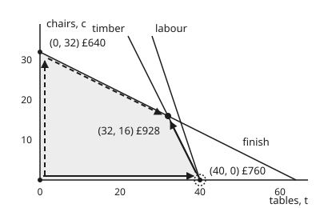

# The simplex method: walk the corners, improving on every move

[Syllabus](../../../SYLLABUS.md) → [Optimization](../README.md) → [Linear Programming](../README.md#s04) → The simplex method

---

## General Overview

A furniture workshop makes tables and chairs. A table earns £19 of profit and a chair £20. Each week the workshop has 160 metres of timber, 120 hours of labour and 64 litres of finish. A table takes 4 m of timber, 3 hours and 1 litre of finish. A chair takes 2 m, 1 hour and 2 litres. The aim is to **maximise** the week's profit.

[Corners are enough](02-corners-and-the-fundamental-theorem.md) showed that the best plan sits at a corner of the region of allowed plans. Here there are four corners; a plant with dozens of products and limits has far too many to list.

The **simplex method** lists none of them. (Here "simplex" names this method, not the triangle-like shape of the same name.) It starts at one corner and walks an edge along which profit rises, until the next wall stops it at a new corner. Then it asks again. When no edge leads uphill it stops, and the numbers it is holding prove that nothing does better.

From "make nothing" (£0), this card's run takes three moves. Move one makes 40 tables: £760. Move two changes the bookkeeping but not the plan: the workshop is still at 40 tables and £760, because three walls meet at that corner. That is a **degenerate pivot**.

Move three trades tables for chairs along the timber wall and lands on **32 tables and 16 chairs, £928 a week**. The last row of the table then hands back prices for timber (£3 a metre) and finish (£7 a litre). At those prices the week's materials are worth exactly £928, and no plan can earn more than its materials are worth.

**The simplex method keeps the limits as a table of equations solved at the current corner; each move picks a direction that raises profit, walks it until the first limit binds, and re-solves the table there, and when no direction raises profit the table's last row is a proof that the corner is best.**

**What kind of fact this is:** a method. That each move keeps the plan allowed, never lowers profit, and stops only at a proved best is a theorem, proved on this card in Why it works. That the method always finishes needs a rule against cycling; that rule's guarantee is stated here and proved in the source named.

### The picture: two walks to the same corner

<p align="center"></p>

Drawn to scale: tables across, chairs up; the shaded region is every allowed plan. The timber and labour lines both pass through (40, 0), so three walls meet there. Solid arrows: this card's run, tables first, three pivots; the dotted ring marks the pivot that does not move. Dashed arrows: Dantzig's rule, chairs first, two pivots through (0, 32).

---

## The formula

The workshop in the shelf's standard form, from [Corners are enough](02-corners-and-the-fundamental-theorem.md): maximise $c^Tx$ (the total profit: each variable times its profit per unit, added up) subject to $Ax = b$ and $x \ge 0$. Here $x = (t, c, s_1, s_2, s_3)$ lists five variables: $t$ tables, $c$ chairs, and one **slack** per limit, the timber, labour and finish left over. So timber reads $4t + 2c + s_1 = 160$. As on that card, the letter $c$ alone counts chairs, while in $c^Tx$ it is the profit list $(19, 20, 0, 0, 0)$.

A corner is a **basic feasible solution** ([Corners are enough](02-corners-and-the-fundamental-theorem.md)): three **basic** variables, one per limit, solved from the equations, and the other two, the **non-basic** ones, held at zero. The **tableau** is those equations written already solved for the basic variables, plus a profit row.

One simplex move, a **pivot**, is these two lines:

$$\theta = \min_{i\,:\,\bar a_{ij} > 0} \frac{\bar b_i}{\bar a_{ij}}, \qquad z_{\text{new}} = z_{\text{old}} + (-r_j)\,\theta .$$

**Read it aloud:** pick a column $j$ whose profit-row entry $r_j$ is negative; raise that variable until the first row runs out, which happens at the smallest ratio of right side to column entry over the rows where the entry is positive; profit rises by the gain per unit times that step.

| Symbol | Plain meaning | In our example | Push it up and the answer… |
| --- | --- | --- | --- |
| $x = (t, c, s_1, s_2, s_3)$ | tables and chairs made per week, then timber (m), labour (h) and finish (l) left over | (32, 16, 0, 8, 0) at the best plan | — |
| $c$; $c_B$, $c_N$ | profit per unit of each variable, £; its entries for the basic and non-basic variables | (19, 20, 0, 0, 0) | profit rises; past a point the best corner moves |
| $A$, $a_j$ | resource used per unit, one row per limit; $a_j$ its column $j$ | rows `[4, 2, 1, 0, 0]`, `[3, 1, 0, 1, 0]`, `[1, 2, 0, 0, 1]` | each unit uses more, so fewer fit |
| $b$ | resource available per week | (160, 120, 64) | more fits; profit rises by that resource's price, within a range |
| $B$, $N$; $x_B$, $x_N$ | the basic columns and the rest; their variables | after pivot 3, basic $c$, $t$, $s_2$ = 16, 32, 8 | — |
| $z$, $k$ | the week's profit in £ at the current corner; $k$ counts tableaus from 0 at the origin | 0, 760, 760, 928 for $k$ = 0 to 3 | — |
| $r_j$ | the **profit-row entry** of column $j$: minus the profit one more unit of variable $j$ adds, the other non-basic variables staying at zero | $-19$ for tables at the start | negative means that move is uphill |
| $\bar b_i$ | right side of row $i$ of the current tableau: the value of that row's basic variable now | 40 tables after pivot 1 | — |
| $\bar a_{ij}$ | entry of row $i$ in the entering column: how fast row $i$'s variable falls as variable $j$ rises | 4, 3 and 1 in pivot 1 | — |
| $\theta$ | the **step**: how far the entering variable rises | 40, then 0, then 8 | — |
| $y_i$ | **price** of resource $i$, read from the final profit row under slack $s_i$ | £3, £0, £7 | — |
| $n$ | number of variables in the Klee–Minty cube | 3 | its worst-case pivot count $2^n - 1$ doubles with each one |

### When it holds

- **Profit and limits are straight lines.** Twice the tables use twice the timber. If a cost curves, the best plan can sit in the middle of an edge, and walking corners misses it.
- **There is a starting corner.** Here every $b_i \ge 0$, so "make nothing" is allowed and the slacks are the first basic variables. A limit such as "make at least 10 chairs" puts the origin outside the region; then a first stage, **phase one**, solves a helper problem whose answer is a starting corner, or proves there is none.
- **The profit is bounded.** If the entering column has no positive entry, no limit ever stops the walk and profit grows without end: the program is unbounded, and the method says so instead of returning a plan.
- **A rule against cycling.** At a degenerate corner a pivot can have step 0. A careless rule can then cycle through the same tables forever: Beale's example does, below. Bland's rule (smallest index enters; among tied rows, smallest index leaves) never cycles.
- **Exact arithmetic, or tolerances.** The tests "$r_j < 0$" and "$\bar a_{ij} > 0$" are exact here because the code uses fractions. Floating-point solvers need tolerances, or a tiny rounding error picks the wrong row.

---

## Why it works

### Step 0: walk from basis to neighbouring basis, along edges, never through the middle

Each tableau holds the two non-basic variables at zero, as tight walls, and solves for the three basic ones ([Corners are enough](02-corners-and-the-fundamental-theorem.md)). Two bases are neighbours when they differ in one variable. Usually that means two corners joined by an edge. Where more walls meet than are needed, as at (40, 0), several bases name the same corner, and a move between two of them changes the table without moving the plan.

So a move lets one non-basic variable grow while the other stays at zero. That growing variable is the **entering** variable. The basic variable that hits zero first takes its place among the zeros: the **leaving** variable. The tableau, solved for the basic variables, says how each one changes as the entering variable grows. Everything below checks that the move is safe and that it helps.

### Step 1: the profit row says which edges go uphill

Write profit the same way: $z = z_{\text{now}} - \sum_j r_j \cdot (\text{variable } j)$, summed over the non-basic variables. At the origin this reads $z = 0 + 19t + 20c$, so the tableau stores $r = -19$ and $-20$. A negative $r_j$ says "raise variable $j$ and profit rises by $-r_j$ per unit". Either negative column is a legal choice. This card's run takes the first one, tables. **Dantzig's rule** takes the most negative, chairs.

### Step 2: the ratio test keeps every value allowed

Raise the entering variable by $\theta$. Row $i$'s basic variable becomes $\bar b_i - \bar a_{ij}\theta$. If $\bar a_{ij} \le 0$ that never falls below zero. If $\bar a_{ij} > 0$ it reaches zero at $\theta = \bar b_i / \bar a_{ij}$. So the largest safe step is the smallest of those ratios, which is the formula's $\theta$. Any larger step drives some resource negative: the plan would use timber the workshop does not have. If no entry in the column is positive, the step is unlimited and the program is unbounded.

### Step 3: the pivot re-solves the table at the new corner

The leaving row is divided by its pivot entry $\bar a_{ij}$, so the entering variable now has coefficient 1 there. That row, times a suitable number, is subtracted from every other row and from the profit row, clearing the entering column. These are the row moves of [Gaussian elimination](../../03-Algebra/05-Solving%20Systems/02-gaussian-elimination.md); they never change which points satisfy the equations. The new table is the same limits, solved for the new basic variables. Profit changes by $(-r_j)\theta$, which is never negative.

### Step 4: when no entry is negative, the corner is best

Suppose every $r_j \ge 0$. Every allowed plan has every variable $\ge 0$, so $z = z_{\text{now}} - \sum r_j \cdot(\text{variable})$ is at most $z_{\text{now}}$. No plan beats the current one. The workshop's final profit row reads $z = 928 - 3s_1 - 7s_3$: each metre of timber or litre of finish left unused costs £3 or £7 of profit.

The entries under the slacks are the prices $y = (3, 0, 7)$, and they give a second, independent proof. They **cover** each product's profit: a table uses $4 \times 3 + 3 \times 0 + 1 \times 7 = 19$ pounds' worth, a chair $2 \times 3 + 0 + 2 \times 7 = 20$.

So any plan's profit is at most the value of the resources it uses, which is at most $160 \times 3 + 120 \times 0 + 64 \times 7 = 928$. That bound meets the plan's £928, so the plan is best. Why the prices always exist and always meet the best profit is [LP duality](04-lp-duality-and-complementary-slackness.md).

### Step 5: why it stops, and when it might not

Each tableau is fixed by its set of basic variables, and there are only so many sets: here 10 ways to pick 3 basic columns of 5. If every step $\theta$ is positive, profit strictly rises, so no set comes back, and the walk ends. A step of 0 breaks that argument: profit stays put, and a rule could return to a set it has seen. That is **cycling**. Bland proved that choosing the smallest-index improving column, and the smallest-index basic variable among tied rows, never revisits a set, so the walk always ends (Bland 1977).

<details>
<summary>Detailed proof: the stopping test and the price bound, in matrix form</summary>

Let $B$ be the columns of the basic variables and $N$ the rest, so $Bx_B + Nx_N = b$. Solving, $x_B = B^{-1}b - B^{-1}N x_N$: these are the tableau's rows, with $\bar b = B^{-1}b$ and the columns $B^{-1}a_j$.

Profit is $c_B^Tx_B + c_N^Tx_N = c_B^TB^{-1}b - (c_B^TB^{-1}N - c_N^T)\,x_N$. So the profit row holds $r_N = c_B^TB^{-1}N - c_N^T$ and $z_{\text{now}} = c_B^TB^{-1}b$.

If $r_N \ge 0$, every allowed point has $x_N \ge 0$, so its profit is at most $z_{\text{now}}$. That is the stopping test.

Write $y^T = c_B^TB^{-1}$. A slack column is all zeros except a 1 in its own row, with zero profit, so its profit-row entry is $y_i$; the stopping test says $y \ge 0$. A product column $j$ has entry $y^Ta_j - c_j \ge 0$, so $A^Ty \ge c$. For any allowed $x$: $c^Tx \le (A^Ty)^Tx = y^T(Ax) \le y^Tb$, using $x \ge 0$ and then $y \ge 0$. And $y^Tb = c_B^TB^{-1}b = z_{\text{now}}$. So the bound meets the current profit.

The ratio test: along the edge, $x_B(\theta) = \bar b - \theta\,B^{-1}a_j$, and the smallest ratio over positive entries is the largest $\theta$ with $x_B(\theta) \ge 0$. The pivot is an invertible row operation, so the new table describes the same set of solutions.

</details>

### How fast: pivots, and the cost of each

One pivot is one elimination pass over the tableau: here 4 rows of 6 numbers. The question is how many pivots. In the worst case, very many: Klee and Minty built a squashed cube on which Dantzig's rule visits every corner, $2^n - 1$ pivots for $n$ variables. The code runs the 3-variable cube and counts 7 pivots, through every corner of the cube.

In practice the count stays small, and smoothed analysis (Spielman and Teng 2004) explains why: shake the data a little at random and, under the shadow-vertex pivot rule (which follows the outline of the region's shadow cast onto a plane), the expected number of pivots becomes polynomial in the problem's size. Methods with a polynomial worst case exist too: [Interior point for linear programs](08-interior-point-for-lp-and-complexity.md).

---

## Worked numbers, by hand

The start is the origin, tableau $k = 0$: basic variables $s_1, s_2, s_3$ equal to 160, 120 and 64; profit 0. The run below enters the first column with a negative profit-row entry, and where the ratio test ties it takes labour out.

| Step | Arithmetic | Value |
| --- | --- | --- |
| pivot 1: entering column | profit row $-19$, $-20$; first negative is tables | $t$ enters |
| pivot 1: ratio test | $160/4,\ 120/3,\ 64/1$ | 40, 40, 64: a tie; $s_2$ (labour) leaves |
| pivot 1: profit | $0 + 19 \times 40$ | £760 at (40, 0) |
| pivot 2: entering column | chairs' entry $-20 + 19 \times \tfrac13$ | $-41/3$: $c$ enters |
| pivot 2: ratio test | $0 \div \tfrac23,\ 40 \div \tfrac13,\ 24 \div \tfrac53$ | 0, 120, 14.4: $s_1$ (timber) leaves |
| pivot 2: profit | $760 + \tfrac{41}{3} \times 0$ | £760, still at (40, 0): degenerate |
| pivot 3: entering column | profit row: only $s_2$ is negative | $-21$: $s_2$ enters |
| pivot 3: ratio test | $c$ row entry $-2$ skipped; $40 \div 1,\ 24 \div 3$ | 40, 8: $s_3$ (finish) leaves |
| pivot 3: profit | $760 + 21 \times 8$ | £928 at (32, 16) |
| stopping test | profit row 0, 0, 3, 0, 7 | none negative: stop |
| price bound | $160 \times 3 + 120 \times 0 + 64 \times 7$ | 928, equal to the profit |
| **answer** | 3 pivots, steps 40, 0, 8 | **32 tables, 16 chairs, £928 a week** |

Make 32 tables and 16 chairs. Timber and finish are used to the last metre and litre, and 8 labour hours a week are spare. The prices, £3 a metre of timber and £7 a litre of finish, prove that no plan earns more.

Pivot 3 reads plainly. Labour slack $s_2$ enters: the workshop leaves some labour hours unused. With timber held full, each spare hour means one table fewer and two chairs more, £21 better off, until finish runs out after 8 hours.

### What breaks if you drop a piece

| Mistake | Comes out at | What went wrong |
| --- | --- | --- |
| Skip the ratio test in pivot 1: take finish out | (64, 0), "earning" £1,216 | That plan needs timber slack $-96$ m and labour slack $-72$ h: it uses resources the workshop does not have |
| Stop at the first pivot with step 0 | £760, short by £168 | A step of 0 means a degenerate corner, not the best one; the profit row still had $-41/3$ |
| Dantzig's rule, lowest index leaving, on Beale's example (four variables, three limits) | profit 0 after each of 6 pivots, then back to the starting basis | Cycling: the hypothesis "every step is positive" fails, and the rule loops forever. Bland's rule ends after 6 pivots at the optimum, 1.25 |
| Dantzig's rule on the 3-variable Klee–Minty cube | 7 pivots for profit 10000, every corner visited | Each pivot improves, but the rule's greed is a bad guide: the worst case is $2^n - 1$ |

---

## How the tableau moves: four tables, three pivots

Each table below is the workshop's three limits plus the profit row, solved at the current corner. The row label is the basic variable that row is solved for. The pivot entry, the one its row is divided by, is in bold brackets.

**Tableau $k = 0$, at (0, 0), profit £0.**

| basic | $t$ | $c$ | $s_1$ | $s_2$ | $s_3$ | right side |
| --- | ---: | ---: | ---: | ---: | ---: | ---: |
| $s_1$ (timber) | 4 | 2 | 1 | 0 | 0 | 160 |
| $s_2$ (labour) | **[3]** | 1 | 0 | 1 | 0 | 120 |
| $s_3$ (finish) | 1 | 2 | 0 | 0 | 1 | 64 |
| $z$ | −19 | −20 | 0 | 0 | 0 | 0 |

**After pivot 1, at (40, 0), profit £760.** Timber's right side is 0: the timber wall passes through this corner too.

| basic | $t$ | $c$ | $s_1$ | $s_2$ | $s_3$ | right side |
| --- | ---: | ---: | ---: | ---: | ---: | ---: |
| $s_1$ | 0 | **[2/3]** | 1 | −4/3 | 0 | 0 |
| $t$ | 1 | 1/3 | 0 | 1/3 | 0 | 40 |
| $s_3$ | 0 | 5/3 | 0 | −1/3 | 1 | 24 |
| $z$ | 0 | −41/3 | 0 | 19/3 | 0 | 760 |

**After pivot 2, still at (40, 0), profit £760.** Chairs are basic at value 0; timber slack has left. The point did not move.

| basic | $t$ | $c$ | $s_1$ | $s_2$ | $s_3$ | right side |
| --- | ---: | ---: | ---: | ---: | ---: | ---: |
| $c$ | 0 | 1 | 3/2 | −2 | 0 | 0 |
| $t$ | 1 | 0 | −1/2 | 1 | 0 | 40 |
| $s_3$ | 0 | 0 | −5/2 | **[3]** | 1 | 24 |
| $z$ | 0 | 0 | 41/2 | −21 | 0 | 760 |

**After pivot 3, at (32, 16), profit £928.** No negative entry in the profit row: stop.

| basic | $t$ | $c$ | $s_1$ | $s_2$ | $s_3$ | right side |
| --- | ---: | ---: | ---: | ---: | ---: | ---: |
| $c$ | 0 | 1 | −1/6 | 0 | 2/3 | 16 |
| $t$ | 1 | 0 | 1/3 | 0 | −1/3 | 32 |
| $s_2$ | 0 | 0 | −5/6 | 1 | 1/3 | 8 |
| $z$ | 0 | 0 | 3 | 0 | 7 | 928 |

The degenerate pivot was not wasted. It changed which walls the table is written against, from the labour wall to the timber wall, and only from the timber wall does an uphill edge show. Profit after each pivot, for the two rules:

```
tables first, pivot 0 |                                   0
tables first, pivot 1 |##########################       760
tables first, pivot 2 |##########################       760
tables first, pivot 3 |################################ 928
Dantzig, pivot 1      |######################           640
Dantzig, pivot 2      |################################ 928
```

Here Dantzig's greedier first step, chairs at £20, happens to avoid the degenerate corner. Breaking pivot 1's tie the other way, timber out, avoids only the zero-length pivot: the walk still stops at the degenerate corner (40, 0), but labour slack stays in the basis there at 0, so the next pivot already moves to (32, 16). Two pivots, both with a positive step.

---

## Code, from first principles, and it actually runs

Nothing imported knows linear programming: Python uses exact fractions, Rust its own fraction type. There are **three independent roads** to the answer. Road one is the simplex walk, printing every tableau. Road two takes the prices from the final profit row and checks them directly: they cover each product's profit, and their bound equals £928. Road three lists every corner by crossing each pair of walls and keeping the crossings that obey all the limits. The code also runs Dantzig's rule, the tie broken the other way, Beale's example under both rules, and the Klee–Minty cube.

### Python

```python
# The simplex method -- the check behind the card.  Standard library only.
# Every number on the card is printed here, in exact fractions.  Roads to the
# answer: the tableau walk; the prices read off its last row, checked against
# every limit; every corner of the region listed by crossing pairs of walls.
from fractions import Fraction as F
from itertools import combinations
from math import comb

def show(q, dec=4):               # whole number, short decimal, or a/b
    q = F(q)
    for k in range(dec):
        if (q * 10**k).denominator == 1:
            s = str(abs(q.numerator * 10**k // q.denominator)).rjust(k + 1, "0")
            return ("-" if q < 0 else "") + (s[:-k] + "." + s[-k:] if k else s)
    return f"{q.numerator}/{q.denominator}"

def pivot(T, z, basis, r, j):     # row r's basic variable leaves, column j enters
    p = T[r][j]; T[r] = [v / p for v in T[r]]
    for i in range(len(T)):
        if i != r:
            f = T[i][j]
            T[i] = [a - f * q for a, q in zip(T[i], T[r])]
    f = z[j]; z[:] = [a - f * q for a, q in zip(z, T[r])]; basis[r] = j

def start(A, b, c):               # slack basis: the origin, profit 0
    m = len(A)
    T = [[F(v) for v in A[i]] + [F(int(i == k)) for k in range(m)] + [F(b[i])] for i in range(m)]
    return T, [F(-v) for v in c] + [F(0)] * (m + 1), list(range(len(c), len(c) + m))

def point(T, basis, n):
    x = [F(0)] * n
    for i, bv in enumerate(basis):
        if bv < n:
            x[bv] = T[i][-1]
    return x

def simplex(A, b, c, enter="first", tie="high", cap=60, say=None):
    T, z, basis = start(A, b, c)
    n, m, log, seen = len(c), len(A), [], [sorted(basis)]
    while len(log) < cap:
        neg = [j for j in range(n + m) if z[j] < 0]   # columns that still raise profit
        if not neg:
            return T, z, basis, log, "optimal"
        j = neg[0] if enter == "first" else min(neg, key=lambda k: (z[k], k))
        rat = [T[i][-1] / T[i][j] if T[i][j] > 0 else None for i in range(m)]
        best = min(r for r in rat if r is not None)    # ratio test
        ties = [i for i in range(m) if rat[i] == best]
        r = (min if tie == "low" else max)(ties, key=lambda i: basis[i])
        out = basis[r]
        pivot(T, z, basis, r, j)
        log.append((j, out, best, z[-1], point(T, basis, n + m)))
        if say:
            say(len(log), j, out, rat, len(ties) > 1, T, z, basis)
        if sorted(basis) in seen:
            return T, z, basis, log, f"back to the basis of pivot {seen.index(sorted(basis))}"
        seen.append(sorted(basis))
    return T, z, basis, log, "cap"

NAME = ["t", "c", "s1", "s2", "s3"]
def table(T, z, basis):
    for i, row in enumerate(T + [z]):
        lab = NAME[basis[i]] if i < len(T) else "z"
        print(f"  {lab:>2} | " + " ".join(show(v, 1).rjust(5) for v in row[:-1]) + " | " + show(row[-1]))

def say(k, j, out, rat, tie, T, z, basis):
    x = point(T, basis, 2)
    rs = ", ".join("-" if r is None else show(r) for r in rat)
    print(f"pivot {k}: {NAME[j]} enters; ratios {rs}{'; tie' if tie else ''}; {NAME[out]} leaves; "
          f"point ({show(x[0])}, {show(x[1])}); profit {show(z[-1])}")
    table(T, z, basis)

A, b, c = [[4, 2], [3, 1], [1, 2]], [160, 120, 64], [19, 20]
print("maximise 19 t + 20 c pounds: timber 4,2 <= 160 m; labour 3,1 <= 120 h; finish 1,2 <= 64 l")
print("columns:   t     c    s1    s2    s3 | right side")
T0, z0, b0 = start(A, b, c)
print("tableau k=0: point (0, 0); profit 0")
table(T0, z0, b0)
T, z, basis, log, st = simplex(A, b, c, say=say)
x, y = point(T, basis, 2), z[2:5]                     # prices sit under the slack columns
print(f"stop: {st} after {len(log)} pivots; steps " + ", ".join(show(l[2]) for l in log)
      + f"; make {show(x[0])} tables, {show(x[1])} chairs, profit {show(z[-1])}")
print(f"prices: timber {show(y[0])}, labour {show(y[1])}, finish {show(y[2])}; bound "
      f"{' + '.join(f'{b[i]}*{show(y[i])}' for i in range(3))} = {show(sum(b[i] * y[i] for i in range(3)))}")
cover = [sum(A[i][j] * y[i] for i in range(3)) for j in range(2)]
print(f"prices cover each profit: tables {show(cover[0])} >= 19, chairs {show(cover[1])} >= 20")
walls = A + [[-1, 0], [0, -1]]
lims = b + [0, 0]
corners = {}
for p, q in combinations(range(5), 2):                 # cross every pair of walls
    (a1, a2), (a3, a4) = walls[p], walls[q]
    d = F(a1 * a4 - a2 * a3)
    if d:
        pt = ((lims[p] * a4 - a2 * lims[q]) / d, (a1 * lims[q] - lims[p] * a3) / d)
        if all(w[0] * pt[0] + w[1] * pt[1] <= l for w, l in zip(walls, lims)):
            corners[pt] = 19 * pt[0] + 20 * pt[1]
print("corners: " + "; ".join(f"({show(p[0])}, {show(p[1])}) {show(v)}" for p, v in sorted(corners.items())))
tight = sum(w[0] * 40 + w[1] * 0 == l for w, l in zip(walls, lims))
print(f"walls tight at (40, 0): {tight} for 2 unknowns, so the corner is degenerate; {comb(5, 3)} ways to pick 3 basic columns of 5")
_, zd, _, ld, _ = simplex(A, b, c, enter="dantzig")
print("Dantzig's rule: " + " -> ".join(f"({show(l[4][0])}, {show(l[4][1])}) {show(l[3])}" for l in ld) + f"; {len(ld)} pivots")
_, _, _, lb, _ = simplex(A, b, c, tie="low")
print("tie broken by timber: " + " -> ".join(f"({show(l[4][0])}, {show(l[4][1])}) {show(l[3])}" for l in lb)
      + f"; {len(lb)} pivots; after pivot 1, {NAME[lb[0][1]]} has left and s2 = {show(lb[0][4][3])}")
Tm, zm, bm = start(A, b, c)
pivot(Tm, zm, bm, 2, 0)                                # skip the ratio test: finish leaves
print(f"break, no ratio test: point ({show(Tm[2][-1])}, 0), timber slack {show(Tm[0][-1])}, "
      f"labour slack {show(Tm[1][-1])}, claimed profit {show(zm[-1])}")
first0 = next(l for l in log if l[2] == 0)
print(f"break, stop at the step-0 pivot: profit {show(first0[3])}, short by {show(z[-1] - first0[3])}")
BA = [[F(1, 4), -8, -1, 9], [F(1, 2), -12, F(-1, 2), 3], [0, 0, 1, 0]]
BB, BC = [0, 0, 1], [F(3, 4), -20, F(1, 2), -6]
_, _, _, lbe, sbe = simplex(BA, BB, BC, enter="dantzig", tie="low")
Tb, zb, bb, lbl, sbl = simplex(BA, BB, BC, enter="first", tie="low")
print(f"Beale, Dantzig's rule: profit after each pivot {', '.join(show(l[3]) for l in lbe)}; {sbe}")
xb, yb = point(Tb, bb, 4), zb[4:7]
print(f"Beale, Bland's rule: {sbl} after {len(lbl)} pivots, profit {show(zb[-1])}, "
      f"x = ({', '.join(show(v) for v in xb)}), prices ({', '.join(show(v) for v in yb)})")
KA, KB, KC = [[1, 0, 0], [20, 1, 0], [200, 20, 1]], [1, 100, 10000], [100, 10, 1]
_, zk, _, lk, _ = simplex(KA, KB, KC, enter="dantzig")
print(f"Klee-Minty cube, 3 variables, Dantzig's rule: {len(lk)} pivots to profit {show(zk[-1])}")
for lab, bb2 in [("finish 70 l", [160, 120, 70]), ("labour 130 h", [160, 130, 64])]:
    Tt, zt, bt, lt, _ = simplex(A, bb2, c)
    xt = point(Tt, bt, 2)
    print(f"try {lab}: ({show(xt[0])}, {show(xt[1])}), profit {show(zt[-1])}, {len(lt)} pivots, "
          f"{sum(l[2] == 0 for l in lt)} with step 0")
print("figure, px = 50 + 5*t, py = 225 - 5*c: corners " + " ".join(
    f"({show(50 + 5 * p[0])},{show(225 - 5 * p[1])})" for p in sorted(corners)) + "; timber to (160,45), labour to (190,45), finish to (370,225)")

best = max(corners.values())
assert x == [32, 16] and z[-1] == best == 928 and len(log) == 3     # walk meets enumeration
assert all(v >= 0 for v in y) and cover[0] >= 19 and cover[1] >= 20  # prices are a valid bound
assert sum(b[i] * y[i] for i in range(3)) == best                    # bound meets the best corner
assert log[1][2] == 0 and log[1][4] == log[0][4] and tight == 3      # the degenerate pivot
assert zd[-1] == best and len(ld) == 2 and len(lb) == 2 and lb[0][1] == 2 and lb[0][4][3] == 0
assert sbe == "back to the basis of pivot 0" and len(lbe) == 6       # cycling without Bland
assert sbl == "optimal" and zb[-1] == sum(BC[j] * xb[j] for j in range(4)) == sum(BB[i] * yb[i] for i in range(3)) == F(5, 4)
assert len(lk) == 2**3 - 1 and zk[-1] == 10000
print("ALL CHECKS PASS")
```

**Ran 2026-11-11 on macOS, Python 3.14.10, standard library only. All checks passed. Output, pasted from the run:**

```
maximise 19 t + 20 c pounds: timber 4,2 <= 160 m; labour 3,1 <= 120 h; finish 1,2 <= 64 l
columns:   t     c    s1    s2    s3 | right side
tableau k=0: point (0, 0); profit 0
  s1 |     4     2     1     0     0 | 160
  s2 |     3     1     0     1     0 | 120
  s3 |     1     2     0     0     1 | 64
   z |   -19   -20     0     0     0 | 0
pivot 1: t enters; ratios 40, 40, 64; tie; s2 leaves; point (40, 0); profit 760
  s1 |     0   2/3     1  -4/3     0 | 0
   t |     1   1/3     0   1/3     0 | 40
  s3 |     0   5/3     0  -1/3     1 | 24
   z |     0 -41/3     0  19/3     0 | 760
pivot 2: c enters; ratios 0, 120, 14.4; s1 leaves; point (40, 0); profit 760
   c |     0     1   3/2    -2     0 | 0
   t |     1     0  -1/2     1     0 | 40
  s3 |     0     0  -5/2     3     1 | 24
   z |     0     0  41/2   -21     0 | 760
pivot 3: s2 enters; ratios -, 40, 8; s3 leaves; point (32, 16); profit 928
   c |     0     1  -1/6     0   2/3 | 16
   t |     1     0   1/3     0  -1/3 | 32
  s2 |     0     0  -5/6     1   1/3 | 8
   z |     0     0     3     0     7 | 928
stop: optimal after 3 pivots; steps 40, 0, 8; make 32 tables, 16 chairs, profit 928
prices: timber 3, labour 0, finish 7; bound 160*3 + 120*0 + 64*7 = 928
prices cover each profit: tables 19 >= 19, chairs 20 >= 20
corners: (0, 0) 0; (0, 32) 640; (32, 16) 928; (40, 0) 760
walls tight at (40, 0): 3 for 2 unknowns, so the corner is degenerate; 10 ways to pick 3 basic columns of 5
Dantzig's rule: (0, 32) 640 -> (32, 16) 928; 2 pivots
tie broken by timber: (40, 0) 760 -> (32, 16) 928; 2 pivots; after pivot 1, s1 has left and s2 = 0
break, no ratio test: point (64, 0), timber slack -96, labour slack -72, claimed profit 1216
break, stop at the step-0 pivot: profit 760, short by 168
Beale, Dantzig's rule: profit after each pivot 0, 0, 0, 0, 0, 0; back to the basis of pivot 0
Beale, Bland's rule: optimal after 6 pivots, profit 1.25, x = (1, 0, 1, 0), prices (0, 1.5, 1.25)
Klee-Minty cube, 3 variables, Dantzig's rule: 7 pivots to profit 10000
try finish 70 l: (30, 20), profit 970, 3 pivots, 1 with step 0
try labour 130 h: (32, 16), profit 928, 2 pivots, 0 with step 0
figure, px = 50 + 5*t, py = 225 - 5*c: corners (50,225) (50,65) (210,145) (250,225); timber to (160,45), labour to (190,45), finish to (370,225)
ALL CHECKS PASS
```

### Rust

```rust
// The simplex method -- the check behind the card.  std only, no crates.
// Exact fractions from a small rational type.  Roads to the answer: the tableau
// walk; the prices read off its last row, checked against every limit; every
// corner of the region listed by crossing pairs of walls.
use std::cmp::Ordering;
use std::ops::{Add, Div, Mul, Sub};

#[derive(Clone, Copy, PartialEq, Eq, Debug)]
struct Q { n: i128, d: i128 }
fn gcd(a: i128, b: i128) -> i128 { if b == 0 { a.abs() } else { gcd(b, a % b) } }
fn q(n: i128, d: i128) -> Q { let g = gcd(n, d) * d.signum(); Q { n: n / g, d: d / g } }
fn z(n: i128) -> Q { q(n, 1) }
impl Add for Q { type Output = Q; fn add(self, o: Q) -> Q { q(self.n * o.d + o.n * self.d, self.d * o.d) } }
impl Sub for Q { type Output = Q; fn sub(self, o: Q) -> Q { q(self.n * o.d - o.n * self.d, self.d * o.d) } }
impl Mul for Q { type Output = Q; fn mul(self, o: Q) -> Q { q(self.n * o.n, self.d * o.d) } }
impl Div for Q { type Output = Q; fn div(self, o: Q) -> Q { q(self.n * o.d, self.d * o.n) } }
impl PartialOrd for Q { fn partial_cmp(&self, o: &Q) -> Option<Ordering> { Some(self.cmp(o)) } }
impl Ord for Q { fn cmp(&self, o: &Q) -> Ordering { (self.n * o.d).cmp(&(o.n * self.d)) } }

fn show(v: Q, dec: u32) -> String { // whole number, short decimal, or a/b
    for k in 0..dec {
        let p = 10i128.pow(k);
        if (v.n * p) % v.d == 0 {
            let s = format!("{:0>w$}", ((v.n * p) / v.d).abs(), w = k as usize + 1);
            let body = if k > 0 { format!("{}.{}", &s[..s.len() - k as usize], &s[s.len() - k as usize..]) } else { s };
            return format!("{}{}", if v.n < 0 { "-" } else { "" }, body);
        }
    }
    format!("{}/{}", v.n, v.d)
}
fn sh(v: Q) -> String { show(v, 4) }

type Tab = (Vec<Vec<Q>>, Vec<Q>, Vec<usize>);
fn start(a: &[Vec<Q>], b: &[Q], c: &[Q]) -> Tab {
    let (m, n) = (a.len(), c.len());
    let t = (0..m).map(|i| { let mut r = a[i].clone(); for k in 0..m { r.push(z((i == k) as i128)); } r.push(b[i]); r }).collect();
    let mut zr: Vec<Q> = c.iter().map(|&v| z(0) - v).collect();
    zr.extend(vec![z(0); m + 1]);
    (t, zr, (n..n + m).collect())
}
fn pivot(s: &mut Tab, r: usize, j: usize) { // row r's basic variable leaves, column j enters
    let p = s.0[r][j];
    s.0[r] = s.0[r].iter().map(|&v| v / p).collect();
    let pr = s.0[r].clone();
    for i in 0..s.0.len() { if i != r { let f = s.0[i][j]; s.0[i] = s.0[i].iter().zip(&pr).map(|(&a, &b)| a - f * b).collect(); } }
    let f = s.1[j];
    s.1 = s.1.iter().zip(&pr).map(|(&a, &b)| a - f * b).collect();
    s.2[r] = j;
}
fn point(s: &Tab, n: usize) -> Vec<Q> {
    let mut x = vec![z(0); n];
    for (i, &bv) in s.2.iter().enumerate() { if bv < n { x[bv] = *s.0[i].last().unwrap(); } }
    x
}
const NAME: [&str; 5] = ["t", "c", "s1", "s2", "s3"];
fn table(s: &Tab) {
    for i in 0..=s.0.len() {
        let row = if i < s.0.len() { &s.0[i] } else { &s.1 };
        let lab = if i < s.0.len() { NAME[s.2[i]] } else { "z" };
        let cells: Vec<String> = row[..row.len() - 1].iter().map(|&v| format!("{:>5}", show(v, 1))).collect();
        println!("  {:>2} | {} | {}", lab, cells.join(" "), sh(*row.last().unwrap()));
    }
}
struct Step { best: Q, zv: Q, x: Vec<Q>, out: usize }
fn simplex(a: &[Vec<Q>], b: &[Q], c: &[Q], dantzig: bool, low: bool, say: bool) -> (Tab, Vec<Step>, String) {
    let mut s = start(a, b, c);
    let (n, m) = (c.len(), a.len());
    let mut log: Vec<Step> = vec![];
    let mut seen = vec![{ let mut v = s.2.clone(); v.sort(); v }];
    while log.len() < 60 {
        let neg: Vec<usize> = (0..n + m).filter(|&j| s.1[j] < z(0)).collect(); // columns that still raise profit
        if neg.is_empty() { return (s, log, "optimal".to_string()); }
        let j = if dantzig { *neg.iter().min_by(|&&p, &&k| s.1[p].cmp(&s.1[k]).then(p.cmp(&k))).unwrap() } else { neg[0] };
        let rat: Vec<Option<Q>> = (0..m).map(|i| if s.0[i][j] > z(0) { Some(*s.0[i].last().unwrap() / s.0[i][j]) } else { None }).collect();
        let best = rat.iter().flatten().min().copied().unwrap(); // ratio test
        let ties: Vec<usize> = (0..m).filter(|&i| rat[i] == Some(best)).collect();
        let r = if low { *ties.iter().min_by_key(|&&i| s.2[i]).unwrap() } else { *ties.iter().max_by_key(|&&i| s.2[i]).unwrap() };
        let out = s.2[r];
        pivot(&mut s, r, j);
        log.push(Step { best, zv: *s.1.last().unwrap(), x: point(&s, n + m), out });
        if say {
            let rs: Vec<String> = rat.iter().map(|r| r.map_or("-".to_string(), sh)).collect();
            println!("pivot {}: {} enters; ratios {}{}; {} leaves; point ({}, {}); profit {}", log.len(), NAME[j], rs.join(", "),
                if ties.len() > 1 { "; tie" } else { "" }, NAME[out], sh(log.last().unwrap().x[0]), sh(log.last().unwrap().x[1]), sh(s.1[5]));
            table(&s);
        }
        let mut key = s.2.clone(); key.sort();
        if let Some(p) = seen.iter().position(|k| *k == key) { return (s, log, format!("back to the basis of pivot {}", p)); }
        seen.push(key);
    }
    (s, log, "cap".to_string())
}
fn qm(v: &[&[i128]]) -> Vec<Vec<Q>> { v.iter().map(|r| r.iter().map(|&x| z(x)).collect()).collect() }
fn qv(v: &[i128]) -> Vec<Q> { v.iter().map(|&x| z(x)).collect() }
fn path(l: &[Step]) -> String { l.iter().map(|s| format!("({}, {}) {}", sh(s.x[0]), sh(s.x[1]), sh(s.zv))).collect::<Vec<_>>().join(" -> ") }

fn main() {
    let (a, b, c) = (qm(&[&[4, 2], &[3, 1], &[1, 2]]), qv(&[160, 120, 64]), qv(&[19, 20]));
    println!("maximise 19 t + 20 c pounds: timber 4,2 <= 160 m; labour 3,1 <= 120 h; finish 1,2 <= 64 l");
    println!("columns:   t     c    s1    s2    s3 | right side");
    println!("tableau k=0: point (0, 0); profit 0");
    table(&start(&a, &b, &c));
    let (s, log, st) = simplex(&a, &b, &c, false, false, true);
    let (x, y) = (point(&s, 2), s.1[2..5].to_vec()); // prices sit under the slack columns
    let steps: Vec<String> = log.iter().map(|l| sh(l.best)).collect();
    println!("stop: {} after {} pivots; steps {}; make {} tables, {} chairs, profit {}", st, log.len(), steps.join(", "), sh(x[0]), sh(x[1]), sh(s.1[5]));
    let bound = (0..3).fold(z(0), |acc, i| acc + b[i] * y[i]);
    let terms: Vec<String> = (0..3).map(|i| format!("{}*{}", sh(b[i]), sh(y[i]))).collect();
    println!("prices: timber {}, labour {}, finish {}; bound {} = {}", sh(y[0]), sh(y[1]), sh(y[2]), terms.join(" + "), sh(bound));
    let cover: Vec<Q> = (0..2).map(|j| (0..3).fold(z(0), |acc, i| acc + a[i][j] * y[i])).collect();
    println!("prices cover each profit: tables {} >= 19, chairs {} >= 20", sh(cover[0]), sh(cover[1]));
    let walls = qm(&[&[4, 2], &[3, 1], &[1, 2], &[-1, 0], &[0, -1]]);
    let lims = qv(&[160, 120, 64, 0, 0]);
    let mut corners: Vec<((Q, Q), Q)> = vec![];
    for p in 0..5 { for r in p + 1..5 { // cross every pair of walls
        let (a1, a2, a3, a4) = (walls[p][0], walls[p][1], walls[r][0], walls[r][1]);
        let d = a1 * a4 - a2 * a3;
        if d == z(0) { continue; }
        let pt = ((lims[p] * a4 - a2 * lims[r]) / d, (a1 * lims[r] - lims[p] * a3) / d);
        if (0..5).all(|w| walls[w][0] * pt.0 + walls[w][1] * pt.1 <= lims[w]) && !corners.iter().any(|k| k.0 == pt) {
            corners.push((pt, z(19) * pt.0 + z(20) * pt.1));
        }
    } }
    corners.sort();
    let cs: Vec<String> = corners.iter().map(|(p, v)| format!("({}, {}) {}", sh(p.0), sh(p.1), sh(*v))).collect();
    println!("corners: {}", cs.join("; "));
    let tight = (0..5).filter(|&w| walls[w][0] * z(40) == lims[w]).count();
    println!("walls tight at (40, 0): {} for 2 unknowns, so the corner is degenerate; {} ways to pick 3 basic columns of 5", tight, (5 * 4 * 3) / (3 * 2));
    let (sd, ld, _) = simplex(&a, &b, &c, true, false, false);
    println!("Dantzig's rule: {}; {} pivots", path(&ld), ld.len());
    let (_, lb, _) = simplex(&a, &b, &c, false, true, false);
    println!("tie broken by timber: {}; {} pivots; after pivot 1, {} has left and s2 = {}", path(&lb), lb.len(), NAME[lb[0].out], sh(lb[0].x[3]));
    let mut tm = start(&a, &b, &c);
    pivot(&mut tm, 2, 0); // skip the ratio test: finish leaves
    println!("break, no ratio test: point ({}, 0), timber slack {}, labour slack {}, claimed profit {}", sh(tm.0[2][5]), sh(tm.0[0][5]), sh(tm.0[1][5]), sh(tm.1[5]));
    let first0 = log.iter().find(|l| l.best == z(0)).unwrap();
    println!("break, stop at the step-0 pivot: profit {}, short by {}", sh(first0.zv), sh(s.1[5] - first0.zv));
    let ba = vec![vec![q(1, 4), z(-8), z(-1), z(9)], vec![q(1, 2), z(-12), q(-1, 2), z(3)], qv(&[0, 0, 1, 0])];
    let (bb, bc) = (qv(&[0, 0, 1]), vec![q(3, 4), z(-20), q(1, 2), z(-6)]);
    let (_, lbe, sbe) = simplex(&ba, &bb, &bc, true, true, false);
    let (tb, lbl, sbl) = simplex(&ba, &bb, &bc, false, true, false);
    let pe: Vec<String> = lbe.iter().map(|l| sh(l.zv)).collect();
    println!("Beale, Dantzig's rule: profit after each pivot {}; {}", pe.join(", "), sbe);
    let (xb, yb) = (point(&tb, 4), tb.1[4..7].to_vec());
    let js = |v: &[Q]| v.iter().map(|&w| sh(w)).collect::<Vec<_>>().join(", ");
    println!("Beale, Bland's rule: {} after {} pivots, profit {}, x = ({}), prices ({})", sbl, lbl.len(), sh(tb.1[7]), js(&xb), js(&yb));
    let (ka, kb, kc) = (qm(&[&[1, 0, 0], &[20, 1, 0], &[200, 20, 1]]), qv(&[1, 100, 10000]), qv(&[100, 10, 1]));
    let (sk, lk, _) = simplex(&ka, &kb, &kc, true, false, false);
    println!("Klee-Minty cube, 3 variables, Dantzig's rule: {} pivots to profit {}", lk.len(), sh(sk.1[6]));
    for (lab, b2) in [("finish 70 l", [160, 120, 70]), ("labour 130 h", [160, 130, 64])] {
        let (st2, lt, _) = simplex(&a, &qv(&b2), &c, false, false, false);
        let xt = point(&st2, 2);
        println!("try {}: ({}, {}), profit {}, {} pivots, {} with step 0", lab, sh(xt[0]), sh(xt[1]), sh(st2.1[5]), lt.len(), lt.iter().filter(|l| l.best == z(0)).count());
    }
    let fc: Vec<String> = corners.iter().map(|(p, _)| format!("({},{})", sh(z(50) + z(5) * p.0), sh(z(225) - z(5) * p.1))).collect();
    println!("figure, px = 50 + 5*t, py = 225 - 5*c: corners {}; timber to (160,45), labour to (190,45), finish to (370,225)", fc.join(" "));

    let best = corners.iter().map(|k| k.1).max().unwrap();
    assert!(x == qv(&[32, 16]) && s.1[5] == best && best == z(928) && log.len() == 3); // walk meets enumeration
    assert!(y.iter().all(|&v| v >= z(0)) && cover[0] >= z(19) && cover[1] >= z(20)); // prices are a valid bound
    assert!(bound == best); // bound meets the best corner
    assert!(log[1].best == z(0) && log[1].x == log[0].x && tight == 3); // the degenerate pivot
    assert!(sd.1[5] == best && ld.len() == 2 && lb.len() == 2 && lb[0].out == 2 && lb[0].x[3] == z(0));
    assert!(sbe == "back to the basis of pivot 0" && lbe.len() == 6); // cycling without Bland
    let val = (0..4).fold(z(0), |acc, j| acc + bc[j] * xb[j]);
    let dual = (0..3).fold(z(0), |acc, i| acc + bb[i] * yb[i]);
    assert!(sbl == "optimal" && tb.1[7] == val && val == dual && dual == q(5, 4));
    assert!(lk.len() == 7 && sk.1[6] == z(10000));
    println!("ALL CHECKS PASS");
}
```

**Ran 2026-11-11 on macOS, rustc 1.98.1, no crates. All checks passed. Output, pasted from the run:**

```
maximise 19 t + 20 c pounds: timber 4,2 <= 160 m; labour 3,1 <= 120 h; finish 1,2 <= 64 l
columns:   t     c    s1    s2    s3 | right side
tableau k=0: point (0, 0); profit 0
  s1 |     4     2     1     0     0 | 160
  s2 |     3     1     0     1     0 | 120
  s3 |     1     2     0     0     1 | 64
   z |   -19   -20     0     0     0 | 0
pivot 1: t enters; ratios 40, 40, 64; tie; s2 leaves; point (40, 0); profit 760
  s1 |     0   2/3     1  -4/3     0 | 0
   t |     1   1/3     0   1/3     0 | 40
  s3 |     0   5/3     0  -1/3     1 | 24
   z |     0 -41/3     0  19/3     0 | 760
pivot 2: c enters; ratios 0, 120, 14.4; s1 leaves; point (40, 0); profit 760
   c |     0     1   3/2    -2     0 | 0
   t |     1     0  -1/2     1     0 | 40
  s3 |     0     0  -5/2     3     1 | 24
   z |     0     0  41/2   -21     0 | 760
pivot 3: s2 enters; ratios -, 40, 8; s3 leaves; point (32, 16); profit 928
   c |     0     1  -1/6     0   2/3 | 16
   t |     1     0   1/3     0  -1/3 | 32
  s2 |     0     0  -5/6     1   1/3 | 8
   z |     0     0     3     0     7 | 928
stop: optimal after 3 pivots; steps 40, 0, 8; make 32 tables, 16 chairs, profit 928
prices: timber 3, labour 0, finish 7; bound 160*3 + 120*0 + 64*7 = 928
prices cover each profit: tables 19 >= 19, chairs 20 >= 20
corners: (0, 0) 0; (0, 32) 640; (32, 16) 928; (40, 0) 760
walls tight at (40, 0): 3 for 2 unknowns, so the corner is degenerate; 10 ways to pick 3 basic columns of 5
Dantzig's rule: (0, 32) 640 -> (32, 16) 928; 2 pivots
tie broken by timber: (40, 0) 760 -> (32, 16) 928; 2 pivots; after pivot 1, s1 has left and s2 = 0
break, no ratio test: point (64, 0), timber slack -96, labour slack -72, claimed profit 1216
break, stop at the step-0 pivot: profit 760, short by 168
Beale, Dantzig's rule: profit after each pivot 0, 0, 0, 0, 0, 0; back to the basis of pivot 0
Beale, Bland's rule: optimal after 6 pivots, profit 1.25, x = (1, 0, 1, 0), prices (0, 1.5, 1.25)
Klee-Minty cube, 3 variables, Dantzig's rule: 7 pivots to profit 10000
try finish 70 l: (30, 20), profit 970, 3 pivots, 1 with step 0
try labour 130 h: (32, 16), profit 928, 2 pivots, 0 with step 0
figure, px = 50 + 5*t, py = 225 - 5*c: corners (50,225) (50,65) (210,145) (250,225); timber to (160,45), labour to (190,45), finish to (370,225)
ALL CHECKS PASS
```

The two outputs are identical, line for line.

### Lean

Lean proves the stopping test, the ratio test and the price bound for every linear program of any size, plus the workshop's worked numbers.

- Take a corner whose basic variables are all at least 0. It is an allowed plan. If no profit-row entry is negative, no allowed plan earns more.
- Let one non-basic variable enter and rise by a step $\theta \ge 0$, the others staying at zero. The moved point still solves $Ax = b$.
- Its profit is the old profit plus $(-r_j)\,\theta$, so profit never falls when $r_j$ is negative.
- The moved point stays allowed exactly when $\theta$ is at most each ratio $\bar b_i / \bar a_{ij}$ whose $\bar a_{ij}$ is positive.
- If prices $y \ge 0$ cover each product's profit, no allowed plan earns more than the week's resources are worth at those prices.
- The best plan, 32 tables and 16 chairs, fits all three limits and earns £928.
- The prices £3, £0 and £7 cover £19 and £20, and value the week's resources at £928.
- The four corner profits, each pivot's ratios and profit, and the break numbers −96, −72, £1,216 and £168 all check.
- There are 10 ways to pick 3 basic columns of 5, and $2^3 - 1 = 7$ for the Klee–Minty count.

The pivot's row moves, whole runs, Bland's rule, Beale's cycle, the Klee–Minty walk and the figure are left to the Python and Rust checks.

```lean
-- The simplex method: a corner whose profit row has no negative entry is a best plan, a ratio-test step along an edge keeps the plan allowed and changes profit by the gain per unit times the step, and resource prices that cover every product's profit bound every plan's profit.
import Mathlib.LinearAlgebra.Matrix.NonsingularInverse
import Mathlib.Data.Real.Basic
import Mathlib.Tactic

open Matrix

/-- Helper: an invertible column-selection `A.submatrix id β` forces `β` to be injective. -/
lemma simplex_basis_injective {m n : ℕ} (A : Matrix (Fin m) (Fin n) ℝ) (β : Fin m → Fin n)
    (hB : IsUnit (A.submatrix id β).det) : Function.Injective β := by
  intro i i' h
  by_contra hne
  apply hB.ne_zero
  exact Matrix.det_zero_of_column_eq hne (fun k => by simp [h])

/-- Helper: a sum against a vector that vanishes off the basic columns is a sum over the basis. -/
lemma simplex_sum_basic {m n : ℕ} (β : Fin m → Fin n) (hβ : Function.Injective β)
    (f x : Fin n → ℝ) (hx : ∀ k, k ∉ Set.range β → x k = 0) :
    ∑ k, f k * x k = ∑ i, f (β i) * x (β i) := by
  have himg : ∑ k ∈ Finset.univ.image β, f k * x k = ∑ i, f (β i) * x (β i) :=
    Finset.sum_image (fun i _ i' _ h => hβ h)
  rw [← himg]
  symm
  apply Finset.sum_subset (Finset.subset_univ _)
  intro k _ hk
  rw [hx k ?_, mul_zero]
  rintro ⟨i, rfl⟩
  exact hk (Finset.mem_image_of_mem β (Finset.mem_univ i))

/-- Helper: the same, when one extra non-basic coordinate `j` may be non-zero. -/
lemma simplex_sum_enter {m n : ℕ} (β : Fin m → Fin n) (hβ : Function.Injective β)
    (j : Fin n) (hj : j ∉ Set.range β)
    (f x : Fin n → ℝ) (hx : ∀ k, k ≠ j → k ∉ Set.range β → x k = 0) :
    ∑ k, f k * x k = ∑ i, f (β i) * x (β i) + f j * x j := by
  set x' : Fin n → ℝ := fun k => if k = j then 0 else x k with hx'
  have h1 : ∑ k, f k * x k = ∑ k, f k * x' k + ∑ k, f k * (if k = j then x j else 0) := by
    rw [← Finset.sum_add_distrib]
    refine Finset.sum_congr rfl (fun k _ => ?_)
    by_cases hk : k = j
    · subst hk; simp [hx']
    · simp [hx', hk]
  have h2 : ∑ k, f k * (if k = j then x j else 0) = f j * x j := by simp
  have h3 : ∀ k, k ∉ Set.range β → x' k = 0 := by
    intro k hk
    by_cases hkj : k = j
    · simp [hx', hkj]
    · simp [hx', hkj, hx k hkj hk]
  rw [h1, h2, simplex_sum_basic β hβ f x' h3]
  congr 1
  refine Finset.sum_congr rfl (fun i _ => ?_)
  have : β i ≠ j := fun h => hj ⟨i, h⟩
  simp [hx', this]

#print axioms simplex_basis_injective
#print axioms simplex_sum_basic
#print axioms simplex_sum_enter

/-- The stopping test. Take a linear program in standard form: maximise `c ⬝ᵥ x` subject to
`A *ᵥ x = b` and `x ≥ 0`. Pick one basic column `β i` of `A` per limit `i`, so that the basis
matrix `B` (those columns) is invertible, and let `xstar` be its corner: basic variables
`B⁻¹ *ᵥ b`, the rest zero. If that corner is allowed (`B⁻¹ *ᵥ b ≥ 0`) and every non-basic entry
of the profit row `r = (c_B ᵥ* B⁻¹) ᵥ* A - c` is non-negative, then the corner is an allowed
plan and no allowed plan earns more. -/
theorem simplex_stopping_test_proves_optimal {m n : ℕ}
    (A : Matrix (Fin m) (Fin n) ℝ) (b : Fin m → ℝ) (c : Fin n → ℝ)
    (β : Fin m → Fin n) (B : Matrix (Fin m) (Fin m) ℝ) (hBdef : B = A.submatrix id β)
    (hB : IsUnit B.det)
    (xstar : Fin n → ℝ)
    (hbasic : ∀ i, xstar (β i) = (B⁻¹ *ᵥ b) i)
    (hnonbasic : ∀ k, k ∉ Set.range β → xstar k = 0)
    (hfeas : ∀ i, 0 ≤ (B⁻¹ *ᵥ b) i)
    (hstop : ∀ k, k ∉ Set.range β → 0 ≤ (((c ∘ β) ᵥ* B⁻¹) ᵥ* A) k - c k) :
    A *ᵥ xstar = b ∧ 0 ≤ xstar ∧
      ∀ x : Fin n → ℝ, 0 ≤ x → A *ᵥ x = b → c ⬝ᵥ x ≤ c ⬝ᵥ xstar := by
  subst hBdef
  have hβ := simplex_basis_injective A β hB
  have hAx : A *ᵥ xstar = (A.submatrix id β) *ᵥ ((A.submatrix id β)⁻¹ *ᵥ b) := by
    ext r
    simp only [mulVec, dotProduct, submatrix_apply, id]
    rw [simplex_sum_basic β hβ (A r) xstar hnonbasic]
    exact Finset.sum_congr rfl (fun i _ => by rw [hbasic i]; rfl)
  have hfeasible : A *ᵥ xstar = b := by
    rw [hAx, mulVec_mulVec, mul_nonsing_inv _ hB, one_mulVec]
  refine ⟨hfeasible, ?_, ?_⟩
  · intro k
    by_cases hk : k ∈ Set.range β
    · obtain ⟨i, rfl⟩ := hk
      simp only [Pi.zero_apply]
      rw [hbasic i]
      exact hfeas i
    · simp only [Pi.zero_apply]
      rw [hnonbasic k hk]
  · intro x hx hAxb
    set y := (c ∘ β) ᵥ* (A.submatrix id β)⁻¹ with hy
    have hyB : y ᵥ* (A.submatrix id β) = c ∘ β := by
      rw [hy, vecMul_vecMul, nonsing_inv_mul _ hB, vecMul_one]
    have hcover : c ≤ y ᵥ* A := by
      intro k
      by_cases hk : k ∈ Set.range β
      · obtain ⟨i, rfl⟩ := hk
        have h1 : (y ᵥ* A) (β i) = (y ᵥ* (A.submatrix id β)) i := by
          simp [vecMul, dotProduct, submatrix_apply]
        rw [h1, hyB]
        simp
      · have := hstop k hk
        linarith
    have hcstar : c ⬝ᵥ xstar = y ⬝ᵥ b := by
      rw [hy, ← dotProduct_mulVec]
      simp only [dotProduct]
      rw [simplex_sum_basic β hβ c xstar hnonbasic]
      exact Finset.sum_congr rfl (fun i _ => by rw [hbasic i]; rfl)
    calc c ⬝ᵥ x ≤ (y ᵥ* A) ⬝ᵥ x := dotProduct_le_dotProduct_of_nonneg_right hcover hx
      _ = y ⬝ᵥ (A *ᵥ x) := (dotProduct_mulVec y A x).symm
      _ = c ⬝ᵥ xstar := by rw [hAxb, hcstar]

/-- One pivot's walk along an edge, and the ratio test. At an allowed corner, as above, let the
non-basic variable `j` enter and rise by `t ≥ 0`, with the other non-basic variables held at
zero; each basic variable falls at the rate `d = B⁻¹ *ᵥ (column j of A)`. The moved point still
satisfies `A *ᵥ x = b`; its profit is the old profit plus `(-r j) * t`, so it never falls when
`r j < 0`; and it stays allowed exactly when `t` is at most every ratio `xB i / d i` over the rows
with `d i > 0`. (When no `d i` is positive, every step is allowed: the program is unbounded.) -/
theorem simplex_ratio_test_step {m n : ℕ}
    (A : Matrix (Fin m) (Fin n) ℝ) (b : Fin m → ℝ) (c : Fin n → ℝ)
    (β : Fin m → Fin n) (B : Matrix (Fin m) (Fin m) ℝ) (hBdef : B = A.submatrix id β)
    (hB : IsUnit B.det)
    (xstar : Fin n → ℝ)
    (hbasic : ∀ i, xstar (β i) = (B⁻¹ *ᵥ b) i)
    (hnonbasic : ∀ k, k ∉ Set.range β → xstar k = 0)
    (hfeas : ∀ i, 0 ≤ (B⁻¹ *ᵥ b) i)
    (j : Fin n) (hj : j ∉ Set.range β)
    (t : ℝ) (ht : 0 ≤ t)
    (xt : Fin n → ℝ)
    (hxt_enter : xt j = t)
    (hxt_basic : ∀ i, xt (β i) = (B⁻¹ *ᵥ b) i - t * (B⁻¹ *ᵥ (fun i' => A i' j)) i)
    (hxt_rest : ∀ k, k ≠ j → k ∉ Set.range β → xt k = 0) :
    A *ᵥ xt = b ∧
      c ⬝ᵥ xt = c ⬝ᵥ xstar + (-((((c ∘ β) ᵥ* B⁻¹) ᵥ* A) j - c j)) * t ∧
      ((((c ∘ β) ᵥ* B⁻¹) ᵥ* A) j - c j < 0 → c ⬝ᵥ xstar ≤ c ⬝ᵥ xt) ∧
      (0 ≤ xt ↔ ∀ i, 0 < (B⁻¹ *ᵥ (fun i' => A i' j)) i →
        t ≤ (B⁻¹ *ᵥ b) i / (B⁻¹ *ᵥ (fun i' => A i' j)) i) := by
  subst hBdef
  have hβ := simplex_basis_injective A β hB
  set B := A.submatrix id β with hBB
  set v := B⁻¹ *ᵥ b with hv
  set a : Fin m → ℝ := fun i' => A i' j with ha
  set d := B⁻¹ *ᵥ a with hd
  have hrest : ∀ k, k ≠ j → k ∉ Set.range β → xt k = 0 := hxt_rest
  have hsum : ∀ f : Fin n → ℝ, ∑ k, f k * xt k = ∑ i, f (β i) * (v i - t * d i) + f j * t := by
    intro f
    rw [simplex_sum_enter β hβ j hj f xt hrest, hxt_enter]
    congr 1
    exact Finset.sum_congr rfl (fun i _ => by rw [hxt_basic i])
  have hBv : B *ᵥ v = b := by rw [hv, mulVec_mulVec, mul_nonsing_inv _ hB, one_mulVec]
  have hBd : B *ᵥ d = a := by rw [hd, mulVec_mulVec, mul_nonsing_inv _ hB, one_mulVec]
  have hsplit : ∀ f : Fin m → ℝ, ∑ i, f i * (v i - t * d i) = ∑ i, f i * v i - t * ∑ i, f i * d i := by
    intro f
    rw [Finset.mul_sum, ← Finset.sum_sub_distrib]
    exact Finset.sum_congr rfl (fun i _ => by ring)
  have hstar : c ⬝ᵥ xstar = ∑ i, c (β i) * v i := by
    simp only [dotProduct]
    rw [simplex_sum_basic β hβ c xstar hnonbasic]
    exact Finset.sum_congr rfl (fun i _ => by rw [hbasic i])
  have hrj : (((c ∘ β) ᵥ* B⁻¹) ᵥ* A) j = ∑ i, c (β i) * d i := by
    have h1 : (((c ∘ β) ᵥ* B⁻¹) ᵥ* A) j = ((c ∘ β) ᵥ* B⁻¹) ⬝ᵥ a := by
      simp [vecMul, dotProduct, ha]
    rw [h1, ← dotProduct_mulVec]
    rfl
  have hprofit : c ⬝ᵥ xt = c ⬝ᵥ xstar + (-((((c ∘ β) ᵥ* B⁻¹) ᵥ* A) j - c j)) * t := by
    have h1 : c ⬝ᵥ xt = ∑ k, c k * xt k := rfl
    rw [h1, hsum c, hsplit, hstar, hrj]
    ring
  refine ⟨?_, hprofit, ?_, ?_⟩
  · ext r
    have h1 : (A *ᵥ xt) r = ∑ k, A r k * xt k := rfl
    have h2 : b r = ∑ i, A r (β i) * v i := by
      rw [← hBv]; rfl
    have h3 : A r j = ∑ i, A r (β i) * d i := (congrFun hBd r).symm
    rw [h1, hsum (A r), hsplit, h2, h3]
    ring
  · intro hneg
    rw [hprofit]
    have : 0 ≤ (-((((c ∘ β) ᵥ* B⁻¹) ᵥ* A) j - c j)) * t := mul_nonneg (by linarith) ht
    linarith
  · constructor
    · intro hnn i hdi
      have h0 := hnn (β i)
      simp only [Pi.zero_apply] at h0
      rw [hxt_basic i] at h0
      rw [le_div_iff₀ hdi]
      linarith
    · intro hratio k
      simp only [Pi.zero_apply]
      by_cases hk : k ∈ Set.range β
      · obtain ⟨i, rfl⟩ := hk
        rw [hxt_basic i]
        by_cases hdi : 0 < d i
        · have := hratio i hdi
          rw [le_div_iff₀ hdi] at this
          linarith
        · replace hdi : d i ≤ 0 := not_lt.mp hdi
          have h1 := hfeas i
          have h2 : t * d i ≤ 0 := mul_nonpos_of_nonneg_of_nonpos ht hdi
          linarith
      · by_cases hkj : k = j
        · rw [hkj, hxt_enter]; exact ht
        · rw [hrest k hkj hk]

/-- The price bound. For limits `A *ᵥ x ≤ b` with `x ≥ 0`, if the resource prices `y ≥ 0`
cover each product's profit (`c ≤ y ᵥ* A`), then no allowed plan earns more than the
resources are worth: `c ⬝ᵥ x ≤ y ⬝ᵥ b`. -/
theorem prices_bound_every_plan {m n : ℕ}
    (A : Matrix (Fin m) (Fin n) ℝ) (b : Fin m → ℝ) (c : Fin n → ℝ) (y : Fin m → ℝ)
    (hy : 0 ≤ y) (hcover : c ≤ y ᵥ* A)
    (x : Fin n → ℝ) (hx : 0 ≤ x) (hAx : A *ᵥ x ≤ b) :
    c ⬝ᵥ x ≤ y ⬝ᵥ b := by
  calc c ⬝ᵥ x ≤ (y ᵥ* A) ⬝ᵥ x := dotProduct_le_dotProduct_of_nonneg_right hcover hx
    _ = y ⬝ᵥ (A *ᵥ x) := (dotProduct_mulVec y A x).symm
    _ ≤ y ⬝ᵥ b := dotProduct_le_dotProduct_of_nonneg_left hAx hy

-- The workshop's best plan, 32 tables and 16 chairs, fits all three limits and earns £928.
example : 4 * 32 + 2 * 16 ≤ 160 ∧ 3 * 32 + 1 * 16 ≤ 120 ∧ 1 * 32 + 2 * 16 ≤ 64 := by decide
example : 19 * 32 + 20 * 16 = 928 := by norm_num
-- In standard form, x = (32, 16, 0, 8, 0) solves the three equations.
example : 4 * 32 + 2 * 16 + 0 = 160 ∧ 3 * 32 + 1 * 16 + 8 = 120 ∧ 1 * 32 + 2 * 16 + 0 = 64 := by
  decide
-- The prices £3, £0, £7 cover tables (19) and chairs (20), and value the week's stock at £928.
example : 4 * 3 + 3 * 0 + 1 * 7 = 19 ∧ 2 * 3 + 1 * 0 + 2 * 7 = 20 := by decide
example : 160 * 3 + 120 * 0 + 64 * 7 = 928 := by norm_num
-- The four corners' profits: (0, 0) 0, (0, 32) 640, (32, 16) 928, (40, 0) 760.
example : 19 * 0 + 20 * 0 = 0 ∧ 19 * 0 + 20 * 32 = 640 ∧ 19 * 40 + 20 * 0 = 760 := by decide
-- Pivot 1: ratios 40, 40, 64; profit 0 + 19 × 40 = 760.
example : (160 : ℚ) / 4 = 40 ∧ (120 : ℚ) / 3 = 40 ∧ (64 : ℚ) / 1 = 64 := by norm_num
example : 0 + 19 * 40 = 760 := by norm_num
-- Pivot 2: chairs' entry -20 + 19 × 1/3 = -41/3; ratios 0, 120, 72/5; profit stays 760.
example : (-20 : ℚ) + 19 * (1 / 3) = -41 / 3 := by norm_num
example : (0 : ℚ) / (2 / 3) = 0 ∧ (40 : ℚ) / (1 / 3) = 120 ∧ (24 : ℚ) / (5 / 3) = 72 / 5 := by
  norm_num
example : (760 : ℚ) + 41 / 3 * 0 = 760 := by norm_num
-- Pivot 3: ratios 40, 8; profit 760 + 21 × 8 = 928.
example : (40 : ℚ) / 1 = 40 ∧ (24 : ℚ) / 3 = 8 := by norm_num
example : 760 + 21 * 8 = 928 := by norm_num
-- Skipping the ratio test: (64, 0) leaves timber slack -96 and labour slack -72, "earning" £1,216.
example : (160 : ℤ) - 4 * 64 = -96 ∧ (120 : ℤ) - 3 * 64 = -72 ∧ 19 * 64 = 1216 := by decide
-- Stopping at the step-0 pivot leaves £760, short by £168.
example : 928 - 760 = 168 := by norm_num
-- 10 ways to pick 3 basic columns of 5; the 3-variable Klee–Minty cube takes 2^3 - 1 = 7 pivots.
example : Nat.choose 5 3 = 10 := by decide
example : 2 ^ 3 - 1 = 7 := by decide

#print axioms simplex_stopping_test_proves_optimal
#print axioms simplex_ratio_test_step
#print axioms prices_bound_every_plan
```

**Checked 2026-11-12 on macOS, Lean 4.36.0-rc2, Mathlib v4.36.0-rc2. Every proof is complete and uses only Lean's standard axioms. Output, pasted from the run:**

```
'simplex_basis_injective' depends on axioms: [propext, Classical.choice, Quot.sound]
'simplex_sum_basic' depends on axioms: [propext, Classical.choice, Quot.sound]
'simplex_sum_enter' depends on axioms: [propext, Classical.choice, Quot.sound]
'simplex_stopping_test_proves_optimal' depends on axioms: [propext, Classical.choice, Quot.sound]
'simplex_ratio_test_step' depends on axioms: [propext, Classical.choice, Quot.sound]
'prices_bound_every_plan' depends on axioms: [propext, Classical.choice, Quot.sound]
```

> [!TIP]
> **Try changing**
> The break lines and asserts are pinned to the workshop's numbers, so each run below prints the walk and its answer, then stops with an error. The check's own lines print every answer as well.
> - Guess first: does breaking pivot 1's tie the other way still meet a degenerate step? Add `tie="low"` to the call `simplex(A, b, c, say=say)`. Answer: no. Timber leaves, and the walk goes (40, 0) £760, then (32, 16) £928, in 2 pivots.
> - Guess first: which corner does Dantzig's rule visit on the way? Add `enter="dantzig"` to the same call. Answer: (0, 32) for £640, then (32, 16) for £928, in 2 pivots.
> - Guess first: what do 70 litres of finish earn? Set `b` to `[160, 120, 70]` in the line `A, b, c = ...`. Answer: (30, 20) for £970, which is £928 plus 6 litres at the £7 price. Still 3 pivots, 1 with step 0, because timber and labour still tie at 40 tables.
> - Guess first: what changes with 130 labour hours? Set `b` to `[160, 130, 64]`. Answer: the same plan, (32, 16) for £928, but in 2 pivots with no step 0: the labour wall no longer passes through (40, 0), so that corner stops being degenerate.

---

## The usual mistake

> [!warning]
> **Reading a step of zero as "this is the top".** A pivot with step 0 changes the table but not the plan, and it happens at any corner where more walls meet than are needed to pin it down. The test for "best" is the profit row: stop only when no entry is negative. At (40, 0) after pivot 2 the profit is still £760, but the row holds $-21$, and one more pivot earns £168.
>
> Smaller traps:
> - **Skipping the ratio test.** Taking finish out first instead of the smallest ratio gives (64, 0) and a "profit" of £1,216, with timber slack $-96$ m. A negative right side means the plan is not allowed.
> - **Mixing up the sign convention.** This card writes the profit row as $z - 19t - 20c = 0$, so negative means uphill for a maximum. A minimising textbook, or a row written the other way, flips it. Read it the wrong way round here and the run stops at once, at (0, 0) and £0.
> - **Reading prices as leftovers.** The final row's 3 under $s_1$ is £3 per metre of timber, not 3 metres spare. Leftovers are the basic variables' right sides: 8 labour hours, and 0 for the two resources that have prices.

---

## Where you meet it in real life

- **Production and blending plans.** Refineries, feed mills and factories plan output as linear programs like the workshop's, only far larger, and commercial solvers still offer a simplex method beside interior point.
- **Branch and bound.** Every node of an integer search tree solves a linear program, and a simplex variant restarts from the parent's final tableau, so a few pivots usually finish it: [Branch and bound](../05-Integer%20and%20Combinatorial%20Optimisation/03-branch-and-bound.md).
- **Cutting planes.** A Gomory cut is read straight off one row of the final simplex table: [Cutting planes](../05-Integer%20and%20Combinatorial%20Optimisation/04-cutting-planes.md).
- **Prices for free.** The final profit row is the price list for the resources. How far each price holds is [Shadow prices](05-sensitivity-and-shadow-prices.md).
- **Networks.** On shipping problems each pivot sends flow around a cycle of routes, and the method becomes the network simplex: [Network flows](06-network-flows-as-linear-programs.md).

> **Say it back**
> The simplex method stands at a corner of the allowed plans, with the limits written as a table solved there. A negative entry in the profit row names a direction that raises profit; the ratio test says how far to go before a limit binds; a pivot re-solves the table at the new corner. A pivot can have step 0 where too many walls meet, as at the workshop's (40, 0), and a careless rule can cycle there; Bland's rule cannot. When no profit-row entry is negative, the corner is best, and the row's prices prove it: 32 tables and 16 chairs earn £928, and timber at £3 and finish at £7 value the week's stock at exactly £928.

---

## What this builds on

- [Corners are enough](02-corners-and-the-fundamental-theorem.md): the best plan of a bounded linear program is at a corner, and a corner is a set of tight walls. That is why a walk over corners can find the best plan.
- [Linear programs](01-linear-programs-and-polyhedra.md): the notation $c^Tx$, $Ax = b$, $x \ge 0$ and the workshop's region.
- [Gaussian elimination](../../03-Algebra/05-Solving%20Systems/02-gaussian-elimination.md): the row moves a pivot performs, and why they keep the same solutions.

## Where this goes next

- [LP duality](04-lp-duality-and-complementary-slackness.md): the prices in the final profit row are the solution of a partner problem, and its value always equals the best profit.
- [Interior point for linear programs](08-interior-point-for-lp-and-complexity.md): a method that cuts through the inside of the region instead of walking its edges, with a polynomial bound on its work.

Still open after this card: no pivot rule is known to make the simplex method take a polynomial number of pivots on every linear program.

---

## Sources

Verified 2026-11-11: every link below resolves to the publisher's page.

- Dantzig, George B. *Linear Programming and Extensions*. Princeton University Press, 1963. [doi:10.1515/9781400884179](https://doi.org/10.1515/9781400884179). The method's inventor's own account: the tableau, the pivot and the most-negative entering rule.
- Beale, E. M. L. "Cycling in the Dual Simplex Algorithm." *Naval Research Logistics Quarterly* 2, no. 4 (1955): 269–275. [doi:10.1002/nav.3800020406](https://doi.org/10.1002/nav.3800020406). The small example on which the simplex method cycles.
- Bland, Robert G. "New Finite Pivoting Rules for the Simplex Method." *Mathematics of Operations Research* 2, no. 2 (1977): 103–107. [doi:10.1287/moor.2.2.103](https://doi.org/10.1287/moor.2.2.103). The smallest-index rule and the proof that it never cycles.
- Spielman, Daniel A., and Shang-Hua Teng. "Smoothed Analysis of Algorithms: Why the Simplex Algorithm Usually Takes Polynomial Time." *Journal of the ACM* 51, no. 3 (2004): 385–463. [doi:10.1145/990308.990310](https://doi.org/10.1145/990308.990310). Why the exponential worst case rarely shows in practice.
- Bertsimas, Dimitris, and John N. Tsitsiklis. *Introduction to Linear Optimization*. Athena Scientific, 1997. [Publisher page](http://www.athenasc.com/linoptbook.html). The textbook route: the tableau, degeneracy, Beale's example, Bland's rule, phase one and the Klee–Minty cube.
