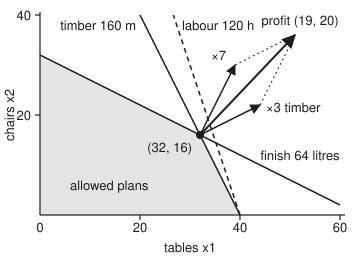

# LP duality: the partner problem with the same value, and the slackness that pairs them

[Syllabus](../../../SYLLABUS.md) → [Optimization](../README.md) → [Linear Programming](../README.md#s04) → LP duality

---

## General Overview

A furniture workshop makes tables and chairs. A table earns £19 and a chair £20. A table takes 4 metres of timber, 3 hours of labour and 1 litre of finish; a chair takes 2 metres, 1 hour and 2 litres. This week there are 160 metres of timber, 120 hours of labour and 64 litres of finish. The workshop **chooses** how many of each to make, wants **profit as large as possible** (this card maximises), and is **limited** by the three stocks.

The best plan is 32 tables and 16 chairs, for **£928**. It uses all the timber and all the finish, and leaves 8 hours of labour spare. [The simplex method](03-simplex-method.md) finds it. But a reader of the plan can fairly ask: how do we *know* no other plan earns more?

Answer with prices. Put a value on each stock: **£3 a metre of timber, £0 an hour of labour, £7 a litre of finish**. At those prices, the inputs of one table are worth exactly £19 and the inputs of one chair exactly £20. So no product turns its inputs into more money than the inputs are worth. Whatever the plan, the profit can never exceed the value of the whole stock, and the stock is worth 160 × £3 + 120 × £0 + 64 × £7 = £928. The plan earns £928. The ceiling has been reached, so the plan is best.

Those prices solve a second linear program, the **dual**: find the cheapest prices that value every product's inputs at no less than its profit. Its best value equals the best profit. The two answers fit by a rule called **complementary slackness**: labour has 8 spare hours, so its price is zero; tables and chairs are both made, so each is valued exactly at its profit.

**Every linear program has a partner, the dual, whose every feasible price list bounds the original's best value; when either has a best answer both do, the two values are equal, and at that pair every spare resource has price zero and every product made just breaks even at the prices.**

**What kind of fact this is:** three theorems, proved on this card in Why it works: weak duality, strong duality (by the simplex method's final table, with the anti-cycling rule taken from [The simplex method](03-simplex-method.md)), and complementary slackness. The workshop's numbers are a made-up example.

### The picture: the profit direction, built from the walls that hold the corner

<p align="center"></p>

Tables run across, chairs up, to scale; the shaded area is every plan the stocks allow. At the best corner, (32, 16), the timber and finish lines cross. Each wall points outward along its usage numbers: (4, 2) for timber, (1, 2) for finish. The profit direction (19, 20), drawn to (51, 36), is 3 times the timber arrow (tip at (44, 22)) plus 7 times the finish arrow (tip at (39, 30), marked ×7). Those multipliers are the prices. The dashed labour line misses the corner, so its price is 0.

---

## The formula

Unlike the standard form on [Linear programs](01-linear-programs-and-polyhedra.md), which minimises with equations and slacks, this card keeps the workshop as "maximise $c^T x$ subject to $Ax \le b$, $x \ge 0$", inequalities holding entry by entry; the symbols keep their roles: the plan is $x$, the profit per item $c$, the usage table $A$ and the stocks $b$. $A^T$ is $A$ with rows and columns swapped. This card introduces $y$, the **dual prices**: one price per resource, in pounds per unit. The original problem is called the **primal**, and a plan or price list is **feasible** when it meets all its rules.

$$
\textbf{primal: } \max_{x}\ c^T x \ \text{ subject to } Ax \le b,\ x \ge 0
\qquad\qquad
\textbf{dual: } \min_{y}\ b^T y \ \text{ subject to } A^T y \ge c,\ y \ge 0
$$

$$
\text{weak duality: } c^T x \le b^T y, \qquad \text{the gap: } b^T y - c^T x = \sum_i y_i s_i + \sum_j x_j r_j, \qquad s = b - Ax,\quad r = A^T y - c
$$

**Read it aloud:** the dual looks for the cheapest prices on the resources that value each product's inputs at least at its profit; any such price list's stock value is at least any plan's profit, and the gap between them is the price of every spare unit plus the over-valuation of every item made.

For the workshop, with $x_1$ tables and $x_2$ chairs:

$$
\max\ 19x_1 + 20x_2 \quad\text{s.t.}\quad 4x_1 + 2x_2 \le 160,\ \ 3x_1 + x_2 \le 120,\ \ x_1 + 2x_2 \le 64,\ \ x \ge 0
$$

$$
\min\ 160y_1 + 120y_2 + 64y_3 \quad\text{s.t.}\quad 4y_1 + 3y_2 + y_3 \ge 19,\ \ 2y_1 + y_2 + 2y_3 \ge 20,\ \ y \ge 0
$$

Each primal row (a resource) becomes a dual variable (its price). Each primal column (a product) becomes a dual row (its break-even rule). The dual of the dual is the primal again.

| Symbol | Plain meaning | In our example | Push it up and the answer… |
| --- | --- | --- | --- |
| $x = (x_1, x_2)$ | the plan: tables and chairs made | (32, 16) at the best | — |
| $c$ | profit per item, £ | (19, 20) | chairs to 40: the plan jumps to (0, 32), £1,280 |
| $A$, $A^T$ | usage table: row $i$ is a resource, column $j$ a product; $A^T$ swaps them | table (4, 3, 1), chair (2, 1, 2) | — |
| $b$ | stocks: metres, hours, litres | (160, 120, 64) | finish to 65: profit £935, up £7 |
| $y = (y_1, y_2, y_3)$, $y_i$ | dual prices on timber, labour, finish, £ per unit | (3, 0, 7) | — |
| $s = b - Ax$, $s_i$ | slack: unused stock of resource $i$ | (0, 8, 0) | — |
| $r = A^T y - c$, $r_j$ | surplus: how far product $j$'s inputs, at the prices, exceed its profit | (0, 0) | — |
| $p^\star$, $d^\star$ | best profit; cheapest stock value | both £928 | — |
| $B$, $c_B$ | at the simplex method's last corner: the columns of the variables in the solution, and their profits | tables, chairs, spare labour; (19, 20, 0) | — |
| $w$, $k$ | a direction of price change that proves no plan exists, and how far to move along it | (0, 0, 1, 2); $k = 10$ and $100$ | the dual value falls £16 per step |

### When it holds

- **Both problems are linear.** Every product uses the same stock per item however many are made. Without linearity the zero gap is no longer automatic, and an off-or-full choice can open one: [Lagrangian duality](../03-Constrained%20Optimisation/04-lagrangian-duality-weak-and-strong.md) shows such a gap with a fixed-speed pump.
- **Prices on "at most" rules are at least zero.** A negative labour price rewards spare hours: prices (8, −6, 5) give a false ceiling of £880.
- **The price list covers every product.** Prices (2, 0, 7) value a table's inputs at £15 and a chair's at £18, under their £19 and £20 profits, and their £768 is no ceiling.
- **Strong duality needs one side to have a best answer.** Add an order for 40 chairs and no plan exists, since the finish allows only 32. Then the dual has no best answer either: its value falls without limit.
- **Quantities may be fractional.** If tables must be whole, the problem is an integer program and the best dual can sit strictly above the best whole-number plan ([Integer programs](../05-Integer%20and%20Combinatorial%20Optimisation/01-integer-programs-and-relaxations.md)). Here the best plan happens to be whole.

---

## Why it works

### Step 0: a fair price list is a ceiling, and the gap is made of waste

Suppose prices value each product's inputs at no less than its profit. Then every item earns at most the value of what it consumed, so profit is at most the value of the stock consumed, which is at most the value of the whole stock. That is weak duality. The excess of ceiling over profit is two kinds of waste at those prices: priced stock left over, and items made whose inputs are worth more than they earn. Strong duality says both can be removed when a best plan exists; complementary slackness says they are exactly what must vanish.

### Step 1: weak duality, in one chain

Take any plan $x$ with $Ax \le b$, $x \ge 0$ and any prices $y$ with $A^T y \ge c$, $y \ge 0$. Then

$$
c^T x \;\le\; (A^T y)^T x \;=\; y^T (Ax) \;\le\; y^T b .
$$

The first step holds because $c \le A^T y$ entry by entry and every $x_j \ge 0$. The second step just regroups the same sum. The third holds because $Ax \le b$ entry by entry and every $y_i \ge 0$. Both sign conditions are used, once each, which is why the two broken price lists in What breaks fail.

The code tests the chain on every whole-number plan (881 of them) against every price list with whole-pound prices from £0 to £10 that covers both products (933 of them). The smallest gap is 0, and it is reached by exactly 1 pair: 32 tables and 16 chairs, with prices (3, 0, 7).

Two consequences follow at once. If the primal is unbounded (profit grows without limit), no price list can exist, so the dual is infeasible. If the dual is unbounded below, no plan can exist.

### Step 2: the gap identity

Write the slack $s = b - Ax$ and the surplus $r = A^T y - c$. Both are $\ge 0$ for feasible $x$ and $y$. Expand:

$$
b^T y - c^T x = (Ax + s)^T y - (A^T y - r)^T x = y^T s + x^T r .
$$

The terms $y^T Ax$ and $x^T A^T y$ are the same number and cancel. What remains is a sum of products of non-negative numbers. Try the prices (3, 1, 7), a list that also charges £1 an hour for labour. The stock is then worth £1,048, and the gap to £928 is £120. The identity splits it: £1 times the 8 spare hours, plus 32 tables each over-valued by £3, plus 16 chairs each over-valued by £1, that is $1 \times 8 + 32 \times 3 + 16 \times 1 = 120$.

### Step 3: complementary slackness

The gap is a sum of non-negative terms, so it is zero exactly when every term is zero:

$$
y_i\, s_i = 0 \ \text{ for every resource } i, \qquad x_j\, r_j = 0 \ \text{ for every product } j .
$$

In words: a resource with stock left over has price zero; a resource with a positive price is used up; a product that is made breaks even exactly at the prices; a product whose inputs are worth more than its profit is not made. **Theorem:** feasible $x$ and $y$ are both optimal if and only if these hold. If they hold, the gap is zero, so by weak duality no plan beats $x$ and no price list beats $y$. If the gap is not zero, then by strong duality (next step) a better plan or better prices exist.

At the workshop: labour has slack 8 and price 0; timber and finish have slack 0 and prices 3 and 7; tables and chairs have surplus 0 and are made. Every product in the table of the code's output is zero.

Slackness also finds the prices from the plan. Labour is slack, so $y_2 = 0$. Tables and chairs are made, so their rules hold with equality: $4y_1 + y_3 = 19$ and $2y_1 + 2y_3 = 20$. The second gives $y_1 + y_3 = 10$; subtract from the first and $3y_1 = 9$, so $y_1 = 3$ and $y_3 = 7$. Both are $\ge 0$, so the list is fair, and it certifies the plan.

### Step 4: strong duality, from the simplex method's last table

**Strong duality theorem.** If the primal has a best plan, the dual has a best price list, and $p^\star = d^\star$. If either problem is unbounded, the other is infeasible. (Both can be infeasible.)

The proof in words: the simplex method stops only when no column's **reduced cost** (its usage valued at the current prices, minus its profit) is negative. Under a product column, that stopping test says the product is covered; under a slack column, it says the price is at least zero. So the prices in the final table are a fair list, and their stock value equals the plan's profit.

<details>
<summary>Detailed proof: strong duality for linear programs</summary>

Write the primal in equality form, maximise $c^T x$ subject to $Ax + s = b$, $x \ge 0$, $s \ge 0$, and first suppose $b \ge 0$, so the origin is a starting corner. The columns are those of $A$, one per product, followed by one unit column per slack, each slack earning 0.

Run the simplex method with an anti-cycling rule (Bland's rule, on [The simplex method](03-simplex-method.md)). There are finitely many bases (sets of columns that pin down a corner), and the rule never repeats one, so it stops. Since the primal has a best plan, it does not stop on an unbounded column; it stops at a basis: one column per resource, together forming an invertible matrix $B$, whose variables take the values $B^{-1} b \ge 0$ while the rest are zero.

Define $y^T = c_B^T B^{-1}$. The reduced cost of any column is its usage valued at the prices $y$, minus its profit. The stopping rule says it is $\ge 0$ for every column. For product column $j$ this reads $(A^T y)_j \ge c_j$. For slack column $i$, whose column is the $i$-th unit vector and whose profit is 0, it reads $y_i \ge 0$. So $y$ is dual feasible.

The plan's profit is $c_B^T B^{-1} b = y^T b$. So $c^T x = b^T y$, and by weak duality $x$ is a best plan and $y$ a best price list, with $p^\star = d^\star$.

If instead the dual has a best price list, write it as a maximising LP of the same form and run the argument on it: its dual is the primal, so the primal has a best plan with the same value.

If some stock entry of $b$ is negative, phase one of the simplex method (same card) either finds a starting corner, after which the argument above runs unchanged, or proves the primal infeasible. The statements about unbounded problems are Step 1's consequences of weak duality.

For the workshop, the last basis holds tables, chairs and spare labour. Its columns, in the order timber, labour, finish, are (4, 3, 1), (2, 1, 2) and (0, 1, 0), with profits (19, 20, 0). Solving $y^T B = c_B^T$ is the three equations of Step 3: $y = (3, 0, 7)$, and the code reads the same numbers off the final table's slack columns.

</details>

The LP dual is the [Lagrangian duality](../03-Constrained%20Optimisation/04-lagrangian-duality-weak-and-strong.md) bound: price the stock rules with $y \ge 0$, and the best priced profit over $x \ge 0$ is $b^T y$ when $A^T y \ge c$, unlimited otherwise. For linear programs no strictly feasible point is needed.

### Step 5: when no plan exists, the dual says why

An order for at least 40 chairs adds the rule $-x_2 \le -40$. Add the finish rule once and the order rule twice:

$$
(x_1 + 2x_2) + 2(-x_2) \le 64 + 2(-40) \quad\Longrightarrow\quad x_1 \le -16 ,
$$

which no plan with $x_1 \ge 0$ can meet. The weights $w = (0, 0, 1, 2)$ on the four rules are a **certificate of infeasibility**. They are also a direction in which the dual's prices can move forever: from (3, 0, 7, 0), each step $k$ along $w$ keeps every product covered and lowers the stock value by £16. The value runs 928, then £768 at $k = 10$, then −£672 at $k = 100$. That such weights always exist when no plan does is **Farkas' lemma**, the alternative form of strong duality (Bertsimas and Tsitsiklis, section 4.6).

---

## Worked numbers, by hand

The plan (32, 16) and the prices (3, 0, 7).

| Step | Arithmetic | Value |
| --- | --- | --- |
| timber used | $4 \times 32 + 2 \times 16$ | 160 of 160 m, slack 0 |
| labour used | $3 \times 32 + 16$ | 112 of 120 h, slack 8 |
| finish used | $32 + 2 \times 16$ | 64 of 64 litres, slack 0 |
| profit | $19 \times 32 + 20 \times 16$ | £928 |
| a table's inputs at the prices | $4 \times 3 + 3 \times 0 + 1 \times 7$ | £19, surplus 0 |
| a chair's inputs at the prices | $2 \times 3 + 1 \times 0 + 2 \times 7$ | £20, surplus 0 |
| stock value | $160 \times 3 + 120 \times 0 + 64 \times 7$ | £928 |
| price times slack | $3 \times 0,\ 0 \times 8,\ 7 \times 0$ | 0, 0, 0 |
| made times surplus | $32 \times 0,\ 16 \times 0$ | 0, 0 |
| gap | $928 - 928$ | **£0** |

The plan earns £928 and a fair price list values the stock at £928, so no plan earns more and no fair price list is cheaper: 32 tables and 16 chairs is proved best.

### A price list that is fair but not best

Charge £1 an hour for labour too: prices (3, 1, 7).

| Step | Arithmetic | Value |
| --- | --- | --- |
| a table's inputs | $4 \times 3 + 3 \times 1 + 1 \times 7$ | £22, surplus 3 |
| a chair's inputs | $2 \times 3 + 1 \times 1 + 2 \times 7$ | £21, surplus 1 |
| stock value | $160 \times 3 + 120 \times 1 + 64 \times 7$ | £1,048 |
| gap | $1048 - 928$ | £120 |
| gap, by the identity | $1 \times 8 + 32 \times 3 + 16 \times 1$ | **£120** |

Still a valid ceiling, but £120 too high, and the identity names the cause: a price on 8 spare hours, and both products over-valued.

### What breaks if you drop a piece

| Mistake | Comes out at | What went wrong |
| --- | --- | --- |
| Prices (2, 0, 7): a table's inputs worth £15 and a chair's £18, under their £19 and £20 profits | a "ceiling" of £768, £160 below a plan that really earns £928 | The list does not cover every product, so the first step of the chain fails |
| Prices (8, −6, 5): both products covered, labour priced negative | a "ceiling" of £880, £48 below the truth | A negative price on a slack resource: −6 × 8 spare hours = −£48, exactly the shortfall |
| An order for 40 chairs, finish still 64 litres | no plan at all; dual value £768 at $k = 10$ and −£672 at $k = 100$ | Strong duality needs a best plan to exist; here the dual is unbounded instead |
| At the chairs-only corner (0, 32), solving slackness for prices | prices (0, 0, 10), total £640; a table's inputs worth £10, under £19 | Slackness holds at every corner the simplex method visits; without fair prices it proves nothing |

---

## Code, from first principles, and it actually runs

The code solves the workshop in exact fractions and reaches the prices by **three independent roads**. Road 1 runs the simplex method (largest profit enters first) and reads the prices off the final table's slack columns. Road 2 never runs simplex: it lists every corner of the dual's feasible region, by solving each set of three tight dual rules, and takes the cheapest. Road 3 solves the complementary-slackness equations from the plan. All three give (3, 0, 7), and the primal's four corners, listed separately, confirm the best profit £928. Then the gap identity is checked on the trial prices, weak duality on a grid of 881 plans and 933 price lists, and every broken case is printed. Every number on the card is printed.

### Python

```python
# LP duality -- the check behind the card.  Standard library only, exact fractions.
# Workshop: maximise profit 19x1 + 20x2 pounds (x1 tables, x2 chairs) subject to
# timber 4x1 + 2x2 <= 160 m, labour 3x1 + x2 <= 120 h, finish x1 + 2x2 <= 64 litres, x >= 0.
# Dual: minimise 160y1 + 120y2 + 64y3 subject to 4y1 + 3y2 + y3 >= 19, 2y1 + y2 + 2y3 >= 20, y >= 0.
from fractions import Fraction as F
from itertools import combinations

A, B, C = [[4, 2], [3, 1], [1, 2]], [160, 120, 64], [19, 20]
RES, PROD = ["timber", "labour", "finish"], ["tables", "chairs"]
dot = lambda u, v: sum(p * q for p, q in zip(u, v))
col = lambda M, j: [row[j] for row in M]
num = lambda x: str(x) if F(x).denominator == 1 else f"{float(x):.2f}"
show = lambda v: "(" + ", ".join(num(x) for x in v) + ")"

def solve(M, v):                          # Gauss-Jordan elimination in fractions; None if singular
    n = len(v)
    T = [[F(x) for x in row] + [F(w)] for row, w in zip(M, v)]
    for i in range(n):
        p = next((r for r in range(i, n) if T[r][i] != 0), None)
        if p is None: return None
        T[i], T[p] = T[p], T[i]
        for r in range(n):
            f = T[r][i] / T[i][i]
            if r != i and f != 0: T[r] = [a - f * b for a, b in zip(T[r], T[i])]
    return [T[i][n] / T[i][i] for i in range(n)]

def corners(G, h):                        # every point where n walls of G z <= h meet and all hold
    out = []
    for rows in combinations(range(len(G)), len(G[0])):
        z = solve([G[r] for r in rows], [h[r] for r in rows])
        if z is not None and all(dot(g, z) <= w for g, w in zip(G, h)) and z not in out: out.append(z)
    return out

def simplex(A, b, c):                     # max c.x, Ax <= b, x >= 0, b >= 0; Dantzig's rule
    m, n = len(A), len(c)
    T = [[F(x) for x in A[i]] + [F(int(i == k)) for k in range(m)] + [F(b[i])] for i in range(m)]
    z, basis, path = [F(-x) for x in c] + [F(0)] * (m + 1), [n + i for i in range(m)], []
    while min(z[:-1]) < 0:
        j = z.index(min(z[:-1]))          # entering column: most negative reduced cost
        r = min((T[i][-1] / T[i][j], i) for i in range(m) if T[i][j] > 0)[1]
        T[r] = [x / T[r][j] for x in T[r]]
        for i in range(m):
            f = T[i][j]
            if i != r: T[i] = [a - f * q for a, q in zip(T[i], T[r])]
        f = z[j]; z = [a - f * q for a, q in zip(z, T[r])]; basis[r] = j
        x = [F(0)] * n
        for i, v in enumerate(basis):
            if v < n: x[v] = T[i][-1]
        path.append(x)
    return x, z[n:n + m], z[-1], path     # plan, prices on the slack columns, value, corners visited

G = A + [[-1, 0], [0, -1]]
pc = corners(G, B + [0, 0])
print("primal corners (tables, chairs) and profit: " + " | ".join(f"{show(p)} {dot(C, p)}" for p in pc))
x, y, val, path = simplex(A, B, C)
print(f"road 1, simplex (Dantzig's rule): {len(path)} pivots, path (0, 0) -> " + " -> ".join(show(p) for p in path))
print(f"road 1, best plan {x[0]} tables, {x[1]} chairs, profit {val}")
print("road 1, prices read off the final tableau: " + ", ".join(f"{n} {v}" for n, v in zip(RES, y)))
dc = corners([[-a for a in col(A, j)] for j in range(2)] + [[-int(i == k) for k in range(3)] for i in range(3)], [-c for c in C] + [0] * 3)
yb = min(dc, key=lambda v: dot(B, v))
print(f"road 2, dual corners checked: {len(dc)}; cheapest price list {show(yb)} worth {dot(B, yb)}")
y3 = solve([[4, 3, 1], [2, 1, 2], [0, 1, 0]], [19, 20, 0])
print(f"road 3, slackness equations 4y1 + 3y2 + y3 = 19, 2y1 + y2 + 2y3 = 20, y2 = 0: y = {show(y3)}")
print(f"duality gap at the best pair: {dot(B, y)} - {val} = {dot(B, y) - val}")
use = [dot(row, x) for row in A]
print("resource  used  limit  slack  price  price x slack")
for i in range(3):
    print(f"{RES[i]:8s}  {use[i]!s:>4}  {B[i]:5d}  {B[i] - use[i]!s:>5}  {y[i]!s:>5}  {y[i] * (B[i] - use[i])!s:>13}")
print("product  made  inputs at prices  profit  surplus  made x surplus")
for j in range(2):
    v = dot(col(A, j), y)
    print(f"{PROD[j]:7s}  {x[j]!s:>4}  {v!s:>16}  {C[j]:6d}  {v - C[j]!s:>7}  {x[j] * (v - C[j])!s:>14}")
yt = [3, 1, 7]; vt = [dot(col(A, j), yt) for j in range(2)]
s8, r = [B[i] - use[i] for i in range(3)], [vt[j] - C[j] for j in range(2)]
print(f"trial prices {show(yt)}: table inputs {vt[0]}, chair inputs {vt[1]}, total {dot(B, yt)}")
print(f"gap identity: {dot(B, yt)} - {val} = {dot(B, yt) - val} = " + " + ".join(
    [f"{yt[i]} x {s8[i]}" for i in range(3) if s8[i]] + [f"{x[j]} x {r[j]}" for j in range(2)]))
plans = [(t, c) for t in range(41) for c in range(33) if all(dot(row, (t, c)) <= w for row, w in zip(A, B))]
prices = [(a, b, d) for a in range(11) for b in range(11) for d in range(11) if all(dot(col(A, j), (a, b, d)) >= C[j] for j in range(2))]
gaps = [dot(B, q) - dot(C, p) for p in plans for q in prices]
print(f"weak duality grid: {len(plans)} whole-number plans x {len(prices)} price lists, smallest gap {min(gaps)}, zero gaps {gaps.count(0)}")
for bad in ([2, 0, 7], [8, -6, 5]):
    print(f"break, prices {show(bad)}: inputs {dot(col(A, 0), bad)} and {dot(col(A, 1), bad)}, total {dot(B, bad)}, below {val} by {val - dot(B, bad)}")
print(f"break, negative labour price: -6 x {s8[1]} spare hours = {-6 * s8[1]}")
A4, B4, w = A + [[0, -1]], B + [-40], [0, 0, 1, 2]   # add an order: x2 >= 40, written -x2 <= -40
none = corners(A4 + [[-1, 0], [0, -1]], B4 + [0, 0])
wa = [dot(col(A4, j), w) for j in range(2)]          # finish row + 2 x order row
print(f"break, order for 40 chairs: {len(none)} feasible corners; finish + 2 x order reads {wa[0]}x1 + {wa[1]}x2 <= {dot(B4, w)}")
yk = lambda k: [a + k * b for a, b in zip(y + [0], w)]
print(f"break, its dual: prices {show(y + [0])} + k x {show(w)} stay valid, value {dot(B, y)} - {-dot(B4, w)}k: "
      f"k = 10 -> {dot(B4, yk(10))}, k = 100 -> {dot(B4, yk(100))}")
y0 = solve([[1, 0, 0], [0, 1, 0], [2, 1, 2]], [0, 0, 20])
print(f"break, corner (0, 32): slackness prices {show(y0)}, tables valued {dot(col(A, 0), y0)} < 19, total {dot(B, y0)}")
tips = [[x[k] + y[i] * A[i][k] for k in range(2)] for i in (0, 2)] + [[x[k] + C[k] for k in range(2)]]
print("figure, corners " + " ".join(show(p) for p in pc) + f"; profit (19, 20) = {y[0]} x (4, 2) + {y[2]} x (1, 2); "
      "arrow tips " + " ".join(show(t) for t in tips))
fin, lab = simplex(A, [160, 120, 65], C), simplex(A, [160, 111, 64], C)
print(f"try, finish 65 litres: plan {show(fin[0])}, profit {fin[2]}, prices {show(fin[1])}")
print(f"try, labour 112 hours: profit {simplex(A, [160, 112, 64], C)[2]}; labour 111: plan {show(lab[0])}, "
      f"profit {num(lab[2])}, prices {show(lab[1])}")
ch = simplex(A, B, [19, 40])
print(f"try, chair profit 40: plan {show(ch[0])}, profit {ch[2]}, prices {show(ch[1])}")
assert val == 928 and x == [32, 16] and dot(B, y) == val                 # strong duality: equal values
assert max(dot(C, p) for p in pc) == val and yb == y and y3 == y         # three roads agree
assert min(gaps) == 0 and gaps.count(0) == 1                             # weak duality on the grid
assert all(y[i] * s8[i] == 0 for i in range(3)) and dot(B, yt) - val == 120  # the trial gap, by hand
assert [yt[i] * s8[i] for i in range(3)] + [x[j] * r[j] for j in range(2)] == [0, 8, 0, 96, 16]  # its terms
assert dot(B, [8, -6, 5]) < val and dot(col(A, 0), y0) < 19             # the broken certificates
assert none == [] and min(wa) >= 0 and dot(B4, w) < 0                   # Farkas: no plan fills the order
assert all(dot(col(A4, j), yk(k)) >= C[j] for j in range(2) for k in (10, 100))
print("ALL CHECKS PASS")
```

**Ran 2026-11-11 on macOS, Python 3.14.10, standard library only. All checks passed. Output, pasted from the run:**

```
primal corners (tables, chairs) and profit: (40, 0) 760 | (32, 16) 928 | (0, 32) 640 | (0, 0) 0
road 1, simplex (Dantzig's rule): 2 pivots, path (0, 0) -> (0, 32) -> (32, 16)
road 1, best plan 32 tables, 16 chairs, profit 928
road 1, prices read off the final tableau: timber 3, labour 0, finish 7
road 2, dual corners checked: 5; cheapest price list (3, 0, 7) worth 928
road 3, slackness equations 4y1 + 3y2 + y3 = 19, 2y1 + y2 + 2y3 = 20, y2 = 0: y = (3, 0, 7)
duality gap at the best pair: 928 - 928 = 0
resource  used  limit  slack  price  price x slack
timber     160    160      0      3              0
labour     112    120      8      0              0
finish      64     64      0      7              0
product  made  inputs at prices  profit  surplus  made x surplus
tables     32                19      19        0               0
chairs     16                20      20        0               0
trial prices (3, 1, 7): table inputs 22, chair inputs 21, total 1048
gap identity: 1048 - 928 = 120 = 1 x 8 + 32 x 3 + 16 x 1
weak duality grid: 881 whole-number plans x 933 price lists, smallest gap 0, zero gaps 1
break, prices (2, 0, 7): inputs 15 and 18, total 768, below 928 by 160
break, prices (8, -6, 5): inputs 19 and 20, total 880, below 928 by 48
break, negative labour price: -6 x 8 spare hours = -48
break, order for 40 chairs: 0 feasible corners; finish + 2 x order reads 1x1 + 0x2 <= -16
break, its dual: prices (3, 0, 7, 0) + k x (0, 0, 1, 2) stay valid, value 928 - 16k: k = 10 -> 768, k = 100 -> -672
break, corner (0, 32): slackness prices (0, 0, 10), tables valued 10 < 19, total 640
figure, corners (40, 0) (32, 16) (0, 32) (0, 0); profit (19, 20) = 3 x (4, 2) + 7 x (1, 2); arrow tips (44, 22) (39, 30) (51, 36)
try, finish 65 litres: plan (31.67, 16.67), profit 935, prices (3, 0, 7)
try, labour 112 hours: profit 928; labour 111: plan (31.60, 16.20), profit 924.40, prices (0, 3.60, 8.20)
try, chair profit 40: plan (0, 32), profit 1280, prices (0, 0, 20)
ALL CHECKS PASS
```

### Rust

Same numbers, same labels, built with `rustc --edition 2021 -O`; a small fraction type `Q` stands in for Python's `Fraction`.

```rust
// LP duality -- the same check as the Python, in Rust.  No crates, exact fractions.
// Workshop: maximise profit 19x1 + 20x2 pounds (x1 tables, x2 chairs) subject to
// timber 4x1 + 2x2 <= 160 m, labour 3x1 + x2 <= 120 h, finish x1 + 2x2 <= 64 litres, x >= 0.
// Dual: minimise 160y1 + 120y2 + 64y3 subject to 4y1 + 3y2 + y3 >= 19, 2y1 + y2 + 2y3 >= 20, y >= 0.
use std::cmp::Ordering;
use std::ops::{Add, Div, Mul, Sub};

#[derive(Clone, Copy, Debug, PartialEq, Eq)]
struct Q(i64, i64); // numerator, denominator > 0, in lowest terms
fn gcd(a: i64, b: i64) -> i64 { if b == 0 { a.abs() } else { gcd(b, a % b) } }
fn q(n: i64, d: i64) -> Q { let g = gcd(n, d).max(1) * d.signum(); Q(n / g, d / g) }
fn z(n: i64) -> Q { Q(n, 1) }
impl Add for Q { type Output = Q; fn add(self, o: Q) -> Q { q(self.0 * o.1 + o.0 * self.1, self.1 * o.1) } }
impl Sub for Q { type Output = Q; fn sub(self, o: Q) -> Q { q(self.0 * o.1 - o.0 * self.1, self.1 * o.1) } }
impl Mul for Q { type Output = Q; fn mul(self, o: Q) -> Q { q(self.0 * o.0, self.1 * o.1) } }
impl Div for Q { type Output = Q; fn div(self, o: Q) -> Q { q(self.0 * o.1, self.1 * o.0) } }
impl Ord for Q { fn cmp(&self, o: &Q) -> Ordering { (self.0 * o.1).cmp(&(o.0 * self.1)) } }
impl PartialOrd for Q { fn partial_cmp(&self, o: &Q) -> Option<Ordering> { Some(self.cmp(o)) } }
impl std::fmt::Display for Q {
    fn fmt(&self, f: &mut std::fmt::Formatter) -> std::fmt::Result {
        if self.1 == 1 { f.pad(&self.0.to_string()) } else { f.pad(&format!("{:.2}", self.0 as f64 / self.1 as f64)) }
    }
}
type V = Vec<Q>;
fn dot(u: &[Q], v: &[Q]) -> Q { u.iter().zip(v).fold(z(0), |s, (a, b)| s + *a * *b) }
fn col(m: &[V], j: usize) -> V { m.iter().map(|r| r[j]).collect() }
fn vz(v: &[i64]) -> V { v.iter().map(|&x| z(x)).collect() }
fn show(v: &[Q]) -> String { format!("({})", v.iter().map(|x| x.to_string()).collect::<Vec<_>>().join(", ")) }

fn solve(m: &[V], v: &[Q]) -> Option<V> { // Gauss-Jordan elimination in fractions; None if singular
    let n = v.len();
    let mut t: Vec<V> = m.iter().zip(v).map(|(r, w)| { let mut r = r.clone(); r.push(*w); r }).collect();
    for i in 0..n {
        let p = (i..n).find(|&r| t[r][i] != z(0))?;
        t.swap(i, p);
        for r in 0..n {
            let f = t[r][i] / t[i][i];
            if r != i && f != z(0) { let ti = t[i].clone(); for k in 0..=n { t[r][k] = t[r][k] - f * ti[k]; } }
        }
    }
    Some((0..n).map(|i| t[i][n] / t[i][i]).collect())
}
fn combos(m: usize, n: usize, start: usize, cur: &mut Vec<usize>, out: &mut Vec<Vec<usize>>) {
    if cur.len() == n { out.push(cur.clone()); return; }
    for i in start..m { cur.push(i); combos(m, n, i + 1, cur, out); cur.pop(); }
}
fn corners(g: &[V], h: &[Q]) -> Vec<V> { // every point where n walls of G z <= h meet and all hold
    let (mut sets, mut out) = (vec![], vec![]);
    combos(g.len(), g[0].len(), 0, &mut vec![], &mut sets);
    for rows in sets {
        let gm: Vec<V> = rows.iter().map(|&r| g[r].clone()).collect();
        let hv: V = rows.iter().map(|&r| h[r]).collect();
        if let Some(p) = solve(&gm, &hv) {
            if g.iter().zip(h).all(|(gr, w)| dot(gr, &p) <= *w) && !out.contains(&p) { out.push(p); }
        }
    }
    out
}
fn simplex(a: &[V], b: &[Q], c: &[Q]) -> (V, V, Q, Vec<V>) { // max c.x, Ax <= b, b >= 0; Dantzig's rule
    let (m, n) = (a.len(), c.len());
    let mut t: Vec<V> = (0..m).map(|i| { let mut r = a[i].clone();
        r.extend((0..m).map(|k| z((i == k) as i64))); r.push(b[i]); r }).collect();
    let mut zr: V = c.iter().map(|&x| z(0) - x).collect(); zr.extend(vec![z(0); m + 1]);
    let (mut basis, mut path): (Vec<usize>, Vec<V>) = ((n..n + m).collect(), vec![]);
    let mut x = vec![z(0); n];
    loop {
        let mn = *zr[..n + m].iter().min().unwrap();
        if mn >= z(0) { break; }
        let j = zr.iter().position(|&v| v == mn).unwrap(); // entering column: most negative reduced cost
        let mut r = usize::MAX;
        for i in 0..m { if t[i][j] > z(0) && (r == usize::MAX || t[i][n + m] / t[i][j] < t[r][n + m] / t[r][j]) { r = i; } }
        let p = t[r][j]; t[r] = t[r].iter().map(|&v| v / p).collect();
        let tr = t[r].clone();
        for i in 0..m { if i != r { let f = t[i][j]; for k in 0..=n + m { t[i][k] = t[i][k] - f * tr[k]; } } }
        let f = zr[j]; for k in 0..=n + m { zr[k] = zr[k] - f * tr[k]; } basis[r] = j;
        x = vec![z(0); n];
        for (i, &v) in basis.iter().enumerate() { if v < n { x[v] = t[i][n + m]; } }
        path.push(x.clone());
    }
    (x, zr[n..n + m].to_vec(), zr[n + m], path) // plan, prices on the slack columns, value, corners visited
}

fn main() {
    let a: Vec<V> = vec![vz(&[4, 2]), vz(&[3, 1]), vz(&[1, 2])];
    let (b, c) = (vz(&[160, 120, 64]), vz(&[19, 20]));
    let (res, prod) = (["timber", "labour", "finish"], ["tables", "chairs"]);
    let mut g = a.clone(); g.push(vz(&[-1, 0])); g.push(vz(&[0, -1]));
    let pc = corners(&g, &vz(&[160, 120, 64, 0, 0]));
    let pcs: Vec<String> = pc.iter().map(|p| format!("{} {}", show(p), dot(&c, p))).collect();
    println!("primal corners (tables, chairs) and profit: {}", pcs.join(" | "));
    let (x, y, val, path) = simplex(&a, &b, &c);
    let ps: Vec<String> = path.iter().map(|p| show(p)).collect();
    println!("road 1, simplex (Dantzig's rule): {} pivots, path (0, 0) -> {}", path.len(), ps.join(" -> "));
    println!("road 1, best plan {} tables, {} chairs, profit {}", x[0], x[1], val);
    let yr: Vec<String> = (0..3).map(|i| format!("{} {}", res[i], y[i])).collect();
    println!("road 1, prices read off the final tableau: {}", yr.join(", "));
    let mut dg: Vec<V> = (0..2).map(|j| col(&a, j).iter().map(|&v| z(0) - v).collect()).collect();
    for i in 0..3 { dg.push((0..3).map(|k| z(-((i == k) as i64))).collect()); }
    let dc = corners(&dg, &vz(&[-19, -20, 0, 0, 0]));
    let yb = dc.iter().fold(dc[0].clone(), |m, v| if dot(&b, v) < dot(&b, &m) { v.clone() } else { m });
    println!("road 2, dual corners checked: {}; cheapest price list {} worth {}", dc.len(), show(&yb), dot(&b, &yb));
    let y3 = solve(&[vz(&[4, 3, 1]), vz(&[2, 1, 2]), vz(&[0, 1, 0])], &vz(&[19, 20, 0])).unwrap();
    println!("road 3, slackness equations 4y1 + 3y2 + y3 = 19, 2y1 + y2 + 2y3 = 20, y2 = 0: y = {}", show(&y3));
    println!("duality gap at the best pair: {} - {} = {}", dot(&b, &y), val, dot(&b, &y) - val);
    let used: V = a.iter().map(|r| dot(r, &x)).collect();
    let s8: V = (0..3).map(|i| b[i] - used[i]).collect();
    println!("resource  used  limit  slack  price  price x slack");
    for i in 0..3 { println!("{:8}  {:>4}  {:>5}  {:>5}  {:>5}  {:>13}", res[i], used[i], b[i], s8[i], y[i], y[i] * s8[i]); }
    println!("product  made  inputs at prices  profit  surplus  made x surplus");
    for j in 0..2 {
        let v = dot(&col(&a, j), &y);
        println!("{:7}  {:>4}  {:>16}  {:>6}  {:>7}  {:>14}", prod[j], x[j], v, c[j], v - c[j], x[j] * (v - c[j]));
    }
    let yt = vz(&[3, 1, 7]);
    let vt: V = (0..2).map(|j| dot(&col(&a, j), &yt)).collect();
    let r: V = (0..2).map(|j| vt[j] - c[j]).collect();
    println!("trial prices {}: table inputs {}, chair inputs {}, total {}", show(&yt), vt[0], vt[1], dot(&b, &yt));
    let mut terms: Vec<String> = (0..3).filter(|&i| s8[i] != z(0)).map(|i| format!("{} x {}", yt[i], s8[i])).collect();
    terms.extend((0..2).map(|j| format!("{} x {}", x[j], r[j])));
    println!("gap identity: {} - {} = {} = {}", dot(&b, &yt), val, dot(&b, &yt) - val, terms.join(" + "));
    let ai = [[4i64, 2], [3, 1], [1, 2]]; let (bi, ci) = ([160i64, 120, 64], [19i64, 20]);
    let mut plans = vec![];
    for t in 0..41i64 { for ch in 0..33i64 { if (0..3).all(|i| ai[i][0] * t + ai[i][1] * ch <= bi[i]) { plans.push((t, ch)); } } }
    let mut prices = vec![];
    for p in 0..11i64 { for l in 0..11i64 { for f in 0..11i64 {
        if (0..2).all(|j| ai[0][j] * p + ai[1][j] * l + ai[2][j] * f >= ci[j]) { prices.push((p, l, f)); } } } }
    let (mut gmin, mut zeros) = (i64::MAX, 0);
    for &(t, ch) in &plans { for &(p, l, f) in &prices {
        let gap = 160 * p + 120 * l + 64 * f - 19 * t - 20 * ch; gmin = gmin.min(gap); if gap == 0 { zeros += 1; } } }
    println!("weak duality grid: {} whole-number plans x {} price lists, smallest gap {}, zero gaps {}", plans.len(), prices.len(), gmin, zeros);
    for bad in [vz(&[2, 0, 7]), vz(&[8, -6, 5])] {
        println!("break, prices {}: inputs {} and {}, total {}, below {} by {}", show(&bad), dot(&col(&a, 0), &bad),
                 dot(&col(&a, 1), &bad), dot(&b, &bad), val, val - dot(&b, &bad));
    }
    println!("break, negative labour price: -6 x {} spare hours = {}", s8[1], z(-6) * s8[1]);
    let mut a4 = a.clone(); a4.push(vz(&[0, -1])); let b4 = vz(&[160, 120, 64, -40]); let w = vz(&[0, 0, 1, 2]);
    let mut g4 = a4.clone(); g4.push(vz(&[-1, 0])); g4.push(vz(&[0, -1]));
    let none = corners(&g4, &vz(&[160, 120, 64, -40, 0, 0]));
    let wa: V = (0..2).map(|j| dot(&col(&a4, j), &w)).collect();
    println!("break, order for 40 chairs: {} feasible corners; finish + 2 x order reads {}x1 + {}x2 <= {}", none.len(), wa[0], wa[1], dot(&b4, &w));
    let mut y4 = y.clone(); y4.push(z(0));
    let yk = |k: i64| -> V { y4.iter().zip(&w).map(|(&p, &d)| p + z(k) * d).collect() };
    println!("break, its dual: prices {} + k x {} stay valid, value {} - {}k: k = 10 -> {}, k = 100 -> {}", show(&y4), show(&w),
             dot(&b, &y), z(0) - dot(&b4, &w), dot(&b4, &yk(10)), dot(&b4, &yk(100)));
    let y0 = solve(&[vz(&[1, 0, 0]), vz(&[0, 1, 0]), vz(&[2, 1, 2])], &vz(&[0, 0, 20])).unwrap();
    println!("break, corner (0, 32): slackness prices {}, tables valued {} < 19, total {}", show(&y0), dot(&col(&a, 0), &y0), dot(&b, &y0));
    let cs: Vec<String> = pc.iter().map(|p| show(p)).collect();
    let tips: Vec<String> = [(0..2).map(|k| x[k] + y[0] * a[0][k]).collect::<V>(), (0..2).map(|k| x[k] + y[2] * a[2][k]).collect(),
        (0..2).map(|k| x[k] + c[k]).collect()].iter().map(|t| show(t)).collect();
    println!("figure, corners {}; profit (19, 20) = {} x (4, 2) + {} x (1, 2); arrow tips {}", cs.join(" "), y[0], y[2], tips.join(" "));
    let fin = simplex(&a, &vz(&[160, 120, 65]), &c); let lab = simplex(&a, &vz(&[160, 111, 64]), &c);
    println!("try, finish 65 litres: plan {}, profit {}, prices {}", show(&fin.0), fin.2, show(&fin.1));
    println!("try, labour 112 hours: profit {}; labour 111: plan {}, profit {}, prices {}",
             simplex(&a, &vz(&[160, 112, 64]), &c).2, show(&lab.0), lab.2, show(&lab.1));
    let chp = simplex(&a, &b, &vz(&[19, 40]));
    println!("try, chair profit 40: plan {}, profit {}, prices {}", show(&chp.0), chp.2, show(&chp.1));
    assert!(val == z(928) && x == vz(&[32, 16]) && dot(&b, &y) == val);           // strong duality: equal values
    assert!(pc.iter().map(|p| dot(&c, p)).max().unwrap() == val && yb == y && y3 == y); // three roads agree
    assert!(gmin == 0 && zeros == 1);                                             // weak duality on the grid
    assert!((0..3).all(|i| y[i] * s8[i] == z(0)) && dot(&b, &yt) - val == z(120));     // the trial gap, by hand
    assert!((0..3).map(|i| yt[i] * s8[i]).chain((0..2).map(|j| x[j] * r[j])).collect::<V>() == vz(&[0, 8, 0, 96, 16])); // its terms
    assert!(dot(&b, &vz(&[8, -6, 5])) < val && dot(&col(&a, 0), &y0) < z(19));     // the broken certificates
    assert!(none.is_empty() && wa.iter().all(|&v| v >= z(0)) && dot(&b4, &w) < z(0)); // Farkas: no plan fills the order
    assert!((0..2).all(|j| [10, 100].iter().all(|&k| dot(&col(&a4, j), &yk(k)) >= c[j])));
    println!("ALL CHECKS PASS");
}
```

**Ran 2026-11-11 on macOS, rustc 1.98.1, no crates. All checks passed. Output, pasted from the run:**

```
primal corners (tables, chairs) and profit: (40, 0) 760 | (32, 16) 928 | (0, 32) 640 | (0, 0) 0
road 1, simplex (Dantzig's rule): 2 pivots, path (0, 0) -> (0, 32) -> (32, 16)
road 1, best plan 32 tables, 16 chairs, profit 928
road 1, prices read off the final tableau: timber 3, labour 0, finish 7
road 2, dual corners checked: 5; cheapest price list (3, 0, 7) worth 928
road 3, slackness equations 4y1 + 3y2 + y3 = 19, 2y1 + y2 + 2y3 = 20, y2 = 0: y = (3, 0, 7)
duality gap at the best pair: 928 - 928 = 0
resource  used  limit  slack  price  price x slack
timber     160    160      0      3              0
labour     112    120      8      0              0
finish      64     64      0      7              0
product  made  inputs at prices  profit  surplus  made x surplus
tables     32                19      19        0               0
chairs     16                20      20        0               0
trial prices (3, 1, 7): table inputs 22, chair inputs 21, total 1048
gap identity: 1048 - 928 = 120 = 1 x 8 + 32 x 3 + 16 x 1
weak duality grid: 881 whole-number plans x 933 price lists, smallest gap 0, zero gaps 1
break, prices (2, 0, 7): inputs 15 and 18, total 768, below 928 by 160
break, prices (8, -6, 5): inputs 19 and 20, total 880, below 928 by 48
break, negative labour price: -6 x 8 spare hours = -48
break, order for 40 chairs: 0 feasible corners; finish + 2 x order reads 1x1 + 0x2 <= -16
break, its dual: prices (3, 0, 7, 0) + k x (0, 0, 1, 2) stay valid, value 928 - 16k: k = 10 -> 768, k = 100 -> -672
break, corner (0, 32): slackness prices (0, 0, 10), tables valued 10 < 19, total 640
figure, corners (40, 0) (32, 16) (0, 32) (0, 0); profit (19, 20) = 3 x (4, 2) + 7 x (1, 2); arrow tips (44, 22) (39, 30) (51, 36)
try, finish 65 litres: plan (31.67, 16.67), profit 935, prices (3, 0, 7)
try, labour 112 hours: profit 928; labour 111: plan (31.60, 16.20), profit 924.40, prices (0, 3.60, 8.20)
try, chair profit 40: plan (0, 32), profit 1280, prices (0, 0, 20)
ALL CHECKS PASS
```

> [!TIP]
> **Try changing**
> - Guess first: finish rises from 64 to 65 litres. What is the new best profit? Set the stocks to `[160, 120, 65]`. The plan moves to (31.67, 16.67) and profit rises to £935: exactly the finish price, £7, more. The prices stay (3, 0, 7).
> - Guess first: labour falls from 120 to 112 hours. Does profit drop? It stays £928, because the 8 spare hours were worth £0. Cut one more hour, to 111, and labour starts to bind: profit £924.40, plan (31.60, 16.20), and the prices jump to (0, 3.60, 8.20). A zero price is a statement about the margin, not about labour being useless.
> - Guess first: chairs earn £40 instead of £20. Set `C = [19, 40]`. The plan becomes 0 tables and 32 chairs for £1,280, with prices (0, 0, 20): only finish binds, and a table's inputs, valued at £20, exceed its £19 profit, so no tables are made.

---

## The usual mistake

> [!warning]
> **Treating complementary slackness as the proof.** At the chairs-only corner (0, 32), finish is used up and timber and labour are spare. Slackness then forces timber and labour prices to zero and the chair rule to hold exactly, giving prices (0, 0, 10) and a stock value of £640, equal to that corner's profit. The gap is zero, yet the plan is not best. The prices value a table's inputs at £10, under its £19 profit, so they are not a fair list. Slackness pairs a plan with prices; the proof needs both sides feasible as well. Check that every price is at least zero and every product is covered, then check slackness.
>
> - **Getting the dual's directions wrong.** A maximising primal with "at most" rules has a minimising dual with "at least" rules and prices at least zero. Write both product rules as "at most" and prices (2, 0, 7) look acceptable: a "ceiling" of £768, below the real £928.
> - **Allowing a negative price.** Prices (8, −6, 5) cover both products and total £880, £48 under the true profit.
> - **Reading a zero price as "worthless".** Labour's price is £0 only because 8 hours are spare. At 111 hours it is £3.60 an hour.

---

## Where you meet it in real life

- **Solver reports.** Every LP solver prints a dual value beside each constraint, read as the worth of one more unit ([Shadow prices](../../14-Applied%20and%20computational/05-Operations%20Research/02-shadow-prices-and-sensitivity.md)). The zero beside a slack resource is complementary slackness.
- **Electricity markets.** Dispatch is solved as a large LP each hour, and the price paid at each node is the dual price of that node's demand rule.
- **Solvers' stopping tests.** "Optimal" means a plan and a price list whose values agree to a tolerance; [Interior point for linear programs](08-interior-point-for-lp-and-complexity.md) methods steer by that gap.
- **Two-player games.** A zero-sum game's best mixed strategies for the two players are a primal and dual pair, and the equal values are the minimax theorem ([Nash equilibrium](../../14-Applied%20and%20computational/05-Operations%20Research/09-game-theory-and-nash-equilibrium.md)).
- **Shipping.** In a transport problem the prices are values at depots and customers, and slackness says a route is used only where the price difference exactly pays its cost ([Network flows](06-network-flows-as-linear-programs.md)).

> **Say it back**
> Every linear program has a partner: the maximum-profit plan is paired with the cheapest prices on the resources that value each product's inputs at least at its profit. Any fair price list's stock value is a ceiling on any plan's profit, and the gap is the price of spare stock plus the over-valuation of items made. When a best plan exists, the simplex method's last table hands over prices that close the gap, so the two best values are equal. At that pair, a resource with stock left over has price zero, and a product that is made exactly breaks even. The workshop's 32 tables and 16 chairs earn £928, and timber at £3, labour at £0 and finish at £7 value the stock at the same £928, which proves the plan best.

---

## What this builds on

- [The simplex method](03-simplex-method.md): the corner walk whose final table, with an anti-cycling rule and phase one, is the proof of strong duality here.
- [Lagrangian duality](../03-Constrained%20Optimisation/04-lagrangian-duality-weak-and-strong.md): pricing constraints to get a bound. For an LP that bound is the dual LP, and the gap closes without needing a strictly feasible point.
- [Shadow prices](../../14-Applied%20and%20computational/05-Operations%20Research/02-shadow-prices-and-sensitivity.md): dual values read off a solver report as the worth of one more unit of each resource; this card proves why they exist.

## Where this goes next

- [Shadow prices](05-sensitivity-and-shadow-prices.md): the dual prices as rates of change, with the stretch of stock over which each price holds.
- [Network flows](06-network-flows-as-linear-programs.md): shipping problems whose dual prices are values at the nodes, and whose slackness picks out the routes used.
- [Linear programs](01-linear-programs-and-polyhedra.md): the dual of moving one distribution onto another, where the prices become potentials.

The question this card leaves open: the prices are exact only at the margin, so how far can a stock move before the best corner, and with it the price list, changes?

---

## Sources

Verified 2026-11-11: every link below resolves to the publisher's page.

- Bertsimas, D., and J. N. Tsitsiklis. *Introduction to Linear Optimization*. Athena Scientific, 1997. [Publisher's page](http://www.athenasc.com/linoptbook.html). Chapter 4: the dual problem, weak and strong duality proved from the simplex method, complementary slackness, and Farkas' lemma (section 4.6).
- Vanderbei, R. J. *Linear Programming: Foundations and Extensions*, 5th ed. Springer, 2020. [doi:10.1007/978-3-030-39415-8](https://doi.org/10.1007/978-3-030-39415-8). Chapter 5: duality theory, with the dual read off the final simplex dictionary as on this card.
- Dantzig, G. B. *Linear Programming and Extensions*. Princeton University Press, 1963. [doi:10.1515/9781400884179](https://doi.org/10.1515/9781400884179). The simplex method's original account, with the dual prices as the multipliers of the final basis.
- Goldman, A. J., and A. W. Tucker. "Theory of Linear Programming." In *Linear Inequalities and Related Systems*, Annals of Mathematics Studies 38, Princeton University Press, 1956. [doi:10.1515/9781400881987-005](https://doi.org/10.1515/9781400881987-005). The duality and complementary slackness theorems, and the existence of a strictly complementary optimal pair.
- Boyd, S., and L. Vandenberghe. *Convex Optimization*. Cambridge University Press, 2004. [doi:10.1017/CBO9780511804441](https://doi.org/10.1017/CBO9780511804441). Chapter 5: the LP dual derived as a Lagrange dual problem, and complementary slackness (section 5.5.2).
