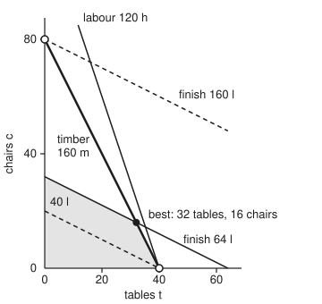
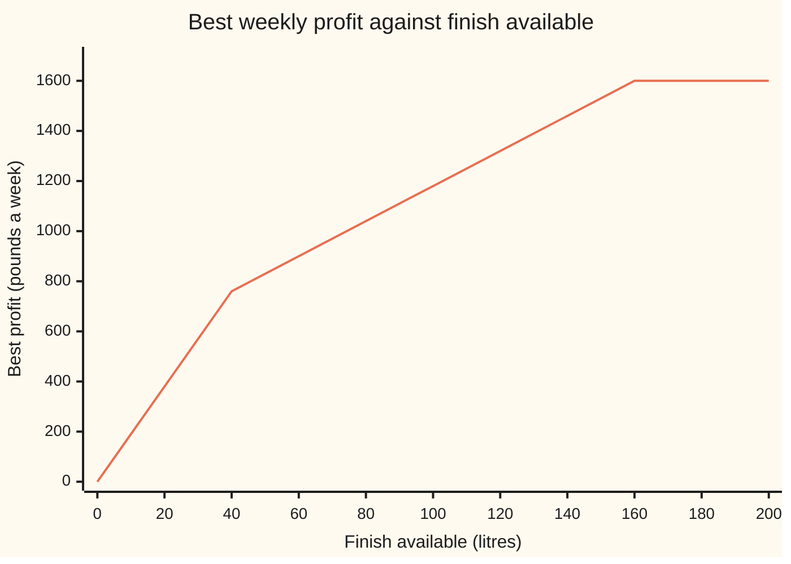

# Shadow prices: what one more hour of labour is actually worth

[Syllabus](../../../SYLLABUS.md) → [Optimization](../README.md) → [Linear Programming](../README.md#s04) → Shadow prices

---

## General Overview

A furniture workshop makes tables and chairs. A table earns £19 of profit and uses 4 metres of timber, 3 hours of labour and 1 litre of finish. A chair earns £20 and uses 2 m of timber, 1 hour and 2 litres. Each week there are 160 m of timber, 120 hours of labour and 64 litres of finish.

The workshop **chooses** how many of each to make and **maximises** the week's profit. The best plan is 32 tables and 16 chairs, £928 a week.

The owner can hire a carpenter for extra hours. What is one more hour of labour worth? **Nothing.** The best plan uses 112 of the 120 hours, so 8 hours already sit idle.

The scarce stocks are the other two. One more litre of finish adds £7 to the week's profit, and that stays true for any amount of finish from 40 to 160 litres. One more metre of timber adds £3, from 64 m up to 169.6 m. Labour gets a price only if the hours fall below 112: from there down to 32 hours, each hour is worth £3.60.

These numbers are **shadow prices** (the extra profit one more unit of a limit brings). The [Shadow prices](../../14-Applied%20and%20computational/05-Operations%20Research/02-shadow-prices-and-sensitivity.md) card read them off a solver's report for a bakery. This card shows where they come from.

They are the dual prices of [LP duality](04-lp-duality-and-complementary-slackness.md). In the dual, each stock gets a price, so that what each product uses is worth at least its profit, and the stocks' total value is as small as possible. They sit in the last row of the simplex method's final table, and the same table gives the **range** over which each one stays exact.

**A shadow price is the dual variable of its limit; the final simplex tableau prints it in the slack's column of the profit row, and it stays exact while the corner's plan, recomputed for the new limit, stays non-negative.**

**What kind of fact this is:** a theorem, proved on this card in Why it works, using weak and strong duality as proved on [LP duality](04-lp-duality-and-complementary-slackness.md). The workshop's figures are a made-up example.

### The picture: the finish line slides, the best corner rides the timber line

<p align="center"></p>

The shaded region holds every plan the three stocks allow. The best corner, the filled dot, is where the timber line (bold) meets the finish line. Add finish and the finish line slides up and right; the corner slides up the timber line with it.

At 40 litres the corner reaches 40 tables and no chairs, the lower hollow dot. At 160 litres it reaches no tables and 80 chairs, the upper one. Between the two dots, every litre buys the same £7. Past them, the corner changes and so does the price.

---

## The formula

Notation from [Linear programs](01-linear-programs-and-polyhedra.md) and [The simplex method](03-simplex-method.md): maximise $c^T x$ (the total profit) subject to $Ax + s = b$, $x \ge 0$, $s \ge 0$, with $x$ the plan and $s$ the slacks. $B$ is the columns of the basic variables (the ones the corner solves for; the rest sit at zero) at the final corner, and $c_B$ their margins (profit per item). The dual prices $y$ are those of [LP duality](04-lp-duality-and-complementary-slackness.md).

This card adds four symbols:

- $z^*(b)$, the best profit as a function of the limits;
- $\delta$, a change in one limit;
- $\ell_i$ and $u_i$, the ends of its range;
- $r_j$, the profit-row entry of column $j$.

$$
y^T = c_B^T B^{-1}, \qquad r_j = y^T a_j - c_j, \qquad z^*(b_i + \delta) = z^*(b) + y_i\,\delta \ \text{ while } \ B^{-1}(b + \delta e_i) \ge 0
$$

**Read it aloud:** the shadow prices are the final corner's margins pushed back through its equations; a column's profit-row entry is the value, at those prices, of what one unit uses, minus what it earns; and moving limit $i$ by $\delta$ moves the best profit by its price times $\delta$, for as long as the corner's recomputed amounts stay zero or more. Here $e_i$ is a column of zeros with a 1 in row $i$, and $a_j$ is column $j$ of $A$.

| Symbol | Plain meaning | In our example | Push it up and the answer… |
| --- | --- | --- | --- |
| $x_1,\ x_2$ | tables and chairs made a week | 32 and 16 | — (chosen) |
| $c_j$ | profit per item of product $j$, in pounds | £19, £20 | the plan holds inside its margin range |
| $A,\ a_j,\ e_i$ | what one item uses of each stock; $a_j$ is product $j$'s column; $e_i$ is zeros with a 1 in row $i$ | table (4 m, 3 h, 1 l) | stocks run out sooner |
| $b_i$ | stock $i$ for the week | 160 m, 120 h, 64 l | profit rises by $y_i$ a unit, inside the range |
| $s_1,\ s_2,\ s_3$ | slack: unused timber, labour, finish | 0, 8 h, 0 | profit falls by $y_i$ per unit left unused |
| $B,\ x_B,\ c_B,\ N$ | the final corner's basic columns, their amounts and margins; $N$ the zero variables' columns | basic $x_1$, $x_2$, $s_2$ = 32, 16, 8 | — |
| $y_i,\ y^{(k)}$ | shadow price of stock $i$, pounds a unit, the dual variable; $y^{(k)}$ one corner of the dual | £3, £0, £7 | — |
| $r_j$ | profit-row entry: value used at prices $y$, minus margin; the **reduced cost** | 0 for $x_1$, $x_2$; $r = y$ under the slacks | each unit of $j$ forced into the plan costs $r_j$ |
| $z,\ z^*(b)$ | profit of the current plan; best profit the stocks $b$ allow | £928 | rises by $y_i$ per unit of stock $i$ |
| $\delta,\ \varepsilon$ | change in one stock, in its own units; change in one margin, in pounds | +1 litre | profit moves by $y_i \delta$ |
| $\ell_i,\ u_i$ | ends of the range where $y_i$ holds | finish 40 to 160 l | — |

Some texts quote the reduced cost with the opposite sign, $c_j - y^T a_j$: what one unit adds rather than what it costs. This card keeps the simplex card's sign, so a negative $r_j$ means "bring $j$ in".

### When it holds

- **Profit and stock use are linear.** Each table uses 3 hours however many are made. If overtime made later hours dearer, the profit would curve and no single price would exist.
- **One stock moves at a time.** Each range holds the other stocks fixed. Moving two at once can leave the corner sooner than either range says.
- **The best corner is non-degenerate** (exactly as many tight limits as products). At a degenerate corner, such as 40 tables and no chairs when finish is 40 litres, the price for one more litre (£7) and for one fewer (£19) differ. The price is one-sided there, and a solver prints only one of them.
- **Amounts may be fractional.** If tables must be whole, the problem becomes an integer program and its prices can jump.

---

## Why it works

### Step 0: the final tableau is the problem rewritten at the best corner

The simplex method ends with the limits solved for the basic variables in terms of the zero ones. At the best corner, the zero ones are $s_1$ (timber slack) and $s_3$ (finish slack), and profit reads

$$z = 928 - 3s_1 - 7s_3.$$

Read it as a deal. Leaving one metre of timber unused ($s_1 = 1$) costs £3. Leaving one litre of finish unused costs £7. Leaving a unit unused is the same as having one unit less. So one unit *more* is worth £3 or £7, for as long as this same rewriting stays valid. Everything else is making that precise.

### Step 1: the profit row holds the dual prices

The basic variables solve $Bx_B + Nx_N = b$, where $N$ holds the zero variables' columns, so $x_B = B^{-1}b - B^{-1}N x_N$. Put that into the profit $c_B^T x_B + c_N^T x_N$:

$$z = y^T b - \sum_{j \text{ zero}} r_j \cdot (\text{variable } j), \qquad y^T = c_B^T B^{-1}, \quad r_j = y^T a_j - c_j.$$

A slack's column $a_j$ is a single 1 in its stock's row and its margin is 0, so under slack $i$ the profit row shows exactly $y_i$: £3, £0 and £7.

[LP duality](04-lp-duality-and-complementary-slackness.md) proves, from this same final table, that these $y$ are the dual's best prices. The profit row's non-negative entries say every product is covered and every price is at least zero. And $y^T b = 3 \times 160 + 0 \times 120 + 7 \times 64 = 928$ equals the plan's profit. So the numbers in Step 0's deal are the dual variables. What follows is new: how far the deal stretches.

### Step 2: move one stock, and the corner moves in a straight line

Change stock $i$ by $\delta$. The basis $B$ stays the same, so its equations still have one answer: $x_B = B^{-1}(b + \delta e_i) = B^{-1}b + \delta\, B^{-1}e_i$. And $B^{-1}e_i$ is the slack's column in the final tableau. The corner slides in a straight line, one slack column per stock.

The profit row does not involve $b$ at all, so $y$ stays a feasible dual: weak duality still caps every plan at $y^T b$. As long as the moved corner is still allowed, $x_B \ge 0$, the moved plan and the same prices have equal value, so both are best:

$$z^*(b + \delta e_i) = y^T(b + \delta e_i) = z^*(b) + y_i\,\delta.$$

That is the formula. The shadow price is the slope.

### Step 3: the range is a ratio test on the slack column

The range ends at the first basic amount to reach zero. For finish, the slack column is $(-\tfrac13, \tfrac13, \tfrac23)$ in the rows of $x_1$, $s_2$, $x_2$. So with $\delta$ more litres, tables are $32 - \delta/3$, spare labour is $8 + \delta/3$ and chairs are $16 + 2\delta/3$. Tables hit zero when the finish reaches 160 litres; spare labour and chairs both hit zero when it falls to 40 litres. The range is **40 to 160 litres**.

A stock with spare has its slack basic. That slack's own row just says the spare amount shrinks one for one, so its price, 0, holds down to the point where the spare runs out (labour: 112 hours) and upward without limit.

### Step 4: the same trick ranges the margins

Raise a basic product's margin by $\varepsilon$ (pounds). Now $c_B$ changes, and by Step 1's formula the profit row gains $\varepsilon$ times that product's tableau row (its own column stays 0). The plan stays best while no profit-row entry turns negative.

For tables, the row of $x_1$ has $\tfrac13$ under $s_1$ and $-\tfrac13$ under $s_3$, so the entries become $3 + \varepsilon/3$ and $7 - \varepsilon/3$. The first turns negative below a table margin of £10 and the second above £40, so the plan stays best for **a table margin of £10 to £40**. For chairs, the same reading gives £9.50 to £38.

The profit-row entry of a product not in the plan prices it out. Suppose the workshop could also make a stool from 1 m of timber, 1 hour and 1 litre of finish, earning £9. At the current prices that stock is worth $3 + 0 + 7 = £10$, so $r = 10 - 9 = 1$: every stool forced into the plan costs £1. Raise the stool's margin to £11 and $r = -1$, so stools enter.

<details>
<summary>Detailed proof: beyond its range the price steps down, never up</summary>

The dual is: minimise $b^T y$ subject to $A^T y \ge c$, $y \ge 0$. Its limits do not involve $b$, so the stocks only tilt its objective. Strong duality, proved on [LP duality](04-lp-duality-and-complementary-slackness.md), says $z^*(b)$ equals the dual's best value whenever the workshop's problem has a plan. The dual's best value is reached at one of its corners, and the dual has finitely many corners $y^{(1)}, \dots, y^{(K)}$. So

$$z^*(b) = \min_k\, b^T y^{(k)}.$$

Each $b^T y^{(k)}$ is a straight line in any one stock $b_i$, with slope $y^{(k)}_i$. The smallest of several straight lines is a broken line that bends downward (concave): as $b_i$ grows, the line in charge can only hand over to one with a smaller slope. So a stock's price can only fall as more of it is added.

The bends sit where two dual corners tie, which is where the workshop's best corner is degenerate. At a bend the slope on the left and on the right differ: that is the one-sided price.

For finish, the dual corners in charge give slopes 19, 7 and 0, with bends at 40 and 160 litres. Below 40 litres only finish binds and every litre goes into a £19 table; above 160 litres finish is spare.

</details>

---

## Worked numbers, by hand

The two tight stocks, timber and finish, fix the corner. Subtract the finish row from the timber row and solve.

| Step | Arithmetic | Value |
| --- | --- | --- |
| timber, finish rows | $4x_1 + 2x_2 + s_1 = 160$; $x_1 + 2x_2 + s_3 = 64$ | |
| subtract | $3x_1 + s_1 - s_3 = 96$ | $x_1 = 32 - \tfrac13 s_1 + \tfrac13 s_3$ |
| chairs | $x_2 = (64 - x_1 - s_3)/2$ | $16 + \tfrac16 s_1 - \tfrac23 s_3$ |
| spare labour | $s_2 = 120 - 3x_1 - x_2$ | $8 + \tfrac56 s_1 - \tfrac13 s_3$ |
| profit | $19x_1 + 20x_2 = 608 + 320 + (-\tfrac{19}{3} + \tfrac{20}{6})s_1 + (\tfrac{19}{3} - \tfrac{40}{3})s_3$ | $928 - 3s_1 - 7s_3$ |
| shadow prices | read under $s_1, s_2, s_3$ | **£3, £0, £7** |
| dual check | $3 \times 160 + 0 \times 120 + 7 \times 64$ | 928 |
| finish range | tables $32 - \delta/3 \ge 0$; labour $8 + \delta/3 \ge 0$; chairs $16 + 2\delta/3 \ge 0$ | **40 to 160 litres** |
| timber range | tables $32 + \delta/3 \ge 0$; labour $8 - 5\delta/6 \ge 0$; chairs $16 - \delta/6 \ge 0$ | **64 to 169.6 m** |
| labour range | spare 8 hours | 112 h upward |
| stool | $3 \times 1 + 0 \times 1 + 7 \times 1 - 9$ | $r = 1$: leave it out |

One more litre of finish adds £7 a week, and keeps doing so up to 160 litres; one more hour of labour adds nothing.

Re-solving the whole problem at shifted stocks confirms every number. Finish at 40 litres gives £760 and at 160 litres £1,600, a straight line at £7 a litre between them. Timber at 169.6 m gives £956.80. Labour at 111 hours gives £924.40, the £3.60 an hour that labour earns below 112 hours. With the stool at £11 the plan becomes 32 tables, 8 chairs and 16 stools for £944, which is 16 stools times the £1 its $r = -1$ promised.

### What breaks if you drop a piece

| Mistake | Comes out at | What went wrong |
| --- | --- | --- |
| Use £7 for 100 more litres (64 to 164) | predicts £1,628; true £1,600 | 164 is past the 160-litre end; beyond it finish is spare and worth £0 |
| Value labour at its average, £928 ÷ 120 h | £7.73 an hour; true £0 | the average spreads all profit over all hours; the price is the slope at the margin, and 8 hours are idle |
| Make the stool because it earns £9 | 16 stools: £912, not £928 | its stock is worth £10 at the shadow prices, so each stool loses £1 |
| At 40 litres, price one fewer litre at £7 | predicts £753; true £741 | the corner is degenerate there: one fewer litre costs £19, not £7 |

---

## How the price moves as the finish grows

Hold timber at 160 m and labour at 120 h, and give the workshop more and more finish. The table traces the best plan's story; the chart is the best profit.

| Finish, litres | What limits the plan | One more litre is worth |
| --- | --- | --- |
| 0 to 40 | finish alone: tables only, one per litre | £19 |
| 40 to 160 | timber and finish together | £7 |
| past 160 | timber alone: 80 chairs, finish spare | £0 |



The one line is the best profit $z^*$ with the finish moved and all else fixed. It climbs £380 per 20 litres up to 40, then £140 per 20 litres up to 160, then goes flat. Each bend is a degenerate corner, and each slope is a shadow price. The slopes only fall, as the fold in Why it works proves.

---

## Code, from first principles, and it actually runs

Both programs work in exact fractions, so 169.6 and 1/3 are exact, not rounded. They take three independent roads.

Road 1 runs the simplex method (Dantzig's rule, most negative profit-row entry first) and reads the prices, the ranges and the margin ranges off the final tableau. Road 2 lists every corner of the dual problem and finds the cheapest: the prices come out again, with no tableau in sight. Road 3 re-solves the workshop by listing every corner, at stocks just inside and just outside each range, at shifted margins, and with the stool added. The asserts check that the three roads agree.

### Python

```python
# Shadow prices: the workshop LP.  Maximise 19x1 + 20x2 pounds (x1 tables, x2
# chairs); timber 4x1 + 2x2 <= 160 m, labour 3x1 + x2 <= 120 h, finish x1 + 2x2 <= 64 l.
# Road 1 reads prices, reduced costs and ranges off the final simplex tableau.
# Road 2 finds the dual prices by listing the dual's corners.  Road 3 re-solves
# the LP at shifted limits by listing every corner.  Exact fractions throughout.
from fractions import Fraction as F
from itertools import combinations
C, B = [F(19), F(20)], [F(160), F(120), F(64)]
A = [[F(4), F(2)], [F(3), F(1)], [F(1), F(2)]]
NAMES, COLS = ["timber", "labour", "finish"], ["x1", "x2", "s1", "s2", "s3"]

def fmt(q):                          # whole, short decimal, or a/b
    if q.denominator == 1: return str(q.numerator)
    for k in (1, 2, 3):
        if 10 ** k % q.denominator == 0: return f"{float(q):.{k}f}"
    return f"{q.numerator}/{q.denominator}"

def solve(M, v):                     # Gaussian elimination; None if singular
    n = len(v); M = [row[:] + [v[i]] for i, row in enumerate(M)]
    for k in range(n):
        p = next((r for r in range(k, n) if M[r][k] != 0), None)
        if p is None: return None
        M[k], M[p] = M[p], M[k]
        for r in range(n):
            if r != k and M[r][k] != 0:
                f = M[r][k] / M[k][k]; M[r] = [a - f * b for a, b in zip(M[r], M[k])]
    return [M[i][n] / M[i][i] for i in range(n)]

def best(c, A, b):                   # max c.x, Ax <= b, x >= 0: try every corner
    n = len(c); rows = A + [[F(-(i == j)) for j in range(n)] for i in range(n)]
    rhs = b + [F(0)] * n; top = None
    for pick in combinations(range(len(rows)), n):
        x = solve([rows[i] for i in pick], [rhs[i] for i in pick])
        if x is None or any(sum(a * xi for a, xi in zip(r, x)) > h for r, h in zip(rows, rhs)):
            continue
        z = sum(ci * xi for ci, xi in zip(c, x))
        if top is None or z > top[0]: top = (z, x)
    return top

def z_at(i, level):                  # best profit with limit i moved to `level`
    b = B[:]; b[i] = F(level); return best(C, A, b)[0]

# Road 1: simplex, Dantzig's rule (most negative profit-row entry enters)
T = [A[i] + [F(int(i == j)) for j in range(3)] + [B[i]] for i in range(3)]
z = [-x for x in C] + [F(0)] * 4
basis, path = [2, 3, 4], []
while min(z[:-1]) < 0:
    e = z.index(min(z[:-1]))
    r = min((T[i][-1] / T[i][e], i) for i in range(3) if T[i][e] > 0)[1]
    path.append(f"{COLS[e]} in, {COLS[basis[r]]} out"); basis[r] = e
    T[r] = [x / T[r][e] for x in T[r]]
    for i in range(3):
        if i != r: T[i] = [a - T[i][e] * p for a, p in zip(T[i], T[r])]
    z = [a - z[e] * p for a, p in zip(z, T[r])]
print("pivots: " + "; ".join(path))
print(f"{'final tableau':<14}" + "".join(f"{h:>7}" for h in COLS + ["rhs"]))
for i in range(3): print(f"{'row ' + COLS[basis[i]]:<14}" + "".join(f"{fmt(x):>7}" for x in T[i]))
print(f"{'profit row':<14}" + "".join(f"{fmt(x):>7}" for x in z))
y = [z[2 + i] for i in range(3)]
print("shadow prices, pounds per unit:", ", ".join(f"{n} {fmt(p)}" for n, p in zip(NAMES, y)))
ranges = []
for i in range(3):                   # basic values move by delta * slack column
    lo, hi = None, None
    for r in range(3):
        a, v = T[r][2 + i], T[r][-1]
        if a > 0: lo = max(lo, -v / a) if lo is not None else -v / a
        if a < 0: hi = min(hi, v / -a) if hi is not None else v / -a
    ranges.append((B[i] + lo, None if hi is None else B[i] + hi))
    print(f"{NAMES[i]} price {fmt(y[i])} holds from {fmt(ranges[i][0])} to "
          f"{'no limit' if hi is None else fmt(ranges[i][1])}")
margins = []
for j in range(2):                   # a margin moves the profit row by eps * its row
    r, out = basis.index(j), [k for k in range(5) if k not in basis]
    lo = max(-z[k] / T[r][k] for k in out if T[r][k] > 0)
    hi = min(z[k] / -T[r][k] for k in out if T[r][k] < 0); margins.append((C[j] + lo, C[j] + hi))
    print(f"{['table', 'chair'][j]} margin {fmt(C[j])}: plan stays best from {fmt(C[j] + lo)} to {fmt(C[j] + hi)}")
# Road 2: the dual (minimise 160y1 + 120y2 + 64y3, each product's margin covered)
At = [[-A[i][j] for i in range(3)] for j in range(2)]
dv, dy = best([-b for b in B], At, [-c for c in C])
print("dual by its corners: y =", ", ".join(fmt(v) for v in dy), "| dual value", fmt(-dv))
# Road 3: re-solve by listing corners, at shifted limits
zs, xs = best(C, A, B)
print(f"primal by its corners: tables {fmt(xs[0])}, chairs {fmt(xs[1])}, profit {fmt(zs)}")
for i, (lo, hi) in enumerate(ranges):
    top = hi if hi is not None else lo + 50
    print(f"{NAMES[i]} at {fmt(lo - 1)}, {fmt(lo)}, {fmt(top)}, {fmt(top + 1)}: profit "
          + ", ".join(fmt(z_at(i, v)) for v in (lo - 1, lo, top, top + 1)))
lab = (z_at(1, 112) - z_at(1, 32)) / 80
print(f"labour below 112 h: profit {fmt(z_at(1, 111))} at 111 h; price {fmt(lab)} an hour from 32 to 112")
stool = [F(1), F(1), F(1)]
for m in (9, 11):
    r_j = sum(p * a for p, a in zip(y, stool)) - m   # value used minus margin
    C3, A3 = C + [F(m)], [row + [s] for row, s in zip(A, stool)]
    z3, x3 = best(C3, A3, B)
    print(f"stool at {m}: profit-row entry {fmt(r_j)}; re-solved tables {fmt(x3[0])}, chairs {fmt(x3[1])}, "
          f"stools {fmt(x3[2])}, profit {fmt(z3)}")
force = lambda k: best(C3[:2] + [F(9)], A3 + [[F(0), F(0), F(-1)]], B + [F(-k)])[0]
print(f"stool at 9, forced: 1 stool {fmt(force(1))}, 16 stools {fmt(force(16))}")
print(f"finish at 40: one litre more adds {fmt(z_at(2, 41) - z_at(2, 40))}, one fewer loses {fmt(z_at(2, 40) - z_at(2, 39))}")
print(f"mistake, 100 more litres at 7: predicts {fmt(zs + 700)}, true {fmt(z_at(2, 164))}")
print(f"mistake, labour at its average: {float(zs / B[1]):.2f} an hour, true {fmt(z_at(1, 121) - zs)}")
print(f"mistake, one fewer litre at 40 at 7: predicts {fmt(z_at(2, 40) - 7)}, true {fmt(z_at(2, 39))}")
pts = list(range(0, 201, 20))
print("chart, finish litres:", " ".join(str(p) for p in pts))
print("chart, best profit:", " ".join(fmt(z_at(2, p)) for p in pts))
X, Y = (lambda t: F(50) + F(16, 5) * t), (lambda c: F(300) - F(16, 5) * c)
pt = lambda t, c: f"({float(X(t)):.1f} {float(Y(c)):.1f})"
print("figure, best", pt(32, 16), "origin", pt(0, 0), "timber", pt(0, 80), pt(40, 0), "finish64", pt(0, 32),
      pt(64, 0), "labour", pt(F(35, 3), 85), "finish40", pt(0, 20), "finish160", pt(64, 48))
assert y == dy and -dv == zs == z[-1] == 928           # tableau prices = dual corners
assert [xs[0], xs[1]] == [T[basis.index(0)][-1], T[basis.index(1)][-1]] == [32, 16]
for i, (lo, hi) in enumerate(ranges):                  # re-solves confirm price and ends
    top = hi if hi is not None else lo + 50
    assert z_at(i, top) - z_at(i, lo) == y[i] * (top - lo)
    assert z_at(i, lo) - z_at(i, lo - 1) != y[i]
    assert hi is None or z_at(i, hi + 1) - z_at(i, hi) != y[i]
assert ranges[2] == (40, 160) and ranges[0] == (64, F(848, 5)) and lab == F(18, 5)
assert z_at(1, 72) * 2 == z_at(1, 32) + z_at(1, 112) and z_at(1, 32) - z_at(1, 31) != lab
assert force(1) == zs - 1 and force(16) == zs - 16 and z3 == zs - 16 * r_j   # reduced cost x stools
assert z_at(2, 65) - zs == y[2] and z_at(0, 161) - zs == y[0] and z_at(1, 121) == zs
for j, (lo, hi) in enumerate(margins):                # re-solve at, and past, each margin end
    for m, stays in ((lo, True), (hi, True), (lo - 1, False), (hi + 1, False)):
        c2 = C[:]; c2[j] = m; zz = best(c2, A, B)[0]
        assert (zz == c2[0] * 32 + c2[1] * 16) == stays
print("ALL CHECKS PASS")
```

**Ran 2026-11-11 on macOS, Python 3.14.10, standard library only. All checks passed. Output, pasted from the run:**

```
pivots: x2 in, s3 out; x1 in, s1 out
final tableau      x1     x2     s1     s2     s3    rhs
row x1              1      0    1/3      0   -1/3     32
row s2              0      0   -5/6      1    1/3      8
row x2              0      1   -1/6      0    2/3     16
profit row          0      0      3      0      7    928
shadow prices, pounds per unit: timber 3, labour 0, finish 7
timber price 3 holds from 64 to 169.6
labour price 0 holds from 112 to no limit
finish price 7 holds from 40 to 160
table margin 19: plan stays best from 10 to 40
chair margin 20: plan stays best from 9.5 to 38
dual by its corners: y = 3, 0, 7 | dual value 928
primal by its corners: tables 32, chairs 16, profit 928
timber at 63, 64, 169.6, 170.6: profit 630, 640, 956.8, 956.8
labour at 111, 112, 162, 163: profit 924.4, 928, 928, 928
finish at 39, 40, 160, 161: profit 741, 760, 1600, 1600
labour below 112 h: profit 924.4 at 111 h; price 3.6 an hour from 32 to 112
stool at 9: profit-row entry 1; re-solved tables 32, chairs 16, stools 0, profit 928
stool at 11: profit-row entry -1; re-solved tables 32, chairs 8, stools 16, profit 944
stool at 9, forced: 1 stool 927, 16 stools 912
finish at 40: one litre more adds 7, one fewer loses 19
mistake, 100 more litres at 7: predicts 1628, true 1600
mistake, labour at its average: 7.73 an hour, true 0
mistake, one fewer litre at 40 at 7: predicts 753, true 741
chart, finish litres: 0 20 40 60 80 100 120 140 160 180 200
chart, best profit: 0 380 760 900 1040 1180 1320 1460 1600 1600 1600
figure, best (152.4 248.8) origin (50.0 300.0) timber (50.0 44.0) (178.0 300.0) finish64 (50.0 197.6) (254.8 300.0) labour (87.3 28.0) finish40 (50.0 236.0) finish160 (254.8 146.4)
ALL CHECKS PASS
```

### Rust

Same numbers, same labels, built with `rustc --edition 2021 -O`. The fraction type `Q` is written out at the top.

```rust
// Shadow prices: the workshop LP, the same three roads as the Python, in Rust.
// Maximise 19x1 + 20x2 pounds (x1 tables, x2 chairs); timber 4x1 + 2x2 <= 160 m,
// labour 3x1 + x2 <= 120 h, finish x1 + 2x2 <= 64 l.  Roads: the final simplex
// tableau, the dual's corners, re-solving at shifted limits.  Exact fractions, no crates.
use std::{cmp::Ordering, ops::{Add, Div, Mul, Neg, Sub}};
#[derive(Clone, Copy, PartialEq, Debug)]
struct Q(i64, i64); // numerator, denominator > 0, lowest terms
fn gcd(a: i64, b: i64) -> i64 { if b == 0 { a.abs() } else { gcd(b, a % b) } }
fn q(n: i64, d: i64) -> Q { let g = gcd(n, d) * d.signum(); Q(n / g, d / g) }
fn w(n: i64) -> Q { Q(n, 1) }
impl Add for Q { type Output = Q; fn add(self, o: Q) -> Q { q(self.0 * o.1 + o.0 * self.1, self.1 * o.1) } }
impl Sub for Q { type Output = Q; fn sub(self, o: Q) -> Q { q(self.0 * o.1 - o.0 * self.1, self.1 * o.1) } }
impl Mul for Q { type Output = Q; fn mul(self, o: Q) -> Q { q(self.0 * o.0, self.1 * o.1) } }
impl Div for Q { type Output = Q; fn div(self, o: Q) -> Q { q(self.0 * o.1, self.1 * o.0) } }
impl Neg for Q { type Output = Q; fn neg(self) -> Q { Q(-self.0, self.1) } }
impl PartialOrd for Q {
    fn partial_cmp(&self, o: &Q) -> Option<Ordering> { (self.0 * o.1).partial_cmp(&(o.0 * self.1)) }
}
fn f64q(x: Q) -> f64 { x.0 as f64 / x.1 as f64 }
fn fmt(x: Q) -> String { // whole, short decimal, or a/b
    if x.1 == 1 { return x.0.to_string(); }
    for k in 1..4 { if 10i64.pow(k as u32) % x.1 == 0 { return format!("{:.*}", k, f64q(x)); } }
    format!("{}/{}", x.0, x.1)
}
fn join(v: &[Q], sep: &str) -> String { v.iter().map(|&x| fmt(x)).collect::<Vec<_>>().join(sep) }
fn solve(m: &[Vec<Q>], v: &[Q]) -> Option<Vec<Q>> { // Gaussian elimination
    let n = v.len();
    let mut m: Vec<Vec<Q>> = m.iter().zip(v).map(|(r, &x)| { let mut r = r.clone(); r.push(x); r }).collect();
    for k in 0..n {
        let p = (k..n).find(|&r| m[r][k] != w(0))?;
        m.swap(k, p);
        for r in 0..n {
            if r != k && m[r][k] != w(0) {
                let f = m[r][k] / m[k][k];
                m[r] = (0..=n).map(|j| m[r][j] - f * m[k][j]).collect();
            }
        }
    }
    Some((0..n).map(|i| m[i][n] / m[i][i]).collect())
}
fn picks(m: usize, n: usize, start: usize, cur: &mut Vec<usize>, out: &mut Vec<Vec<usize>>) {
    if cur.len() == n { out.push(cur.clone()); return; }
    for i in start..m { cur.push(i); picks(m, n, i + 1, cur, out); cur.pop(); }
}
fn best(c: &[Q], a: &[Vec<Q>], b: &[Q]) -> (Q, Vec<Q>) { // max c.x, Ax <= b, x >= 0
    let n = c.len();
    let mut rows = a.to_vec();
    for i in 0..n { rows.push((0..n).map(|j| if i == j { w(-1) } else { w(0) }).collect()); }
    let mut rhs = b.to_vec(); rhs.extend(vec![w(0); n]);
    let (mut all, mut top): (Vec<Vec<usize>>, Option<(Q, Vec<Q>)>) = (vec![], None);
    picks(rows.len(), n, 0, &mut vec![], &mut all);
    for pk in all {
        let m: Vec<Vec<Q>> = pk.iter().map(|&i| rows[i].clone()).collect();
        let v: Vec<Q> = pk.iter().map(|&i| rhs[i]).collect();
        let x = match solve(&m, &v) { Some(x) => x, None => continue };
        let dot = |r: &Vec<Q>| r.iter().zip(&x).fold(w(0), |s, (&p, &xi)| s + p * xi);
        if rows.iter().zip(&rhs).any(|(r, &h)| dot(r) > h) { continue; }
        let z = c.iter().zip(&x).fold(w(0), |s, (&p, &xi)| s + p * xi);
        if top.as_ref().map_or(true, |t| z > t.0) { top = Some((z, x)); }
    }
    top.unwrap()
}
fn main() {
    let (c, b) = (vec![w(19), w(20)], vec![w(160), w(120), w(64)]);
    let a = vec![vec![w(4), w(2)], vec![w(3), w(1)], vec![w(1), w(2)]];
    let (names, cols) = (["timber", "labour", "finish"], ["x1", "x2", "s1", "s2", "s3"]);
    let z_at = |i: usize, level: Q| { let mut bb = b.clone(); bb[i] = level; best(&c, &a, &bb).0 };
    // Road 1: simplex, Dantzig's rule
    let mut t: Vec<Vec<Q>> = (0..3).map(|i| {
        let mut r = a[i].clone(); for j in 0..3 { r.push(w((i == j) as i64)); } r.push(b[i]); r }).collect();
    let mut z: Vec<Q> = vec![w(-19), w(-20), w(0), w(0), w(0), w(0)];
    let (mut basis, mut path) = (vec![2usize, 3, 4], vec![]);
    loop {
        let e = (0..5).fold(0, |m, k| if z[k] < z[m] { k } else { m });
        if !(z[e] < w(0)) { break; }
        let r = (0..3).filter(|&i| t[i][e] > w(0))
            .fold(None, |m: Option<usize>, i| match m { Some(k) if !(t[i][5] / t[i][e] < t[k][5] / t[k][e]) => Some(k), _ => Some(i) }).unwrap();
        path.push(format!("{} in, {} out", cols[e], cols[basis[r]])); basis[r] = e;
        let p = t[r][e]; t[r] = t[r].iter().map(|&x| x / p).collect();
        for i in 0..3 { if i != r { let f = t[i][e]; t[i] = (0..6).map(|j| t[i][j] - f * t[r][j]).collect(); } }
        let f = z[e]; z = (0..6).map(|j| z[j] - f * t[r][j]).collect();
    }
    println!("pivots: {}", path.join("; "));
    let mut head = format!("{:<14}", "final tableau");
    for h in cols.iter().chain(["rhs"].iter()) { head.push_str(&format!("{:>7}", h)); }
    println!("{}", head);
    let line = |name: String, r: &[Q]| { let mut s = format!("{:<14}", name);
        for &x in r { s.push_str(&format!("{:>7}", fmt(x))); } println!("{}", s); };
    for i in 0..3 { line(format!("row {}", cols[basis[i]]), &t[i]); }
    line("profit row".to_string(), &z);
    let y: Vec<Q> = (0..3).map(|i| z[2 + i]).collect();
    println!("shadow prices, pounds per unit: {}", (0..3).map(|i| format!("{} {}", names[i], fmt(y[i]))).collect::<Vec<_>>().join(", "));
    let mut ranges: Vec<(Q, Option<Q>)> = vec![];
    for i in 0..3 { // basic values move by delta * slack column
        let (mut lo, mut hi): (Option<Q>, Option<Q>) = (None, None);
        for r in 0..3 {
            let (av, v) = (t[r][2 + i], t[r][5]);
            if av > w(0) { let s = -v / av; lo = Some(match lo { Some(l) if l > s => l, _ => s }); }
            if av < w(0) { let s = v / -av; hi = Some(match hi { Some(h) if h < s => h, _ => s }); }
        }
        ranges.push((b[i] + lo.unwrap(), hi.map(|h| b[i] + h)));
        println!("{} price {} holds from {} to {}", names[i], fmt(y[i]), fmt(ranges[i].0),
                 ranges[i].1.map_or("no limit".to_string(), fmt));
    }
    let mut margins: Vec<(Q, Q)> = vec![];
    for j in 0..2 { // a margin moves the profit row by eps * its row
        let r = basis.iter().position(|&k| k == j).unwrap();
        let out: Vec<usize> = (0..5).filter(|k| !basis.contains(k)).collect();
        let lo = out.iter().filter(|&&k| t[r][k] > w(0)).map(|&k| -z[k] / t[r][k]).fold(None, |m: Option<Q>, s| Some(match m { Some(v) if v > s => v, _ => s })).unwrap();
        let hi = out.iter().filter(|&&k| t[r][k] < w(0)).map(|&k| z[k] / -t[r][k]).fold(None, |m: Option<Q>, s| Some(match m { Some(v) if v < s => v, _ => s })).unwrap();
        margins.push((c[j] + lo, c[j] + hi));
        println!("{} margin {}: plan stays best from {} to {}", ["table", "chair"][j], fmt(c[j]), fmt(c[j] + lo), fmt(c[j] + hi));
    }
    // Road 2: the dual by its corners
    let at: Vec<Vec<Q>> = (0..2).map(|j| (0..3).map(|i| -a[i][j]).collect()).collect();
    let (dv, dy) = best(&b.iter().map(|&x| -x).collect::<Vec<_>>(), &at, &c.iter().map(|&x| -x).collect::<Vec<_>>());
    println!("dual by its corners: y = {} | dual value {}", join(&dy, ", "), fmt(-dv));
    // Road 3: re-solve by listing corners, at shifted limits
    let (zs, xs) = best(&c, &a, &b);
    println!("primal by its corners: tables {}, chairs {}, profit {}", fmt(xs[0]), fmt(xs[1]), fmt(zs));
    for i in 0..3 {
        let (lo, top) = (ranges[i].0, ranges[i].1.unwrap_or(ranges[i].0 + w(50)));
        let v: Vec<Q> = [lo - w(1), lo, top, top + w(1)].iter().map(|&l| z_at(i, l)).collect();
        println!("{} at {}, {}, {}, {}: profit {}", names[i], fmt(lo - w(1)), fmt(lo), fmt(top), fmt(top + w(1)), join(&v, ", "));
    }
    let lab = (z_at(1, w(112)) - z_at(1, w(32))) / w(80);
    println!("labour below 112 h: profit {} at 111 h; price {} an hour from 32 to 112", fmt(z_at(1, w(111))), fmt(lab));
    let stool = [w(1), w(1), w(1)];
    let a3: Vec<Vec<Q>> = (0..3).map(|i| { let mut r = a[i].clone(); r.push(stool[i]); r }).collect();
    let (mut z3, mut r_last) = (w(0), w(0));
    for m in [9, 11] {
        let r_j = (0..3).fold(w(0), |s, i| s + y[i] * stool[i]) - w(m); // value used minus margin
        let (zz, x3) = best(&[w(19), w(20), w(m)], &a3, &b); z3 = zz; r_last = r_j;
        println!("stool at {}: profit-row entry {}; re-solved tables {}, chairs {}, stools {}, profit {}", m, fmt(r_j), fmt(x3[0]), fmt(x3[1]), fmt(x3[2]), fmt(zz));
    }
    let force = |k: i64| { let mut a4 = a3.clone(); a4.push(vec![w(0), w(0), w(-1)]);
        let mut b4 = b.clone(); b4.push(w(-k)); best(&[w(19), w(20), w(9)], &a4, &b4).0 };
    println!("stool at 9, forced: 1 stool {}, 16 stools {}", fmt(force(1)), fmt(force(16)));
    println!("finish at 40: one litre more adds {}, one fewer loses {}", fmt(z_at(2, w(41)) - z_at(2, w(40))), fmt(z_at(2, w(40)) - z_at(2, w(39))));
    println!("mistake, 100 more litres at 7: predicts {}, true {}", fmt(zs + w(700)), fmt(z_at(2, w(164))));
    println!("mistake, labour at its average: {:.2} an hour, true {}", f64q(zs / b[1]), fmt(z_at(1, w(121)) - zs));
    println!("mistake, one fewer litre at 40 at 7: predicts {}, true {}", fmt(z_at(2, w(40)) - w(7)), fmt(z_at(2, w(39))));
    let pts: Vec<i64> = (0..=200).step_by(20).collect();
    println!("chart, finish litres: {}", pts.iter().map(|p| p.to_string()).collect::<Vec<_>>().join(" "));
    println!("chart, best profit: {}", join(&pts.iter().map(|&p| z_at(2, w(p))).collect::<Vec<_>>(), " "));
    let pt = |tt: Q, cc: Q| format!("({:.1} {:.1})", f64q(w(50) + q(16, 5) * tt), f64q(w(300) - q(16, 5) * cc));
    println!("figure, best {} origin {} timber {} {} finish64 {} {} labour {} finish40 {} finish160 {}",
             pt(w(32), w(16)), pt(w(0), w(0)), pt(w(0), w(80)), pt(w(40), w(0)), pt(w(0), w(32)), pt(w(64), w(0)),
             pt(q(35, 3), w(85)), pt(w(0), w(20)), pt(w(64), w(48)));
    assert!(y == dy && -dv == zs && zs == z[5] && zs == w(928)); // tableau prices = dual corners
    let bi = |j: usize| basis.iter().position(|&k| k == j).unwrap();
    assert!(xs == vec![t[bi(0)][5], t[bi(1)][5]] && xs == vec![w(32), w(16)]);
    for i in 0..3 { // re-solves confirm price and ends
        let (lo, hi) = ranges[i]; let top = hi.unwrap_or(lo + w(50));
        assert!(z_at(i, top) - z_at(i, lo) == y[i] * (top - lo));
        assert!(z_at(i, lo) - z_at(i, lo - w(1)) != y[i]);
        assert!(hi.map_or(true, |h| z_at(i, h + w(1)) - z_at(i, h) != y[i]));
    }
    assert!(ranges[2] == (w(40), Some(w(160))) && ranges[0] == (w(64), Some(q(848, 5))) && lab == q(18, 5));
    assert!(z_at(1, w(72)) * w(2) == z_at(1, w(32)) + z_at(1, w(112)) && z_at(1, w(32)) - z_at(1, w(31)) != lab);
    assert!(force(1) == zs - w(1) && force(16) == zs - w(16) && z3 == zs - w(16) * r_last); // reduced cost x stools
    assert!(z_at(2, w(65)) - zs == y[2] && z_at(0, w(161)) - zs == y[0] && z_at(1, w(121)) == zs);
    for (j, &(lo, hi)) in margins.iter().enumerate() { // re-solve at, and past, each margin end
        for (m, stays) in [(lo, true), (hi, true), (lo - w(1), false), (hi + w(1), false)] {
            let mut c2 = c.clone(); c2[j] = m;
            assert!((best(&c2, &a, &b).0 == c2[0] * w(32) + c2[1] * w(16)) == stays);
        }
    }
    println!("ALL CHECKS PASS");
}
```

**Ran 2026-11-11 on macOS, rustc 1.98.1, no crates. All checks passed. Output, pasted from the run:**

```
pivots: x2 in, s3 out; x1 in, s1 out
final tableau      x1     x2     s1     s2     s3    rhs
row x1              1      0    1/3      0   -1/3     32
row s2              0      0   -5/6      1    1/3      8
row x2              0      1   -1/6      0    2/3     16
profit row          0      0      3      0      7    928
shadow prices, pounds per unit: timber 3, labour 0, finish 7
timber price 3 holds from 64 to 169.6
labour price 0 holds from 112 to no limit
finish price 7 holds from 40 to 160
table margin 19: plan stays best from 10 to 40
chair margin 20: plan stays best from 9.5 to 38
dual by its corners: y = 3, 0, 7 | dual value 928
primal by its corners: tables 32, chairs 16, profit 928
timber at 63, 64, 169.6, 170.6: profit 630, 640, 956.8, 956.8
labour at 111, 112, 162, 163: profit 924.4, 928, 928, 928
finish at 39, 40, 160, 161: profit 741, 760, 1600, 1600
labour below 112 h: profit 924.4 at 111 h; price 3.6 an hour from 32 to 112
stool at 9: profit-row entry 1; re-solved tables 32, chairs 16, stools 0, profit 928
stool at 11: profit-row entry -1; re-solved tables 32, chairs 8, stools 16, profit 944
stool at 9, forced: 1 stool 927, 16 stools 912
finish at 40: one litre more adds 7, one fewer loses 19
mistake, 100 more litres at 7: predicts 1628, true 1600
mistake, labour at its average: 7.73 an hour, true 0
mistake, one fewer litre at 40 at 7: predicts 753, true 741
chart, finish litres: 0 20 40 60 80 100 120 140 160 180 200
chart, best profit: 0 380 760 900 1040 1180 1320 1460 1600 1600 1600
figure, best (152.4 248.8) origin (50.0 300.0) timber (50.0 44.0) (178.0 300.0) finish64 (50.0 197.6) (254.8 300.0) labour (87.3 28.0) finish40 (50.0 236.0) finish160 (254.8 146.4)
ALL CHECKS PASS
```

The two outputs match line for line.

### Lean

Lean proves the price formula and its range for any linear program's final simplex tableau, and checks the workshop's arithmetic.

- Move one stock by $\delta$. While the corner's recomputed amounts stay zero or more, the best profit moves by exactly $y_i\,\delta$.
- Under slack $i$, the profit row shows exactly the shadow price $y_i$.
- The prices are a feasible dual: none is negative, and each product's stock is worth at least its profit.
- The stocks' value at those prices equals the best profit, and no feasible dual is cheaper.
- At a non-degenerate best corner, the best profit has slope exactly $y_i$ in stock $i$, for small rises and small falls alike.
- The plan of 32 tables and 16 chairs uses 160 m, 112 h and 64 l, and earns £928.
- The prices £3, £0 and £7 value the stocks at £928, and price each table at £19 and each chair at £20.
- The stool's profit-row entry is 1 at £9 and −1 at £11. At £11, 32 tables, 8 chairs and 16 stools fit and earn £944.
- The finish range ends give £760 and £1,600, and the mistakes table's £1,628 and £912 come out as stated.

Margin ranges, the timber and labour ranges, prices past each range end, and the re-solves are left to the Python and Rust checks.

```lean
-- Shadow prices: at a best corner read off a final simplex tableau, the profit row under each slack is that limit's dual price, and moving one limit changes the best profit by that price times the change for as long as the corner's recomputed plan stays non-negative.
import Mathlib.Data.Matrix.ColumnRowPartitioned
import Mathlib.LinearAlgebra.Matrix.NonsingularInverse
import Mathlib.Data.Real.Archimedean
import Mathlib.Analysis.Calculus.Deriv.Basic
import Mathlib.Analysis.Calculus.Deriv.Mul
import Mathlib.Analysis.Calculus.Deriv.Add
import Mathlib.Tactic.NormNum
import Mathlib.Tactic.FinCases

open Matrix

/-! Setting, in the card's notation. The program is: maximise `c ⬝ᵥ x` subject to `A *ᵥ x ≤ b`
and `x ≥ 0`, so `A *ᵥ x + s = b` with slacks `s ≥ 0`. With slacks added the columns are
`fromCols A 1` (products `Sum.inl j`, then slack `Sum.inr i` = a single 1 in row `i`) and the
margins are `Sum.elim c 0`. The best profit is
`z*(b) = sSup ((fun x => c ⬝ᵥ x) '' {x | 0 ≤ x ∧ A *ᵥ x ≤ b})`.
A final simplex tableau is a basis `β` (one basic column per limit) whose matrix `B` is
invertible, whose corner `B⁻¹ *ᵥ b` is non-negative, and whose profit row
`r k = (y ᵥ* fromCols A 1) k - Sum.elim c 0 k`, with `y = c_B ᵥ* B⁻¹`, has no negative entry.
Moving limit `i` by `δ` replaces `b` by `b + Pi.single i δ` (that is, `b + δ e_i`). -/

lemma sp_weak {m n : ℕ} (A : Matrix (Fin m) (Fin n) ℝ) (y b' : Fin m → ℝ) (c : Fin n → ℝ)
    (hy : 0 ≤ y) (hc : c ≤ y ᵥ* A) (x : Fin n → ℝ) (hx : 0 ≤ x) (hAx : A *ᵥ x ≤ b') :
    c ⬝ᵥ x ≤ y ⬝ᵥ b' := by
  calc c ⬝ᵥ x ≤ (y ᵥ* A) ⬝ᵥ x :=
        Finset.sum_le_sum fun j _ => mul_le_mul_of_nonneg_right (hc j) (hx j)
    _ = y ⬝ᵥ (A *ᵥ x) := (dotProduct_mulVec _ _ _).symm
    _ ≤ y ⬝ᵥ b' := Finset.sum_le_sum fun i _ => mul_le_mul_of_nonneg_left (hAx i) (hy i)

#print axioms sp_weak

lemma sp_dual_feas {m n : ℕ} (A : Matrix (Fin m) (Fin n) ℝ) (c : Fin n → ℝ) (y : Fin m → ℝ)
    (hopt : ∀ k, 0 ≤ (y ᵥ* fromCols A (1 : Matrix (Fin m) (Fin m) ℝ)) k
                      - Sum.elim c (0 : Fin m → ℝ) k) :
    0 ≤ y ∧ c ≤ y ᵥ* A := by
  refine ⟨fun i => ?_, fun j => ?_⟩
  · have := hopt (Sum.inr i)
    simpa [vecMul_fromCols, vecMul_one] using this
  · have := hopt (Sum.inl j)
    simp only [vecMul_fromCols, Sum.elim_inl] at this
    exact sub_nonneg.mp this

#print axioms sp_dual_feas

lemma sp_attained {m n : ℕ}
    (A : Matrix (Fin m) (Fin n) ℝ) (c : Fin n → ℝ)
    (β : Fin m → Fin n ⊕ Fin m) (B : Matrix (Fin m) (Fin m) ℝ)
    (hBdef : B = (fromCols A (1 : Matrix (Fin m) (Fin m) ℝ)).submatrix id β)
    (hB : IsUnit B.det) (b' : Fin m → ℝ) (hb' : 0 ≤ B⁻¹ *ᵥ b') :
    ∃ x : Fin n → ℝ, 0 ≤ x ∧ A *ᵥ x ≤ b' ∧
      c ⬝ᵥ x = ((Sum.elim c (0 : Fin m → ℝ) ∘ β) ᵥ* B⁻¹) ⬝ᵥ b' := by
  classical
  set M := fromCols A (1 : Matrix (Fin m) (Fin m) ℝ) with hM
  set v := B⁻¹ *ᵥ b' with hv
  let P : Matrix (Fin n ⊕ Fin m) (Fin m) ℝ := Matrix.of fun k j => if β j = k then 1 else 0
  have hMP : M * P = B := by
    ext r j
    simp [P, Matrix.mul_apply, hBdef]
  have hcP : Sum.elim c (0 : Fin m → ℝ) ᵥ* P = Sum.elim c (0 : Fin m → ℝ) ∘ β := by
    ext j
    simp [P, Matrix.vecMul, dotProduct]
  set w := P *ᵥ v with hw
  have hw0 : 0 ≤ w := by
    intro k
    simp only [hw, Matrix.mulVec, dotProduct, Pi.zero_apply]
    exact Finset.sum_nonneg fun j _ => by
      simp only [P, Matrix.of_apply]
      split_ifs
      · simpa using hb' j
      · simp
  have hMw : M *ᵥ w = b' := by
    rw [hw, mulVec_mulVec, hMP, hv, mulVec_mulVec, mul_nonsing_inv _ hB, one_mulVec]
  refine ⟨w ∘ Sum.inl, fun j => hw0 _, ?_, ?_⟩
  · have h := hMw
    rw [hM, fromCols_mulVec, one_mulVec] at h
    intro i
    have hi := congrFun h i
    simp only [Pi.add_apply] at hi
    have := hw0 (Sum.inr i)
    simp only [Pi.zero_apply] at this
    simp only [Function.comp_apply] at hi ⊢
    linarith
  · rw [← dotProduct_mulVec, ← hv, ← hcP, ← dotProduct_mulVec, ← hw]
    simp [dotProduct, Fintype.sum_sum_type]

#print axioms sp_attained

lemma sp_value {m n : ℕ}
    (A : Matrix (Fin m) (Fin n) ℝ) (c : Fin n → ℝ)
    (β : Fin m → Fin n ⊕ Fin m) (B : Matrix (Fin m) (Fin m) ℝ)
    (hBdef : B = (fromCols A (1 : Matrix (Fin m) (Fin m) ℝ)).submatrix id β)
    (hB : IsUnit B.det)
    (y : Fin m → ℝ) (hydef : y = (Sum.elim c (0 : Fin m → ℝ) ∘ β) ᵥ* B⁻¹)
    (hopt : ∀ k, 0 ≤ (y ᵥ* fromCols A (1 : Matrix (Fin m) (Fin m) ℝ)) k
                      - Sum.elim c (0 : Fin m → ℝ) k)
    (b' : Fin m → ℝ) (hb' : 0 ≤ B⁻¹ *ᵥ b') :
    sSup ((fun x => c ⬝ᵥ x) '' {x | 0 ≤ x ∧ A *ᵥ x ≤ b'}) = y ⬝ᵥ b' := by
  obtain ⟨hy, hc⟩ := sp_dual_feas A c y hopt
  obtain ⟨x, hx, hAx, hcx⟩ := sp_attained A c β B hBdef hB b' hb'
  apply IsGreatest.csSup_eq
  refine ⟨⟨x, ⟨hx, hAx⟩, by simp [hcx, hydef]⟩, ?_⟩
  rintro _ ⟨x', ⟨hx', hAx'⟩, rfl⟩
  exact sp_weak A y b' c hy hc x' hx' hAx'

#print axioms sp_value

/-- The card's formula. Take the final simplex tableau of the program and its prices
`yᵀ = c_Bᵀ B⁻¹`. Move one limit `i` by `δ`. As long as the corner's plan recomputed for the new
limit, `B⁻¹ (b + δ e_i)`, stays non-negative, the best profit moves by the price times the change:
`z*(b + δ e_i) = z*(b) + y_i δ`. -/
theorem shadow_price_exact_over_its_range {m n : ℕ}
    (A : Matrix (Fin m) (Fin n) ℝ) (b : Fin m → ℝ) (c : Fin n → ℝ)
    (β : Fin m → Fin n ⊕ Fin m) (B : Matrix (Fin m) (Fin m) ℝ)
    (hBdef : B = (fromCols A (1 : Matrix (Fin m) (Fin m) ℝ)).submatrix id β)
    (hB : IsUnit B.det)
    (y : Fin m → ℝ) (hydef : y = (Sum.elim c (0 : Fin m → ℝ) ∘ β) ᵥ* B⁻¹)
    (hfeas : 0 ≤ B⁻¹ *ᵥ b)
    (hopt : ∀ k, 0 ≤ (y ᵥ* fromCols A (1 : Matrix (Fin m) (Fin m) ℝ)) k
                      - Sum.elim c (0 : Fin m → ℝ) k)
    (i : Fin m) (δ : ℝ) (hrange : 0 ≤ B⁻¹ *ᵥ (b + Pi.single i δ)) :
    sSup ((fun x => c ⬝ᵥ x) '' {x | 0 ≤ x ∧ A *ᵥ x ≤ b + Pi.single i δ})
      = sSup ((fun x => c ⬝ᵥ x) '' {x | 0 ≤ x ∧ A *ᵥ x ≤ b}) + y i * δ := by
  rw [sp_value A c β B hBdef hB y hydef hopt _ hrange,
    sp_value A c β B hBdef hB y hydef hopt _ hfeas, dotProduct_add, dotProduct_single]

/-- The shadow price is the dual variable, printed in the slack's column. At the same final
tableau, the profit-row entry under slack `i` is exactly `y i`; the prices `y` are a feasible
dual (no price is negative, and what each product uses is worth at least its profit); their
value `y ⬝ᵥ b` equals the best profit; and no feasible dual has a smaller value. -/
theorem shadow_price_is_dual_price_in_slack_column {m n : ℕ}
    (A : Matrix (Fin m) (Fin n) ℝ) (b : Fin m → ℝ) (c : Fin n → ℝ)
    (β : Fin m → Fin n ⊕ Fin m) (B : Matrix (Fin m) (Fin m) ℝ)
    (hBdef : B = (fromCols A (1 : Matrix (Fin m) (Fin m) ℝ)).submatrix id β)
    (hB : IsUnit B.det)
    (y : Fin m → ℝ) (hydef : y = (Sum.elim c (0 : Fin m → ℝ) ∘ β) ᵥ* B⁻¹)
    (hfeas : 0 ≤ B⁻¹ *ᵥ b)
    (hopt : ∀ k, 0 ≤ (y ᵥ* fromCols A (1 : Matrix (Fin m) (Fin m) ℝ)) k
                      - Sum.elim c (0 : Fin m → ℝ) k) :
    (∀ i, (y ᵥ* fromCols A (1 : Matrix (Fin m) (Fin m) ℝ)) (Sum.inr i)
            - Sum.elim c (0 : Fin m → ℝ) (Sum.inr i) = y i) ∧
      0 ≤ y ∧ c ≤ y ᵥ* A ∧
      y ⬝ᵥ b = sSup ((fun x => c ⬝ᵥ x) '' {x | 0 ≤ x ∧ A *ᵥ x ≤ b}) ∧
      ∀ y' : Fin m → ℝ, 0 ≤ y' → c ≤ y' ᵥ* A → y ⬝ᵥ b ≤ y' ⬝ᵥ b := by
  obtain ⟨hy, hc⟩ := sp_dual_feas A c y hopt
  refine ⟨fun i => by simp [vecMul_fromCols, vecMul_one], hy, hc,
    (sp_value A c β B hBdef hB y hydef hopt b hfeas).symm, ?_⟩
  intro y' hy' hc'
  obtain ⟨x, hx, hAx, hcx⟩ := sp_attained A c β B hBdef hB b hfeas
  rw [← hydef] at hcx
  rw [← hcx]
  exact sp_weak A y' b c hy' hc' x hx hAx

/-- At a non-degenerate best corner (every basic amount strictly positive), the price is
two-sided: the best profit, as a function of limit `i` alone, has slope exactly `y i` there,
for one unit more and for one unit less alike. -/
theorem shadow_price_two_sided_at_nondegenerate_corner {m n : ℕ}
    (A : Matrix (Fin m) (Fin n) ℝ) (b : Fin m → ℝ) (c : Fin n → ℝ)
    (β : Fin m → Fin n ⊕ Fin m) (B : Matrix (Fin m) (Fin m) ℝ)
    (hBdef : B = (fromCols A (1 : Matrix (Fin m) (Fin m) ℝ)).submatrix id β)
    (hB : IsUnit B.det)
    (y : Fin m → ℝ) (hydef : y = (Sum.elim c (0 : Fin m → ℝ) ∘ β) ᵥ* B⁻¹)
    (hnondeg : ∀ k, 0 < (B⁻¹ *ᵥ b) k)
    (hopt : ∀ k, 0 ≤ (y ᵥ* fromCols A (1 : Matrix (Fin m) (Fin m) ℝ)) k
                      - Sum.elim c (0 : Fin m → ℝ) k)
    (i : Fin m) :
    HasDerivAt
      (fun t : ℝ => sSup ((fun x => c ⬝ᵥ x) '' {x | 0 ≤ x ∧ A *ᵥ x ≤ b + Pi.single i t}))
      (y i) 0 := by
  have hlin : HasDerivAt (fun t : ℝ => y ⬝ᵥ b + y i * t) (y i) 0 := by
    simpa using ((hasDerivAt_id (0 : ℝ)).const_mul (y i)).const_add (y ⬝ᵥ b)
  apply hlin.congr_of_eventuallyEq
  have hev : ∀ᶠ t in nhds (0 : ℝ), 0 ≤ B⁻¹ *ᵥ (b + Pi.single i t) := by
    have hall : ∀ᶠ t in nhds (0 : ℝ), ∀ k, 0 < (B⁻¹ *ᵥ (b + Pi.single i t)) k := by
      rw [Filter.eventually_all]
      intro k
      have hcont : Continuous fun t : ℝ => (B⁻¹ *ᵥ b) k + B⁻¹ k i * t := by fun_prop
      have h0 := hcont.continuousAt (x := (0 : ℝ))
      have := h0.eventually (lt_mem_nhds (by simpa using hnondeg k))
      refine this.mono fun t ht => ?_
      rw [mulVec_add, mulVec_single]
      simpa [mul_comm] using ht
    exact hall.mono fun t ht k => (ht k).le
  refine hev.mono fun t ht => ?_
  simp only
  rw [sp_value A c β B hBdef hB y hydef hopt _ ht, dotProduct_add, dotProduct_single]

/-! The workshop: tables and chairs; timber, labour and finish. -/

-- The plan 32 tables and 16 chairs uses 160 m of timber, 112 of the 120 hours, 64 litres of finish.
example : (!![4, 2; 3, 1; 1, 2] : Matrix (Fin 3) (Fin 2) ℤ) *ᵥ ![32, 16] = ![160, 112, 64] := by
  decide

-- Its profit is £928.
example : (![19, 20] : Fin 2 → ℤ) ⬝ᵥ ![32, 16] = 928 := by decide

-- The prices £3, £0, £7 value the stocks at £928, the dual check.
example : (![3, 0, 7] : Fin 3 → ℤ) ⬝ᵥ ![160, 120, 64] = 928 := by decide

-- At those prices a table's stock is worth exactly £19 and a chair's exactly £20 (profit-row entry 0).
example : (![3, 0, 7] : Fin 3 → ℤ) ᵥ* !![4, 2; 3, 1; 1, 2] = ![19, 20] := by decide

-- The stool (1 m, 1 h, 1 l): its stock is worth £10, so r = 1 at a £9 margin and r = -1 at £11.
example : (![3, 0, 7] : Fin 3 → ℤ) ⬝ᵥ ![1, 1, 1] - 9 = 1 := by decide
example : (![3, 0, 7] : Fin 3 → ℤ) ⬝ᵥ ![1, 1, 1] - 11 = -1 := by decide

-- Finish range ends: 928 + 7 × (40 - 64) = 760 = 19 × 40, and 928 + 7 × (160 - 64) = 1600 = 20 × 80.
example : (928 : ℤ) + 7 * (40 - 64) = 760 ∧ (19 : ℤ) * 40 = 760 := by decide
example : (928 : ℤ) + 7 * (160 - 64) = 1600 ∧ (20 : ℤ) * 80 = 1600 := by decide

-- With the stool at £11: 32 tables, 8 chairs, 16 stools use 160 m, 120 h, 64 l and earn £944 = 928 + 16.
example : (!![4, 2, 1; 3, 1, 1; 1, 2, 1] : Matrix (Fin 3) (Fin 3) ℤ) *ᵥ ![32, 8, 16]
    = ![160, 120, 64] := by decide
example : (![19, 20, 11] : Fin 3 → ℤ) ⬝ᵥ ![32, 8, 16] = 944 ∧ (944 : ℤ) = 928 + 16 * 1 := by decide

-- The mistakes: £7 for 100 more litres predicts 1628, not 1600; 16 forced stools at £9 give 912.
example : (928 : ℤ) + 7 * 100 = 1628 ∧ (928 : ℤ) - 16 * 1 = 912 := by decide

#print axioms shadow_price_exact_over_its_range
#print axioms shadow_price_is_dual_price_in_slack_column
#print axioms shadow_price_two_sided_at_nondegenerate_corner
```

**Checked 2026-11-12 on macOS, Lean 4.36.0-rc2, Mathlib v4.36.0-rc2. Every proof is complete and uses only Lean's standard axioms. Output, pasted from the run:**

```
'sp_weak' depends on axioms: [propext, Classical.choice, Quot.sound]
'sp_dual_feas' depends on axioms: [propext, Classical.choice, Quot.sound]
'sp_attained' depends on axioms: [propext, Classical.choice, Quot.sound]
'sp_value' depends on axioms: [propext, Classical.choice, Quot.sound]
'shadow_price_exact_over_its_range' depends on axioms: [propext, Classical.choice, Quot.sound]
'shadow_price_is_dual_price_in_slack_column' depends on axioms: [propext, Classical.choice, Quot.sound]
'shadow_price_two_sided_at_nondegenerate_corner' depends on axioms: [propext, Classical.choice, Quot.sound]
```

> [!TIP]
> **Try changing**
> Guess first, then run it. Most asserts are pinned to the workshop's numbers, so expect one to stop the program after the experiment prints.
> - **Guess first: does a bigger finish stock change the timber price?** Set `B` to `[F(160), F(120), F(100)]`. The plan becomes 20 tables and 40 chairs for £1,180, but timber is still £3 and finish still £7: the corner slid, the basis stayed. The timber range moves to 100 to 184 m.
> - **Guess first: does labour ever get a price?** Set labour to `F(100)`, below 112. Now labour and finish bind: labour is worth £3.60 an hour, finish £8.20 a litre and timber £0. The plan is 27.2 tables and 18.4 chairs for £884.80.
> - **Guess first: what does a stool at £10 do?** Change `(9, 11)` to `(10, 11)`. Its profit-row entry is 0, so it is exactly break-even: the re-solve finds 32 tables, 8 chairs and 16 stools, a second plan with the same £928. This one passes every assert.
> - **Guess first: does the entering rule change the prices?** Replace `e = z.index(min(z[:-1]))` with `e = next(k for k in range(5) if z[k] < 0)`, so tables enter first. Timber and labour tie at 40 tables and the code takes the first row, timber, out. The walk still takes two pivots and ends at the same final tableau and the same prices.

---

## The usual mistake

> [!warning]
> **Quoting a shadow price without its range.** "Finish is worth £7 a litre" is true from 40 to 160 litres and false outside. Buy 100 more litres and the model promises £1,628; the workshop gets £1,600, because past 160 litres timber is the only limit and finish is spare. A price is a slope, and slopes only hold until the corner changes.
>
> - **Valuing a stock by its average.** £928 ÷ 120 hours is £7.73 an hour. Labour's real price is £0: 8 hours are idle.
> - **Judging a new product by its own margin.** The stool earns £9, but the timber and finish it takes are worth £10 at the shadow prices. Sixteen forced stools cut profit from £928 to £912.
> - **Trusting the printed price at a degenerate corner.** At 40 litres of finish, one more litre adds £7 but one fewer loses £19. A solver prints one of the two. Predicting £753 from £7 misses the true £741.

---

## Where you meet it in real life

- **Factory and refinery planning.** A planning model's sensitivity report lists every limit's dual value with its allowable increase and decrease: the price and range on this card, read from the final basis.
- **Electricity markets.** Many grid operators clear the market with a linear program. The price at each node is the dual value of that node's power-balance limit, so a power price *is* a shadow price.
- **Product decisions.** "Should we add this item?" is pricing out: value what it uses at the shadow prices and compare with its margin, as the stool does, before re-solving anything.
- **Capacity investment.** A shadow price above the cost of one more unit says "buy", but only up to the range's end; past it, the price must be recomputed.

> **Say it back**
> At the best corner, the final simplex tableau writes profit as 928 minus £3 per metre of timber left unused minus £7 per litre of finish left unused, and those coefficients are the shadow prices. They are also the dual variables: they cover each product's margin and their value on the stocks equals the best profit. Move one stock and the corner slides in a straight line along the slack's column, so the profit moves by the price times the change, until some basic amount reaches zero. That point is the range's end: 40 and 160 litres for finish, 64 and 169.6 m for timber, 112 hours upward for labour, whose price is zero. One more hour of labour is worth nothing here, because 8 hours are already idle.

---

## What this builds on

- [LP duality](04-lp-duality-and-complementary-slackness.md): the dual problem, weak and strong duality, and complementary slackness, which is why idle labour has price zero.
- [Shadow prices](../../14-Applied%20and%20computational/05-Operations%20Research/02-shadow-prices-and-sensitivity.md): the same prices and ranges read off a solver's report for a bakery, as a tool; this card supplies the reason.

## Where this goes next

- [Network flows](06-network-flows-as-linear-programs.md): the next card. Shipping problems become linear programs with whole-number answers, and the dual prices on this card become the value of one more unit at each place in the network.
- [Modelling tricks](07-piecewise-linear-and-minimax-objectives-as-lps.md): kinked costs and worst cases become linear programs, and their shadow prices read the same way.
- [Interior point for linear programs](08-interior-point-for-lp-and-complexity.md): a method that reaches the answer through the inside of the region, with no final tableau to read prices from; the dual prices come out of its own iterations instead.

When many stocks change together, by amounts too big for every single range, what is the cheapest way to know the new prices without solving the whole problem again?

---

## Sources

Verified 2026-11-11: every link below resolves to the publisher's page.

- Kantorovich, L. V. "Mathematical Methods of Organizing and Planning Production." *Management Science* 6, no. 4 (1960): 366–422. [doi:10.1287/mnsc.6.4.366](https://doi.org/10.1287/mnsc.6.4.366). The 1939 report in translation: production planning as a linear program, with resource prices that come from the plan.
- Bertsimas, Dimitris, and John N. Tsitsiklis. *Introduction to Linear Optimization*. Athena Scientific, 1997. [Publisher page](http://www.athenasc.com/linoptbook.html). Chapter 5, sensitivity analysis: the dual prices from the final basis, the ranges on the right-hand side and the costs, and $z^*(b)$ as a concave broken line.
- Wendell, Richard E. "The Tolerance Approach to Sensitivity Analysis in Linear Programming." *Management Science* 31, no. 5 (1985): 564–578. [doi:10.1287/mnsc.31.5.564](https://doi.org/10.1287/mnsc.31.5.564). How far several margins or stocks can move at once while the plan stays best: the joint-change question this card leaves open.
- Jansen, B., J. J. de Jong, C. Roos, and T. Terlaky. "Sensitivity Analysis in Linear Programming: Just Be Careful!" *European Journal of Operational Research* 101, no. 1 (1997): 15–28. [doi:10.1016/S0377-2217(96)00172-5](https://doi.org/10.1016/S0377-2217(96)00172-5). Why a degenerate corner gives one-sided prices, and how solvers' printed ranges can mislead.
