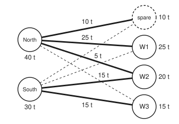

# Network flows: shipping problems that are linear programs with whole answers

[Syllabus](../../../SYLLABUS.md) → [Optimization](../README.md) → [Linear Programming](../README.md#s04) → Network flows

---

## General Overview

Two sawmills supply three furniture workshops with timber every week. The North mill can cut 40 tonnes and the South mill 30. Workshop W1 needs 25 tonnes, W2 needs 20 and W3 needs 15. That is 60 tonnes wanted and 70 available. Haulage is charged per tonne and depends on the route: North to W1 costs £6 a tonne, South to W3 costs £7, and so on. The task is to **minimise** the week's haulage bill while every workshop gets exactly what it needs and no mill ships more than it cuts.

This is a linear program (straight-line cost, straight-line limits, from [Linear programs](01-linear-programs-and-polyhedra.md)). Its unknowns are the six tonnages, one per route, and nothing stops them being fractions. Yet when it is solved, the cheapest plan ships whole tonnes on every route: North sends 25 t to W1 and 5 t to W2 and keeps 10 t, South sends 15 t to W2 and 15 t to W3, for **£380 a week**. The prices that come out of the same calculation prove no plan, whole or fractional, is cheaper.

That is not luck with these numbers. A shipping problem's limits only ever say "these tonnages add up to that total". The best corner of such a problem (a plan pinned down by enough limits holding exactly) can be worked out by subtraction alone, so whole supplies and demands give whole shipments. This card writes the problem as a linear program, solves it with the shipping form of the simplex method, and shows why the answer comes out whole.

**A shipping problem whose supplies and demands are whole numbers has a best plan in whole numbers, because each corner of its linear program uses routes that form trees (no loops), and trees can be filled in by subtraction, one dead end at a time.**

**What kind of fact this is:** a theorem, proved on this card in Why it works; the optimality certificate uses weak duality, proved here in one line, and the general rule for all such tables is the subject of [Total unimodularity](../05-Integer%20and%20Combinatorial%20Optimisation/05-total-unimodularity.md).

### The picture: the cheapest plan

<p align="center"></p>

Schematic, not to scale. Mills on the left with what they can cut; the spare column and the workshops on the right with what they take. Thick lines carry the cheapest plan with its tonnes. Thin dashed lines are routes the plan leaves empty. "Spare" is the 10 t North keeps at the mill. Drawn this way, the five used routes never cross and contain no loop.

---

## The formula

Number the mills $i$ and the workshops $j$. The spare column is an extra "workshop" that takes the 10 t nobody needs, at no cost; with it, total supply equals total demand and every row can be an equation. The haulage cost per tonne is $c_{ij}$:

| £ per tonne | W1 | W2 | W3 | spare |
| --- | ---: | ---: | ---: | ---: |
| North (40 t) | 6 | 7 | 10 | 0 |
| South (30 t) | 7 | 6 | 7 | 0 |
| needs | 25 t | 20 t | 15 t | 10 t |

The **transportation problem**, a linear program in the shelf's form $c^T x$ made smallest under $Ax = b$, $x \ge 0$:

$$\min \sum_{i}\sum_{j} c_{ij}\,x_{ij} \quad\text{such that}\quad \sum_{j} x_{ij} = a_i \ \text{for each mill},\qquad \sum_{i} x_{ij} = b_j \ \text{for each column},\qquad x_{ij} \ge 0$$

**Read it aloud:** choose a tonnage for every route so that each mill ships out exactly what it has and each workshop receives exactly what it needs, and make the total haulage bill as small as possible.

Two companion facts carry the rest of the card. The integrality theorem:

$$a_i,\ b_j \ \text{whole numbers} \;\Longrightarrow\; \text{every corner has every } x_{ij} \text{ whole}$$

and the certificate, with one dual price $u_i$ per mill and $v_j$ per column (the prices $y$ of [LP duality](04-lp-duality-and-complementary-slackness.md), split by row group):

$$\bar c_{ij} = c_{ij} - u_i - v_j \;\ge\; 0 \ \text{on every route},\qquad \bar c_{ij} = 0 \ \text{wherever } x_{ij} > 0 \;\Longrightarrow\; x \text{ is a cheapest plan}$$

**Read it aloud:** if no route costs less than the prices at its two ends add up to, and every route in use costs exactly that, nothing beats the plan.

| Symbol | Plain meaning | In our example | Push it up and the answer… |
| --- | --- | --- | --- |
| $i$, $j$ | a mill (row), a column: a workshop or the spare | North, South; W1, W2, W3, spare | — |
| $m$, $n$ | number of mills, number of columns | 2, 4 | — |
| $x_{ij}$ | tonnes a week sent from mill $i$ to column $j$ | North to W1: 25 t | — |
| $c_{ij}$ | haulage cost on that route, £ per tonne | North to W1: £6 | the bill rises, at most by $x_{ij}$ per £1 |
| $a_i$ | what mill $i$ can cut, tonnes a week | 40, 30 | South: −£1 a tonne, the price $u_S$ |
| $b_j$ | what column $j$ takes, tonnes a week | 25, 20, 15; spare 10 | W2: +£7 a tonne, the price $v_2$ |
| $A$, $b$ | the constraint table and its right-hand side: one row per mill and per column, one column per route; $b$ stacks the $a_i$ and the $b_j$ | 6 rows, 8 routes | — |
| $u_i$, $v_j$ | dual prices at each mill and each column | $u$ = 0, −1; $v$ = 6, 7, 8, 0 | — |
| $\bar c_{ij}$ | reduced cost: how much the bill changes per tonne sent round the loop a new route opens | South to W1: 2 | above 0 keeps the plan |
| $\theta$ | tonnes shifted round that loop in one simplex step | 10 t | — |
| $d$ | a loop's pattern of change: +1 or −1 on its routes, 0 elsewhere (proof only) | North-W2 +1, South-W2 −1, South-W3 +1, North-W3 −1 | — |

Simplex, on this card, means the LP shelf's corner-walking method, not a triangle-shaped set. The table $A$ has a 1 in mill $i$'s row and a 1 in column $j$'s row for route $(i, j)$, and nothing else.

### When it holds

- **Supplies and demands are whole numbers.** The subtraction in Why it works copies them into the plan. If South can cut 30.5 t, the best plan sends 4.5 t (9/2) from North to W2.
- **Every limit is a "total in or out" row.** One extra row of another shape, such as a 55-hour limit on South's lorry at 3, 2 and 2 hours a tonne to W1, W2 and W3, can force a half tonne: the best fractional plan then costs £382.50 against £383 for the best whole one.
- **Totals balance, or a spare column absorbs the difference.** With 70 t cut and 60 t wanted, demanding that each mill ship all it cuts leaves no plan at all.
- **The solver returns a corner.** The theorem is about corners. Simplex always lands on one; a method that walks through the inside, such as [Interior point for linear programs](08-interior-point-for-lp-and-complexity.md), can stop somewhere between two equally cheap plans when there is a tie.

---

## Why it works

### Step 0: shipping limits only add and subtract

Every row says "these tonnages add to that total", with every coefficient 1. A corner of a linear program is pinned down by some of its limits holding exactly ([Corners are enough](02-corners-and-the-fundamental-theorem.md)). If those limits can be solved one unknown at a time, each by subtracting known numbers from a whole total, the corner is whole. The work is to show the routes a corner uses never form a loop, and that loop-free routes can be solved that way.

### Step 1: a corner never uses a loop of routes

Picture mills and columns as dots and each used route as a line between a mill and a column. Suppose the used routes contained a loop, such as North → W2 → South → W3 → North. Walking it, add $\theta$ tonnes on every other route and take $\theta$ off the rest. Each dot on the loop gains $\theta$ on one line and loses $\theta$ on another, so every row still holds. For a small enough $\theta$ both the "add" plan and the "take off" plan stay at or above 0, and the original plan is the midpoint of the two. A corner is never the midpoint of two other points of the region, so a corner's routes contain no loop.

### Step 2: loop-free routes are filled in leaf by leaf

A set of lines with no loop is a forest: a set of trees. Every tree with a line in it has a leaf, a dot touched by only one used line. That line's tonnage is forced: it must equal the leaf's supply or demand, a whole number. Strike the leaf, take that tonnage off the dot at the other end, and the rest is a smaller forest with whole totals. Repeat until every route is filled.

On the cheapest plan the leaves go like this. W1 is touched only by North, so North to W1 = 25. W3 is touched only by South: 15. The spare column: North keeps 10. South has 30 − 15 = 15 left and one route left, to W2: 15. W2 still needs 20 − 15 = 5, from North. North's total, 25 + 5 + 10 = 40, checks. Only subtraction was used.

### Step 3: the simplex step only moves whole tonnes

The shipping form of the simplex method keeps a tree of $m + n - 1 = 5$ routes. To try an unused route it adds that route, which closes exactly one loop in the tree, and pushes $\theta$ tonnes round the loop, adding and taking off alternately. $\theta$ is the smallest tonnage on a "take off" route, so it is whole, and the route it empties leaves the tree. Every plan the method visits is whole, which is Step 2 seen from the method's side.

### Step 4: prices certify the answer

Set the spare column's price to $v_\text{spare} = 0$ and solve $u_i + v_j = c_{ij}$ along the tree's routes. That is again leaf by leaf, so the prices are whole too. For any plan $x$ that meets every row, with every $\bar c_{ij} \ge 0$:

$$\sum_{i,j} c_{ij}\,x_{ij} \;\ge\; \sum_{i,j} (u_i + v_j)\,x_{ij} \;=\; \sum_i a_i u_i + \sum_j b_j v_j .$$

The inequality uses $x_{ij} \ge 0$; the equality regroups by row. The right-hand side is the same number for every plan. On the simplex's plan every used route has $\bar c_{ij} = 0$, so the inequality is an equality and that plan's cost meets the floor. This is weak duality from [LP duality](04-lp-duality-and-complementary-slackness.md), with the floor met exactly: £380 on both sides here.

### Step 5: every network, not just two rows of mills

A general network, with junctions that pass timber on, has one row per junction: what leaves minus what arrives equals that junction's supply. Each route column then holds +1 at its start and −1 at its end, and a route may have a capacity, the most it can carry. Step 1's loop argument needs one change, because routes now have directions. Walk any loop of routes that each sit strictly between 0 and their capacity. Add $\theta$ on routes walked in their own direction and take $\theta$ off routes walked against it. At each junction on the loop the walk then brings in as much as it carries out, so every junction still balances. (On the shipping network every route points from a mill to a column, so a loop walks routes forwards and backwards in turn: Step 1's alternating pattern.) So the corners of any **minimum-cost flow** problem (cheapest shipping through a network with junctions and route capacities) are whole when supplies and capacities are. The largest flow from a source to a sink is one of these linear programs, which is why [Max-flow min-cut](../../04-Combinatorics%20and%20graphs/13-Matchings%20and%20Flows/06-max-flow-min-cut.md) can promise whole flows from whole capacities. The general rule for which tables have only whole corners is [Total unimodularity](../05-Integer%20and%20Combinatorial%20Optimisation/05-total-unimodularity.md).

<details>
<summary>Detailed proof: whole supplies give whole corners</summary>

**Setup.** The region is $\{x : \sum_j x_{ij} = a_i,\ \sum_i x_{ij} = b_j,\ x \ge 0\}$ with $\sum a_i = \sum b_j$. Let $x$ be a corner, and call the routes with $x_{ij} > 0$ the used routes.

**No loop.** If the used routes held a loop $(i_1, j_1), (i_2, j_1), (i_2, j_2), \dots, (i_1, j_k)$, it alternates mill and column, so it has an even number of routes. Let $d$ be $+1$ on the odd-numbered routes, $-1$ on the even-numbered ones and 0 elsewhere. Every mill and column on the loop meets one $+1$ and one $-1$, so $Ad = 0$. With $\theta$ the smallest $x_{ij}$ on the loop, $x + \theta d$ and $x - \theta d$ are both in the region and $x$ is their midpoint, contradicting that $x$ is a corner.

**Leaf by leaf.** So the used routes form a forest. Take a leaf: a mill or column met by exactly one used route, say $(i, j)$ with leaf $j$. Every other route at $j$ carries 0, so $x_{ij} = b_j$, whole. Remove $j$ and replace $a_i$ by $a_i - b_j$, still whole. The remaining tonnages form a corner of the smaller problem, since any midpoint splitting there would also split the original. Induct on the number of routes. A leaf at a mill works the same way.

**Certificate.** For any feasible $x$ and prices with $c_{ij} \ge u_i + v_j$ on every route, $\sum c_{ij} x_{ij} \ge \sum_i a_i u_i + \sum_j b_j v_j$, and equality holds when $c_{ij} = u_i + v_j$ wherever $x_{ij} > 0$. That is all Step 4 needs. Strong duality, which says such prices always exist at the optimum, is proved on [LP duality](04-lp-duality-and-complementary-slackness.md); here the simplex method hands the prices over directly.

</details>

---

## Worked numbers, by hand

The shipping simplex starts from the **northwest-corner plan**: fill the table from its top-left cell, taking as much as each row and column allows, then move right or down.

| Step | Arithmetic | Value |
| --- | --- | --- |
| northwest start | North: W1 25, W2 15; South: W2 5, W3 15, spare 10 | 5 routes, a tree |
| its cost | 25 × 6 + 15 × 7 + 5 × 6 + 15 × 7 + 10 × 0 | £390 |
| try North → spare | loop: +North-spare, −South-spare, +South-W2, −North-W2; per tonne 0 − 0 + 6 − 7 | −1 a tonne |
| how far | smallest "take off" tonnage: South-spare 10, North-W2 15 | $\theta$ = 10 t |
| new cost | 390 − 10 × 1 | £380 |
| prices on the new tree | spare 0; North 0; W1 6, W2 7; South 6 − 7; W3 7 + 1 | $u$ = 0, −1; $v$ = 6, 7, 8 |
| reduced costs of unused routes | North-W3 10 − 0 − 8; South-W1 7 + 1 − 6; South-spare 0 + 1 − 0 | 2, 2, 1: none below 0 |
| price floor | 40 × 0 + 30 × (−1) + 25 × 6 + 20 × 7 + 15 × 8 + 10 × 0 | £380 |
| **cheapest plan** | North: W1 25, W2 5, keeps 10; South: W2 15, W3 15 | **£380 a week, all whole tonnes** |

The haulier books five whole lorry runs and pays £380 a week. The prices also read as values: one more tonne of South's capacity saves £1, and one more tonne needed at W2 costs £7.

### What breaks if you drop a piece

| Mistake | Comes out at | What went wrong |
| --- | --- | --- |
| Add a 55-hour limit on South's lorry, 3, 2 and 2 hours a tonne to W1, W2, W3 | best plan sends South 12.5 t (25/2) to W2 and North 7.5 t (15/2), for £382.50; best whole plan £383 | a row with coefficient 2 is not a "total in or out" row: the corner solves 2 × (South to W2) + 30 = 55 |
| Round that half tonne | South 13 t to W2: 56 hours, over the limit; 12 t: 54 hours, £383 | rounding up breaks a limit; rounding down happens to work here but is not a method |
| South's capacity written as 30.5 t | North sends 4.5 t to W2; £379.50 | a fractional supply is copied into the plan by the subtraction |
| Each mill must ship all it cuts | 70 t out, 60 t in: no plan fits | supply rows as equalities need the spare column |

---

## Code, from first principles, and it actually runs

Nothing imported knows about linear programs. The script solves the shipping problem with the shipping form of the simplex method, written out: a northwest-corner start, prices along the tree, the loop a new route closes and the shift round it. It reaches £380 by **four independent roads**: the simplex method; its prices as a certificate, whose floor meets the plan; every corner of the linear program, found in exact fractions by solving each choice of three tight limits by Cramer's rule (each unknown a ratio of two determinants; with two mills, North's three tonnages fix the rest); and every one of the 3,001 whole-tonne plans. It then prints each "what breaks" row and each "Try changing" answer.

### Python

```python
# Network flows as linear programs -- the check behind the card. Standard library only.
# Two mills ship timber to three workshops; MINIMISE haulage cost. Roads: the transportation
# simplex (it only adds and subtracts); its prices as a certificate; every corner of the
# linear program in exact fractions; every whole-tonne plan listed.
from fractions import Fraction as Fr
from itertools import combinations, product

COST = [[6, 7, 10], [7, 6, 7]]            # pounds per tonne, North and South mill to W1, W2, W3
SUPPLY, DEMAND = [40, 30], [25, 20, 15]   # tonnes a week
HOURS, BUDGET = [3, 2, 2], 55             # South lorry hours per tonne to W1, W2, W3; hours a week
NAMES = ["W1", "W2", "W3", "spare"]
lab = lambda r: f"{'NS'[r[0]]}-{NAMES[r[1]]}"

def transport(cost, supply, demand, log=False):
    c = [row + [0] for row in cost]                  # the spare column costs nothing
    a, b = list(supply), list(demand) + [sum(supply) - sum(demand)]
    m, n = len(a), len(b)
    x, i, j = {}, 0, 0                               # northwest-corner start
    while i < m and j < n:
        q = min(a[i], b[j]); x[(i, j)] = q; a[i] -= q; b[j] -= q
        if a[i] == 0 and i < m - 1: i += 1
        else: j += 1
    total = lambda: sum(c[i][j] * q for (i, j), q in x.items())
    if log: print("northwest-corner start:", ", ".join(f"{lab(r)} {q}" for r, q in x.items()), "| cost", total())
    k = 0
    while True:
        u, v = [None] * m, [None] * n; v[n - 1] = 0  # prices: u_i + v_j = c_ij on used routes
        for _ in range(m + n):
            for (i, j) in x:
                if u[i] is None and v[j] is not None: u[i] = c[i][j] - v[j]
                if v[j] is None and u[i] is not None: v[j] = c[i][j] - u[i]
        red = {(i, j): c[i][j] - u[i] - v[j] for i in range(m) for j in range(n) if (i, j) not in x}
        e = min(red, key=lambda r: (red[r], r))
        if red[e] >= 0: return x, total(), u, v, red, k
        adj = {}                                     # the loop the new route closes, a path in the tree
        for (i, j) in x:
            adj.setdefault(("r", i), []).append(("c", j)); adj.setdefault(("c", j), []).append(("r", i))
        prev, stack = {("c", e[1]): None}, [("c", e[1])]
        while stack:
            nd = stack.pop()
            for nb in adj.get(nd, []):
                if nb not in prev: prev[nb] = nd; stack.append(nb)
        path = [("r", e[0])]
        while prev[path[-1]] is not None: path.append(prev[path[-1]])
        cells = [(p[1], q[1]) if p[0] == "r" else (q[1], p[1]) for p, q in zip(path, path[1:])]
        minus, plus = cells[0::2], cells[1::2]
        th = min(x[r] for r in minus); out = min(r for r in minus if x[r] == th)
        for r in minus: x[r] -= th
        for r in plus: x[r] += th
        x[e] = th; del x[out]; k += 1
        if log: print(f"pivot {k}: enter {lab(e)} (reduced cost {red[e]}), shift {th} t, leave {lab(out)}, cost {total()}")

def det3(M):
    return (M[0][0] * (M[1][1] * M[2][2] - M[1][2] * M[2][1]) - M[0][1] * (M[1][0] * M[2][2] - M[1][2] * M[2][0])
            + M[0][2] * (M[1][0] * M[2][1] - M[1][1] * M[2][0]))

def rows(supply, budget):  # y = North's tonnes to W1..W3; South sends DEMAND - y; each row g.y <= h
    R = [([-int(i == j) for i in range(3)], 0) for j in range(3)]
    R += [([int(i == j) for i in range(3)], DEMAND[j]) for j in range(3)]
    R += [([1, 1, 1], supply[0]), ([-1, -1, -1], supply[1] - sum(DEMAND))]
    if budget: R.append(([-h for h in HOURS], budget - sum(h * d for h, d in zip(HOURS, DEMAND))))
    return R

fits = lambda R, y: all(sum(g[k] * y[k] for k in range(3)) <= h for g, h in R)
plan_cost = lambda y: sum(COST[0][j] * y[j] + COST[1][j] * (DEMAND[j] - y[j]) for j in range(3))
south_hours = lambda y: sum(HOURS[j] * (DEMAND[j] - y[j]) for j in range(3))
show = lambda y: "(" + ", ".join(str(q) for q in y) + ")"

def corners(supply, budget=0):  # every corner: three rows tight, solved by Cramer's rule
    R, pts = rows(supply, budget), set()
    for trio in combinations(R, 3):
        A = [g for g, _ in trio]; D = det3(A)
        if D == 0: continue
        y = tuple(Fr(det3([[trio[r][1] if k == col else A[r][k] for k in range(3)] for r in range(3)]), D)
                  for col in range(3))
        if fits(R, y): pts.add(y)
    best = min(pts, key=plan_cost)
    return len(pts), sum(all(q.denominator == 1 for q in p) for p in pts), best, plan_cost(best)

def whole_best(supply, budget=0):
    R = rows(supply, budget)
    ok = [y for y in product(*(range(d + 1) for d in DEMAND)) if fits(R, y)]
    return len(ok), min(map(plan_cost, ok))

x, cost, u, v, red, piv = transport(COST, SUPPLY, DEMAND, log=True)
print("best plan:", ", ".join(f"{lab(r)} {q}" for r, q in sorted(x.items())), f"| cost {cost}, pivots {piv}")
print(f"prices: u North {u[0]}, South {u[1]}; v W1 {v[0]}, W2 {v[1]}, W3 {v[2]}, spare {v[3]}")
print("reduced costs, unused routes:", ", ".join(f"{lab(r)} {q}" for r, q in sorted(red.items())))
dual = sum(a * p for a, p in zip(SUPPLY + DEMAND + [sum(SUPPLY) - sum(DEMAND)], u + v))
print("dual value: supplies times u plus demands times v =", dual)
nc, nw, cb, cv = corners(SUPPLY)
print(f"corners {nc}, whole {nw}, best corner, North sends {show(cb)}, cost {cv}")
nplans, wb = whole_best(SUPPLY)
print(f"whole plans {nplans}, best {wb}; South lorry hours in best plan {south_hours(cb)}")
hc, hw, hb, hv = corners(SUPPLY, BUDGET)
hn, hwb = whole_best(SUPPLY, BUDGET)
print(f"break, hours <= {BUDGET}: corners {hc}, whole {hw}, best: North sends {show(hb)}, South-W2 {DEMAND[1] - hb[1]}, cost {hv} = {float(hv)}")
print(f"break, hours <= {BUDGET}: whole plans {hn}, best whole plan {hwb}")
f = [j for j in range(3) if hb[j].denominator > 1][0]          # the route with a half tonne
up = tuple(int(q) for q in hb); down = tuple(q + (j == f) for j, q in enumerate(up))
print(f"break, round South-{NAMES[f]} up to {DEMAND[f] - up[f]} t: hours {south_hours(up)}; down to "
      f"{DEMAND[f] - down[f]} t: hours {south_hours(down)}, cost {plan_cost(down)}")
_, _, fb, fv = corners([40, Fr(61, 2)])
print(f"break, South 30.5 t: best: North sends {show(fb)}, cost {fv} = {float(fv)}")
print(f"break, supply as equality: supply {sum(SUPPLY)} t, demand {sum(DEMAND)} t, no plan fits")
t1 = transport(COST, [40, 35], DEMAND)[1]
t2 = transport(COST, SUPPLY, [25, 21, 15])[1]
x3, t3 = transport([[6, 7, 10], [4, 6, 7]], SUPPLY, DEMAND)[:2]
_, _, _, t4 = corners(SUPPLY, 56)
print(f"try, South 35 t: {t1}; W2 needs 21 t: {t2}; hours <= 56: {t4}")
print("try, S-W1 at 4:", ", ".join(f"{lab(r)} {q}" for r, q in sorted(x3.items())), f"| cost {t3}")
print("figure, North (60 80) South (60 180) spare (290 35) W1 (290 95) W2 (290 155) W3 (290 215)")

assert cost == cv == wb == 380, "simplex, all corners and all whole plans must agree"
assert dual == cost and min(red.values()) >= 0, "prices certify the plan: no route undercuts them"
assert nw == nc and cb == tuple(x.get((0, j), 0) for j in range(3)), "every corner whole; the best is the simplex plan"
assert hb[f].denominator == 2 and hv < hwb, "a non-network row lets a half tonne in, below the best whole plan"
assert t1 == cost + 5 * u[1] and t2 == cost + v[1], "prices predict the cost of one more tonne"
assert t3 == cost + 15 * (red[(1, 0)] - 3), "S-W1 at 4: reduced cost 2 - 3 = -1 a tonne, over 15 t"
print("ALL CHECKS PASS")
```

**Ran 2026-11-11 on macOS, Python 3.14.10, standard library only. All checks passed. Output, pasted from the run:**

```
northwest-corner start: N-W1 25, N-W2 15, S-W2 5, S-W3 15, S-spare 10 | cost 390
pivot 1: enter N-spare (reduced cost -1), shift 10 t, leave S-spare, cost 380
best plan: N-W1 25, N-W2 5, N-spare 10, S-W2 15, S-W3 15 | cost 380, pivots 1
prices: u North 0, South -1; v W1 6, W2 7, W3 8, spare 0
reduced costs, unused routes: N-W3 2, S-W1 2, S-spare 1
dual value: supplies times u plus demands times v = 380
corners 11, whole 11, best corner, North sends (25, 5, 0), cost 380
whole plans 3001, best 380; South lorry hours in best plan 60
break, hours <= 55: corners 9, whole 6, best: North sends (25, 15/2, 0), South-W2 25/2, cost 765/2 = 382.5
break, hours <= 55: whole plans 992, best whole plan 383
break, round South-W2 up to 13 t: hours 56; down to 12 t: hours 54, cost 383
break, South 30.5 t: best: North sends (25, 9/2, 0), cost 759/2 = 379.5
break, supply as equality: supply 70 t, demand 60 t, no plan fits
try, South 35 t: 375; W2 needs 21 t: 387; hours <= 56: 382
try, S-W1 at 4: N-W1 10, N-W2 20, N-spare 10, S-W1 15, S-W3 15 | cost 365
figure, North (60 80) South (60 180) spare (290 35) W1 (290 95) W2 (290 155) W3 (290 215)
ALL CHECKS PASS
```

### Rust

```rust
// Network flows as linear programs -- the check behind the card. Rust std only, no crates.
// Two mills ship timber to three workshops; MINIMISE haulage cost. Roads: the transportation
// simplex (it only adds and subtracts); its prices as a certificate; every corner of the
// linear program in exact fractions; every whole-tonne plan listed.
const COST: [[i64; 3]; 2] = [[6, 7, 10], [7, 6, 7]]; // pounds per tonne, North and South mill to W1, W2, W3
const SUPPLY: [i64; 2] = [40, 30]; // tonnes a week
const DEMAND: [i64; 3] = [25, 20, 15];
const HOURS: [i64; 3] = [3, 2, 2]; // South lorry hours per tonne to W1, W2, W3
const BUDGET: i64 = 55; // hours a week
const NAMES: [&str; 4] = ["W1", "W2", "W3", "spare"];
type Cell = (usize, usize, i64);

fn lab(i: usize, j: usize) -> String { format!("{}-{}", ["N", "S"][i], NAMES[j]) }
fn gcd(a: i64, b: i64) -> i64 { if b == 0 { a.abs() } else { gcd(b, a % b) } }
fn fr(n: i64, d: i64) -> String {
    let g = gcd(n, d).max(1);
    let (n, d) = (n / g * d.signum(), d.abs() / g);
    if d == 1 { format!("{}", n) } else { format!("{}/{}", n, d) }
}
fn list(x: &[Cell]) -> String { x.iter().map(|&(i, j, q)| format!("{} {}", lab(i, j), q)).collect::<Vec<_>>().join(", ") }

struct Out { x: Vec<Cell>, cost: i64, u: Vec<i64>, v: Vec<i64>, red: Vec<Cell>, k: usize }

fn transport(cost: [[i64; 3]; 2], supply: [i64; 2], demand: [i64; 3], log: bool) -> Out {
    let c: Vec<Vec<i64>> = cost.iter().map(|r| vec![r[0], r[1], r[2], 0]).collect(); // spare costs nothing
    let (mut a, mut b) = (supply.to_vec(), demand.to_vec());
    b.push(supply.iter().sum::<i64>() - demand.iter().sum::<i64>());
    let (m, n) = (2usize, 4usize);
    let (mut x, mut i, mut j): (Vec<Cell>, usize, usize) = (vec![], 0, 0); // northwest-corner start
    while i < m && j < n {
        let q = a[i].min(b[j]);
        x.push((i, j, q)); a[i] -= q; b[j] -= q;
        if a[i] == 0 && i < m - 1 { i += 1 } else { j += 1 }
    }
    let total = |x: &Vec<Cell>| x.iter().map(|&(i, j, q)| c[i][j] * q).sum::<i64>();
    if log { println!("northwest-corner start: {} | cost {}", list(&x), total(&x)); }
    let mut k = 0;
    loop {
        let (mut u, mut v) = (vec![None; m], vec![None; n]); // prices: u_i + v_j = c_ij on used routes
        v[n - 1] = Some(0i64);
        for _ in 0..m + n {
            for &(i, j, _) in &x {
                if u[i].is_none() { if let Some(vj) = v[j] { u[i] = Some(c[i][j] - vj); } }
                if v[j].is_none() { if let Some(ui) = u[i] { v[j] = Some(c[i][j] - ui); } }
            }
        }
        let (u, v): (Vec<i64>, Vec<i64>) = (u.iter().map(|p| p.unwrap()).collect(), v.iter().map(|p| p.unwrap()).collect());
        let mut red: Vec<Cell> = vec![];
        for i in 0..m { for j in 0..n {
            if !x.iter().any(|&(a, b, _)| a == i && b == j) { red.push((i, j, c[i][j] - u[i] - v[j])); }
        } }
        let mut e = red[0];
        for &r in &red { if r.2 < e.2 { e = r; } }
        if e.2 >= 0 { let cost = total(&x); return Out { x, cost, u, v, red, k }; }
        let mut adj: Vec<Vec<usize>> = vec![vec![]; m + n]; // the loop the new route closes
        for &(i, j, _) in &x { adj[i].push(m + j); adj[m + j].push(i); }
        let mut prev: Vec<Option<usize>> = vec![None; m + n];
        let (mut seen, mut stack) = (vec![false; m + n], vec![m + e.1]);
        seen[m + e.1] = true;
        while let Some(nd) = stack.pop() {
            for &nb in &adj[nd] { if !seen[nb] { seen[nb] = true; prev[nb] = Some(nd); stack.push(nb); } }
        }
        let mut path = vec![e.0];
        while let Some(p) = prev[*path.last().unwrap()] { path.push(p); }
        let cells: Vec<(usize, usize)> = path.windows(2).map(|w| if w[0] < m { (w[0], w[1] - m) } else { (w[1], w[0] - m) }).collect();
        let pos = |x: &Vec<Cell>, r: (usize, usize)| x.iter().position(|&(a, b, _)| (a, b) == r).unwrap();
        let (mut th, mut out) = (i64::MAX, (0, 0));
        for (t, &r) in cells.iter().enumerate() {
            let q = x[pos(&x, r)].2;
            if t % 2 == 0 && (q < th || (q == th && r < out)) { th = q; out = r; }
        }
        for (t, &r) in cells.iter().enumerate() { let p = pos(&x, r); x[p].2 += if t % 2 == 0 { -th } else { th }; }
        x.push((e.0, e.1, th));
        let p = pos(&x, out); x.remove(p); k += 1;
        if log { println!("pivot {}: enter {} (reduced cost {}), shift {} t, leave {}, cost {}", k, lab(e.0, e.1), e.2, th, lab(out.0, out.1), total(&x)); }
    }
}

fn det3(m: &[[i64; 3]; 3]) -> i64 {
    m[0][0] * (m[1][1] * m[2][2] - m[1][2] * m[2][1]) - m[0][1] * (m[1][0] * m[2][2] - m[1][2] * m[2][0])
        + m[0][2] * (m[1][0] * m[2][1] - m[1][1] * m[2][0])
}
// y = North's tonnes to W1..W3; South sends demand - y; each row g.y <= h
fn rows(sup: [i64; 2], dem: [i64; 3], budget: i64) -> Vec<([i64; 3], i64)> {
    let mut r = vec![];
    for j in 0..3 { let mut g = [0; 3]; g[j] = -1; r.push((g, 0)); }
    for j in 0..3 { let mut g = [0; 3]; g[j] = 1; r.push((g, dem[j])); }
    r.push(([1, 1, 1], sup[0]));
    r.push(([-1, -1, -1], sup[1] - dem.iter().sum::<i64>()));
    if budget > 0 { r.push(([-HOURS[0], -HOURS[1], -HOURS[2]], budget - (0..3).map(|j| HOURS[j] * dem[j]).sum::<i64>())); }
    r
}
fn plan_cost(y: [i64; 3], d: i64, dem: [i64; 3]) -> i64 { (0..3).map(|j| (COST[0][j] - COST[1][j]) * y[j] + d * COST[1][j] * dem[j]).sum() }
fn south_hours(y: [i64; 3]) -> i64 { (0..3).map(|j| HOURS[j] * (DEMAND[j] - y[j])).sum() }
fn show(y: [i64; 3], d: i64) -> String { format!("({}, {}, {})", fr(y[0], d), fr(y[1], d), fr(y[2], d)) }

// every corner: three rows tight, solved by Cramer's rule; s = units per tonne (2 for half tonnes)
fn corners(sup: [i64; 2], dem: [i64; 3], budget: i64, s: i64) -> (usize, usize, [i64; 3], i64, i64) {
    let r = rows(sup, dem, budget);
    let mut pts: Vec<([i64; 3], i64)> = vec![];
    for a in 0..r.len() { for b in a + 1..r.len() { for c in b + 1..r.len() {
        let t = [r[a], r[b], r[c]];
        let m = [t[0].0, t[1].0, t[2].0];
        let mut d = det3(&m);
        if d == 0 { continue; }
        let mut y = [0; 3];
        for col in 0..3 { let mut mk = m; for k in 0..3 { mk[k][col] = t[k].1; } y[col] = det3(&mk); }
        if d < 0 { d = -d; for q in y.iter_mut() { *q = -*q; } }
        if !r.iter().all(|(g, h)| g[0] * y[0] + g[1] * y[1] + g[2] * y[2] <= h * d) { continue; }
        let g = gcd(gcd(gcd(y[0], y[1]), y[2]), d);
        let p = ([y[0] / g, y[1] / g, y[2] / g], d / g);
        if !pts.contains(&p) { pts.push(p); }
    } } }
    let whole = pts.iter().filter(|p| p.1 == 1).count();
    let mut best = pts[0];
    for &p in &pts { if plan_cost(p.0, p.1, dem) * best.1 < plan_cost(best.0, best.1, dem) * p.1 { best = p; } }
    (pts.len(), whole, best.0, best.1 * s, plan_cost(best.0, best.1, dem))
}
fn whole_best(budget: i64) -> (usize, i64) {
    let r = rows(SUPPLY, DEMAND, budget);
    let (mut n, mut best) = (0, i64::MAX);
    for a in 0..=DEMAND[0] { for b in 0..=DEMAND[1] { for c in 0..=DEMAND[2] {
        if r.iter().all(|(g, h)| g[0] * a + g[1] * b + g[2] * c <= *h) { n += 1; best = best.min(plan_cost([a, b, c], 1, DEMAND)); }
    } } }
    (n, best)
}

fn main() {
    let o = transport(COST, SUPPLY, DEMAND, true);
    let mut xs = o.x.clone(); xs.sort();
    println!("best plan: {} | cost {}, pivots {}", list(&xs), o.cost, o.k);
    println!("prices: u North {}, South {}; v W1 {}, W2 {}, W3 {}, spare {}", o.u[0], o.u[1], o.v[0], o.v[1], o.v[2], o.v[3]);
    println!("reduced costs, unused routes: {}", list(&o.red));
    let amounts = [SUPPLY[0], SUPPLY[1], DEMAND[0], DEMAND[1], DEMAND[2], SUPPLY.iter().sum::<i64>() - DEMAND.iter().sum::<i64>()];
    let prices = [o.u[0], o.u[1], o.v[0], o.v[1], o.v[2], o.v[3]];
    let dual: i64 = (0..6).map(|k| amounts[k] * prices[k]).sum();
    println!("dual value: supplies times u plus demands times v = {}", dual);
    let (nc, nw, cb, cd, cn) = corners(SUPPLY, DEMAND, 0, 1);
    println!("corners {}, whole {}, best corner, North sends {}, cost {}", nc, nw, show(cb, cd), fr(cn, cd));
    let (np, wb) = whole_best(0);
    println!("whole plans {}, best {}; South lorry hours in best plan {}", np, wb, south_hours(cb));
    let (hc, hw, hb, hd, hn) = corners(SUPPLY, DEMAND, BUDGET, 1);
    let (hp, hwb) = whole_best(BUDGET);
    println!("break, hours <= {}: corners {}, whole {}, best: North sends {}, South-W2 {}, cost {} = {}", BUDGET, hc, hw, show(hb, hd), fr(DEMAND[1] * hd - hb[1], hd), fr(hn, hd), hn as f64 / hd as f64);
    println!("break, hours <= {}: whole plans {}, best whole plan {}", BUDGET, hp, hwb);
    let f = (0..3).find(|&j| hb[j] % hd != 0).unwrap(); // the route with a half tonne
    let (up, mut down) = ([hb[0] / hd, hb[1] / hd, hb[2] / hd], [hb[0] / hd, hb[1] / hd, hb[2] / hd]);
    down[f] += 1;
    println!("break, round South-{} up to {} t: hours {}; down to {} t: hours {}, cost {}", NAMES[f], DEMAND[f] - up[f], south_hours(up), DEMAND[f] - down[f], south_hours(down), plan_cost(down, 1, DEMAND));
    let (_, _, fb, fd, fnum) = corners([80, 61], [50, 40, 30], 0, 2); // South 30.5 t, in half tonnes
    println!("break, South 30.5 t: best: North sends {}, cost {} = {}", show(fb, fd), fr(fnum, fd), fnum as f64 / fd as f64);
    println!("break, supply as equality: supply {} t, demand {} t, no plan fits", SUPPLY.iter().sum::<i64>(), DEMAND.iter().sum::<i64>());
    let t1 = transport(COST, [40, 35], DEMAND, false).cost;
    let t2 = transport(COST, SUPPLY, [25, 21, 15], false).cost;
    let o3 = transport([[6, 7, 10], [4, 6, 7]], SUPPLY, DEMAND, false);
    let (_, _, _, t4d, t4n) = corners(SUPPLY, DEMAND, 56, 1);
    println!("try, South 35 t: {}; W2 needs 21 t: {}; hours <= 56: {}", t1, t2, fr(t4n, t4d));
    let mut x3 = o3.x; x3.sort();
    println!("try, S-W1 at 4: {} | cost {}", list(&x3), o3.cost);
    println!("figure, North (60 80) South (60 180) spare (290 35) W1 (290 95) W2 (290 155) W3 (290 215)");
    assert!(o.cost * cd == cn && o.cost == wb && wb == 380, "simplex, all corners and all whole plans must agree");
    assert!(dual == o.cost && o.red.iter().all(|r| r.2 >= 0), "prices certify the plan: no route undercuts them");
    let north: Vec<i64> = (0..3).map(|j| o.x.iter().find(|r| r.0 == 0 && r.1 == j).map_or(0, |r| r.2)).collect();
    assert!(nw == nc && cd == 1 && cb.to_vec() == north, "every corner whole; the best is the simplex plan");
    assert!(hd == 2 && hb[f] % 2 != 0 && hn < hwb * hd, "a non-network row lets a half tonne in, below the best whole plan");
    assert!(t1 == o.cost + 5 * o.u[1] && t2 == o.cost + o.v[1], "prices predict the cost of one more tonne");
    let s_w1 = o.red.iter().find(|r| r.0 == 1 && r.1 == 0).unwrap().2;
    assert!(o3.cost == o.cost + 15 * (s_w1 - 3), "S-W1 at 4: reduced cost 2 - 3 = -1 a tonne, over 15 t");
    println!("ALL CHECKS PASS");
}
```

**Ran 2026-11-11 on macOS, rustc 1.98.1, no crates. All checks passed. Output, pasted from the run:**

```
northwest-corner start: N-W1 25, N-W2 15, S-W2 5, S-W3 15, S-spare 10 | cost 390
pivot 1: enter N-spare (reduced cost -1), shift 10 t, leave S-spare, cost 380
best plan: N-W1 25, N-W2 5, N-spare 10, S-W2 15, S-W3 15 | cost 380, pivots 1
prices: u North 0, South -1; v W1 6, W2 7, W3 8, spare 0
reduced costs, unused routes: N-W3 2, S-W1 2, S-spare 1
dual value: supplies times u plus demands times v = 380
corners 11, whole 11, best corner, North sends (25, 5, 0), cost 380
whole plans 3001, best 380; South lorry hours in best plan 60
break, hours <= 55: corners 9, whole 6, best: North sends (25, 15/2, 0), South-W2 25/2, cost 765/2 = 382.5
break, hours <= 55: whole plans 992, best whole plan 383
break, round South-W2 up to 13 t: hours 56; down to 12 t: hours 54, cost 383
break, South 30.5 t: best: North sends (25, 9/2, 0), cost 759/2 = 379.5
break, supply as equality: supply 70 t, demand 60 t, no plan fits
try, South 35 t: 375; W2 needs 21 t: 387; hours <= 56: 382
try, S-W1 at 4: N-W1 10, N-W2 20, N-spare 10, S-W1 15, S-W3 15 | cost 365
figure, North (60 80) South (60 180) spare (290 35) W1 (290 95) W2 (290 155) W3 (290 215)
ALL CHECKS PASS
```

Four roads, one bill. The simplex method needs one step from the £390 start. All 11 corners of the region are whole, as Step 2 promises, and the cheapest is the simplex's plan. The prices put a floor of £380 under every plan, fractional ones included. The 3,001 whole plans agree. With the lorry-hours row added, only 6 of the 9 corners are whole, and the cheapest is not one of them.

> [!TIP]
> **Try changing**
> The "try" lines in the output give each answer.
> - **Guess first: what are 5 more tonnes at South worth?** Set South's capacity to 35. The bill falls to £375: 5 × £1, South's price.
> - **Guess first: what does one more tonne at W2 cost?** Set W2's need to 21. £387: W2's price is £7.
> - **Guess first: does a cheaper unused route change the plan?** Cut South to W1 from £7 to £4. Its reduced cost goes from 2 to −1, so 15 t move round its loop: North sends 10 t to W1 and 20 t to W2, South sends 15 t to W1 and 15 t to W3, for £365.
> - **Guess first: what is one more lorry hour worth?** Set the limit to 56 hours. The best plan costs £382, down from £382.50: half a pound an hour, because each extra hour lets half a tonne move off North's £7 route to W2 onto South's £6 one.

---

## The usual mistake

> [!warning]
> **Assuming every shipping problem comes out whole.** The theorem needs every row to be a "total in or out" row. Add one limit of another shape, here South's 55 lorry hours at 3, 2 and 2 hours a tonne to W1, W2 and W3, and the best plan ships 12.5 t, costing £382.50 against £383 for the best whole plan. Real models collect side limits like this: driver hours, budgets, weight on a bridge. Each one can bring fractions back, and the problem becomes an integer program (a linear program whose answers must be whole numbers).
>
> - **Rounding a fractional plan.** Rounding South's 12.5 t to W2 up to 13 t uses 56 hours, over the 55-hour limit.
> - **Forgetting the spare column.** With 70 t cut and 60 t wanted, equal supply rows leave no plan at all.
> - **Stopping at the first plan.** The northwest-corner start is a whole plan, but it costs £390, £10 more than the best. Being whole proves nothing; the prices prove optimality.
> - **Feeding in fractional data.** South at 30.5 t gives North 4.5 t to W2. The promise is whole answers from whole supplies and demands.

---

## Where you meet it in real life

- **Haulage and distribution.** Depots to shops, quarries to building sites, mills to workshops. Freight planners solve these linear programs every day and get whole lorry-loads without any integer search, as long as the model stays a pure network.
- **Wartime shipping.** The transportation problem was posed by Hitchcock in 1941 and studied by Koopmans for allied merchant shipping. Dantzig's simplex method was quickly specialised to it, the form used on this card.
- **Matching staff to shifts.** Each person is a mill with 1 unit, each shift a workshop needing 1. The plan comes out as 0s and 1s, a matching, which is why matching can be posed as a flow on the combinatorics wing.
- **Largest flow through a network.** Pipes, roads or data links with capacities: maximising what reaches the sink is a network linear program, and whole capacities give whole flows, as [Max-flow min-cut](../../04-Combinatorics%20and%20graphs/13-Matchings%20and%20Flows/06-max-flow-min-cut.md) proves by pushing along routes.
- **Where it stops.** Delivery routing, where each lorry visits several shops in a tour, is not a network flow. Its linear programs go fractional, and that is where integer programming begins.

> **Say it back**
> A shipping problem is a linear program whose every limit says "these tonnages add to that total". A corner of it never uses a loop of routes, so its routes form trees, and a tree can be filled in from its dead ends by subtraction alone. Whole supplies and demands therefore give whole corners, and the simplex method, shifting whole tonnes round loops, ends on one. For the mills that is £380 a week, and prices of 0 and −£1 at the mills and £6, £7, £8 at the workshops prove nothing is cheaper. One limit of another shape, such as lorry hours, can break this and let a half tonne in.

---

## What this builds on

- [LP duality](04-lp-duality-and-complementary-slackness.md): the partner problem and its prices; here they become one price per mill and per workshop, and the floor they set certifies the plan.
- [Max-flow min-cut](../../04-Combinatorics%20and%20graphs/13-Matchings%20and%20Flows/06-max-flow-min-cut.md): whole flows from whole capacities, and matching as a flow; this card shows the same wholeness from the linear-programming side.
- [Flows](../../04-Combinatorics%20and%20graphs/13-Matchings%20and%20Flows/05-flow-networks-and-ford-fulkerson.md): networks, capacities and conservation at each junction, the rows of Step 5.

## Where this goes next

- [Total unimodularity](../05-Integer%20and%20Combinatorial%20Optimisation/05-total-unimodularity.md): the property of the whole table, every square block with determinant −1, 0 or 1, that makes every corner whole for every whole right-hand side.
- [Two-stage stochastic programming](../07-Dynamic%20Programming%20and%20Learning/07-stochastic-programming-with-recourse.md): the same shipping plan when the workshops' needs are uncertain and some choices wait until they are known.
- [Linear programs](01-linear-programs-and-polyhedra.md): the transportation problem with mass spread continuously, where its prices become a way to measure the distance between two distributions.

The certificate here came from the simplex method's tree; whether every network linear program with whole data also has whole prices, and what that says about cuts, is left for [Total unimodularity](../05-Integer%20and%20Combinatorial%20Optimisation/05-total-unimodularity.md).

---

## Sources

Verified 2026-11-11: every link below resolves to the publisher's page.

- Hitchcock, F. L. "The Distribution of a Product from Several Sources to Numerous Localities." *Journal of Mathematics and Physics* 20 (1941). [doi:10.1002/sapm1941201224](https://doi.org/10.1002/sapm1941201224). The transportation problem as stated on this card.
- Koopmans, T. C. "Optimum Utilization of the Transportation System." *Econometrica* 17 (1949). [doi:10.2307/1907301](https://doi.org/10.2307/1907301). Shipping costs and the prices at each end of a route.
- Ford, L. R., and D. R. Fulkerson. "Maximal Flow Through a Network." *Canadian Journal of Mathematics* 8 (1956). [doi:10.4153/CJM-1956-045-5](https://doi.org/10.4153/CJM-1956-045-5). Largest flow as a network problem with whole answers from whole capacities.
- Hoffman, A. J., and J. B. Kruskal. "Integral Boundary Points of Convex Polyhedra." In *Linear Inequalities and Related Systems*, Annals of Mathematics Studies 38, Princeton University Press (1956). [doi:10.1515/9781400881987-014](https://doi.org/10.1515/9781400881987-014). The general theorem behind whole corners, of which Step 2 is the shipping case.
- Bertsimas, D., and J. N. Tsitsiklis. *Introduction to Linear Optimization*. Athena Scientific (1997). [Publisher's page](http://www.athenasc.com/linoptbook.html). Network flow problems, the network simplex method and the tree structure of its bases.
