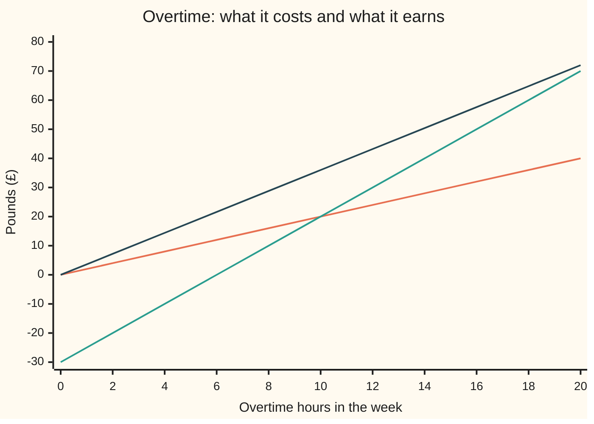

# Modelling tricks: absolute values, worst cases and kinked costs as linear programs

[Syllabus](../../../SYLLABUS.md) → [Optimization](../README.md) → [Linear Programming](../README.md#s04) → Modelling tricks

---

## General Overview

The furniture workshop of this shelf makes tables at £19 profit each and chairs at £20 each, from 160 metres of timber, 64 litres of finish and its labour hours. A table takes 3 hours, a chair 1 hour. This week two joiners are on leave, so regular labour falls from 120 hours to 92. The £19 and £20 already cover the wages for regular hours.

The workshop may buy overtime. The first 10 overtime hours cost a premium of £2 an hour on top of the regular wage. Every hour after that costs £5 extra. The workshop **chooses** how many tables, chairs and overtime hours to have, and wants **profit after the overtime bill as large as possible**: a maximisation.

The trouble is the bill. It is a straight line up to 10 hours, then a steeper one. A linear program (LP: a problem whose cost and limits are all straight-line expressions) cannot hold a bend. The fix is to add a variable for the bill and require it to sit above both lines. Pushed down by the objective, it lands on the higher line, which is the true bill.

The answer: buy exactly 10 overtime hours, make 28 tables and 18 chairs, and earn **£872**. Prices on labour, finish and the cheap tier prove no plan earns more.

The same move turns an absolute value $|u|$ into a linear program, because $|u|$ is the higher of $u$ and $-u$. It also turns a worst case into one, because "the worst of five weeks" is the highest of five lines.

**A cost made of straight pieces whose slopes rise is the highest of its pieces, so a new variable required to sit above every piece, and pushed down by the objective, equals that cost at the optimum; absolute values, worst cases and tiered prices all become linear programs this way.**

**What kind of fact this is:** a modelling method resting on a theorem, proved on this card in Why it works: for a cost that is the highest of straight lines, the linear program with the extra variable has the same best value and the same best plans. The tier prices and the 3 hours a table are a model of the workshop, not laws.

### The picture: the bill is the higher of two lines



Orange is the tier-1 line, £2 an hour. Green is the tier-2 line, £5 an hour minus £30. They cross at 10 hours. The overtime bill is whichever is higher: orange up to 10 hours, green after. Dark blue is the extra profit the hours make possible, £3.60 an hour. The gap between dark blue and the bill is widest at 10 hours: £36 earned against £20 paid.

---

## The formula

A cost that is the highest of $K$ straight-line pieces $\ell_1(x), \dots, \ell_K(x)$ becomes a linear program with one extra variable $z$:

$$
\min_{x \in P}\; \max_{k}\, \ell_k(x) \;=\; \min_{x \in P,\ z}\; z \quad\text{subject to}\quad z \ge \ell_k(x)\ \text{ for } k = 1, \dots, K
$$

**Read it aloud:** to make the highest of several lines as small as possible, add a number that must sit above every line, and make that number as small as possible.

Here $x$ is the plan and $P$ is the set of allowed plans, cut out by straight-line limits ([Linear programs](01-linear-programs-and-polyhedra.md)). Three cases cover most uses:

- **A kinked cost.** The overtime bill is $f(h) = \max(2h,\ 5h - 30)$ for $h$ overtime hours, so $z \ge 2h$ and $z \ge 5h - 30$.
- **An absolute value.** $|u| = \max(u, -u)$, so $e \ge u$ and $e \ge -u$. A sum of absolute values gets one such $e$ per term.
- **A worst case.** The largest of many errors, or the worst of many scenarios, is one $z$ above all of them.

For the workshop, with timber, labour and finish as rows (a row is one limit of the program), the whole week is one linear program:

$$
\max_{t,\,c,\,h,\,z}\; 19t + 20c - z \quad\text{subject to}\quad 4t + 2c \le 160,\ \ 3t + c \le 92 + h,\ \ t + 2c \le 64,\ \ z \ge 2h,\ \ z \ge 5h - 30,\ \ t, c, h \ge 0
$$

**Read it aloud:** choose tables, chairs and overtime to make profit minus the bill as large as possible, where the bill sits on or above both tier lines and the labour used fits inside regular hours plus overtime.

The bill is subtracted from a profit being made as large as possible, so the program pushes $z$ down, onto the higher line.

A second way writes the tiers as two variables: $h_1$ hours at £2, at most 10, and $h_2$ hours at £5. The bill is $2h_1 + 5h_2$ and the labour row becomes $3t + c \le 92 + h_1 + h_2$. Both ways give £872.

| Symbol | Plain meaning | In our example | Push it up and the answer… |
| --- | --- | --- | --- |
| $t$, $c$ | tables and chairs made this week | 28 and 18 | — (chosen) |
| $h$ | overtime hours bought | 10 | — (chosen) |
| $f(h)$, $F(x)$ | the overtime bill, the higher tier line; any cost that is the highest of its pieces | £20 | — |
| $h_1$, $h_2$ | overtime hours in tier 1 (at most 10) and tier 2 | 10 and 0 | — (chosen) |
| $z$ | the new variable standing for the bill, kept above every line | 20 | — (chosen) |
| $\ell_k$, $K$ | the straight-line pieces of a cost, and how many there are | $2h$ and $5h - 30$; $K = 2$ | more pieces, more rows; same idea |
| $x$, $P$ | a plan, and the set of allowed plans | $(t, c, h)$ inside the three stock limits | — |
| $y$ | prices proving the answer: £ per unit of each limit | timber 0, labour 3.60, finish 8.20, tier-1 cap 1.60 | — |
| $q_i$, $H_i$ | tables made and labour hours logged in past week $i$ | week 3: 20 tables, 80 hours | — |
| $a$ | hours per table, fitted from the past weeks | 3 (absolute errors); 3.40 (worst error) | — (chosen) |
| $e_i$ | a number kept above the error in week $i$, both signs | 0 in weeks 1, 2 and 4 | — (chosen) |
| $u$, $r$ | any number inside an absolute value; the list of the five weeks' errors | an error $H_i - a q_i$; at $a = 3$, `0, 0, 20, 0, 1` | $\lvert u \rvert$ rises either way from 0 |

### When it holds

- **The cost is the highest of its pieces.** That is true exactly when the slopes rise from piece to piece: a convex cost ([Building convex functions](../01-Convexity/09-operations-that-preserve-convexity.md)). With a bulk discount instead, £2 then £1, the tier program buys the cheap tier first and reports £908 for a plan whose real bill leaves £898.
- **The kinked term is pushed down.** It must be minimised, or subtracted in a maximisation. If the objective rewarded $|u|$, the variable $e$ would climb forever and the program would have no answer.
- **Every piece has its row.** Leave out the tier-1 line $z \ge 2h$ but keep $z \ge 0$, and the first 6 hours look free: the program buys 6 hours and claims £877.60, but the real bill leaves £865.60. Drop $z \ge 0$ as well and nothing stops the bill going negative: with no overtime the $5h - 30$ line lets it sit at −£30.
- **Every tier has its width.** In the two-variable form, the cap $h_1 \le 10$ is what makes tier 1 run out. Drop it and all 20 hours are charged £2: the program claims £888, the bill leaves £858.

---

## Why it works

### Step 0: a number held above every line settles on the highest

Take any plan. The rows $z \ge 2h$ and $z \ge 5h - 30$ say $z$ is at least the higher of the two, which is the bill $f(h)$. Nothing stops $z$ from being larger, but the objective charges for every pound of $z$, so the best plan never pays more than it must. At the optimum $z = f(h)$. The bend is never written down: it appears where the two rows take turns being tight (met with equality).

### Step 1: the extra variable changes nothing about the best plan

Write $F(x) = \max_k \ell_k(x)$. The claim is that minimising $F$ over $P$ and minimising $z$ over the new program give the same value and the same plans.

<details>
<summary>Detailed proof: the two programs have the same best value and plans</summary>

Take any $(x, z)$ allowed by the new program. Then $z \ge \ell_k(x)$ for every $k$, so $z \ge F(x) \ge \min_P F$. So the new program's value is at least the old one's.

Now take any $x$ in $P$ and set $z = F(x)$. This pair is allowed, since $F(x)$ is at least every $\ell_k(x)$, and it scores exactly $F(x)$. So the new program's value is at most the old one's. The two values are equal.

If $(x^*, z^*)$ is best for the new program, then $z^* = F(x^*)$: if $z^*$ were larger, lowering it to $F(x^*)$ would score better. So $x^*$ is best for the old problem. Conversely, a best $x^*$ for the old problem with $z = F(x^*)$ is best for the new one.

The same argument runs term by term when the objective adds several such costs, each with its own $z$. In a maximisation the cost enters with a minus sign, which pushes each $z$ down just the same.

</details>

The proof uses one fact about $F$: that it is the highest of its pieces. A cost with rising slopes always is. A cost with falling slopes is not: there, beyond the bend, the cheaper line is the true cost, and "sit above both lines" charges the dearer one.

### Step 2: tiers as separate hours, and why the cheap tier fills first

The two-variable form says: overtime $h = h_1 + h_2$, with $0 \le h_1 \le 10$ and $h_2 \ge 0$, and a bill of $2h_1 + 5h_2$. The program is free to put hours into tier 2 while tier 1 has room. It never wants to: moving one hour from tier 2 to tier 1 keeps the labour the same and saves £3. So in every best plan tier 2 is empty until tier 1 is full, and $2h_1 + 5h_2 = f(h)$.

That exchange argument needs the later tier to be dearer. With a bulk discount, tier 2 at £1, moving hours the other way saves money, and the program happily buys 20 cheap hours while the £2 tier sits empty. It reports £908. The real bill for 20 hours is 10 at £2 plus 10 at £1, £30, leaving £898. No error message appears. A falling-slope cost needs a yes-or-no variable that forces tier 1 to fill first ([Yes-or-no variables](../05-Integer%20and%20Combinatorial%20Optimisation/02-modelling-with-binary-variables-big-m-and-indicators.md)).

### Step 3: the answer, and the prices that prove it

With 92 hours and no overtime, labour and finish run out together at 24 tables and 20 chairs, £856. One more labour hour, with the finish still full, lets the workshop make 0.4 more table and 0.2 fewer chair: £7.60 gained, £4.00 lost, **£3.60 an hour**. That holds for the first 20 overtime hours, until the timber runs out at 32 tables and 16 chairs, the shelf's familiar best week.

So each tier-1 hour (£2) earns £1.60 net, and each tier-2 hour (£5) loses £1.40. The workshop buys tier 1 to the end and stops: 10 hours, 102 hours of labour, 28 tables and 18 chairs. Profit is 19 × 28 + 20 × 18 − 20 = **£872**.

Prices on the limits prove nothing earns more ([LP duality](04-lp-duality-and-complementary-slackness.md)). Put $y$ = £0 on timber (148 of 160 metres used, so spare), £3.60 on a labour hour, £8.20 on a litre of finish and £1.60 on each hour of the tier-1 cap. For every allowed plan, the profit splits exactly as

$$
19t + 20c - 2h_1 - 5h_2 \;=\; 3.6\,(3t + c - h_1 - h_2) + 8.2\,(t + 2c) + 1.6\,h_1 - 1.4\,h_2 .
$$

Each bracket is at most its limit: labour at most 92, finish at most 64, $h_1$ at most 10. The last term is at most 0. So profit is at most 3.6 × 92 + 8.2 × 64 + 1.6 × 10 = 331.20 + 524.80 + 16 = **£872**. The plan above reaches it, so it is the best. The −1.4 is the £1.40 lost on every tier-2 hour.

### Step 4: absolute values, fitting the 3 hours a table

Where did "3 hours a table" come from? From five past weeks in which only tables were made:

| Week | Tables $q_i$ | Hours $H_i$ | Hours per table |
| --- | ---: | ---: | ---: |
| 1 | 10 | 30 | 3 |
| 2 | 30 | 90 | 3 |
| 3 | 20 | 80 | 4 (a saw broke) |
| 4 | 25 | 75 | 3 |
| 5 | 15 | 46 | 3.07 |

A fitted rate $a$ predicts $a q_i$ hours in week $i$; the error is $H_i - a q_i$. Make the **total of the absolute errors** as small as possible: a minimisation. (Wing notation: this total is $\lVert r \rVert_1$ of the error list $r$, and the largest error is $\lVert r \rVert_\infty$, from [Subgradients](../01-Convexity/07-subgradients.md).) One $e_i$ per week does it:

$$
\min_{a,\ e}\; e_1 + \dots + e_5 \quad\text{subject to}\quad e_i \ge H_i - a q_i,\ \ e_i \ge -(H_i - a q_i)\ \text{ for each week } i .
$$

The program returns $a = 3$, with total error 21 hours: 20 from the bad week and 1 from week 5. The bad week is outvoted.

The proof is a slope count. Just below $a = 3$ every week's prediction is short, and raising $a$ cuts the total by $q_i$ for each week: 100 hours per unit of $a$. Just above 3, the three exact weeks (65 tables) start to overshoot while weeks 3 and 5 (35 tables) still fall short: the total rises by 65 − 35 = 30. Down on one side and up on the other, so $a = 3$ is the bottom.

### Step 5: worst cases, the same five weeks

Now make the **largest** error as small as possible, a minimax fit: one $z$ above all ten lines $\pm(H_i - a q_i)$. The program returns $a = 3.40$, with worst error 12 hours. The bad week now sets the answer: at 3.40 it is under by 12 hours, and week 2 is over by 12.

The certificate is a pair of weights. Give week 3's error weight 3/5 and week 2's overshoot weight 2/5. For every $a$ the weighted sum is $\tfrac35(80 - 20a) + \tfrac25(30a - 90) = 48 - 36 = 12$, because the $a$ terms cancel: 3/5 × 20 = 2/5 × 30. A weighted average of two errors is never above the larger, so no $a$ has a worst error below 12.

The absolute fit, 3 hours, describes the typical week. The minimax fit, 3.40, guards against the worst week and lets it alone steer the answer. Squaring the errors, the usual least-squares fit, gives 3.18.

The same move finishes a result from finance. [Expected shortfall](../../12-Financial%20mathematics/39-Value%20at%20Risk%20and%20Expected%20Shortfall/05-expected-shortfall-and-coherence.md) proves that the average loss over the worst slice of scenarios equals the smallest value, over trial loss levels, of the level plus the average overshoot above it divided by the slice's share of all scenarios.

Each overshoot is "the loss minus the level, or zero if that is negative", called its positive part: the higher of two straight lines. One extra variable per scenario, kept above both, makes "choose the portfolio with the smallest expected shortfall" a linear program. That is the Rockafellar–Uryasev method.

---

## Worked numbers, by hand

The workshop with 92 regular hours, overtime at £2 for 10 hours and £5 after.

| Step | Arithmetic | Value |
| --- | --- | --- |
| no overtime: labour and finish full | $3t + c = 92$, $t + 2c = 64$ | 24 tables, 20 chairs |
| profit with no overtime | 19 × 24 + 20 × 20 | £856 |
| worth of one more labour hour | 19 × 0.4 − 20 × 0.2 | £3.60 |
| tier 1, £2 an hour | 3.60 − 2 | £1.60 gained per hour |
| tier 2, £5 an hour | 3.60 − 5 | £1.40 lost per hour |
| hours bought | all of tier 1, none of tier 2 | 10, so 102 hours of labour |
| new mix | $3t + c = 102$, $t + 2c = 64$ | 28 tables, 18 chairs |
| timber used | 4 × 28 + 2 × 18 | 148 of 160 metres |
| bill, the higher line | max(2 × 10, 5 × 10 − 30) | £20 |
| **best profit** | 19 × 28 + 20 × 18 − 20 | **£872** |
| price bound | 3.6 × 92 + 8.2 × 64 + 1.6 × 10 | £872, gap 0 |
| for comparison: all 20 hours | 928 − (20 + 50) | £858 |

Ten overtime hours at the cheap rate add £16 to the week; the ten dear hours after them would give back £14.

### What breaks if you drop a piece

| Mistake | Comes out at | What went wrong |
| --- | --- | --- |
| Tiers with falling prices, £2 then £1 | LP says £908, bill leaves £898 | Slopes fall, so the cost is not the highest of its pieces; the cheap tier is used first |
| Tier-1 cap $h_1 \le 10$ dropped | LP says £888 with 20 hours, bill leaves £858 | Every hour is charged the tier-1 price |
| Only the $5h - 30$ line kept, plus $z \ge 0$ | LP says £877.60 with 6 hours, bill leaves £865.60 | The first 6 hours look free |
| Fitting the rate by the worst week | 3.40 hours a table, against 3 | Minimax hands control to the one bad week |

The code prints every row.

---

## Code, from first principles, and it actually runs

Nothing is imported but exact fractions in Python and a small fraction type in Rust. Every linear program is solved by brute force: try each set of limits as equations, solve by elimination, keep the allowed points, take the best corner. The week is reached by three independent roads: the two-variable tier program, the program with $z$ above both lines, and the original kinked problem with no new variables at all, evaluated at every crossing of its limit and kink lines. A fourth road, the prices of Step 3, bounds every plan and must meet the answer exactly. Each fit is solved as a linear program and again by trying every kink of the error curve directly.

### Python

```python
# Modelling tricks -- the check behind the card.  Standard library only.
# A workshop makes t tables (£19 each) and c chairs (£20 each) from 160 m of timber,
# 92 regular hours of labour and 64 l of finish.  Overtime costs £2 an hour extra for
# the first 10 hours and £5 an hour after that.  Maximise profit, £.  Every LP is
# solved by listing every corner in exact fractions: no solver is imported.
from fractions import Fraction as Fr

def solve(A, b):                      # Gauss-Jordan elimination; None if singular
    n = len(A); M = [[Fr(v) for v in row] + [Fr(bi)] for row, bi in zip(A, b)]
    for i in range(n):
        p = next((r for r in range(i, n) if M[r][i] != 0), None)
        if p is None: return None
        M[i], M[p] = M[p], M[i]
        for r in range(n):
            if r != i and M[r][i] != 0:
                f = M[r][i] / M[i][i]; M[r] = [x - f * y for x, y in zip(M[r], M[i])]
    return [M[i][n] / M[i][i] for i in range(n)]

def best_corner(c, A, b):             # maximise c.x over Ax <= b: try every corner
    n, best = len(c), None
    for mask in range(1 << len(A)):
        if bin(mask).count("1") != n: continue
        rows = [i for i in range(len(A)) if mask >> i & 1]
        x = solve([A[i] for i in rows], [b[i] for i in rows])
        if x is None or any(sum(a * v for a, v in zip(A[i], x)) > b[i] for i in range(len(A))):
            continue
        val = sum(a * v for a, v in zip(c, x))
        if best is None or val > best[0]: best = (val, x)
    return best

def m(x):                             # money to the penny, rounded half up, exactly
    s = "-" if x < 0 else ""; x = abs(Fr(x)); p = (x * 200 + 1) // 2
    return f"{s}{p // 100}.{p % 100:02d}"
def nums(xs): return " ".join(m(x) if Fr(x).denominator > 1 else str(x) for x in xs)

TIMBER, FINISH, HOURS = [4, 2], [1, 2], 92
def segment_lp(p1, p2, cap):          # variables t, c, h1, h2: tier hours apart
    A = [TIMBER + [0, 0], [3, 1, -1, -1], FINISH + [0, 0], [0, 0, 1, 0],
         [-1, 0, 0, 0], [0, -1, 0, 0], [0, 0, -1, 0], [0, 0, 0, -1]]
    return best_corner([19, 20, -p1, -p2], A, [160, HOURS, 64, cap, 0, 0, 0, 0])
def epigraph_lp(lines):               # variables t, c, h, z: z sits above every line
    A = [TIMBER + [0, 0], [3, 1, -1, 0], FINISH + [0, 0], [-1, 0, 0, 0],
         [0, -1, 0, 0], [0, 0, -1, 0]] + [[0, 0, s, -1] for s, k in lines]
    return best_corner([19, 20, 0, -1], A, [160, HOURS, 64, 0, 0, 0] + [k for s, k in lines])
def true_cost(h, p1=2, p2=5, cap=10): return p1 * min(h, cap) + p2 * max(h - cap, 0)
def kinked(p1=2, p2=5, cap=10):       # road 3: no new variables; try every crossing
    L = [(TIMBER, 160), (FINISH, 64), ([1, 0], 0), ([0, 1], 0), ([3, 1], HOURS), ([3, 1], HOURS + cap)]
    best = None
    for i in range(len(L)):
        for j in range(i + 1, len(L)):
            x = solve([L[i][0], L[j][0]], [L[i][1], L[j][1]])
            if x is None or min(x) < 0 or 4 * x[0] + 2 * x[1] > 160 or x[0] + 2 * x[1] > 64: continue
            h = max(Fr(0), 3 * x[0] + x[1] - HOURS)
            val = 19 * x[0] + 20 * x[1] - true_cost(h, p1, p2, cap)
            if best is None or val > best[0]: best = (val, x, h)
    return best

v1, x1 = segment_lp(2, 5, 10)
v2, x2 = epigraph_lp([(2, 0), (5, 30)])
v3, x3, h3 = kinked()
print("tiers as two variables  t c h1 h2:", nums(x1), " profit", m(v1))
print("cost as z above lines   t c h z:  ", nums(x2), " profit", m(v2))
print("kinked cost, crossings  t c hours:", nums(x3 + [h3 + HOURS]), " profit", m(v3))
v0, x0 = best_corner([19, 20], [TIMBER, [3, 1], FINISH, [-1, 0], [0, -1]], [160, HOURS, 64, 0, 0])
print("no overtime             t c:", nums(x0), " profit", m(v0))
print("all 20 hours            t c: 32 16  profit", m(19 * 32 + 20 * 16 - true_cost(20)))
dt, dc = Fr(2, 5), Fr(-1, 5)          # one more hour on the finish edge: +0.4 table, -0.2 chair
print("one more hour: tables", m(dt), "chairs", m(dc), "gained", m(19 * dt), "lost", m(-20 * dc),
      "worth", m(19 * dt + 20 * dc))
y = solve([[3, 1, 0], [1, 2, 0], [-1, 0, 1]], [19, 20, -2])   # prices: labour, finish, tier cap
cols = [(19, [4, 3, 1, 0]), (20, [2, 1, 2, 0]), (-2, [0, -1, 0, 1]), (-5, [0, -1, 0, 0])]
Y = [Fr(0)] + y                       # timber is not used up, so its price is 0
red = [sum(a * p for a, p in zip(col, Y)) - cj for cj, col in cols]
bound = sum(p * r for p, r in zip(Y, [160, HOURS, 64, 10]))
print("prices timber labour finish cap:", nums(Y), " shortfalls", nums(red), " bound", m(bound))
print("timber used", 4 * x1[0] + 2 * x1[1], " bound parts", nums([Y[1] * HOURS, Y[2] * 64, Y[3] * 10]),
      " against no overtime", m(v1 - v0), " against all 20 hours", m(v1 - 858))
print("chart hours  ", " ".join(str(h) for h in range(0, 21, 2)))
print("chart 2h     ", " ".join(str(2 * h) for h in range(0, 21, 2)))
print("chart 5h-30  ", " ".join(str(5 * h - 30) for h in range(0, 21, 2)))
print("chart 3.6h   ", nums([Fr(18, 5) * h for h in range(0, 21, 2)]))
b1, xb1 = segment_lp(2, 1, 10)        # what breaks: slopes fall (a bulk discount)
print("falling tiers 2 then 1:  h1 h2", nums(xb1[2:]), " real bill", true_cost(20, 2, 1), " LP says", m(b1), " bill says",
      m(19 * xb1[0] + 20 * xb1[1] - true_cost(xb1[2] + xb1[3], 2, 1)))
b2, xb2 = segment_lp(2, 5, 1000)
print("tier-1 cap dropped:      hours", nums([xb2[2]]), " LP says", m(b2), " bill says",
      m(19 * xb2[0] + 20 * xb2[1] - true_cost(xb2[2])))
b3, xb3 = epigraph_lp([(0, 0), (5, 30)])
print("only the 5h-30 line:     hours", nums([xb3[2]]), " LP says", m(b3), " bill says",
      m(19 * xb3[0] + 20 * xb3[1] - true_cost(xb3[2])))
T1, T2, T3 = segment_lp(2, 3, 10), segment_lp(4, 5, 10), kinked(2, 5, 20)
print("try tier 2 at 3: t c", nums(T1[1][:2]), m(T1[0]), "| tier 1 at 4:", nums(T2[1][:2]), m(T2[0]),
      "| cap 20:", nums(T3[1]), m(T3[0]))

WEEKS = [(10, 30), (30, 90), (20, 80), (25, 75), (15, 46)]   # tables made, hours taken
def total(a): return sum(abs(H - a * q) for q, H in WEEKS)
def worst(a): return max(abs(H - a * q) for q, H in WEEKS)
def fits(weeks):
    n, A, b = len(weeks), [], []
    for i, (q, H) in enumerate(weeks):  # -e_i <= H_i - a q_i <= e_i
        e = [0] * n; e[i] = -1
        A += [[-q] + e, [q] + e]; b += [-H, H]
    l1 = best_corner([0] + [-1] * n, A, b)
    A2 = [[r[0], -1] for r in A]
    return l1, best_corner([0, -1], A2, b)
(l1, la), (mm, ma) = fits(WEEKS)
kinks = sorted({Fr(H, q) for q, H in WEEKS})
cross = {Fr(Hi + s * Hj, qi + s * qj) for qi, Hi in WEEKS for qj, Hj in WEEKS for s in (1, -1) if qi + s * qj != 0}
ak = min(kinks, key=total); am = min(cross, key=worst)
print("absolute: LP a", m(la[0]), "total", m(-l1), "| every kink a", m(ak), "total", m(total(ak)))
print("errors at a = 3:", nums([H - 3 * q for q, H in WEEKS]), " rates", nums([Fr(H, q) for q, H in WEEKS]),
      " tables in exact weeks", sum(q for q, H in WEEKS if H == 3 * q), "others", sum(q for q, H in WEEKS if H != 3 * q))
print("slopes of the total just below and above 3:", -sum(q for q, H in WEEKS),
      sum(q if Fr(H, q) <= 3 else -q for q, H in WEEKS))
print("minimax:  LP a", m(ma[0]), "worst", m(-mm), "| every crossing a", m(am), "worst", m(worst(am)))
print("weights 3/5 on week 3, 2/5 on week 2 give, for every a:", m(Fr(3, 5) * 80), "-", m(Fr(2, 5) * 90),
      "=", m(Fr(3, 5) * 80 - Fr(2, 5) * 90))
ls = Fr(sum(q * H for q, H in WEEKS), sum(q * q for q, H in WEEKS))
(_, la2), (mm2, ma2) = fits([(10, 30), (30, 90), (20, 100), (25, 75), (15, 46)])
print("least squares a", m(ls), "| bad week at 100 h: absolute a", m(la2[0]),
      "minimax a", m(ma2[0]), "worst", m(-mm2))

assert v1 == v2 == v3 == 872 and x1 == [28, 18, 10, 0] and h3 == 10   # three roads agree
assert bound == v1 and min(Y) >= 0 and min(red) >= 0                  # prices certify 872
assert v0 == 856 and 19 * dt + 20 * dc == y[0]                       # labour worth 3.60
assert b1 - (19 * xb1[0] + 20 * xb1[1] - true_cost(xb1[2] + xb1[3], 2, 1)) == 10
assert la[0] == ak == 3 and -l1 == total(3) and ma[0] == am == Fr(17, 5) and -mm == worst(am) == 12
assert Fr(3, 5) * 80 - Fr(2, 5) * 90 == -mm   # weights certify 12
print("ALL CHECKS PASS")
```

**Ran 2026-11-11 on macOS, Python 3.14.10, standard library only. All checks passed. Output, pasted from the run:**

```
tiers as two variables  t c h1 h2: 28 18 10 0  profit 872.00
cost as z above lines   t c h z:   28 18 10 20  profit 872.00
kinked cost, crossings  t c hours: 28 18 102  profit 872.00
no overtime             t c: 24 20  profit 856.00
all 20 hours            t c: 32 16  profit 858.00
one more hour: tables 0.40 chairs -0.20 gained 7.60 lost 4.00 worth 3.60
prices timber labour finish cap: 0 3.60 8.20 1.60  shortfalls 0 0 0 1.40  bound 872.00
timber used 148  bound parts 331.20 524.80 16  against no overtime 16.00  against all 20 hours 14.00
chart hours   0 2 4 6 8 10 12 14 16 18 20
chart 2h      0 4 8 12 16 20 24 28 32 36 40
chart 5h-30   -30 -20 -10 0 10 20 30 40 50 60 70
chart 3.6h    0 7.20 14.40 21.60 28.80 36 43.20 50.40 57.60 64.80 72
falling tiers 2 then 1:  h1 h2 0 20  real bill 30  LP says 908.00  bill says 898.00
tier-1 cap dropped:      hours 20  LP says 888.00  bill says 858.00
only the 5h-30 line:     hours 6  LP says 877.60  bill says 865.60
try tier 2 at 3: t c 32 16 878.00 | tier 1 at 4: 24 20 856.00 | cap 20: 32 16 888.00
absolute: LP a 3.00 total 21.00 | every kink a 3.00 total 21.00
errors at a = 3: 0 0 20 0 1  rates 3 3 4 3 3.07  tables in exact weeks 65 others 35
slopes of the total just below and above 3: -100 30
minimax:  LP a 3.40 worst 12.00 | every crossing a 3.40 worst 12.00
weights 3/5 on week 3, 2/5 on week 2 give, for every a: 48.00 - 36.00 = 12.00
least squares a 3.18 | bad week at 100 h: absolute a 3.00 minimax a 3.80 worst 24.00
ALL CHECKS PASS
```

### Rust

Same numbers, same labels, built with `rustc --edition 2021 -O`.

```rust
// Modelling tricks -- the same check as the Python, in Rust.  No crates.
// A workshop makes t tables (£19 each) and c chairs (£20 each) from 160 m of timber,
// 92 regular hours of labour and 64 l of finish.  Overtime costs £2 an hour extra for
// the first 10 hours and £5 an hour after that.  Maximise profit, £.  Every LP is
// solved by listing every corner in exact fractions, with a small fraction type.
#[derive(Clone, Copy, Debug, PartialEq)]
struct Q { n: i128, d: i128 }
fn gcd(a: i128, b: i128) -> i128 { if b == 0 { a.abs() } else { gcd(b, a % b) } }
fn q(n: i128, d: i128) -> Q { let g = gcd(n, d).max(1) * d.signum(); Q { n: n / g, d: d / g } }
fn z(n: i128) -> Q { Q { n, d: 1 } }
impl std::ops::Add for Q { type Output = Q; fn add(self, o: Q) -> Q { q(self.n * o.d + o.n * self.d, self.d * o.d) } }
impl std::ops::Sub for Q { type Output = Q; fn sub(self, o: Q) -> Q { q(self.n * o.d - o.n * self.d, self.d * o.d) } }
impl std::ops::Mul for Q { type Output = Q; fn mul(self, o: Q) -> Q { q(self.n * o.n, self.d * o.d) } }
impl std::ops::Div for Q { type Output = Q; fn div(self, o: Q) -> Q { q(self.n * o.d, self.d * o.n) } }
impl PartialOrd for Q { fn partial_cmp(&self, o: &Q) -> Option<std::cmp::Ordering> { (self.n * o.d).partial_cmp(&(o.n * self.d)) } }
fn mx(a: Q, b: Q) -> Q { if a > b { a } else { b } }
fn mn(a: Q, b: Q) -> Q { if a < b { a } else { b } }
fn dot(a: &[Q], b: &[Q]) -> Q { a.iter().zip(b).fold(z(0), |s, (x, y)| s + *x * *y) }
fn qv(v: &[i128]) -> Vec<Q> { v.iter().map(|&x| z(x)).collect() }

fn solve(a: &[Vec<Q>], b: &[Q]) -> Option<Vec<Q>> {    // Gauss-Jordan; None if singular
    let n = a.len();
    let mut m: Vec<Vec<Q>> = (0..n).map(|i| { let mut r = a[i].clone(); r.push(b[i]); r }).collect();
    for i in 0..n {
        let p = (i..n).find(|&r| m[r][i].n != 0)?;
        m.swap(i, p);
        for r in 0..n {
            if r != i && m[r][i].n != 0 {
                let f = m[r][i] / m[i][i];
                for k in 0..=n { let v = m[i][k]; m[r][k] = m[r][k] - f * v; }
            }
        }
    }
    Some((0..n).map(|i| m[i][n] / m[i][i]).collect())
}
fn best_corner(c: &[Q], a: &[Vec<Q>], b: &[Q]) -> (Q, Vec<Q>) {   // maximise c.x over Ax <= b
    let mut best: Option<(Q, Vec<Q>)> = None;
    for mask in 0u32..(1 << a.len()) {
        if mask.count_ones() as usize != c.len() { continue; }
        let rows: Vec<usize> = (0..a.len()).filter(|&i| mask >> i & 1 == 1).collect();
        let sa: Vec<Vec<Q>> = rows.iter().map(|&i| a[i].clone()).collect();
        let sb: Vec<Q> = rows.iter().map(|&i| b[i]).collect();
        if let Some(x) = solve(&sa, &sb) {
            if (0..a.len()).any(|i| dot(&a[i], &x) > b[i]) { continue; }
            let val = dot(c, &x);
            if best.as_ref().map_or(true, |bb| val > bb.0) { best = Some((val, x)); }
        }
    }
    best.unwrap()
}
fn m(x: Q) -> String {                              // money to the penny, rounded half up
    let s = if x.n < 0 { "-" } else { "" };
    let p = (x.n.abs() * 200 + x.d).div_euclid(2 * x.d);
    format!("{}{}.{:02}", s, p / 100, p % 100)
}
fn nums(xs: &[Q]) -> String {
    xs.iter().map(|&x| if x.d > 1 { m(x) } else { x.n.to_string() }).collect::<Vec<_>>().join(" ")
}
const HOURS: i128 = 92;
fn segment_lp(p1: i128, p2: i128, cap: i128) -> (Q, Vec<Q>) {   // t, c, h1, h2
    let a: Vec<Vec<Q>> = [[4, 2, 0, 0], [3, 1, -1, -1], [1, 2, 0, 0], [0, 0, 1, 0],
        [-1, 0, 0, 0], [0, -1, 0, 0], [0, 0, -1, 0], [0, 0, 0, -1]].iter().map(|r| qv(r)).collect();
    best_corner(&qv(&[19, 20, -p1, -p2]), &a, &qv(&[160, HOURS, 64, cap, 0, 0, 0, 0]))
}
fn epigraph_lp(lines: &[(i128, i128)]) -> (Q, Vec<Q>) {        // t, c, h, z
    let mut a: Vec<Vec<Q>> = [[4, 2, 0, 0], [3, 1, -1, 0], [1, 2, 0, 0], [-1, 0, 0, 0],
        [0, -1, 0, 0], [0, 0, -1, 0]].iter().map(|r| qv(r)).collect();
    let mut b = qv(&[160, HOURS, 64, 0, 0, 0]);
    for &(s, k) in lines { a.push(qv(&[0, 0, s, -1])); b.push(z(k)); }
    best_corner(&qv(&[19, 20, 0, -1]), &a, &b)
}
fn true_cost(h: Q, p1: i128, p2: i128, cap: i128) -> Q { z(p1) * mn(h, z(cap)) + z(p2) * mx(h - z(cap), z(0)) }
fn kinked(p1: i128, p2: i128, cap: i128) -> (Q, Vec<Q>, Q) {   // road 3: every crossing
    let l = [([4, 2], 160), ([1, 2], 64), ([1, 0], 0), ([0, 1], 0), ([3, 1], HOURS), ([3, 1], HOURS + cap)];
    let mut best: Option<(Q, Vec<Q>, Q)> = None;
    for i in 0..l.len() { for j in i + 1..l.len() {
        if let Some(x) = solve(&[qv(&l[i].0), qv(&l[j].0)], &[z(l[i].1), z(l[j].1)]) {
            if x[0] < z(0) || x[1] < z(0) || z(4) * x[0] + z(2) * x[1] > z(160) || x[0] + z(2) * x[1] > z(64) { continue; }
            let h = mx(z(0), z(3) * x[0] + x[1] - z(HOURS));
            let val = z(19) * x[0] + z(20) * x[1] - true_cost(h, p1, p2, cap);
            if best.as_ref().map_or(true, |bb| val > bb.0) { best = Some((val, x, h)); }
        }
    } }
    best.unwrap()
}
const WEEKS: [(i128, i128); 5] = [(10, 30), (30, 90), (20, 80), (25, 75), (15, 46)];
fn total(a: Q) -> Q { WEEKS.iter().fold(z(0), |s, &(t, h)| { let e = z(h) - a * z(t); s + mx(e, z(0) - e) }) }
fn worst(a: Q) -> Q { WEEKS.iter().fold(z(0), |s, &(t, h)| { let e = z(h) - a * z(t); mx(s, mx(e, z(0) - e)) }) }
fn fits(w: &[(i128, i128)]) -> ((Q, Vec<Q>), (Q, Vec<Q>)) {
    let n = w.len(); let (mut a, mut b) = (vec![], vec![]);
    for (i, &(t, h)) in w.iter().enumerate() {           // -e_i <= H_i - a q_i <= e_i
        let mut e = vec![z(0); n]; e[i] = z(-1);
        let mut r1 = vec![z(-t)]; r1.extend(e.clone()); let mut r2 = vec![z(t)]; r2.extend(e);
        a.push(r1); a.push(r2); b.push(z(-h)); b.push(z(h));
    }
    let mut c = vec![z(0)]; c.extend(vec![z(-1); n]);
    let a2: Vec<Vec<Q>> = a.iter().map(|r| vec![r[0], z(-1)]).collect();
    (best_corner(&c, &a, &b), best_corner(&[z(0), z(-1)], &a2, &b))
}
fn main() {
    let (v1, x1) = segment_lp(2, 5, 10);
    let (v2, x2) = epigraph_lp(&[(2, 0), (5, 30)]);
    let (v3, x3, h3) = kinked(2, 5, 10);
    println!("tiers as two variables  t c h1 h2: {}  profit {}", nums(&x1), m(v1));
    println!("cost as z above lines   t c h z:   {}  profit {}", nums(&x2), m(v2));
    println!("kinked cost, crossings  t c hours: {}  profit {}", nums(&[x3[0], x3[1], h3 + z(HOURS)]), m(v3));
    let base: Vec<Vec<Q>> = [[4, 2], [3, 1], [1, 2], [-1, 0], [0, -1]].iter().map(|r| qv(r)).collect();
    let (v0, x0) = best_corner(&qv(&[19, 20]), &base, &qv(&[160, HOURS, 64, 0, 0]));
    println!("no overtime             t c: {}  profit {}", nums(&x0), m(v0));
    println!("all 20 hours            t c: 32 16  profit {}", m(z(19 * 32 + 20 * 16) - true_cost(z(20), 2, 5, 10)));
    let (dt, dc) = (q(2, 5), q(-1, 5));
    println!("one more hour: tables {} chairs {} gained {} lost {} worth {}", m(dt), m(dc), m(z(19) * dt), m(z(-20) * dc), m(z(19) * dt + z(20) * dc));
    let y = solve(&[qv(&[3, 1, 0]), qv(&[1, 2, 0]), qv(&[-1, 0, 1])], &qv(&[19, 20, -2])).unwrap();
    let cols = [(19, [4, 3, 1, 0]), (20, [2, 1, 2, 0]), (-2, [0, -1, 0, 1]), (-5, [0, -1, 0, 0])];
    let yy = vec![z(0), y[0], y[1], y[2]];
    let red: Vec<Q> = cols.iter().map(|(cj, col)| dot(&qv(col), &yy) - z(*cj)).collect();
    let bound = dot(&yy, &qv(&[160, HOURS, 64, 10]));
    println!("prices timber labour finish cap: {}  shortfalls {}  bound {}", nums(&yy), nums(&red), m(bound));
    println!("timber used {}  bound parts {}  against no overtime {}  against all 20 hours {}", nums(&[z(4) * x1[0] + z(2) * x1[1]]),
             nums(&[yy[1] * z(HOURS), yy[2] * z(64), yy[3] * z(10)]), m(v1 - v0), m(v1 - z(858)));
    let hs: Vec<i128> = (0..=20).step_by(2).collect();
    let row = |f: &dyn Fn(i128) -> Q| nums(&hs.iter().map(|&h| f(h)).collect::<Vec<_>>());
    println!("chart hours   {}", row(&|h| z(h)));
    println!("chart 2h      {}", row(&|h| z(2 * h)));
    println!("chart 5h-30   {}", row(&|h| z(5 * h - 30)));
    println!("chart 3.6h    {}", row(&|h| q(18, 5) * z(h)));
    let (b1, xb1) = segment_lp(2, 1, 10);
    println!("falling tiers 2 then 1:  h1 h2 {}  real bill {}  LP says {}  bill says {}", nums(&xb1[2..]), nums(&[true_cost(z(20), 2, 1, 10)]), m(b1),
             m(z(19) * xb1[0] + z(20) * xb1[1] - true_cost(xb1[2] + xb1[3], 2, 1, 10)));
    let (b2, xb2) = segment_lp(2, 5, 1000);
    println!("tier-1 cap dropped:      hours {}  LP says {}  bill says {}", nums(&xb2[2..3]), m(b2),
             m(z(19) * xb2[0] + z(20) * xb2[1] - true_cost(xb2[2], 2, 5, 10)));
    let (b3, xb3) = epigraph_lp(&[(0, 0), (5, 30)]);
    println!("only the 5h-30 line:     hours {}  LP says {}  bill says {}", nums(&xb3[2..3]), m(b3),
             m(z(19) * xb3[0] + z(20) * xb3[1] - true_cost(xb3[2], 2, 5, 10)));
    let (t1, t2, t3) = (segment_lp(2, 3, 10), segment_lp(4, 5, 10), kinked(2, 5, 20));
    println!("try tier 2 at 3: t c {} {} | tier 1 at 4: {} {} | cap 20: {} {}", nums(&t1.1[..2]), m(t1.0),
             nums(&t2.1[..2]), m(t2.0), nums(&t3.1), m(t3.0));
    let ((l1, la), (mm, ma)) = fits(&WEEKS);
    let mut ak = z(1000);
    for &(t, h) in WEEKS.iter() { let r = q(h, t); if total(r) < total(ak) || (total(r) == total(ak) && r < ak) { ak = r; } }
    let mut am = z(1000);
    for &(ti, hi) in WEEKS.iter() { for &(tj, hj) in WEEKS.iter() { for s in [1i128, -1] {
        if ti + s * tj == 0 { continue; }
        let r = q(hi + s * hj, ti + s * tj);
        if worst(r) < worst(am) || (worst(r) == worst(am) && r < am) { am = r; }
    } } }
    println!("absolute: LP a {} total {} | every kink a {} total {}", m(la[0]), m(z(0) - l1), m(ak), m(total(ak)));
    println!("errors at a = 3: {}  rates {}  tables in exact weeks {} others {}",
             nums(&WEEKS.iter().map(|&(t, h)| z(h - 3 * t)).collect::<Vec<_>>()),
             nums(&WEEKS.iter().map(|&(t, h)| q(h, t)).collect::<Vec<_>>()),
             WEEKS.iter().filter(|&&(t, h)| h == 3 * t).map(|w| w.0).sum::<i128>(), WEEKS.iter().filter(|&&(t, h)| h != 3 * t).map(|w| w.0).sum::<i128>());
    let below: i128 = -WEEKS.iter().map(|w| w.0).sum::<i128>();
    let above: i128 = WEEKS.iter().map(|&(t, h)| if q(h, t) <= z(3) { t } else { -t }).sum();
    println!("slopes of the total just below and above 3: {} {}", below, above);
    println!("minimax:  LP a {} worst {} | every crossing a {} worst {}", m(ma[0]), m(z(0) - mm), m(am), m(worst(am)));
    let cert = q(3, 5) * z(80) - q(2, 5) * z(90);
    println!("weights 3/5 on week 3, 2/5 on week 2 give, for every a: {} - {} = {}", m(q(3, 5) * z(80)), m(q(2, 5) * z(90)), m(cert));
    let ls = q(WEEKS.iter().map(|&(t, h)| t * h).sum(), WEEKS.iter().map(|&(t, _)| t * t).sum());
    let ((_, la2), (mm2, ma2)) = fits(&[(10, 30), (30, 90), (20, 100), (25, 75), (15, 46)]);
    println!("least squares a {} | bad week at 100 h: absolute a {} minimax a {} worst {}", m(ls), m(la2[0]), m(ma2[0]), m(z(0) - mm2));

    assert!(v1 == z(872) && v2 == v1 && v3 == v1 && x1 == qv(&[28, 18, 10, 0]) && h3 == z(10));   // three roads
    assert!(bound == v1 && yy.iter().all(|&p| p >= z(0)) && red.iter().all(|&r| r >= z(0)));    // prices certify
    assert!(v0 == z(856) && z(19) * dt + z(20) * dc == y[0]);                                      // labour 3.60
    assert!(b1 - (z(19) * xb1[0] + z(20) * xb1[1] - true_cost(xb1[2] + xb1[3], 2, 1, 10)) == z(10));
    assert!(la[0] == z(3) && ak == z(3) && z(0) - l1 == total(z(3)) && ma[0] == q(17, 5) && am == ma[0] && z(0) - mm == worst(am) && worst(am) == z(12));
    assert!(cert == z(0) - mm);                                                                    // weights certify 12
    println!("ALL CHECKS PASS");
}
```

**Ran 2026-11-11 on macOS, rustc 1.98.1, no crates. All checks passed. Output, pasted from the run:**

```
tiers as two variables  t c h1 h2: 28 18 10 0  profit 872.00
cost as z above lines   t c h z:   28 18 10 20  profit 872.00
kinked cost, crossings  t c hours: 28 18 102  profit 872.00
no overtime             t c: 24 20  profit 856.00
all 20 hours            t c: 32 16  profit 858.00
one more hour: tables 0.40 chairs -0.20 gained 7.60 lost 4.00 worth 3.60
prices timber labour finish cap: 0 3.60 8.20 1.60  shortfalls 0 0 0 1.40  bound 872.00
timber used 148  bound parts 331.20 524.80 16  against no overtime 16.00  against all 20 hours 14.00
chart hours   0 2 4 6 8 10 12 14 16 18 20
chart 2h      0 4 8 12 16 20 24 28 32 36 40
chart 5h-30   -30 -20 -10 0 10 20 30 40 50 60 70
chart 3.6h    0 7.20 14.40 21.60 28.80 36 43.20 50.40 57.60 64.80 72
falling tiers 2 then 1:  h1 h2 0 20  real bill 30  LP says 908.00  bill says 898.00
tier-1 cap dropped:      hours 20  LP says 888.00  bill says 858.00
only the 5h-30 line:     hours 6  LP says 877.60  bill says 865.60
try tier 2 at 3: t c 32 16 878.00 | tier 1 at 4: 24 20 856.00 | cap 20: 32 16 888.00
absolute: LP a 3.00 total 21.00 | every kink a 3.00 total 21.00
errors at a = 3: 0 0 20 0 1  rates 3 3 4 3 3.07  tables in exact weeks 65 others 35
slopes of the total just below and above 3: -100 30
minimax:  LP a 3.40 worst 12.00 | every crossing a 3.40 worst 12.00
weights 3/5 on week 3, 2/5 on week 2 give, for every a: 48.00 - 36.00 = 12.00
least squares a 3.18 | bad week at 100 h: absolute a 3.00 minimax a 3.80 worst 24.00
ALL CHECKS PASS
```

The two outputs match line for line.

### Lean

Lean proves the main theorem for any number of pieces and limits, and checks the workshop week and both five-week fits exactly.

- Minimising the highest of several straight-line pieces over the allowed plans gives the same best value as minimising $z$ held above every piece.
- A pair $(x, z)$ is best for the new program exactly when $x$ is best for the old one and $z = F(x)$.
- The workshop's best profit is £872, and the only plan that earns it is 28 tables, 18 chairs, 10 overtime hours and a £20 bill.
- The absolute fit gives $a = 3$ with total error 21 hours, and no other rate does as well.
- The minimax fit gives $a = 3.40$ with worst error 12 hours, and no other rate does as well.
- The hand sums also check: the £856 and £858 weeks, the price bound and the minimax weights.

The two-variable tier program, the broken models in What breaks, and the least-squares fit are left to the Python and Rust checks.

```lean
-- Modelling tricks: minimising the highest of several straight-line pieces over a polyhedron is the same linear program as minimising one extra number held above every piece, and the card's workshop week and five-week fits come out exactly as stated.
import Mathlib.Data.Matrix.Mul
import Mathlib.Data.Real.Archimedean
import Mathlib.Order.ConditionallyCompleteLattice.Indexed
import Mathlib.Order.Filter.Extr
import Mathlib.Tactic.NormNum
import Mathlib.Tactic.Linarith

/-- The epigraph trick. Let the allowed plans `P` be cut out by straight-line limits
`A i ⬝ᵥ x ≤ c i`, and let the cost `F x` be the highest of `K ≥ 1` straight-line pieces
`a k ⬝ᵥ x + b k`. Add one number `z` that must sit on or above every piece, and minimise `z`.
Then the two programs have the same best value (the same lower bounds, and a least value of one
is a least value of the other), and the same best plans: `(x, z)` is best for the new program
exactly when `x` is best for the old one and `z = F x`. -/
theorem min_max_of_lines_eq_epigraph_lp {n m K : ℕ} (hK : 0 < K)
    (A : Fin m → Fin n → ℝ) (c : Fin m → ℝ) (a : Fin K → Fin n → ℝ) (b : Fin K → ℝ) :
    let P : Set (Fin n → ℝ) := {x | ∀ i, A i ⬝ᵥ x ≤ c i}
    let F : (Fin n → ℝ) → ℝ := fun x => ⨆ k, a k ⬝ᵥ x + b k
    let E : Set ((Fin n → ℝ) × ℝ) := {p | p.1 ∈ P ∧ ∀ k, a k ⬝ᵥ p.1 + b k ≤ p.2}
    lowerBounds (F '' P) = lowerBounds (Prod.snd '' E) ∧
    (∀ v, IsLeast (F '' P) v ↔ IsLeast (Prod.snd '' E) v) ∧
    (∀ x z, ((x, z) ∈ E ∧ IsMinOn Prod.snd E (x, z)) ↔ (x ∈ P ∧ IsMinOn F P x ∧ z = F x)) := by
  intro P F E
  have : Nonempty (Fin K) := ⟨⟨0, hK⟩⟩
  have hle : ∀ x k, a k ⬝ᵥ x + b k ≤ F x := fun x k =>
    le_ciSup (Set.finite_range (fun k => a k ⬝ᵥ x + b k)).bddAbove k
  have hsup : ∀ x z, (∀ k, a k ⬝ᵥ x + b k ≤ z) → F x ≤ z := fun x z h => ciSup_le h
  have hmemE : ∀ x, x ∈ P → (x, F x) ∈ E := fun x hx => ⟨hx, fun k => hle x k⟩
  have hlb : lowerBounds (F '' P) = lowerBounds (Prod.snd '' E) := by
    ext v
    constructor
    · rintro hv _ ⟨⟨x, z⟩, ⟨hx, hz⟩, rfl⟩
      exact le_trans (hv ⟨x, hx, rfl⟩) (hsup x z hz)
    · rintro hv _ ⟨x, hx, rfl⟩
      exact hv ⟨(x, F x), hmemE x hx, rfl⟩
  refine ⟨hlb, ?_, ?_⟩
  · intro v
    constructor
    · rintro ⟨⟨x, hx, rfl⟩, hv⟩
      exact ⟨⟨(x, F x), hmemE x hx, rfl⟩, hlb ▸ hv⟩
    · rintro ⟨⟨⟨x, z⟩, ⟨hx, hz⟩, rfl⟩, hv⟩
      have h1 : F x ≤ z := hsup x z hz
      have h2 : z ≤ F x := (hlb ▸ hv : z ∈ lowerBounds (Prod.snd '' E)) ⟨(x, F x), hmemE x hx, rfl⟩
      refine ⟨⟨x, hx, le_antisymm h1 h2⟩, ?_⟩
      exact hlb ▸ hv
  · intro x z
    constructor
    · rintro ⟨⟨hx, hz⟩, hmin⟩
      rw [isMinOn_iff] at hmin
      have h1 : F x ≤ z := hsup x z hz
      have h2 : z ≤ F x := hmin (x, F x) (hmemE x hx)
      have hzF : z = F x := le_antisymm h2 h1
      refine ⟨hx, ?_, hzF⟩
      rw [isMinOn_iff]
      intro y hy
      have := hmin (y, F y) (hmemE y hy)
      simp only at this
      linarith
    · rintro ⟨hx, hmin, rfl⟩
      rw [isMinOn_iff] at hmin
      refine ⟨hmemE x hx, ?_⟩
      rw [isMinOn_iff]
      rintro ⟨y, w⟩ ⟨hy, hw⟩
      exact le_trans (hmin y hy) (hsup y w hw)

/-- The workshop's week as one linear program: tables `t`, chairs `c`, overtime hours `h` and a
bill `z` held above both tier lines `2h` and `5h - 30`, with 160 m of timber, 92 regular hours
plus overtime, and 64 l of finish. The best profit `19t + 20c - z` is exactly £872, and the only
plan that earns it is 28 tables, 18 chairs and 10 overtime hours, with a bill of £20. -/
theorem workshop_best_week_is_872 :
    IsGreatest {p : ℝ | ∃ t c h z : ℝ, 0 ≤ t ∧ 0 ≤ c ∧ 0 ≤ h ∧
        4 * t + 2 * c ≤ 160 ∧ 3 * t + c ≤ 92 + h ∧ t + 2 * c ≤ 64 ∧
        2 * h ≤ z ∧ 5 * h - 30 ≤ z ∧ p = 19 * t + 20 * c - z} 872 ∧
    ∀ t c h z : ℝ, 0 ≤ t → 0 ≤ c → 0 ≤ h →
        4 * t + 2 * c ≤ 160 → 3 * t + c ≤ 92 + h → t + 2 * c ≤ 64 →
        2 * h ≤ z → 5 * h - 30 ≤ z → 19 * t + 20 * c - z = 872 →
        t = 28 ∧ c = 18 ∧ h = 10 ∧ z = 20 := by
  refine ⟨⟨⟨28, 18, 10, 20, by norm_num⟩, ?_⟩, ?_⟩
  · rintro p ⟨t, c, h, z, ht, hc, hh, h1, h2, h3, h4, h5, rfl⟩
    linarith
  · intro t c h z ht hc hh h1 h2 h3 h4 h5 h6
    refine ⟨?_, ?_, ?_, ?_⟩ <;> linarith

/-- The five past weeks (10, 30), (30, 90), (20, 80), (25, 75), (15, 46) of tables and hours.
Fitting the hours per table `a` by the total of the absolute errors gives `a = 3` and total 21,
and no other rate does as well. Fitting by the largest error (minimax) gives `a = 17/5` (3.40)
and worst error 12, and no other rate does as well. -/
theorem five_week_fits :
    IsLeast (Set.range fun a : ℝ => |30 - 10 * a| + |90 - 30 * a| + |80 - 20 * a| +
        |75 - 25 * a| + |46 - 15 * a|) 21 ∧
    (∀ a : ℝ, |30 - 10 * a| + |90 - 30 * a| + |80 - 20 * a| + |75 - 25 * a| +
        |46 - 15 * a| = 21 ↔ a = 3) ∧
    IsLeast (Set.range fun a : ℝ => max (max (max (max |30 - 10 * a| |90 - 30 * a|)
        |80 - 20 * a|) |75 - 25 * a|) |46 - 15 * a|) 12 ∧
    (∀ a : ℝ, max (max (max (max |30 - 10 * a| |90 - 30 * a|) |80 - 20 * a|)
        |75 - 25 * a|) |46 - 15 * a| = 12 ↔ a = 17 / 5) := by
  have b1 : ∀ x : ℝ, x ≤ |x| := le_abs_self
  have b2 : ∀ x : ℝ, -x ≤ |x| := neg_le_abs
  refine ⟨⟨⟨3, by norm_num⟩, ?_⟩, ?_, ⟨⟨17 / 5, by norm_num [abs_of_nonneg, abs_of_nonpos]⟩, ?_⟩, ?_⟩
  · rintro _ ⟨a, rfl⟩
    linarith [b1 (80 - 20 * a), b1 (46 - 15 * a), b2 (30 - 10 * a), b2 (75 - 25 * a),
      abs_nonneg (90 - 30 * a)]
  · intro a
    constructor
    · intro h
      refine le_antisymm ?_ ?_
      · linarith [b2 (30 - 10 * a), b2 (90 - 30 * a), b1 (80 - 20 * a), b2 (75 - 25 * a),
          b1 (46 - 15 * a)]
      · linarith [b1 (30 - 10 * a), b1 (90 - 30 * a), b1 (80 - 20 * a), b1 (75 - 25 * a),
          b1 (46 - 15 * a)]
    · rintro rfl
      norm_num [abs_of_nonneg, abs_of_nonpos]
  · rintro _ ⟨a, rfl⟩
    have hB : |90 - 30 * a| ≤ max (max (max (max |30 - 10 * a| |90 - 30 * a|)
        |80 - 20 * a|) |75 - 25 * a|) |46 - 15 * a| :=
      le_max_of_le_left (le_max_of_le_left (le_max_of_le_left (le_max_right _ _)))
    have hC : |80 - 20 * a| ≤ max (max (max (max |30 - 10 * a| |90 - 30 * a|)
        |80 - 20 * a|) |75 - 25 * a|) |46 - 15 * a| :=
      le_max_of_le_left (le_max_of_le_left (le_max_right _ _))
    linarith [b1 (80 - 20 * a), b2 (90 - 30 * a)]
  · intro a
    constructor
    · intro h
      have hB : |90 - 30 * a| ≤ max (max (max (max |30 - 10 * a| |90 - 30 * a|)
          |80 - 20 * a|) |75 - 25 * a|) |46 - 15 * a| :=
        le_max_of_le_left (le_max_of_le_left (le_max_of_le_left (le_max_right _ _)))
      have hC : |80 - 20 * a| ≤ max (max (max (max |30 - 10 * a| |90 - 30 * a|)
          |80 - 20 * a|) |75 - 25 * a|) |46 - 15 * a| :=
        le_max_of_le_left (le_max_of_le_left (le_max_right _ _))
      rw [h] at hB hC
      linarith [b1 (80 - 20 * a), b2 (90 - 30 * a)]
    · rintro rfl
      norm_num [abs_of_nonneg, abs_of_nonpos]

-- The best week: 28 tables, 18 chairs, 10 overtime hours.
example : 19 * 28 + 20 * 18 - 20 = 872 := by norm_num
example : max (2 * 10 : ℤ) (5 * 10 - 30) = 20 := by norm_num
example : 4 * 28 + 2 * 18 = 148 ∧ 3 * 28 + 18 = 102 ∧ 28 + 2 * 18 = 64 := by norm_num
-- No overtime: 24 tables, 20 chairs, labour and finish both full.
example : 3 * 24 + 20 = 92 ∧ 24 + 2 * 20 = 64 ∧ 19 * 24 + 20 * 20 = 856 := by norm_num
-- All 20 hours: 32 tables, 16 chairs, bill 2 × 10 + 5 × 10.
example : 19 * 32 + 20 * 16 - (2 * 10 + 5 * 10) = 858 := by norm_num
-- The price bound: £18/5 an hour of labour, £41/5 a litre of finish, £8/5 an hour of tier-1 cap.
example : (18 / 5 : ℚ) * 92 + 41 / 5 * 64 + 8 / 5 * 10 = 872 := by norm_num
example : (18 / 5 : ℚ) * 3 + 41 / 5 * 1 = 19 ∧ (18 / 5 : ℚ) * 1 + 41 / 5 * 2 = 20 := by norm_num
-- What breaks: falling tiers (LP 908, real 898) and the dropped tier-1 cap (LP 888).
example : 928 - 1 * 20 = 908 ∧ 928 - (2 * 10 + 1 * 10) = 898 ∧ 928 - 2 * 20 = 888 := by norm_num
-- The absolute fit at a = 3: errors 0, 0, 20, 0, 1, total 21; slopes -100 below and 30 above.
example : |(30 : ℤ) - 3 * 10| + |(90 : ℤ) - 3 * 30| + |(80 : ℤ) - 3 * 20| +
    |(75 : ℤ) - 3 * 25| + |(46 : ℤ) - 3 * 15| = 21 := by decide
example : 10 + 30 + 20 + 25 + 15 = 100 ∧ (10 + 30 + 25) - (20 + 15) = 30 := by norm_num
-- The minimax certificate: weights 3/5 and 2/5 cancel the a terms and leave 12.
example : (3 / 5 : ℚ) * 20 = 2 / 5 * 30 ∧ (3 / 5 : ℚ) * 80 - 2 / 5 * 90 = 12 := by norm_num
example : (80 : ℚ) - 17 / 5 * 20 = 12 ∧ (17 / 5 : ℚ) * 30 - 90 = 12 := by norm_num

#print axioms min_max_of_lines_eq_epigraph_lp
#print axioms workshop_best_week_is_872
#print axioms five_week_fits
```

**Checked 2026-11-12 on macOS, Lean 4.36.0-rc2, Mathlib v4.36.0-rc2. Every proof is complete and uses only Lean's standard axioms. Output, pasted from the run:**

```
'min_max_of_lines_eq_epigraph_lp' depends on axioms: [propext, Classical.choice, Quot.sound]
'workshop_best_week_is_872' depends on axioms: [propext, Classical.choice, Quot.sound]
'five_week_fits' depends on axioms: [propext, Classical.choice, Quot.sound]
```

> [!TIP]
> **Try changing**
> Guess first, then run it. The asserts are pinned to this week's numbers, so expect one to stop the run.
> - **Guess first: what if tier 2 cost £3?** In the first line after the functions, change `segment_lp(2, 5, 10)` to `segment_lp(2, 3, 10)`. £3 is below the £3.60 an hour is worth, so all 20 hours are bought: 32 tables, 16 chairs, £878.
> - **Guess first: what if tier 1 cost £4?** Change it to `segment_lp(4, 5, 10)`. Both tiers now cost more than £3.60, so no overtime: 24 tables, 20 chairs, £856.
> - **Guess first: what if tier 1 were 20 hours long?** Change it to `segment_lp(2, 5, 20)`. The workshop buys all 20 hours at £2 and stops where timber runs out: 32 tables, 16 chairs, £888.
> - **Guess first: what if the bad week took 100 hours?** In `WEEKS`, change `(20, 80)` to `(20, 100)`. The absolute fit stays at 3.00. The minimax fit jumps to 3.80, with worst error 24 hours.
>
> The "try" line and the last line of the output already print these answers.

---

## The usual mistake

> [!warning]
> **Using the trick on a cost whose slopes fall.** A bulk discount, a fixed fee spread over volume, or "the first 10 hours at £2, the rest at £1" is not the highest of its lines. The program still solves, still prints a plan, and gives a wrong number with no warning: £908 claimed against £898 real for the falling-price overtime. Check that each slope is at least the one before it; if not, the cost needs a yes-or-no variable.
>
> - **Dropping a tier's width:** £888 claimed against £858.
> - **Forgetting a piece:** £877.60 claimed against £865.60.
> - **Rewarding a kink.** Maximising $|u|$ lets the new variable climb without limit.
> - **Choosing the fit by habit:** 3.40 hours a table from the worst week, against 3 from the typical one.

---

## Where you meet it in real life

- **Tiered tariffs and wages.** Overtime rates and rising-block water and power prices have slopes that rise, and so do many income tax schedules, so planning models carry them as linear programs.
- **Robust fitting.** Fitting by absolute errors was one of the first uses of linear programming: Charnes, Cooper and Ferguson used it in 1955 to fit executive pay, and Wagner set out the regression method in 1959. A few bad records barely move it, as the broken-saw week showed.
- **Tolerances.** Minimax fits are used where the worst point matters, such as a filter that must stay within a band at every frequency.
- **Worst-case planning.** Choosing a plan whose profit in the worst of several price scenarios is as large as possible is one $z$ below every scenario's profit line.
- **Portfolios.** Minimising expected shortfall over asset weights is a linear program by the positive-part trick, as in [Expected shortfall](../../12-Financial%20mathematics/39-Value%20at%20Risk%20and%20Expected%20Shortfall/05-expected-shortfall-and-coherence.md).

> **Say it back**
> A cost built from straight pieces whose slopes rise is the highest of those pieces. Add a variable that must sit above every piece and let the objective push it down: it lands on the true cost, and the problem becomes a linear program. The workshop's overtime bill, max(2h, 5h − 30), comes out as 10 hours, 28 tables and 18 chairs, £872, proved by prices of £3.60 an hour on labour and £8.20 a litre on finish. An absolute value is the higher of u and −u, and a worst case is the highest of many lines, so both use the same move. If the slopes fall, the trick reports a wrong answer without complaint.

---

## What this builds on

- [Linear programs](01-linear-programs-and-polyhedra.md): the form every program on this card is rewritten into, and the workshop's three stock limits.
- [Expected shortfall](../../12-Financial%20mathematics/39-Value%20at%20Risk%20and%20Expected%20Shortfall/05-expected-shortfall-and-coherence.md): the minimum over trial loss levels that this card's positive-part trick turns into a linear program.
- [LP duality](04-lp-duality-and-complementary-slackness.md): where prices like the £3.60 and £8.20 in Step 3 come from, and why they always exist for a solvable linear program.

## Where this goes next

- [Interior point for linear programs](08-interior-point-for-lp-and-complexity.md): the next card, a method that solves these enlarged programs without walking corner to corner, in a number of steps that grows slowly with size.
- [Yes-or-no variables](../05-Integer%20and%20Combinatorial%20Optimisation/02-modelling-with-binary-variables-big-m-and-indicators.md): what a cost with falling slopes needs instead.

The open question is what to do with a convex cost that is curved rather than kinked: it is the highest of infinitely many lines, and no finite list of rows captures it exactly.

---

## Sources

Verified 2026-11-11: every link below resolves to the publisher's page.

- Bertsimas, Dimitris, and John N. Tsitsiklis. *Introduction to Linear Optimization*. Athena Scientific, 1997. [Publisher page](http://www.athenasc.com/linoptbook.html). Section 1.3, piecewise linear convex objectives and absolute values as linear programs.
- Boyd, Stephen, and Lieven Vandenberghe. *Convex Optimization*. Cambridge University Press, 2004. [doi:10.1017/CBO9780511804441](https://doi.org/10.1017/CBO9780511804441). The epigraph form, and absolute-error and minimax (Chebyshev) fitting as linear programs.
- Charnes, A., W. W. Cooper, and R. O. Ferguson. "Optimal Estimation of Executive Compensation by Linear Programming." *Management Science* 1, no. 2 (1955): 138–151. [doi:10.1287/mnsc.1.2.138](https://doi.org/10.1287/mnsc.1.2.138). The first absolute-error fit solved as a linear program.
- Wagner, Harvey M. "Linear Programming Techniques for Regression Analysis." *Journal of the American Statistical Association* 54, no. 285 (1959): 206–212. [doi:10.1080/01621459.1959.10501506](https://doi.org/10.1080/01621459.1959.10501506). Absolute-error and minimax regression written as linear programs.
- Rockafellar, R. Tyrrell, and Stanislav Uryasev. "Optimization of Conditional Value-at-Risk." *Journal of Risk* 2, no. 3 (2000): 21–41. [doi:10.21314/JOR.2000.038](https://doi.org/10.21314/JOR.2000.038). Minimising expected shortfall as a linear program with one variable per scenario.
