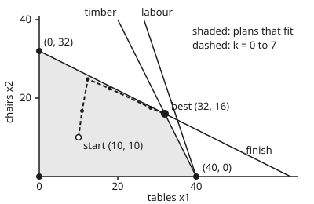
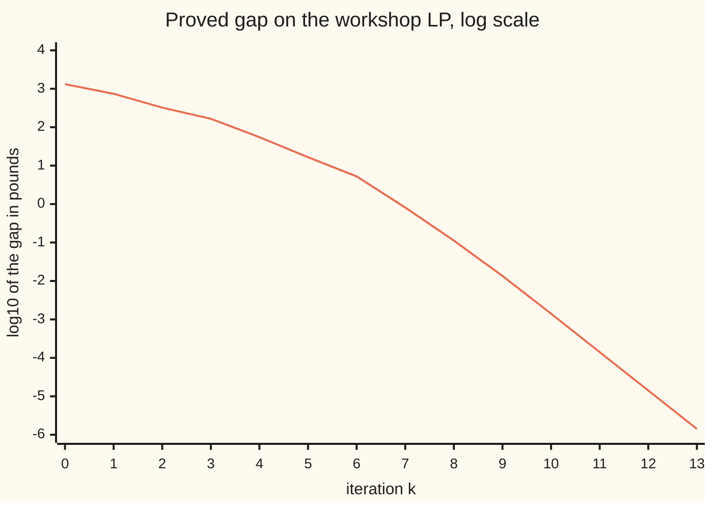

# Interior point for linear programs: polynomial time, and when simplex still wins

[Syllabus](../../../SYLLABUS.md) → [Optimization](../README.md) → [Linear Programming](../README.md#s04) → Interior point for linear programs

---

## General Overview

A furniture workshop makes tables and chairs. A table earns £19 and a chair £20. A table uses 4 m of timber, 3 hours of labour and 1 litre of finish; a chair uses 2 m, 1 hour and 2 litres. The week's stock is 160 m of timber, 120 hours and 64 litres. The job is to **maximise** profit. The best plan is 32 tables and 16 chairs for £928. Prices of £3 a metre on timber, £0 an hour on labour and £7 a litre on finish prove that no plan earns more.

[The simplex method](03-simplex-method.md) finds that plan by walking along the edges of the region of allowed plans, corner to corner. An **interior point method** cuts through the middle instead. It starts at a plan strictly inside every limit, 10 tables and 10 chairs, and carries a set of prices along with it. Each step moves the plan and the prices together. The plan earns £390 at the start and the prices prove a ceiling of £1,720. After 13 steps the two meet at £928 to four decimal places.

The step count is the point. On a family of squashed cubes found by Klee and Minty in 1972, simplex with Dantzig's rule visits every corner: 1,023 pivots in 10 dimensions, over a trillion in 40. The interior point code on the same cubes takes 15 and 16 iterations. One version of the method has a proof that its count grows only like a polynomial in the size of the problem. That gives a second proof, after the ellipsoid method of 1979, that linear programming is solvable in **polynomial time**, and the first by a method that is also fast in practice. Simplex still wins in common jobs, and the card says which.

**A primal-dual interior point method applies Newton's method to the optimality conditions with every product of a quantity and its price held at a shared positive value μ, aims each step at a fixed fraction σ of μ, and so shrinks the gap between the plan's profit and the prices' ceiling by an exact factor per step; its short-step form provably needs a number of steps that grows like the square root of the problem's size times the number of digits of accuracy.**

**What kind of fact this is:** a method, with theorems inside it. The gap's fall per step is proved on this card in Why it works. The lemma that keeps the short-step method on track, the Klee–Minty pivot count and the bit-length bound are stated with their sources, and the code checks the first two on these numbers.

### The picture: through the middle, not round the edge

<p align="center"></p>

The shaded region is every plan that fits the stock, drawn to scale. Simplex hops along its edges between the four black corners. The dashed path is the interior point method's first eight plans, k = 0 to 7. It never touches an edge: it bends towards the finish line, runs just inside it, and closes on the corner (32, 16) from inside.

---

## The formula

Notation first, in words. As on [Linear programs](01-linear-programs-and-polyhedra.md), the problem is written with equalities: a leftover variable is added for each resource, so the plan is $x = (x_1, \dots, x_5)$: tables, chairs, and leftover timber, labour and finish. The profits are $c$, the resource use per unit is the matrix $A$ (one row per resource) and the stock is $b$. As on [LP duality](04-lp-duality-and-complementary-slackness.md), $y$ holds a price for each resource, and a column's **surplus** is what its resources are worth at prices $y$, minus what it earns. That card writes the surplus $r = A^\mathsf{T} y - c$, and [Shadow prices](05-sensitivity-and-shadow-prices.md) calls it the reduced cost. Interior-point texts write it $s$, and so does this card: $s = A^\mathsf{T} y - c$. The slacks $s$ of those two cards are the leftovers $x_3$ to $x_5$ here. A leftover column's surplus is just that resource's price, so $s_3$ to $s_5$ are $y_1$ to $y_3$.

$$\text{maximise } c^\mathsf{T} x \text{ subject to } Ax = b,\; x \ge 0; \qquad \text{the central path: } Ax = b,\quad A^\mathsf{T} y - s = c,\quad x_j s_j = \mu \text{ for every } j,\quad x, s > 0.$$

One Newton step towards the path point at $\sigma\mu$ solves

$$A\,dx = 0, \qquad A^\mathsf{T} dy - ds = 0, \qquad s_j\,dx_j + x_j\,ds_j = \sigma\mu - x_j s_j,$$

and the gap $x^\mathsf{T} s = b^\mathsf{T} y - c^\mathsf{T} x$ after a step of length $\alpha$ is exactly $(1 - \alpha(1 - \sigma))$ times the gap before.

**Read it aloud:** keep the plan feasible and the prices feasible, ask every quantity times its surplus to equal the same small number μ, take a Newton step that aims at a fraction σ of today's μ, and the gap between the prices' ceiling and the plan's profit shrinks by the factor one minus α times one minus σ.

The optimality conditions of the LP are the same three lines with $x_j s_j = 0$: complementary slackness, from [LP duality](04-lp-duality-and-complementary-slackness.md). For the two products it is that card's $x_j r_j = 0$; for the three leftovers it is its rule that a resource with stock to spare has price zero. The central path relaxes that to $x_j s_j = \mu$. It is the same path as the barrier card's $x^*(t)$, with $\mu = 1/t$ ([Interior point methods](../03-Constrained%20Optimisation/08-interior-point-methods.md)). Here μ is the average product $x^\mathsf{T} s / n$, not the strong-convexity μ of shelf 01.

| Symbol | Plain meaning | In our example | Push it up and the answer… |
| --- | --- | --- | --- |
| $x$, $x_j$ | the plan: tables, chairs, leftover timber, labour, finish | start (10, 10, 100, 80, 34); ends at 32 tables, 16 chairs | — |
| $c$, $A$, $b$ | profit per unit; resource use per unit, one row per resource; stock | $c$ = (19, 20, 0, 0, 0) £; rows (4, 2), (3, 1), (1, 2) plus leftovers; $b$ = (160, 120, 64) | more stock: the best profit rises by the price |
| $y$ | price per unit of each resource | start (5, 5, 5); ends (3, 0, 7) £ per m, h, l | the ceiling $b^\mathsf{T} y$ rises |
| $s$, $s_j$ | surplus $A^\mathsf{T} y - c$ ($r$ on LP duality): resources' worth at prices $y$ minus profit | start (21, 5, 5, 5, 5) | prices overcharge more |
| $x^\mathsf{T} s$ | the gap: ceiling $b^\mathsf{T} y$ minus profit $c^\mathsf{T} x$; $\text{gap}_0$ is its value when the short step starts | 1330 at the start; 0.000001 at the end | the proof is weaker: the ceiling sits further above the profit |
| $n$, $m$ | number of variables; number of resource rows | 5; 3 | each step costs more |
| $\mu$ | average product $x^\mathsf{T} s / n$; the path's parameter, $1/t$ on the barrier card | 266 at the start | the path point sits further inside |
| $\sigma$ | centring fraction: the step aims at $\sigma\mu$ | 0.1; 0.8211 for the short step | each step cuts the gap less |
| $dx$, $dy$, $ds$; $D$, $M$ | Newton direction; weights $x_j / s_j$; the $m \times m$ matrix $A D A^\mathsf{T}$ | see Worked numbers | — |
| $\alpha$, $\eta$ | step length; fraction of the largest safe step taken | $\alpha$ = 0.4878 at step 0; $\eta$ = 0.9 | longer steps, fewer iterations |
| $k$, $\varepsilon$, $\theta$ | iteration, from $k = 0$ at the start; stopping tolerance on the gap; width of the short step's neighbourhood | 13 iterations; gap below $10^{-8}$ times (1 + profit); $\theta$ = 0.4 | — |
| $d$, $L$ | Klee–Minty dimension; bits needed to write the LP's data | $d$ = 2 to 40 | simplex pivots $2^d - 1$; interior bound grows like $L$ |

### When it holds

- **A plan and prices strictly inside.** This version starts from $x > 0$ with $Ax = b$ and $s > 0$. Add a limit that leaves only one allowed plan and no strictly inside start exists: the central path is empty. Solvers then use an infeasible-start or self-dual form, which also reports when an LP has no plan or no ceiling (Wright).
- **Rows of $A$ independent.** Each step solves $M\,dy = \text{right side}$. Write the timber limit twice and $M$ is singular: the step is undefined. Presolve, a solver's clean-up pass before the first step, removes such rows.
- **Steps that stop short of the edge.** The direction can push a quantity or a surplus through zero. Take every full step and the plan leaves the region: after 2 full steps it uses 24.4441 m more timber than exists.
- **A fraction σ below one.** With σ = 1 every step only re-centres: the gap stays at 1330 forever.
- **A unique best corner, if a corner is wanted.** With tied best plans the method stops inside the tied edge, not at a corner.

---

## Why it works

### Step 0: walk on the prices' proof, not on the corners

The idea in words. A plan $x$ and prices $y$ that both obey their limits bracket the best profit: profit below, ceiling above. The gap between them is a sum of products, each quantity times its surplus. Simplex keeps this gap at zero at every corner it visits, with prices that break some limit, and walks until the prices become valid. An interior point method does the opposite. It keeps both the plan and the prices valid from the start, with every product strictly positive. Then it shrinks all the products together, evenly, so no quantity or surplus is forced to zero before its time. Shrinking them evenly keeps the plan away from the edges, and the steps long.

### Step 1: the gap is a sum of products

If $Ax = b$ and $s = A^\mathsf{T} y - c$, then

$$b^\mathsf{T} y - c^\mathsf{T} x = (Ax)^\mathsf{T} y - c^\mathsf{T} x = x^\mathsf{T}(A^\mathsf{T} y - c) = x^\mathsf{T} s = \sum_j x_j s_j.$$

With $x \ge 0$ and $s \ge 0$, every term is non-negative, so the ceiling is at least the profit: weak duality from [LP duality](04-lp-duality-and-complementary-slackness.md). At the start, $b^\mathsf{T} y$ = 1720, $c^\mathsf{T} x$ = 390 and $x^\mathsf{T} s$ = 1330, as the product form says.

### Step 2: Newton's method on the bent conditions

The conditions on the central path are $n + m + n$ equations in $x$, $y$, $s$. Two blocks are linear and already hold. The third, $x_j s_j = \sigma\mu$, is curved. Newton's method replaces it by its tangent: $(x_j + dx_j)(s_j + ds_j) \approx x_j s_j + s_j dx_j + x_j ds_j$, dropping the small product $dx_j\,ds_j$. That gives the system in The formula.

To solve it, the second block says $ds = A^\mathsf{T} dy$. The third then gives $dx_j = (\sigma\mu - x_j s_j - x_j\,ds_j)/s_j$, where $\sigma\mu - x_j s_j$ is how far the product $x_j s_j$ falls short of its target. Putting that into $A\,dx = 0$ leaves one $m \times m$ system:

$$\big(A D A^\mathsf{T}\big)\,dy = A\,\big((\sigma\mu - x_j s_j) / s_j\big)_j, \qquad D = \text{diag}(x_j / s_j).$$

For the workshop $M = A D A^\mathsf{T}$ is 3 by 3, solved by elimination. Every iteration costs one such solve. That cost, about $m^3/3$ multiply-adds plus forming $M$, is the price of an interior point step. A simplex pivot updates one tableau and is far cheaper.

### Step 3: the gap falls by an exact factor

Take a step $\alpha$ along $(dx, dy, ds)$. The new gap is

$$\sum_j (x_j + \alpha dx_j)(s_j + \alpha ds_j) = x^\mathsf{T} s + \alpha \sum_j (s_j dx_j + x_j ds_j) + \alpha^2\, dx^\mathsf{T} ds.$$

The middle sum is $\sum_j (\sigma\mu - x_j s_j) = n\sigma\mu - n\mu$. The last term is zero: $dx^\mathsf{T} ds = dx^\mathsf{T} A^\mathsf{T} dy = (A\,dx)^\mathsf{T} dy = 0$. So the new gap is $n\mu\,(1 - \alpha(1 - \sigma))$, exactly, for any step. Newton's dropped term does no harm to the gap, because it sums to zero.

Two consequences. With σ = 1 the gap never moves. With σ = 0.1 and a full step, it falls tenfold. The only thing that stops a full step is the edge, which is why the plan should sit near the central path, where all products are similar and none is about to hit zero first.

### Step 4: the short step, and a count that is proved

The **short-step method** fixes $\theta = 0.4$ and $\sigma = 1 - 0.4/\sqrt{n}$ and always takes $\alpha = 1$. It needs a start in the neighbourhood $\lVert (x_j s_j / \mu - 1)_j \rVert \le 0.4$: every product within 40 percent of the average, in the root-sum-of-squares sense.

**Lemma (stated, not proved here).** If the current point is in that neighbourhood, the full step keeps every $x_j$ and $s_j$ positive and lands back in the neighbourhood. This is Monteiro and Adler's 1989 result; Wright gives the proof in chapter 5. It rests on bounding the dropped products $dx_j\,ds_j$ by the neighbourhood's width.

Given the lemma, the count follows from Step 3. Each step multiplies the gap by exactly σ, so after $k$ steps it is $\sigma^k$ times the first gap. It falls below $\varepsilon$ once $k \ge \ln(\text{gap}_0 / \varepsilon) / (-\ln \sigma)$. Since $-\ln \sigma = -\ln(1 - 0.4/\sqrt{n}) \ge 0.4/\sqrt{n}$,

$$k \;\le\; \Big\lceil \frac{\sqrt{n}}{0.4}\, \ln \frac{\text{gap}_0}{\varepsilon} \Big\rceil.$$

For the workshop, $n = 5$ gives σ = 0.8211. Two centring steps bring the start into the neighbourhood with the gap still 1330. The exact count is predicted as 96, the code takes 96, and the bound is 104.9806. The worst neighbourhood width met on the way is 0.1290, well inside 0.4.

### Step 5: from a gap to polynomial time

The bound grows like $\sqrt{n}$ times the logarithm of the accuracy. To get an exact answer, not just a small gap, use the data's size. If the LP's whole-number data take $L$ bits to write, every corner's coordinates are fractions whose denominators are at most about $2^L$ (Cramer's rule). So two corners with different profits differ by at least a fixed power of $2^{-L}$. Once the gap is smaller than that, rounding to the nearest corner gives the exact best corner. Then $\ln(\text{gap}_0/\varepsilon)$ is of order $L$, and the count is of order $\sqrt{n}\,L$ iterations, each at most of order $n^3$ operations. That is $O(n^{3.5} L)$ arithmetic operations, the bound Karmarkar proved for his 1984 method: polynomial in the size of the input. Khachiyan's ellipsoid method had shown in 1979 that a polynomial bound exists; interior point methods made one fast in practice.

### Step 6: the simplex method's worst case

Simplex has no such bound. [The simplex method](03-simplex-method.md) already runs Dantzig's rule on a small Klee–Minty cube; this step gives the cube for every $d$. Klee and Minty built, for each $d$, an LP in $d$ variables: maximise $\sum_j 10^{d-j} x_j$ subject to $2\sum_{j<i} 10^{i-j} x_j + x_i \le 100^{i-1}$ and $x \ge 0$. Its region is a squashed cube with $2^d$ corners, and Dantzig's rule (enter the column with the largest profit per unit) visits every one of them: $2^d - 1$ pivots. The code runs that rule for $d$ up to 10 and gets exactly $2^d - 1$ each time. Later authors built similar traps for many other pivot rules (Bertsimas and Tsitsiklis, chapter 3).

The interior point code runs on the same cubes with each $x_j$ measured in units of $100^{j-1}$, which keeps the numbers near 1. A change of units multiplies each $x_j$ by a constant and divides its surplus $s_j$ by the same constant, so every product $x_j s_j$ and every step is unchanged. Changing units can change which column Dantzig's rule picks, so simplex runs on the original cube.

---

## Worked numbers, by hand

Step $k = 0$ on the workshop, from the plan of 10 tables and 10 chairs and prices of £5 on everything.

| Step | Arithmetic | Value |
| --- | --- | --- |
| leftovers | $160 - 40 - 20$; $120 - 30 - 10$; $64 - 10 - 20$ | 100, 80, 34 |
| surplus $s = A^\mathsf{T} y - c$ | tables $(4 + 3 + 1) \times 5 - 19$; chairs $(2 + 1 + 2) \times 5 - 20$; leftovers: the prices | 21, 5, 5, 5, 5 |
| gap $x^\mathsf{T} s$ | $10 \times 21 + 10 \times 5 + (100 + 80 + 34) \times 5$ | 1330 |
| same gap as ceiling minus profit | $(160 + 120 + 64) \times 5 - (190 + 200)$ | $1720 - 390 = 1330$ |
| $\mu$, and the target $\sigma\mu$ | $1330 / 5$; $0.1 \times 266$ | 266; 26.6 |
| $M = A D A^\mathsf{T}$, $D = x_j / s_j$ | e.g. top left: $16 \times 10/21 + 4 \times 2 + 20$ | rows (35.6190, 9.7143, 9.9048), (9.7143, 22.2857, 5.4286), (9.9048, 5.4286, 15.2762) |
| solve for the price change $dy$ | elimination on $M$ | (−2.9871, −3.4601, 0.1045) |
| surplus change $ds = A^\mathsf{T} dy$ | tables $4(-2.9871) + 3(-3.4601) + 0.1045$ | (−22.2239, −9.2252, −2.9871, −3.4601, 0.1045) |
| plan change $dx_j = (26.6 - x_j s_j - x_j ds_j)/s_j$ | tables $(26.6 - 210 + 222.239)/21$ | (1.8495, 13.7705, −34.9389, −19.3189, −29.3904) |
| largest safe step | chairs' surplus: $5 / 9.2252$ | 0.5420 |
| step taken, $\alpha = 0.9 \times$ safe | $0.9 \times 0.5420$ | 0.4878 |
| **new gap** | $1330 \times (1 - 0.4878 \times 0.9)$ | **746.1121** |

The first step cuts the proved gap from £1,330 to £746.11, and the run's table below shows 746.112091, so Step 3's factor holds to every digit. The step was cut short by the chairs' surplus. Prices are falling fast, and a full step would have priced chairs' resources below their £20 profit, which voids the ceiling.

### What breaks if you drop a piece

| Mistake | Comes out at | What went wrong |
| --- | --- | --- |
| Take the full Newton step every time | after 2 steps: 40.2877 tables, 11.6467 chairs, timber left −24.4441 m, "profit" £998.4004 | The plan left the region. It beats the true £928 only by spending timber that does not exist. |
| Set σ = 1: centre, never push | gap after 20 iterations 1330.0000 | Step 3 with σ = 1: the factor is exactly 1. The plan moves towards the centre and the proof never improves. |
| Tie the best plans: chairs at £38 | stops after 10 at (9.1177, 27.4411), profit £1216.0000 | Profit is now parallel to the finish line, so a whole edge is best. The method ends inside it, not at a corner; a corner needs crossover: a few simplex pivots from the interior answer. |
| Use the proved short step in practice | 96 iterations, against 13 for the long steps | The bound is a worst case. Long steps of 0.9 of the safe length have a weaker proved bound and run far faster. |

---

## How the gap closes, step by step

The puzzle: the early steps are cut short by the edges, yet the method finishes in 13. The table follows one run from the start, σ = 0.1, η = 0.9. Profit is $c^\mathsf{T} x$, the ceiling is $b^\mathsf{T} y$, and the gap is their difference.

| $k$ | tables | chairs | profit, £ | ceiling, £ | gap, £ | step $\alpha$ |
| ---: | ---: | ---: | ---: | ---: | ---: | ---: |
| 0 | 10.0000 | 10.0000 | 390.0000 | 1720.0000 | 1330.000000 | 0.4878 |
| 1 | 10.9022 | 16.7171 | 541.4839 | 1287.5959 | 746.112091 | 0.6282 |
| 2 | 12.3797 | 24.8270 | 731.7539 | 1056.0044 | 324.250516 | 0.5378 |
| 3 | 17.9340 | 22.4332 | 789.4092 | 956.7284 | 167.319199 | 0.7432 |
| 4 | 28.3754 | 17.4939 | 889.0106 | 944.4167 | 55.406137 | 0.7799 |
| 5 | 31.7069 | 16.0106 | 922.6437 | 939.1598 | 16.516141 | 0.7586 |
| 6 | 31.9980 | 15.9464 | 926.8909 | 932.1313 | 5.240357 | 0.9398 |
| 7 | 31.9968 | 15.9905 | 927.7477 | 928.5556 | 0.807915 | 0.9568 |
| 8 | 31.9990 | 15.9989 | 927.9586 | 928.0708 | 0.112216 | 0.9786 |
| 9 | 31.9998 | 15.9999 | 927.9947 | 928.0081 | 0.013383 | 0.9949 |
| 10 | 32.0000 | 16.0000 | 927.9994 | 928.0008 | 0.001400 | 0.9997 |
| 11 | 32.0000 | 16.0000 | 927.9999 | 928.0001 | 0.000140 | 1.0000 |
| 12 | 32.0000 | 16.0000 | 928.0000 | 928.0000 | 0.000014 | 1.0000 |
| 13 | 32.0000 | 16.0000 | 928.0000 | 928.0000 | 0.000001 | 1.0000 |

Two phases show. For the first six steps the edges cut α to between 0.4878 and 0.7799, and the gap falls only a few-fold a step. From step 6 the plan is near the best corner, the edges stop binding, α climbs to 1, and Step 3's factor becomes σ = 0.1: a tenfold cut each time. Both ends move: the ceiling falls from £1,720 while the profit rises from £390, so the prices do as much of the work as the plan.



The line is the base-10 logarithm of the gap $x^\mathsf{T} s$ at each iteration. It bends from a shallow slope to a straight drop of one unit per step once full steps are allowed.

The same method on the Klee–Minty cubes, with simplex beside it:

| $d$ | simplex pivots, Dantzig's rule | $2^d - 1$ | interior point iterations |
| ---: | ---: | ---: | ---: |
| 2 | 3 | 3 | 11 |
| 4 | 15 | 15 | 12 |
| 6 | 63 | 63 | 13 |
| 8 | 255 | 255 | 14 |
| 10 | 1023 | 1023 | 15 |
| 20 | not run | 1048575 | 15 |
| 40 | not run | 1099511627775 | 16 |

Simplex doubles with every added dimension. The interior point count creeps up by about one per doubling of $d$. The often-quoted "about 20 iterations whatever the size" is a rule of thumb, not a constant: here the count is 11 to 16 and still grows slowly with size. Every run ends at $x_d$ = 1.000000 in the new units, the cube's best corner.

---

## Code, from first principles, and it actually runs

The code runs the primal-dual method on the workshop with every Newton step written out: the surplus, the matrix $M = A D A^\mathsf{T}$ built by hand and solved by elimination, the largest safe step and 0.9 of it. It reaches the answer by three independent roads. Road 1 is the interior point method itself. Road 2 lists every corner of the region in exact fractions, crossing each pair of limit lines and keeping those that fit. Road 3 checks the prices (3, 0, 7) exactly: they cover each product's profit and their ceiling equals the best corner's £928, so the best corner is proved optimal and the interior point answer must meet it. It then prints the four breaks, the short-step count against its prediction, and both methods on Klee–Minty cubes. The simplex tableau stays in whole numbers, because every Klee–Minty pivot element is 1, and the code asserts that.

### Python

```python
# Interior point for linear programs -- the check behind the card.  Standard library only.
# Roads to the answer: the primal-dual interior point method; every corner of the
# workshop's region listed in exact fractions; the prices y = (3, 0, 7) checked as a
# dual bound that meets the best corner.  Then the worst cases: the simplex method on
# Klee-Minty cubes against the interior point count on the same cubes.
import math
from fractions import Fraction as F
from itertools import combinations

def solve(M, r):                  # Gaussian elimination with row swaps
    n = len(r); M = [M[i][:] + [r[i]] for i in range(n)]
    for k in range(n):
        p = max(range(k, n), key=lambda i: abs(M[i][k]))   # first of the largest
        M[k], M[p] = M[p], M[k]
        for i in range(k + 1, n):
            f = M[i][k] / M[k][k]
            for j in range(k, n + 1): M[i][j] -= f * M[k][j]
    x = [0.0] * n
    for k in range(n - 1, -1, -1):
        x[k] = (M[k][n] - dot(M[k][k + 1:n], x[k + 1:])) / M[k][k]
    return x

def dot(u, v):
    t = 0.0
    for a, b in zip(u, v): t += a * b
    return t
def f4(v): return f"{v:.4f}"

def newton(A, c, x, y, sigma):    # one primal-dual Newton direction, x and y feasible
    m, n = len(A), len(c)
    s = [dot([A[i][j] for i in range(m)], y) - c[j] for j in range(n)]
    mu = dot(x, s) / n
    r = [sigma * mu - x[j] * s[j] for j in range(n)]
    d = [x[j] / s[j] for j in range(n)]
    M = [[dot([A[i][j] * d[j] for j in range(n)], A[l]) for l in range(m)] for i in range(m)]
    dy = solve(M, [dot(A[i], [r[j] / s[j] for j in range(n)]) for i in range(m)])
    ds = [dot([A[i][j] for i in range(m)], dy) for j in range(n)]
    dx = [(r[j] - x[j] * ds[j]) / s[j] for j in range(n)]
    return s, mu, M, dx, dy, ds

def ipm(A, c, x, y, sigma=0.1, eta=0.9, cap=200, hist=None):
    for k in range(cap + 1):
        s, mu, M, dx, dy, ds = newton(A, c, x, y, sigma)
        gap = dot(x, s)
        amax = min([-x[j] / dx[j] for j in range(len(x)) if dx[j] < 0] + [-s[j] / ds[j] for j in range(len(x)) if ds[j] < 0] + [1e9])
        a = 1.0 if eta is None else min(1.0, eta * amax)
        if hist is not None: hist.append((k, x, y, gap, a))
        if gap <= 1e-8 * (1 + abs(dot(c, x))) or k == cap: return k, x, y, s
        x = [x[j] + a * dx[j] for j in range(len(x))]; y = [y[i] + a * dy[i] for i in range(len(y))]

A = [[4.0, 2.0, 1.0, 0.0, 0.0], [3.0, 1.0, 0.0, 1.0, 0.0], [1.0, 2.0, 0.0, 0.0, 1.0]]
b, c = [160.0, 120.0, 64.0], [19.0, 20.0, 0.0, 0.0, 0.0]
X0, Y0 = [10.0, 10.0, 100.0, 80.0, 34.0], [5.0, 5.0, 5.0]
print("maximise 19 x1 + 20 x2 pounds: timber 4,2 <= 160 m; labour 3,1 <= 120 h; finish 1,2 <= 64 l")
s, mu, M, dx, dy, ds = newton(A, c, X0, Y0, 0.1)
print("start x = (" + ", ".join(f4(v) for v in X0) + "), y = (5, 5, 5), s = (" + ", ".join(f4(v) for v in s) + ")")
print(f"gap x.s = {f4(dot(X0, s))}, mu = {f4(mu)}, target sigma*mu = {f4(0.1 * mu)}")
print("M = A D A^T rows: " + "; ".join(", ".join(f4(v) for v in row) for row in M))
print("dy = (" + ", ".join(map(f4, dy)) + "), ds = (" + ", ".join(map(f4, ds)) + "), dx = (" + ", ".join(map(f4, dx)) + ")")
amax = min(-s[j] / ds[j] for j in range(5) if ds[j] < 0)
print(f"largest safe step {f4(amax)} (chairs' surplus s2 hits 0); take 0.9 of it: alpha = {f4(0.9 * amax)}")
print(f"new gap predicted 1330 * (1 - alpha * 0.9) = {f4(1330 * (1 - 0.9 * amax * 0.9))}")
H = []
k, x, y, s = ipm(A, c, X0, Y0, hist=H)
print(" k   tables    chairs    profit     bound       gap   step")
for (j, xj, yj, g, a) in H:
    print(f"{j:2d} {xj[0]:8.4f} {xj[1]:9.4f} {dot(c, xj):9.4f} {dot(b, yj):9.4f} {g:9.6f} {a:6.4f}")
print("chart log10 gap: " + ", ".join(f"{math.log10(h[3]):.2f}" for h in H))
print(f"stop after {k} iterations: plan ({f4(x[0])}, {f4(x[1])}), prices y = ({', '.join(f4(v) for v in y)})")
P, Q, R = [[4, 2], [3, 1], [1, 2], [-1, 0], [0, -1]], [160, 120, 64, 0, 0], {}
for p, q in combinations(range(5), 2):          # cross every pair of walls, exactly
    det = F(P[p][0] * P[q][1] - P[p][1] * P[q][0])
    if det:
        pt = ((Q[p] * P[q][1] - P[p][1] * Q[q]) / det, (P[p][0] * Q[q] - Q[p] * P[q][0]) / det)
        if all(w[0] * pt[0] + w[1] * pt[1] <= l for w, l in zip(P, Q)): R[pt] = 19 * pt[0] + 20 * pt[1]
print("corners: " + "; ".join(f"({p[0]}, {p[1]}) {v}" for p, v in sorted(R.items())))
yc = [3, 0, 7]
cover = [sum(P[i][j] * yc[i] for i in range(3)) for j in range(2)]
print(f"certificate y = (3, 0, 7): covers tables {cover[0]} >= 19, chairs {cover[1]} >= 20; bound {sum(Q[i] * yc[i] for i in range(3))}")
H2 = []; ipm(A, c, X0, Y0, eta=None, cap=2, hist=H2)
for j in (1, 2):
    xj = H2[j][1]; print(f"break, full steps, after {j}: plan ({f4(xj[0])}, {f4(xj[1])}), timber left {f4(xj[2])}, profit {f4(dot(c, xj))}")
Hc = []; ipm(A, c, X0, Y0, sigma=1.0, cap=20, hist=Hc)
print(f"break, sigma = 1 (centre only): gap after 20 iterations {f4(Hc[-1][3])}")
kt, xt, yt, st = ipm(A, [19.0, 38.0, 0.0, 0.0, 0.0], X0, [5.0, 10.0, 10.0])
print(f"break, chairs at 38 pounds (tied best edge): stops after {kt} at ({f4(xt[0])}, {f4(xt[1])}), profit {f4(19 * xt[0] + 38 * xt[1])}")
xs, ys, nc = X0, Y0, 0                           # short-step method: centre, then sigma = 1 - 0.4/sqrt(n)
def prox(x, y):
    s = newton(A, c, x, y, 1.0)[0]; mu = dot(x, s) / 5
    return math.sqrt(sum((x[j] * s[j] / mu - 1) ** 2 for j in range(5)))
while prox(xs, ys) > 0.4:
    _, xs, ys, _ = ipm(A, c, xs, ys, sigma=1.0, cap=1); nc += 1
sig = 1 - 0.4 / math.sqrt(5); g0 = dot(xs, newton(A, c, xs, ys, 1.0)[0]); Hs = []
ks, xs, ys, _ = ipm(A, c, xs, ys, sigma=sig, eta=None, cap=500, hist=Hs)
worst = max(prox(h[1], h[2]) for h in Hs)
pred = math.ceil(math.log(g0 / (1e-8 * 929)) / -math.log(sig))
bound = math.sqrt(5) / 0.4 * math.log(g0 / (1e-8 * 929))
print(f"short step: {nc} centring steps, gap {f4(g0)}; sigma {f4(sig)}; {ks} iterations (predicted {pred}, bound {f4(bound)}); worst proximity {f4(worst)}")

def km_simplex(n):                               # Dantzig's rule, integer tableau: every pivot is 1
    T = [[2 * 10 ** (i - j) if j < i else int(j == i or j == n + i) for j in range(2 * n)] + [100 ** i] for i in range(n)]
    z, piv = [-(10 ** (n - 1 - j)) for j in range(n)] + [0] * (n + 1), 0
    while min(z[:-1]) < 0:
        j = z.index(min(z[:-1]))
        r = min((i for i in range(n) if T[i][j] > 0), key=lambda i: F(T[i][-1], T[i][j]))
        assert T[r][j] == 1
        for i in range(n):
            if i != r: T[i] = [u - T[i][j] * v for u, v in zip(T[i], T[r])]
        z = [u - z[j] * v for u, v in zip(z, T[r])]; piv += 1
    return piv, z[-1]

def km_ipm(n):                                   # the same cube with each x_j measured in units of 100^j
    p = [1.0]
    for _ in range(n): p.append(p[-1] / 10.0)
    A = [[2.0 * p[i - j] if j < i else float(j == i or j == n + i) for j in range(2 * n)] for i in range(n)]
    x = [0.1] * n + [1.0 - dot(A[i][:n], [0.1] * n) for i in range(n)]
    return ipm(A, [p[n - 1 - j] for j in range(n)] + [0.0] * n, x, [2.0] * n)

print(" d  pivots          2^d - 1  iterations  x_d")
rows = []
for n in (2, 4, 6, 8, 10, 20, 40):
    piv, val = km_simplex(n) if n <= 10 else (None, None)
    k_n, xk, _, _ = km_ipm(n)
    rows.append((n, piv, val, k_n, xk[n - 1]))
    print(f"{n:2d} {'-' if piv is None else piv:>7} {2 ** n - 1:>16} {k_n:>11}  {xk[n - 1]:.6f}")
print("figure, px = 50 + 5*x1, py = 225 - 5*x2: path k = 0..7 " + " ".join(f"({50 + 5 * h[1][0]:.1f},{225 - 5 * h[1][1]:.1f})" for h in H[:8]))

best = max(R.values())
assert best == 928 and max(R, key=R.get) == (32, 16)                      # enumeration
assert cover[0] >= 19 and cover[1] >= 20 and sum(Q[i] * yc[i] for i in range(3)) == best  # dual bound meets it
assert abs(x[0] - 32) < 1e-6 and abs(x[1] - 16) < 1e-6 and k == 13       # interior point meets both
assert max(abs(y[i] - yc[i]) for i in range(3)) < 1e-6
assert abs(H[1][3] - 1330 * (1 - 0.9 * amax * 0.9)) < 1e-9               # gap falls by 1 - alpha(1 - sigma)
assert H2[2][1][2] < 0 and dot(c, H2[2][1]) > best                        # full steps leave the region
assert abs(Hc[-1][3] - 1330) < 1e-6 and ks == pred and worst <= 0.4
assert abs(19 * xt[0] + 38 * xt[1] - 1216) < 1e-5 and 1 < xt[0] < 31     # tie: inside the edge, no corner
assert all(r[1] is None or (r[1] == 2 ** r[0] - 1 and r[2] == 100 ** (r[0] - 1)) for r in rows)
assert all(abs(r[4] - 1) < 1e-6 and r[3] <= 20 for r in rows)
print("ALL CHECKS PASS")
```

**Ran 2026-11-11 on macOS, Python 3.14.10, standard library only. All checks passed. Output, pasted from the run:**

```
maximise 19 x1 + 20 x2 pounds: timber 4,2 <= 160 m; labour 3,1 <= 120 h; finish 1,2 <= 64 l
start x = (10.0000, 10.0000, 100.0000, 80.0000, 34.0000), y = (5, 5, 5), s = (21.0000, 5.0000, 5.0000, 5.0000, 5.0000)
gap x.s = 1330.0000, mu = 266.0000, target sigma*mu = 26.6000
M = A D A^T rows: 35.6190, 9.7143, 9.9048; 9.7143, 22.2857, 5.4286; 9.9048, 5.4286, 15.2762
dy = (-2.9871, -3.4601, 0.1045), ds = (-22.2239, -9.2252, -2.9871, -3.4601, 0.1045), dx = (1.8495, 13.7705, -34.9389, -19.3189, -29.3904)
largest safe step 0.5420 (chairs' surplus s2 hits 0); take 0.9 of it: alpha = 0.4878
new gap predicted 1330 * (1 - alpha * 0.9) = 746.1121
 k   tables    chairs    profit     bound       gap   step
 0  10.0000   10.0000  390.0000 1720.0000 1330.000000 0.4878
 1  10.9022   16.7171  541.4839 1287.5959 746.112091 0.6282
 2  12.3797   24.8270  731.7539 1056.0044 324.250516 0.5378
 3  17.9340   22.4332  789.4092  956.7284 167.319199 0.7432
 4  28.3754   17.4939  889.0106  944.4167 55.406137 0.7799
 5  31.7069   16.0106  922.6437  939.1598 16.516141 0.7586
 6  31.9980   15.9464  926.8909  932.1313  5.240357 0.9398
 7  31.9968   15.9905  927.7477  928.5556  0.807915 0.9568
 8  31.9990   15.9989  927.9586  928.0708  0.112216 0.9786
 9  31.9998   15.9999  927.9947  928.0081  0.013383 0.9949
10  32.0000   16.0000  927.9994  928.0008  0.001400 0.9997
11  32.0000   16.0000  927.9999  928.0001  0.000140 1.0000
12  32.0000   16.0000  928.0000  928.0000  0.000014 1.0000
13  32.0000   16.0000  928.0000  928.0000  0.000001 1.0000
chart log10 gap: 3.12, 2.87, 2.51, 2.22, 1.74, 1.22, 0.72, -0.09, -0.95, -1.87, -2.85, -3.85, -4.85, -5.85
stop after 13 iterations: plan (32.0000, 16.0000), prices y = (3.0000, 0.0000, 7.0000)
corners: (0, 0) 0; (0, 32) 640; (32, 16) 928; (40, 0) 760
certificate y = (3, 0, 7): covers tables 19 >= 19, chairs 20 >= 20; bound 928
break, full steps, after 1: plan (11.8495, 23.7705), timber left 65.0611, profit 700.5496
break, full steps, after 2: plan (40.2877, 11.6467), timber left -24.4441, profit 998.4004
break, sigma = 1 (centre only): gap after 20 iterations 1330.0000
break, chairs at 38 pounds (tied best edge): stops after 10 at (9.1177, 27.4411), profit 1216.0000
short step: 2 centring steps, gap 1330.0000; sigma 0.8211; 96 iterations (predicted 96, bound 104.9806); worst proximity 0.1290
 d  pivots          2^d - 1  iterations  x_d
 2       3                3          11  1.000000
 4      15               15          12  1.000000
 6      63               63          13  1.000000
 8     255              255          14  1.000000
10    1023             1023          15  1.000000
20       -          1048575          15  1.000000
40       -    1099511627775          16  1.000000
figure, px = 50 + 5*x1, py = 225 - 5*x2: path k = 0..7 (100.0,175.0) (104.5,141.4) (111.9,100.9) (139.7,112.8) (191.9,137.5) (208.5,144.9) (210.0,145.3) (210.0,145.0)
ALL CHECKS PASS
```

### Rust

Same numbers, same labels, built with `rustc --edition 2021 -O`. The simplex tableau uses 128-bit whole numbers; the corner list keeps each corner as whole-number numerators over one whole-number denominator.

```rust
// Interior point for linear programs -- the check behind the card.  std only, no crates.
// Roads to the answer: the primal-dual interior point method; every corner of the
// workshop's region listed in exact fractions; the prices y = (3, 0, 7) checked as a
// dual bound that meets the best corner.  Then the worst cases: the simplex method on
// Klee-Minty cubes against the interior point count on the same cubes.
type V = Vec<f64>;
type Hist = Vec<(usize, V, V, f64, f64)>;
fn dot(u: &[f64], v: &[f64]) -> f64 { let mut t = 0.0; for (a, b) in u.iter().zip(v) { t += a * b; } t }
fn f4(v: f64) -> String { format!("{:.4}", v) }
fn list(v: &[f64]) -> String { v.iter().map(|&a| f4(a)).collect::<Vec<_>>().join(", ") }
fn col(a: &[V], j: usize) -> V { a.iter().map(|r| r[j]).collect() }

fn solve(m0: &[V], r: &[f64]) -> V { // Gaussian elimination with row swaps
    let n = r.len();
    let mut m: Vec<V> = (0..n).map(|i| { let mut row = m0[i].clone(); row.push(r[i]); row }).collect();
    for k in 0..n {
        let mut p = k;
        for i in k + 1..n { if m[i][k].abs() > m[p][k].abs() { p = i; } }
        m.swap(k, p);
        for i in k + 1..n {
            let f = m[i][k] / m[k][k];
            for j in k..n + 1 { let v = m[k][j]; m[i][j] -= f * v; }
        }
    }
    let mut x = vec![0.0; n];
    for k in (0..n).rev() { x[k] = (m[k][n] - dot(&m[k][k + 1..n], &x[k + 1..])) / m[k][k]; }
    x
}

// one primal-dual Newton direction, x and y feasible: returns s, mu, M, dx, dy, ds
fn newton(a: &[V], c: &[f64], x: &[f64], y: &[f64], sigma: f64) -> (V, f64, Vec<V>, V, V, V) {
    let (m, n) = (a.len(), c.len());
    let s: V = (0..n).map(|j| dot(&col(a, j), y) - c[j]).collect();
    let mu = dot(x, &s) / n as f64;
    let r: V = (0..n).map(|j| sigma * mu - x[j] * s[j]).collect();
    let d: V = (0..n).map(|j| x[j] / s[j]).collect();
    let mm: Vec<V> = (0..m).map(|i| (0..m).map(|l| dot(&(0..n).map(|j| a[i][j] * d[j]).collect::<V>(), &a[l])).collect()).collect();
    let rs: V = (0..n).map(|j| r[j] / s[j]).collect();
    let dy = solve(&mm, &(0..m).map(|i| dot(&a[i], &rs)).collect::<V>());
    let ds: V = (0..n).map(|j| dot(&col(a, j), &dy)).collect();
    let dx: V = (0..n).map(|j| (r[j] - x[j] * ds[j]) / s[j]).collect();
    (s, mu, mm, dx, dy, ds)
}

fn ipm(a: &[V], c: &[f64], x0: &[f64], y0: &[f64], sigma: f64, eta: Option<f64>, cap: usize, h: &mut Hist) -> (usize, V, V) {
    let (mut x, mut y) = (x0.to_vec(), y0.to_vec());
    let n = x.len();
    for k in 0..=cap {
        let (s, _, _, dx, dy, ds) = newton(a, c, &x, &y, sigma);
        let gap = dot(&x, &s);
        let mut amax = 1e9;
        for j in 0..n { if dx[j] < 0.0 { amax = f64::min(amax, -x[j] / dx[j]); } if ds[j] < 0.0 { amax = f64::min(amax, -s[j] / ds[j]); } }
        let al = match eta { None => 1.0, Some(e) => f64::min(1.0, e * amax) };
        h.push((k, x.clone(), y.clone(), gap, al));
        if gap <= 1e-8 * (1.0 + dot(c, &x).abs()) || k == cap { return (k, x, y); }
        for j in 0..n { x[j] += al * dx[j]; }
        for i in 0..y.len() { y[i] += al * dy[i]; }
    }
    unreachable!()
}

fn km_simplex(n: usize) -> (usize, i128) { // Dantzig's rule, integer tableau: every pivot is 1
    let mut t: Vec<Vec<i128>> = (0..n).map(|i| {
        let mut row: Vec<i128> = (0..2 * n).map(|j| if j < i { 2 * 10i128.pow((i - j) as u32) } else { (j == i || j == n + i) as i128 }).collect();
        row.push(100i128.pow(i as u32)); row }).collect();
    let mut z: Vec<i128> = (0..n).map(|j| -(10i128.pow((n - 1 - j) as u32))).chain(vec![0; n + 1]).collect();
    let mut piv = 0;
    loop {
        let mut j = 0;
        for k in 1..2 * n { if z[k] < z[j] { j = k; } }
        if z[j] >= 0 { return (piv, z[2 * n]); }
        let mut r = usize::MAX;
        for i in 0..n { if t[i][j] > 0 && (r == usize::MAX || t[i][2 * n] * t[r][j] < t[r][2 * n] * t[i][j]) { r = i; } }
        assert!(t[r][j] == 1);
        let tr = t[r].clone();
        for i in 0..n { if i != r { let f = t[i][j]; for q in 0..=2 * n { t[i][q] -= f * tr[q]; } } }
        let f = z[j]; for q in 0..=2 * n { z[q] -= f * tr[q]; }
        piv += 1;
    }
}

fn km_ipm(n: usize) -> (usize, V) { // the same cube with each x_j measured in units of 100^j
    let mut p = vec![1.0];
    for _ in 0..n { let l = p[p.len() - 1] / 10.0; p.push(l); }
    let a: Vec<V> = (0..n).map(|i| (0..2 * n).map(|j| if j < i { 2.0 * p[i - j] } else if j == i || j == n + i { 1.0 } else { 0.0 }).collect()).collect();
    let x: V = (0..2 * n).map(|i| if i < n { 0.1 } else { 1.0 - dot(&a[i - n][..n], &vec![0.1; n]) }).collect();
    let c: V = (0..n).map(|j| p[n - 1 - j]).chain(vec![0.0; n]).collect();
    let (k, x, _) = ipm(&a, &c, &x, &vec![2.0; n], 0.1, Some(0.9), 200, &mut Vec::new());
    (k, x)
}

fn frac(n: i64, d: i64) -> String { if n % d == 0 { format!("{}", n / d) } else { format!("{}/{}", n, d) } }

fn main() {
    let a: Vec<V> = vec![vec![4.0, 2.0, 1.0, 0.0, 0.0], vec![3.0, 1.0, 0.0, 1.0, 0.0], vec![1.0, 2.0, 0.0, 0.0, 1.0]];
    let (b, c) = (vec![160.0, 120.0, 64.0], vec![19.0, 20.0, 0.0, 0.0, 0.0]);
    let (x0, y0) = (vec![10.0, 10.0, 100.0, 80.0, 34.0], vec![5.0, 5.0, 5.0]);
    println!("maximise 19 x1 + 20 x2 pounds: timber 4,2 <= 160 m; labour 3,1 <= 120 h; finish 1,2 <= 64 l");
    let (s, mu, mm, dx, dy, ds) = newton(&a, &c, &x0, &y0, 0.1);
    println!("start x = ({}), y = (5, 5, 5), s = ({})", list(&x0), list(&s));
    println!("gap x.s = {}, mu = {}, target sigma*mu = {}", f4(dot(&x0, &s)), f4(mu), f4(0.1 * mu));
    println!("M = A D A^T rows: {}", mm.iter().map(|r| list(r)).collect::<Vec<_>>().join("; "));
    println!("dy = ({}), ds = ({}), dx = ({})", list(&dy), list(&ds), list(&dx));
    let mut amax = f64::INFINITY;
    for j in 0..5 { if ds[j] < 0.0 { amax = f64::min(amax, -s[j] / ds[j]); } }
    println!("largest safe step {} (chairs' surplus s2 hits 0); take 0.9 of it: alpha = {}", f4(amax), f4(0.9 * amax));
    println!("new gap predicted 1330 * (1 - alpha * 0.9) = {}", f4(1330.0 * (1.0 - 0.9 * amax * 0.9)));
    let mut h: Hist = Vec::new();
    let (k, x, y) = ipm(&a, &c, &x0, &y0, 0.1, Some(0.9), 200, &mut h);
    println!(" k   tables    chairs    profit     bound       gap   step");
    for (j, xj, yj, g, al) in &h { println!("{:2} {:8.4} {:9.4} {:9.4} {:9.4} {:9.6} {:6.4}", j, xj[0], xj[1], dot(&c, xj), dot(&b, yj), g, al); }
    println!("chart log10 gap: {}", h.iter().map(|e| format!("{:.2}", e.3.log10())).collect::<Vec<_>>().join(", "));
    println!("stop after {} iterations: plan ({}, {}), prices y = ({})", k, f4(x[0]), f4(x[1]), list(&y));
    let (pw, qw): ([[i64; 2]; 5], [i64; 5]) = ([[4, 2], [3, 1], [1, 2], [-1, 0], [0, -1]], [160, 120, 64, 0, 0]);
    let mut corners: Vec<(i64, i64, i64)> = Vec::new(); // (num x1, num x2, common denominator > 0)
    for p in 0..5 { for q in p + 1..5 {
        let mut det = pw[p][0] * pw[q][1] - pw[p][1] * pw[q][0];
        if det == 0 { continue; }
        let (mut n1, mut n2) = (qw[p] * pw[q][1] - pw[p][1] * qw[q], pw[p][0] * qw[q] - qw[p] * pw[q][0]);
        if det < 0 { det = -det; n1 = -n1; n2 = -n2; }
        if (0..5).all(|w| pw[w][0] * n1 + pw[w][1] * n2 <= qw[w] * det) && !corners.iter().any(|&(a1, a2, d)| a1 * det == n1 * d && a2 * det == n2 * d) { corners.push((n1, n2, det)); }
    } }
    corners.sort_by(|u, v| (u.0 * v.2).cmp(&(v.0 * u.2)).then((u.1 * v.2).cmp(&(v.1 * u.2))));
    let profit = |u: &(i64, i64, i64)| (19 * u.0 + 20 * u.1, u.2);
    println!("corners: {}", corners.iter().map(|u| format!("({}, {}) {}", frac(u.0, u.2), frac(u.1, u.2), frac(profit(u).0, u.2))).collect::<Vec<_>>().join("; "));
    let yc = [3i64, 0, 7];
    let cover: Vec<i64> = (0..2).map(|j| (0..3).map(|i| pw[i][j] * yc[i]).sum()).collect();
    let dual: i64 = (0..3).map(|i| qw[i] * yc[i]).sum();
    println!("certificate y = (3, 0, 7): covers tables {} >= 19, chairs {} >= 20; bound {}", cover[0], cover[1], dual);
    let mut h2: Hist = Vec::new(); ipm(&a, &c, &x0, &y0, 0.1, None, 2, &mut h2);
    for j in [1, 2] { let xj = &h2[j].1; println!("break, full steps, after {}: plan ({}, {}), timber left {}, profit {}", j, f4(xj[0]), f4(xj[1]), f4(xj[2]), f4(dot(&c, xj))); }
    let mut hc: Hist = Vec::new(); ipm(&a, &c, &x0, &y0, 1.0, Some(0.9), 20, &mut hc);
    println!("break, sigma = 1 (centre only): gap after 20 iterations {}", f4(hc[hc.len() - 1].3));
    let (kt, xt, _) = ipm(&a, &[19.0, 38.0, 0.0, 0.0, 0.0], &x0, &[5.0, 10.0, 10.0], 0.1, Some(0.9), 200, &mut Vec::new());
    println!("break, chairs at 38 pounds (tied best edge): stops after {} at ({}, {}), profit {}", kt, f4(xt[0]), f4(xt[1]), f4(19.0 * xt[0] + 38.0 * xt[1]));
    let prox = |x: &[f64], y: &[f64]| -> f64 {
        let s = newton(&a, &c, x, y, 1.0).0; let mu = dot(x, &s) / 5.0;
        let mut t = 0.0; for j in 0..5 { let v = x[j] * s[j] / mu - 1.0; t += v * v; } t.sqrt() };
    let (mut xs, mut ys, mut nc) = (x0.clone(), y0.clone(), 0); // short step: centre, then sigma = 1 - 0.4/sqrt(n)
    while prox(&xs, &ys) > 0.4 { let r = ipm(&a, &c, &xs, &ys, 1.0, Some(0.9), 1, &mut Vec::new()); xs = r.1; ys = r.2; nc += 1; }
    let sig = 1.0 - 0.4 / 5f64.sqrt();
    let g0 = dot(&xs, &newton(&a, &c, &xs, &ys, 1.0).0);
    let mut hs: Hist = Vec::new();
    let (ks, _, _) = ipm(&a, &c, &xs, &ys, sig, None, 500, &mut hs);
    let worst = hs.iter().map(|e| prox(&e.1, &e.2)).fold(f64::MIN, f64::max);
    let pred = ((g0 / (1e-8 * 929.0)).ln() / -sig.ln()).ceil() as usize;
    let bound = 5f64.sqrt() / 0.4 * (g0 / (1e-8 * 929.0)).ln();
    println!("short step: {} centring steps, gap {}; sigma {}; {} iterations (predicted {}, bound {}); worst proximity {}", nc, f4(g0), f4(sig), ks, pred, f4(bound), f4(worst));
    println!(" d  pivots          2^d - 1  iterations  x_d");
    let mut rows = Vec::new();
    for n in [2usize, 4, 6, 8, 10, 20, 40] {
        let sp = if n <= 10 { Some(km_simplex(n)) } else { None };
        let (kn, xk) = km_ipm(n);
        let ps = match sp { Some((p, _)) => p.to_string(), None => "-".to_string() };
        println!("{:2} {:>7} {:>16} {:>11}  {:.6}", n, ps, (1u64 << n) - 1, kn, xk[n - 1]); rows.push((n, sp, kn, xk[n - 1]));
    }
    println!("figure, px = 50 + 5*x1, py = 225 - 5*x2: path k = 0..7 {}", h[..8].iter().map(|e| format!("({:.1},{:.1})", 50.0 + 5.0 * e.1[0], 225.0 - 5.0 * e.1[1])).collect::<Vec<_>>().join(" "));
    let best = corners.iter().map(|u| profit(u).0 / u.2).max().unwrap();
    assert!(best == 928 && corners.iter().any(|u| u.0 == 32 * u.2 && u.1 == 16 * u.2 && profit(u).0 == 928 * u.2)); // enumeration
    assert!(cover[0] >= 19 && cover[1] >= 20 && dual == best);                  // dual bound meets it
    assert!((x[0] - 32.0).abs() < 1e-6 && (x[1] - 16.0).abs() < 1e-6 && k == 13); // interior point meets both
    assert!((0..3).all(|i| (y[i] - yc[i] as f64).abs() < 1e-6));
    assert!((h[1].3 - 1330.0 * (1.0 - 0.9 * amax * 0.9)).abs() < 1e-9);       // gap falls by 1 - alpha(1 - sigma)
    assert!(h2[2].1[2] < 0.0 && dot(&c, &h2[2].1) > best as f64);              // full steps leave the region
    assert!((hc[hc.len() - 1].3 - 1330.0).abs() < 1e-6 && ks == pred && worst <= 0.4);
    assert!((19.0 * xt[0] + 38.0 * xt[1] - 1216.0).abs() < 1e-5 && 1.0 < xt[0] && xt[0] < 31.0); // tie: inside the edge
    assert!(rows.iter().all(|r| match r.1 { None => true, Some((p, v)) => p == (1usize << r.0) - 1 && v == 100i128.pow(r.0 as u32 - 1) }));
    assert!(rows.iter().all(|r| (r.3 - 1.0).abs() < 1e-6 && r.2 <= 20));
    println!("ALL CHECKS PASS");
}
```

**Ran 2026-11-11 on macOS, rustc 1.98.1, no crates. All checks passed. Output, pasted from the run:**

```
maximise 19 x1 + 20 x2 pounds: timber 4,2 <= 160 m; labour 3,1 <= 120 h; finish 1,2 <= 64 l
start x = (10.0000, 10.0000, 100.0000, 80.0000, 34.0000), y = (5, 5, 5), s = (21.0000, 5.0000, 5.0000, 5.0000, 5.0000)
gap x.s = 1330.0000, mu = 266.0000, target sigma*mu = 26.6000
M = A D A^T rows: 35.6190, 9.7143, 9.9048; 9.7143, 22.2857, 5.4286; 9.9048, 5.4286, 15.2762
dy = (-2.9871, -3.4601, 0.1045), ds = (-22.2239, -9.2252, -2.9871, -3.4601, 0.1045), dx = (1.8495, 13.7705, -34.9389, -19.3189, -29.3904)
largest safe step 0.5420 (chairs' surplus s2 hits 0); take 0.9 of it: alpha = 0.4878
new gap predicted 1330 * (1 - alpha * 0.9) = 746.1121
 k   tables    chairs    profit     bound       gap   step
 0  10.0000   10.0000  390.0000 1720.0000 1330.000000 0.4878
 1  10.9022   16.7171  541.4839 1287.5959 746.112091 0.6282
 2  12.3797   24.8270  731.7539 1056.0044 324.250516 0.5378
 3  17.9340   22.4332  789.4092  956.7284 167.319199 0.7432
 4  28.3754   17.4939  889.0106  944.4167 55.406137 0.7799
 5  31.7069   16.0106  922.6437  939.1598 16.516141 0.7586
 6  31.9980   15.9464  926.8909  932.1313  5.240357 0.9398
 7  31.9968   15.9905  927.7477  928.5556  0.807915 0.9568
 8  31.9990   15.9989  927.9586  928.0708  0.112216 0.9786
 9  31.9998   15.9999  927.9947  928.0081  0.013383 0.9949
10  32.0000   16.0000  927.9994  928.0008  0.001400 0.9997
11  32.0000   16.0000  927.9999  928.0001  0.000140 1.0000
12  32.0000   16.0000  928.0000  928.0000  0.000014 1.0000
13  32.0000   16.0000  928.0000  928.0000  0.000001 1.0000
chart log10 gap: 3.12, 2.87, 2.51, 2.22, 1.74, 1.22, 0.72, -0.09, -0.95, -1.87, -2.85, -3.85, -4.85, -5.85
stop after 13 iterations: plan (32.0000, 16.0000), prices y = (3.0000, 0.0000, 7.0000)
corners: (0, 0) 0; (0, 32) 640; (32, 16) 928; (40, 0) 760
certificate y = (3, 0, 7): covers tables 19 >= 19, chairs 20 >= 20; bound 928
break, full steps, after 1: plan (11.8495, 23.7705), timber left 65.0611, profit 700.5496
break, full steps, after 2: plan (40.2877, 11.6467), timber left -24.4441, profit 998.4004
break, sigma = 1 (centre only): gap after 20 iterations 1330.0000
break, chairs at 38 pounds (tied best edge): stops after 10 at (9.1177, 27.4411), profit 1216.0000
short step: 2 centring steps, gap 1330.0000; sigma 0.8211; 96 iterations (predicted 96, bound 104.9806); worst proximity 0.1290
 d  pivots          2^d - 1  iterations  x_d
 2       3                3          11  1.000000
 4      15               15          12  1.000000
 6      63               63          13  1.000000
 8     255              255          14  1.000000
10    1023             1023          15  1.000000
20       -          1048575          15  1.000000
40       -    1099511627775          16  1.000000
figure, px = 50 + 5*x1, py = 225 - 5*x2: path k = 0..7 (100.0,175.0) (104.5,141.4) (111.9,100.9) (139.7,112.8) (191.9,137.5) (208.5,144.9) (210.0,145.3) (210.0,145.0)
ALL CHECKS PASS
```

The two outputs match line for line.

> [!TIP]
> **Try changing**
> Guess first, then run the Python. The asserts are pinned to the printed counts, so expect some to stop it after the tables print.
> - **Guess first: does a less greedy σ help?** Change the default `sigma=0.1` in `ipm` to `0.3`. The workshop takes 17 iterations instead of 13, and the cubes take 16 to 19. Aiming at a point further inside buys safety the method did not need.
> - **Guess first: what about a bolder η?** Change the default `eta=0.9` to `0.99`. The workshop takes 11 iterations and every cube 10 or 11. Stepping closer to the edge pays here; on badly scaled problems it can stall.
> - **Guess first: does a start near a corner cost much?** Set `X0` to `[1.0, 1.0, 154.0, 116.0, 61.0]`: 1 table and 1 chair. It takes 14 iterations, one more than from (10, 10).
> - **Guess first: how far can the cube grow?** Add `80` to the list of sizes. The interior point method takes 16 iterations at $d$ = 80; simplex would need $2^{80} - 1$ = 1208925819614629174706175 pivots.

---

## The usual mistake

> [!warning]
> **Reading "polynomial time" as "faster than simplex".** The polynomial bound is a worst case, and simplex's exponential worst case needs a contrived problem. On the workshop, simplex reaches the best corner in a handful of pivots, each one a cheap tableau update, while each of the 13 interior point iterations solves a fresh system in $M = A D A^\mathsf{T}$. The proved short step is slower still: 96 iterations. Interior point wins on very large sparse problems (mostly zeros) and where simplex stalls on many tied corners. Measure in iterations times cost per iteration, never in iterations alone.
>
> - **Reading the last plan as a corner.** The method ends strictly inside. With a unique best corner the plan is within rounding of it, (32.0000, 16.0000) here. With tied profits, chairs at £38, it stops at (9.1177, 27.4411), inside the best edge, where no corner rule applies.
> - **Taking full Newton steps.** After 2 full steps the plan claims £998.4004 by using −24.4441 m of leftover timber. Cut every step to stay strictly inside.
> - **Forgetting to push.** With σ = 1 the gap stays at 1330.0000 for good. Centring alone proves nothing new.
> - **Expecting a warm start (restarting from the last answer) to help as much as it does for simplex.** After a small change to the stock, simplex restarts from the old best corner and usually needs a few pivots. An interior point method's last iterate sits close to the old edges, where steps are short, so it gains little from it. This is why branch and bound, which re-solves thousands of slightly changed LPs, uses simplex.

---

## Where you meet it in real life

- **Large planning models.** Airline fleet assignment, electricity dispatch and supply-chain LPs with millions of variables are often solved by interior point codes, which exploit the zeros in $A$ (most products use few resources) when forming and solving $A D A^\mathsf{T}$.
- **Commercial and open-source LP solvers.** They ship both simplex and interior point methods, often run side by side, and finish an interior point solve with crossover, a few simplex pivots to an exact corner.
- **Integer programming.** [Branch and bound](../05-Integer%20and%20Combinatorial%20Optimisation/03-branch-and-bound.md) solves one LP per node and re-solves after each small change, which is where simplex's warm start wins.
- **Cones and matrices.** The same primal-dual step, with products of matrices in place of products of numbers, is how [Semidefinite programs](../06-Conic%2C%20Quadratic%20and%20Stochastic%20Programs/05-semidefinite-programs-and-relaxations.md) are solved.

> **Say it back**
> A primal-dual interior point method keeps a plan and prices that both obey their limits, so the gap between the prices' ceiling and the plan's profit is a sum of products, each quantity times its surplus. Each iteration takes a Newton step towards every product equal to a fraction σ of their average, and the gap then falls by exactly one minus α times one minus σ. The short-step version provably keeps full steps safe, so its count grows like the square root of the size times the bits of the data: polynomial time. Simplex can take exponentially many pivots, 2^d − 1 on the Klee–Minty cube, while the interior point code takes 11 to 16. Simplex still wins on warm starts, exact corners and cheap pivots.

---

## What this builds on

- [The simplex method](03-simplex-method.md): the corner-walking method compared here, its tableau and Dantzig's entering rule, which the Klee–Minty cube defeats.
- [Interior point methods](../03-Constrained%20Optimisation/08-interior-point-methods.md): the log barrier, the central path $x^*(t)$ and the gap $m/t$. This card's $\mu$ is $1/t$, and the primal-dual step replaces the barrier's centring rounds by one Newton step per cut.
- [LP duality](04-lp-duality-and-complementary-slackness.md): prices $y$, weak duality and complementary slackness, the conditions the central path relaxes.

## Where this goes next

- [Branch and bound](../05-Integer%20and%20Combinatorial%20Optimisation/03-branch-and-bound.md): whole-number plans by splitting into cases, each case one LP, re-solved from the last answer.
- [Semidefinite programs](../06-Conic%2C%20Quadratic%20and%20Stochastic%20Programs/05-semidefinite-programs-and-relaxations.md): the primal-dual interior point idea with matrices in place of the vectors $x$ and $s$.

Whether some algorithm solves every linear program in a number of steps bounded by a polynomial in the number of variables and limits alone, with no dependence on the bits of the data, is unsolved as of 2026-11-11, and so is whether any pivot rule makes simplex polynomial.

---

## Sources

Verified 2026-11-11: every link below resolves to the publisher's page.

- Wright, Stephen J. *Primal-Dual Interior-Point Methods*. SIAM, 1997. [doi:10.1137/1.9781611971453](https://doi.org/10.1137/1.9781611971453). The primal-dual step, the short-step neighbourhood lemma and its iteration bound (chapter 5), and the infeasible-start and self-dual variants.
- Monteiro, Renato D. C., and Ilan Adler. "Interior Path Following Primal-Dual Algorithms. Part I: Linear Programming." *Mathematical Programming* 44 (1989): 27–41. [doi:10.1007/BF01587075](https://doi.org/10.1007/BF01587075). The short-step method with σ = 1 − θ/√n and its $O(\sqrt{n}\,L)$ iteration count.
- Karmarkar, N. "A New Polynomial-Time Algorithm for Linear Programming." *Combinatorica* 4, no. 4 (1984): 373–395. [doi:10.1007/BF02579150](https://doi.org/10.1007/BF02579150). The first interior point method for LP with a polynomial bound, $O(n^{3.5} L)$ operations.
- Bertsimas, Dimitris, and John N. Tsitsiklis. *Introduction to Linear Optimization*. Athena Scientific, 1997. [Publisher page](http://www.athenasc.com/linoptbook.html). The simplex method's worst case on the Klee–Minty cube, the ellipsoid method and interior point methods side by side.
- Spielman, Daniel A., and Shang-Hua Teng. "Smoothed Analysis of Algorithms: Why the Simplex Algorithm Usually Takes Polynomial Time." *Journal of the ACM* 51, no. 3 (2004): 385–463. [doi:10.1145/990308.990310](https://doi.org/10.1145/990308.990310). Why simplex is fast in practice despite Klee–Minty: tiny random changes to the data make its expected pivot count polynomial.
