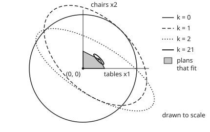
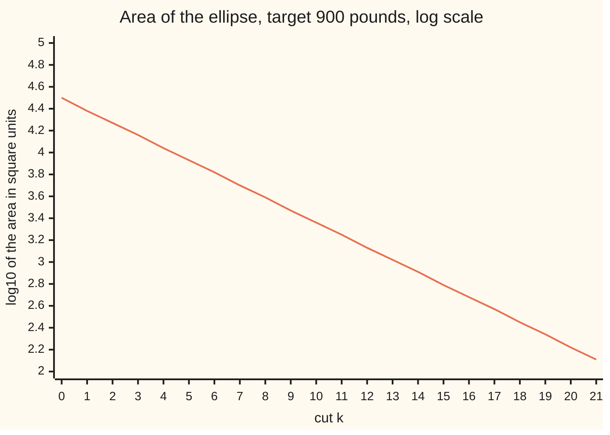

# The ellipsoid method: trap the answer in shrinking ellipsoids, and linear programming in polynomial time

[Syllabus](../../../SYLLABUS.md) → [Optimization](../README.md) → [Linear Programming](../README.md#s04) → The ellipsoid method

---

## General Overview

A furniture workshop makes tables and chairs. A table earns £19 and a chair £20. A table uses 4 m of timber, 3 hours of labour and 1 litre of finish; a chair uses 2 m, 1 hour and 2 litres. The week's stock is 160 m, 120 hours and 64 litres. The workshop **maximises** profit, and [The simplex method](03-simplex-method.md) finds the best plan: 32 tables and 16 chairs for £928.

The ellipsoid method asks a yes-or-no question instead: **is there a plan that earns at least £900?** It starts from a disc of radius 100 around "make nothing", which holds every plan: none has more than 40 tables or 32 chairs. Then it repeats one move:

1. Test the disc's centre against every limit, each loosened slightly, by 0.05.
2. If the centre keeps every loosened limit, stop: the answer is yes.
3. If it breaks a limit, draw a line parallel to that limit through the centre. Every good plan lies on one side. Throw the other half away.
4. Wrap the kept half in the smallest ellipse that holds it, and go to step 1.

In more dimensions the disc is a ball and each ellipse an **ellipsoid**: a stretched and turned ball, which gives the method its name.

Each wrap has exactly 0.7698 times the area of the one before. For £900, the centre after 21 cuts is 29.3879 tables and 17.2231 chairs, earning £902.8308 within the real stock: yes. For £929, after 86 cuts the area is smaller than the loosened set of good plans would be if any plan qualified: no. Twelve questions, halving the range of targets each time, find the best whole-pound profit, £928.

That counted number of cuts is why the method matters. In 1979 Leonid Khachiyan used it to give the first proof that every linear program (LP) can be solved in **polynomial time**: in a number of steps bounded by a power of the size of its data. In practice it is slow, and [Interior point for linear programs](08-interior-point-for-lp-and-complexity.md) took over.

**The ellipsoid method keeps an ellipsoid that must contain every answer, cuts it through its centre along a limit the centre breaks, and wraps the kept half in a new ellipsoid whose volume is smaller by a fixed factor, so after a counted number of cuts it either finds an answer or proves there is none.**

**What kind of fact this is:** a method with theorems inside it. The wrap's containment and volume factor are proved in Why it works. The general bit-size bound is stated with its source, and checked on the workshop's numbers.

### The picture: the trap closing on the workshop

<p align="center"></p>

The shaded shape is every plan that fits the stock. The trap must hold only the plans earning £900 or more: a sliver of area 3.1111 at the corner (32, 16), too small to see, inside every ellipse. The rest of the shaded shape may be cut away. The solid circle is the start, $`k = 0`$. The dashed ellipse after one cut pokes outside the disc: a new ellipse need not sit inside the old one, it only has less area. The small ellipse is $`k = 21`$, centred on the plan that earns £902.8308.

---

## The formula

Notation first, in words. As on [Linear programs](01-linear-programs-and-polyhedra.md), the limits are $`Ax \le b`$ and the profit is $`c^\mathsf{T} x`$. The plan is $`x = (x_1, x_2)`$, tables and chairs, so $`n = 2`$ variables.

An **ellipsoid** is a stretched and turned ball. Written with a centre $`x_k`$ and a **shape matrix** $`P_k`$, it is

```math
E_k = \{\, x : (x - x_k)^\mathsf{T} P_k^{-1} (x - x_k) \le 1 \,\}.
```

$`P_k`$ is symmetric and positive definite, $`P_k \succ 0`$: $`v^\mathsf{T} P_k v > 0`$ for every $`v \ne 0`$ ([Quadratic forms](../../03-Algebra/07-Eigenvalues%20and%20Symmetric%20Matrices/05-quadratic-forms-and-positive-definite.md)). The start is $`x_0 = (0, 0)`$, $`P_0 = 100^2 I`$. In two dimensions an ellipsoid is an ellipse, and volume is area.

A **separation oracle** takes a point $`x_k`$ and either says "in the set" or returns a row $`a`$ with $`a^\mathsf{T} x < a^\mathsf{T} x_k`$ for every $`x`$ in the set. For an LP it returns the first broken limit. The **central cut** keeps the half $`a^\mathsf{T} x \le a^\mathsf{T} x_k`$ and wraps it:

```math
d_k = \frac{P_k a}{\sqrt{a^\mathsf{T} P_k a}}, \qquad x_{k+1} = x_k - \frac{1}{n+1}\, d_k, \qquad P_{k+1} = \frac{n^2}{n^2 - 1}\Big(P_k - \frac{2}{n+1}\, d_k d_k^\mathsf{T}\Big).
```

The volume falls by the same factor at every cut:

```math
\frac{\mathrm{vol}\, E_{k+1}}{\mathrm{vol}\, E_k} = \rho_n = \frac{n}{n+1}\Big(\frac{n^2}{n^2-1}\Big)^{(n-1)/2} < e^{-1/(2(n+1))}, \qquad \rho_2 = \tfrac{2}{3}\sqrt{\tfrac{4}{3}} = 0.7698 < e^{-1/6} = 0.8465.
```

**Read it aloud:** move the centre $`1/(n+1)`$ of the way to the ellipse's edge, a third in two dimensions, towards the side where the broken limit holds; squeeze the shape along that direction and stretch it a little across; the area is then multiplied by a fixed factor below one, 0.7698 in two dimensions.

| Symbol | Plain meaning | In our example | Push it up and the answer… |
| --- | --- | --- | --- |
| $`x = (x_1, x_2)`$ | a plan: tables, chairs | found (29.3879, 17.2231) | — |
| $`A`$, $`b`$, $`c`$ | use per unit; stock; profit per unit | rows (4, 2), (3, 1), (1, 2); (160, 120, 64); (19, 20) £ | — |
| $`T`$ | profit target, £ | 900; bisection finds 928 | fewer plans qualify |
| $`\varepsilon`$ | slack added to every limit | 0.05 | floor rises; past 1/11, false plans |
| $`x_k`$, $`P_k`$, $`F_k`$, $`E_k`$ | centre; shape matrix; its factor, $`P_k = F_k F_k^\mathsf{T}`$; ellipsoid after $`k`$ cuts | (0, 0) and 10000 $`I`$ at $`k`$ = 0 ($`I`$: identity matrix) | — |
| $`a`$, $`\beta`$ | the broken limit $`a^\mathsf{T} x \le \beta`$: the cut | (−19, −20), −900 at $`k`$ = 0 | — |
| $`d_k`$ | from the centre to the ellipsoid's edge, along $`P_k a`$; the centre moves by $`-d_k/(n+1)`$ | (−68.8749, −72.4999) at $`k`$ = 0 | — |
| $`n`$ | number of variables | 2 | $`\rho_n`$ nears 1 |
| $`\rho_n`$ | volume factor per cut | 0.7698 | more cuts needed |
| $`V_0`$, $`V_{\min}`$ | start area; floor for a non-empty loosened set | 31415.9265; 6.5746 millionths | budget $`K`$ grows like $`\ln(V_0 / V_{\min})`$ |
| $`k`$, $`K`$ | cut counter from $`k = 0`$; the cut budget | 21 to "yes" at £900; $`K`$ = 86 | — |
| $`y`$, $`L`$ | resource prices ([LP duality](04-lp-duality-and-complementary-slackness.md)); bits to write the data | (3, 0, 7) £ per m, h, l | floor falls like $`2^{-\text{poly}(n, L)}`$ |

### When it holds

- **A separation oracle.** The method needs only a broken limit at each centre. Without one there is no cut.
- **A start that holds every answer.** From a disc of radius 20, the £900 question gets "no" after 73 cuts: every such plan lies outside it.
- **A volume floor for a non-empty set.** At £928 the good plans are one point, of area zero. Drop the slack, keep the 86-cut budget, and bisection reports £927.
- **Slack too small to add false plans.** The prices (3, 0, 7) show any slack below 1/11 keeps £929 empty. With 0.5 the method reports £933.
- **A shape matrix that stays exactly symmetric.** The proofs assume exact numbers. In floating point, if $`P_k`$'s two off-diagonal entries are worked out separately, they round apart, and at cut 71 of the £929 question $`a^\mathsf{T} P_k a`$ = −0.000164: no longer positive definite. With the entry worked out once, the same update runs all 86 cuts.

---

## Why it works

### Step 0: a convex set lies on one side of every broken limit

The idea in words. Limits $`Ax \le b`$ cut out a convex set, a shape with no dents. If the centre breaks a limit, the whole set lies on the side of the parallel line through the centre where the limit holds, so the other half of the ellipsoid can go.

The kept half fits in a new ellipsoid with a fixed fraction less volume, whatever the old shape. The set always stays inside the ellipsoid. So if a non-empty set must have some minimum volume, a counted number of cuts either lands a centre in it or proves it empty.

### Step 1: the cut is a separating line

A limit $`a^\mathsf{T} x \le \beta`$ broken at the centre means $`a^\mathsf{T} x_k > \beta`$. Every good plan has $`a^\mathsf{T} x \le \beta < a^\mathsf{T} x_k`$. So the line $`a^\mathsf{T} x = a^\mathsf{T} x_k`$ through the centre separates the centre from the good set. [Separating hyperplanes](../01-Convexity/06-separating-hyperplanes.md) proves such a line exists for any point outside any closed convex set, so the method works for any convex set where some routine can find the line.

The target is a limit like the others: $`c^\mathsf{T} x \ge T`$ is the row $`-c^\mathsf{T} x \le -T`$, so the first cut, at (0, 0), uses $`a = (-19, -20)`$.

### Step 2: every ellipsoid is a ball seen through a linear map

Write $`P_k = F_k F_k^\mathsf{T}`$. Then $`E_k`$ is the set of points $`x_k + F_k u`$ with $`\lVert u\rVert \le 1`$: the unit ball, stretched by $`F_k`$ and moved to $`x_k`$. A linear map multiplies every volume by the same number, $`\lvert\det F_k\rvert`$, so volume ratios survive it. It is enough to cut the unit ball through its centre.

Turn the ball so the cut keeps $`u_1 \le 0`$. The wrap has centre $`(-\tfrac{1}{n+1}, 0, \dots, 0)`$, half-axis $`\tfrac{n}{n+1}`$ along $`u_1`$ and $`\tfrac{n}{\sqrt{n^2-1}}`$ across. Mapped back through $`F_k`$, this is the update in The formula: $`d_k = F_k u`$, where $`u`$ is now the point of the ball's edge in the direction of $`F_k^\mathsf{T} a`$.

### Step 3: the half-ball fits, and the volume factor

The fold proves the half-ball lies inside the wrap. The wrap's volume, relative to the ball, is the product of its half-axes:

```math
\rho_n = \frac{n}{n+1} \cdot \Big(\frac{n}{\sqrt{n^2-1}}\Big)^{n-1}.
```

For $`n = 2`$ that is $`\tfrac23 \cdot \tfrac{2}{\sqrt 3}`$ = 0.7698. The code measures 0.769800 at all 21 cuts of the £900 run.

<details>
<summary>Detailed proof: the half-ball lies inside the new ellipsoid</summary>

Take $`u`$ with $`\lVert u\rVert \le 1`$ and $`-1 \le u_1 \le 0`$. The new ellipsoid's test, with $`r^2 = \lVert u\rVert^2 - u_1^2`$ the squared distance from the $`u_1`$ axis, is

$`\displaystyle \Big(\frac{n+1}{n}\Big)^2 \Big(u_1 + \frac{1}{n+1}\Big)^2 + \frac{n^2-1}{n^2}\, r^2 \le 1.`$

Multiply out the first term:

$`\displaystyle \frac{(n+1)^2}{n^2} u_1^2 + \frac{2(n+1)}{n^2} u_1 + \frac{1}{n^2}.`$

Put $`r^2 = \lVert u\rVert^2 - u_1^2`$ into the second term. The $`u_1^2`$ terms combine, since $`(n+1)^2 - (n^2 - 1) = 2(n+1)`$. The left side becomes

$`\displaystyle \frac{2(n+1)}{n^2}\, u_1 (u_1 + 1) + \frac{1}{n^2} + \frac{n^2-1}{n^2} \lVert u\rVert^2.`$

The first term is at most zero, because $`u_1 \le 0`$ and $`u_1 + 1 \ge 0`$. The last is at most $`\tfrac{n^2-1}{n^2}`$, because $`\lVert u\rVert \le 1`$. So the sum is at most $`\tfrac{1}{n^2} + \tfrac{n^2-1}{n^2} = 1`$. Every point of the half-ball passes the test.

The new shape matrix is positive definite: it is $`F_k`$ times the shape matrix of the unit ball's wrap, which has positive half-axes and so is positive definite, times $`F_k^\mathsf{T}`$. On the workshop, all three corners of the loosened £900 region stay inside all 22 ellipses, the worst scoring 0.2673 against the limit 1.

</details>

### Step 4: the factor is below one in every dimension

Use $`1 + t \le e^t`$ twice. First, $`\tfrac{n}{n+1} = 1 - \tfrac{1}{n+1} \le e^{-1/(n+1)}`$. Second, $`\tfrac{n^2}{n^2-1} = 1 + \tfrac{1}{n^2-1} \le e^{1/(n^2-1)}`$; raised to the power $`(n-1)/2`$ this is $`e^{1/(2(n+1))}`$. Multiply:

```math
\rho_n \le e^{-1/(n+1) + 1/(2(n+1))} = e^{-1/(2(n+1))}.
```

So every $`2(n+1)`$ cuts divide the volume by at least $`e`$. The bound is close for large $`n`$, loose for small:

| $`n`$ | exact $`\rho_n`$ | bound $`e^{-1/(2(n+1))}`$ |
| ---: | ---: | ---: |
| 2 | 0.7698 | 0.8465 |
| 3 | 0.8438 | 0.8825 |
| 10 | 0.9511 | 0.9556 |
| 100 | 0.9950 | 0.9951 |

### Step 5: a floor on the volume, from the size of the data

Cuts alone prove only "no plan set with more than this volume". So every limit, the target included, gets a slack $`\varepsilon`$ = 0.05: $`Ax \le b + \varepsilon`$ and $`c^\mathsf{T} x \ge T - \varepsilon`$. Two facts make the loosened question as good as the real one.

- **A real plan leaves room.** Moving a plan by at most $`\delta`$ per coordinate changes a limit's left side by at most $`\delta`$ times the sum of its row's entries with signs dropped, at most 19 + 20 = 39. So a square of half-width $`\varepsilon / 39`$ around a real plan keeps every loosened limit. Its area, $`(2\varepsilon/39)^2`$ = 6.5746 millionths, is the floor $`V_{\min}`$.
- **No real plan means no loosened plan.** Add the timber limit 3 times and the finish limit 7 times, the prices (3, 0, 7). Every loosened plan then has $`19 x_1 + 20 x_2 \le 928 + 10\varepsilon`$ = 928.5, while £929 needs $`929 - \varepsilon`$ = 928.95. So the loosened £929 set is empty, as it is whenever $`11\varepsilon < 1`$.

The first fact makes every "no" right, the second every "yes" at a whole-pound target. A "yes" centre keeps only the loosened limits, though. The £928 centre (31.9654, 16.0349) uses 64.0352 litres of finish, more than the 64 in stock; Step 7 recovers the exact best corner.

For a general LP with whole-number data of bit length $`L`$, both facts hold with $`\varepsilon`$ and $`V_{\min}`$ of size $`2^{-\text{poly}(n, L)}`$: 2 to the minus some fixed power of $`n`$ and $`L`$. The reason is [Cramer's rule](../../03-Algebra/05-Solving%20Systems/06-cramers-rule-and-the-adjugate.md): every corner and price is a ratio of determinants of the data, with denominator at most $`2^L`$. This is **stated, not proved here**; Khachiyan's paper and the survey by Bland, Goldfarb and Todd prove it.

### Step 6: counting the cuts

After $`k`$ cuts the volume is exactly $`V_0 \rho_n^{\,k}`$. It falls below the floor once

```math
k \ge K = \Big\lceil \frac{\ln(V_0 / V_{\min})}{\ln(1/\rho_n)} \Big\rceil.
```

For the workshop $`V_0 = \pi \times 100^2`$ = 31415.9265 gives $`K`$ = 86, and every "no" stops at exactly 86. The bound $`e^{-1/6}`$ alone would promise 134.

In general $`\ln(V_0/V_{\min})`$ is polynomial in $`n`$ and $`L`$, and the factor $`2(n+1)`$ multiplies it by about $`n`$. Khachiyan's count is of order $`n^2 L`$ cuts. Each cut costs the oracle's pass over the limits plus an update of order $`n^2`$ arithmetic operations: polynomial. Precision is part of the theorem: Khachiyan rounds each centre and shape to a fixed number of bits and enlarges each ellipsoid slightly to absorb the rounding.

### Step 7: from yes-or-no to the best plan

To maximise, bisect on the target between £0, which "make nothing" reaches, and £2759, which no point of the start disc reaches. Ask about the middle whole-pound target, keep the half that holds the answer, repeat. Twelve questions bracket the best profit between £928 and £929.

To pin the exact value in general, bisect further. Corner profits are fractions with denominators bounded through $`L`$, so different ones differ by a known minimum; once the bracket is narrower, one fits. Here the corner list shows the best corner earns exactly £928, and the prices (3, 0, 7) prove the ceiling.

### Step 8: other ways to trap the answer

- **Cut through the centre of gravity.** Grünbaum proved in 1960 that any cut through a convex set's centre of gravity leaves at least $`1/e`$ of its volume on each side. So each cut keeps at most $`1 - 1/e`$ = 0.6321, in any dimension. But finding the centre of gravity of a polytope is itself hard; the ellipsoid trades a worse factor for an easy centre.
- **Kelley's cutting-plane method.** To minimise a convex function, Kelley (1960) keeps every subgradient line found so far ([Subgradients](../01-Convexity/07-subgradients.md)) and minimises their maximum, an LP, to choose the next point. It uses all past cuts, but has no volume factor and no step count of the ellipsoid's kind.

---

## Worked numbers, by hand

Cut $`k = 0`$ for the target £900, from the disc of radius 100 around (0, 0).

| Step | Arithmetic | Value |
| --- | --- | --- |
| test the centre | profit at (0, 0) is 0, below $`900 - 0.05`$; every resource limit holds | profit limit broken |
| the cut's row | $`-19 x_1 - 20 x_2 \le -900`$ | $`a`$ = (−19, −20) |
| $`a^\mathsf{T} P_0 a`$ | $`10000 \times (19^2 + 20^2)`$ | 7610000; root 2758.6228 |
| $`d_0 = P_0 a / \sqrt{a^\mathsf{T} P_0 a}`$ | $`10000 \times (-19, -20) / 2758.6228`$ | (−68.8749, −72.4999) |
| new centre $`x_1 = x_0 - d_0/3`$ | $`(68.8749, 72.4999) / 3`$ | (22.9583, 24.1666) |
| $`P_1`$, top left | $`\tfrac43 \big(10000 - \tfrac23 \times 68.8749^2\big)`$ | 9116.6594 |
| $`P_1`$, off the diagonal | $`\tfrac43 \big(0 - \tfrac23 \times 68.8749 \times 72.4999\big)`$ | −4438.6042 |
| $`P_1`$, bottom right | $`\tfrac43 \big(10000 - \tfrac23 \times 72.4999^2\big)`$ | 8661.1184 |
| area ratio | $`\sqrt{\det P_1} / \sqrt{\det P_0}`$ | 0.769800 |
| **new area** | $`31415.9265 \times 0.7698`$ | **24183.9915** |

The first cut keeps the higher-profit half-disc in an ellipse with 0.7698 of the disc's area. Twenty more cuts reach a centre inside every loosened limit: 29.3879 tables and 17.2231 chairs, earning £902.8308.

### What breaks if you drop a piece

| Mistake | Comes out at | What went wrong |
| --- | --- | --- |
| Keep the wrong half at each cut | after one cut, the corner (32, 16) scores 1.0203, outside; target £900: "no" after 86 cuts | The good plans were thrown away. The ellipse shrank around nothing, and the floor turned that into a false "no". |
| No slack ($`\varepsilon`$ = 0), same 86-cut budget | bisection says £927 | At £928 the good set is the single point (32, 16), of area zero. Without the slack there is no floor, so the budget runs out first. |
| Slack 0.5, above 1/11 | bisection says £933 | $`928 + 10 \times 0.5`$ reaches past £929: the loosened limits admit plans the stock cannot make. |
| Start disc of radius 20 | target £900: "no" after 73 cuts | Every plan earning £900 lies outside that disc. The method only searches inside its first ellipsoid. |

---

## How the trap closes, step by step

The puzzle: the centre wanders outside the plans, to (−3.7327, 23.0856) and (46.6102, 22.8083), yet the method closes in steadily. The table follows the £900 question; "cut by" names the first broken limit.

| $`k`$ | tables $`x_1`$ | chairs $`x_2`$ | area | cut by |
| ---: | ---: | ---: | ---: | --- |
| 0 | 0.0000 | 0.0000 | 31415.9265 | profit |
| 1 | 22.9583 | 24.1666 | 24183.9915 | finish |
| 2 | 22.4634 | -2.4635 | 18616.8454 | chairs ≥ 0 |
| 3 | -3.7327 | 23.0856 | 14331.2542 | tables ≥ 0 |
| 4 | 30.7716 | 14.4646 | 11032.2047 | profit |
| 5 | 46.6102 | 22.8083 | 8492.5951 | timber |
| 6 | 26.5594 | 29.4298 | 6537.6028 | timber |
| 7 | 13.1922 | 33.8442 | 5032.6489 | finish |
| 8 | 24.3631 | 10.2522 | 3874.1350 | profit |
| 9 | 23.7853 | 20.8639 | 2982.3105 | finish |
| 10 | 35.3248 | 5.2239 | 2295.7837 | profit |
| 11 | 42.3173 | 4.9495 | 1767.2951 | timber |
| 12 | 27.2721 | 17.0815 | 1360.4644 | profit |
| 13 | 26.7092 | 22.0754 | 1047.2860 | finish |
| 14 | 37.7627 | 10.1215 | 806.2011 | timber |
| 15 | 28.1192 | 17.3480 | 620.6139 | profit |
| 16 | 28.2678 | 20.3501 | 477.7488 | finish |
| 17 | 35.2386 | 12.6967 | 367.7712 | timber |
| 18 | 28.8371 | 17.3219 | 283.1104 | profit |
| 19 | 29.1158 | 19.2162 | 217.9385 | finish |
| 20 | 33.6919 | 14.1631 | 167.7691 | timber |
| 21 | 29.3879 | 17.2231 | 129.1487 | fits: a plan |

The centre is not a path to the answer, only the middle of the current trap, so it bounces from side to side. The area falls steadily, by 0.7698 every row. Near the end the cuts cycle through profit, finish and timber, the limits that meet near the best corner.



The line is the base-10 logarithm of the area. It is straight because the factor never changes.

The bisection on the target, with the number of cuts each question took:

| test | target £ | answer | cuts | test | target £ | answer | cuts |
| ---: | ---: | --- | ---: | ---: | ---: | --- | ---: |
| 1 | 1379 | no | 86 | 7 | 925 | yes | 29 |
| 2 | 689 | yes | 4 | 8 | 936 | no | 86 |
| 3 | 1034 | no | 86 | 9 | 930 | no | 86 |
| 4 | 861 | yes | 4 | 10 | 927 | yes | 45 |
| 5 | 947 | no | 86 | 11 | 928 | yes | 48 |
| 6 | 904 | yes | 24 | 12 | 929 | no | 86 |

Every "no" used the whole 86-cut budget. A "yes" far below the best profit is fast, 4 cuts at £689; near it the loosened set is tiny, and £928 took 48. The twelve questions took 670 cuts.

---

## Code, from first principles, and it actually runs

The code writes out every step: the oracle's pass over the limits, the centre and shape updates, the area. It keeps the shape as a factor $`F_k`$ (`L` in the code), $`P_k = F_k F_k^\mathsf{T}`$, a form no rounding can make indefinite. It also runs the $`P_k`$ form of The formula, on the first cut and on the £929 question. With the off-diagonal entry worked out once, that run takes all 86 cuts and ends on the factor run's centre, (32.0003, 16.0245); worked out twice, it breaks at cut 71.

Three independent roads reach the answer. Road 1 is the ellipsoid method with bisection. Road 2 lists every corner of the region, and of the £900 region, in exact fractions. Road 3 checks the prices (3, 0, 7): they cover each product's profit, value the stock at £928 and prove the £929 question empty. It also checks the volume factor and containment at every cut, and prints the breaks.

### Python

```python
# The ellipsoid method -- the check behind the card.  Standard library only.
# Question: is there a workshop plan earning at least T pounds?  Each limit is relaxed
# by EPS so a plan, if one exists, leaves room of area at least (2 EPS/39)^2.
# Roads to the answer: central-cut ellipsoid steps plus bisection on T; every corner
# of the region listed in exact fractions; the prices y = (3, 0, 7) as a dual bound.
import math
from fractions import Fraction as F

G = [[4, 2], [3, 1], [1, 2], [-1, 0], [0, -1], [-19, -20]]   # rows a_i: a_i x <= h_i
H = [160, 120, 64, 0, 0]                                       # the sixth limit is -T
NAMES = ["timber", "labour", "finish", "tables>=0", "chairs>=0", "profit"]
EPS = 0.05
RATIO = (2 / 3) * math.sqrt(4 / 3)          # area factor per central cut, n = 2
S, BETA = math.sqrt(4 / 3), 1 - math.sqrt(1 / 3)

def step_L(c, L, a):     # one central cut, with P = L L^T kept as its factor L
    w = [L[0][0] * a[0] + L[1][0] * a[1], L[0][1] * a[0] + L[1][1] * a[1]]
    q = math.sqrt(w[0] * w[0] + w[1] * w[1]); u = [w[0] / q, w[1] / q]          # q = sqrt(a^T P a)
    b = [L[0][0] * u[0] + L[0][1] * u[1], L[1][0] * u[0] + L[1][1] * u[1]]  # b = P a / q
    c = [c[0] - b[0] / 3, c[1] - b[1] / 3]
    return c, [[S * (L[i][j] - BETA * b[i] * u[j]) for j in range(2)] for i in range(2)]

def step_P(c, P, a, sym=False):     # the same cut written on P itself, as in The formula
    Pa = [P[0][0] * a[0] + P[0][1] * a[1], P[1][0] * a[0] + P[1][1] * a[1]]
    q2 = a[0] * Pa[0] + a[1] * Pa[1]
    if q2 <= 0: return None, None, q2, None
    b = [Pa[0] / math.sqrt(q2), Pa[1] / math.sqrt(q2)]
    e = lambda i, j: 4 / 3 * (P[i][j] - 2 / 3 * b[i] * b[j])    # sym: the off-diagonal is worked out once
    return [c[0] - b[0] / 3, c[1] - b[1] / 3], [[e(min(i, j), max(i, j)) if sym else e(i, j) for j in range(2)] for i in range(2)], q2, b

def PofL(L): return [[sum(L[i][k] * L[j][k] for k in range(2)) for j in range(2)] for i in range(2)]

def decide(T, eps=EPS, rad=100.0, vmin=None, hist=None, side=1):
    h = H + [-T]; c = [0.0, 0.0]; L = [[rad, 0.0], [0.0, rad]]
    vmin = (2 * eps / 39) ** 2 if vmin is None else vmin
    k = 0
    while True:
        area = math.pi * abs(L[0][0] * L[1][1] - L[0][1] * L[1][0])
        cut = next((i for i in range(6) if G[i][0] * c[0] + G[i][1] * c[1] > h[i] + eps), None)
        if hist is not None: hist.append((k, c, L, area, cut))
        if cut is None: return True, k, c
        if area < vmin: return False, k, c
        c, L = step_L(c, L, [side * G[cut][0], side * G[cut][1]]); k += 1

def bisect(eps=EPS, vmin=None, log=None):
    lo, hi = 0, 2759             # the disc's best profit is 100 sqrt(761) = 2758.6
    while hi - lo > 1:
        m = (lo + hi) // 2; ok, k, c = decide(m, eps, vmin=vmin)
        if log is not None: log.append((m, ok, k, c))
        lo, hi = (m, hi) if ok else (lo, m)
    return lo

def inside(v, c, P):     # (v - c)^T P^-1 (v - c): at most 1 means inside the ellipse
    d = P[0][0] * P[1][1] - P[0][1] * P[1][0]; x, y = v[0] - c[0], v[1] - c[1]
    return (P[1][1] * x * x - 2 * P[0][1] * x * y + P[0][0] * y * y) / d

def corners(h):          # every crossing of two limit lines that keeps all limits, exact
    out = set()
    for p in range(len(h)):
        for q in range(p + 1, len(h)):
            det = G[p][0] * G[q][1] - G[p][1] * G[q][0]
            if det:
                v = (F(h[p] * G[q][1] - G[p][1] * h[q], det), F(G[p][0] * h[q] - h[p] * G[q][0], det))
                if all(G[i][0] * v[0] + G[i][1] * v[1] <= h[i] for i in range(len(h))): out.add(v)
    m = [sum(float(v[i]) for v in out) / len(out) for i in (0, 1)]
    pts = sorted(out, key=lambda v: math.atan2(float(v[1]) - m[1], float(v[0]) - m[0]))
    return pts, abs(sum(pts[i][0] * pts[i - 1][1] - pts[i - 1][0] * pts[i][1] for i in range(len(pts)))) / 2

def f4(v): return f"{v:.4f}"
def real(T, c): return all(G[i][0] * c[0] + G[i][1] * c[1] <= (H + [-T])[i] for i in range(6)), c[0] + 2 * c[1]  # unloosened limits kept? finish used
print("maximise 19 x1 + 20 x2 pounds: timber 4,2 <= 160 m; labour 3,1 <= 120 h; finish 1,2 <= 64 l; limits relaxed by 0.05")
c1, P1, q2, b = step_P([0.0, 0.0], [[1e4, 0.0], [0.0, 1e4]], G[5])
print(f"step 0, T = 900: a = (-19, -20), a^T P a = {f4(q2)}, root {f4(math.sqrt(q2))}, d = ({f4(b[0])}, {f4(b[1])})")
r0 = math.sqrt(P1[0][0] * P1[1][1] - P1[0][1] * P1[1][0]) / 1e4     # area ratio from det P, no L
print(f"centre 1 = ({f4(c1[0])}, {f4(c1[1])}); P1 rows {f4(P1[0][0])}, {f4(P1[0][1])}; {f4(P1[1][0])}, {f4(P1[1][1])}; area ratio {r0:.6f}")
hist = []; found = decide(900, hist=hist)
print(" k       x1       x2        area  cut by")
for (k, c, L, area, cut) in hist:
    print(f"{k:2d} {c[0]:8.4f} {c[1]:8.4f} {area:11.4f}  {NAMES[cut] if cut is not None else 'fits: a plan'}")
c = hist[-1][1]; r900 = real(900, c)
print(f"plan found: ({f4(c[0])}, {f4(c[1])}) earns {f4(19 * c[0] + 20 * c[1])}; real limits kept: {'yes' if r900[0] else 'no'}, finish {f4(r900[1])} l")
print("chart log10 area: " + ", ".join(f"{math.log10(h[3]):.2f}" for h in hist))
ratios = [hist[k + 1][3] / hist[k][3] for k in range(len(hist) - 1)]
Q900, aQ = corners([160 + F(1, 20), 120 + F(1, 20), 64 + F(1, 20), F(1, 20), F(1, 20), -900 + F(1, 20)])
worst = max(inside(v, h[1], PofL(h[2])) for h in hist for v in Q900)
print(f"area ratio each step: min {min(ratios):.6f}, max {max(ratios):.6f}; formula (2/3) sqrt(4/3) = {RATIO:.6f}")
print(f"relaxed region for 900: {len(Q900)} corners, area {f4(float(aQ))}; worst corner score over all 22 ellipses {f4(worst)}")
R0, _ = corners(H); P900, a9 = corners(H + [-900])
print("corners: " + "; ".join(f"({v[0]}, {v[1]}) {19 * v[0] + 20 * v[1]}" for v in sorted(R0)))
print("plans earning >= 900: corners " + ", ".join(f"({v[0]}, {v[1]})" for v in P900) + f"; area {f4(float(a9))}")
yc = [3, 0, 7]; ceil = sum(H[i] * yc[i] for i in range(3)); slack = ceil + EPS * sum(yc)
cover = [sum(G[i][j] * yc[i] for i in range(3)) for j in range(2)]
print(f"certificate y = (3, 0, 7): tables {cover[0]}, chairs {cover[1]}; bound {ceil}; relaxed: profit <= {f4(slack)} < 929 - 0.05")
log = []; best = bisect(log=log)
for i in (0, 6):
    print("tests: " + ", ".join(f"{m} {'yes' if ok else 'no'} ({k})" for m, ok, k, _ in log[i:i + 6]))
c928 = [e[3] for e in log if e[0] == 928][0]; r928 = real(928, c928)
print(f"best whole target {best}: loosened point ({f4(c928[0])}, {f4(c928[1])}), real limits kept: {'yes' if r928[0] else 'no'}, finish {f4(r928[1])} l; {len(log)} tests, {sum(e[2] for e in log)} steps")
vmin = (2 * EPS / 39) ** 2; v0 = math.pi * 1e4
K = math.ceil(math.log(v0 / vmin) / -math.log(RATIO)); Kb = math.ceil(math.log(v0 / vmin) / (1 / 6))
print(f"floor area {vmin * 1e6:.4f} millionths; steps to reach it: exact ratio {K}, bound exp(-1/6) {Kb}")
nr = [(n, n / (n + 1) * (n * n / (n * n - 1)) ** ((n - 1) / 2), math.exp(-1 / (2 * (n + 1)))) for n in (2, 3, 10, 100)]
print("volume ratio by n (exact, bound): " + "; ".join(f"{n} {r:.4f} {e:.4f}" for n, r, e in nr) + f"; centre of gravity at most {1 - math.exp(-1):.4f}")
bad = [c1[0] * -1, c1[1] * -1]   # the wrong half's centre: old centre + b/3
rw = decide(900, side=-1)
print(f"break, wrong half kept: corner (32, 16) scores {f4(inside([32, 16], bad, P1))} > 1 after one cut; target 900 says {'yes' if rw[0] else 'no'} after {rw[1]} steps")
b0 = bisect(eps=0.0, vmin=vmin); b5 = bisect(eps=0.5)
print(f"break, no relaxation, same budget: says {b0}; relaxed by 0.5: says {b5}")
r20 = decide(900, rad=20.0)
print(f"break, start disc radius 20: target 900 says {'yes' if r20[0] else 'no'} after {r20[1]} steps")
runs = []                # target 929 on P itself: the off-diagonal worked out twice, then once
for sym in (False, True):
    h, k, c, P = H + [-929], 0, [0.0, 0.0], [[1e4, 0.0], [0.0, 1e4]]
    while k < K:
        r = step_P(c, P, G[next(i for i in range(6) if G[i][0] * c[0] + G[i][1] * c[1] > h[i] + EPS)], sym)
        if r[2] <= 0: break
        c, P, k = r[0], r[1], k + 1
    runs.append((k, c, P, r[2]))
(k, _, P, q71), (ks, cs, _, _), r929 = runs[0], runs[1], decide(929)
print(f"break, P updated with two off-diagonals worked out apart, target 929: at step {k} a^T P a = {q71:.6f}; off-diagonals {P[0][1]:.6f} against {P[1][0]:.6f}")
print(f"P updated with one off-diagonal, target 929: {ks} steps, centre ({f4(cs[0])}, {f4(cs[1])}); factor L run: ({f4(r929[2][0])}, {f4(r929[2][1])})")
fig = []
for j in (0, 1, 2, 21):
    Pk = PofL(hist[j][2]); p, q, s = Pk[0][0], Pk[0][1], Pk[1][1]
    m = math.sqrt((p - s) * (p - s) / 4 + q * q); th = 0.5 * math.atan2(2 * q, p - s)
    fig.append(f"k{j} ({170 + 1.1 * hist[j][1][0]:.1f},{140 - 1.1 * hist[j][1][1]:.1f}) r {1.1 * math.sqrt((p + s) / 2 + m):.1f} {1.1 * math.sqrt((p + s) / 2 - m):.1f} rot {0.0 - math.degrees(th) + 0.0:.1f}")
reg = " ".join(f"({170 + 1.1 * float(v[0]):.1f},{140 - 1.1 * float(v[1]):.1f})" for v in sorted(R0))
print("figure, px = 170 + 1.1*x1, py = 140 - 1.1*x2: region " + reg + "; " + "; ".join(fig))

top = max(R0, key=lambda v: 19 * v[0] + 20 * v[1])
assert top == (32, 16) and best == 19 * top[0] + 20 * top[1]                          # ellipsoid meets enumeration
assert cover[0] >= 19 and cover[1] >= 20 and ceil == best and slack < best + 1 - EPS   # dual bound meets it
assert all(abs(r - RATIO) < 1e-9 and r < math.exp(-1 / 6) for r in ratios + [r0]) and worst <= 1 + 1e-9  # ratio, bound, containment
assert all(abs(PofL(hist[1][2])[i][j] - P1[i][j]) < 1e-6 for i in range(2) for j in range(2))
assert found[0] and found[1] == 21 and all(e[2] == K for e in log if not e[1]) and r900[0] and not r928[0]
assert inside([32, 16], bad, P1) > 1 and not rw[0] and b0 == 927 and b5 > 928 and not r20[0] and q71 <= 0 and k == 71
assert ks == K and all(abs(cs[i] - r929[2][i]) < 1e-9 for i in (0, 1))                 # P form meets factor form
print("ALL CHECKS PASS")
```

**Ran 2026-11-24 on macOS, Python 3.14.10, standard library only. All checks passed. Output, pasted from the run:**

```
maximise 19 x1 + 20 x2 pounds: timber 4,2 <= 160 m; labour 3,1 <= 120 h; finish 1,2 <= 64 l; limits relaxed by 0.05
step 0, T = 900: a = (-19, -20), a^T P a = 7610000.0000, root 2758.6228, d = (-68.8749, -72.4999)
centre 1 = (22.9583, 24.1666); P1 rows 9116.6594, -4438.6042; -4438.6042, 8661.1184; area ratio 0.769800
 k       x1       x2        area  cut by
 0   0.0000   0.0000  31415.9265  profit
 1  22.9583  24.1666  24183.9915  finish
 2  22.4634  -2.4635  18616.8454  chairs>=0
 3  -3.7327  23.0856  14331.2542  tables>=0
 4  30.7716  14.4646  11032.2047  profit
 5  46.6102  22.8083   8492.5951  timber
 6  26.5594  29.4298   6537.6028  timber
 7  13.1922  33.8442   5032.6489  finish
 8  24.3631  10.2522   3874.1350  profit
 9  23.7853  20.8639   2982.3105  finish
10  35.3248   5.2239   2295.7837  profit
11  42.3173   4.9495   1767.2951  timber
12  27.2721  17.0815   1360.4644  profit
13  26.7092  22.0754   1047.2860  finish
14  37.7627  10.1215    806.2011  timber
15  28.1192  17.3480    620.6139  profit
16  28.2678  20.3501    477.7488  finish
17  35.2386  12.6967    367.7712  timber
18  28.8371  17.3219    283.1104  profit
19  29.1158  19.2162    217.9385  finish
20  33.6919  14.1631    167.7691  timber
21  29.3879  17.2231    129.1487  fits: a plan
plan found: (29.3879, 17.2231) earns 902.8308; real limits kept: yes, finish 63.8340 l
chart log10 area: 4.50, 4.38, 4.27, 4.16, 4.04, 3.93, 3.82, 3.70, 3.59, 3.47, 3.36, 3.25, 3.13, 3.02, 2.91, 2.79, 2.68, 2.57, 2.45, 2.34, 2.22, 2.11
area ratio each step: min 0.769800, max 0.769800; formula (2/3) sqrt(4/3) = 0.769800
relaxed region for 900: 3 corners, area 3.2345; worst corner score over all 22 ellipses 0.2673
corners: (0, 0) 0; (0, 32) 640; (32, 16) 928; (40, 0) 760
plans earning >= 900: corners (100/3, 40/3), (32, 16), (260/9, 158/9); area 3.1111
certificate y = (3, 0, 7): tables 19, chairs 20; bound 928; relaxed: profit <= 928.5000 < 929 - 0.05
tests: 1379 no (86), 689 yes (4), 1034 no (86), 861 yes (4), 947 no (86), 904 yes (24)
tests: 925 yes (29), 936 no (86), 930 no (86), 927 yes (45), 928 yes (48), 929 no (86)
best whole target 928: loosened point (31.9654, 16.0349), real limits kept: no, finish 64.0352 l; 12 tests, 670 steps
floor area 6.5746 millionths; steps to reach it: exact ratio 86, bound exp(-1/6) 134
volume ratio by n (exact, bound): 2 0.7698 0.8465; 3 0.8438 0.8825; 10 0.9511 0.9556; 100 0.9950 0.9951; centre of gravity at most 0.6321
break, wrong half kept: corner (32, 16) scores 1.0203 > 1 after one cut; target 900 says no after 86 steps
break, no relaxation, same budget: says 927; relaxed by 0.5: says 933
break, start disc radius 20: target 900 says no after 73 steps
break, P updated with two off-diagonals worked out apart, target 929: at step 71 a^T P a = -0.000164; off-diagonals 0.000107 against -0.000098
P updated with one off-diagonal, target 929: 86 steps, centre (32.0003, 16.0245); factor L run: (32.0003, 16.0245)
figure, px = 170 + 1.1*x1, py = 140 - 1.1*x2: region (170.0,140.0) (170.0,104.8) (205.2,122.4) (214.0,140.0); k0 (170.0,140.0) r 110.0 110.0 rot 0.0; k1 (195.3,113.4) r 127.0 73.3 rot 43.5; k2 (194.7,142.7) r 138.3 51.8 rot 31.2; k21 (202.3,121.1) r 14.4 3.5 rot 45.8
ALL CHECKS PASS
```

### Rust

Same numbers, same labels, built with `rustc --edition 2021 -O`. Exact fractions are a pair of 64-bit whole numbers reduced by their greatest common divisor.

```rust
// The ellipsoid method -- the check behind the card.  std only, no crates.
// Question: is there a workshop plan earning at least T pounds?  Each limit is relaxed
// by EPS so a plan, if one exists, leaves room of area at least (2 EPS/39)^2.
// Roads to the answer: central-cut ellipsoid steps plus bisection on T; every corner
// of the region listed in exact fractions; the prices y = (3, 0, 7) as a dual bound.
const G: [[f64; 2]; 6] = [[4.0, 2.0], [3.0, 1.0], [1.0, 2.0], [-1.0, 0.0], [0.0, -1.0], [-19.0, -20.0]];
const H: [i64; 5] = [160, 120, 64, 0, 0];
const NAMES: [&str; 6] = ["timber", "labour", "finish", "tables>=0", "chairs>=0", "profit"];
const EPS: f64 = 0.05;
type M2 = [[f64; 2]; 2];
type Q = (i64, i64); // an exact fraction: numerator, denominator > 0

fn gcd(a: i64, b: i64) -> i64 { if b == 0 { a.abs() } else { gcd(b, a % b) } }
fn q(n: i64, d: i64) -> Q { let g = gcd(n, d).max(1) * d.signum(); (n / g, d / g) }
fn qs(a: Q) -> String { if a.1 == 1 { format!("{}", a.0) } else { format!("{}/{}", a.0, a.1) } }
fn qf(a: Q) -> f64 { a.0 as f64 / a.1 as f64 }
fn f4(v: f64) -> String { format!("{:.4}", v) }
fn real(t: f64, c: [f64; 2]) -> (bool, f64) { let h = [160.0, 120.0, 64.0, 0.0, 0.0, -t]; ((0..6).all(|i| G[i][0] * c[0] + G[i][1] * c[1] <= h[i]), c[0] + 2.0 * c[1]) } // unloosened limits kept? finish used

fn step_l(c: [f64; 2], l: M2, a: [f64; 2]) -> ([f64; 2], M2) { // one central cut, P = L L^T kept as L
    let (s, beta) = ((4.0f64 / 3.0).sqrt(), 1.0 - (1.0f64 / 3.0).sqrt()); let w = [l[0][0] * a[0] + l[1][0] * a[1], l[0][1] * a[0] + l[1][1] * a[1]];
    let qq = (w[0] * w[0] + w[1] * w[1]).sqrt(); let u = [w[0] / qq, w[1] / qq];
    let b = [l[0][0] * u[0] + l[0][1] * u[1], l[1][0] * u[0] + l[1][1] * u[1]];
    let n = |i: usize, j: usize| s * (l[i][j] - beta * b[i] * u[j]);
    ([c[0] - b[0] / 3.0, c[1] - b[1] / 3.0], [[n(0, 0), n(0, 1)], [n(1, 0), n(1, 1)]])
}

fn step_p(c: [f64; 2], p: M2, a: [f64; 2], sym: bool) -> ([f64; 2], M2, f64, [f64; 2]) { // the same cut on P itself
    let pa = [p[0][0] * a[0] + p[0][1] * a[1], p[1][0] * a[0] + p[1][1] * a[1]];
    let q2 = a[0] * pa[0] + a[1] * pa[1];
    if q2 <= 0.0 { return (c, p, q2, [0.0; 2]); }
    let b = [pa[0] / q2.sqrt(), pa[1] / q2.sqrt()]; // sym: the off-diagonal is worked out once
    let n = |i: usize, j: usize| { let (i, j) = if sym { (i.min(j), i.max(j)) } else { (i, j) }; 4.0 / 3.0 * (p[i][j] - 2.0 / 3.0 * b[i] * b[j]) };
    ([c[0] - b[0] / 3.0, c[1] - b[1] / 3.0], [[n(0, 0), n(0, 1)], [n(1, 0), n(1, 1)]], q2, b)
}

fn p_of_l(l: &M2) -> M2 { let e = |i: usize, j: usize| l[i][0] * l[j][0] + l[i][1] * l[j][1]; [[e(0, 0), e(0, 1)], [e(1, 0), e(1, 1)]] }

fn first_cut(c: [f64; 2], h: &[f64; 6], eps: f64) -> Option<usize> { (0..6).find(|&i| G[i][0] * c[0] + G[i][1] * c[1] > h[i] + eps) }

type Hist = Vec<(usize, [f64; 2], M2, f64, Option<usize>)>;
fn decide(t: i64, eps: f64, rad: f64, vmin: Option<f64>, hist: &mut Hist, side: f64) -> (bool, usize, [f64; 2]) {
    let (h, mut c, mut l) = ([160.0, 120.0, 64.0, 0.0, 0.0, -(t as f64)], [0.0, 0.0], [[rad, 0.0], [0.0, rad]]);
    let (vmin, mut k) = (vmin.unwrap_or((2.0 * eps / 39.0).powi(2)), 0);
    loop {
        let area = std::f64::consts::PI * (l[0][0] * l[1][1] - l[0][1] * l[1][0]).abs();
        let cut = first_cut(c, &h, eps); hist.push((k, c, l, area, cut));
        let Some(i) = cut else { return (true, k, c) };
        if area < vmin { return (false, k, c); }
        (c, l) = step_l(c, l, [side * G[i][0], side * G[i][1]]); k += 1;
    }
}

fn bisect(eps: f64, vmin: Option<f64>, log: &mut Vec<(i64, bool, usize, [f64; 2])>) -> i64 {
    let (mut lo, mut hi) = (0i64, 2759i64); // the disc's best profit is 100 sqrt(761) = 2758.6
    while hi - lo > 1 {
        let m = (lo + hi) / 2; let (ok, k, c) = decide(m, eps, 100.0, vmin, &mut Vec::new(), 1.0);
        log.push((m, ok, k, c)); if ok { lo = m } else { hi = m }
    }
    lo
}

fn inside(v: [f64; 2], c: [f64; 2], p: &M2) -> f64 { // at most 1 means inside the ellipse
    let (d, x, y) = (p[0][0] * p[1][1] - p[0][1] * p[1][0], v[0] - c[0], v[1] - c[1]);
    (p[1][1] * x * x - 2.0 * p[0][1] * x * y + p[0][0] * y * y) / d
}

fn corners(h: &[Q]) -> (Vec<(Q, Q)>, f64) { // every crossing of two limit lines that keeps all limits
    let g: Vec<[i64; 2]> = G.iter().map(|r| [r[0] as i64, r[1] as i64]).collect();
    let mut out: Vec<(Q, Q)> = Vec::new();
    for p in 0..h.len() { for r in p + 1..h.len() {
        let det = g[p][0] * g[r][1] - g[p][1] * g[r][0];
        if det == 0 { continue; }
        let d = h[p].1 * h[r].1 * det; // common denominator
        let v = (q(h[p].0 * h[r].1 * g[r][1] - g[p][1] * h[r].0 * h[p].1, d), q(g[p][0] * h[r].0 * h[p].1 - h[p].0 * h[r].1 * g[r][0], d));
        let ok = (0..h.len()).all(|i| { let lhs = q(g[i][0] * v.0 .0 * v.1 .1 + g[i][1] * v.1 .0 * v.0 .1, v.0 .1 * v.1 .1); lhs.0 * h[i].1 <= h[i].0 * lhs.1 });
        if ok && !out.contains(&v) { out.push(v); }
    } }
    let m = [out.iter().map(|v| qf(v.0)).sum::<f64>() / out.len() as f64, out.iter().map(|v| qf(v.1)).sum::<f64>() / out.len() as f64];
    out.sort_by(|a, b| (qf(a.1) - m[1]).atan2(qf(a.0) - m[0]).partial_cmp(&(qf(b.1) - m[1]).atan2(qf(b.0) - m[0])).unwrap());
    let (n, mut s) = (out.len(), q(0, 1));
    for i in 0..n {
        let (a, b) = (out[i], out[(i + n - 1) % n]);
        let (t1, t2) = (q(a.0 .0 * b.1 .0, a.0 .1 * b.1 .1), q(b.0 .0 * a.1 .0, b.0 .1 * a.1 .1));
        s = q(s.0 * t1.1 * t2.1 + t1.0 * s.1 * t2.1 - t2.0 * s.1 * t1.1, s.1 * t1.1 * t2.1);
    }
    (out, (qf(s) / 2.0).abs())
}

fn main() {
    let ratio = (2.0f64 / 3.0) * (4.0f64 / 3.0).sqrt(); // area factor per central cut, n = 2
    let yn = |b: bool| if b { "yes" } else { "no" };
    println!("maximise 19 x1 + 20 x2 pounds: timber 4,2 <= 160 m; labour 3,1 <= 120 h; finish 1,2 <= 64 l; limits relaxed by 0.05");
    let (c1, p1, q2, b) = step_p([0.0, 0.0], [[1e4, 0.0], [0.0, 1e4]], G[5], false);
    println!("step 0, T = 900: a = (-19, -20), a^T P a = {}, root {}, d = ({}, {})", f4(q2), f4(q2.sqrt()), f4(b[0]), f4(b[1]));
    let r0 = (p1[0][0] * p1[1][1] - p1[0][1] * p1[1][0]).sqrt() / 1e4; // area ratio from det P, no L
    println!("centre 1 = ({}, {}); P1 rows {}, {}; {}, {}; area ratio {:.6}", f4(c1[0]), f4(c1[1]), f4(p1[0][0]), f4(p1[0][1]), f4(p1[1][0]), f4(p1[1][1]), r0);
    let mut hist: Hist = Vec::new(); let found = decide(900, EPS, 100.0, None, &mut hist, 1.0);
    println!(" k       x1       x2        area  cut by");
    for (k, c, _, area, cut) in &hist {
        println!("{:2} {:8.4} {:8.4} {:11.4}  {}", k, c[0], c[1], area, match cut { Some(i) => NAMES[*i], None => "fits: a plan" });
    }
    let c = hist[hist.len() - 1].1; let r900 = real(900.0, c);
    println!("plan found: ({}, {}) earns {}; real limits kept: {}, finish {} l", f4(c[0]), f4(c[1]), f4(19.0 * c[0] + 20.0 * c[1]), yn(r900.0), f4(r900.1));
    println!("chart log10 area: {}", hist.iter().map(|h| format!("{:.2}", h.3.log10())).collect::<Vec<_>>().join(", "));
    let ratios: Vec<f64> = (0..hist.len() - 1).map(|k| hist[k + 1].3 / hist[k].3).collect();
    let e = q(1, 20);
    let (q900, a_q) = corners(&[q(3201, 20), q(2401, 20), q(1281, 20), e, e, q(-17999, 20)]);
    let mut worst: f64 = 0.0; for h in &hist { for v in &q900 { worst = worst.max(inside([qf(v.0), qf(v.1)], h.1, &p_of_l(&h.2))); } }
    println!("area ratio each step: min {:.6}, max {:.6}; formula (2/3) sqrt(4/3) = {:.6}", ratios.iter().cloned().fold(f64::INFINITY, f64::min), ratios.iter().cloned().fold(0.0, f64::max), ratio);
    println!("relaxed region for 900: {} corners, area {}; worst corner score over all 22 ellipses {}", q900.len(), f4(a_q), f4(worst));
    let hq: Vec<Q> = H.iter().map(|&x| q(x, 1)).collect(); let (mut r0s, _) = corners(&hq);
    r0s.sort_by(|a, b| (a.0 .0 * b.0 .1).cmp(&(b.0 .0 * a.0 .1)).then((a.1 .0 * b.1 .1).cmp(&(b.1 .0 * a.1 .1))));
    let prof = |v: &(Q, Q)| q(19 * v.0 .0 * v.1 .1 + 20 * v.1 .0 * v.0 .1, v.0 .1 * v.1 .1);
    println!("corners: {}", r0s.iter().map(|v| format!("({}, {}) {}", qs(v.0), qs(v.1), qs(prof(v)))).collect::<Vec<_>>().join("; "));
    let mut h9 = hq.clone(); h9.push(q(-900, 1)); let (p900, a9) = corners(&h9);
    println!("plans earning >= 900: corners {}; area {}", p900.iter().map(|v| format!("({}, {})", qs(v.0), qs(v.1))).collect::<Vec<_>>().join(", "), f4(a9));
    let yc = [3i64, 0, 7];
    let ceil: i64 = (0..3).map(|i| H[i] * yc[i]).sum();
    let slack = ceil as f64 + EPS * (yc.iter().sum::<i64>() as f64);
    let cover: Vec<i64> = (0..2).map(|j| (0..3).map(|i| G[i][j] as i64 * yc[i]).sum()).collect();
    println!("certificate y = (3, 0, 7): tables {}, chairs {}; bound {}; relaxed: profit <= {} < 929 - 0.05", cover[0], cover[1], ceil, f4(slack));
    let mut log = Vec::new(); let best = bisect(EPS, None, &mut log);
    for i in [0usize, 6] {
        println!("tests: {}", log[i..i + 6].iter().map(|e| format!("{} {} ({})", e.0, yn(e.1), e.2)).collect::<Vec<_>>().join(", "));
    }
    let c928 = log.iter().find(|e| e.0 == 928).unwrap().3; let r928 = real(928.0, c928);
    println!("best whole target {}: loosened point ({}, {}), real limits kept: {}, finish {} l; {} tests, {} steps", best, f4(c928[0]), f4(c928[1]), yn(r928.0), f4(r928.1), log.len(), log.iter().map(|e| e.2).sum::<usize>());
    let (vmin, v0) = ((2.0 * EPS / 39.0).powi(2), std::f64::consts::PI * 1e4);
    let (kk, kb) = (((v0 / vmin).ln() / -ratio.ln()).ceil() as usize, ((v0 / vmin).ln() / (1.0 / 6.0)).ceil() as usize);
    println!("floor area {:.4} millionths; steps to reach it: exact ratio {}, bound exp(-1/6) {}", vmin * 1e6, kk, kb);
    let nr: Vec<(usize, f64, f64)> = [2usize, 3, 10, 100].iter().map(|&n| { let f = n as f64;
        (n, f / (f + 1.0) * (f * f / (f * f - 1.0)).powf((f - 1.0) / 2.0), (-1.0 / (2.0 * (f + 1.0))).exp()) }).collect();
    println!("volume ratio by n (exact, bound): {}; centre of gravity at most {:.4}", nr.iter().map(|(n, r, e)| format!("{} {:.4} {:.4}", n, r, e)).collect::<Vec<_>>().join("; "), 1.0 - (-1.0f64).exp());
    let bad = [c1[0] * -1.0, c1[1] * -1.0]; // the wrong half's centre: old centre + b/3
    let (rw, sbad) = (decide(900, EPS, 100.0, None, &mut Vec::new(), -1.0), inside([32.0, 16.0], bad, &p1));
    println!("break, wrong half kept: corner (32, 16) scores {} > 1 after one cut; target 900 says {} after {} steps", f4(sbad), yn(rw.0), rw.1);
    let (b0, b5) = (bisect(0.0, Some(vmin), &mut Vec::new()), bisect(0.5, None, &mut Vec::new()));
    println!("break, no relaxation, same budget: says {}; relaxed by 0.5: says {}", b0, b5);
    let r20 = decide(900, EPS, 20.0, None, &mut Vec::new(), 1.0);
    println!("break, start disc radius 20: target 900 says {} after {} steps", yn(r20.0), r20.1);
    let (h929, mut runs) = ([160.0, 120.0, 64.0, 0.0, 0.0, -929.0], Vec::new()); // target 929 on P itself: the off-diagonal worked out twice, then once
    for sym in [false, true] {
        let (mut k, mut c, mut p, mut q2) = (0usize, [0.0, 0.0], [[1e4, 0.0], [0.0, 1e4]], 1.0);
        while k < kk { let r = step_p(c, p, G[first_cut(c, &h929, EPS).unwrap()], sym); q2 = r.2; if q2 <= 0.0 { break; } (c, p, k) = (r.0, r.1, k + 1); }
        runs.push((k, c, p, q2));
    }
    let ((k, _, p, qlast), (ks, cs, _, _), r929) = (runs[0], runs[1], decide(929, EPS, 100.0, None, &mut Vec::new(), 1.0));
    println!("break, P updated with two off-diagonals worked out apart, target 929: at step {} a^T P a = {:.6}; off-diagonals {:.6} against {:.6}", k, qlast, p[0][1], p[1][0]);
    println!("P updated with one off-diagonal, target 929: {} steps, centre ({}, {}); factor L run: ({}, {})", ks, f4(cs[0]), f4(cs[1]), f4(r929.2[0]), f4(r929.2[1]));
    let mut fig = Vec::new();
    for j in [0usize, 1, 2, 21] {
        let pk = p_of_l(&hist[j].2); let (a, bq, s) = (pk[0][0], pk[0][1], pk[1][1]);
        let (m, th) = (((a - s) * (a - s) / 4.0 + bq * bq).sqrt(), 0.5 * (2.0 * bq).atan2(a - s));
        fig.push(format!("k{} ({:.1},{:.1}) r {:.1} {:.1} rot {:.1}", j, 170.0 + 1.1 * hist[j].1[0], 140.0 - 1.1 * hist[j].1[1],
            1.1 * ((a + s) / 2.0 + m).sqrt(), 1.1 * ((a + s) / 2.0 - m).sqrt(), 0.0 - th.to_degrees() + 0.0));
    }
    let reg = r0s.iter().map(|v| format!("({:.1},{:.1})", 170.0 + 1.1 * qf(v.0), 140.0 - 1.1 * qf(v.1))).collect::<Vec<_>>().join(" ");
    println!("figure, px = 170 + 1.1*x1, py = 140 - 1.1*x2: region {}; {}", reg, fig.join("; "));

    let top = r0s.iter().max_by(|a, b| qf(prof(a)).partial_cmp(&qf(prof(b))).unwrap()).unwrap();
    assert!(qf(top.0) == 32.0 && qf(top.1) == 16.0 && prof(top) == q(best, 1)); // ellipsoid meets enumeration
    assert!(cover[0] >= 19 && cover[1] >= 20 && ceil == best && slack < best as f64 + 1.0 - EPS); // dual bound meets it
    assert!(ratios.iter().chain([r0].iter()).all(|&r| (r - ratio).abs() < 1e-9 && r < (-1.0f64 / 6.0).exp()) && worst <= 1.0 + 1e-9); // ratio, bound, containment
    let ph = p_of_l(&hist[1].2); assert!((0..2).all(|i| (0..2).all(|j| (ph[i][j] - p1[i][j]).abs() < 1e-6)));
    assert!(found.0 && found.1 == 21 && log.iter().filter(|e| !e.1).all(|e| e.2 == kk) && r900.0 && !r928.0);
    assert!(sbad > 1.0 && !rw.0 && b0 == 927 && b5 > 928 && !r20.0 && qlast <= 0.0 && k == 71);
    assert!(ks == kk && (0..2).all(|i| (cs[i] - r929.2[i]).abs() < 1e-9)); // P form meets factor form
    println!("ALL CHECKS PASS");
}
```

**Ran 2026-11-24 on macOS, rustc 1.98.1, no crates. All checks passed. Output, pasted from the run:**

```
maximise 19 x1 + 20 x2 pounds: timber 4,2 <= 160 m; labour 3,1 <= 120 h; finish 1,2 <= 64 l; limits relaxed by 0.05
step 0, T = 900: a = (-19, -20), a^T P a = 7610000.0000, root 2758.6228, d = (-68.8749, -72.4999)
centre 1 = (22.9583, 24.1666); P1 rows 9116.6594, -4438.6042; -4438.6042, 8661.1184; area ratio 0.769800
 k       x1       x2        area  cut by
 0   0.0000   0.0000  31415.9265  profit
 1  22.9583  24.1666  24183.9915  finish
 2  22.4634  -2.4635  18616.8454  chairs>=0
 3  -3.7327  23.0856  14331.2542  tables>=0
 4  30.7716  14.4646  11032.2047  profit
 5  46.6102  22.8083   8492.5951  timber
 6  26.5594  29.4298   6537.6028  timber
 7  13.1922  33.8442   5032.6489  finish
 8  24.3631  10.2522   3874.1350  profit
 9  23.7853  20.8639   2982.3105  finish
10  35.3248   5.2239   2295.7837  profit
11  42.3173   4.9495   1767.2951  timber
12  27.2721  17.0815   1360.4644  profit
13  26.7092  22.0754   1047.2860  finish
14  37.7627  10.1215    806.2011  timber
15  28.1192  17.3480    620.6139  profit
16  28.2678  20.3501    477.7488  finish
17  35.2386  12.6967    367.7712  timber
18  28.8371  17.3219    283.1104  profit
19  29.1158  19.2162    217.9385  finish
20  33.6919  14.1631    167.7691  timber
21  29.3879  17.2231    129.1487  fits: a plan
plan found: (29.3879, 17.2231) earns 902.8308; real limits kept: yes, finish 63.8340 l
chart log10 area: 4.50, 4.38, 4.27, 4.16, 4.04, 3.93, 3.82, 3.70, 3.59, 3.47, 3.36, 3.25, 3.13, 3.02, 2.91, 2.79, 2.68, 2.57, 2.45, 2.34, 2.22, 2.11
area ratio each step: min 0.769800, max 0.769800; formula (2/3) sqrt(4/3) = 0.769800
relaxed region for 900: 3 corners, area 3.2345; worst corner score over all 22 ellipses 0.2673
corners: (0, 0) 0; (0, 32) 640; (32, 16) 928; (40, 0) 760
plans earning >= 900: corners (100/3, 40/3), (32, 16), (260/9, 158/9); area 3.1111
certificate y = (3, 0, 7): tables 19, chairs 20; bound 928; relaxed: profit <= 928.5000 < 929 - 0.05
tests: 1379 no (86), 689 yes (4), 1034 no (86), 861 yes (4), 947 no (86), 904 yes (24)
tests: 925 yes (29), 936 no (86), 930 no (86), 927 yes (45), 928 yes (48), 929 no (86)
best whole target 928: loosened point (31.9654, 16.0349), real limits kept: no, finish 64.0352 l; 12 tests, 670 steps
floor area 6.5746 millionths; steps to reach it: exact ratio 86, bound exp(-1/6) 134
volume ratio by n (exact, bound): 2 0.7698 0.8465; 3 0.8438 0.8825; 10 0.9511 0.9556; 100 0.9950 0.9951; centre of gravity at most 0.6321
break, wrong half kept: corner (32, 16) scores 1.0203 > 1 after one cut; target 900 says no after 86 steps
break, no relaxation, same budget: says 927; relaxed by 0.5: says 933
break, start disc radius 20: target 900 says no after 73 steps
break, P updated with two off-diagonals worked out apart, target 929: at step 71 a^T P a = -0.000164; off-diagonals 0.000107 against -0.000098
P updated with one off-diagonal, target 929: 86 steps, centre (32.0003, 16.0245); factor L run: (32.0003, 16.0245)
figure, px = 170 + 1.1*x1, py = 140 - 1.1*x2: region (170.0,140.0) (170.0,104.8) (205.2,122.4) (214.0,140.0); k0 (170.0,140.0) r 110.0 110.0 rot 0.0; k1 (195.3,113.4) r 127.0 73.3 rot 43.5; k2 (194.7,142.7) r 138.3 51.8 rot 31.2; k21 (202.3,121.1) r 14.4 3.5 rot 45.8
ALL CHECKS PASS
```

The two outputs match line for line.

### Lean

Lean proves the wrap, update and volume-factor theorems in every dimension from 2, and checks the card's workshop numbers.

- Cut the unit ball through its centre. Every point of the kept half passes the new ellipsoid's test.
- Take a positive definite $`P_k`$, a cut row $`a \ne 0`$ and $`n \ge 2`$. Then $`P_{k+1}`$ is positive definite, with determinant $`\rho_n^2`$ times that of $`P_k`$.
- Suppose $`n \ge 2`$. Then $`\rho_n < e^{-1/(2(n+1))}`$, so the factor is below one.
- In two dimensions $`\rho_2^2`$ = 16/27, so $`\rho_2 = \tfrac23\sqrt{\tfrac43}`$.
- The first cut at £900 has $`a^\mathsf{T} P_0 a`$ = 7610000.
- 32 tables and 16 chairs use 160 m of timber, 112 hours of labour and 64 litres of finish, and earn £928.
- The prices (3, 0, 7) cover each product's profit and value the stock at £928.
- With slack 0.05, the price bound 928.5 is below the 928.95 that £929 needs, as 11 times the slack is below 1.
- The corners (100/3, 40/3) and (260/9, 158/9) earn exactly £900, on the timber and finish lines.
- With (32, 16), they make a triangle of area 28/9 = 3.1111.
- Bisection from £0 to £2759 needs twelve questions, since $`2^{11} < 2759 \le 2^{12}`$.

The cut runs, the corners inside all 22 ellipses, the 86-cut budget and the bisection are left to the Python and Rust checks.

```lean
-- The ellipsoid method: a central cut's half-ball lies inside the wrap, each update keeps the shape matrix positive definite and multiplies its determinant by ρ_n², and the volume factor ρ_n is below exp(-1/(2(n+1))).
import Mathlib.Analysis.InnerProductSpace.PiL2
import Mathlib.Analysis.SpecialFunctions.Pow.Real
import Mathlib.Analysis.SpecialFunctions.Exp
import Mathlib.LinearAlgebra.Matrix.PosDef
import Mathlib.LinearAlgebra.Matrix.SchurComplement
import Mathlib.Algebra.Order.Star.Real

open Matrix

/-- Symmetry of the bilinear form of a symmetric real matrix. -/
theorem ellipsoid_dot_mulVec_symm {n : ℕ} (P : Matrix (Fin n) (Fin n) ℝ) (hP : Pᵀ = P)
    (x y : Fin n → ℝ) : x ⬝ᵥ (P *ᵥ y) = y ⬝ᵥ (P *ᵥ x) := by
  rw [dotProduct_mulVec, ← mulVec_transpose, hP, dotProduct_comm]

/-- Cauchy–Schwarz for a positive semidefinite real form. -/
theorem ellipsoid_cauchy_schwarz {n : ℕ} (P : Matrix (Fin n) (Fin n) ℝ) (hP : P.PosDef)
    (a x : Fin n → ℝ) :
    (a ⬝ᵥ (P *ᵥ x)) ^ 2 ≤ (a ⬝ᵥ (P *ᵥ a)) * (x ⬝ᵥ (P *ᵥ x)) := by
  have hT : Pᵀ = P := hP.isHermitian.eq
  set A := a ⬝ᵥ (P *ᵥ a)
  set B := a ⬝ᵥ (P *ᵥ x)
  set C := x ⬝ᵥ (P *ᵥ x)
  have hsym : x ⬝ᵥ (P *ᵥ a) = B := ellipsoid_dot_mulVec_symm P hT x a
  have hA : 0 ≤ A := by
    have := hP.posSemidef.dotProduct_mulVec_nonneg a
    simpa using this
  let y : Fin n → ℝ := A • x - B • a
  have hy : 0 ≤ y ⬝ᵥ (P *ᵥ y) := by
    have := hP.posSemidef.dotProduct_mulVec_nonneg y
    simpa using this
  have e : y ⬝ᵥ (P *ᵥ y) = A * (A * C - B ^ 2) := by
    simp only [y, mulVec_sub, mulVec_smul, dotProduct_sub, sub_dotProduct, dotProduct_smul,
      smul_dotProduct, smul_eq_mul]
    rw [hsym]
    ring
  rw [e] at hy
  rcases hA.lt_or_eq with hA' | hA'
  · nlinarith [(mul_nonneg_iff_of_pos_left hA').mp hy]
  · -- A = 0 forces a = 0
    have ha : a = 0 := by
      by_contra h
      have := hP.dotProduct_mulVec_pos h
      simp at this
      exact absurd hA'.symm (ne_of_gt this)
    subst ha
    have hB : B = 0 := by simp [B]
    rw [hB, ← hA']
    simp

#print axioms ellipsoid_dot_mulVec_symm
#print axioms ellipsoid_cauchy_schwarz

/-- The detailed proof on the card: cut the unit ball of `ℝⁿ` through its centre along a unit
direction `v`, keeping the half `⟪v, u⟫ ≤ 0`. Every point `u` of that half-ball passes the test of
the wrap, the ellipsoid with centre `-v/(n+1)`, half-axis `n/(n+1)` along `v` and `n/√(n²-1)`
across:
`((n+1)/n)² (⟪v,u⟫ + 1/(n+1))² + ((n²-1)/n²) (‖u‖² - ⟪v,u⟫²) ≤ 1`. -/
theorem half_ball_subset_ellipsoid_wrap {n : ℕ} (v u : EuclideanSpace ℝ (Fin n))
    (hv : ‖v‖ = 1) (hu : ‖u‖ ≤ 1) (hcut : inner ℝ v u ≤ 0) :
    (((n : ℝ) + 1) / n) ^ 2 * (inner ℝ v u + 1 / ((n : ℝ) + 1)) ^ 2
      + (((n : ℝ) ^ 2 - 1) / (n : ℝ) ^ 2) * (‖u‖ ^ 2 - (inner ℝ v u) ^ 2) ≤ 1 := by
  have hn : (1 : ℝ) ≤ n := by
    rcases Nat.eq_zero_or_pos n with h | h
    · subst h
      have : v = 0 := Subsingleton.elim _ _
      simp [this] at hv
    · exact_mod_cast h
  set t := inner ℝ v u with ht
  have habs : |t| ≤ 1 := by
    calc |t| ≤ ‖v‖ * ‖u‖ := abs_real_inner_le_norm v u
      _ ≤ 1 := by rw [hv, one_mul]; exact hu
  have ht1 : -1 ≤ t := (abs_le.mp habs).1
  have hsq : t ^ 2 ≤ ‖u‖ ^ 2 := by
    have : |t| ≤ ‖u‖ := by
      calc |t| ≤ ‖v‖ * ‖u‖ := abs_real_inner_le_norm v u
        _ = ‖u‖ := by rw [hv, one_mul]
    have h0 : 0 ≤ |t| := abs_nonneg _
    calc t ^ 2 = |t| ^ 2 := (sq_abs t).symm
      _ ≤ ‖u‖ ^ 2 := pow_le_pow_left₀ h0 this 2
  have hs1 : ‖u‖ ^ 2 ≤ 1 := by
    have := norm_nonneg u
    nlinarith
  have hn0 : (0 : ℝ) < n := by linarith
  have hn1 : (0 : ℝ) < (n : ℝ) + 1 := by linarith
  have key : (((n : ℝ) + 1) / n) ^ 2 * (t + 1 / ((n : ℝ) + 1)) ^ 2
      + (((n : ℝ) ^ 2 - 1) / (n : ℝ) ^ 2) * (‖u‖ ^ 2 - t ^ 2)
      = ((((n : ℝ) + 1) * t + 1) ^ 2 + ((n : ℝ) ^ 2 - 1) * (‖u‖ ^ 2 - t ^ 2)) / (n : ℝ) ^ 2 := by
    field_simp
  rw [key, div_le_one (by positivity)]
  have h2 : 0 ≤ (n : ℝ) ^ 2 - 1 := by nlinarith
  have h3 : ((n : ℝ) ^ 2 - 1) * (‖u‖ ^ 2 - t ^ 2) ≤ ((n : ℝ) ^ 2 - 1) * (1 - t ^ 2) :=
    mul_le_mul_of_nonneg_left (by linarith) h2
  nlinarith [mul_nonneg (neg_nonneg.mpr hcut) (show 0 ≤ t + 1 by linarith)]

/-- The update in The formula: for a positive definite shape matrix `P` and a cut row `a ≠ 0`, with
`d = P a / √(aᵀ P a)` and `P' = n²/(n²-1) (P - 2/(n+1) d dᵀ)`, the new shape matrix `P'` is again
positive definite, and `det P' = ρ_n² det P` where `ρ_n² = (n/(n+1))² (n²/(n²-1))^(n-1)`. Since
volume is proportional to `√det`, each cut multiplies the volume by `ρ_n`. -/
theorem ellipsoid_update_posDef_and_det {n : ℕ} (hn : 2 ≤ n) (P : Matrix (Fin n) (Fin n) ℝ)
    (hP : P.PosDef) (a : Fin n → ℝ) (ha : a ≠ 0) :
    let d : Fin n → ℝ := (Real.sqrt (a ⬝ᵥ (P *ᵥ a)))⁻¹ • (P *ᵥ a)
    let P' : Matrix (Fin n) (Fin n) ℝ :=
      ((n : ℝ) ^ 2 / ((n : ℝ) ^ 2 - 1)) • (P - (2 / ((n : ℝ) + 1)) • vecMulVec d d)
    P'.PosDef ∧
      P'.det = ((n : ℝ) / ((n : ℝ) + 1)) ^ 2 * ((n : ℝ) ^ 2 / ((n : ℝ) ^ 2 - 1)) ^ (n - 1) * P.det := by
  intro d P'
  have hn2 : (2 : ℝ) ≤ n := by exact_mod_cast hn
  have hn1 : (0 : ℝ) < (n : ℝ) + 1 := by linarith
  have hq1 : (0 : ℝ) < (n : ℝ) ^ 2 - 1 := by nlinarith
  have hT : Pᵀ = P := hP.isHermitian.eq
  set q := a ⬝ᵥ (P *ᵥ a) with hq_def
  have hq : 0 < q := by
    have := hP.dotProduct_mulVec_pos ha
    simpa using this
  set s := Real.sqrt q with hs_def
  have hs : 0 < s := Real.sqrt_pos.mpr hq
  have hss : s * s = q := Real.mul_self_sqrt hq.le
  set k : ℝ := 2 / ((n : ℝ) + 1) with hk_def
  have hk0 : 0 < k := by positivity
  have hk1 : k < 1 := by rw [hk_def, div_lt_one hn1]; linarith
  set c : ℝ := (n : ℝ) ^ 2 / ((n : ℝ) ^ 2 - 1) with hc_def
  have hc : 0 < c := by positivity
  set M : Matrix (Fin n) (Fin n) ℝ := P - k • vecMulVec d d with hM_def
  have hdx : ∀ x : Fin n → ℝ, d ⬝ᵥ x = s⁻¹ * (a ⬝ᵥ (P *ᵥ x)) := by
    intro x
    have hd : d = s⁻¹ • (P *ᵥ a) := rfl
    rw [hd, smul_dotProduct, smul_eq_mul, dotProduct_comm (P *ᵥ a) x,
      ellipsoid_dot_mulVec_symm P hT x a]
  constructor
  · -- positive definiteness
    have hMd : M.PosDef := by
      refine PosDef.of_dotProduct_mulVec_pos ?_ ?_
      · have h1 : (vecMulVec d d)ᴴ = vecMulVec d d := by
          rw [conjTranspose_eq_transpose_of_trivial, transpose_vecMulVec]
        have h2 : Pᴴ = P := hP.isHermitian.eq
        show (P - k • vecMulVec d d)ᴴ = P - k • vecMulVec d d
        rw [conjTranspose_sub, conjTranspose_smul, h1, h2, star_trivial]
      · intro x hx
        rw [star_trivial]
        have hC := hP.dotProduct_mulVec_pos hx
        rw [star_trivial] at hC
        have hCS := ellipsoid_cauchy_schwarz P hP a x
        rw [← hq_def] at hCS
        have e : x ⬝ᵥ (M *ᵥ x) = x ⬝ᵥ (P *ᵥ x) - k * (d ⬝ᵥ x) ^ 2 := by
          simp only [hM_def, sub_mulVec, smul_mulVec, vecMulVec_mulVec, dotProduct_sub,
            dotProduct_smul, smul_eq_mul, op_smul_eq_smul]
          rw [dotProduct_comm x d]
          ring
        rw [e, hdx x]
        set B := a ⬝ᵥ (P *ᵥ x)
        set C := x ⬝ᵥ (P *ᵥ x)
        have e2 : (s⁻¹ * B) ^ 2 = B ^ 2 / q := by
          rw [mul_pow, inv_pow, ← hss]; ring
        rw [e2]
        have h3 : B ^ 2 / q ≤ C := by rw [div_le_iff₀ hq]; linarith
        nlinarith
    exact hMd.smul hc
  · -- determinant
    let w : Fin n → ℝ := (-(k * s⁻¹)) • a
    have hPw : P *ᵥ w = -k • d := by
      simp only [w, d, mulVec_smul, smul_smul, neg_mul]
      rfl
    have hfac : M = P * (1 + vecMulVec w d) := by
      rw [Matrix.mul_add, Matrix.mul_one, mul_vecMulVec, hPw, smul_vecMulVec, neg_smul,
        ← sub_eq_add_neg]
    have hdw : d ⬝ᵥ w = -k := by
      simp only [w, dotProduct_smul, smul_eq_mul]
      rw [hdx a, ← hq_def]
      field_simp
      rw [← hss]
      ring
    have hdet1 : (1 + vecMulVec w d).det = 1 - k := by
      rw [vecMulVec_eq Unit, det_one_add_replicateCol_mul_replicateRow, hdw]
      ring
    have hM : M.det = (1 - k) * P.det := by
      rw [hfac, det_mul, hdet1, mul_comm]
    show (c • M).det = _
    rw [det_smul, hM, Fintype.card_fin]
    obtain ⟨m, rfl⟩ : ∃ m, n = m + 1 := ⟨n - 1, by omega⟩
    rw [Nat.add_sub_cancel, pow_succ]
    simp only [hc_def, hk_def]
    push_cast
    have : ((m : ℝ) + 1) ^ 2 - 1 ≠ 0 := by push_cast at hq1; exact hq1.ne'
    have : ((m : ℝ) + 1) + 1 ≠ 0 := by push_cast at hn1; exact hn1.ne'
    field_simp
    ring

/-- Step 4: in every dimension `n ≥ 2` the volume factor
`ρ_n = n/(n+1) · (n²/(n²-1))^((n-1)/2)` is below `exp(-1/(2(n+1)))`, hence below one. -/
theorem ellipsoid_volume_factor_lt_exp {n : ℕ} (hn : 2 ≤ n) :
    (n : ℝ) / ((n : ℝ) + 1) * ((n : ℝ) ^ 2 / ((n : ℝ) ^ 2 - 1)) ^ (((n : ℝ) - 1) / 2)
      < Real.exp (-1 / (2 * ((n : ℝ) + 1))) := by
  have hn2 : (2 : ℝ) ≤ n := by exact_mod_cast hn
  have hn1 : (0 : ℝ) < (n : ℝ) + 1 := by linarith
  have hq : (0 : ℝ) < (n : ℝ) ^ 2 - 1 := by nlinarith
  have h1 : (n : ℝ) / ((n : ℝ) + 1) < Real.exp (-1 / ((n : ℝ) + 1)) := by
    have hne : -1 / ((n : ℝ) + 1) ≠ 0 := by
      have : (0 : ℝ) < 1 / ((n : ℝ) + 1) := by positivity
      intro h; rw [neg_div] at h; linarith
    have := Real.add_one_lt_exp hne
    have e : (n : ℝ) / ((n : ℝ) + 1) = -1 / ((n : ℝ) + 1) + 1 := by field_simp; ring
    rw [e]; exact this
  have h2 : ((n : ℝ) ^ 2 / ((n : ℝ) ^ 2 - 1)) ^ (((n : ℝ) - 1) / 2)
      ≤ Real.exp (1 / (2 * ((n : ℝ) + 1))) := by
    have hb : (n : ℝ) ^ 2 / ((n : ℝ) ^ 2 - 1) ≤ Real.exp (1 / ((n : ℝ) ^ 2 - 1)) := by
      have e : (n : ℝ) ^ 2 / ((n : ℝ) ^ 2 - 1) = 1 / ((n : ℝ) ^ 2 - 1) + 1 := by
        field_simp; ring
      rw [e]; exact Real.add_one_le_exp _
    have hexp : (0 : ℝ) ≤ ((n : ℝ) - 1) / 2 := by
      have : (0 : ℝ) ≤ (n : ℝ) - 1 := by linarith
      positivity
    calc ((n : ℝ) ^ 2 / ((n : ℝ) ^ 2 - 1)) ^ (((n : ℝ) - 1) / 2)
        ≤ (Real.exp (1 / ((n : ℝ) ^ 2 - 1))) ^ (((n : ℝ) - 1) / 2) :=
          Real.rpow_le_rpow (by positivity) hb hexp
      _ = Real.exp (1 / ((n : ℝ) ^ 2 - 1) * (((n : ℝ) - 1) / 2)) := (Real.exp_mul _ _).symm
      _ = Real.exp (1 / (2 * ((n : ℝ) + 1))) := by
          congr 1
          have : (n : ℝ) ^ 2 - 1 = ((n : ℝ) - 1) * ((n : ℝ) + 1) := by ring
          rw [this]
          have : (0 : ℝ) < (n : ℝ) - 1 := by linarith
          field_simp
  have hpos1 : (0 : ℝ) < (n : ℝ) / ((n : ℝ) + 1) := by
    have : (0 : ℝ) < n := by linarith
    positivity
  have hpos2 : (0 : ℝ) < ((n : ℝ) ^ 2 / ((n : ℝ) ^ 2 - 1)) ^ (((n : ℝ) - 1) / 2) := by
    apply Real.rpow_pos_of_pos; positivity
  calc (n : ℝ) / ((n : ℝ) + 1) * ((n : ℝ) ^ 2 / ((n : ℝ) ^ 2 - 1)) ^ (((n : ℝ) - 1) / 2)
      < Real.exp (-1 / ((n : ℝ) + 1)) * Real.exp (1 / (2 * ((n : ℝ) + 1))) :=
        mul_lt_mul h1 h2 hpos2 (Real.exp_pos _).le
    _ = Real.exp (-1 / (2 * ((n : ℝ) + 1))) := by
        rw [← Real.exp_add]; congr 1; field_simp; ring

-- In two dimensions ρ₂² = (2/3)² · (4/3) = 16/27, so ρ₂ = (2/3)√(4/3).
example : ((2 : ℚ) / (2 + 1)) ^ 2 * ((2 : ℚ) ^ 2 / ((2 : ℚ) ^ 2 - 1)) ^ (2 - 1) = 16 / 27 := by norm_num

-- The first cut at target £900: aᵀ P₀ a = 10000 · (19² + 20²) = 7610000.
example : (10000 : ℤ) * ((-19) ^ 2 + (-20) ^ 2) = 7610000 := by norm_num

-- The best plan, 32 tables and 16 chairs: timber 160 m, labour 112 h ≤ 120, finish 64 l, profit £928.
example : 4 * 32 + 2 * 16 = 160 ∧ 3 * 32 + 1 * 16 ≤ 120 ∧ 1 * 32 + 2 * 16 = 64 ∧ 19 * 32 + 20 * 16 = 928 := by
  norm_num

-- The prices y = (3, 0, 7) cover each product's profit and value the stock at £928.
example : 3 * 4 + 0 * 3 + 7 * 1 = 19 ∧ 3 * 2 + 0 * 1 + 7 * 2 = 20 ∧ 3 * 160 + 0 * 120 + 7 * 64 = 928 := by
  norm_num

-- With slack ε = 1/20 the loosened £929 question is empty: 928 + 10ε < 929 - ε, as 11ε < 1.
example : (928 : ℚ) + 10 * (1 / 20) < 929 - 1 / 20 ∧ 11 * ((1 : ℚ) / 20) < 1 := by norm_num

-- The corners of the plans earning at least £900: (100/3, 40/3) and (260/9, 158/9) earn exactly £900,
-- the first on the timber line, the second on the finish line.
example : (19 : ℚ) * (100 / 3) + 20 * (40 / 3) = 900 ∧ (4 : ℚ) * (100 / 3) + 2 * (40 / 3) = 160 ∧
    (19 : ℚ) * (260 / 9) + 20 * (158 / 9) = 900 ∧ (260 : ℚ) / 9 + 2 * (158 / 9) = 64 := by norm_num

-- That triangle, with third corner (32, 16), has area 28/9 = 3.1111.
example : |((100 : ℚ) / 3 - 32) * (158 / 9 - 16) - (40 / 3 - 16) * (260 / 9 - 32)| / 2 = 28 / 9 := by
  norm_num

-- Bisection from the bracket [0, 2759] needs twelve questions: 2^11 < 2759 ≤ 2^12.
example : 2 ^ 11 < 2759 ∧ 2759 ≤ 2 ^ 12 := by norm_num

#print axioms half_ball_subset_ellipsoid_wrap
#print axioms ellipsoid_update_posDef_and_det
#print axioms ellipsoid_volume_factor_lt_exp
```

**Checked 2026-11-24 on macOS, Lean 4.36.0-rc2, Mathlib v4.36.0-rc2. Every proof is complete and uses only Lean's standard axioms. Output, pasted from the run:**

```
'ellipsoid_dot_mulVec_symm' depends on axioms: [propext, Classical.choice, Quot.sound]
'ellipsoid_cauchy_schwarz' depends on axioms: [propext, Classical.choice, Quot.sound]
'half_ball_subset_ellipsoid_wrap' depends on axioms: [propext, Classical.choice, Quot.sound]
'ellipsoid_update_posDef_and_det' depends on axioms: [propext, Classical.choice, Quot.sound]
'ellipsoid_volume_factor_lt_exp' depends on axioms: [propext, Classical.choice, Quot.sound]
```

> [!TIP]
> **Try changing**
> The asserts are pinned to the printed counts, so expect some to stop the run after the tables print.
> - **Guess first: does a higher target take longer?** Change `decide(900, hist=hist)` to `decide(920, hist=hist)`. It takes 26 cuts, not 21, ending at (32.0395, 15.6579), earning £921.9084: fewer plans qualify, so the trap must shrink further.
> - **Guess first: what does a smaller slack cost?** Set `EPS = 0.01`. The budget rises only from 86 to 98 cuts, because it grows with the logarithm of the floor. The answer is still £928.
> - **Guess first: what does a careless start cost?** Change `rad=100.0` to `rad=1000.0` in `decide`. The £900 question takes 42 cuts and the budget is 103: logarithmic again.
> - **Guess first: where does the slack go wrong?** Set `EPS = 0.09`, then `0.1`. The first gives £928, the second £929: the line is 1/11.

---

## The usual mistake

> [!warning]
> **Reading "polynomial time" as "fast".** The bound grows like a power of $`n`$ times the bit length $`L`$, and every "no" uses the whole budget. On the workshop each "no" took 86 cuts and the bisection 670, against a handful of simplex pivots or 13 interior point iterations ([Interior point for linear programs](08-interior-point-for-lp-and-complexity.md)). The ellipsoid method settled a question of theory; its practical use is where only a separation oracle exists.
>
> - **Expecting each ellipse inside the last.** The first wrap pokes outside the disc. Only the volume falls.
> - **Dropping the slack.** The £928 plans have area zero, and the method answers £927.
> - **Too much slack.** At 0.5 the loosened limits admit £933 plans the stock cannot make.
> - **Letting $`P_k`$ drift from symmetric.** Its two off-diagonal entries, worked out separately, round differently. The update multiplies that gap by 4/3 every cut while $`P_k`$ shrinks: at cut 71 of the £929 question the entries are 0.000107 against −0.000098, and $`a^\mathsf{T} P_k a`$ = −0.000164. Work the entry out once.

---

## Where you meet it in real life

- **Complexity theory.** Khachiyan's 1979 result put linear programming among the problems solvable in polynomial time.
- **Combinatorial optimisation.** Grötschel, Lovász and Schrijver showed that a polynomial separation oracle is enough to optimise in polynomial time, even over polytopes with exponentially many limits. Their book applies it to stable sets in perfect graphs and to submodular function minimisation.
- **Semidefinite programs.** A matrix $`X`$ that is not positive semidefinite has a vector $`v`$ with $`v^\mathsf{T} X v < 0`$: a separating cut. That is the theoretical polynomial-time guarantee for [Semidefinite programs](../06-Conic%2C%20Quadratic%20and%20Stochastic%20Programs/05-semidefinite-programs-and-relaxations.md); solvers use interior point methods.
- **Integer programming.** [Cutting planes](../05-Integer%20and%20Combinatorial%20Optimisation/04-cutting-planes.md) uses separation routines of the same kind: given a fractional point, find a limit it breaks that every whole-number plan keeps.

> **Say it back**
> The ellipsoid method asks "is there a point in this convex set?" and traps the set inside an ellipsoid. A limit broken at the centre puts the whole set on one side, so half the ellipsoid goes and the rest is wrapped in a new one. Each wrap keeps a fixed fraction of the volume: 0.7698 in two dimensions, below $`e^{-1/(2(n+1))}`$ in general. Slightly loosened limits give a non-empty set a minimum volume, so a counted number of cuts, 86 here, finds a point or proves there is none. Bisection on the target turns this into optimisation, in time polynomial in the data's size.

---

## What this builds on

- [Separating hyperplanes](../01-Convexity/06-separating-hyperplanes.md): a point outside a closed convex set can be split from it by a line. Every cut is such a line.
- [LP duality](04-lp-duality-and-complementary-slackness.md): the prices (3, 0, 7) that bound the profit at £928 and prove the loosened £929 question empty.
- [Interior point for linear programs](08-interior-point-for-lp-and-complexity.md): the other polynomial-time method, its bit-length $`L`$, and why it, not the ellipsoid, is used in practice.
- [Quadratic forms](../../03-Algebra/07-Eigenvalues%20and%20Symmetric%20Matrices/05-quadratic-forms-and-positive-definite.md): positive definite matrices, the shape matrices that describe every ellipsoid here.

## Where this goes next

- [Cutting planes](../05-Integer%20and%20Combinatorial%20Optimisation/04-cutting-planes.md): separation used on whole-number problems, slicing off fractional corners one broken limit at a time.
- [Semidefinite programs](../06-Conic%2C%20Quadratic%20and%20Stochastic%20Programs/05-semidefinite-programs-and-relaxations.md): convex problems over matrices, where an eigenvector is the separation oracle.

Behind both stands the equivalence of separation and optimisation, built on this method. Whether linear programs can be solved in a number of steps bounded by a polynomial in the numbers of variables and limits alone, with no dependence on the bit length $`L`$, is unsolved as of 2026-11-24.

---

## Sources

Verified 2026-11-24: every link below resolves to the publisher's page.

- Khachiyan, L. G. "Polynomial Algorithms in Linear Programming." *USSR Computational Mathematics and Mathematical Physics* 20, no. 1 (1980): 53–72. [doi:10.1016/0041-5553(80)90061-0](https://doi.org/10.1016/0041-5553(80)90061-0). The 1979 result in full: the method on LPs, the bit-size floor and the rounding.
- Bland, Robert G., Donald Goldfarb, and Michael J. Todd. "The Ellipsoid Method: A Survey." *Operations Research* 29, no. 6 (1981): 1039–1091. [doi:10.1287/opre.29.6.1039](https://doi.org/10.1287/opre.29.6.1039). The update formulas, the volume factor and its bound, and the method's origins and performance.
- Grötschel, Martin, László Lovász, and Alexander Schrijver. *Geometric Algorithms and Combinatorial Optimization*. 2nd ed. Springer, 1993. [doi:10.1007/978-3-642-78240-4](https://doi.org/10.1007/978-3-642-78240-4). Separation equals optimisation, and its combinatorial uses.
- Kelley, J. E., Jr. "The Cutting-Plane Method for Solving Convex Programs." *Journal of the Society for Industrial and Applied Mathematics* 8, no. 4 (1960): 703–712. [doi:10.1137/0108053](https://doi.org/10.1137/0108053). The cutting-plane method of Step 8.
- Grünbaum, Branko. "Partitions of Mass-Distributions and of Convex Bodies by Hyperplanes." *Pacific Journal of Mathematics* 10, no. 4 (1960): 1257–1261. [doi:10.2140/pjm.1960.10.1257](https://doi.org/10.2140/pjm.1960.10.1257). The $`1/e`$ bound behind the centre-of-gravity method.
