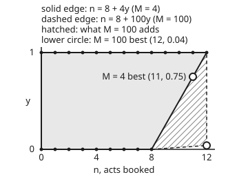

# Yes-or-no variables: switching constraints on and off with big-M

[Syllabus](../../../SYLLABUS.md) → [Optimization](../README.md) → [Integer and Combinatorial Optimisation](../README.md#s05) → Yes-or-no variables

---

## General Overview

A summer festival has a shortlist of 12 acts, A to L. Each act's value is its expected ticket takings minus its fee: £62k for act A, falling to £6k for act L. The main stage has 8 slots. A ninth act needs stage 2, and opening stage 2 costs a fixed £40k for rigging, crew and a licence. The festival wants the most net takings: a maximisation.

Two plans compete. Shut stage 2 and book the best 8 acts: £332k. Open it, book all 12 and pay the charge: £381k − £40k = £341k. Opening wins by £9k. A solver can only find that if the model says, in straight-line inequalities, "more than 8 acts means stage 2 is open, and an open stage 2 costs £40k".

The tool is a **binary variable** (a variable allowed only the values 0 and 1): here y = 1 means stage 2 is open. The rule "if stage 2 is shut, at most 8 acts" becomes n − 8 ≤ M·y, where n is the number of acts booked and M is a fixed number. With y = 0 the rule bites. With y = 1 it is slackened by M, enough that no real plan is blocked.

Choosing that M is the craft. Take M = 4, the most acts the shortlist can put past 8, and the solver's easy fractional version of the problem comes within £4k of the truth. Take M = 100, a common lazy choice, and it lands £38.40k away.

**A yes-or-no variable times a number M switches a straight-line rule off; M must be at least the most any real plan can break the rule by, and no bigger, because every extra unit of M loosens the fractional version the solver relies on.**

**What kind of fact this is:** a modelling method, carrying two theorems proved on this card in Why it works: the switched rule is exact whenever M covers the largest overshoot, and a smaller valid M never gives a weaker fractional bound. That the acts' values simply add up is a model: an assumption about the festival, not a law.

### The picture: what the fractional version allows

<p align="center"></p>

Dots are real plans: up to 8 acts with stage 2 shut (y = 0), up to 12 with it open (y = 1). The shaded region is every (n, y) pair the fractional version accepts with M = 4. Its slanted edge joins two real plans, so it holds nothing that is not an average of real plans.

M = 100 adds the whole hatched triangle between the dashed line and the slanted edge, with corners (8, 0), (12, 0.04) and (12, 1). Almost every fractional pair is then allowed, including 12 acts with stage 2 only 4% open.

---

## The formula

A rule written as "something ≤ 0" can be switched on and off. Call the something g(x): how far plan x breaks the rule, so g(x) ≤ 0 means the rule holds. Call the switch δ, a binary: 1 means the rule must hold, 0 means it is off.

$$g(x) \le M\,(1 - \delta), \qquad M = \max\{\, g(x) : x \text{ obeys every other rule} \,\}$$

**Read it aloud:** the rule's overshoot may be at most M times "switch off"; and M is the biggest overshoot any plan could reach if this rule were gone.

With δ = 1 the right side is 0 and the rule holds. With δ = 0 the right side is M, which no plan exceeds, so the rule vanishes. That is all big-M is.

For the festival, each act gets a binary $x_i$ (1: book act i), with value $v_i$ in £k. The rule "n ≤ 8" is switched on when stage 2 is shut, so δ = 1 − y and g = n − 8. The whole model:

$$z_{IP} = \max \; \sum_{i} v_i x_i - F y \quad\text{subject to}\quad \sum_i x_i - 8 \le M y, \qquad x_i,\, y \in \{0, 1\}$$

**Read it aloud:** choose acts and the stage switch to make takings minus the opening charge as large as possible, with the acts past 8 never exceeding M times the switch.

Stage 2 has 6 slots, but only 4 acts remain once 8 are on the main stage, so the most n − 8 can ever reach is 4. That is M.

| Symbol | Plain meaning | In our example | Push it up and the answer… |
| --- | --- | --- | --- |
| $x_i$ | binary: 1 books act i, 0 passes | all twelve 1 in the best plan | — (the solver chooses it) |
| $v_i$ | act i's takings minus fee, £k | 62 for A down to 6 for L | that act is booked sooner |
| $n$ | acts booked, $\sum_i x_i$ | 12 | — |
| $y$ | binary switch: 1 opens stage 2 | 1 | — (the solver chooses it) |
| $F$ | fixed charge for opening stage 2, £k | 40 | at 50 the stage stays shut |
| $g(x)$ | how far a plan breaks a rule; ≤ 0 means it holds | n − 8 | — |
| $\delta$ | binary switch: 1 enforces the rule | 1 − y | — |
| $M$, $M'$ | the big-M: most any plan can break the rule by; $M'$ a smaller one compared in Step 5 | 4 | still correct, but a looser bound |
| $z_{IP}$, $z_{LP}(M)$ | best value with whole decisions; best with fractions allowed, for that M | £341k; £345k at M = 4 | — |
| $\pi$ | price on the stage rule, £k per act past 8 (Step 4) | F/M = 10 | — |
| $s_A$, $s_B$ | start times of two headliners, hours after 18:00 | between 0 and 3.5, and 0 and 4 | — |
| $w$ | binary: 1 if A plays before B | either | — |

### Three patterns, one inequality

[Integer programs](../../14-Applied%20and%20computational/05-Operations%20Research/03-integer-programming-and-branch-and-bound.md) already links binaries to binaries: "B only if C" is $x_B \le x_C$, and no M is needed. Here the switched quantity is a count or a time, which can be larger than 1, so the switch needs a multiplier.

- **If-then.** "If more than 8 acts, then stage 2 is open" is the same statement as "if stage 2 is shut, then at most 8 acts". Written: $n - 8 \le 4y$. The other direction, stage 2 open only with more than 8 acts, needs no rule here: the £40k charge already makes an idle stage 2 a loss. If it had to be enforced, it would be $n \ge 9y$.
- **Fixed charge** (a cost paid in full once anything is used, not per unit). The £40k enters the objective as $-40y$. On its own it does nothing: the solver would set y = 0 and still book 12 acts. The if-then link is what makes it payable. The general form is "quantity ≤ M·y, cost F·y", with M the quantity's largest possible value.
- **Either-or.** Headliner A plays 90 minutes and B plays 60, between 18:00 and 23:00. They share one sound crew, so A finishes before B starts, or B finishes before A starts. One binary w carries both cases:

$$s_A + 1.5 - s_B \le 5\,(1 - w), \qquad s_B + 1 - s_A \le 5\,w$$

With w = 1 the first rule holds (A first) and the second is off. The 5 is the formula's M: A can start no later than 21:30 and B no earlier than 18:00, so $s_A + 1.5 - s_B$ is at most 3.5 + 1.5 − 0 = 5 hours. The other side also tops out at 5. The window's length is M.

Many solvers also accept an **indicator constraint**, "y = 0 implies n ≤ 8", typed in directly. The solver can then enforce it by branching on y instead of multiplying by an M. That is the tool when no honest bound exists.

### When it holds

- **M covers the largest overshoot.** Take M = 2 and 12 acts become impossible even with stage 2 open; the solver settles for £332k and loses £9k.
- **The quantity has a real bound.** If n or a time had no upper limit, no finite M would be valid. Add the true limit, or use an indicator constraint.
- **M is no bigger than it needs to be.** A larger M gives the same whole-number answer but a looser fractional bound: £379.40k at M = 100 against £345k at M = 4. Very large M also collides with the solver's rounding tolerance (the usual mistake).
- **The charge really is all-or-nothing.** If stage 2's cost grew with each act, the model needs a per-act term as well.
- **Values add.** Each act's value is assumed not to depend on who else plays. Two acts splitting the same audience break that, and need a joint binary like the one in [Integer programs](../../14-Applied%20and%20computational/05-Operations%20Research/03-integer-programming-and-branch-and-bound.md).

---

## Why it works

### Step 0: a switch times a number can make a rule harmless

A rule "g ≤ 0" with M(1 − δ) added to its right side holds as written when δ = 1. When δ = 0 it reads g ≤ M. If M is at least the largest g any otherwise legal plan can reach, that relaxed rule rules nothing out. So the switch has exactly two settings: the rule, and no rule. Everything else on this card is about what M does to the fractional version, which is where solvers spend their time.

### Step 1: with whole switches, the model is exact

Take M = 4. A plan with stage 2 shut (y = 0) must have n ≤ 8: the real rule. A plan with stage 2 open (y = 1) must have n ≤ 12, which every plan meets, since only 12 acts exist. And a plan with more than 8 acts forces y = 1, so it pays £40k. The model's plans are exactly the festival's plans, with the right costs.

Listing all 8,192 settings of the switches (2^12 act choices, times 2 settings of y) and keeping those that obey the rule finds the best: all 12 acts, stage 2 open, £341k.

### Step 2: an M that is too small removes real plans

The plan with 12 acts has n − 8 = 4. With M = 2, the largest n allowed is 8 + 2 = 10, even with y = 1. The best plan is gone, and the solver, correctly solving the wrong model, reports £332k with stage 2 shut. No error message appears. Any M below the largest overshoot cuts off at least the plan that reaches it.

### Step 3: the fractional version spreads the charge across M acts

Solvers bound the best plan by the **relaxation** (the same model with "0 or 1" loosened to "anywhere from 0 to 1"), as [Integer programs](01-integer-programs-and-relaxations.md) sets out. In the relaxation, y only needs to reach (n − 8)/M, so the charge paid is F(n − 8)/M. The £40k turns into a **toll** of F/M per act past 8.

With M = 4 the toll is £10k an act. Acts I, J and K are worth £18k, £14k and £11k, more than the toll, so all three go in. Act L, at £6k, stays out. That is n = 11 and y = 3/4, worth £332k + 8 + 4 + 1 = £345k.

With M = 100 the toll is £0.40k, every act goes in, y = 0.04, and the bound is £379.40k. The toll is the whole story: a big M makes the charge almost free in the relaxation, so the bound overshoots.

### Step 4: a price on the stage rule proves each bound

A price π ≥ 0 per act past 8 certifies a relaxed value without any search. For every fractional plan obeying the rule,

$$\sum_i v_i x_i - F y = \sum_i (v_i - \pi)\, x_i + (\pi M - F)\, y + \pi\,(n - M y) \le \sum_i \max(0,\ v_i - \pi) + \max(0,\ \pi M - F) + 8\pi,$$

since each $x_i$ and y is at most 1 and $n - My \le 8$.

Set π = F/M, the toll. For M = 4: 8 × 10 plus the positive parts 52 + 45 + 38 + 31 + 27 + 23 + 20 + 16 + 8 + 4 + 1 gives 80 + 265 = 345. The greedy plan above reaches 345, and the price says nothing can beat it, so £345k is the relaxation's exact best.

This is weak duality from [LP duality](../04-Linear%20Programming/04-lp-duality-and-complementary-slackness.md): every price π ≥ 0 gives a ceiling on the relaxation's best value. Here π is the dual price. It plays the part of the prices y there and on [Integer programs](01-integer-programs-and-relaxations.md), because y is taken here by the stage switch.

### Step 5: the smallest valid M gives the tightest relaxation

If M′ < M and y ≥ 0, then $n - 8 \le M'y$ implies $n - 8 \le My$. So every fractional plan allowed with M′ is allowed with M. A bigger region has a best value at least as high: $z_{LP}(M') \le z_{LP}(M)$. The code prints the chain: £345k at M = 4, £355k at M = 6 (stage 2's slot count, a tempting wrong choice), £367.67k at M = 12, £379.40k at M = 100.

At M = 4 the region's corners are (0, 0), (8, 0), (12, 1) and (0, 1), all real plans. So in the (n, y) picture every fractional pair is an average of real ones. That region is the **convex hull** (the smallest region with no dents containing the dots), and no single inequality on n and y does better. The fractional best still has y = 0.75, because which acts are booked matters too; closing the last £4k gap is the job of [Branch and bound](03-branch-and-bound.md).

<details>
<summary>Either-or relaxations stay weak even with the best M</summary>

For the headliners, list every pair of quarter-hour start times: 255 pairs, of which 132 have no clash. With M = 5 hours the model keeps exactly those 132. With M = 4 hours it keeps only 112: B at 18:00 with A at 21:30 is lost, because that order needs $s_A + 1.5 - s_B = 5$.

Now relax w. At w = 1/2 both rules loosen by 2.5 hours, and all 123 clashing pairs pass. The fractional version has forgotten the rule entirely. This is why scheduling models full of either-or pairs are hard: the bound comes almost wholly from branching on w. Balas's disjunctive programming builds the convex hull of the "A first" and "B first" regions instead, at the cost of a copy of the variables for each case.

</details>

---

## Worked numbers, by hand

The 12 acts, the 8 main-stage slots and the £40k charge, with M = 4.

| Step | Arithmetic | Value |
| --- | --- | --- |
| smallest valid M | 12 acts − 8 slots (stage 2's 6 slots never bind) | 4 |
| stage 2 shut | 62 + 55 + 48 + 41 + 37 + 33 + 30 + 26 | 332 |
| stage 2 open | 381 − 40 | 341 |
| every setting listed | 2^12 × 2 | 8,192 settings, best 341 |
| toll in the relaxation | 40 / 4 | 10 per act past 8 |
| acts worth more than the toll | I 18, J 14, K 11; L 6 is not | 3 acts |
| relaxed best | 332 + (18 − 10) + (14 − 10) + (11 − 10) | 345 |
| stage 2 share in it | (11 − 8) / 4 | 0.75 |
| gap | (345 − 341) / 341 | 1.17% |
| the same with M = 100 | toll 0.40; every act in | 379.40, gap 11.26% |
| **best plan** | open stage 2, book all 12 | **£341k** |

Open stage 2 and book every act: £9k better than staying on one stage, proved by listing every plan, with the tight relaxation's ceiling only £4k above it.

### What breaks if you drop a piece

| Mistake | Comes out at | What went wrong |
| --- | --- | --- |
| No link between n and y | £381k, 12 acts, y = 0 | Stage 2 is used and never paid for |
| M = 2, too small | £332k, 8 acts; relaxed 332.00, 2.64% below a real plan | The 12-act plan is cut off; £9k lost |
| M = 100, too big | right plan, but bound 379.40, gap 11.26% | The toll falls to £0.40k; the bound is nearly useless |
| M = 1,000,000 | y = 0.000004; claims £380.99984k with stage 2 "shut" | Below a 0.00001 tolerance, y reads as 0 |
| Either-or with M = 4 hours | 112 of 132 clash-free pairs kept | B at 18:00 with A at 21:30 is lost |

The code prints every row.

---

## Code, from first principles, and it actually runs

Nothing is imported but exact fractions in Python and a small fraction type in Rust. The whole-number answer comes by two roads: listing all 8,192 settings of the switches, and sorting the two cases (stage shut, stage open). Each relaxation is solved by the greedy toll fill of Step 3 and certified by the price bound of Step 4; the asserts demand the two agree exactly. The either-or model is checked against the plain clash test on all 255 start pairs.

### Python

```python
# Big-M and yes-or-no switches -- the check behind the card.  Standard library only.
# A festival books acts from a shortlist of 12.  The main stage holds 8; a ninth
# act needs stage 2, which costs a fixed £40k to open.  Maximise net takings, £k.
# Road 1 lists every plan.  Road 2 sorts.  The relaxations are solved by a greedy
# fill and certified by a dual price.  Then an either-or rule on set times.
from fractions import Fraction as Fr

V = [62, 55, 48, 41, 37, 33, 30, 26, 18, 14, 11, 6]   # acts A..L: takings minus fee, £k
K, S2, F, NAMES = 8, 6, 40, "ABCDEFGHIJKL"             # slots on stages 1 and 2, charge

def best_plan(allowed):                                # road 1: all 2^12 x 2 plans
    best = None
    for mask in range(1 << len(V)):
        n = bin(mask).count("1")
        for y in (0, 1):
            if allowed(n, y):
                val = sum(v for i, v in enumerate(V) if mask >> i & 1) - F * y
                if best is None or val > best[0]:
                    best = (val, n, y)
    return best

def relax(M):                                         # greedy fill: past 8 acts each
    toll, n, val = Fr(F, M), Fr(0), Fr(0)              # unit of an act costs F/M
    for v in V:                                        # V is sorted, best first
        free = min(Fr(1), max(Fr(0), K - n))
        extra = min(1 - free, K + M - n - free) if v > toll else Fr(0)
        n, val = n + free + extra, val + v * free + (v - toll) * extra
    return val, n, max(Fr(0), (n - K) / M)

def dual_bound(M):                                    # price pi on n - M*y <= 8
    pi = Fr(F, M)
    return K * pi + sum(max(Fr(0), v - pi) for v in V) + max(Fr(0), pi * M - F)

def pct(a, b):
    return f"{100 * float(Fr(a) - b) / float(b):.2f}%"

true_rule = lambda n, y: n <= K + S2 * y               # the real rule: 8 slots, or 8 + 6
z_ip, n_ip, y_ip = best_plan(true_rule)
shut, opened = best_plan(lambda n, y: y == 0 and n <= K), best_plan(lambda n, y: y == 1 and n <= K + S2)
by_sort = (sum(V[:K]), sum(V[:K + S2]) - F)            # road 2: best 8, or best 14 less F
m_small = max(n - K for n in range(min(len(V), K + S2) + 1))  # most n - 8 reaches
print("acts A-L, net value in £k:", *V, f"(sum {sum(V)})")
print(f"main stage slots {K}; stage 2 opening charge £{F}k; plans listed: {(1 << len(V)) * 2}")
print(f"road 1, every plan: best £{z_ip}k, {n_ip} acts, stage 2 open = {y_ip}")
print(f"best with stage 2 shut £{shut[0]}k (acts {NAMES[:K]}); best with it open £{opened[0]}k")
print(f"road 2, by sorting: shut £{by_sort[0]}k, open £{by_sort[1]}k")
print(f"smallest valid M = most that n - 8 can reach = {m_small}")
print("M        relaxed  y         acts n  toll F/M  dual bound  gap to IP")
rows = {}
for M in (2, 4, 6, 12, 100, 10**6):
    val, n, y = relax(M)
    rows[M] = (val, n, y)
    print(f"{M:<8} {float(val):7.2f}  {float(y):.6f}  {float(n):6.2f}  {float(Fr(F, M)):8.5f}"
          f"  {float(dual_bound(M)):10.2f}  {pct(val, z_ip)}")
v4, n4, y4 = rows[4]
print(f"tight relaxation by hand: 332 + (18-10) + (14-10) + (11-10) = {float(v4):.2f}")
parts = [v - 10 for v in V if v > 10]
print(f"price bound at M = 4: 8 x 10 + ({' + '.join(map(str, parts))}) = 80 + {sum(parts)} = {80 + sum(parts)}")
print(f"gap in £k: M = 4 {float(v4 - z_ip):.2f}, M = 100 {float(rows[100][0] - z_ip):.2f}")
no_link = best_plan(lambda n, y: True)
too_small = best_plan(lambda n, y: n <= K + 2 * y)
print(f"mistake 1, no link from n to y: claims £{no_link[0]}k with {no_link[1]} acts, y = {no_link[2]}")
print(f"mistake 2, M = 2: at most {K + 2} acts; best £{too_small[0]}k, {too_small[1]} acts, loses £{z_ip - too_small[0]}k")
print(f"mistake 3, M = 100: right plan, but bound {float(rows[100][0]):.2f}, gap {pct(rows[100][0], z_ip)}")
yb = rows[10**6][2]
print(f"mistake 4, M = 1000000: y = {float(yb):.6f}, under a 0.00001 tolerance it reads 0;"
      f" plan claims £{float(rows[10**6][0]):.5f}k, 12 acts, stage 2 shut")
# either-or: headliners A (90 min) and B (60 min) share one sound crew, between
# 18:00 and 23:00.  Times in quarter hours after 18:00.  w = 1 means A plays first.
dA, dB, END = 6, 4, 20
pairs = [(a, b) for a in range(END - dA + 1) for b in range(END - dB + 1)]
truth = [(a, b) for a, b in pairs if a + dA <= b or b + dB <= a]
mE = max(max(a + dA - b, b + dB - a) for a, b in pairs)
def passes(a, b, M, w):
    return a + dA - b <= M * (1 - w) and b + dB - a <= M * w
model = lambda M: [(a, b) for a, b in pairs if passes(a, b, M, 0) or passes(a, b, M, 1)]
clash_half = [p for p in pairs if p not in truth and passes(*p, mE, Fr(1, 2))]
print(f"either-or: {len(pairs)} start pairs on the quarter hour, {len(truth)} without a clash")
print(f"smallest valid M = {mE} quarter hours = {mE // 4} hours; that model keeps {len(model(mE))}")
print(f"M = 4 hours keeps {len(model(16))}; B at 18:00, A at 21:30 kept: {'yes' if (14, 0) in model(16) else 'no'}")
print(f"relaxed w = 0.5 with M = 5 hours loosens both rules by {mE / 8} hours;"
      f" lets {len(clash_half)} of {len(pairs) - len(truth)} clashes through")
px = lambda n: 60 + 20 * float(n)
py = lambda y: 200 - 140 * float(y)
print(f"figure, tight edge ({px(8):.0f},{py(0):.0f})-({px(12):.0f},{py(1):.0f}); loose M=100 edge"
      f" ({px(8):.0f},{py(0):.0f})-({px(12):.0f},{py(Fr(4, 100)):.1f}); optima ({px(n4):.0f},{py(y4):.0f})"
      f" and ({px(12):.0f},{py(rows[100][2]):.1f})")
assert (z_ip, n_ip, y_ip) == (341, 12, 1) and (shut[0], opened[0]) == by_sort  # two roads
assert all(relax(M)[0] == dual_bound(M) for M in rows)                      # LP certified
assert m_small == 4 and v4 == 345 and v4 == 80 + sum(parts) and y4 == Fr(3, 4) and too_small[0] == 332
assert [rows[M][0] for M in (4, 6, 12, 100, 10**6)] == sorted(rows[M][0] for M in (4, 6, 12, 100, 10**6))
assert mE == 20 and sorted(model(mE)) == sorted(truth) and len(model(16)) < len(truth)
print("ALL CHECKS PASS")
```

**Ran 2026-11-11 on macOS, Python 3.14.10, standard library only. All checks passed. Output, pasted from the run:**

```
acts A-L, net value in £k: 62 55 48 41 37 33 30 26 18 14 11 6 (sum 381)
main stage slots 8; stage 2 opening charge £40k; plans listed: 8192
road 1, every plan: best £341k, 12 acts, stage 2 open = 1
best with stage 2 shut £332k (acts ABCDEFGH); best with it open £341k
road 2, by sorting: shut £332k, open £341k
smallest valid M = most that n - 8 can reach = 4
M        relaxed  y         acts n  toll F/M  dual bound  gap to IP
2         332.00  0.000000    8.00  20.00000      332.00  -2.64%
4         345.00  0.750000   11.00  10.00000      345.00  1.17%
6         355.00  0.500000   11.00   6.66667      355.00  4.11%
12        367.67  0.333333   12.00   3.33333      367.67  7.82%
100       379.40  0.040000   12.00   0.40000      379.40  11.26%
1000000   381.00  0.000004   12.00   0.00004      381.00  11.73%
tight relaxation by hand: 332 + (18-10) + (14-10) + (11-10) = 345.00
price bound at M = 4: 8 x 10 + (52 + 45 + 38 + 31 + 27 + 23 + 20 + 16 + 8 + 4 + 1) = 80 + 265 = 345
gap in £k: M = 4 4.00, M = 100 38.40
mistake 1, no link from n to y: claims £381k with 12 acts, y = 0
mistake 2, M = 2: at most 10 acts; best £332k, 8 acts, loses £9k
mistake 3, M = 100: right plan, but bound 379.40, gap 11.26%
mistake 4, M = 1000000: y = 0.000004, under a 0.00001 tolerance it reads 0; plan claims £380.99984k, 12 acts, stage 2 shut
either-or: 255 start pairs on the quarter hour, 132 without a clash
smallest valid M = 20 quarter hours = 5 hours; that model keeps 132
M = 4 hours keeps 112; B at 18:00, A at 21:30 kept: no
relaxed w = 0.5 with M = 5 hours loosens both rules by 2.5 hours; lets 123 of 123 clashes through
figure, tight edge (220,200)-(300,60); loose M=100 edge (220,200)-(300,194.4); optima (280,95) and (300,194.4)
ALL CHECKS PASS
```

### Rust

Same numbers, same labels, built with `rustc --edition 2021 -O`.

```rust
// Big-M and yes-or-no switches -- the same check as the Python, in Rust.  No crates.
// A festival books acts from a shortlist of 12.  The main stage holds 8; a ninth
// act needs stage 2, which costs a fixed £40k to open.  Maximise net takings, £k.
// Road 1 lists every plan.  Road 2 sorts.  The relaxations are solved by a greedy
// fill and certified by a dual price.  Then an either-or rule on set times.
use std::cmp::Ordering;
use std::ops::{Add, Div, Mul, Sub};

#[derive(Clone, Copy, Debug)]
struct Q(i128, i128);                                  // an exact fraction, den > 0
fn gcd(a: i128, b: i128) -> i128 { if b == 0 { a.abs() } else { gcd(b, a % b) } }
fn q(n: i128, d: i128) -> Q { let g = gcd(n, d).max(1) * d.signum(); Q(n / g, d / g) }
impl Add for Q { type Output = Q; fn add(self, o: Q) -> Q { q(self.0 * o.1 + o.0 * self.1, self.1 * o.1) } }
impl Sub for Q { type Output = Q; fn sub(self, o: Q) -> Q { q(self.0 * o.1 - o.0 * self.1, self.1 * o.1) } }
impl Mul for Q { type Output = Q; fn mul(self, o: Q) -> Q { q(self.0 * o.0, self.1 * o.1) } }
impl Div for Q { type Output = Q; fn div(self, o: Q) -> Q { q(self.0 * o.1, self.1 * o.0) } }
impl PartialEq for Q { fn eq(&self, o: &Q) -> bool { self.0 * o.1 == o.0 * self.1 } }
impl PartialOrd for Q { fn partial_cmp(&self, o: &Q) -> Option<Ordering> { (self.0 * o.1).partial_cmp(&(o.0 * self.1)) } }
fn f(x: Q) -> f64 { x.0 as f64 / x.1 as f64 }
fn z(n: i128) -> Q { Q(n, 1) }
fn mx(a: Q, b: Q) -> Q { if a > b { a } else { b } }
fn mn(a: Q, b: Q) -> Q { if a < b { a } else { b } }

const V: [i128; 12] = [62, 55, 48, 41, 37, 33, 30, 26, 18, 14, 11, 6]; // acts A..L, £k
const K: i128 = 8; const S2: i128 = 6; const F: i128 = 40;          // slots, charge

fn best_plan(allowed: &dyn Fn(i128, i128) -> bool) -> (i128, i128, i128) { // road 1
    let mut best: Option<(i128, i128, i128)> = None;
    for mask in 0..(1u32 << V.len()) {
        let n = mask.count_ones() as i128;
        for y in 0..2 {
            if allowed(n, y) {
                let val: i128 = (0..V.len()).filter(|i| mask >> i & 1 == 1).map(|i| V[i]).sum::<i128>() - F * y;
                if best.map_or(true, |b| val > b.0) { best = Some((val, n, y)) }
            }
        }
    }
    best.unwrap()
}

fn relax(m: i128) -> (Q, Q, Q) {                       // greedy fill: past 8 acts each
    let (toll, mut n, mut val) = (q(F, m), z(0), z(0)); // unit of an act costs F/M
    for &v in V.iter() {
        let free = mn(z(1), mx(z(0), z(K) - n));
        let extra = if z(v) > toll { mn(z(1) - free, z(K + m) - n - free) } else { z(0) };
        n = n + free + extra;
        val = val + z(v) * free + (z(v) - toll) * extra;
    }
    (val, n, mx(z(0), (n - z(K)) / z(m)))
}

fn dual_bound(m: i128) -> Q {                         // price pi on n - M*y <= 8
    let pi = q(F, m);
    let mut b = z(K) * pi + mx(z(0), pi * z(m) - z(F));
    for &v in V.iter() { b = b + mx(z(0), z(v) - pi) }
    b
}

fn pct(a: Q, b: i128) -> String { format!("{:.2}%", 100.0 * f(a - z(b)) / b as f64) }

fn main() {
    let (z_ip, n_ip, y_ip) = best_plan(&|n, y| n <= K + S2 * y);  // the real rule
    let shut = best_plan(&|n, y| y == 0 && n <= K);
    let opened = best_plan(&|n, y| y == 1 && n <= K + S2);
    let total: i128 = V.iter().sum();
    let by_sort = (V[..K as usize].iter().sum::<i128>(), V[..((K + S2) as usize).min(V.len())].iter().sum::<i128>() - F); // road 2
    let m_small = (0..=(V.len() as i128).min(K + S2)).map(|n| n - K).max().unwrap();
    let vs: Vec<String> = V.iter().map(|v| v.to_string()).collect();
    println!("acts A-L, net value in £k: {} (sum {})", vs.join(" "), total);
    println!("main stage slots {}; stage 2 opening charge £{}k; plans listed: {}", K, F, (1 << V.len()) * 2);
    println!("road 1, every plan: best £{}k, {} acts, stage 2 open = {}", z_ip, n_ip, y_ip);
    println!("best with stage 2 shut £{}k (acts {}); best with it open £{}k", shut.0, &"ABCDEFGHIJKL"[..K as usize], opened.0);
    println!("road 2, by sorting: shut £{}k, open £{}k", by_sort.0, by_sort.1);
    println!("smallest valid M = most that n - 8 can reach = {}", m_small);
    println!("M        relaxed  y         acts n  toll F/M  dual bound  gap to IP");
    let ms: [i128; 6] = [2, 4, 6, 12, 100, 1_000_000];
    let rows: Vec<(Q, Q, Q)> = ms.iter().map(|&m| relax(m)).collect();
    for (i, &m) in ms.iter().enumerate() {
        let (val, n, y) = rows[i];
        println!("{:<8} {:7.2}  {:.6}  {:6.2}  {:8.5}  {:10.2}  {}", m, f(val), f(y), f(n), f(q(F, m)),
                 f(dual_bound(m)), pct(val, z_ip));
    }
    let (v4, n4, y4) = rows[1];
    println!("tight relaxation by hand: 332 + (18-10) + (14-10) + (11-10) = {:.2}", f(v4));
    let parts: Vec<i128> = V.iter().filter(|&&v| v > 10).map(|&v| v - 10).collect();
    let ps: Vec<String> = parts.iter().map(|p| p.to_string()).collect();
    let psum: i128 = parts.iter().sum();
    println!("price bound at M = 4: 8 x 10 + ({}) = 80 + {} = {}", ps.join(" + "), psum, 80 + psum);
    println!("gap in £k: M = 4 {:.2}, M = 100 {:.2}", f(v4 - z(z_ip)), f(rows[4].0 - z(z_ip)));
    let no_link = best_plan(&|_n, _y| true);
    let too_small = best_plan(&|n, y| n <= K + 2 * y);
    println!("mistake 1, no link from n to y: claims £{}k with {} acts, y = {}", no_link.0, no_link.1, no_link.2);
    println!("mistake 2, M = 2: at most {} acts; best £{}k, {} acts, loses £{}k", K + 2, too_small.0, too_small.1, z_ip - too_small.0);
    println!("mistake 3, M = 100: right plan, but bound {:.2}, gap {}", f(rows[4].0), pct(rows[4].0, z_ip));
    println!("mistake 4, M = 1000000: y = {:.6}, under a 0.00001 tolerance it reads 0; plan claims £{:.5}k, 12 acts, stage 2 shut",
             f(rows[5].2), f(rows[5].0));
    // either-or: headliners A (90 min) and B (60 min) share one sound crew, between
    // 18:00 and 23:00.  Times in quarter hours after 18:00.  w = 1 means A plays first.
    let (da, db, end) = (6i128, 4i128, 20i128);
    let pairs: Vec<(i128, i128)> = (0..=end - da).flat_map(|a| (0..=end - db).map(move |b| (a, b))).collect();
    let truth: Vec<(i128, i128)> = pairs.iter().copied().filter(|&(a, b)| a + da <= b || b + db <= a).collect();
    let m_e = pairs.iter().map(|&(a, b)| (a + da - b).max(b + db - a)).max().unwrap();
    let passes = |a: i128, b: i128, m: i128, w: Q| z(a + da - b) <= z(m) * (z(1) - w) && z(b + db - a) <= z(m) * w;
    let model = |m: i128| -> Vec<(i128, i128)> {
        pairs.iter().copied().filter(|&(a, b)| passes(a, b, m, z(0)) || passes(a, b, m, z(1))).collect() };
    let clash_half = pairs.iter().filter(|p| !truth.contains(p) && passes(p.0, p.1, m_e, q(1, 2))).count();
    println!("either-or: {} start pairs on the quarter hour, {} without a clash", pairs.len(), truth.len());
    println!("smallest valid M = {} quarter hours = {} hours; that model keeps {}", m_e, m_e / 4, model(m_e).len());
    println!("M = 4 hours keeps {}; B at 18:00, A at 21:30 kept: {}", model(16).len(),
             if model(16).contains(&(14, 0)) { "yes" } else { "no" });
    println!("relaxed w = 0.5 with M = 5 hours loosens both rules by {} hours; lets {} of {} clashes through",
             m_e as f64 / 8.0, clash_half, pairs.len() - truth.len());
    let px = |n: Q| 60.0 + 20.0 * f(n);
    let py = |y: Q| 200.0 - 140.0 * f(y);
    println!("figure, tight edge ({:.0},{:.0})-({:.0},{:.0}); loose M=100 edge ({:.0},{:.0})-({:.0},{:.1}); optima ({:.0},{:.0}) and ({:.0},{:.1})",
             px(z(8)), py(z(0)), px(z(12)), py(z(1)), px(z(8)), py(z(0)), px(z(12)), py(q(4, 100)),
             px(n4), py(y4), px(z(12)), py(rows[4].2));
    assert!((z_ip, n_ip, y_ip) == (341, 12, 1) && (shut.0, opened.0) == by_sort);  // two roads
    assert!(ms.iter().all(|&m| relax(m).0 == dual_bound(m)));                     // LP certified
    assert!(m_small == 4 && v4 == z(345) && v4 == z(80 + psum) && y4 == q(3, 4) && too_small.0 == 332);
    assert!((1..5).all(|i| rows[i].0 <= rows[i + 1].0));
    assert!(m_e == 20 && model(m_e) == truth && model(16).len() < truth.len());
    println!("ALL CHECKS PASS");
}
```

**Ran 2026-11-11 on macOS, rustc 1.98.1, no crates. All checks passed. Output, pasted from the run:**

```
acts A-L, net value in £k: 62 55 48 41 37 33 30 26 18 14 11 6 (sum 381)
main stage slots 8; stage 2 opening charge £40k; plans listed: 8192
road 1, every plan: best £341k, 12 acts, stage 2 open = 1
best with stage 2 shut £332k (acts ABCDEFGH); best with it open £341k
road 2, by sorting: shut £332k, open £341k
smallest valid M = most that n - 8 can reach = 4
M        relaxed  y         acts n  toll F/M  dual bound  gap to IP
2         332.00  0.000000    8.00  20.00000      332.00  -2.64%
4         345.00  0.750000   11.00  10.00000      345.00  1.17%
6         355.00  0.500000   11.00   6.66667      355.00  4.11%
12        367.67  0.333333   12.00   3.33333      367.67  7.82%
100       379.40  0.040000   12.00   0.40000      379.40  11.26%
1000000   381.00  0.000004   12.00   0.00004      381.00  11.73%
tight relaxation by hand: 332 + (18-10) + (14-10) + (11-10) = 345.00
price bound at M = 4: 8 x 10 + (52 + 45 + 38 + 31 + 27 + 23 + 20 + 16 + 8 + 4 + 1) = 80 + 265 = 345
gap in £k: M = 4 4.00, M = 100 38.40
mistake 1, no link from n to y: claims £381k with 12 acts, y = 0
mistake 2, M = 2: at most 10 acts; best £332k, 8 acts, loses £9k
mistake 3, M = 100: right plan, but bound 379.40, gap 11.26%
mistake 4, M = 1000000: y = 0.000004, under a 0.00001 tolerance it reads 0; plan claims £380.99984k, 12 acts, stage 2 shut
either-or: 255 start pairs on the quarter hour, 132 without a clash
smallest valid M = 20 quarter hours = 5 hours; that model keeps 132
M = 4 hours keeps 112; B at 18:00, A at 21:30 kept: no
relaxed w = 0.5 with M = 5 hours loosens both rules by 2.5 hours; lets 123 of 123 clashes through
figure, tight edge (220,200)-(300,60); loose M=100 edge (220,200)-(300,194.4); optima (280,95) and (300,194.4)
ALL CHECKS PASS
```

The two outputs match line for line.

### Lean

Lean proves the card's three general rules for any number of acts, any slot count and any M, and checks the festival's sums.

- The switched rule g(x) ≤ M(1 − δ) is "the rule, or no rule" exactly when M covers every plan's overshoot.
- If M′ ≤ M, the relaxation's best value with M′ is at most its best value with M, whenever both best values exist.
- Every price π ≥ 0 caps every fractional plan at ∑ max(0, v_i − π) + max(0, πM − F) + 8π.
- The festival's numbers hold: £332k shut, £341k open, M = 4, and a relaxed plan with y = 3/4 worth £345k.
- The headliners' numbers hold: 132 of 255 start pairs are clash-free; M = 5 hours keeps all 132, and M = 4 hours keeps 112.

The Python and Rust checks cover the rest: listing all 8,192 plans, the greedy fill, and the bounds for M = 6, 12, 100 and 1,000,000.

```lean
-- Yes-or-no variables: a rule g ≤ M·(1 − δ) with a 0-or-1 switch δ is exactly "the rule when δ = 1, no rule when δ = 0" if and only if M is at least every overshoot g a plan can reach; a smaller M never gives a higher fractional best, and every price π ≥ 0 gives a ceiling on that fractional best.
import Mathlib.Basic.Real.Basic
import Mathlib.Algebra.BigOperators.Fin
import Mathlib.Algebra.Order.BigOperators.Group.Finset
import Mathlib.Order.Bounds.Basic
import Mathlib.Data.Fin.VecNotation
import Mathlib.Tactic.NormNum
import Mathlib.Tactic.FinCases
import Mathlib.Tactic.Linarith
import Mathlib.Tactic.Ring

open Finset

/-- The fractional version (relaxation) of the festival model with `k` acts, `K` main-stage slots
and big-M value `M`: each act's booking `x i` and the stage-2 switch `y` may be anywhere from 0 to 1,
and the acts past `K` may not exceed `M` times the switch: `∑ x i − K ≤ M · y`. -/
def relaxedPlans (k : ℕ) (K M : ℝ) : Set ((Fin k → ℝ) × ℝ) :=
  {p | (∀ i, 0 ≤ p.1 i ∧ p.1 i ≤ 1) ∧ 0 ≤ p.2 ∧ p.2 ≤ 1 ∧ (∑ i, p.1 i) - K ≤ M * p.2}

/-- A plan's net takings: each act's value `v i` times its booking, minus the fixed charge `F`
times the stage-2 switch. -/
def planValue {k : ℕ} (v : Fin k → ℝ) (F : ℝ) (p : (Fin k → ℝ) × ℝ) : ℝ :=
  (∑ i, v i * p.1 i) - F * p.2

/-- Big-M is exact exactly when M covers the largest overshoot. Let `S` be the plans that obey
every other rule and `g x` how far plan `x` breaks the switched rule. The switched rule
`g x ≤ M · (1 − δ)`, with `δ` equal to 0 or 1, means "the rule `g x ≤ 0` holds when `δ = 1`, and
there is no rule when `δ = 0`" for every plan in `S`, if and only if `M` is at least `g x` for
every plan `x` in `S`. With a smaller `M`, the plan with the largest overshoot is cut off even
with the rule switched off. -/
theorem big_m_switch_exact_iff_m_covers_overshoot {X : Type*} (S : Set X) (g : X → ℝ) (M : ℝ) :
    (∀ x ∈ S, ∀ δ : ℝ, (δ = 0 ∨ δ = 1) → (g x ≤ M * (1 - δ) ↔ (δ = 1 → g x ≤ 0))) ↔
      ∀ x ∈ S, g x ≤ M := by
  constructor
  · intro h x hx
    have := (h x hx 0 (Or.inl rfl)).2 (fun h01 => absurd h01 (by norm_num))
    simpa using this
  · intro h x hx δ hδ
    rcases hδ with rfl | rfl
    · simp only [sub_zero, mul_one]
      exact ⟨fun _ h01 => absurd h01 (by norm_num), fun _ => h x hx⟩
    · simp

/-- The smallest valid M gives the tightest relaxation. If `M' ≤ M`, every fractional plan
allowed with `M'` is allowed with `M`, so the best fractional value with `M'` is at most the best
fractional value with `M`: `z_LP(M') ≤ z_LP(M)`. -/
theorem relaxed_best_le_of_smaller_m {k : ℕ} (v : Fin k → ℝ) (F K M' M : ℝ) (hM : M' ≤ M)
    (z' z : ℝ)
    (hz' : IsGreatest (planValue v F '' relaxedPlans k K M') z')
    (hz : IsGreatest (planValue v F '' relaxedPlans k K M) z) :
    z' ≤ z := by
  obtain ⟨p, hp, rfl⟩ := hz'.1
  apply hz.2
  refine ⟨p, ?_, rfl⟩
  obtain ⟨h1, h2, h3, h4⟩ := hp
  exact ⟨h1, h2, h3, le_trans h4 (mul_le_mul_of_nonneg_right hM h2)⟩

/-- A price on the stage rule proves a ceiling. For every price `π ≥ 0` per act past `K`, every
fractional plan obeying `∑ x i − K ≤ M · y` has net takings at most
`∑ max(0, v i − π) + max(0, π·M − F) + K·π`. -/
theorem relaxed_value_le_price_bound {k : ℕ} (v : Fin k → ℝ) (F K M π : ℝ) (hπ : 0 ≤ π)
    (p : (Fin k → ℝ) × ℝ) (hp : p ∈ relaxedPlans k K M) :
    planValue v F p ≤ (∑ i, max 0 (v i - π)) + max 0 (π * M - F) + K * π := by
  obtain ⟨h1, h2, h3, h4⟩ := hp
  unfold planValue
  have key : ∀ i ∈ (univ : Finset (Fin k)), v i * p.1 i ≤ max 0 (v i - π) + π * p.1 i := by
    intro i _
    obtain ⟨a, b⟩ := h1 i
    have hm1 : (v i - π) * p.1 i ≤ max 0 (v i - π) * p.1 i :=
      mul_le_mul_of_nonneg_right (le_max_right _ _) a
    have hm2 : max 0 (v i - π) * p.1 i ≤ max 0 (v i - π) * 1 :=
      mul_le_mul_of_nonneg_left b (le_max_left _ _)
    nlinarith
  have hs := Finset.sum_le_sum key
  rw [Finset.sum_add_distrib, ← Finset.mul_sum] at hs
  have hy : (π * M - F) * p.2 ≤ max 0 (π * M - F) := by
    rcases le_or_gt (π * M - F) 0 with h | h
    · have : (π * M - F) * p.2 ≤ 0 := mul_nonpos_of_nonpos_of_nonneg h h2
      linarith [le_max_left 0 (π * M - F)]
    · have : (π * M - F) * p.2 ≤ (π * M - F) * 1 := mul_le_mul_of_nonneg_left h3 h.le
      linarith [le_max_right 0 (π * M - F)]
  have hpi : π * (∑ i, p.1 i) ≤ π * (K + M * p.2) := mul_le_mul_of_nonneg_left (by linarith) hπ
  nlinarith

/-! The card's festival: acts A to L, values in £k, 8 main-stage slots, a £40k charge. -/

-- Stage 2 shut, the best 8 acts: £332k.
example : ([62, 55, 48, 41, 37, 33, 30, 26] : List ℤ).sum = 332 := by decide
-- Stage 2 open, all 12 acts, less the £40k charge: £381k − £40k = £341k, £9k better.
example : ([62, 55, 48, 41, 37, 33, 30, 26, 18, 14, 11, 6] : List ℤ).sum = 381 := by decide
example : (381 : ℤ) - 40 = 341 ∧ (341 : ℤ) - 332 = 9 := by decide
-- The smallest valid M: 12 acts − 8 slots = 4; settings listed: 2^12 × 2 = 8,192.
example : (12 : ℤ) - 8 = 4 ∧ 2 ^ 12 * 2 = 8192 := by decide
-- The 12-act plan passes n − 8 ≤ M·y with M = 4 and y = 1, and is cut off with M = 2.
example : (12 : ℤ) - 8 ≤ 4 * 1 ∧ ¬ ((12 : ℤ) - 8 ≤ 2 * 1) := by decide
-- The toll 40 / 4 = 10, and the price bound at M = 4: 8 × 10 + 265 + 0 = 345.
example : ([62, 55, 48, 41, 37, 33, 30, 26, 18, 14, 11, 6].map (fun v : ℤ => max 0 (v - 10))).sum
    = 265 := by decide
example : (8 : ℤ) * 10 + 265 + max 0 (10 * 4 - 40) = 345 := by decide
-- The relaxed plan at M = 4 (acts A to K booked, L out, y = 3/4) is allowed and is worth £345k:
-- 332 + (18 − 10) + (14 − 10) + (11 − 10).
example : ((![1, 1, 1, 1, 1, 1, 1, 1, 1, 1, 1, 0], 3 / 4) : (Fin 12 → ℝ) × ℝ)
    ∈ relaxedPlans 12 8 4 := by
  refine ⟨fun i => ?_, by norm_num, by norm_num, ?_⟩
  · fin_cases i <;> norm_num
  · norm_num [Fin.sum_univ_succ]
example : planValue ![62, 55, 48, 41, 37, 33, 30, 26, 18, 14, 11, 6] 40
    ((![1, 1, 1, 1, 1, 1, 1, 1, 1, 1, 1, 0], 3 / 4) : (Fin 12 → ℝ) × ℝ) = 345 := by
  norm_num [planValue, Fin.sum_univ_succ]
example : (332 : ℤ) + (18 - 10) + (14 - 10) + (11 - 10) = 345 := by decide

/-! The headliners: start times in quarter hours after 18:00; A plays 6 (90 min), B plays 4
(60 min), the night ends at 20 (23:00). So A starts at 0..14 and B at 0..16. -/

-- 255 start pairs, of which 132 have no clash.
example : ((List.range 15).product (List.range 17)).length = 255 := by decide +kernel
example : (((List.range 15).product (List.range 17)).filter
    (fun p : ℕ × ℕ => p.1 + 6 ≤ p.2 ∨ p.2 + 4 ≤ p.1)).length = 132 := by decide +kernel
-- With M = 20 quarter hours (5 hours) the either-or model keeps exactly those 132 pairs.
example : (((List.range 15).product (List.range 17)).filter (fun p : ℕ × ℕ =>
    ((p.1 : ℤ) + 6 - p.2 ≤ 20 * (1 - 0) ∧ (p.2 : ℤ) + 4 - p.1 ≤ 20 * 0) ∨
    ((p.1 : ℤ) + 6 - p.2 ≤ 20 * (1 - 1) ∧ (p.2 : ℤ) + 4 - p.1 ≤ 20 * 1))).length = 132 := by
  decide +kernel
-- With M = 16 quarter hours (4 hours) it keeps only 112: B at 18:00 with A at 21:30 is lost.
example : (((List.range 15).product (List.range 17)).filter (fun p : ℕ × ℕ =>
    ((p.1 : ℤ) + 6 - p.2 ≤ 16 * (1 - 0) ∧ (p.2 : ℤ) + 4 - p.1 ≤ 16 * 0) ∨
    ((p.1 : ℤ) + 6 - p.2 ≤ 16 * (1 - 1) ∧ (p.2 : ℤ) + 4 - p.1 ≤ 16 * 1))).length = 112 := by
  decide +kernel

#print axioms big_m_switch_exact_iff_m_covers_overshoot
#print axioms relaxed_best_le_of_smaller_m
#print axioms relaxed_value_le_price_bound
```

**Checked 2026-11-12 on macOS, Lean 4.36.0-rc2, Mathlib v4.36.0-rc2. Every proof is complete and uses only Lean's standard axioms. Output, pasted from the run:**

```
'big_m_switch_exact_iff_m_covers_overshoot' depends on axioms: [propext, Classical.choice, Quot.sound]
'relaxed_best_le_of_smaller_m' depends on axioms: [propext, Classical.choice, Quot.sound]
'relaxed_value_le_price_bound' depends on axioms: [propext, Classical.choice, Quot.sound]
```

> [!TIP]
> **Try changing**
> Guess first, then run it. The asserts are pinned to the festival's numbers, so expect one to stop the program.
> - **Raise the charge.** Set `F` to `50`. Guess first: does stage 2 still open? No: open now earns £331k against £332k shut, and the first assert stops it.
> - **Shrink stage 2.** Set `S2` to `3`. Guess first: what is the smallest valid M, and the best plan? M becomes 3 and the best plan books 11 acts for £335k; the first assert stops it.
> - **Extend the night.** Set `END` to `24` (midnight). Guess first: what is M now? 24 quarter hours, 6 hours: the window again. The last assert stops it.
> - **Break the toll.** In `relax`, change `if v > toll` to `if v >= 0`. Guess first: which assert catches it? The second: the greedy fill now gives 341.00 at M = 4, below its own price bound of 345.00.

---

## The usual mistake

> [!warning]
> **Picking M "big enough" by feel.** A huge M is not safe. With M = 1,000,000 the relaxation sets y = 0.000004, and a solver treats anything within 0.00001 of a whole number as whole. It can report 12 acts with stage 2 "shut", worth £380.99984k, a plan that cannot be staged.
>
> Even when nothing goes wrong, the bound is £381.00k against the true £341k, a gap of 11.73%, so the search proves less. Derive M from the other rules: here 12 acts − 8 slots = 4.
>
> - **M too small.** M = 2 silently loses the best plan: £332k instead of £341k.
> - **The obvious capacity instead of the real bound.** Stage 2 has 6 slots, but only 4 acts can reach it. M = 6 gives a bound of £355k against £345k.
> - **The charge without the link.** −40y in the objective alone lets the solver claim £381k with stage 2 shut.
> - **One M for every rule.** The either-or needs hours, the stage rule needs acts. A shared M is too big for one or too small for the other.

---

## Where you meet it in real life

- **Power stations.** A generator either runs, between its minimum and maximum output, or is off, and starting it costs a fixed sum. Unit commitment models write output ≤ capacity × on, with the start-up cost as a fixed charge.
- **Warehouses and depots.** Flow through a site is at most its capacity times "site open", with the lease as the fixed charge, the depot model of [Integer programs](../../14-Applied%20and%20computational/05-Operations%20Research/03-integer-programming-and-branch-and-bound.md) with quantities attached.
- **Machine and crew scheduling.** Every pair of jobs on one machine is an either-or like the headliners, with the planning window as M. Their weak relaxations are why such schedules are hard to prove optimal.
- **Solver logs.** A model that solves the same plan but proves it slowly often has an M set to 10^6 somewhere; tightening it is the first fix a modeller tries.

> **Say it back**
> A binary switch times a number M turns a straight-line rule off: "n − 8 ≤ M·y" holds n to 8 only when stage 2 is shut. M must be at least the most any real plan breaks the rule by, here 12 − 8 = 4, or real plans vanish. Above that, M changes nothing in the whole-number model but loosens the fractional one, because the relaxation pays a fixed charge as a toll of F/M per unit. With M = 4 the bound is £345k against the true £341k; with M = 100 it is £379.40k. Fixed charges, if-then and either-or rules are all this one inequality.

---

## What this builds on

- [Integer programs](01-integer-programs-and-relaxations.md): the relaxation, and why its value bounds the whole-number best.
- [Integer programs](../../14-Applied%20and%20computational/05-Operations%20Research/03-integer-programming-and-branch-and-bound.md): binaries for count, either-or and if-then between decisions, with no M.

## Where this goes next

- [Four classic models](06-classic-integer-models-knapsack-assignment-and-covering.md): knapsack, assignment, covering and routing: the same switches, written into the four standard models.
- [Branch and bound](03-branch-and-bound.md): how the gap between relaxation and plan sets the size of the search.
- [Cutting planes](04-cutting-planes.md): inequalities that slice away what a loose big-M lets in.

The open question is what to do when the largest overshoot is itself hard to compute, so that no small M can be proved valid.

---

## Sources

Verified 2026-11-11: every link below resolves to the publisher's page.

- Williams, H. Paul. *Model Building in Mathematical Programming*, 5th ed. Wiley, 2013. [Publisher page](https://www.wiley.com/en-us/Model+Building+in+Mathematical+Programming%2C+5th+Edition-p-9781118443330). The modeller's handbook for fixed charges, if-then and either-or rules with binaries.
- Wolsey, Laurence A. *Integer Programming*, 2nd ed. Wiley, 2020. [Publisher page](https://www.wiley.com/en-us/Integer+Programming%2C+2nd+Edition-p-9781119606536). Formulations, and why a tighter one gives a better relaxation bound.
- Balas, Egon. "Disjunctive Programming." *Annals of Discrete Mathematics* 5 (1979): 3–51. [doi:10.1016/S0167-5060(08)70342-X](https://doi.org/10.1016/S0167-5060(08)70342-X). The convex hull of an either-or, the strong alternative to big-M.
- Bonami, Pierre, Andrea Lodi, Andrea Tramontani, and Sven Wiese. "On Mathematical Programming with Indicator Constraints." *Mathematical Programming* 151 (2015): 191–223. [doi:10.1007/s10107-015-0891-4](https://doi.org/10.1007/s10107-015-0891-4). Big-M against indicator constraints, and the tolerance trouble with large M.
