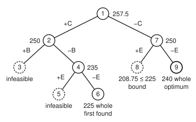
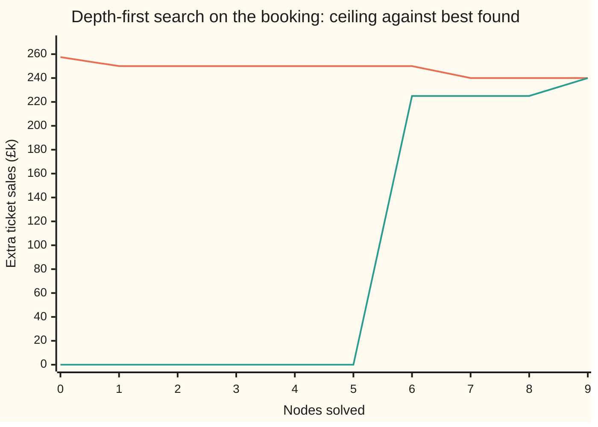

# Branch and bound: split into cases and throw away what cannot win

[Syllabus](../../../SYLLABUS.md) → [Optimization](../README.md) → [Integer and Combinatorial Optimisation](../README.md#s05) → Branch and bound

---

## General Overview

A summer festival has £150k left in its budget for acts. Five acts are on offer. Each has a fee, and the promoter has an estimate of the extra tickets each act would sell. The aim is to **maximise** extra ticket sales, with total fees inside the £150k. Each act is booked whole or not at all.

| Act | A | B | C | D | E |
| --- | ---: | ---: | ---: | ---: | ---: |
| Fee, £k | 30 | 80 | 80 | 30 | 90 |
| Extra ticket sales, £k | 70 | 130 | 115 | 40 | 90 |
| Sales per £1 of fee | 2.333 | 1.625 | 1.438 | 1.333 | 1.000 |

Five yes-or-no choices make 32 possible bookings, and 16 of them fit the budget. Checking all 32 is easy here. But the count doubles with every act added, so a method that checks every booking soon runs out of time. Branch and bound gets the same certainty while looking at far fewer cases.

It works like this. First, pretend an act can be booked in part. The pretend problem is easy, and its answer is a **ceiling**: no real booking can sell more. Here the ceiling is £257.5k: A and B in full, plus half of C. Half a band is nonsense, so split the problem into two cases: "C booked" and "C skipped". Each case gets its own ceiling, and so on down. A case is thrown away the moment its ceiling cannot beat the best real booking already found. Here, 9 cases are solved and 5 are closed without further splitting. One booking wins: A, B and D, selling **£240k** of extra tickets for £140k of fees.

The computing wing's [Integer programs](../../14-Applied%20and%20computational/05-Operations%20Research/03-integer-programming-and-branch-and-bound.md) already split on a fractional variable and bounded each branch by its relaxation. This card runs a full tree by hand, with every ceiling and every reason for closing a node, and shows how the order of nodes changes the work.

**Branch and bound splits a whole-number problem into cases, gives each case a ceiling by allowing fractions, and discards any case that is empty, already solved, or whose ceiling cannot beat the best answer in hand; when no case is left open, the best answer in hand is proved best.**

**What kind of fact this is:** a method, whose correctness is a theorem proved on this card in Why it works: every booking ends up in exactly one closed case, and a case is closed only when it holds nothing better than the answer. That each act's sales add up independently of the others is a model: an assumption about the festival, not a law.

### The picture: the search tree for the booking

<p align="center"></p>

Schematic, not to scale. Each circle is one case, numbered in the order it was solved. A `+C` edge books act C; a `−C` edge skips it. The number beside a circle is its ceiling in £k. Dashed circles were closed without finding a booking: infeasible, or beaten on bound.

---

## The formula

The festival's problem, written as an **integer program** (a linear program whose variables must be whole numbers; [Integer programs](01-integer-programs-and-relaxations.md)):

$$\max \sum_{j} v_j\,x_j \quad\text{subject to}\quad \sum_{j} f_j\,x_j \le W, \qquad x_j \in \{0, 1\}$$

**Read it aloud:** choose a yes or a no for every act to make total extra ticket sales as large as possible, keeping the booked acts' fees within the budget.

The $\sum_j$ sign means "add up over every act $j$". The **relaxation** (the same problem with a rule loosened) replaces "$x_j$ is 0 or 1" with "$x_j$ is anywhere from 0 to 1". Its best value is the ceiling.

Branch and bound keeps a list of open cases, called **nodes**. A node is the original problem with some acts already fixed: booked or skipped. Solving a node means solving its relaxation. Then the node is closed by one of three rules, or split in two:

$$\text{close node } N \text{ if } \;(\text{its relaxation has no answer}) \;\text{ or }\; \bar z_N \le z_{\text{inc}} \;\text{ or }\; (\text{its relaxed answer is whole})$$

**Read it aloud:** stop working on a case when no booking fits it, when its ceiling is no better than the best booking already found, or when its pretend answer turns out to be a real booking.

| Symbol | Plain meaning | In our example | Push it up and the answer… |
| --- | --- | --- | --- |
| $j$ | which act, A to E | C is the act split on first | — |
| $x_j$ | the decision for act $j$: 1 book it, 0 skip it | $x_A = x_B = x_D = 1$ in the best booking | — (the method chooses it) |
| $f_j$ | act $j$'s fee, £k | $f_C = 80$ | that act is less likely booked |
| $v_j$ | act $j$'s extra ticket sales, £k | $v_C = 115$ | that act is more likely booked |
| $W$ | the fee budget, £k | 150 | best sales rise or stay; the tree can grow or shrink |
| $N$ | a node: the problem with some acts fixed | node 7 skips C | — |
| $\bar z_N$ | node $N$'s ceiling: its relaxation's best value, £k | 257.5 at the root | the node is harder to discard |
| $z_{\text{inc}}$ | the **incumbent**: best whole booking found so far, £k | 225 after node 6, 240 after node 9 | more nodes are discarded |
| $z^{\ast}$ | the best possible whole booking, £k | 240 | — |
| $\lambda$ | a price on each £k of fee, for the certificate in Step 1 | 1.4375 at the root | — |

### When it holds

- **The ceiling must really be a ceiling.** Discarding a node is safe only if nothing inside it can beat its ceiling. Fill the pretend booking with the biggest sellers first instead of the best sellers per £, and the root's "ceiling" comes out at £230.625k, below the real £240k booking. The search then discards the winner and returns A, C and D at £225k.
- **Every booking must stay in an open case until the list is empty.** A split into "C booked" and "C skipped" keeps every booking; stopping early abandons the rest. Stop after the first whole booking, and the answer is A, C and D at £225k, found after 6 nodes, with the winner still unseen in node 7.
- **Sales must add up act by act.** If A and B pull the same crowd and sell £30k less together, the chosen A, B and D really earns £210k, and the true best is A, C and D at £225k. The fix is a yes-or-no variable for the pair ([Yes-or-no variables](02-modelling-with-binary-variables-big-m-and-indicators.md)).
- **The problem must stay small enough.** The tree can grow fast. Cut the budget to £130k and the same five acts take 23 nodes. Integer programming is NP-hard (no method is known that solves every case quickly; Karp, 1972, in Sources; the proof is planned for the complexity wing), so no node rule avoids a huge tree on every problem.

---

## Why it works

### Step 0: a split loses nothing, and a ceiling lets a whole pile go unseen

Every whole booking books C or skips it. So the two nodes "C booked" and "C skipped" share out all 16 bookings that fit, with none lost and none counted twice. Keep splitting, and every booking always sits in exactly one open node.

Now suppose a node's ceiling is £208.75k and a £225k booking is already in hand. Every booking in that node sells at most £208.75k. The whole pile can be thrown away without listing a single member. That is the "bound" in branch and bound.

### Step 1: the relaxation is a ceiling, and here it is solved by one fill

Every whole booking is also a fractional one, since 0 and 1 lie between 0 and 1. The relaxation chooses from a bigger set, so its best is at least as high. This is proved on [Integer programs](01-integer-programs-and-relaxations.md); inside a node it holds the same way.

With one budget line, the best fractional booking has a simple shape. Rank the free acts by sales per £ of fee. Book them whole in that order until the next one does not fit. Take the fraction of that act that uses up the budget, and stop. At the root: A (£30k) and B (£80k) use £110k, the £40k left buys half of C, and the ceiling is $70 + 130 + 57.5 = 257.5$.

Why no other fractional booking does better: any spending on a lower-ranked act could be moved to a higher-ranked one and buy more sales per £. This fill for the one-budget problem dates from 1957 (see Sources).

A second road, with no fill at all, proves the same ceiling. Put a price $\lambda$ (at least 0) on each £k of fee. For any booking in the node, whole or fractional, write each free act's sales as

$$v_j x_j = (v_j - \lambda f_j)\,x_j + \lambda f_j x_j \le \max(0,\; v_j - \lambda f_j) + \lambda f_j x_j .$$

Add this over the free acts. The fees of the booked free acts add to at most the budget left, so

$$\text{sales} \;\le\; \text{sales of acts already booked} \;+\; \lambda \times \text{budget left} \;+\; \sum_{\text{free } j} \max(0,\; v_j - \lambda f_j).$$

Choose $\lambda$ as the sales per £ of the part-booked act. At the root that is C's 1.4375. Only A and B earn more than their fee's worth at that price, and the right side comes to 257.5: exactly the fill's ceiling. Both programs check this match at every node that has a part-booked act. A price that gives the same number as a fill proves the fill is the best fractional booking.

### Step 2: split on the act booked in part

The root's fill books half of C. Neither child allows half a C, so the fractional answer is gone from both and their ceilings fall or stay: 250 in each. Splitting on the part-booked act is the usual choice because it removes exactly what made the parent's answer unreal.

Splitting on any act would be correct, just slower. Splitting on acts in the fixed order A, B, C, D, E solves 11 nodes instead of 9.

### Step 3: three ways to close a node, each one safe

- **Infeasible.** The acts already booked cost more than £150k (C and B: £160k). The node holds no booking, so nothing is lost.
- **Bound.** The ceiling is no higher than the incumbent. By Step 0, nothing inside can beat the booking in hand. Node 8: 208.75 against 225.
- **Whole.** The fill books every act whole or not at all. Then the fill is a real booking, and it equals the node's ceiling, so it is the best booking in that node. It becomes the incumbent if it beats the old one. Node 6 gives 225, then node 9 gives 240.

### Step 4: why it stops, and why the last incumbent is best

Each split fixes one more act, so no path runs more than five splits deep, and the tree is finite. When the list is empty, every booking sits in exactly one closed node. A closed node either holds no booking, or holds nothing better than some incumbent, or handed its best booking to the incumbent. So the final incumbent is at least as good as every booking. Both programs confirm this on all 32 bookings: each falls in exactly one of the 5 closed nodes, and none beats its node's ceiling.

The proof runs while the search does. The highest ceiling still on the list caps every booking not yet seen. The difference between it and the incumbent is the **search gap**. When the search gap reaches 0, the answer is proved.

<details>
<summary>Detailed proof: the closed tree is a certificate, whatever the order of nodes</summary>

Claim: when the list is empty, $z_{\text{inc}} = z^{\ast}$.

Invariant: at every moment, each booking that fits the budget lies either in exactly one node still on the list, or in a closed node that holds nothing better than the current $z_{\text{inc}}$. At the start, the root holds them all. A split replaces one node by two whose fixed acts differ in one act's 0 or 1, so each booking moves to exactly one child. Closing by infeasibility removes a node holding no bookings. Closing by bound removes a node whose bookings all sell at most $\bar z_N \le z_{\text{inc}}$ (Step 1). Closing as whole removes a node whose best booking sells $\bar z_N$, and $z_{\text{inc}}$ becomes at least that. The incumbent never falls, so "nothing better than $z_{\text{inc}}$" stays true as the incumbent rises.

When the list is empty, every booking lies in a closed node, so every booking sells at most $z_{\text{inc}}$. And $z_{\text{inc}}$ is itself a real booking's sales. So $z_{\text{inc}} = z^{\ast}$.

Nothing in the argument depends on which node is taken next, or which act is split on. Those choices change the work, not the answer.

Best-first never splits a node whose ceiling is below $z^{\ast}$. The nodes on the path down to the best booking all have ceilings of at least $z^{\ast}$, so best-first takes every one of them before any node below $z^{\ast}$. By then the best booking is the incumbent, and the lower node closes on bound.

</details>

---

## Worked numbers, by hand

Depth-first (always take the newest node), "book it" before "skip it", splitting on the act booked in part. Each fill ranks free acts A, B, C, D, E by sales per £.

| Step | Arithmetic | Value |
| --- | --- | --- |
| Node 1, root | A, B whole (£110k); £40k buys half of C: $70 + 130 + 57.5$ | ceiling 257.5; split on C |
| Node 2, +C | C costs £80k, £70k left; A whole, £40k buys half of B: $115 + 70 + 65$ | 250; split on B |
| Node 3, +C +B | fees $80 + 80 = 160 > 150$ | infeasible: closed |
| Node 4, +C −B | £70k left: A, D whole, £10k buys a ninth of E: $115 + 70 + 40 + 10$ | 235; split on E |
| Node 5, +C −B +E | fees $80 + 90 = 170 > 150$ | infeasible: closed |
| Node 6, +C −B −E | £70k left: A, D whole, nothing else free: $115 + 70 + 40$ | 225, whole: incumbent 225 |
| Node 7, −C | A, B, D whole (£140k); £10k buys a ninth of E: $70 + 130 + 40 + 10$ | 250; above 225, split on E |
| Node 8, −C +E | E costs £90k, £60k left; A whole, £30k buys three-eighths of B: $90 + 70 + 48.75$ | 208.75, not above 225: closed on bound |
| Node 9, −C −E | A, B, D whole, nothing else free: $70 + 130 + 40$ | 240, whole: incumbent 240 |
| Count | 4 split; 5 closed (2 infeasible, 1 bound, 2 whole) | 9 nodes |
| **Best booking** | A, B, D: fees $30 + 80 + 30 = 140$ | **£240k** |

So the festival should book A, B and D. The closed tree proves that no booking within £150k sells more than £240k. The root ceiling, £257.5k, sat £17.5k above the answer: that £17.5k is the root's integrality gap, as defined on [Integer programs](01-integer-programs-and-relaxations.md). The search gap of Step 4 is a different number: it starts at £257.5k and falls to 0.

### What breaks if you drop a piece

| Mistake | Comes out at | What went wrong |
| --- | --- | --- |
| Stop at the first whole booking | A, C, D: £225k | node 7 was still open with ceiling 250; the tree was not closed |
| Round the root's fill down | A, B: £200k | dropping half of C leaves £40k unspent that D could use |
| Round the root's fill up | A, B, C: fees £190k against £150k | not a booking at all: it breaks the budget |
| Fill biggest sales first, not best per £ | root "ceiling" 230.625; answer A, C, D £225k | that fill is not the relaxation's best, so it is not a ceiling and it discards the winner |

---

## How the search moves: the ceiling falls and the floor rises

Two numbers tell how far the search has come. The ceiling is the most any booking not yet ruled out could sell. The floor is the incumbent, £0 before any booking is found, since booking nobody is always allowed. The answer is proved when they meet.

| After node | Most still possible, £k | Best found, £k | Search gap, £k |
| --- | ---: | ---: | ---: |
| 0 (start) | 257.5 | 0 | 257.5 |
| 1 to 5 | 250 | 0 | 250 |
| 6 | 250 | 225 | 25 |
| 7 | 240 | 225 | 15 |
| 8 | 240 | 225 | 15 |
| 9 | 240 | 240 | 0 |

Depth-first dived into the "C booked" side and spent nodes 2 to 6 there; its first booking came only at node 6. The order of nodes changes the work, never the answer:

```
nodes solved to prove £240k is best
best-first, highest ceiling next        ███████                          7
depth-first, split the part-booked act  █████████                        9
depth-first, split acts in order A to E ███████████                      11
list every booking                      ████████████████████████████████ 32
```

Best-first also opens "C booked" first, as the two 250s tie, but then takes "C skipped" ahead of the 235 node. That finds £240k at once, and every node left closes. Depth-first keeps only the current path and the siblings waiting beside it, at most one per level, which matters when trees run to millions of nodes.



The upper line (orange) is the most any booking not yet ruled out could sell. The lower line (green) is the best booking in hand. They meet at £240k after node 9, and the meeting is the proof.

---

## Code, from first principles, and it actually runs

Both programs solve every relaxation in exact fractions (Python's `Fraction`; in Rust, a small rational type written out) and reach the answer **three independent ways**. Road 1 is branch and bound, run depth-first, best-first and with a fixed split order. Road 2 is Step 1's price certificate, which must equal the fill's ceiling at every node with a part-booked act. Road 3 lists all 32 bookings, finds the single best, and checks that each lands in exactly one closed node and beats none of their ceilings. The programs also compute every wrong answer, the budget experiments and the figure's coordinates.

### Python

```python
# Branch and bound on a festival booking -- the check behind the card.  Standard library only.
# Five acts, a £150k fee budget: book the acts that bring the most extra ticket sales (maximise).
# Every relaxation is solved in exact fractions; nothing imported knows the answer.
from fractions import Fraction as Fr
NAMES = "ABCDE"
FEE = [30, 80, 80, 30, 90]                      # f_j, the act's fee, £k
SALES = [70, 130, 115, 40, 90]                  # v_j, extra ticket sales it brings, £k
BUDGET, N = 150, 5
BY_RATIO = [0, 1, 2, 3, 4]                      # sales per £ of fee, best first (checked below)
BY_SALES = [1, 2, 4, 0, 3]                      # biggest sales first: the wrong fill, for "What breaks"
SELECT = "depth"                                # which node next: "depth" (newest) or "best" (highest ceiling)

def relax(fix, budget=BUDGET, order=BY_RATIO):
    """fix maps acts to 1 (booked) or 0 (skipped). Fill the rest in `order`, the first misfit in part."""
    left = budget - sum(FEE[j] for j in fix if fix[j])
    if left < 0:
        return None                             # the acts already booked break the budget
    z, took = Fr(sum(SALES[j] for j in fix if fix[j])), [j for j in fix if fix[j]]
    for j in order:
        if j in fix:
            continue
        if FEE[j] > left:
            return (z + Fr(SALES[j] * left, FEE[j]), j, took) if left else (z, None, took)
        left, z, took = left - FEE[j], z + SALES[j], took + [j]
    return z, None, took

def price_bound(fix, lam):
    """Road 2: charge lam per £k of fee. Every whole plan in the node earns at most this. No fill used."""
    left = BUDGET - sum(FEE[j] for j in fix if fix[j])
    return (sum(SALES[j] for j in fix if fix[j]) + lam * left
            + sum(max(Fr(0), SALES[j] - lam * FEE[j]) for j in range(N) if j not in fix))

def search(select="depth", branch="part", budget=BUDGET, order=BY_RATIO, first_whole=False):
    """Road 1. A node is solved when made, then closed or split when taken off the list."""
    todo, done, inc, plan = [({}, relax({}, budget, order), 0, -1)], [], Fr(-1), []
    while todo:
        k = len(todo) - 1                       # depth-first: the last one made
        if select == "best":                    # best-first: highest ceiling, oldest on a tie
            k = max(range(len(todo)), key=lambda i: (todo[i][1][0] if todo[i][1] else -1, -i))
        fix, r, depth, parent = todo.pop(k)
        if r is None:
            verdict = "infeasible"
        elif r[0] <= inc:
            verdict = "bound"
        elif r[1] is None:
            verdict, inc, plan = "whole", r[0], sorted(r[2])
        else:
            verdict = "split"
            j = r[1] if branch == "part" else min(i for i in range(N) if i not in fix)
            kids = [({**fix, j: v}, relax({**fix, j: v}, budget, order), depth + 1, len(done)) for v in (1, 0)]
            todo += kids if select == "best" else kids[::-1]     # depth-first takes "book it" first
        done.append((fix, r, depth, verdict, inc, parent))
        if first_whole and verdict == "whole":
            break
    return done, inc, plan

def num(x):                                     # an exact decimal: every number here has one
    assert 10000 % x.denominator == 0
    v = x.numerator * (10000 // x.denominator)
    return f"{v // 10000}.{v % 10000:04d}".rstrip("0").rstrip(".")

acts = lambda p: " ".join(NAMES[j] for j in sorted(p))
fees = lambda p: sum(FEE[j] for j in p)
sales = lambda p: sum(SALES[j] for j in p)
assert all(SALES[a] * FEE[b] > SALES[b] * FEE[a] for a, b in zip(BY_RATIO, BY_RATIO[1:]))
print("acts (fee, sales, per £):", ", ".join(f"{NAMES[j]} {FEE[j]} {SALES[j]} "
      f"{(2000 * SALES[j] + FEE[j]) // (2 * FEE[j]) / 1000:.3f}" for j in range(N)))
done, best, plan = search(select=SELECT)
for n, (fix, r, depth, verdict, inc, _) in enumerate(done, 1):
    what = f"split on {NAMES[r[1]]}" if verdict == "split" else verdict
    if r is not None and r[1] is not None:      # road 2 at every node with an act booked in part
        lam = Fr(SALES[r[1]], FEE[r[1]])
        assert price_bound(fix, lam) == r[0] and price_bound(fix, lam + Fr(1, 8)) > r[0]
        what += f", price {num(lam)}"
    lab = " ".join(("+" if fix[j] else "-") + NAMES[j] for j in fix) or "root"
    print(f"node {n}  {lab:<9} ceiling {'none' if r is None else num(r[0]):>7}  {what:<24}"
          f" best so far {'none' if inc < 0 else num(inc)}")
kinds = [d[3] for d in done]
print(f"{SELECT}-first: {len(done)} nodes, {kinds.count('split')} split, {len(done) - kinds.count('split')} pruned "
      f"({kinds.count('infeasible')} infeasible, {kinds.count('bound')} bound, {kinds.count('whole')} whole)")
print(f"answer: book {acts(plan)}, sales {num(best)}, fees {fees(plan)}; root ceiling {num(done[0][1][0])}, "
      f"integrality gap {num(done[0][1][0] - best)}")

# How the search moves: after each node, the most any plan still on the list could earn, and the best in hand
hi, lo = [done[0][1][0]], [Fr(0)]
for n in range(len(done)):
    lo.append(max(done[n][4], Fr(0)))
    hi.append(max([d[1][0] for m, d in enumerate(done) if m > n and d[1] and d[5] <= n] + [lo[-1]]))
for name, row in [("most still possible", hi), ("best found", lo), ("search gap", [a - b for a, b in zip(hi, lo)])]:
    print(f"{name + ':':<20}", " ".join(num(x) for x in row))

# Road 3: all 32 plans, and a check that the closed nodes hold each plan exactly once
plans = [[j for j in range(N) if m >> j & 1] for m in range(1 << N)]
fits = [p for p in plans if fees(p) <= BUDGET]
top = max(sales(p) for p in fits)
winners = [p for p in fits if sales(p) == top]
leaves = [(d[0], d[1]) for d in done if d[3] != "split"]
for p in plans:
    home = [r for fix, r in leaves if all((j in p) == bool(fix[j]) for j in fix)]
    assert len(home) == 1 and (p not in fits or (home[0] is not None and sales(p) <= home[0][0]))
print(f"every plan: {len(plans)} plans, {len(fits)} fit, best {top} = {acts(winners[0])}, winners {len(winners)}")
print(f"the {len(leaves)} closed nodes hold all {len(plans)} plans once each; none beats its node's ceiling")
assert best == top and winners == [plan] and (len(done), len(leaves), kinds.count("whole")) == (9, 5, 2)

# Other choices of node and of branching act: same answer, different work
for name, kw in [("best-first", dict(select="best")), ("branch in order A to E", dict(branch="order"))]:
    d, b, p = search(**kw)
    assert b == top and p == plan
    print(f"{name}: {len(d)} nodes, answer {num(b)}")

# What breaks
d, b, p = search(first_whole=True)
print(f"stop at the first whole plan: {acts(p)}, sales {num(b)}, after {len(d)} nodes")
r = relax({})
print(f"round the root down: {acts(r[2])}, sales {sales(r[2])}; round it up: {acts(r[2] + [r[1]])}, "
      f"fees {fees(r[2] + [r[1]])} against {BUDGET}")
d, b, p = search(order=BY_SALES)
print(f"fill biggest sales first: root 'ceiling' {num(d[0][1][0])}, answer {acts(p)} {num(b)}")
assert b < top and d[0][1][0] < top < relax({})[0] and sales(r[2]) < top < sales(r[2] + [r[1]])
real = lambda p: sales(p) - (30 if 0 in p and 1 in p else 0)          # A and B pull the same crowd
alt = max(fits, key=real)
print(f"A and B share fans, £30k less together: {acts(plan)} really earns {real(plan)}; best is {acts(alt)} {real(alt)}")

# Try changing the budget
for bud in (140, 130):
    d, b, p = search(budget=bud)
    print(f"budget {bud}: {len(d)} nodes, book {acts(p)}, sales {num(b)}")

# Figure: leaves 80 apart left to right, each parent above the middle of its two children
pos, nxt = {}, [40]
def place(i):
    kids = sorted([k for k, d in enumerate(done) if d[5] == i], key=lambda k: -list(done[k][0].values())[-1])
    xs = [place(k) for k in kids]
    x = (xs[0] + xs[1]) // 2 if xs else nxt[0]
    nxt[0] += 0 if xs else 80
    pos[i + 1] = (x, 28 + 55 * done[i][2])
    return x
place(0)
print("figure,", " ".join(f"{n}:{pos[n][0]},{pos[n][1]}" for n in sorted(pos)))
print("ALL CHECKS PASS")
```

**Ran 2026-11-11 on macOS, Python 3.14.10, standard library only. All checks passed. Output, pasted from the run:**

```
acts (fee, sales, per £): A 30 70 2.333, B 80 130 1.625, C 80 115 1.438, D 30 40 1.333, E 90 90 1.000
node 1  root      ceiling   257.5  split on C, price 1.4375 best so far none
node 2  +C        ceiling     250  split on B, price 1.625  best so far none
node 3  +C +B     ceiling    none  infeasible               best so far none
node 4  +C -B     ceiling     235  split on E, price 1      best so far none
node 5  +C -B +E  ceiling    none  infeasible               best so far none
node 6  +C -B -E  ceiling     225  whole                    best so far 225
node 7  -C        ceiling     250  split on E, price 1      best so far 225
node 8  -C +E     ceiling  208.75  bound, price 1.625       best so far 225
node 9  -C -E     ceiling     240  whole                    best so far 240
depth-first: 9 nodes, 4 split, 5 pruned (2 infeasible, 1 bound, 2 whole)
answer: book A B D, sales 240, fees 140; root ceiling 257.5, integrality gap 17.5
most still possible: 257.5 250 250 250 250 250 250 240 240 240
best found:          0 0 0 0 0 0 225 225 225 240
search gap:          257.5 250 250 250 250 250 25 15 15 0
every plan: 32 plans, 16 fit, best 240 = A B D, winners 1
the 5 closed nodes hold all 32 plans once each; none beats its node's ceiling
best-first: 7 nodes, answer 240
branch in order A to E: 11 nodes, answer 240
stop at the first whole plan: A C D, sales 225, after 6 nodes
round the root down: A B, sales 200; round it up: A B C, fees 190 against 150
fill biggest sales first: root 'ceiling' 230.625, answer A C D 225
A and B share fans, £30k less together: A B D really earns 210; best is A C D 225
budget 140: 5 nodes, book A B D, sales 240
budget 130: 23 nodes, book A B, sales 200
figure, 1:210,28 2:100,83 3:40,138 4:160,138 5:120,193 6:200,193 7:320,83 8:280,138 9:360,138
ALL CHECKS PASS
```

### Rust

```rust
// Branch and bound on a festival booking -- the check behind the card.  std only, no crates.
// Five acts, a £150k fee budget: book the acts that bring the most extra ticket sales (maximise).
// Every relaxation is solved in exact fractions, with a small rational type written out below.
use std::cmp::Ordering;
const NAMES: [&str; 5] = ["A", "B", "C", "D", "E"];
const FEE: [i64; 5] = [30, 80, 80, 30, 90]; // f_j, the act's fee, £k
const SALES: [i64; 5] = [70, 130, 115, 40, 90]; // v_j, extra ticket sales it brings, £k
const BUDGET: i64 = 150;
const BY_RATIO: [usize; 5] = [0, 1, 2, 3, 4]; // sales per £ of fee, best first (checked below)
const BY_SALES: [usize; 5] = [1, 2, 4, 0, 3]; // biggest sales first: the wrong fill
#[derive(Clone, Copy, Debug, PartialEq)]
struct Q(i64, i64); // numerator, denominator > 0, in lowest terms
fn gcd(a: i64, b: i64) -> i64 { if b == 0 { a.abs() } else { gcd(b, a % b) } }
fn q(n: i64, d: i64) -> Q { let g = gcd(n, d).max(1); Q(n / g, d / g) }
impl Q {
    fn add(self, o: Q) -> Q { q(self.0 * o.1 + o.0 * self.1, self.1 * o.1) }
    fn mul(self, o: Q) -> Q { q(self.0 * o.0, self.1 * o.1) }
    fn cmp(self, o: Q) -> Ordering { (self.0 * o.1).cmp(&(o.0 * self.1)) }
}
fn num(x: Q) -> String { // an exact decimal: every number here has one
    assert!(10000 % x.1 == 0); let v = x.0 * (10000 / x.1);
    format!("{}.{:04}", v / 10000, v % 10000).trim_end_matches('0').trim_end_matches('.').to_string()
}
type Fix = Vec<(usize, i64)>; // acts set so far, in the order they were set: 1 booked, 0 skipped
type Relax = Option<(Q, Option<usize>, Vec<usize>)>; // ceiling, act taken in part, acts taken whole
fn get(fix: &Fix, j: usize) -> Option<i64> { fix.iter().find(|p| p.0 == j).map(|p| p.1) }
fn relax(fix: &Fix, budget: i64, order: &[usize; 5]) -> Relax {
    let mut took: Vec<usize> = fix.iter().filter(|p| p.1 == 1).map(|p| p.0).collect();
    let mut left = budget - fees(&took);
    if left < 0 { return None; } // the acts already booked break the budget
    let mut z = q(sales(&took), 1);
    for &j in order {
        if get(fix, j).is_some() { continue; }
        if FEE[j] > left { return Some(if left > 0 { (z.add(q(SALES[j] * left, FEE[j])), Some(j), took) } else { (z, None, took) }); }
        left -= FEE[j]; z = z.add(q(SALES[j], 1)); took.push(j);
    }
    Some((z, None, took))
}
// Road 2: charge lam per £k of fee. Every whole plan in the node earns at most this. No fill used.
fn price_bound(fix: &Fix, lam: Q) -> Q {
    let booked: Vec<usize> = fix.iter().filter(|p| p.1 == 1).map(|p| p.0).collect();
    let mut b = q(sales(&booked), 1).add(lam.mul(q(BUDGET - fees(&booked), 1)));
    for j in (0..5).filter(|&j| get(fix, j).is_none()) {
        let gain = q(SALES[j], 1).add(lam.mul(q(-FEE[j], 1))); if gain.0 > 0 { b = b.add(gain); } }
    b
}
struct Node { fix: Fix, r: Relax, depth: i64, verdict: &'static str, inc: Q, parent: i64 }
// Road 1. A node is solved when made, then closed or split when taken off the list.
fn search(best_first: bool, in_order: bool, budget: i64, order: &[usize; 5], first_whole: bool) -> (Vec<Node>, Q, Vec<usize>) {
    let mut todo: Vec<(Fix, Relax, i64, i64)> = vec![(vec![], relax(&vec![], budget, order), 0, -1)];
    let (mut done, mut inc, mut plan): (Vec<Node>, Q, Vec<usize>) = (vec![], q(-1, 1), vec![]);
    while !todo.is_empty() {
        let mut k = todo.len() - 1; // depth-first: the last one made
        if best_first { // best-first: highest ceiling, oldest on a tie
            let key = |i: usize| todo[i].1.as_ref().map(|r| r.0).unwrap_or(q(-1, 1));
            k = (1..todo.len()).fold(0, |k, i| if key(i).cmp(key(k)) == Ordering::Greater { i } else { k });
        }
        let (fix, r, depth, parent) = todo.remove(k);
        let verdict = match &r {
            None => "infeasible",
            Some((z, _, _)) if z.cmp(inc) != Ordering::Greater => "bound",
            Some((z, None, took)) => { inc = *z; plan = took.clone(); plan.sort(); "whole" }
            Some((_, Some(part), _)) => {
                let j = if in_order { (0..5).find(|&i| get(&fix, i).is_none()).unwrap() } else { *part };
                let mut kids: Vec<_> = [1, 0].iter().map(|&v| { let mut f = fix.clone(); f.push((j, v));
                    let rr = relax(&f, budget, order); (f, rr, depth + 1, done.len() as i64) }).collect();
                if !best_first { kids.reverse(); } // depth-first takes "book it" first
                todo.extend(kids); "split"
            }
        };
        done.push(Node { fix, r, depth, verdict, inc, parent });
        if first_whole && verdict == "whole" { break; }
    }
    (done, inc, plan)
}
fn acts(p: &[usize]) -> String { let mut s = p.to_vec(); s.sort(); s.iter().map(|&j| NAMES[j]).collect::<Vec<_>>().join(" ") }
fn fees(p: &[usize]) -> i64 { p.iter().map(|&j| FEE[j]).sum() }
fn sales(p: &[usize]) -> i64 { p.iter().map(|&j| SALES[j]).sum() }
fn place(done: &Vec<Node>, i: usize, nxt: &mut i64, pos: &mut Vec<(i64, i64)>) -> i64 {
    let mut kids: Vec<usize> = (0..done.len()).filter(|&k| done[k].parent == i as i64).collect();
    kids.sort_by_key(|&k| -done[k].fix.last().unwrap().1); // the "book it" child on the left
    let xs: Vec<i64> = kids.iter().map(|&k| place(done, k, nxt, pos)).collect();
    let x = if xs.is_empty() { *nxt += 80; *nxt - 80 } else { (xs[0] + xs[1]) / 2 };
    pos[i] = (x, 28 + 55 * done[i].depth);
    x
}
fn main() {
    assert!(BY_RATIO.windows(2).all(|w| SALES[w[0]] * FEE[w[1]] > SALES[w[1]] * FEE[w[0]]));
    let hdr: Vec<String> = (0..5).map(|j| { let r = (2000 * SALES[j] + FEE[j]) / (2 * FEE[j]);
        format!("{} {} {} {}.{:03}", NAMES[j], FEE[j], SALES[j], r / 1000, r % 1000) }).collect();
    println!("acts (fee, sales, per £): {}", hdr.join(", "));
    let best_first = false; let (done, best, plan) = search(best_first, false, BUDGET, &BY_RATIO, false); // true: best-first
    for (n, d) in done.iter().enumerate() {
        let mut what = d.verdict.to_string();
        if let Some((z, Some(p), _)) = &d.r {
            if d.verdict == "split" { what = format!("split on {}", NAMES[*p]); }
            let lam = q(SALES[*p], FEE[*p]); // road 2 at every node with an act booked in part
            assert!(price_bound(&d.fix, lam) == *z && price_bound(&d.fix, lam.add(q(1, 8))).cmp(*z) == Ordering::Greater);
            what += &format!(", price {}", num(lam));
        }
        let lab = d.fix.iter().map(|p| format!("{}{}", if p.1 == 1 { "+" } else { "-" }, NAMES[p.0])).collect::<Vec<_>>().join(" ");
        let lab = if lab.is_empty() { "root".to_string() } else { lab };
        let ceil = d.r.as_ref().map(|r| num(r.0)).unwrap_or("none".into());
        println!("node {}  {:<9} ceiling {:>7}  {:<24} best so far {}", n + 1, lab, ceil, what, if d.inc.0 < 0 { "none".into() } else { num(d.inc) });
    }
    let count = |v: &str| done.iter().filter(|d| d.verdict == v).count();
    println!("{}: {} nodes, {} split, {} pruned ({} infeasible, {} bound, {} whole)", if best_first { "best-first" } else { "depth-first" }, done.len(), count("split"),
        done.len() - count("split"), count("infeasible"), count("bound"), count("whole"));
    let root = done[0].r.as_ref().unwrap().0;
    println!("answer: book {}, sales {}, fees {}; root ceiling {}, integrality gap {}", acts(&plan), num(best), fees(&plan), num(root), num(root.add(q(-best.0, best.1))));
    // How the search moves: after each node, the most any plan still on the list could earn, and the best in hand
    let (mut hi, mut lo) = (vec![root], vec![q(0, 1)]);
    for n in 0..done.len() {
        let floor = if done[n].inc.0 < 0 { q(0, 1) } else { done[n].inc }; let mut top = floor;
        for (m, d) in done.iter().enumerate() {
            if let Some(r) = &d.r { if m > n && d.parent <= n as i64 && r.0.cmp(top) == Ordering::Greater { top = r.0; } }
        }
        hi.push(top); lo.push(floor);
    }
    let gap: Vec<Q> = hi.iter().zip(&lo).map(|(a, b)| a.add(q(-b.0, b.1))).collect();
    for (name, row) in [("most still possible", &hi), ("best found", &lo), ("search gap", &gap)] {
        println!("{:<20} {}", format!("{}:", name), row.iter().map(|&x| num(x)).collect::<Vec<_>>().join(" "));
    }
    // Road 3: all 32 plans, and a check that the closed nodes hold each plan exactly once
    let plans: Vec<Vec<usize>> = (0..32).map(|m| (0..5).filter(|j| m >> j & 1 == 1).collect()).collect();
    let fits: Vec<&Vec<usize>> = plans.iter().filter(|p| fees(p) <= BUDGET).collect();
    let top = fits.iter().map(|p| sales(p)).max().unwrap();
    let winners: Vec<&&Vec<usize>> = fits.iter().filter(|p| sales(p) == top).collect();
    let leaves: Vec<&Node> = done.iter().filter(|d| d.verdict != "split").collect();
    for p in &plans {
        let home: Vec<&&Node> = leaves.iter().filter(|d| d.fix.iter().all(|f| p.contains(&f.0) == (f.1 == 1))).collect();
        assert!(home.len() == 1);
        if fees(p) <= BUDGET { assert!(home[0].r.as_ref().unwrap().0.cmp(q(sales(p), 1)) != Ordering::Less); }
    }
    println!("every plan: {} plans, {} fit, best {} = {}, winners {}", plans.len(), fits.len(), top, acts(winners[0]), winners.len());
    println!("the {} closed nodes hold all {} plans once each; none beats its node's ceiling", leaves.len(), plans.len());
    assert!(best == q(top, 1) && winners.len() == 1 && *winners[0] == &plan);
    assert!((done.len(), leaves.len(), count("whole")) == (9, 5, 2));
    // Other choices of node and of branching act: same answer, different work
    for (name, bf, ord) in [("best-first", true, false), ("branch in order A to E", false, true)] {
        let (d, b, p) = search(bf, ord, BUDGET, &BY_RATIO, false);
        assert!(b == best && p == plan);
        println!("{}: {} nodes, answer {}", name, d.len(), num(b));
    }
    // What breaks
    let (d, b, p) = search(false, false, BUDGET, &BY_RATIO, true);
    println!("stop at the first whole plan: {}, sales {}, after {} nodes", acts(&p), num(b), d.len());
    let (rz, rp, rt) = relax(&vec![], BUDGET, &BY_RATIO).unwrap();
    let mut up = rt.clone(); up.push(rp.unwrap());
    println!("round the root down: {}, sales {}; round it up: {}, fees {} against {}", acts(&rt), sales(&rt), acts(&up), fees(&up), BUDGET);
    let (d, b, p) = search(false, false, BUDGET, &BY_SALES, false);
    let wrong = d[0].r.as_ref().unwrap().0;
    println!("fill biggest sales first: root 'ceiling' {}, answer {} {}", num(wrong), acts(&p), num(b));
    assert!(b.cmp(best) == Ordering::Less && wrong.cmp(best) == Ordering::Less && rz.cmp(best) == Ordering::Greater);
    assert!(sales(&rt) < top && top < sales(&up));
    let real = |p: &[usize]| sales(p) - if p.contains(&0) && p.contains(&1) { 30 } else { 0 }; // A and B pull the same crowd
    let alt = fits.iter().fold(fits[0], |a, p| if real(p) > real(a) { p } else { a });
    println!("A and B share fans, £30k less together: {} really earns {}; best is {} {}", acts(&plan), real(&plan), acts(alt), real(alt));
    // Try changing the budget
    for bud in [140, 130] {
        let (d, b, p) = search(false, false, bud, &BY_RATIO, false);
        println!("budget {}: {} nodes, book {}, sales {}", bud, d.len(), acts(&p), num(b));
    }
    // Figure: leaves 80 apart left to right, each parent above the middle of its two children
    let (mut nxt, mut pos) = (40, vec![(0, 0); done.len()]);
    place(&done, 0, &mut nxt, &mut pos);
    let fig: Vec<String> = pos.iter().enumerate().map(|(n, p)| format!("{}:{},{}", n + 1, p.0, p.1)).collect();
    println!("figure, {}", fig.join(" "));
    println!("ALL CHECKS PASS");
}
```

**Ran 2026-11-11 on macOS, rustc 1.98.1, no crates. All checks passed. Output, pasted from the run:**

```
acts (fee, sales, per £): A 30 70 2.333, B 80 130 1.625, C 80 115 1.438, D 30 40 1.333, E 90 90 1.000
node 1  root      ceiling   257.5  split on C, price 1.4375 best so far none
node 2  +C        ceiling     250  split on B, price 1.625  best so far none
node 3  +C +B     ceiling    none  infeasible               best so far none
node 4  +C -B     ceiling     235  split on E, price 1      best so far none
node 5  +C -B +E  ceiling    none  infeasible               best so far none
node 6  +C -B -E  ceiling     225  whole                    best so far 225
node 7  -C        ceiling     250  split on E, price 1      best so far 225
node 8  -C +E     ceiling  208.75  bound, price 1.625       best so far 225
node 9  -C -E     ceiling     240  whole                    best so far 240
depth-first: 9 nodes, 4 split, 5 pruned (2 infeasible, 1 bound, 2 whole)
answer: book A B D, sales 240, fees 140; root ceiling 257.5, integrality gap 17.5
most still possible: 257.5 250 250 250 250 250 250 240 240 240
best found:          0 0 0 0 0 0 225 225 225 240
search gap:          257.5 250 250 250 250 250 25 15 15 0
every plan: 32 plans, 16 fit, best 240 = A B D, winners 1
the 5 closed nodes hold all 32 plans once each; none beats its node's ceiling
best-first: 7 nodes, answer 240
branch in order A to E: 11 nodes, answer 240
stop at the first whole plan: A C D, sales 225, after 6 nodes
round the root down: A B, sales 200; round it up: A B C, fees 190 against 150
fill biggest sales first: root 'ceiling' 230.625, answer A C D 225
A and B share fans, £30k less together: A B D really earns 210; best is A C D 225
budget 140: 5 nodes, book A B D, sales 240
budget 130: 23 nodes, book A B, sales 200
figure, 1:210,28 2:100,83 3:40,138 4:160,138 5:120,193 6:200,193 7:320,83 8:280,138 9:360,138
ALL CHECKS PASS
```

The two outputs match line for line.

> [!TIP]
> **Try changing**
> Guess first, then run it. An assert is a line that stops the program if a number comes out wrong.
> - **Guess first:** does taking the highest ceiling next save work? In the line `SELECT = "depth"`, write `"best"`. The tree shrinks to 7 nodes with the same £240k, and the assert pinned to 9 nodes stops the run.
> - **Guess first:** what if the split ignores the fill and takes acts in order? Put `"depth"` back, and in the line `done, best, plan = search(select=SELECT)` add `branch="order"`. 11 nodes, same answer, and the same assert stops it.
> - **Guess first:** £10k less budget, more nodes or fewer? Set `BUDGET, N = 140, 5`. Only 5 nodes: A, B and D cost exactly £140k, so fills land whole sooner.
> - **Guess first:** £20k less? The loop under `# Try changing the budget` already runs 130: the tree grows to 23 nodes and the answer drops to A and B at £200k. Setting `BUDGET` itself to 130 stops the run early, because one ceiling then has no exact decimal for `num` to print.

---

## The usual mistake

> [!warning]
> **Taking the first good booking as the answer.** Depth-first finds A, C and D at £225k after 6 nodes, and it looks fine. But node 7 is still open with a ceiling of £250k, and it holds A, B and D at £240k. Branch and bound's answer is worth something only when the list is empty; until then it is "the best found".
>
> - Rounding the fractional answer down gives a real booking, A and B, but only £200k.
> - Rounding it up books A, B and C for £190k of fees, over the £150k budget.
> - Quoting the root's £257.5k as achievable promises £17.5k that no booking delivers.
> - Bounding with a fill that is not the best fractional booking, such as biggest sales first, gives a "ceiling" of £230.625k, below a real booking, and the search returns £225k.

---

## Where you meet it in real life

- **Integer programming solvers.** The engines behind airline crew rosters, delivery routes and factory schedules run branch and bound, usually with [Cutting planes](04-cutting-planes.md) added at each node. Their logs print the incumbent, the best open ceiling and the search gap, exactly as in the table above.
- **Capital budgeting.** Choosing which projects a firm funds within a fixed budget is this card's problem with projects in place of acts.
- **Loading and packing.** Filling a lorry or a container by weight is the same one-limit problem. The best-per-unit fill is the standard ceiling.

> **Say it back**
> Branch and bound settles a yes-or-no problem by splitting it into cases, such as "act C booked" and "act C skipped". Each case gets a ceiling by allowing fractions, which here means filling the budget with the best sellers per £. A case closes when no booking fits it, when its ceiling cannot beat the best booking found, or when its fill is already a real booking. When no case is left open, the best booking found is proved best: here A, B and D, £240k, after 9 nodes with 5 closed. The order of cases changes the work, from 7 to 11 nodes here, but never the answer.

---

## What this builds on

- [Integer programs](01-integer-programs-and-relaxations.md): writing whole-number decisions as an integer program, and why the relaxation is a ceiling.
- [Integer programs](../../14-Applied%20and%20computational/05-Operations%20Research/03-integer-programming-and-branch-and-bound.md): the computing wing's first search tree, three nodes on a depot choice, which this card extends to a full tree with every closing rule and node order.

## Where this goes next

- [Cutting planes](04-cutting-planes.md): add constraints that slice off fractional answers, so ceilings drop and the tree shrinks.
- [Lagrangian relaxation](07-lagrangian-relaxation-and-decomposition.md): the price $\lambda$ of Step 1, grown into a method that prices the hard constraints and gives ceilings for problems with no easy fill.

Which act to split on and which node to open next were fixed by rule here; the open question is how a solver should choose them on a problem with thousands of variables, where the tree's size depends on it.

---

## Sources

Verified 2026-11-11: every link below resolves to the publisher's page.

- Land, A. H., and Doig, A. G. "An Automatic Method of Solving Discrete Programming Problems." *Econometrica* 28, no. 3 (1960): 497–520. [doi:10.2307/1910129](https://doi.org/10.2307/1910129). The original branch-and-bound method: split on a fractional variable, bound each branch with a linear program.
- Dantzig, G. B. "Discrete-Variable Extremum Problems." *Operations Research* 5, no. 2 (1957): 266–288. [doi:10.1287/opre.5.2.266](https://doi.org/10.1287/opre.5.2.266). The fill by value per unit of cost that solves the one-limit relaxation used in Step 1.
- Kolesar, P. J. "A Branch and Bound Algorithm for the Knapsack Problem." *Management Science* 13, no. 9 (1967): 723–735. [doi:10.1287/mnsc.13.9.723](https://doi.org/10.1287/mnsc.13.9.723). Branch and bound on exactly this one-budget yes-or-no problem.
- Karp, R. M. "Reducibility among Combinatorial Problems." In *Complexity of Computer Computations*, 85–103. Springer, 1972. [doi:10.1007/978-1-4684-2001-2_9](https://doi.org/10.1007/978-1-4684-2001-2_9). Shows that 0-1 integer programming and the knapsack problem are among the hardest problems in NP.
- Conforti, M., Cornuéjols, G., and Zambelli, G. *Integer Programming*. Graduate Texts in Mathematics 271. Springer, 2014. [doi:10.1007/978-3-319-11008-0](https://doi.org/10.1007/978-3-319-11008-0). A modern graduate text covering branch and bound, node selection and branching rules.
