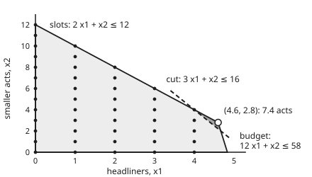

# Cutting planes: slicing off fractional corners without losing integer points

[Syllabus](../../../SYLLABUS.md) → [Optimization](../README.md) → [Integer and Combinatorial Optimisation](../README.md#s05) → Cutting planes

---

## General Overview

The shelf's festival again. A headliner costs £60k, needs 4 hours of stage time and draws about 5,500 extra tickets. A smaller act costs £5k, needs 2 hours and draws about 1,000. The budget is £290k and the stage licence gives 24 hours. The organiser books whole acts and wants as many tickets as possible, so this is a maximisation.

Allow fractions and the best plan is 4.6 headliners and 2.8 smaller acts: 7.4 acts, 28,100 tickets ([Integer programs](01-integer-programs-and-relaxations.md)). This version with fractions allowed is the relaxed problem. Its best plan sits at a corner, where the budget and the stage hours are both used up exactly. Its best value is a ceiling, because no whole booking can beat it.

Nobody books 0.6 of a band. The best whole booking is 4 and 4, for 26,000 tickets, so the fractional ceiling sits 2,100 tickets too high.

[Branch and bound](03-branch-and-bound.md) attacks that ceiling by splitting into cases. A cutting plane attacks it differently. It adds one new limit that every whole booking already obeys and the 7.4-act corner breaks.

Here the limit is $3x_1 + x_2 \le 16$, with $x_1$ headliners and $x_2$ smaller acts: score a headliner 3 and a smaller act 1, and keep the score at 16 or less. All 45 whole bookings pass. The corner scores 16.6 and is gone. Nothing is guessed: the limit is read off the simplex method's final table.

**A cutting plane is a new inequality that every whole-number plan obeys and the fractional corner breaks, so adding it lowers the ceiling without losing a single real plan.**

**What kind of fact this is:** a theorem, proved on this card in Why it works: the cut keeps every whole plan and removes the corner. Gomory's result that repeated cuts finish in finitely many rounds is stated with its source, not proved.

### The picture: one cut removes the 7.4-act corner

<p align="center"></p>

The shaded region holds every booking the budget and the hours allow, fractions included. The dots are the 45 whole bookings. The cut runs through the dot (4, 4) and slices off the small triangle at the corner. No dot is lost.

---

## The formula

Notation first, in words. [The simplex method](../04-Linear%20Programming/03-simplex-method.md) ends with a **tableau**: one equation per limit, each solved for one **basic** variable (allowed to be non-zero at the corner) in terms of the **non-basic** ones (held at zero there). Write one such row as

$$x_B + \sum_{j} \bar a_j\, x_j = \bar b ,$$

where the sum runs over the non-basic variables $x_j$. The **fractional part** of a number is what is left after rounding down: $f(v) = v - \lfloor v \rfloor$. So $f(4.6) = 0.6$, and $f(-0.1) = 0.9$, because rounding −0.1 down gives −1.

The **Gomory fractional cut** from that row is

$$\sum_{j} f(\bar a_j)\, x_j \;\ge\; f(\bar b).$$

**Read it aloud:** weight each non-basic variable by the fractional part of its coefficient; together they must reach at least the fractional part of the right side.

To keep every number whole, money is counted in £5k units and time in 2-hour slots. The budget becomes $12x_1 + x_2 \le 58$ and the stage $2x_1 + x_2 \le 12$.

| Symbol | Plain meaning | In our example | Push it up and the answer… |
| --- | --- | --- | --- |
| $x_1$ | headliners booked | 4.6 at the corner, 4 in the answer | +5,500 tickets each, but £60k and 4 hours |
| $x_2$ | smaller acts booked | 2.8 at the corner, 4 in the answer | +1,000 tickets each, £5k and 2 hours |
| $s_1$ | budget slack: £5k units left unspent | $58 - 12x_1 - x_2$ | — |
| $s_2$ | stage slack: 2-hour slots left empty | $12 - 2x_1 - x_2$ | — |
| $x_B$ | the basic variable a tableau row is solved for | $x_1$ | — |
| $x_j$ | a non-basic variable, zero at the corner | $s_1$ and $s_2$ | — |
| $\bar a_j$ | its coefficient in that row | 0.1 for $s_1$, −0.1 for $s_2$ | — |
| $\bar b$ | the row's right side: $x_B$ at the corner | 4.6 | a bigger fractional part, a deeper cut |
| $\lfloor v \rfloor$ | $v$ rounded down to a whole number | $\lfloor -0.1 \rfloor = -1$ | — |
| $f(v)$ | fractional part $v - \lfloor v \rfloor$, from 0 up to but not including 1 | $f(-0.1) = 0.9$ | — |

### When it holds

- **Every variable, slacks included, must be a whole number at a whole plan.** That needs whole coefficients and whole limits. Write the budget in millions of pounds, $0.06x_1 + 0.005x_2 \le 0.29$, and the slack can be 0.005; the same recipe then throws out the best booking (see What breaks).
- **The row must come from a corner.** The corner breaks the cut because its non-basic variables are zero. A point inside the region need not break it.
- **The right side must be fractional.** If $f(\bar b) = 0$ the cut says "something non-negative is at least 0", which removes nothing.
- **One cut rarely finishes.** Here the new corner is still fractional. Pure cutting repeats; branch and cut mixes cuts with branching.

---

## Why it works

### Step 0: whole plans make whole equations

Each tableau row is a mixture of the original limits, so every plan, fractional or whole, satisfies it. At a whole booking all the variables in the row, slacks included, are whole numbers; only the row's coefficients and right side can be fractional.

Split each of those into a whole part and a fractional part. The whole parts give a whole number, and the fractional parts must make up the rest. That forces an inequality the fractional corner cannot meet.

There is a second way to see the same cut. Mix the two limits, 0.1 of the budget row plus 0.9 of the stage row:

$$0.1\,(12x_1 + x_2) + 0.9\,(2x_1 + x_2) \le 0.1 \times 58 + 0.9 \times 12, \quad\text{that is}\quad 3x_1 + x_2 \le 16.6 .$$

At a whole booking the left side is a whole number. A whole number no bigger than 16.6 is no bigger than 16. Rounding down the right side is the whole trick.

### Step 1: the tableau row at the 7.4-act corner

Two simplex pivots (steps from one corner to the next) reach the corner (4.6, 2.8). The row solved for $x_1$ reads

$$x_1 + 0.1\,s_1 - 0.1\,s_2 = 4.6 .$$

At the corner both slacks are zero (money and stage are used up) and $x_1 = 4.6$.

### Step 2: split and round

Write $0.1 = 0 + 0.1$, $-0.1 = -1 + 0.9$ and $4.6 = 4 + 0.6$. Whole parts to the left, fractional parts to the right:

$$x_1 - s_2 - 4 = 0.6 - 0.1\,s_1 - 0.9\,s_2 .$$

At a whole booking the left side is a whole number. The right side is at most 0.6, because slacks are never negative. A whole number that is at most 0.6 is at most 0. So the right side is at most 0:

$$0.1\,s_1 + 0.9\,s_2 \ge 0.6 .$$

That is the formula, with $f(0.1) = 0.1$, $f(-0.1) = 0.9$ and $f(4.6) = 0.6$.

<details>
<summary>Detailed proof: the Gomory cut keeps every whole-number point and removes the corner</summary>

Take a row $x_B + \sum_j \bar a_j x_j = \bar b$ of the final tableau of a problem whose limits have whole coefficients and whole right sides. Take any point where every variable, slacks included, is a whole number and none is negative. The row holds at that point, because the tableau is the original limits combined.

Split $\bar a_j = \lfloor \bar a_j \rfloor + f(\bar a_j)$ and $\bar b = \lfloor \bar b \rfloor + f(\bar b)$. The row becomes

$$x_B + \sum_j \lfloor \bar a_j \rfloor x_j - \lfloor \bar b \rfloor = f(\bar b) - \sum_j f(\bar a_j)\, x_j .$$

The left side is built from whole numbers, so it is a whole number. On the right each $f(\bar a_j) \ge 0$ and each $x_j \ge 0$, so the right side is at most $f(\bar b)$, which is below 1. A whole number below 1 is at most 0. Hence $f(\bar b) - \sum_j f(\bar a_j) x_j \le 0$, which is the cut.

At the corner each non-basic $x_j$ is 0, so the cut's left side is 0. When $\bar b$ is fractional, $f(\bar b) > 0$ and the corner breaks the cut.

</details>

### Step 3: the corner breaks it

At the corner $s_1 = s_2 = 0$, so the left side is 0, short of 0.6. This is no accident: non-basic variables are zero at every corner, so any row with a fractional right side gives a cut that its corner breaks.

### Step 4: back into acts

Replace the slacks by what they measure, $s_1 = 58 - 12x_1 - x_2$ and $s_2 = 12 - 2x_1 - x_2$. The cut becomes $16.6 - 3x_1 - x_2 \ge 0.6$, which is

$$3x_1 + x_2 \le 16 .$$

The same cut as the mixture in Step 0. The corner scores 16.6; all 45 whole bookings score 16 or less, and (4, 4) scores exactly 16.

Re-solve with the new limit and the best corner moves to (4.67, 2), worth 27,666.67 tickets. The ceiling has dropped from 28,100 and the gap to the best whole booking from 2,100 to 1,666.67 tickets. The corner is still fractional, so the work is not done.

The row solved for $x_2$, $x_2 - 0.2\,s_1 + 1.2\,s_2 = 2.8$, gives a second valid cut, $0.8\,s_1 + 0.2\,s_2 \ge 0.8$, or $10x_1 + x_2 \le 48$. It also removes the corner (which scores 48.8) but leaves a higher ceiling, 27,750 tickets at (4.5, 3). Rows differ in how deep they cut.

### Step 5: cut again, and again

Pure cutting repeats Steps 1 to 4 on the new corner, each time from the row of the variable that is still fractional:

| Round | Cut | New best corner | Ceiling, tickets |
| --- | --- | --- | --- |
| 0 | none | (4.6, 2.8) | 28,100 |
| 1 | $3x_1 + x_2 \le 16$ | (4.67, 2) | 27,666.67 |
| 2 | $4x_1 + x_2 \le 20$ | (4.75, 1) | 27,125 |
| 3 | $5x_1 + x_2 \le 24$ | (4.8, 0) | 26,400 |
| 4 | $x_1 \le 4$ | **(4, 4)** | **26,000** |

After four rounds the best corner is whole, and the ceiling equals a real booking. That equality is the certificate: no booking can beat the ceiling, and (4, 4) reaches it. The fourth cut, "at most 4 headliners", is the very limit that [Integer programs](01-integer-programs-and-relaxations.md) adds by hand to close the gap.

Gomory announced in 1958 that, with a careful choice of rows and of pivoting rules, this process always ends after finitely many cuts at a whole-number optimum. Finite can mean very many. On larger problems the cuts grow shallow and the arithmetic delicate, so pure cutting is rarely used on its own.

### Step 6: branch and cut, both ideas in one search

**Branch and cut** runs [Branch and bound](03-branch-and-bound.md) and, at each node of the search tree (each case the split creates), adds cuts before deciding whether to branch. A Gomory cut derived at the root is valid for the whole problem, so it is kept and helps every node. Cuts lower the ceilings, so more nodes are pruned (dropped without being split further); branching guarantees progress when the cuts stall.

On the festival:

- **Branch and bound alone:** the root (4.6, 2.8) splits on $x_1$. The branch $x_1 \le 4$ lands on (4, 4), 26,000 tickets, a whole booking. The branch $x_1 \ge 5$ is empty: five headliners break the budget. Three nodes.
- **One cut, then branch:** the root becomes (4.67, 2), ceiling 27,666.67. One split on $x_1$ gives the same two children. Three nodes.

One cut does not shrink this tree (four cuts would, to a single node), so the cut's gain here is the root ceiling: 1,666.67 tickets above the answer instead of 2,100.

On problems with thousands of variables that gap decides how many nodes survive pruning. Balas, Ceria, Cornuéjols and Natraj (1996) showed that rounds of Gomory cuts at the root, followed by branching, make Gomory's cuts practical on standard test problems, and integer-programming solvers combine cuts and branching in this way.

---

## Worked numbers, by hand

| Step | Arithmetic | Value |
| --- | --- | --- |
| relaxed corner | budget $12x_1 + x_2 = 58$ meets stage $2x_1 + x_2 = 12$ | (4.6, 2.8): 7.4 acts, 28,100 tickets |
| tableau row for $x_1$ | from the simplex, 2 pivots | $x_1 + 0.1 s_1 - 0.1 s_2 = 4.6$ |
| fractional parts | $f(0.1)$, $f(-0.1)$, $f(4.6)$ | 0.1, 0.9, 0.6 |
| the cut in slacks | $0.1 s_1 + 0.9 s_2 \ge 0.6$ | the corner gives 0, so it breaks |
| the cut in acts | substitute the slacks: $16.6 - 3x_1 - x_2 \ge 0.6$ | $3x_1 + x_2 \le 16$ |
| corner against the cut | 3 × 4.6 + 2.8 | 16.6 > 16 |
| whole bookings kept | all 45 checked one by one | 45 of 45 |
| re-solved ceiling | new best corner (4.67, 2) | **27,666.67 tickets** |

One cut lowers the ceiling from 28,100 to 27,666.67 tickets and keeps every whole booking; three more rounds, or one branch, reach the proved answer of 4 headliners and 4 smaller acts, 26,000 tickets.

### What breaks if you drop a piece

| Mistake | Comes out at | What went wrong |
| --- | --- | --- |
| Round the corner to (5, 3) | £315k > £290k and 26 hours > 24 | Rounding ignores the limits |
| Round down to (4, 2) | 24,000 tickets, 2,000 short | Rounding down is allowed but wastes a slot |
| Budget in millions, $0.06x_1 + 0.005x_2 \le 0.29$ | cut $38x_1 + 19x_2 \le 222$ throws out (0, 12), (1, 10), (2, 8), (3, 6) and (4, 4); best left (4, 3), 25,000 tickets | The budget slack can be 0.005, not whole, so Step 2's "whole number" fails and the cut deletes the true answer |

The code prints all three. The last row is the hypothesis failing: the arithmetic of the recipe runs without complaint and quietly cuts away every booking that fills all 24 hours.

---

## Code, from first principles, and it actually runs

Nothing imported knows linear programming. The Python uses exact fractions; the Rust carries its own fraction type. There are three independent roads:

- Road one is the simplex method, pivot by pivot, which produces the tableau and the cut.
- Road two lists every corner of the region by crossing each pair of edges and keeping the crossings that obey all the limits.
- Road three lists all 45 whole bookings and checks each cut against every one, the pure-cutting rounds included.

On top of those, a depth-first branch and bound counts nodes with and without the cut, and a loop repeats Gomory cuts until the corner is whole; its last corner must be the best booking from the list.

### Python

```python
# Cutting planes -- the check behind the card.  Standard library, exact fractions.
# Festival: x1 headliners (60 thousand pounds, 4 hours, 5,500 tickets), x2 smaller
# acts (5 thousand, 2 hours, 1,000 tickets); 290 thousand pounds, 24 stage hours.
# Money in 5-thousand units, time in 2-hour slots; tickets in hundreds; maximise.
# Roads: simplex tableau; every corner of the region; every whole-number booking.
from fractions import Fraction as Fr
from itertools import combinations
from math import floor, gcd

A, B, C = [[12, 1], [2, 1]], [58, 12], [55, 10]
val = lambda x: C[0] * x[0] + C[1] * x[1]       # tickets, in hundreds

def simplex(A, b):                     # maximise C.x, Ax <= b, x >= 0, slack start
    m, n = len(A), 2
    T = [[Fr(v) for v in A[i]] + [Fr(int(i == j)) for j in range(m)] + [Fr(b[i])] for i in range(m)]
    z, basis, pivots = [Fr(-v) for v in C] + [Fr(0)] * (m + 1), [n + i for i in range(m)], 0
    while True:
        col = next((j for j in range(n + m) if z[j] < 0), None)          # Bland's rule
        if col is None:
            return T, z, basis, pivots
        r = min((T[i][-1] / T[i][col], basis[i], i) for i in range(m) if T[i][col] > 0)[2]
        T[r] = [v / T[r][col] for v in T[r]]
        for row in T + [z]:
            if row is not T[r]:
                f = row[col]
                row[:] = [a - f * c for a, c in zip(row, T[r])]
        basis[r], pivots = col, pivots + 1

def corners(A, b, extra=()):           # road 2: every crossing of two edges, kept if feasible
    rows = [(a, Fr(bi)) for a, bi in zip(A, b)] + [([-1, 0], Fr(0)), ([0, -1], Fr(0))] + list(extra)
    pts = set()
    for (p, e), (q, f) in combinations(rows, 2):
        d = p[0] * q[1] - p[1] * q[0]
        if d:
            x = ((e * q[1] - p[1] * f) / d, (p[0] * f - e * q[0]) / d)
            if all(a[0] * x[0] + a[1] * x[1] <= c for a, c in rows):
                pts.add(x)
    return sorted(pts)

def lp_best(A, b, extra=()):           # None when the region is empty
    return max(corners(A, b, extra), key=lambda x: (val(x), x), default=None)

def plans(A, b):                       # road 3: every whole-number booking
    return [(i, j) for i in range(13) for j in range(13)
            if all(a[0] * i + a[1] * j <= c for a, c in zip(A, b))]

frac = lambda v: v - floor(v)          # fractional part: frac(-0.1) = 0.9

def gomory(row, A, b):                 # sum frac(a_j) s_j >= frac(rhs), rewritten in x1, x2
    m = len(A)
    fs, fx = [frac(v) for v in row[2:2 + m]], [frac(v) for v in row[:2]]
    cx = [sum(fs[i] * A[i][k] for i in range(m)) - fx[k] for k in range(2)]  # s_i = b_i - A_i x
    rhs = sum(fs[i] * b[i] for i in range(m)) - frac(row[-1])
    scale = 1
    for v in cx + [rhs]:
        scale = scale * v.denominator // gcd(scale, v.denominator)
    ints = [int(v * scale) for v in cx + [rhs]]
    g = gcd(gcd(ints[0], ints[1]), ints[2])
    return fs, frac(row[-1]), [ints[0] // g, ints[1] // g], ints[2] // g

def bnb(extra, st, log, depth=0):      # depth first, x <= floor branch first; st = [best, plan, nodes]
    x = lp_best(A, B, extra)
    st[2] += 1
    log.append((depth, x))
    if x is None or (st[0] is not None and val(x) <= st[0]):
        return                         # empty, or cannot beat the best booking found
    k = next((k for k in range(2) if x[k].denominator > 1), None)
    if k is None:
        st[0], st[1] = val(x), x
        return
    lo, hi = [0, 0], [0, 0]
    lo[k], hi[k] = 1, -1
    bnb(tuple(extra) + ((lo, Fr(floor(x[k]))),), st, log, depth + 1)
    bnb(tuple(extra) + ((hi, Fr(-floor(x[k]) - 1)),), st, log, depth + 1)

show = lambda v: str(v) if v.denominator == 1 else f"{float(v):.2f}".rstrip("0")
pt = lambda p: f"({show(Fr(p[0]))}, {show(Fr(p[1]))})"
tk = lambda p: show(100 * val(p))

T, z, basis, piv = simplex(A, B)
x = [next((T[i][-1] for i, bv in enumerate(basis) if bv == k), Fr(0)) for k in range(2)]
top = lp_best(A, B)
print(f"relaxation by simplex: {pt(x)}, {show(x[0] + x[1])} acts, {show(100 * z[-1])} tickets, {piv} pivots")
print(f"relaxation by corners: {' '.join(pt(p) for p in corners(A, B))} -> best {pt(top)}, {tk(top)} tickets")
for i, bv in enumerate(basis):
    print(f"tableau row x{bv + 1}: s1 {show(T[i][2])}, s2 {show(T[i][3])}, right side {show(T[i][-1])}")
pts = plans(A, B)
best = max(pts, key=val)
print(f"whole-number bookings: {len(pts)}; best {pt(best)}, {tk(best)} tickets; gap {show(100 * (val(top) - val(best)))}")
cuts = {}
for i, bv in enumerate(basis):
    fs, f0, a, c = gomory(T[i], A, B)
    cuts[bv] = ((a, Fr(c)),)
    new = lp_best(A, B, cuts[bv])
    print(f"cut from row x{bv + 1}: {show(fs[0])} s1 + {show(fs[1])} s2 >= {show(f0)}  ->  {a[0]} x1 + {a[1]} x2 <= {c}; "
          f"corner gives {show(a[0] * top[0] + a[1] * top[1])}; new best {pt(new)}, {tk(new)} tickets")
    assert all(a[0] * p + a[1] * q <= c for p, q in pts)            # keeps every whole booking
    assert a[0] * top[0] + a[1] * top[1] > c                        # removes the 7.4-act corner
w = [Fr(1, 10), Fr(9, 10)]                     # the x1 cut as a blend of the two limits, rounded
print(f"blend 0.1 x budget + 0.9 x slots: {show(w[0] * 12 + w[1] * 2)} x1 + {show(w[0] + w[1])} x2 <= "
      f"{show(w[0] * 58 + w[1] * 12)}, round down to {floor(w[0] * 58 + w[1] * 12)}")
T2, z2, b2, piv2 = simplex(A + [cuts[0][0][0]], B + [cuts[0][0][1]])
print(f"re-solve with the cut by simplex: {show(100 * z2[-1])} tickets, gap {show(100 * (z2[-1] - val(best)))}, {piv2} pivots")
for name, extra in (("branch and bound, no cut", ()), ("branch and cut, x1-row cut at root", cuts[0])):
    st, log = [None, None, 0], []
    bnb(extra, st, log)
    print(f"{name}: nodes {st[2]}, best {pt(st[1])}, {tk(st[1])} tickets")
    for d, p in log:
        print(f"  node at depth {d}: " + ("empty" if p is None else f"{pt(p)}, {tk(p)} tickets"))
rows, rounds, cur = [], 0, top                 # pure cutting: the x1 row's cut, round after round
while any(v.denominator > 1 for v in cur):
    Ac, Bc = A + [r[0] for r in rows], B + [r[1] for r in rows]
    T3, z3, b3, _ = simplex(Ac, Bc)
    _, _, a3, c3 = gomory(T3[b3.index(0 if cur[0].denominator > 1 else 1)], Ac, Bc)
    assert all(a3[0] * p + a3[1] * q <= c3 for p, q in pts)          # keeps every whole booking
    assert a3[0] * cur[0] + a3[1] * cur[1] > c3                      # removes the current corner
    rows, rounds = rows + [(a3, Fr(c3))], rounds + 1
    cur = lp_best(A, B, rows)
    print(f"  pure cutting, round {rounds}: {a3[0]} x1 + {a3[1]} x2 <= {c3}; best {pt(cur)}, {tk(cur)} tickets")
print(f"mistake 1, round the corner to (5, 3): budget {60 * 5 + 5 * 3} > 290, hours {4 * 5 + 2 * 3} > 24")
print(f"mistake 2, round down to (4, 2): {tk((4, 2))} tickets, {show(100 * (val(best) - val((4, 2))))} short")
Am, Bm = [[Fr(6, 100), Fr(5, 1000)], [4, 2]], [Fr(29, 100), 24]   # budget in millions of pounds
Tm, zm, bm, _ = simplex(Am, Bm)
_, _, a5, c5 = gomory(Tm[bm.index(0)], Am, Bm)
lost = [p for p in pts if a5[0] * p[0] + a5[1] * p[1] > c5]
left = max((p for p in pts if p not in lost), key=val)
print(f"mistake 3, budget in millions, 0.06 x1 + 0.005 x2 <= 0.29: cut {a5[0]} x1 + {a5[1]} x2 <= {c5} "
      f"throws out {lost}; best left {pt(left)}, {tk(left)} tickets")
for name, extra in (("region", ()), ("after the cut", cuts[0])):
    print(f"figure, {name}: {' '.join(pt(p) for p in corners(A, B, extra))}")
assert x == list(top) and 100 * z[-1] == 28100 == 100 * val(top)      # simplex agrees with corners
assert best == (4, 4) == tuple(st[1]) and val(best) == 260 == st[0]   # search agrees with the list
assert cuts[0][0] == ([3, 1], 16) and z2[-1] == val(lp_best(A, B, cuts[0]))
assert (4, 4) in lost and val(left) < val(best)                       # fractional data breaks it
assert cur == best and rounds == 4                                    # pure cutting ends at the listed best
print("ALL CHECKS PASS")
```

**Ran 2026-11-11 on macOS, Python 3.14.10, standard library only. All checks passed. Output, pasted from the run:**

```
relaxation by simplex: (4.6, 2.8), 7.4 acts, 28100 tickets, 2 pivots
relaxation by corners: (0, 0) (0, 12) (4.6, 2.8) (4.83, 0) -> best (4.6, 2.8), 28100 tickets
tableau row x1: s1 0.1, s2 -0.1, right side 4.6
tableau row x2: s1 -0.2, s2 1.2, right side 2.8
whole-number bookings: 45; best (4, 4), 26000 tickets; gap 2100
cut from row x1: 0.1 s1 + 0.9 s2 >= 0.6  ->  3 x1 + 1 x2 <= 16; corner gives 16.6; new best (4.67, 2), 27666.67 tickets
cut from row x2: 0.8 s1 + 0.2 s2 >= 0.8  ->  10 x1 + 1 x2 <= 48; corner gives 48.8; new best (4.5, 3), 27750 tickets
blend 0.1 x budget + 0.9 x slots: 3 x1 + 1 x2 <= 16.6, round down to 16
re-solve with the cut by simplex: 27666.67 tickets, gap 1666.67, 2 pivots
branch and bound, no cut: nodes 3, best (4, 4), 26000 tickets
  node at depth 0: (4.6, 2.8), 28100 tickets
  node at depth 1: (4, 4), 26000 tickets
  node at depth 1: empty
branch and cut, x1-row cut at root: nodes 3, best (4, 4), 26000 tickets
  node at depth 0: (4.67, 2), 27666.67 tickets
  node at depth 1: (4, 4), 26000 tickets
  node at depth 1: empty
  pure cutting, round 1: 3 x1 + 1 x2 <= 16; best (4.67, 2), 27666.67 tickets
  pure cutting, round 2: 4 x1 + 1 x2 <= 20; best (4.75, 1), 27125 tickets
  pure cutting, round 3: 5 x1 + 1 x2 <= 24; best (4.8, 0), 26400 tickets
  pure cutting, round 4: 1 x1 + 0 x2 <= 4; best (4, 4), 26000 tickets
mistake 1, round the corner to (5, 3): budget 315 > 290, hours 26 > 24
mistake 2, round down to (4, 2): 24000 tickets, 2000 short
mistake 3, budget in millions, 0.06 x1 + 0.005 x2 <= 0.29: cut 38 x1 + 19 x2 <= 222 throws out [(0, 12), (1, 10), (2, 8), (3, 6), (4, 4)]; best left (4, 3), 25000 tickets
figure, region: (0, 0) (0, 12) (4.6, 2.8) (4.83, 0)
figure, after the cut: (0, 0) (0, 12) (4, 4) (4.67, 2) (4.83, 0)
ALL CHECKS PASS
```

### Rust

Same numbers, same labels, built with `rustc --edition 2021 -O`.

```rust
// Cutting planes -- the same check as the Python, in Rust.  No crates; a small
// exact-fraction type.  Festival: x1 headliners (60 thousand pounds, 4 hours,
// 5,500 tickets), x2 smaller acts (5 thousand, 2 hours, 1,000 tickets); 290
// thousand pounds, 24 stage hours.  Money in 5-thousand units, time in 2-hour
// slots; tickets in hundreds; maximise.  Same three roads as the Python.
use std::cmp::Ordering;
#[derive(Clone, Copy, PartialEq, Eq, Debug)]
struct Q(i64, i64); // numerator, denominator > 0, in lowest terms
fn gcd(a: i64, b: i64) -> i64 { if b == 0 { a.abs() } else { gcd(b, a % b) } }
fn q(n: i64, d: i64) -> Q { let g = gcd(n, d).max(1) * d.signum(); Q(n / g, d / g) }
fn z(n: i64) -> Q { Q(n, 1) }
impl std::ops::Add for Q { type Output = Q; fn add(self, o: Q) -> Q { q(self.0 * o.1 + o.0 * self.1, self.1 * o.1) } }
impl std::ops::Sub for Q { type Output = Q; fn sub(self, o: Q) -> Q { q(self.0 * o.1 - o.0 * self.1, self.1 * o.1) } }
impl std::ops::Mul for Q { type Output = Q; fn mul(self, o: Q) -> Q { q(self.0 * o.0, self.1 * o.1) } }
impl std::ops::Div for Q { type Output = Q; fn div(self, o: Q) -> Q { q(self.0 * o.1, self.1 * o.0) } }
impl Ord for Q { fn cmp(&self, o: &Q) -> Ordering { (self.0 * o.1).cmp(&(o.0 * self.1)) } }
impl PartialOrd for Q { fn partial_cmp(&self, o: &Q) -> Option<Ordering> { Some(self.cmp(o)) } }
fn floor(v: Q) -> i64 { v.0.div_euclid(v.1) }
fn frac(v: Q) -> Q { v - z(floor(v)) } // fractional part: frac(-0.1) = 0.9
fn show(v: Q) -> String {
    if v.1 == 1 { return format!("{}", v.0) }
    format!("{:.2}", v.0 as f64 / v.1 as f64).trim_end_matches('0').to_string()
}
type P = (Q, Q);
type Row = (Vec<Q>, Q);
const C: [i64; 2] = [55, 10];
fn val(p: P) -> Q { z(C[0]) * p.0 + z(C[1]) * p.1 } // tickets, in hundreds
fn pt(p: P) -> String { format!("({}, {})", show(p.0), show(p.1)) }
fn tk(p: P) -> String { show(z(100) * val(p)) }
fn pts_str(ps: &[P]) -> String { ps.iter().map(|&p| pt(p)).collect::<Vec<_>>().join(" ") }
fn wp(p: (i64, i64)) -> P { (z(p.0), z(p.1)) }

fn simplex(a: &[Vec<Q>], b: &[Q]) -> (Vec<Vec<Q>>, Vec<Q>, Vec<usize>, usize) { // maximise C.x, Ax <= b
    let (m, n) = (a.len(), 2);
    let mut t: Vec<Vec<Q>> = (0..m).map(|i| {
        let mut r = a[i].clone();
        r.extend((0..m).map(|j| z((i == j) as i64))); r.push(b[i]); r }).collect();
    let mut zr: Vec<Q> = C.iter().map(|&c| z(-c)).collect(); zr.extend(vec![z(0); m + 1]);
    let (mut basis, mut piv): (Vec<usize>, usize) = ((n..n + m).collect(), 0);
    loop {
        let col = match (0..n + m).find(|&j| zr[j] < z(0)) { Some(c) => c, None => return (t, zr, basis, piv) }; // Bland
        let r = (0..m).filter(|&i| t[i][col] > z(0))
            .min_by(|&i, &k| (t[i][n + m] / t[i][col], basis[i]).cmp(&(t[k][n + m] / t[k][col], basis[k]))).unwrap();
        let p = t[r][col];
        t[r] = t[r].iter().map(|&v| v / p).collect();
        let pr = t[r].clone();
        for i in 0..m { if i != r { let f = t[i][col]; t[i] = t[i].iter().zip(&pr).map(|(&x, &c)| x - f * c).collect(); } }
        let f = zr[col]; zr = zr.iter().zip(&pr).map(|(&x, &c)| x - f * c).collect();
        basis[r] = col; piv += 1;
    }
}
fn corners(a: &[Vec<Q>], b: &[Q], extra: &[Row]) -> Vec<P> { // road 2: every crossing of two edges
    let mut rows: Vec<Row> = a.iter().cloned().zip(b.iter().cloned()).collect();
    rows.push((vec![z(-1), z(0)], z(0))); rows.push((vec![z(0), z(-1)], z(0)));
    rows.extend(extra.iter().cloned());
    let mut pts: Vec<P> = vec![];
    for i in 0..rows.len() { for j in i + 1..rows.len() {
        let ((p, e), (r, f)) = (&rows[i], &rows[j]);
        let d = p[0] * r[1] - p[1] * r[0];
        if d == z(0) { continue }
        let x = ((*e * r[1] - p[1] * *f) / d, (p[0] * *f - *e * r[0]) / d);
        if rows.iter().all(|(g, c)| g[0] * x.0 + g[1] * x.1 <= *c) && !pts.contains(&x) { pts.push(x) }
    } }
    pts.sort(); pts
}
fn lp_best(a: &[Vec<Q>], b: &[Q], extra: &[Row]) -> Option<P> { // None when the region is empty
    corners(a, b, extra).into_iter().max_by_key(|&p| (val(p), p.0, p.1))
}
fn plans(a: &[Vec<Q>], b: &[Q]) -> Vec<(i64, i64)> { // road 3: every whole-number booking
    let mut v = vec![];
    for i in 0..13 { for j in 0..13 { if a.iter().zip(b).all(|(r, &c)| r[0] * z(i) + r[1] * z(j) <= c) { v.push((i, j)) } } }
    v
}
fn gomory(row: &[Q], a: &[Vec<Q>], b: &[Q]) -> (Vec<Q>, Q, [i64; 2], i64) {
    let m = a.len();
    let fs: Vec<Q> = row[2..2 + m].iter().map(|&v| frac(v)).collect();
    let cx: Vec<Q> = (0..2).map(|k| (0..m).fold(z(0), |s, i| s + fs[i] * a[i][k]) - frac(row[k])).collect();
    let rhs = (0..m).fold(z(0), |s, i| s + fs[i] * b[i]) - frac(row[row.len() - 1]);
    let vals = [cx[0], cx[1], rhs];
    let scale = vals.iter().fold(1, |s, v| s * v.1 / gcd(s, v.1));
    let ints: Vec<i64> = vals.iter().map(|v| v.0 * (scale / v.1)).collect();
    let g = gcd(gcd(ints[0], ints[1]), ints[2]);
    (fs, frac(row[row.len() - 1]), [ints[0] / g, ints[1] / g], ints[2] / g)
}
struct St { best: Option<(Q, P)>, nodes: usize, log: Vec<(usize, Option<P>)> }
fn bnb(a: &[Vec<Q>], b: &[Q], extra: Vec<Row>, st: &mut St, depth: usize) { // depth first, x <= floor first
    let x = lp_best(a, b, &extra);
    st.nodes += 1; st.log.push((depth, x));
    let x = match x { Some(x) => x, None => return };
    if let Some((v, _)) = st.best { if val(x) <= v { return } } // cannot beat the best booking found
    let k = match (0..2).find(|&k| [x.0, x.1][k].1 > 1) { Some(k) => k, None => { st.best = Some((val(x), x)); return } };
    let fl = floor([x.0, x.1][k]);
    let (mut lo, mut hi) = (vec![z(0), z(0)], vec![z(0), z(0)]);
    lo[k] = z(1); hi[k] = z(-1);
    let (mut e1, mut e2) = (extra.clone(), extra);
    e1.push((lo, z(fl))); e2.push((hi, z(-fl - 1)));
    bnb(a, b, e1, st, depth + 1); bnb(a, b, e2, st, depth + 1);
}
fn cut_row(c: [i64; 2], r: i64) -> Row { (vec![z(c[0]), z(c[1])], z(r)) }
fn qv(v: &[i64]) -> Vec<Q> { v.iter().map(|&x| z(x)).collect() }

fn main() {
    let a = vec![qv(&[12, 1]), qv(&[2, 1])];
    let b = qv(&[58, 12]);
    let (t, zr, basis, piv) = simplex(&a, &b);
    let x: P = (basis.iter().position(|&v| v == 0).map_or(z(0), |i| t[i][4]), basis.iter().position(|&v| v == 1).map_or(z(0), |i| t[i][4]));
    let top = lp_best(&a, &b, &[]).unwrap();
    println!("relaxation by simplex: {}, {} acts, {} tickets, {} pivots", pt(x), show(x.0 + x.1), show(z(100) * zr[4]), piv);
    println!("relaxation by corners: {} -> best {}, {} tickets", pts_str(&corners(&a, &b, &[])), pt(top), tk(top));
    for (i, bv) in basis.iter().enumerate() {
        println!("tableau row x{}: s1 {}, s2 {}, right side {}", bv + 1, show(t[i][2]), show(t[i][3]), show(t[i][4]));
    }
    let pts = plans(&a, &b);
    let best = *pts.iter().max_by_key(|&&p| val(wp(p))).unwrap();
    println!("whole-number bookings: {}; best {}, {} tickets; gap {}", pts.len(), pt(wp(best)), tk(wp(best)), show(z(100) * (val(top) - val(wp(best)))));
    let mut cuts = vec![([0i64; 2], 0i64); 2];
    for (i, &bv) in basis.iter().enumerate() {
        let (fs, f0, c, r) = gomory(&t[i], &a, &b);
        cuts[bv] = (c, r);
        let nw = lp_best(&a, &b, &[cut_row(c, r)]).unwrap();
        println!("cut from row x{}: {} s1 + {} s2 >= {}  ->  {} x1 + {} x2 <= {}; corner gives {}; new best {}, {} tickets",
            bv + 1, show(fs[0]), show(fs[1]), show(f0), c[0], c[1], r, show(z(c[0]) * top.0 + z(c[1]) * top.1), pt(nw), tk(nw));
        assert!(pts.iter().all(|p| c[0] * p.0 + c[1] * p.1 <= r)); // keeps every whole booking
        assert!(z(c[0]) * top.0 + z(c[1]) * top.1 > z(r)); // removes the 7.4-act corner
    }
    let w = [q(1, 10), q(9, 10)]; // the x1 cut as a blend of the two limits, rounded
    let rb = w[0] * z(58) + w[1] * z(12);
    println!("blend 0.1 x budget + 0.9 x slots: {} x1 + {} x2 <= {}, round down to {}", show(w[0] * z(12) + w[1] * z(2)), show(w[0] + w[1]), show(rb), floor(rb));
    let (_, z2, _, piv2) = simplex(&[a[0].clone(), a[1].clone(), qv(&cuts[0].0)], &[b[0], b[1], z(cuts[0].1)]);
    println!("re-solve with the cut by simplex: {} tickets, gap {}, {} pivots", show(z(100) * z2[5]), show(z(100) * (z2[5] - val(wp(best)))), piv2);
    let mut found = (z(0), (z(0), z(0)));
    for (name, extra) in [("branch and bound, no cut", vec![]), ("branch and cut, x1-row cut at root", vec![cut_row(cuts[0].0, cuts[0].1)])] {
        let mut st = St { best: None, nodes: 0, log: vec![] };
        bnb(&a, &b, extra, &mut st, 0);
        found = st.best.unwrap();
        println!("{}: nodes {}, best {}, {} tickets", name, st.nodes, pt(found.1), tk(found.1));
        for (d, p) in &st.log {
            match p { None => println!("  node at depth {}: empty", d), Some(p) => println!("  node at depth {}: {}, {} tickets", d, pt(*p), tk(*p)) }
        }
    }
    let (mut ac, mut bc, mut cur, mut rounds) = (a.clone(), b.clone(), top, 0); // pure cutting, round after round
    while cur.0.1 > 1 || cur.1.1 > 1 {
        let (t3, _, b3, _) = simplex(&ac, &bc);
        let want = if cur.0.1 > 1 { 0 } else { 1 };
        let (_, _, c3, r3) = gomory(&t3[b3.iter().position(|&v| v == want).unwrap()], &ac, &bc);
        assert!(pts.iter().all(|p| c3[0] * p.0 + c3[1] * p.1 <= r3) && z(c3[0]) * cur.0 + z(c3[1]) * cur.1 > z(r3)); // keeps every booking, removes the corner
        ac.push(qv(&c3)); bc.push(z(r3)); rounds += 1;
        let extra: Vec<Row> = (2..ac.len()).map(|i| (ac[i].clone(), bc[i])).collect();
        cur = lp_best(&a, &b, &extra).unwrap();
        println!("  pure cutting, round {}: {} x1 + {} x2 <= {}; best {}, {} tickets", rounds, c3[0], c3[1], r3, pt(cur), tk(cur));
    }
    println!("mistake 1, round the corner to (5, 3): budget {} > 290, hours {} > 24", 60 * 5 + 5 * 3, 4 * 5 + 2 * 3);
    println!("mistake 2, round down to (4, 2): {} tickets, {} short", tk(wp((4, 2))), show(z(100) * (val(wp(best)) - val(wp((4, 2))))));
    let am = vec![vec![q(6, 100), q(5, 1000)], qv(&[4, 2])]; // budget in millions of pounds
    let bm = vec![q(29, 100), z(24)];
    let (tm, _, bms, _) = simplex(&am, &bm);
    let (_, _, c5, r5) = gomory(&tm[bms.iter().position(|&v| v == 0).unwrap()], &am, &bm);
    let lost: Vec<(i64, i64)> = pts.iter().filter(|p| c5[0] * p.0 + c5[1] * p.1 > r5).cloned().collect();
    let left = *pts.iter().filter(|p| !lost.contains(p)).max_by_key(|&&p| val(wp(p))).unwrap();
    println!("mistake 3, budget in millions, 0.06 x1 + 0.005 x2 <= 0.29: cut {} x1 + {} x2 <= {} throws out {:?}; best left {}, {} tickets",
        c5[0], c5[1], r5, lost, pt(wp(left)), tk(wp(left)));
    println!("figure, region: {}", pts_str(&corners(&a, &b, &[])));
    println!("figure, after the cut: {}", pts_str(&corners(&a, &b, &[cut_row(cuts[0].0, cuts[0].1)])));
    assert!(x == top && z(100) * zr[4] == z(28100) && z(100) * val(top) == z(28100)); // simplex agrees with corners
    assert!(best == (4, 4) && found == (val(wp(best)), wp(best)) && val(wp(best)) == z(260)); // search agrees with the list
    assert!(cuts[0] == ([3, 1], 16) && Some(z2[5]) == lp_best(&a, &b, &[cut_row(cuts[0].0, cuts[0].1)]).map(val));
    assert!(lost.contains(&(4, 4)) && val(wp(left)) < val(wp(best))); // fractional data breaks it
    assert!(cur == wp(best) && rounds == 4); // pure cutting ends at the listed best
    println!("ALL CHECKS PASS");
}
```

**Ran 2026-11-11 on macOS, rustc 1.98.1, no crates. All checks passed. Output, pasted from the run:**

```
relaxation by simplex: (4.6, 2.8), 7.4 acts, 28100 tickets, 2 pivots
relaxation by corners: (0, 0) (0, 12) (4.6, 2.8) (4.83, 0) -> best (4.6, 2.8), 28100 tickets
tableau row x1: s1 0.1, s2 -0.1, right side 4.6
tableau row x2: s1 -0.2, s2 1.2, right side 2.8
whole-number bookings: 45; best (4, 4), 26000 tickets; gap 2100
cut from row x1: 0.1 s1 + 0.9 s2 >= 0.6  ->  3 x1 + 1 x2 <= 16; corner gives 16.6; new best (4.67, 2), 27666.67 tickets
cut from row x2: 0.8 s1 + 0.2 s2 >= 0.8  ->  10 x1 + 1 x2 <= 48; corner gives 48.8; new best (4.5, 3), 27750 tickets
blend 0.1 x budget + 0.9 x slots: 3 x1 + 1 x2 <= 16.6, round down to 16
re-solve with the cut by simplex: 27666.67 tickets, gap 1666.67, 2 pivots
branch and bound, no cut: nodes 3, best (4, 4), 26000 tickets
  node at depth 0: (4.6, 2.8), 28100 tickets
  node at depth 1: (4, 4), 26000 tickets
  node at depth 1: empty
branch and cut, x1-row cut at root: nodes 3, best (4, 4), 26000 tickets
  node at depth 0: (4.67, 2), 27666.67 tickets
  node at depth 1: (4, 4), 26000 tickets
  node at depth 1: empty
  pure cutting, round 1: 3 x1 + 1 x2 <= 16; best (4.67, 2), 27666.67 tickets
  pure cutting, round 2: 4 x1 + 1 x2 <= 20; best (4.75, 1), 27125 tickets
  pure cutting, round 3: 5 x1 + 1 x2 <= 24; best (4.8, 0), 26400 tickets
  pure cutting, round 4: 1 x1 + 0 x2 <= 4; best (4, 4), 26000 tickets
mistake 1, round the corner to (5, 3): budget 315 > 290, hours 26 > 24
mistake 2, round down to (4, 2): 24000 tickets, 2000 short
mistake 3, budget in millions, 0.06 x1 + 0.005 x2 <= 0.29: cut 38 x1 + 19 x2 <= 222 throws out [(0, 12), (1, 10), (2, 8), (3, 6), (4, 4)]; best left (4, 3), 25000 tickets
figure, region: (0, 0) (0, 12) (4.6, 2.8) (4.83, 0)
figure, after the cut: (0, 0) (0, 12) (4, 4) (4.67, 2) (4.83, 0)
ALL CHECKS PASS
```

The two outputs match line for line.

### Lean

Lean proves the Gomory cut is valid for every tableau row, and checks the festival's cut and numbers.

- Take any tableau row and any point that satisfies it. If its variables are whole numbers and the non-basic ones are not negative, the point obeys the Gomory fractional cut.
- At a corner every non-basic variable is zero. If the row's right side is fractional, that corner breaks the cut.
- Every whole booking inside the budget and the stage limits obeys $3x_1 + x_2 \le 16$.
- The hand arithmetic holds exactly: the 45 whole bookings, the best booking (4, 4) at 26,000 tickets, and the corner's score of 16.6.
- So do the tableau row for $x_1$, the fractional parts, the second cut and the re-solved corner.
- With the budget in millions, the recipe's cut $38x_1 + 19x_2 \le 222$ throws out (4, 4).

The simplex pivots, the branch and bound searches and the four rounds of pure cutting are left to the Python and Rust checks.

```lean
-- Cutting planes: the Gomory fractional cut from a tableau row keeps every whole-number point, the corner with a fractional right side breaks it, and on the festival example the cut 3 x1 + x2 <= 16 keeps all 45 whole bookings.
import Mathlib.Algebra.Order.Floor.Ring
import Mathlib.Data.Rat.Floor
import Mathlib.Algebra.Order.Archimedean.Real.Basic
import Mathlib.Algebra.BigOperators.Group.Finset.Basic
import Mathlib.Algebra.Order.BigOperators.Group.Finset
import Mathlib.Algebra.BigOperators.Ring.Finset
import Mathlib.Tactic.NormNum
import Mathlib.Tactic.Ring

open Finset

/-- The Gomory fractional cut is valid. Take a tableau row
`x_B + ∑ⱼ āⱼ xⱼ = b̄` (the sum runs over the non-basic variables).
At any point where the basic variable and every non-basic variable are whole numbers
and the non-basic variables are not negative, the row's fractional parts satisfy
`∑ⱼ f(āⱼ) xⱼ ≥ f(b̄)`, where `f(v) = v - ⌊v⌋` is the fractional part. -/
theorem gomory_fractional_cut_keeps_whole_points
    {ι : Type*} [Fintype ι] (a : ι → ℝ) (b : ℝ) (xB : ℤ) (x : ι → ℤ)
    (hx : ∀ j, 0 ≤ x j)
    (hrow : (xB : ℝ) + ∑ j, a j * (x j : ℝ) = b) :
    Int.fract b ≤ ∑ j, Int.fract (a j) * (x j : ℝ) := by
  set S : ℝ := ∑ j, Int.fract (a j) * (x j : ℝ) with hSdef
  have hS : 0 ≤ S := Finset.sum_nonneg (fun j _ =>
    mul_nonneg (Int.fract_nonneg _) (by exact_mod_cast hx j))
  have hsplit : ∀ j, a j * (x j : ℝ) = (⌊a j⌋ : ℝ) * (x j : ℝ) + Int.fract (a j) * (x j : ℝ) := by
    intro j; rw [Int.fract]; ring
  have hb : b = (((xB + ∑ j, ⌊a j⌋ * x j : ℤ)) : ℝ) + S := by
    rw [← hrow]; simp_rw [hsplit]; rw [Finset.sum_add_distrib, Int.cast_add, Int.cast_sum]; simp only [Int.cast_mul]; ring
  rw [hb, Int.fract_intCast_add]
  have h0 : (0 : ℤ) ≤ ⌊S⌋ := Int.floor_nonneg.mpr hS
  have h0' : (0 : ℝ) ≤ (⌊S⌋ : ℝ) := by exact_mod_cast h0
  rw [Int.fract]; linarith

/-- The corner breaks the cut. At the corner every non-basic variable is zero,
so the cut's left side is 0. When the row's right side is fractional
(`f(b̄) ≠ 0`), 0 falls short of `f(b̄)`, so the corner is removed. -/
theorem gomory_fractional_cut_removes_corner
    {ι : Type*} [Fintype ι] (a : ι → ℝ) (b : ℝ) (x : ι → ℝ)
    (hcorner : ∀ j, x j = 0)
    (hfrac : Int.fract b ≠ 0) :
    ∑ j, Int.fract (a j) * x j < Int.fract b := by
  have hzero : ∑ j, Int.fract (a j) * x j = 0 := by simp [hcorner]
  rw [hzero]
  exact lt_of_le_of_ne (Int.fract_nonneg b) (Ne.symm hfrac)

/-- On the festival (money in £5k units, time in 2-hour slots), every whole booking
of `x₁` headliners and `x₂` smaller acts with `12 x₁ + x₂ ≤ 58` and `2 x₁ + x₂ ≤ 12`
obeys the cut `3 x₁ + x₂ ≤ 16`. -/
theorem festival_cut_keeps_whole_bookings (x₁ x₂ : ℤ) (h₁ : 0 ≤ x₁) (h₂ : 0 ≤ x₂)
    (hbudget : 12 * x₁ + x₂ ≤ 58) (hstage : 2 * x₁ + x₂ ≤ 12) :
    3 * x₁ + x₂ ≤ 16 := by
  have _ := h₁
  omega

/-! ### The card's worked numbers -/

/-- The whole bookings: pairs (headliners, smaller acts) inside both limits. -/
def wholeBookings : Finset (ℕ × ℕ) :=
  (range 13 ×ˢ range 13).filter (fun p => 12 * p.1 + p.2 ≤ 58 ∧ 2 * p.1 + p.2 ≤ 12)

-- There are 45 whole bookings.
example : wholeBookings.card = 45 := by decide

-- All 45 whole bookings pass the cut 3 x₁ + x₂ ≤ 16.
example : ∀ p ∈ wholeBookings, 3 * p.1 + p.2 ≤ 16 := by decide

-- The second cut 10 x₁ + x₂ ≤ 48 also keeps all 45 whole bookings.
example : ∀ p ∈ wholeBookings, 10 * p.1 + p.2 ≤ 48 := by decide

-- The best whole booking is (4, 4): 26,000 tickets (5,500 per headliner, 1,000 per smaller act).
example : (4, 4) ∈ wholeBookings ∧
    ∀ p ∈ wholeBookings, 5500 * p.1 + 1000 * p.2 ≤ 5500 * 4 + 1000 * 4 := by decide
example : 5500 * 4 + 1000 * 4 = 26000 := by norm_num

-- (4, 4) scores exactly 16 on the cut.
example : 3 * 4 + 4 = 16 := by norm_num

-- The relaxed corner (4.6, 2.8) = (23/5, 14/5) meets both limits exactly, gives 28,100 tickets,
-- and scores 16.6 > 16 on the cut.
example : (12 : ℚ) * (23/5) + 14/5 = 58 ∧ (2 : ℚ) * (23/5) + 14/5 = 12 := by norm_num
example : (5500 : ℚ) * (23/5) + 1000 * (14/5) = 28100 := by norm_num
example : (3 : ℚ) * (23/5) + 14/5 = 83/5 ∧ (16 : ℚ) < 83/5 := by norm_num

-- The tableau row x₁ + (1/10) s₁ - (1/10) s₂ = 23/5 holds at every point,
-- with s₁ = 58 - 12 x₁ - x₂ and s₂ = 12 - 2 x₁ - x₂.
example (x₁ x₂ : ℚ) :
    x₁ + (1/10) * (58 - 12 * x₁ - x₂) - (1/10) * (12 - 2 * x₁ - x₂) = 23/5 := by ring

-- The fractional parts: f(0.1) = 0.1, f(-0.1) = 0.9, f(4.6) = 0.6, and ⌊-0.1⌋ = -1.
example : Int.fract ((1 : ℚ)/10) = 1/10 := by norm_num
example : Int.fract (-(1 : ℚ)/10) = 9/10 := by norm_num
example : Int.fract ((23 : ℚ)/5) = 3/5 := by norm_num
example : ⌊(-(1 : ℚ)/10)⌋ = -1 := by norm_num

-- Back into acts: the slack cut (1/10) s₁ + (9/10) s₂ ≥ 3/5 is 3 x₁ + x₂ ≤ 16.
example (x₁ x₂ : ℚ) :
    (1/10) * (58 - 12 * x₁ - x₂) + (9/10) * (12 - 2 * x₁ - x₂) - 3/5 = 16 - (3 * x₁ + x₂) := by
  ring

-- Re-solved corner (14/3, 2) after the first cut: on the cut and the budget, 27,666.67 = 83000/3 tickets.
example : (3 : ℚ) * (14/3) + 2 = 16 ∧ (12 : ℚ) * (14/3) + 2 = 58 ∧
    (5500 : ℚ) * (14/3) + 1000 * 2 = 83000/3 := by norm_num

-- With the budget in millions, the recipe's cut 38 x₁ + 19 x₂ ≤ 222 throws out (4, 4).
example : 38 * 4 + 19 * 4 = 228 ∧ 222 < 228 := by norm_num

#print axioms gomory_fractional_cut_keeps_whole_points
#print axioms gomory_fractional_cut_removes_corner
#print axioms festival_cut_keeps_whole_bookings
```

**Checked 2026-11-12 on macOS, Lean 4.36.0-rc2, Mathlib v4.36.0-rc2. Every proof is complete and uses only Lean's standard axioms. Output, pasted from the run:**

```
'gomory_fractional_cut_keeps_whole_points' depends on axioms: [propext, Classical.choice, Quot.sound]
'gomory_fractional_cut_removes_corner' depends on axioms: [propext, Classical.choice, Quot.sound]
'festival_cut_keeps_whole_bookings' depends on axioms: [propext, Quot.sound]
```

> [!TIP]
> **Try changing**
> Guess first, then run the Python. The final asserts are pinned to this festival, so a change of data may stop the run there, after everything has printed.
> - **£10k more budget.** Set `B` to `[60, 12]` (£300k). Guess the best booking. It flips to 5 headliners and no smaller acts, 27,500 tickets; the corner moves to (4.8, 2.4) and pure cutting needs only 2 rounds. The pinned asserts then stop the run.
> - **Smaller acts draw 1,500.** Set `C` to `[55, 15]`. Guess whether the cut changes. It does not: the corner, the tableau and $3x_1 + x_2 \le 16$ are the same, because the limits are. The ceiling is 29,500, the answer (4, 4) at 28,000, and pure cutting needs 2 rounds.
> - **Cut from the other row.** In the pure-cutting loop, change `0 if cur[0].denominator > 1 else 1` to `1 if cur[1].denominator > 1 else 0`. Guess the rounds. Seven instead of four, ending at (4, 4); every cut keeps all 45 bookings, and only the assert pinned to four rounds stops the run: the row you cut from matters.
> - **Two more hours of stage.** Set `B` to `[58, 13]`. Guess what the $x_2$ row gives. The corner is (4.5, 4); the $x_2$ row's right side is the whole number 4, its cut removes nothing, and the assert that it must remove the corner stops the run.

---

## The usual mistake

> [!warning]
> **Rounding the relaxed answer instead of cutting.** The corner (4.6, 2.8) rounds to (5, 3), which costs £315k and needs 26 hours: neither fits. A cut never rounds the plan. It rounds an inequality that every whole plan obeys, then re-solves.
>
> - **Rounding down and stopping.** (4, 2) fits but sells 24,000 tickets, 2,000 short of the best.
> - **Cutting with fractional data.** With the budget in millions of pounds the recipe produces $38x_1 + 19x_2 \le 222$, which deletes (4, 4) and leaves a best of 25,000 tickets. Scale every limit to whole coefficients first.
> - **Expecting one cut to finish.** One cut leaves the ceiling at 27,666.67 tickets; this festival needs four rounds of pure cutting, or one branch.
> - **Calling a cut's corner optimal.** (4.67, 2) is not a booking. Only when the ceiling equals a whole booking, 26,000 at (4, 4), is the answer proved.

---

## Where you meet it in real life

- **Integer-programming solvers.** Airline crew rostering, power-station scheduling and supply-chain planning run on branch and cut: rounds of cuts at the root, Gomory's among them, then branching.
- **Travelling salesman tours.** Padberg and Rinaldi solved very large symmetric tours by adding cuts that forbid sub-tours (closed loops that skip some of the cities) and other fractional patterns; their 1991 paper made the name "branch and cut" standard.
- **Knapsack covers.** A yes-or-no budget row says some groups of acts cannot all be booked. A **cover inequality** writes that down: if acts A, B and C together cost more than the budget, at most two of them are booked. Solvers generate these from any such row ([Yes-or-no variables](02-modelling-with-binary-variables-big-m-and-indicators.md)).
- **When no cut is needed.** For assignment and network-flow problems every corner of the relaxation is already whole, so there is nothing to cut: [Total unimodularity](05-total-unimodularity.md).

> **Say it back**
> The relaxed festival's best corner, 4.6 headliners and 2.8 smaller acts, is not a booking. Every whole booking makes each tableau row an equation among whole numbers, so splitting the row into whole and fractional parts gives an inequality every whole booking obeys and the corner breaks: here $3x_1 + x_2 \le 16$. Adding it lowers the ceiling from 28,100 to 27,666.67 tickets without losing a booking. Repeated cuts reach the proved answer, (4, 4) at 26,000 tickets, in four rounds; branch and cut mixes cuts with branching so that neither has to do all the work.

---

## What this builds on

- [Branch and bound](03-branch-and-bound.md): the search tree, the ceiling from the relaxation, and pruning. Step 6 adds cuts to its nodes.
- [Integer programs](01-integer-programs-and-relaxations.md): the festival, its relaxation, and why the relaxed value is a ceiling on every whole booking.
- [The simplex method](../04-Linear%20Programming/03-simplex-method.md): the tableau, its pivots, and the corners the cut's rows come from.

## Where this goes next

- [Total unimodularity](05-total-unimodularity.md): the next card. When the limits have this structure, every corner is already whole and there is nothing to cut.
- [Four classic models](06-classic-integer-models-knapsack-assignment-and-covering.md): knapsack, assignment, covering and routing, where sub-tour cuts (loop bans there) earn their keep.
- [Lagrangian relaxation](07-lagrangian-relaxation-and-decomposition.md): another way to lower the ceiling, by pricing a hard limit instead of adding cuts.
- [Heuristics with a promise](08-heuristics-and-approximation-guarantees.md): quick answers with a proved bound on how far from the best they can be, which also give branch and cut its first plan to prune against.

The open question is which cuts are worth their cost: a deeper cut lowers the ceiling more, but finding the deepest one is itself a hard problem.

---

## Sources

Verified 2026-11-11: every link below resolves to the publisher's page.

- Gomory, Ralph E. "Outline of an Algorithm for Integer Solutions to Linear Programs." *Bulletin of the American Mathematical Society* 64, no. 5 (1958): 275–278. [doi:10.1090/S0002-9904-1958-10224-4](https://doi.org/10.1090/S0002-9904-1958-10224-4). The fractional cut on this card and the finite-termination result stated in Step 5.
- Balas, Egon, Sebastián Ceria, Gérard Cornuéjols, and N. Natraj. "Gomory Cuts Revisited." *Operations Research Letters* 19, no. 1 (1996): 1–9. [doi:10.1016/0167-6377(96)00007-7](https://doi.org/10.1016/0167-6377(96)00007-7). Gomory cuts made practical inside branch and cut.
- Padberg, Manfred, and Giovanni Rinaldi. "A Branch-and-Cut Algorithm for the Resolution of Large-Scale Symmetric Traveling Salesman Problems." *SIAM Review* 33, no. 1 (1991): 60–100. [doi:10.1137/1033004](https://doi.org/10.1137/1033004). The paper behind the name branch and cut.
- Conforti, Michele, Gérard Cornuéjols, and Giacomo Zambelli. *Integer Programming*. Springer, 2014. [doi:10.1007/978-3-319-11008-0](https://doi.org/10.1007/978-3-319-11008-0). Gomory cuts, cover inequalities and branch and cut, with proofs.
- Wolsey, Laurence A. *Integer Programming*, 2nd ed. Wiley, 2020. [Publisher page](https://www.wiley.com/en-us/Integer+Programming%2C+2nd+Edition-p-9781119606536). The textbook route through cutting planes and branch and cut.
