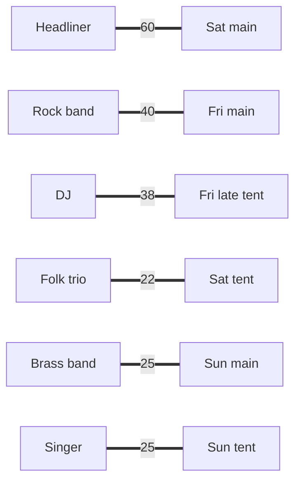

# Total unimodularity: the matrices whose linear programs are already integral

[Syllabus](../../../SYLLABUS.md) → [Optimization](../README.md) → [Integer and Combinatorial Optimisation](../README.md#s05) → Total unimodularity

---

## General Overview

A summer festival has six acts and six slots to put them in. The acts are a headliner, a rock band, a DJ, a folk trio, a brass band and a singer. The slots are the main stage on Friday, Saturday and Sunday, a late tent on Friday, and the tent on Saturday and on Sunday.

The promoter has an estimate of the extra ticket sales each act brings in each slot, in thousands of pounds. The headliner on Saturday night is worth £60k. The DJ is worth most in the Friday late tent, £38k. The goal is to **maximise** total sales: one act per slot, one slot per act.

An act is booked into a slot or it is not, so this is a whole-number decision, and those are usually hard. The cheap move is to allow fractions, solve the resulting linear program (straight-line value, straight-line limits), and hope. That fractional version is the **relaxation**, from [Integer programs](01-integer-programs-and-relaxations.md). Usually hope fails: add the festival's £80k budget and the relaxation books 19/40 of the headliner, and the work goes back to search.

Here it does not fail. Solved in exact fractions, the festival's relaxation books every act 0 or 1: £210k, the best of all 720 plans. That is not luck with these values. It happens for any values, because of the **shape of the constraint table**. A table with that shape is called **totally unimodular**.

**If every square block cut from the constraint table has determinant −1, 0 or +1, and the limits on the right-hand side are whole numbers, every corner of the linear program is whole, so the relaxation already solves the whole-number problem and no branching is needed.**

**What kind of fact this is:** a theorem (Hoffman and Kruskal, 1956), proved on this card in Why it works for the direction used here; the converse is stated with its source. The test that assignment and network tables pass is also proved here.

### The picture: the festival's best plan



Acts on the left, slots on the right, extra sales in £ thousand on each line; schematic. The linear program was free to spread each act over several slots. It put every act wholly in one slot, and these six lines total £210k.

---

## The formula

Write $x_{ij}$ for the share of act $i$ booked into slot $j$, and $c_{ij}$ for its value. The relaxation of the festival is a linear program (LP) in the standard form of [Linear programs](../04-Linear%20Programming/01-linear-programs-and-polyhedra.md), $c^T x$ (each value $c_{ij}$ times its share $x_{ij}$, added up) made largest under $Ax \le b$, $x \ge 0$:

$$\max \sum_{i,j} c_{ij}\,x_{ij} \quad\text{such that}\quad \sum_j x_{ij} \le 1 \text{ for each act},\quad \sum_i x_{ij} \le 1 \text{ for each slot},\quad x_{ij} \ge 0$$

The constraint table $A$ has 12 rows (six acts, then six slots) and 36 columns (one per act-slot pair). Column $(i, j)$ holds a 1 in act row $i$, a 1 in slot row $j$ and 0 everywhere else. The right-hand side $b$ is all 1s.

A **square submatrix** of $A$ is what is left after keeping some rows and the same number of columns. Its **determinant** is the single number from [Determinants](../../03-Algebra/05-Solving%20Systems/04-determinants.md) that is zero when its rows are dependent. The definition and the theorem:

$$A \text{ is totally unimodular} \iff \det(S) \in \{-1,\, 0,\, +1\} \text{ for every square submatrix } S \text{ of } A$$

$$A \text{ totally unimodular and } b \text{ whole} \;\Longrightarrow\; \text{every corner of } \{x : Ax \le b,\ x \ge 0\} \text{ is whole}$$

**Read it aloud:** if no square block of the table has a determinant other than minus one, zero or one, then every corner of the region it cuts out has whole coordinates, as long as the limits on the right are whole.

The test that proves the festival's table qualifies:

$$\text{entries in } \{-1, 0, 1\},\ \text{at most two nonzeros per column, rows split into two groups as below} \;\Longrightarrow\; A \text{ is totally unimodular}$$

The split rule: when a column's two nonzeros have the same sign they sit in different groups; when they have opposite signs they sit in the same group. For the festival the groups are acts and slots, and every column has one 1 in each.

| Symbol | Plain meaning | In our example | Push it up and the answer… |
| --- | --- | --- | --- |
| $i$, $j$ | an act (a row group), a slot (the other row group) | Headliner is $i = 1$; Sat main is $j = 2$ | — |
| $x_{ij}$ | share of act $i$ booked into slot $j$; the relaxation allows fractions | 1 for Headliner in Sat main, 0 for every pair not drawn | — |
| $c_{ij}$ | extra ticket sales if act $i$ plays slot $j$, £ thousand | Headliner in Sat main: 60 | the best plan may change; it stays whole |
| $A$ | the constraint table: one row per act and per slot, one column per pair | 12 rows, 36 columns of 0s and 1s | — |
| $b$ | the right-hand limits: how many slots an act may fill, how many acts a slot may hold | all 1 | a slot that takes 2 acts: still whole, £215k |
| $S$, $S'$ | a square submatrix kept from $A$; $S'$ is $S$ with one row and one column removed | the 3-act, 3-slot table has 5004 of them | — |
| $\det$ | determinant of a square table | −1, 0 or 1 for every $S$ here; 2 for the duet triangle below | a value other than ±1 or 0 lets fractions in |
| $I$, $s$ | the identity block, one column per row; $s$ is the slack, the unused room in each row | 12 slack columns | — |
| $B$, $x_B$ | the basis: the 12 columns of $[A \mid I]$ that a corner uses, as a square table; $x_B$ are their values | determinant ±1 after each of the 63 pivots (simplex steps from one basis to the next) | — |
| $B_k$, $(x_B)_k$ | $B$ with its $k$-th column swapped for $b$; $(x_B)_k$ is the $k$-th basic value | in the duet triangle, $\det(B_k) = 1$ for each $k$ | — |
| $u_i$, $v_j$ | the dual prices $y$: what one more unit of act $i$, or of slot $j$, is worth | acts 55, 40, 38, 22, 21, 21; slots 0, 5, 4, 0, 0, 4 | — |
| $R_1$, $R_2$ | the two row groups of the test | acts, slots | — |

Simplex, on this card, means [The simplex method](../04-Linear%20Programming/03-simplex-method.md), the LP shelf's corner-walking method, not a triangle-shaped set.

### When it holds

- **Every square block, not just the entries.** A table of 0s and 1s can still fail. Three acts pairing up for duet sets give a 3 × 3 block with determinant 2, and the relaxation answers 1.5 duets when only 1 is possible.
- **The right-hand side must be whole.** Cramer's rule divides by ±1, but it still copies whatever is in $b$, so a limit of half a slot can give a corner with half an act. The values $c$ never matter: any $c$ gives a whole best corner.
- **No extra row that breaks the shape.** Add the festival's £80k budget as a 13th row, with fees 40, 25, 15, 8, 6 and 7, and the table is no longer totally unimodular (the 1 × 1 block holding 40 already fails). The relaxation then books 19/40 of the headliner.
- **The solver must return a corner.** When two plans tie, the halfway point between them is also optimal and not whole. Simplex returns a corner. An interior-point method cuts through the middle of the region instead ([Interior point for linear programs](../04-Linear%20Programming/08-interior-point-for-lp-and-complexity.md)), and can return a point between them, such as the halfway point the code checks.

---

## Why it works

### Step 0: a corner is the solution of a square system, and the only division is by a determinant

A corner of the region is where enough limits hold exactly to pin down one point, which means solving a square system of equations. Cramer's rule, from [The inverse matrix](../../03-Algebra/05-Solving%20Systems/03-inverse-matrix.md), writes each unknown as one determinant divided by another. If the bottom one is ±1 and the top one is built from whole numbers, the answer is whole. Total unimodularity is exactly the promise that the bottom one is ±1.

### Step 1: name the corner's square system

Add a slack $s \ge 0$ to each row, the unused room, so the limits read $Ax + Is = b$. A corner sets all but 12 of the variables to zero. The 12 it keeps are the basic variables; their columns of $[A \mid I]$ form the square basis $B$, and the corner solves $B\,x_B = b$. This is how the LP shelf's simplex method stores a corner, and it moves from one basis to the next.

### Step 2: the basis has determinant ±1

$B$ mixes columns of $A$ and columns of $I$. Each column from $I$ has a single 1. Expand the determinant down that column: it equals ±1 times the determinant of $B$ with that row and column removed. Repeat for every slack column. What remains is a square submatrix of $A$, whose determinant is −1, 0 or +1. It cannot be 0, because $B$ is invertible (a basis always is). So $\det B = \pm 1$.

The festival's solver started from the empty plan, whose basis is $I$, and made 63 pivots. After each one the code computes the new basis's determinant: every one is +1 or −1.

### Step 3: Cramer's rule gives whole numbers

Cramer's rule says $(x_B)_k = \det(B_k) / \det(B)$, where $B_k$ is $B$ with its $k$-th column replaced by $b$. $B_k$ holds whole numbers, so $\det(B_k)$ is whole, and dividing by ±1 keeps it whole. Every corner is whole. Simplex only stands on corners, so every plan it visits is whole, including its answer.

### Step 4: the festival's table passes the test

Take any square submatrix $S$ of the assignment table. Prove $\det S \in \{-1, 0, 1\}$ by induction on its size; a 1 × 1 block is a single 0 or 1. For a larger $S$, look at its columns. Each column of $A$ has one 1 in an act row and one 1 in a slot row, so a column of $S$ keeps two, one or zero of them.

- **A column with no 1s.** The determinant is 0.
- **A column with exactly one 1.** Expand down that column: $\det S = \pm \det S'$, with $S'$ one size smaller. By induction that is −1, 0 or 1.
- **Every column with two 1s.** Then every column has one 1 among the act rows and one among the slot rows. Add up the act rows and subtract the slot rows: every column gives 1 − 1 = 0. The rows are dependent, so $\det S = 0$.

So the table is totally unimodular. The code checks the shape column by column on the full 12 × 36 table, then computes all 5004 square determinants of the 3-act, 3-slot table by brute force: 780 are −1, 3213 are 0, 1011 are +1, and nothing else appears.

The same argument covers a network's table, with one +1 where a pipe leaves a node and one −1 where it arrives. Put every row in one group: summing all rows gives +1 − 1 = 0 in each column. That is why shipping and flow problems also come out whole.

<details>
<summary>Detailed proof: the general two-group test</summary>

Let $A$ have entries −1, 0, 1, at most two nonzeros per column, and rows split into groups $R_1$ and $R_2$ so that a column's two nonzeros lie in different groups when they have the same sign, and in the same group when they have opposite signs.

Take a square submatrix $S$ and argue by induction on its size. If a column of $S$ is all zero, $\det S = 0$. If a column has one nonzero, expand down it and use induction. Otherwise every column has two nonzeros. Add the rows of $S$ in $R_1$ and subtract those in $R_2$. A column with two equal signs in different groups gives $1 - 1$ or $-1 + 1$. A column with opposite signs in the same group gives $1 - 1$ inside that group. Every column sums to 0, so the rows are dependent and $\det S = 0$.

This is Heller and Tompkins's sufficient condition. The full description of totally unimodular tables is Ghouila-Houri's: every set of rows can be split into two groups so that, in every column, the first group's sum minus the second's is −1, 0 or 1. It is quoted, not proved, here. So is Seymour's decomposition theorem, which gives a test of any table for total unimodularity in polynomial time: work that grows like a fixed power of the table's size.

</details>

### Step 5: the prices come out whole too, and they certify the plan

The prices problem, the dual from [LP duality](../04-Linear%20Programming/04-lp-duality-and-complementary-slackness.md), uses the transpose $A^T$: the table with its rows and columns swapped. A submatrix of $A^T$ is the transpose of a submatrix of $A$, with the same determinant, so $A^T$ is totally unimodular too. With whole values $c$, the dual's corners are whole.

The solver's final prices: acts 55, 40, 38, 22, 21, 21 and slots 0, 5, 4, 0, 0, 4. For every pair, act price plus slot price is at least the pair's value. Book any plan: each act and each slot appears once, so its value is at most the sum of all prices, 210. The plan found makes 210. That is the certificate: no plan does better, checked with 36 comparisons, not a search.

### Step 6: the converse, and why a triangle breaks it

Hoffman and Kruskal also proved the converse: if a whole-number $A$ gives whole corners for every whole $b$, then $A$ is totally unimodular. So when $A$ is not totally unimodular, some whole $b$ gives a fractional corner. For tables with at most two nonzeros per column, though, Heller and Tompkins showed the two-group split is also necessary, so the duet triangle, which has no split, must fail.

The simplest failure is an odd loop. The folk trio, the brass band and the singer may pair off for a joint set, each act joining at most one. The table, rows Folk, Brass, Singer, columns Folk-Brass, Brass-Singer, Folk-Singer, is `[[1, 0, 1], [1, 1, 0], [0, 1, 1]]`. No row split works: each column's two 1s must go in different groups, and three rows in a loop cannot alternate between two groups. Its determinant is 2. The relaxation sets every duet to 1/2 and claims 1.5 duets; only 1 is possible.

---

## Worked numbers, by hand

| Step | Arithmetic | Value |
| --- | --- | --- |
| the relaxation's plan | Headliner-Sat main, Rock-Fri main, DJ-Fri late, Folk-Sat tent, Brass-Sun main, Singer-Sun tent | every $x_{ij}$ is 0 or 1 |
| its value | 60 + 40 + 38 + 22 + 25 + 25 | 210 |
| sum of prices | 55 + 40 + 38 + 22 + 21 + 21 + 0 + 5 + 4 + 0 + 0 + 4 | 210 |
| one price check, a booked pair | Headliner 55 + Sat main 5 against value 60 | equal |
| one price check, an unbooked pair | Rock band 40 + Sat main 5 against value 45 | equal: a tie in price, not in plan |
| all 720 plans | best, runner-up, worst | 210, 209, 115 |
| the duet triangle | $1 \times (1 \times 1 - 0 \times 1) - 0 + 1 \times (1 \times 1 - 1 \times 0)$ | determinant 2 |
| duet corner | each $x = \det(B_k)/\det(B) = 1/2$, with $\det(B_k) = 1$ and $\det B = 2$ | 1/2 each, 1.5 duets |
| **the festival** | relaxation = best whole plan = sum of prices | **£210k** |

The promoter books the six acts as drawn in the picture and needs no search: the relaxation's answer is already whole, and the prices prove nothing beats £210k.

### What breaks if you drop a piece

| Mistake | Comes out at | What went wrong |
| --- | --- | --- |
| Duet sets among three acts, solved as a relaxation | 1.5 duets, every $x = 1/2$; best whole is 1 | an odd loop: a block with determinant 2 |
| The £80k budget added as a 13th row | £181.125k, with 19/40 of the headliner in Sat main and the rock band split 19/40 and 21/40; best whole is £170k | the fee row is not 0 or ±1, so the table is not totally unimodular |
| That budget relaxation rounded to the nearest whole plan | £155k, fees £61k | rounding is not optimising: it lands below the best whole plan, £170k |
| A tie, with a solver that can stop between corners, such as interior point | Singer in Sat tent worth 23: two plans tie at £210k, and a point between them, such as the halfway point with four $x$ values at 1/2, fits every limit and also scores 210 | the theorem is about corners; a point between two corners is optimal but not whole |

The budget is what turns the festival into a real integer program, needing [Branch and bound](03-branch-and-bound.md) or [Cutting planes](04-cutting-planes.md); the assignment alone does not.

---

## Code, from first principles, and it actually runs

Nothing imported knows about linear programs or matrices. The relaxation is solved by a simplex tableau (the table of equations that simplex rewrites at each step) in exact fractions with Bland's rule (enter the lowest-numbered improving column, which cannot cycle), starting from the empty plan. The answer is reached **three independent ways**: the simplex method, a list of all 720 whole plans, and the dual prices as a certificate. Then the matrix itself is checked two ways: its column shape on the full table, and every square determinant of the 3-act, 3-slot table. The last two sections print each "what breaks" row and each "Try changing" answer.

### Python

```python
# Total unimodularity -- the check behind the card. Standard library only.
# Six acts, six slots. The LP relaxation (fractions allowed), solved by exact-fraction
# simplex, comes out whole. Roads: simplex; all 720 whole plans; the dual prices as
# a certificate; and the determinants of the constraint matrix itself.
from fractions import Fraction as F
from itertools import combinations, permutations, product

ACTS = ["Headliner", "Rock band", "DJ", "Folk trio", "Brass band", "Singer"]
SLOTS = ["Fri main", "Sat main", "Sun main", "Fri late tent", "Sat tent", "Sun tent"]
VALUE = [[48, 60, 30, 20, 25, 22], [40, 45, 28, 22, 30, 26], [30, 35, 15, 38, 24, 18],
         [18, 20, 26, 12, 22, 24], [15, 18, 25, 10, 20, 21], [20, 22, 24, 14, 21, 25]]
FEE = [40, 25, 15, 8, 6, 7]                     # booking fees, pounds thousand
N = 6

def assignment_matrix(n):                       # n act rows, then n slot rows
    return ([[int(k // n == i) for k in range(n * n)] for i in range(n)] +
            [[int(k % n == j) for k in range(n * n)] for j in range(n)])

def det(M):                                     # fraction-free elimination
    M, sign, prev = [r[:] for r in M], 1, 1
    for k in range(len(M) - 1):
        p = next((i for i in range(k, len(M)) if M[i][k]), None)
        if p is None:
            return 0
        if p != k:
            M[k], M[p], sign = M[p], M[k], -sign
        for i in range(k + 1, len(M)):
            for j in range(k + 1, len(M)):
                M[i][j] = (M[i][j] * M[k][k] - M[i][k] * M[k][j]) // prev
        prev = M[k][k]
    return sign * M[-1][-1]

def simplex(A, b, c):
    """max c.x with A x <= b, x >= 0, b >= 0; tableau in exact fractions, Bland's rule."""
    m, n = len(A), len(A[0])
    full = [A[i] + [int(i == r) for r in range(m)] for i in range(m)]   # [A | I]
    T = [[F(v) for v in full[i]] + [F(b[i])] for i in range(m)]
    z = [F(-v) for v in c] + [F(0)] * (m + 1)
    basis, pivots, whole, unit = [n + i for i in range(m)], 0, True, True
    while True:
        e = next((j for j in range(n + m) if z[j] < 0), None)
        if e is None:
            break
        r = min((i for i in range(m) if T[i][e] > 0), key=lambda i: (T[i][-1] / T[i][e], basis[i]))
        T[r] = [v / T[r][e] for v in T[r]]
        for row in [t for i, t in enumerate(T) if i != r] + [z]:
            f = row[e]
            row[:] = [a - f * p for a, p in zip(row, T[r])]
        basis[r], pivots = e, pivots + 1
        whole &= all(t[-1].denominator == 1 for t in T)
        unit &= abs(det([[full[i][j] for j in basis] for i in range(m)])) == 1
    x = [F(0)] * (n + m)
    for i, j in enumerate(basis): x[j] = T[i][-1]
    return x[:n], z[-1], z[n:n + m], pivots, whole, unit

def show(q): return str(q) if q.denominator == 1 else f"{q} = {float(q):g}"

print("slots:", ", ".join(SLOTS))
for i in range(N):
    print(f"{ACTS[i]:<11} fee {FEE[i]:>2}, values", *VALUE[i])
A = assignment_matrix(N)
c = [VALUE[k // N][k % N] for k in range(N * N)]
x, val, y, piv, whole, unit = simplex(A, [1] * 2 * N, c)
print(f"LP relaxation by simplex: {piv} pivots from the empty plan, value {show(val)}")
print("every corner on the way whole:", "yes" if whole else "no",
      "| every basis determinant +1 or -1:", "yes" if unit else "no")
plan = [(k // N, k % N) for k in range(N * N) if x[k]]
for i, j in plan:
    print(f"  {ACTS[i]:<11} -> {SLOTS[j]:<14} x = {x[i * N + j]}  value {VALUE[i][j]}")
totals = sorted((sum(VALUE[i][p[i]] for i in range(N)), p) for p in permutations(range(N)))
print(f"all {len(totals)} whole plans: best {totals[-1][0]}, runner-up {totals[-2][0]}, worst {totals[0][0]}")
u, v = y[:N], y[N:]
print("dual prices, acts: ", *u, "| slots:", *v, "| total", sum(y))
dual_ok = all(u[i] + v[j] >= VALUE[i][j] for i in range(N) for j in range(N)) and min(y) >= 0
print("every act price + slot price >= that pair's value:", "yes" if dual_ok else "no")
print("price checks:", "; ".join(f"{ACTS[i]} + {SLOTS[j]} {u[i]} + {v[j]} >= {VALUE[i][j]}" for i, j in [(0, 1), (1, 1)]))
assert all(q in (0, 1) for q in x) and len(plan) == N            # the LP answer is whole
assert val == totals[-1][0] == sum(y) and dual_ok and totals[-2][0] < val
assert whole and unit and totals[-1][1] == tuple(j for _, j in plan)

# ---- the matrix itself ----
cols_ok = all(sorted(i for i in range(2 * N) if A[i][k]) in ([k // N, N + k % N],) for k in range(N * N))
print(f"table A: {len(A)} rows x {len(A[0])} columns, plus {len(A)} slack columns;",
      "each column has one 1 in an act row and one in a slot row:", "yes" if cols_ok else "no")
A3, count = assignment_matrix(3), {}
for s in range(1, 7):
    for R in combinations(range(6), s):
        for C in combinations(range(9), s):
            d = det([[A3[i][j] for j in C] for i in R])
            count[d] = count.get(d, 0) + 1
print(f"3 acts x 3 slots: {sum(count.values())} square submatrices; determinants",
      ", ".join(f"{d}: {count[d]}" for d in sorted(count)))
assert cols_ok and set(count) == {-1, 0, 1} and sum(count.values()) == 5004

# ---- what breaks ----
TRI = [[1, 0, 1], [1, 1, 0], [0, 1, 1]]         # duets: rows Folk, Brass, Singer
xt, vt, _, _, _, _ = simplex(TRI, [1, 1, 1], [1, 1, 1])
best_t = max(sum(s) for s in product((0, 1), repeat=3) if all(sum(map(int.__mul__, r, s)) <= 1 for r in TRI))
cram = [det([[1 if j == k else r[j] for j in range(3)] for r in TRI]) for k in range(3)]   # B_k: column k -> b
print(f"duet triangle: determinant {det(TRI)}, Cramer det(B_k) {' '.join(map(str, cram))}, LP x = {' '.join(map(str, xt))}, value {show(vt)}, best whole {best_t}")
assert det(TRI) == 2 and vt == F(3, 2) and best_t == 1 and xt == [F(d, det(TRI)) for d in cram]

def budget_case(B):
    xb, vb, _, _, _, _ = simplex(A + [[FEE[k // N] for k in range(N * N)]], [1] * 2 * N + [B], c)
    best = [0, 0]
    def search(i, used, spent, got):
        if i == N:
            best[0], best[1] = max(best[0], got), best[1] + 1
            return
        search(i + 1, used, spent, got)
        for j in range(N):
            if j not in used and spent + FEE[i] <= B:
                search(i + 1, used | {j}, spent + FEE[i], got + VALUE[i][j])
    search(0, frozenset(), 0, 0)
    return xb, vb, best

xb, vb, (bw, nplans) = budget_case(80)
frac = [f"{ACTS[k // N]}/{SLOTS[k % N]} {q}" for k, q in enumerate(xb) if q.denominator > 1]
print(f"budget 80: LP value {show(vb)}; fractional: {'; '.join(frac)}")
rnd = [k for k, q in enumerate(xb) if q > F(1, 2)]
r_val, r_fee = sum(c[k] for k in rnd), sum(FEE[k // N] for k in rnd)
print(f"budget 80: best whole {bw} over {nplans} plans within budget; LP rounded to nearest {r_val} (fees {r_fee})")
assert frac and r_val < bw < vb and r_fee <= 80 and vb == F(1449, 8)

# ---- try changing ----
c2 = c[:]; c2[4 * N + 2] = 15                    # Brass on Sun main worth 15, not 25
x2, v2, _, _, _, _ = simplex(A, [1] * 2 * N, c2)
x3, v3, _ = budget_case(101)
x4, v4, _, _, _, _ = simplex(A, [1] * N + [1, 2] + [1] * 4, c)   # Sat main takes a double bill
c5 = c[:]; c5[5 * N + 4] = 23                   # Singer on Sat tent worth 23: a tie
x5, v5, _, _, _, _ = simplex(A, [1] * 2 * N, c5)
ties = [p for p in permutations(range(N)) if sum(c5[i * N + p[i]] for i in range(N)) == v5]
mid = [F(sum(p[k // N] == k % N for p in ties), len(ties)) for k in range(N * N)]   # halfway point
mval, room = sum(a * m for a, m in zip(c5, mid)), max(sum(a * m for a, m in zip(r, mid)) for r in A)
for name, xx, vv in [("Brass/Sun main 15", x2, v2), ("budget 101", x3, v3),
                     ("Sat main double bill", x4, v4), ("Singer/Sat tent 23", x5, v5)]:
    print(f"try {name}: LP value {show(vv)}, whole: {'yes' if all(q in (0, 1) for q in xx) else 'no'}")
print(f"try Singer/Sat tent 23: {len(ties)} whole plans tie at {v5}; halfway between them: {mid.count(F(1, 2))} x values at 1/2, value {mval}, fullest row {room}")
assert all(q in (0, 1) for q in x2 + x4 + x5) and v3 == val and len(ties) == 2 and mval == v5 and F(1, 2) in mid and room == 1
print("ALL CHECKS PASS")
```

**Ran 2026-11-11 on macOS, Python 3.14.10, standard library only. All checks passed. Output, pasted from the run:**

```
slots: Fri main, Sat main, Sun main, Fri late tent, Sat tent, Sun tent
Headliner   fee 40, values 48 60 30 20 25 22
Rock band   fee 25, values 40 45 28 22 30 26
DJ          fee 15, values 30 35 15 38 24 18
Folk trio   fee  8, values 18 20 26 12 22 24
Brass band  fee  6, values 15 18 25 10 20 21
Singer      fee  7, values 20 22 24 14 21 25
LP relaxation by simplex: 63 pivots from the empty plan, value 210
every corner on the way whole: yes | every basis determinant +1 or -1: yes
  Headliner   -> Sat main       x = 1  value 60
  Rock band   -> Fri main       x = 1  value 40
  DJ          -> Fri late tent  x = 1  value 38
  Folk trio   -> Sat tent       x = 1  value 22
  Brass band  -> Sun main       x = 1  value 25
  Singer      -> Sun tent       x = 1  value 25
all 720 whole plans: best 210, runner-up 209, worst 115
dual prices, acts:  55 40 38 22 21 21 | slots: 0 5 4 0 0 4 | total 210
every act price + slot price >= that pair's value: yes
price checks: Headliner + Sat main 55 + 5 >= 60; Rock band + Sat main 40 + 5 >= 45
table A: 12 rows x 36 columns, plus 12 slack columns; each column has one 1 in an act row and one in a slot row: yes
3 acts x 3 slots: 5004 square submatrices; determinants -1: 780, 0: 3213, 1: 1011
duet triangle: determinant 2, Cramer det(B_k) 1 1 1, LP x = 1/2 1/2 1/2, value 3/2 = 1.5, best whole 1
budget 80: LP value 1449/8 = 181.125; fractional: Headliner/Sat main 19/40; Rock band/Fri main 19/40; Rock band/Sat main 21/40
budget 80: best whole 170 over 8647 plans within budget; LP rounded to nearest 155 (fees 61)
try Brass/Sun main 15: LP value 209, whole: yes
try budget 101: LP value 210, whole: yes
try Sat main double bill: LP value 215, whole: yes
try Singer/Sat tent 23: LP value 210, whole: yes
try Singer/Sat tent 23: 2 whole plans tie at 210; halfway between them: 4 x values at 1/2, value 210, fullest row 1
ALL CHECKS PASS
```

### Rust

```rust
// Total unimodularity -- the check behind the card. Standard library only. Same roads as the
// Python: exact-fraction simplex, all 720 whole plans, dual prices, and the matrix's determinants.
use std::collections::BTreeMap;

const ACTS: [&str; 6] = ["Headliner", "Rock band", "DJ", "Folk trio", "Brass band", "Singer"];
const SLOTS: [&str; 6] = ["Fri main", "Sat main", "Sun main", "Fri late tent", "Sat tent", "Sun tent"];
const VALUE: [[i64; 6]; 6] = [[48, 60, 30, 20, 25, 22], [40, 45, 28, 22, 30, 26], [30, 35, 15, 38, 24, 18],
                              [18, 20, 26, 12, 22, 24], [15, 18, 25, 10, 20, 21], [20, 22, 24, 14, 21, 25]];
const FEE: [i64; 6] = [40, 25, 15, 8, 6, 7]; // booking fees, pounds thousand
const N: usize = 6;

#[derive(Clone, Copy, PartialEq, PartialOrd)]
struct Q { n: i128, d: i128 } // exact fraction, d > 0, lowest terms
fn gcd(a: i128, b: i128) -> i128 { if b == 0 { a.abs() } else { gcd(b, a % b) } }
fn q(n: i128, d: i128) -> Q { let g = gcd(n, d).max(1) * d.signum(); Q { n: n / g, d: d / g } }
impl std::ops::Add for Q { type Output = Q; fn add(self, o: Q) -> Q { q(self.n * o.d + o.n * self.d, self.d * o.d) } }
impl std::ops::Sub for Q { type Output = Q; fn sub(self, o: Q) -> Q { q(self.n * o.d - o.n * self.d, self.d * o.d) } }
impl std::ops::Mul for Q { type Output = Q; fn mul(self, o: Q) -> Q { q(self.n * o.n, self.d * o.d) } }
impl std::ops::Div for Q { type Output = Q; fn div(self, o: Q) -> Q { q(self.n * o.d, self.d * o.n) } }
impl std::fmt::Display for Q { fn fmt(&self, f: &mut std::fmt::Formatter) -> std::fmt::Result {
    if self.d == 1 { write!(f, "{}", self.n) } else { write!(f, "{}/{}", self.n, self.d) } } }
fn lt(a: Q, b: Q) -> bool { a.n * b.d < b.n * a.d }
fn show(x: Q) -> String { if x.d == 1 { format!("{}", x) } else { format!("{} = {}", x, x.n as f64 / x.d as f64) } }
fn yes(b: bool) -> &'static str { if b { "yes" } else { "no" } } fn whole01(x: &[Q]) -> bool { x.iter().all(|v| v.d == 1 && (v.n == 0 || v.n == 1)) }

fn assignment_matrix(n: usize) -> Vec<Vec<i64>> { // n act rows, then n slot rows
    let mut a: Vec<Vec<i64>> = (0..n).map(|i| (0..n * n).map(|k| (k / n == i) as i64).collect()).collect();
    a.extend((0..n).map(|j| (0..n * n).map(|k| (k % n == j) as i64).collect::<Vec<i64>>()));
    a
}

fn det(m0: &[Vec<i64>]) -> i64 { // fraction-free elimination
    let (mut m, mut sign, mut prev, n) = (m0.to_vec(), 1, 1, m0.len());
    for k in 0..n - 1 {
        let p = match (k..n).find(|&i| m[i][k] != 0) { Some(p) => p, None => return 0 };
        if p != k { m.swap(k, p); sign = -sign; }
        for i in k + 1..n { for j in k + 1..n { m[i][j] = (m[i][j] * m[k][k] - m[i][k] * m[k][j]) / prev; } }
        prev = m[k][k];
    }
    sign * m[n - 1][n - 1]
}

// max c.x with A x <= b, x >= 0, b >= 0; tableau in exact fractions, Bland's rule.
fn simplex(a: &[Vec<i64>], b: &[i64], c: &[i64]) -> (Vec<Q>, Q, Vec<Q>, usize, bool, bool) {
    let (m, n) = (a.len(), a[0].len());
    let full: Vec<Vec<i64>> = (0..m).map(|i| { let mut r = a[i].clone(); r.extend((0..m).map(|k| (k == i) as i64)); r }).collect();
    let mut t: Vec<Vec<Q>> = (0..m).map(|i| full[i].iter().map(|&v| q(v as i128, 1)).chain([q(b[i] as i128, 1)]).collect()).collect();
    let mut z: Vec<Q> = c.iter().map(|&v| q(-v as i128, 1)).chain((0..=m).map(|_| q(0, 1))).collect();
    let (mut basis, mut pivots, mut whole, mut unit): (Vec<usize>, usize, bool, bool) = ((n..n + m).collect(), 0, true, true);
    while let Some(e) = (0..n + m).find(|&j| z[j].n < 0) {
        let mut r = usize::MAX;
        for i in (0..m).filter(|&i| t[i][e].n > 0) {
            if r == usize::MAX { r = i; continue; }
            let (ri, rr) = (t[i][n + m] / t[i][e], t[r][n + m] / t[r][e]);
            if lt(ri, rr) || (ri == rr && basis[i] < basis[r]) { r = i; }
        }
        let p = t[r][e];
        t[r] = t[r].iter().map(|&v| v / p).collect();
        let pr = t[r].clone();
        for i in (0..m).filter(|&i| i != r) { let f = t[i][e]; t[i] = t[i].iter().zip(&pr).map(|(&x, &y)| x - f * y).collect(); }
        let f = z[e]; z = z.iter().zip(&pr).map(|(&x, &y)| x - f * y).collect();
        basis[r] = e; pivots += 1;
        whole &= t.iter().all(|row| row[n + m].d == 1);
        let bm: Vec<Vec<i64>> = (0..m).map(|i| basis.iter().map(|&j| full[i][j]).collect()).collect();
        unit &= det(&bm).abs() == 1;
    }
    let mut x = vec![q(0, 1); n + m]; for (i, &j) in basis.iter().enumerate() { x[j] = t[i][n + m]; }
    (x[..n].to_vec(), z[n + m], z[n..n + m].to_vec(), pivots, whole, unit)
}

fn perms(k: usize, cur: &mut Vec<usize>, out: &mut Vec<Vec<usize>>) {
    if k == N { out.push(cur.clone()); return; }
    for j in 0..N { if !cur.contains(&j) { cur.push(j); perms(k + 1, cur, out); cur.pop(); } }
}
fn combos(n: usize, s: usize) -> Vec<Vec<usize>> {
    if s == 0 { return vec![vec![]]; }
    let mut out = vec![];
    for last in s - 1..n { for mut c in combos(last, s - 1) { c.push(last); out.push(c); } }
    out
}
fn search(i: usize, used: &mut Vec<bool>, spent: i64, got: i64, budget: i64, best: &mut (i64, usize)) {
    if i == N { best.0 = best.0.max(got); best.1 += 1; return; }
    search(i + 1, used, spent, got, budget, best);
    for j in 0..N {
        if !used[j] && spent + FEE[i] <= budget { used[j] = true; search(i + 1, used, spent + FEE[i], got + VALUE[i][j], budget, best); used[j] = false; }
    }
}

fn main() {
    println!("slots: {}", SLOTS.join(", "));
    for i in 0..N { println!("{:<11} fee {:>2}, values {}", ACTS[i], FEE[i], VALUE[i].map(|v| v.to_string()).join(" ")); }
    let a = assignment_matrix(N);
    let c: Vec<i64> = (0..N * N).map(|k| VALUE[k / N][k % N]).collect();
    let ones = vec![1i64; 2 * N];
    let (x, val, y, piv, whole, unit) = simplex(&a, &ones, &c);
    println!("LP relaxation by simplex: {} pivots from the empty plan, value {}", piv, show(val));
    println!("every corner on the way whole: {} | every basis determinant +1 or -1: {}", yes(whole), yes(unit));
    let plan: Vec<(usize, usize)> = (0..N * N).filter(|&k| x[k].n != 0).map(|k| (k / N, k % N)).collect();
    for &(i, j) in &plan { println!("  {:<11} -> {:<14} x = {}  value {}", ACTS[i], SLOTS[j], x[i * N + j], VALUE[i][j]); }
    let mut all = vec![]; perms(0, &mut vec![], &mut all);
    let tot = |cc: &[i64], p: &[usize]| -> i64 { (0..N).map(|i| cc[i * N + p[i]]).sum() };
    let mut totals: Vec<i64> = all.iter().map(|p| tot(&c, p)).collect(); totals.sort();
    let best_p = all.iter().max_by_key(|p| tot(&c, p)).unwrap();
    println!("all {} whole plans: best {}, runner-up {}, worst {}", all.len(), totals[719], totals[718], totals[0]);
    let (u, v, ys) = (&y[..N], &y[N..], y.iter().fold(q(0, 1), |s, &w| s + w));
    let js = |w: &[Q]| w.iter().map(|z| z.to_string()).collect::<Vec<_>>().join(" ");
    println!("dual prices, acts:  {} | slots: {} | total {}", js(u), js(v), ys);
    let dual_ok = (0..N).all(|i| (0..N).all(|j| !lt(u[i] + v[j], q(VALUE[i][j] as i128, 1)))) && y.iter().all(|w| w.n >= 0);
    println!("every act price + slot price >= that pair's value: {}", yes(dual_ok));
    println!("price checks: {}", [(0, 1), (1, 1)].map(|(i, j): (usize, usize)| format!("{} + {} {} + {} >= {}", ACTS[i], SLOTS[j], u[i], v[j], VALUE[i][j])).join("; "));
    assert!(whole01(&x) && plan.len() == N); // the LP answer is whole
    assert!(val == q(totals[719] as i128, 1) && val == ys && dual_ok && lt(q(totals[718] as i128, 1), val));
    assert!(whole && unit && plan.iter().map(|&(_, j)| j).collect::<Vec<_>>() == *best_p);

    // ---- the matrix itself ----
    let cols_ok = (0..N * N).all(|k| (0..2 * N).filter(|&i| a[i][k] != 0).collect::<Vec<_>>() == vec![k / N, N + k % N]);
    println!("table A: {} rows x {} columns, plus {} slack columns; each column has one 1 in an act row and one in a slot row: {}", a.len(), a[0].len(), a.len(), yes(cols_ok));
    let a3 = assignment_matrix(3); let mut count: BTreeMap<i64, usize> = BTreeMap::new();
    for s in 1..=6 { for r in combos(6, s) { for cc in combos(9, s) {
        let sub: Vec<Vec<i64>> = r.iter().map(|&i| cc.iter().map(|&j| a3[i][j]).collect()).collect();
        *count.entry(det(&sub)).or_insert(0) += 1;
    } } }
    let total: usize = count.values().sum(); println!("3 acts x 3 slots: {} square submatrices; determinants {}", total,
             count.iter().map(|(d, k)| format!("{}: {}", d, k)).collect::<Vec<_>>().join(", "));
    assert!(cols_ok && count.keys().cloned().collect::<Vec<_>>() == vec![-1, 0, 1] && total == 5004);

    // ---- what breaks ----
    let tri = vec![vec![1, 0, 1], vec![1, 1, 0], vec![0, 1, 1]]; // duets: rows Folk, Brass, Singer
    let (xt, vt, ..) = simplex(&tri, &[1, 1, 1], &[1, 1, 1]);
    let best_t = (0..8).map(|s: usize| [s & 1, (s >> 1) & 1, (s >> 2) & 1])
        .filter(|s| tri.iter().all(|r| (0..3).map(|k| r[k] * s[k] as i64).sum::<i64>() <= 1)).map(|s| s.iter().sum::<usize>()).max().unwrap();
    let cram: Vec<i64> = (0..3).map(|k| det(&tri.iter().map(|r| (0..3).map(|j| if j == k { 1 } else { r[j] }).collect()).collect::<Vec<Vec<i64>>>())).collect(); // B_k: column k -> b
    println!("duet triangle: determinant {}, Cramer det(B_k) {}, LP x = {}, value {}, best whole {}", det(&tri), cram.iter().map(|d| d.to_string()).collect::<Vec<_>>().join(" "), js(&xt), show(vt), best_t);
    assert!(det(&tri) == 2 && vt == q(3, 2) && best_t == 1 && (0..3).all(|k| xt[k] == q(cram[k] as i128, det(&tri) as i128)));

    let budget_case = |bud: i64| {
        let mut ab = a.clone(); ab.push((0..N * N).map(|k| FEE[k / N]).collect());
        let mut bb = ones.clone(); bb.push(bud);
        let (xb, vb, ..) = simplex(&ab, &bb, &c);
        let mut best = (0, 0); search(0, &mut vec![false; N], 0, 0, bud, &mut best);
        (xb, vb, best)
    };
    let (xb, vb, (bw, nplans)) = budget_case(80);
    let frac: Vec<String> = (0..N * N).filter(|&k| xb[k].d > 1).map(|k| format!("{}/{} {}", ACTS[k / N], SLOTS[k % N], xb[k])).collect();
    println!("budget 80: LP value {}; fractional: {}", show(vb), frac.join("; "));
    let rnd: Vec<usize> = (0..N * N).filter(|&k| lt(q(1, 2), xb[k])).collect();
    let (r_val, r_fee): (i64, i64) = (rnd.iter().map(|&k| c[k]).sum(), rnd.iter().map(|&k| FEE[k / N]).sum());
    println!("budget 80: best whole {} over {} plans within budget; LP rounded to nearest {} (fees {})", bw, nplans, r_val, r_fee);
    assert!(!frac.is_empty() && r_val < bw && lt(q(bw as i128, 1), vb) && r_fee <= 80 && vb == q(1449, 8));

    // ---- try changing ----
    let mut c2 = c.clone(); c2[4 * N + 2] = 15; // Brass on Sun main worth 15, not 25
    let (x2, v2, ..) = simplex(&a, &ones, &c2);
    let (x3, v3, _) = budget_case(101);
    let mut b4 = ones.clone(); b4[N + 1] = 2; // Sat main takes a double bill
    let (x4, v4, ..) = simplex(&a, &b4, &c);
    let mut c5 = c.clone(); c5[5 * N + 4] = 23; // Singer on Sat tent worth 23: a tie
    let (x5, v5, ..) = simplex(&a, &ones, &c5);
    let ties: Vec<&Vec<usize>> = all.iter().filter(|p| q(tot(&c5, p) as i128, 1) == v5).collect();
    let mid: Vec<Q> = (0..N * N).map(|k| q(ties.iter().filter(|p| p[k / N] == k % N).count() as i128, ties.len() as i128)).collect(); // halfway point
    let dot = |r: &[i64]| (0..N * N).fold(q(0, 1), |s, k| s + q(r[k] as i128, 1) * mid[k]);
    let (mval, room) = (dot(&c5), a.iter().map(|r| dot(r)).fold(q(0, 1), |m, v| if lt(m, v) { v } else { m }));
    for (name, xx, vv) in [("Brass/Sun main 15", &x2, v2), ("budget 101", &x3, v3), ("Sat main double bill", &x4, v4), ("Singer/Sat tent 23", &x5, v5)] {
        println!("try {}: LP value {}, whole: {}", name, show(vv), yes(whole01(xx)));
    }
    println!("try Singer/Sat tent 23: {} whole plans tie at {}; halfway between them: {} x values at 1/2, value {}, fullest row {}", ties.len(), v5, mid.iter().filter(|&&m| m == q(1, 2)).count(), mval, room);
    assert!(whole01(&x2) && whole01(&x4) && whole01(&x5) && v3 == val && ties.len() == 2 && mval == v5 && mid.contains(&q(1, 2)) && room == q(1, 1));
    println!("ALL CHECKS PASS");
}
```

**Ran 2026-11-11 on macOS, rustc 1.98.1, no crates. All checks passed. Output, pasted from the run:**

```
slots: Fri main, Sat main, Sun main, Fri late tent, Sat tent, Sun tent
Headliner   fee 40, values 48 60 30 20 25 22
Rock band   fee 25, values 40 45 28 22 30 26
DJ          fee 15, values 30 35 15 38 24 18
Folk trio   fee  8, values 18 20 26 12 22 24
Brass band  fee  6, values 15 18 25 10 20 21
Singer      fee  7, values 20 22 24 14 21 25
LP relaxation by simplex: 63 pivots from the empty plan, value 210
every corner on the way whole: yes | every basis determinant +1 or -1: yes
  Headliner   -> Sat main       x = 1  value 60
  Rock band   -> Fri main       x = 1  value 40
  DJ          -> Fri late tent  x = 1  value 38
  Folk trio   -> Sat tent       x = 1  value 22
  Brass band  -> Sun main       x = 1  value 25
  Singer      -> Sun tent       x = 1  value 25
all 720 whole plans: best 210, runner-up 209, worst 115
dual prices, acts:  55 40 38 22 21 21 | slots: 0 5 4 0 0 4 | total 210
every act price + slot price >= that pair's value: yes
price checks: Headliner + Sat main 55 + 5 >= 60; Rock band + Sat main 40 + 5 >= 45
table A: 12 rows x 36 columns, plus 12 slack columns; each column has one 1 in an act row and one in a slot row: yes
3 acts x 3 slots: 5004 square submatrices; determinants -1: 780, 0: 3213, 1: 1011
duet triangle: determinant 2, Cramer det(B_k) 1 1 1, LP x = 1/2 1/2 1/2, value 3/2 = 1.5, best whole 1
budget 80: LP value 1449/8 = 181.125; fractional: Headliner/Sat main 19/40; Rock band/Fri main 19/40; Rock band/Sat main 21/40
budget 80: best whole 170 over 8647 plans within budget; LP rounded to nearest 155 (fees 61)
try Brass/Sun main 15: LP value 209, whole: yes
try budget 101: LP value 210, whole: yes
try Sat main double bill: LP value 215, whole: yes
try Singer/Sat tent 23: LP value 210, whole: yes
try Singer/Sat tent 23: 2 whole plans tie at 210; halfway between them: 4 x values at 1/2, value 210, fullest row 1
ALL CHECKS PASS
```

The two outputs match line for line.

### Lean

Lean proves the main theorem and the two-group test for every table, the price certificate for any number of acts, and the festival's numbers.

- Take a whole-number table $A$ that is totally unimodular, and whole limits $b$. Every corner of $\{x : Ax \le b,\ x \ge 0\}$ is whole.
- Take a table with entries −1, 0 or 1 and at most two nonzeros per column. If its rows split into two groups by the split rule, it is totally unimodular.
- Suppose each act price plus slot price is at least that pair's value. Then any plan, one act per slot, is worth at most the sum of all prices.
- The festival's plan uses each slot once and is worth 60 + 40 + 38 + 22 + 25 + 25 = 210, in £ thousand.
- The prices add up to 210, and all 36 price checks hold. Headliner + Sat main and Rock band + Sat main tie exactly: 55 + 5 = 60 and 40 + 5 = 45.
- The duet triangle has determinant 2, so it is not totally unimodular.

The simplex run, all 720 plans, the 5004 determinants, the budget and the tie are left to the Python and Rust checks.

```lean
-- Total unimodularity: if every square submatrix of a whole-number table has determinant -1, 0 or 1 and the limits are whole, every corner of {x : Ax ≤ b, x ≥ 0} is whole; the two-group test proves a table qualifies, and prices certify the best assignment.
import Mathlib.LinearAlgebra.Matrix.Determinant.TotallyUnimodular
import Mathlib.Analysis.Convex.Extreme
import Mathlib.Basic.Real.Basic
import Mathlib.LinearAlgebra.Matrix.Notation
import Mathlib

open Matrix

/-- Helper: if a totally unimodular whole-number system has exactly one real solution, that
solution is whole. -/
theorem tu_unique_solution_whole {T n : Type*} [Fintype T] [Fintype n]
    (M : Matrix T n ℤ) (hM : M.IsTotallyUnimodular)
    (hinj : Function.Injective (M.map (Int.cast : ℤ → ℝ)).mulVec)
    (c : T → ℤ) (y : n → ℝ) (hy : (M.map (Int.cast : ℤ → ℝ)) *ᵥ y = fun t => (c t : ℝ)) :
    ∃ z : n → ℤ, y = fun j => (z j : ℝ) := by
  classical
  set M' := M.map (Int.cast : ℤ → ℝ) with hM'
  have hrank : M'.rank = Fintype.card n := by
    rw [Matrix.rank, LinearMap.finrank_range_of_inj (by exact hinj),
      Module.finrank_fintype_fun_eq_card]
  rw [M'.rank_eq_finrank_span_row] at hrank
  obtain ⟨κ, a, ha, hsp, hli⟩ := exists_linearIndependent'.{_, _, 0} ℝ M'.row
  have : Fintype κ := Fintype.ofInjective a ha
  have hcard : Fintype.card κ = Fintype.card n := by
    rw [← hrank, ← hsp, linearIndependent_iff_card_eq_finrank_span.mp hli, Set.finrank]
  let e : n ≃ κ := Fintype.equivOfCardEq hcard.symm
  let f : n → T := a ∘ e
  let B : Matrix n n ℤ := M.submatrix f id
  have hB' : B.map (Int.cast : ℤ → ℝ) = M'.submatrix f id := rfl
  have hli' : LinearIndependent ℝ (B.map (Int.cast : ℤ → ℝ)).row := by
    have := hli.comp e e.injective
    exact this
  have hunit : IsUnit (B.map (Int.cast : ℤ → ℝ)) := linearIndependent_row_iff_isUnit.mp hli'
  have hdet0 : (B.map (Int.cast : ℤ → ℝ)).det ≠ 0 := by
    rw [← isUnit_iff_ne_zero, ← Matrix.isUnit_iff_isUnit_det]; exact hunit
  have hdetcast : ((B.det : ℤ) : ℝ) = (B.map (Int.cast : ℤ → ℝ)).det :=
    (Int.castRingHom ℝ).map_det B
  have htu := (isTotallyUnimodular_iff_fintype M).mp hM n f id
  obtain ⟨s, hs⟩ := htu
  have hsq : B.det * B.det = 1 := by
    change (M.submatrix f id).det * (M.submatrix f id).det = 1
    rw [← hs]
    rcases s with _ | _ | _
    · exfalso; apply hdet0; rw [← hdetcast]; change (((M.submatrix f id).det : ℤ) : ℝ) = 0
      rw [← hs]; simp
    · simp
    · simp
  -- adjugate argument
  have hBy : (B.map (Int.cast : ℤ → ℝ)) *ᵥ y = fun j => (c (f j) : ℝ) := by
    funext j
    rw [hB']
    have := congrFun hy (f j)
    simpa [Matrix.mulVec, dotProduct, Matrix.submatrix] using this
  have hadj := congrArg (fun v => (B.map (Int.cast : ℤ → ℝ)).adjugate *ᵥ v) hBy
  simp only [Matrix.mulVec_mulVec, Matrix.adjugate_mul, Matrix.smul_mulVec, Matrix.one_mulVec] at hadj
  refine ⟨fun j => B.det * (B.adjugate *ᵥ (c ∘ f)) j, ?_⟩
  funext j
  have hj := congrFun hadj j
  have hmap : ((B.adjugate *ᵥ (c ∘ f)) j : ℝ) =
      ((B.map (Int.cast : ℤ → ℝ)).adjugate *ᵥ fun j => (c (f j) : ℝ)) j := by
    rw [show ((B.adjugate *ᵥ (c ∘ f)) j : ℝ) = Int.castRingHom ℝ ((B.adjugate *ᵥ (c ∘ f)) j) from rfl,
      RingHom.map_mulVec]
    congr 1
    have := (Int.castRingHom ℝ).map_adjugate B
    simpa using this
  rw [← hdetcast] at hj
  simp only [Pi.smul_apply, smul_eq_mul] at hj
  have : ((B.det : ℝ) * (B.det : ℝ)) = 1 := by exact_mod_cast hsq
  rw [Int.cast_mul, hmap, ← hj, ← mul_assoc, this, one_mul]

#print axioms tu_unique_solution_whole

/-- Hoffman and Kruskal, the direction the card proves: if every square submatrix of the
whole-number table `A` has determinant -1, 0 or +1, and the right-hand side `b` is whole,
then every corner (extreme point) of the region `{x : A x ≤ b, x ≥ 0}` has whole coordinates. -/
theorem totally_unimodular_corners_are_whole {m n : Type*} [Fintype m] [Fintype n]
    (A : Matrix m n ℤ) (hA : A.IsTotallyUnimodular) (b : m → ℤ) (x : n → ℝ)
    (hx : x ∈ Set.extremePoints ℝ
      {y : n → ℝ | (∀ i, (A.map (Int.cast : ℤ → ℝ) *ᵥ y) i ≤ (b i : ℝ)) ∧ ∀ j, 0 ≤ y j}) :
    ∃ z : n → ℤ, x = fun j => (z j : ℝ) := by
  classical
  set S := {y : n → ℝ | (∀ i, (A.map (Int.cast : ℤ → ℝ) *ᵥ y) i ≤ (b i : ℝ)) ∧ ∀ j, 0 ≤ y j}
    with hS
  let N : Matrix (m ⊕ n) n ℤ := fromRows A (-1)
  have hN : N.IsTotallyUnimodular := by
    refine hA.fromRows_unitlike (fun _ j => ⟨j, -1, ?_⟩)
    ext k
    by_cases hjk : j = k
    · subst hjk; simp
    · simp [hjk, Ne.symm hjk]
  let b' : m ⊕ n → ℤ := Sum.elim b 0
  let Nr := N.map (Int.cast : ℤ → ℝ)
  have hNr : ∀ (y : n → ℝ), (Nr *ᵥ y) = Sum.elim (A.map Int.cast *ᵥ y) (-y) := by
    intro y
    funext r
    cases r with
    | inl i => simp [Nr, N, Matrix.mulVec, dotProduct]
    | inr j => simp [Nr, N, Matrix.mulVec, dotProduct, Matrix.one_apply]
  have hSiff : ∀ y, y ∈ S ↔ ∀ r, (Nr *ᵥ y) r ≤ (b' r : ℝ) := by
    intro y
    simp only [hS, Set.mem_ofPred_eq, hNr, Sum.forall, Sum.elim_inl, Sum.elim_inr, b',
      Pi.neg_apply, Pi.zero_apply, Int.cast_zero, neg_nonpos]
  have hxS : x ∈ S := hx.1
  have key : ∀ d : n → ℝ, (∀ r, (Nr *ᵥ x) r = (b' r : ℝ) → (Nr *ᵥ d) r = 0) → d = 0 := by
    intro d hd
    have hev : ∀ᶠ s in nhds (0 : ℝ), x + s • d ∈ S := by
      simp only [hSiff]
      refine Filter.eventually_all.2 fun r => ?_
      have hlin : ∀ s : ℝ, (Nr *ᵥ (x + s • d)) r = (Nr *ᵥ x) r + s * (Nr *ᵥ d) r := by
        intro s; simp [Matrix.mulVec_add, Matrix.mulVec_smul]
      simp only [hlin]
      by_cases ht : (Nr *ᵥ x) r = (b' r : ℝ)
      · refine Filter.Eventually.of_forall fun s => ?_
        rw [hd r ht, ht]; simp
      · have hlt : (Nr *ᵥ x) r < (b' r : ℝ) := lt_of_le_of_ne ((hSiff x).1 hxS r) ht
        have htend : Filter.Tendsto (fun s : ℝ => (Nr *ᵥ x) r + s * (Nr *ᵥ d) r) (nhds 0)
            (nhds ((Nr *ᵥ x) r)) := by
          have hc : Continuous (fun s : ℝ => (Nr *ᵥ x) r + s * (Nr *ᵥ d) r) :=
            continuous_const.add (continuous_id.mul continuous_const)
          exact hc.tendsto' 0 _ (by simp)
        exact (htend.eventually_lt_const hlt).mono fun s hs => le_of_lt hs
    obtain ⟨ε, hε, hball⟩ := Metric.eventually_nhds_iff.1 hev
    have h1 : x + (ε / 2) • d ∈ S := hball (by
      rw [Real.dist_eq, sub_zero, abs_of_pos (by linarith)]; linarith)
    have h2 : x + (-(ε / 2)) • d ∈ S := hball (by
      rw [Real.dist_eq, sub_zero, abs_neg, abs_of_pos (by linarith)]; linarith)
    have hseg : x ∈ openSegment ℝ (x + (ε / 2) • d) (x + (-(ε / 2)) • d) := by
      refine ⟨1 / 2, 1 / 2, by norm_num, by norm_num, by norm_num, ?_⟩
      ext j; simp; ring
    have := ((mem_extremePoints.1 hx).2 _ h1 _ h2 hseg).1
    have h3 : (ε / 2) • d = 0 := by
      have := congrArg (fun v => v - x) this
      simpa using this
    rcases smul_eq_zero.1 h3 with h | h
    · linarith
    · exact h
  let T := {r : m ⊕ n // (Nr *ᵥ x) r = (b' r : ℝ)}
  let M : Matrix T n ℤ := N.submatrix Subtype.val id
  have hMv : ∀ y, (M.map (Int.cast : ℤ → ℝ)) *ᵥ y = fun t => (Nr *ᵥ y) t.1 := fun y => rfl
  refine tu_unique_solution_whole M (hN.submatrix _ _) ?_ (fun t => b' t.1) x ?_
  · intro d1 d2 h12
    have hz := key (d1 - d2) (fun r hr => by
      have := congrFun h12 ⟨r, hr⟩
      rw [hMv, hMv] at this
      simp only at this
      rw [Matrix.mulVec_sub, Pi.sub_apply, this, sub_self])
    exact sub_eq_zero.1 hz
  · rw [hMv]
    funext t
    exact t.2

/-- The two-group test (Heller and Tompkins): a table with entries -1, 0, 1, at most two
nonzeros in each column, and its rows split into two groups so that a column's two nonzeros
sit in different groups when they have the same sign and in the same group when they have
opposite signs, is totally unimodular. -/
theorem two_group_test_gives_totally_unimodular {m n : Type*} [Fintype m]
    (A : Matrix m n ℤ) (hentry : ∀ i j, A i j = -1 ∨ A i j = 0 ∨ A i j = 1)
    (hcol : ∀ j, (Finset.univ.filter fun i => A i j ≠ 0).card ≤ 2)
    (group : m → Bool)
    (hsplit : ∀ j i₁ i₂, i₁ ≠ i₂ → A i₁ j ≠ 0 → A i₂ j ≠ 0 →
      (A i₁ j = A i₂ j ↔ group i₁ ≠ group i₂)) :
    A.IsTotallyUnimodular := by
  intro k
  induction k with
  | zero => intro f g _ _; exact ⟨1, by simp⟩
  | succ k ih =>
    intro f g hf hg
    by_cases hcase : ∃ c : Fin (k + 1), ∃ r : Fin (k + 1), ∀ i, i ≠ r → A (f i) (g c) = 0
    · obtain ⟨c, r, hr⟩ := hcase
      rw [det_succ_column (A.submatrix f g) c,
        Fintype.sum_eq_single r (fun i hi => by simp [hr i hi])]
      change _ ∈ MonoidHom.mrange SignType.castHom.toMonoidHom
      refine mul_mem (mul_mem (pow_mem ?_ _) ?_) ?_
      · exact ⟨-1, by simp⟩
      · rcases hentry (f r) (g c) with h | h | h
        · exact ⟨-1, by simp [h]⟩
        · exact ⟨0, by simp [h]⟩
        · exact ⟨1, by simp [h]⟩
      · rw [submatrix_submatrix]
        exact ih _ _ (hf.comp Fin.succAbove_right_injective)
          (hg.comp Fin.succAbove_right_injective)
    · push Not at hcase
      refine ⟨0, ?_⟩
      rw [SignType.coe_zero, eq_comm]
      classical
      let w : Fin (k + 1) → ℤ := fun i => if group (f i) then 1 else -1
      apply (Matrix.exists_vecMul_eq_zero_iff).1
      refine ⟨w, ?_, ?_⟩
      · intro h
        have := congrFun h 0
        simp only [w, Pi.zero_apply] at this
        split_ifs at this; omega
      · funext c
        obtain ⟨r1, h1⟩ : ∃ r1, A (f r1) (g c) ≠ 0 := by
          obtain ⟨i, _, hi⟩ := hcase c 0; exact ⟨i, hi⟩
        obtain ⟨r2, h21, h2⟩ := hcase c r1
        have hother : ∀ i, i ≠ r1 → i ≠ r2 → A (f i) (g c) = 0 := by
          intro i hi1 hi2
          by_contra hi
          have h3 : 2 < (Finset.univ.filter fun i => A i (g c) ≠ 0).card := by
            rw [Finset.two_lt_card_iff]
            refine ⟨f r1, f r2, f i, by simpa using h1, by simpa using h2, by simpa using hi,
              hf.ne (Ne.symm h21), hf.ne (Ne.symm hi1), hf.ne (Ne.symm hi2)⟩
          have := hcol (g c)
          omega
        simp only [vecMul, dotProduct, Pi.zero_apply, submatrix_apply]
        rw [Fintype.sum_eq_add r2 r1 h21 (fun i hi => by simp [hother i hi.2 hi.1])]
        have hs := hsplit (g c) (f r2) (f r1) (hf.ne h21) h2 h1
        simp only [w]
        rcases hentry (f r1) (g c) with e1 | e1 | e1 <;>
          rcases hentry (f r2) (g c) with e2 | e2 | e2 <;>
          simp only [e1, e2] at h1 h2 hs ⊢ <;>
          first
          | exact absurd rfl h1
          | exact absurd rfl h2
          | (cases hg1 : group (f r1) <;> cases hg2 : group (f r2) <;> simp [hg1, hg2] at hs ⊢)

/-- The price certificate for an assignment: if act prices `u` and slot prices `v` satisfy
`u i + v j ≥ c i j` for every pair, then every plan that books each act into its own slot
is worth at most the sum of all prices. -/
theorem assignment_value_le_sum_of_prices {n : ℕ} (c : Fin n → Fin n → ℝ) (u v : Fin n → ℝ)
    (hprice : ∀ i j, c i j ≤ u i + v j) (σ : Equiv.Perm (Fin n)) :
    ∑ i, c i (σ i) ≤ ∑ i, u i + ∑ j, v j := by
  calc ∑ i, c i (σ i) ≤ ∑ i, (u i + v (σ i)) := Finset.sum_le_sum fun i _ => hprice i (σ i)
    _ = ∑ i, u i + ∑ j, v j := by rw [Finset.sum_add_distrib, Equiv.sum_comp σ v]

/-- The festival's values, in £ thousand: rows Headliner, Rock band, DJ, Folk trio, Brass band,
Singer; columns Fri main, Sat main, Sun main, Fri late tent, Sat tent, Sun tent. -/
def festivalValue : Fin 6 → Fin 6 → ℤ :=
  !![48, 60, 30, 20, 25, 22;
     40, 45, 28, 22, 30, 26;
     30, 35, 15, 38, 24, 18;
     18, 20, 26, 12, 22, 24;
     15, 18, 25, 10, 20, 21;
     20, 22, 24, 14, 21, 25]

/-- The dual prices: acts and slots. -/
def actPrice : Fin 6 → ℤ := ![55, 40, 38, 22, 21, 21]
def slotPrice : Fin 6 → ℤ := ![0, 5, 4, 0, 0, 4]

/-- The relaxation's plan: Headliner to Sat main, Rock band to Fri main, DJ to Fri late tent,
Folk trio to Sat tent, Brass band to Sun main, Singer to Sun tent. -/
def festivalPlan : Fin 6 → Fin 6 := ![1, 0, 3, 4, 2, 5]

-- The plan uses each slot once.
example : Function.Injective festivalPlan := by decide

-- Its value: 60 + 40 + 38 + 22 + 25 + 25 = 210.
example : ∑ i, festivalValue i (festivalPlan i) = 210 := by decide

-- The prices add up to 210.
example : ∑ i, actPrice i + ∑ j, slotPrice j = 210 := by decide

-- All 36 price checks: act price plus slot price is at least the pair's value.
example : ∀ i j, festivalValue i j ≤ actPrice i + slotPrice j := by decide

-- Headliner + Sat main: 55 + 5 = 60, and Rock band + Sat main: 40 + 5 = 45.
example : actPrice 0 + slotPrice 1 = festivalValue 0 1 ∧
    actPrice 1 + slotPrice 1 = festivalValue 1 1 := by decide

-- The duet triangle has determinant 2.
example : (!![1, 0, 1; 1, 1, 0; 0, 1, 1] : Matrix (Fin 3) (Fin 3) ℤ).det = 2 := by
  simp [Matrix.det_fin_three]

-- So the duet triangle is not totally unimodular.
example : ¬ (!![1, 0, 1; 1, 1, 0; 0, 1, 1] : Matrix (Fin 3) (Fin 3) ℤ).IsTotallyUnimodular := by
  intro h
  obtain ⟨s, hs⟩ := h 3 id id Function.injective_id Function.injective_id
  simp [Matrix.det_fin_three] at hs
  cases s <;> simp at hs

#print axioms totally_unimodular_corners_are_whole
#print axioms two_group_test_gives_totally_unimodular
#print axioms assignment_value_le_sum_of_prices
```

**Checked 2026-11-12 on macOS, Lean 4.36.0-rc2, Mathlib v4.36.0-rc2. Every proof is complete and uses only Lean's standard axioms. Output, pasted from the run:**

```
'tu_unique_solution_whole' depends on axioms: [propext, Classical.choice, Quot.sound]
'totally_unimodular_corners_are_whole' depends on axioms: [propext, Classical.choice, Quot.sound]
'two_group_test_gives_totally_unimodular' depends on axioms: [propext, Classical.choice, Quot.sound]
'assignment_value_le_sum_of_prices' depends on axioms: [propext, Classical.choice, Quot.sound]
```

> [!TIP]
> **Try changing**
> The "try" lines at the end of the output give each answer.
> - **Guess first: can a new value make fractions?** Set Brass band in Sun main to 15, not 25. The relaxation gives £209k, still whole: the runner-up plan takes over.
> - **Guess first: does a budget hurt if it never binds?** Set the budget to 101, the sum of all six fees. £210k, whole: a bad row only matters when it is tight.
> - **Guess first: what if Saturday's main stage takes a double bill?** Set that slot's limit in $b$ to 2. £215k, still whole: $b$ changed but stayed whole.
> - **Guess first: what does a tie do?** Set Singer in Sat tent to 23. Two plans tie at £210k. Simplex still returns a whole corner; the halfway point also scores 210 and is not whole.

---

## The usual mistake

> [!warning]
> **Adding one side constraint and still trusting the relaxation.** Total unimodularity belongs to the whole table, so a single extra row can destroy it. The festival with its £80k budget relaxes to £181.125k, with 19/40 of the headliner booked; the best whole plan is £170k. The assignment part is still easy. The table is not.
>
> - **Reading 0s and 1s as enough.** The duet triangle has only 0s and 1s, and its determinant is 2. It relaxes to 1.5 duets when 1 is the most possible.
> - **Rounding a fractional answer.** Rounding the budget relaxation to the nearest plan gives £155k, short of the best whole plan at £170k.
> - **Trusting any solver's output.** Only corners are promised whole. With Singer in Sat tent at 23, two plans tie at £210k, and an interior-point solver can return a point between them, such as the halfway point.
> - **Blaming the values.** Changing $c$ never makes a corner fractional: Brass band at 15 in Sun main gives a whole £209k. It is $A$ and $b$ that matter.

---

## Where you meet it in real life

- **Shipping and distribution.** Moving whole truckloads from depots to shops is a network flow. Its table has one +1 and one −1 per route, so the relaxation already ships whole truckloads.
- **Matching people to places.** Staff to shifts, students to projects, acts to slots: the table of [The assignment problem](../../14-Applied%20and%20computational/05-Operations%20Research/05-assignment-and-the-hungarian-algorithm.md). The Hungarian method is the fast special solver; any LP solver that returns corners also gives a whole answer.
- **Shift rosters.** When each shift covers a block of consecutive hours, each column has its 1s in one unbroken run, an interval table. Interval tables are also totally unimodular, so staffing levels come out whole.
- **Graph theorems.** With whole plans and whole prices, LP duality on these tables turns into [Konig's theorem](../../04-Combinatorics%20and%20graphs/13-Matchings%20and%20Flows/03-konigs-theorem-and-vertex-cover.md) for matchings and [Max-flow min-cut](../../04-Combinatorics%20and%20graphs/13-Matchings%20and%20Flows/06-max-flow-min-cut.md) for networks.
- **Kidney exchange, where it fails.** Patients swapping donors in pairs is matching on a general graph. Odd loops like the duet triangle appear, the relaxation can go fractional, and extra cuts or search are needed.

> **Say it back**
> A linear program's best answer sits on a corner, and a corner solves a square system by Cramer's rule, dividing by a determinant. If every square block of the constraint table has determinant −1, 0 or 1, that division is by ±1, so with whole limits every corner is whole. Assignment and network tables pass, because their rows split into two groups that cancel. So the festival's relaxation books six whole acts for £210k, and the whole prices prove nothing beats it. A budget row or an odd loop breaks the shape, and then fractions and search come back.

---

## What this builds on

- [Integer programs](01-integer-programs-and-relaxations.md): the relaxation, and why its value bounds the whole-number problem; this card says when the bound is the answer.
- [Network flows](../04-Linear%20Programming/06-network-flows-as-linear-programs.md): shipping as a linear program with one +1 and one −1 per route, the second family this card proves whole.
- [Matchings](../../04-Combinatorics%20and%20graphs/13-Matchings%20and%20Flows/01-matchings-and-augmenting-paths.md): pairs with no one used twice, the combinatorial side of the festival's table.
- [The assignment problem](../../14-Applied%20and%20computational/05-Operations%20Research/05-assignment-and-the-hungarian-algorithm.md): the same problem written as a program and solved by the Hungarian method, with its own receipt of prices.

## Where this goes next

- Krein-Milman (planned): a closed bounded convex region is the convex hull of its corners (the smallest region with no dents containing them), the reason "every corner whole" means the whole region is the hull of the whole plans.
- [Four classic models](06-classic-integer-models-knapsack-assignment-and-covering.md): assignment among knapsack, covering and routing, and which of them keep this shape.
- [Lagrangian relaxation](07-lagrangian-relaxation-and-decomposition.md): price the awkward row and solve what is left.

The festival's budget row is the only thing standing between it and a free whole answer. Pricing that one row away leaves a totally unimodular assignment, so by Step 5 of [Lagrangian relaxation](07-lagrangian-relaxation-and-decomposition.md) the priced bound gains nothing: it is the LP's £181.125k. The question this card leaves open: which side rules, beyond those the two-group test covers, can a festival add and still need no search?

---

## Sources

Verified 2026-11-11: every link below resolves to the publisher's page.

- Hoffman, A. J., and J. B. Kruskal. "Integral Boundary Points of Convex Polyhedra." In *Linear Inequalities and Related Systems*, Annals of Mathematics Studies 38, Princeton University Press (1956). [doi:10.1515/9781400881987-014](https://doi.org/10.1515/9781400881987-014). The theorem and its converse: whole corners for every whole right-hand side exactly when the table is totally unimodular.
- Heller, I., and C. B. Tompkins. "An Extension of a Theorem of Dantzig's." In the same volume (1956). [doi:10.1515/9781400881987-015](https://doi.org/10.1515/9781400881987-015). The two-group test proved in Step 4, covering assignment and network tables.
- Seymour, P. D. "Decomposition of Regular Matroids." *Journal of Combinatorial Theory, Series B* 28, no. 3 (1980). [doi:10.1016/0095-8956(80)90075-1](https://doi.org/10.1016/0095-8956(80)90075-1). The structure theorem behind testing any table for total unimodularity in polynomial time.
- Conforti, M., G. Cornuéjols, and G. Zambelli. *Integer Programming*. Graduate Texts in Mathematics 271, Springer (2014). [doi:10.1007/978-3-319-11008-0](https://doi.org/10.1007/978-3-319-11008-0). A modern textbook account of total unimodularity, Ghouila-Houri's description and interval tables.
